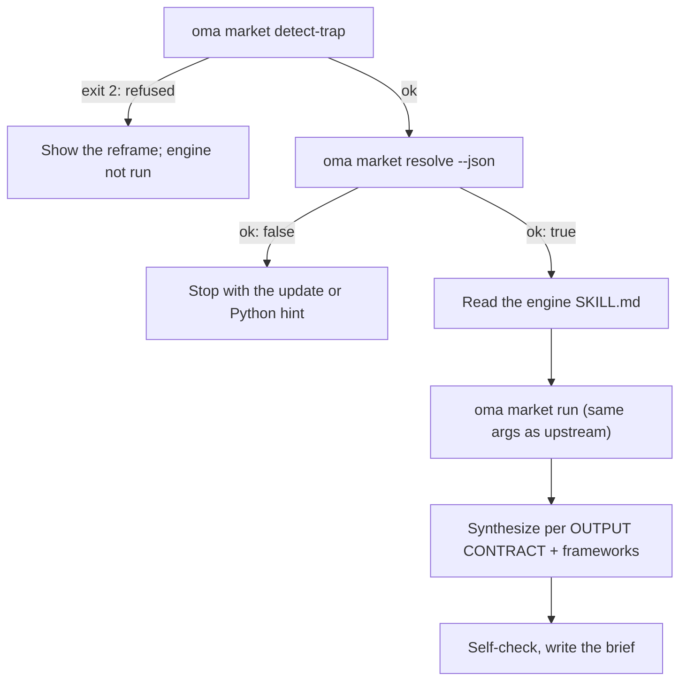

# 시장 조사 {#market-research}

`oma-market`은 Reddit(업보트와 상위 댓글), X, YouTube 자막, TikTok, Instagram, Hacker News, Polymarket, GitHub, arXiv, Techmeme, Digg, LinkedIn, StockTwits, Bluesky, 웹 등 커뮤니티 소스에서 실제 참여 수치와 함께 “최근 N일 동안 사람들이 X에 대해 실제로 무엇을 말하는가”를 답합니다. 불편 사항, 트렌드, 경쟁사 반응, 발견을 조사할 수 있습니다.

조사는 upstream [**last30days**](https://github.com/mvanhorn/last30days-skill) 엔진(MIT, Python 3.12 이상)에서 실행됩니다. oh-my-agent는 엔진을 포크하지 않습니다. **항상 최신 관리 사본**을 유지하고 모든 실행을 게이트하며 그 위에 전략 프레임워크 계층을 추가합니다. 릴리스 주기, 별 수, 프로바이더 범위는 upstream 프로젝트에 속하므로 바뀔 수 있습니다.

---

## 빠른 시작 {#quick-start}

에이전트에게 평소 말로 요청하세요. "market research", "pain points", "competitor analysis", "voice of customer", "trend detection" 같은 표현이 `oma-market` 스킬을 활성화합니다.

```text
최근 30일 동안 개발자들이 VS Code 원격 컨테이너에 대해 보고한 주요 불편 사항을 찾아줘.
최근 90일 동안 Cursor와 Windsurf의 커뮤니티 반응을 비교해줘, frameworks swot,5f.
```

| 조정 방법 | 효과 |
|---|---|
| "A vs B" 또는 `--vs B` | 경쟁사 의도: upstream 비교 흐름 + SWOT + Porter's 5F |
| `--days 7`, `30`, `90`, `180` | 조사 기간 |
| `--intent pain`, `trend`, `competitor`, `discovery` | 자동 의도 분류를 덮어씁니다 |
| `--frameworks none` 또는 `swot,5f,pestel` 같은 목록 | 프레임워크 섹션을 끄거나 골라서 사용합니다 |

결과는 `.agents/results/market/{topic-slug}-{YYYYMMDD}.md`에 브리프 하나로 저장됩니다. 첫 줄은 엔진 배지(`🌐 last30days v<version> · synced <date>`)이고, 이어서 링크가 달린 순위별 증거 클러스터, 프레임워크 섹션, 건너뛴 소스를 나열하는 엔진 푸터가 옵니다.

| 키 없이 실행 | upstream 설정 마법사 필요(키 또는 쿠키) |
|---|---|
| Reddit, Hacker News, GitHub, Polymarket, arXiv, Techmeme, Digg, 웹 | X, YouTube 자막, TikTok, Instagram 및 기타 키가 필요한 소스. 건너뛴 소스는 푸터에 기록됩니다 |

---

## 항상 최신 엔진 사용(Python 3.12 이상 필요) {#always-the-latest-engine--nothing-to-install}

```bash
# Illustrative output; the release tag, cache path, and Python version vary.
oma market resolve
# engine:   last30days
# reason:   last30days 3.21.1 via managed:v3.21.1 (current)
# root:     ~/.cache/oma-market/last30days/v3.21.1
# skill:    ~/.cache/oma-market/last30days/v3.21.1/SKILL.md
# version:  3.21.1
# python:   python3.14 (3.14.7, PATH)
# save_dir: <workspace>/.agents/results/market/raw
```

- 캐시: `~/.cache/oma-market/last30days/<tag>/` 및 `state.json`
- 사용하기 전마다 `resolve`가 GitHub에서 최신 릴리스를 확인합니다. 확인은 `check_interval_min`(기본 60분)마다 한 번으로 제한됩니다. 새 태그는 독립 디렉토리에 내려받고 오래된 태그를 정리하며, 그렇지 않으면 캐시를 재사용합니다. 네트워크가 실패하면 캐시를 재사용하고 `stale`로 보고합니다.
- Python 선택 순서: `LAST30DAYS_PYTHON` → `market.python` → PATH의 `python3.14`, `python3.13`, `python3.12`, `python3`, `python`(3.12 이상이어야 함) → `uv python find '>=3.12'`. 사용할 Python이 없으면 `resolve`가 ok가 아니며 설치 힌트를 출력합니다. 스킬은 웹 검색 전용 조사로 낮추지 않고 중지합니다.
- 엔진 설정과 API 키는 upstream 설정 마법사가 동의를 받아 기록하는 `~/.config/last30days/`에 저장되므로 엔진 업그레이드 뒤에도 유지됩니다.

해석 순서는 다음과 같습니다. 먼저 찾은 항목을 사용합니다. `market.path` → `LAST30DAYS_HOME` → **관리되는 최신 사본** → 사용자 설치 사본(프로젝트와 `~` 아래의 `.agents|.claude|.codex|.cursor|.qwen|.kiro/skills/last30days`, 그 다음 Claude Code 플러그인 캐시).

```bash
oma market update            # force a check / download now
oma market resolve --offline # never touch the network
oma market run -- --help     # the engine's own flags (without `--`, oma prints its own help)
```

---

## 설정 {#configuration}

```yaml
market:
  managed: true                   # false = never download; pins / skill dirs only
  channel: stable                 # stable (latest Release) | main (HEAD)
  check_interval_min: 60          # 0 = check on every call
  path: null                      # explicit engine dir (pin)
  python: null                    # interpreter override
  save_dir: .agents/results/market/raw
```

---

## 실행 방식 {#how-a-run-works}



1. `oma market detect-trap "<topic>"`: 키워드 트랩과 인구통계 쇼핑 주제를 거부하고(종료 코드 2) 재구성 제안을 보여줍니다. 주제가 비어 있거나 200자를 넘으면 종료 코드 4로 끝납니다.
2. `oma market resolve --json`: 엔진과 Python을 확인하고 `ok: false`이면 중지합니다.
3. 에이전트가 해석된 엔진의 `SKILL.md`를 처음부터 끝까지 읽고 따릅니다. 첫 실행 설정 마법사, WebSearch를 사용할 수 있을 때 핸들/서브레딧/해시태그의 사전 조사 해석, 질의 계획, 사전 조건 게이트가 여기에 포함됩니다.
4. `oma market run "<topic>" <flags> --emit=compact`: upstream `python3 scripts/last30days.py` 호출과 같은 인자를 사용하며 `--save-dir`는 `market.save_dir`에서 추가됩니다.
5. upstream OUTPUT CONTRACT를 따라 조사 결과를 종합합니다(첫 줄의 배지, 순위별 증거 클러스터, LAWs 1–8). 그 다음 oma가 엔진 클러스터만 인용하는 프레임워크 섹션을 덧붙입니다.

| 의도 | 엔진 구성 | 프레임워크 |
|---|---|---|
| pain | 불만 형태의 주제, `--days 30`, 자료가 부족할 때 `--deep` | SWOT |
| trend | `--days 7/30/90/180`, “무엇이 뜨는가”에는 `--discover "<domain>"` | SWOT |
| competitor | `"A vs B"` → upstream 비교 흐름 | SWOT + Porter's 5F |
| discovery | `--discover`, 이어서 `--drill` 후속 질의 | SWOT + PESTEL |

6. 자체 검사를 수행한 뒤 `.agents/results/market/{topic-slug}-{YYYYMMDD}.md`에 작성합니다.

---

## 실패 상황 {#failure-modes}

| 상황 | 결과 |
|---|---|
| detect-trap이 주제를 거부함 | 재구성안을 보여주고 엔진은 실행하지 않습니다. 사용자가 명시적으로 다시 확인한 뒤에만 `--force`를 사용합니다 |
| 엔진 캐시가 없고 오프라인임 | `ok: false`가 됩니다. 온라인에서 `oma market update`를 한 번 실행합니다 |
| Python 3.12 이상이 없음 | 설치 힌트(brew / apt / `uv python install 3.12`)와 함께 `ok: false`가 됩니다. 또는 `LAST30DAYS_PYTHON` / `market.python`을 설정합니다. 웹 검색 전용 대체 경로는 없습니다 |
| 릴리스 확인 실패 | 캐시된 엔진을 사용하고 `stale`로 보고합니다 |
| 키가 없는 소스 | 엔진 안에서 건너뛰고 푸터에 기록합니다. upstream 설정 마법사에서 활성화합니다 |

---

## 다음 단계 {#next-steps}

- [콘텐츠와 리서치 워크플로우](./content-and-research.md): 다른 조사와 문서 작업에 맞는 기능을 고릅니다
- [다이어그램 엔진](./diagram-engine.md): archify에 적용된 같은 관리형 최신 버전 패턴
- [oma-config.yaml 의미](./oma-config-semantics.md): `market:` 섹션이 병합되는 방식
- [CLI 명령: market](../cli-interfaces/commands.md#market): 전체 옵션 목록
- upstream: [mvanhorn/last30days-skill](https://github.com/mvanhorn/last30days-skill)
