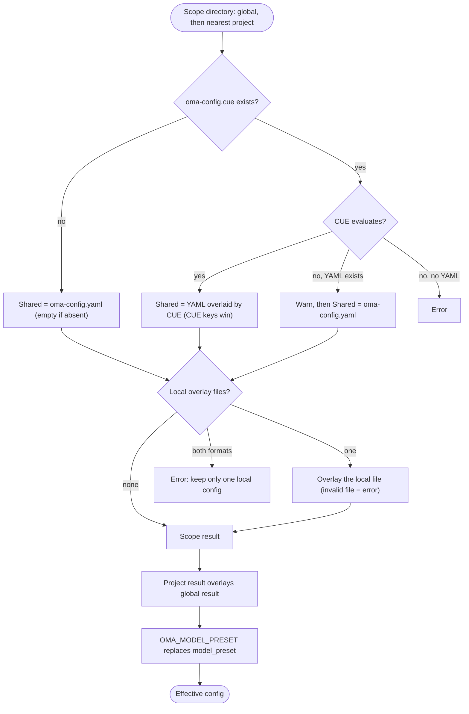

## 개요

OMA는 `$OMA_HOME/.agents/`(기본값 `~/.oma/.agents/`)에서 글로벌 기본값을 읽은 뒤,
작업 디렉토리에서 상위로 올라가며 찾은 가장 가까운 프로젝트 `.agents/`를 그 위에 overlay합니다.
각 범위(scope)는 다음 계층을 가질 수 있습니다.

- **공유 설정**: `.agents/oma-config.yaml`과 `.agents/oma-config.cue`. 둘 다 있고 CUE 파일이 평가되면, CUE 파일이 설정한 키는 모두 YAML 파일의 같은 키를 오버라이드합니다. YAML 파일에만 있는 키는 기본값으로 남습니다. CUE 파일을 평가할 수 없으면 OMA는 경고를 출력하고 YAML 파일만 사용합니다.
- **로컬 설정**: `.agents/oma-config.local.cue` 또는 `.agents/oma-config.local.yaml`(공유 결과에 overlay되는 하나의 파일이며 비공개로 유지해야 합니다).

프로젝트의 공유 설정과 로컬 설정은 글로벌 설정을 오버라이드합니다. 서로 다른 상위
프로젝트 root는 절대 병합하지 않으며, 비어 있는 가장 가까운 `.agents/`도 프로젝트
경계로 취급합니다. 글로벌 기본값은 프로젝트 식별을 바꾸지 않습니다. 지원 키와 기본값은
[설정 레퍼런스](/docs/guide/configuration-reference)를 참고하세요.

## 해석 흐름

OMA는 글로벌 범위와 가장 가까운 프로젝트 범위에 같은 단계를 실행한 뒤 두 결과를 병합합니다.



프로젝트 `.agents/`를 찾지 못했거나, 상위로 올라가다 글로벌 `.agents/` 디렉토리 자체에 도달하면 글로벌 결과만 사용합니다.

## 우선순위 표 {#precedence-table}

뒤쪽 행이 우선합니다. 일반 map은 재귀적으로 병합하고, 배열·스칼라·`null`은 앞선 값을 대체합니다.

| 순서 | 계층 | 규칙 |
|:-----:|-------|------|
| 1 | 글로벌 `oma-config.yaml` | 둘 다 있으면 글로벌 CUE 파일 아래에 깔리는 기본값입니다. |
| 2 | 글로벌 `oma-config.cue` | 글로벌 YAML을 키 단위로 오버라이드합니다. 평가에 실패하고(예: `cue` CLI가 없음) YAML이 있으면, OMA는 `[config] CUE evaluation failed at ... Falling back to oma-config.yaml`을 출력하고 YAML만 사용합니다. |
| 3 | 글로벌 `oma-config.local.cue` 또는 `oma-config.local.yaml` | 하나만 둘 수 있습니다. 형식이 잘못된 local 파일은 오류입니다. |
| 4 | 프로젝트 `oma-config.yaml` | 작업 디렉토리 또는 그 상위에서 가장 가까운 프로젝트 `.agents/`입니다. |
| 5 | 프로젝트 `oma-config.cue` | 4번 행을 키 단위로 오버라이드하며, 2번 행과 같은 폴백을 따릅니다. |
| 6 | 프로젝트 `oma-config.local.cue` 또는 `oma-config.local.yaml` | 하나만 둘 수 있습니다. 형식이 잘못된 local 파일은 오류입니다. |
| 7 | `OMA_MODEL_PRESET` | 비어 있지 않은 값이 해당 프로세스의 `model_preset`을 대체합니다. 빈 값은 오류입니다. |

:::tip[어떤 파일을 편집해야 하나요?]
`.agents/oma-config.cue`가 있으면, 거기서 설정한 키가 `oma-config.yaml`의 같은 키를 오버라이드합니다. 그 키는 CUE 파일에서 바꾸거나, 머신별 값이라면 local overlay에 넣으세요. `oma doctor --profile`은 불러온 파일을 **Configuration sources** 아래에 나열합니다.
:::

프로젝트 로컬 오버라이드에는 변경한 말단 키만 local 파일에 넣으세요. 예를 들어 로컬 모델 선택을 공유 파일에서 분리할 수 있습니다.

```yaml
# .agents/oma-config.local.yaml
model_preset: claude
agents:
  backend:
    model: anthropic/claude-sonnet-5-5
```

가장 가까운 `.agents/` 디렉토리를 선택하려면 프로젝트에서 명령을 실행하세요. 잘못된 local 파일은 오류를 표시하고 중단하므로, 다시 시도하기 전에 수정하거나 제거해야 합니다.

## 설정 확인하기

```bash
oma doctor --profile                           # loaded files, resolved preset, per-role model and CLI
cue export --out json .agents/oma-config.cue   # what the CUE layer evaluates to (requires the cue CLI)
```

| 증상 또는 메시지 | 원인 | 해결 |
|--------------------|-------|-----|
| YAML을 바꿔도 효과가 없음 | `oma-config.cue`가 같은 키를 설정함 | CUE 파일에서 키를 바꾸거나 local 파일에서 오버라이드 |
| `[config] CUE evaluation failed at ... Falling back to oma-config.yaml` | `cue` CLI가 없거나 CUE 파일이 평가되지 않음 | `cue`를 설치하거나 `cue export`가 보고하는 오류를 수정 |
| `Both local CUE and YAML configs exist in ...; keep only one local config.` | local overlay 파일이 두 개 있음 | 둘 중 하나를 삭제 |
| `OMA_MODEL_PRESET must be non-empty` | 변수가 export되었지만 비어 있음 | `unset OMA_MODEL_PRESET` |
| `Unknown model_preset "..."` | 오타, 또는 `custom_presets` 항목 누락 | 오류 메시지에 나온 프리셋 이름을 사용 |
| `Legacy preset name "..." is no longer valid` | `claude-only`처럼 이름 변경 전의 키 | 메시지 안내대로 이름을 바꾸거나 `oma update` 실행 |
| `[model-registry] User inline model "..." failed validation` | 불완전하거나 잘못된 `models:` 항목 | [모델 slug 인라인 지정](/docs/guide/per-agent-models#inlining-model-slugs) 참고 |

## 기본값

| 키 | 기본값 | 적용 시점 |
|-----|---------|--------------|
| `auto_update_cli` | `true` | 두 파일 모두 없거나 키가 누락된 경우 |
| `serena.mode` | `bridge` | 두 파일 모두 없거나 키가 누락된 경우 |
| `serena.auto_update` | `true` | 두 파일 모두 없거나 키가 누락된 경우 |
| `telemetry` | `false` | 두 파일 모두 없거나 키가 누락된 경우 |
| `language` | `en` | 두 파일 모두 없거나 키가 누락된 경우 |
| `model_preset` | 필수 | 배포된 프로젝트 템플릿은 `auto`를 사용하며 schema는 비어 있지 않은 값을 요구합니다. |
| `translation_voice` | `balanced` | 두 파일 모두 없거나 키가 누락된 경우 |
| `timezone` | 시스템 timezone | 두 파일 모두 없거나 키가 누락된 경우 |

## 읽기 순서의 근거

사용자 전체 기본값은 `~/.oma/.agents/oma-config.yaml`(`OMA_HOME`을 설정했다면 `<OMA_HOME>/.agents/oma-config.yaml`)에서
편집하세요. 프로젝트의 공유·로컬 파일은 관련 없는 상위 프로젝트를 상속하지 않으면서
그 기본값을 오버라이드합니다. 프로젝트에서 시맨틱 메모리를 `none`으로 선택하면
글로벌 AgentMemory 선택을 오버라이드합니다.

## 참고 사항

- `oma-config.yaml`의 `language`는 에이전트 응답 언어를 제어합니다. 설치 및 업데이트 경고 메시지를 결정하는 데는 사용되지 **않습니다**. 설치 시점에는 `oma-config.yaml`이 아직 로드되지 않으므로, 해당 메시지는 시스템 로케일(`$LANG`)을 기준으로 합니다.
- `auto_update_cli`는 글로벌 기본값보다 프로젝트 오버라이드를 먼저 사용하며, 어느 범위에서도 설정하지 않으면 기본적으로 활성화됩니다.
- `telemetry`(기본값 `false`)는 각 벤더 자체의 opt-out으로 연결되며, `oma install` / `oma update` / `oma link`가 값을 씁니다. Claude는 `DISABLE_TELEMETRY`와 `CLAUDE_CODE_DISABLE_FEEDBACK_SURVEY`, Gemini와 Qwen은 `privacy.usageStatisticsEnabled`, Codex는 `analytics.enabled`와 `feedback.enabled`, Grok은 `[features] telemetry`, Antigravity(agy)는 `~/.gemini/antigravity-cli/settings.json`의 `enableTelemetry`를 씁니다. `telemetry: true`로 두면 해당 벤더에 대한 oma의 opt-out을 제거해 다시 수집에 동의합니다.
- `diagram`(engine `auto` / `archify` / `mermaid`, `explain_sidecar`, `archify.managed|channel|check_interval_min|path|quality|open`)은 `video` / `image`와 같은 sparse skill-오버라이드 섹션입니다. [Diagram Engine](/docs/guide/diagram-engine)을 참고하세요.
- `video.hyperframes.check_interval_min`은 실행별 HyperFrames 툴체인과 heygen-com/hyperframes의 최신 버전 확인(`oma video compose`, `oma update`) 빈도를 제한합니다. 배포된 CUE 스키마는 아직 `video.hyperframes`를 정의하지 않으므로 `cue export`가 스키마 블록 안에서 이 키를 거부합니다(`field not allowed`). `oma-config.yaml`이나 local YAML 오버레이에서 설정하세요.
- `market`(`managed|channel|check_interval_min|path|python|save_dir`)은 `oma market`의 기반인 항상 최신 `last30days` engine을 설정합니다. [Market Research](/docs/guide/market-research)를 참고하세요.
- 타입이 지정된 런타임 스키마는 `providers`, `free`, `agents`, `models`, `custom_presets`, `vendors`, `session`, `docs`와 필요한 값만 담는 스킬 섹션을 다룹니다. 배포 템플릿에는 `scm`, `memory`, `serena_reaper`, `mcp`처럼 각 사용처가 소유하는 블록도 있으며, 그 하위 키는 해당 사용처가 관리합니다. 이 목록에서 키를 추론하지 말고 [설정 레퍼런스](/docs/guide/configuration-reference)와 해당 블록의 기능 가이드를 참고하세요.
- `oma-config.yaml`을 직접 편집하는 것은 안전합니다. `oma install`과 `oma update`는 정규식 수준의 필드 치환을 사용하며, 자신이 관리하지 않는 사용자 편집 키(예: 커스텀 `agents:` 오버라이드, `session.quota_cap`)는 그대로 보존합니다.
- `oma update`는 배포 템플릿에는 있지만 사용자 파일에는 없는 최상위 키를 `# Added by oma update` marker 아래에 템플릿 기본값으로 덧붙입니다. 이미 있는 키는 절대 건드리지 않으므로 기존 내용은 바이트 단위로 그대로 유지됩니다. 일부러 지운 키는 템플릿 기본값으로 다시 나타나므로, 제외하려면 키를 지우는 대신 값을 명시적으로 지정하세요.
