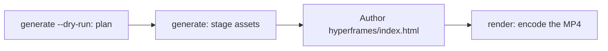

# 영상 생성

`oma-video`는 oh-my-agent의 영상 라우터입니다. 한 줄짜리 브리프에서 스크립트, 내레이션, 비주얼, 자막을 조합하고 실행 디렉토리에 계획을 기록합니다. 프로바이더 단계는 키가 없어도 로컬 또는 결정론적 폴백을 사용할 수 있지만, 실제 MP4를 만들려면 정상적인 컴포지터와 유효한 컴포지션이 필요합니다.

이 스킬은 "shorts", "reels", "screencast" 또는 "make a video", "explainer video", "demo video", "walkthrough video", "video from README" 같은 표현에서 활성화되며, 다른 스킬에 부수적으로 영상이 필요할 때도 활성화됩니다.

> **TL;DR** `oma video generate`는 실행을 계획하고 에셋을 준비합니다. 기본 HyperFrames 컴포지터에서는 MP4를 인코딩하지 않습니다. `<runDir>/hyperframes/index.html`을 작성한 뒤(`/video` 워크플로우가 대신 해 줍니다) `oma video render <runDir>`를 실행하세요. 첫 실행이라면 `oma video doctor --install`부터 시작하세요.

---

## 사용 시기

- 브리프, README, 코드, 데이터를 짧은 클립으로 만들 때.
- 내레이션이 있는 설명 영상이나 데모·워크스루 녹화를 만들 때.
- "브리프 → `.mp4`" 파이프라인을 결정론적으로 다시 돌리고 싶을 때.

## 사용하지 말아야 할 때

- 정지 이미지 한 장이 필요할 때 → [`oma-image`](/docs/guide/image-generation)를 쓰세요.
- 실시간 화면 방송이나 스트리밍 → 범위 밖입니다(oma는 화면을 녹화하지 않으며, 녹화는 사용자가 직접 제공합니다).
- 내레이션 오디오만 필요할 때 → `oma-voice`를 쓰세요.

---

## 한눈에 보는 모드

| 모드 | 화면비 | 조합하는 것 |
|------|--------|------------------|
| `shorts` | 9:16 | 세로형 숏폼 클립 (스크립트 → 내레이션 → 비주얼 → 자막). |
| `explainer` | 16:9 | README, 코드, 데이터 브리프로 만드는 가로형 설명 영상. |
| `demo` | 파생됨 | `--capture <file>`로 전달한 사용자 자신의 화면 녹화로 만드는 워크스루입니다. `--source web --url <url>`은 마스킹된 URL을 컨텍스트로 저장할 뿐이며, oma는 브라우저를 열거나 화면을 녹화하거나 로그인을 자동화하지 않습니다. |

모드가 합리적인 기본값을 정합니다. 값을 바꾸려면 필요한 플래그를 전달합니다.

---

## 빠른 시작

에이전트에서 `/video three quick tips for better focus`를 실행하면 아래 단계를 모두 대신 수행합니다. 직접 실행하면 파이프라인은 네 단계입니다.



```bash
oma video doctor --install   # first run only: HyperFrames toolchain, Chrome Headless Shell, Pretendard

# 1. Plan from an agent-authored script (schema: .agents/skills/oma-video/resources/script-schema.md)
oma video generate "three quick tips for better focus" --mode shorts --script ./script.json --dry-run --output json

# 2. Stage assets (narration needs --voice <profile>; the default is a silent video)
oma video generate "three quick tips for better focus" --mode shorts --script ./script.json --output json

# 3. Author <runDir>/hyperframes/index.html per its AUTHORING.md, then encode
oma video compose <runDir>
oma video render <runDir> --output json

# Demo from your own recording; without --polish the recording itself becomes the output
oma video generate "product walkthrough" --mode demo --capture ./capture.mp4
```

<!-- oma-docs:ignore-start -->

| 단계 | 명령 | 결과 |
|---|---|---|
| 계획 | `generate --dry-run` | `script.json`, `render-spec.json`, `manifest.json`. 렌더링 없음 |
| 에셋 준비 | `generate` | 비주얼, 자막, 선택적 오디오와 음악, `hyperframes/` 스캐폴드, `composition pending` 경고 |
| 작성 | `hyperframes/index.html` 편집 | 컴포지션 |
| 렌더링 | `render <runDir>` | `{mode}-{slug}.mp4`와 갱신된 매니페스트 |

<!-- oma-docs:ignore-end -->

`--script` 없이 실행하면 CLI가 브리프 텍스트로 결정론적인 3장면 스켈레톤을 만듭니다. `--locale`은 내레이션과 자막의 언어 태그를 지정할 뿐 번역하지는 않으므로, 브리프나 `script.json`을 목표 언어로 작성하세요.

실행할 때마다 실행 디렉토리를 출력합니다. 고정된 `--seed`는 결정적인 계획 입력을 안정화하지만 라이브 프로바이더의 출력과 캡처 영상은 달라질 수 있습니다. 저장된 render-spec과 에셋을 다시 사용하려면 기존 실행 디렉토리를 다시 렌더링합니다.

`oma video generate --output json`을 셸로 호출하는 다른 도구는 stdout에서 JSON 봉투를 파싱합니다: `{exitCode, runDir, manifestPath, scriptPath, renderSpecPath, warnings, error}`. `outputs` 키는 없습니다. 출력과 에셋 경로는 `manifestPath`의 매니페스트에서 읽으세요.

---

<a id="always-latest-hyperframes--you-author-the-composition"></a>
<a id="항상-최신-hyperframes-사용-컴포지션은-직접-작성"></a>
## 관리되는 HyperFrames 도구 체인과 컴포지션 작성

oh-my-agent는 **HyperFrames 컴포지션 코드를 함께 제공하지 않습니다**. 각 실행은 `<runDir>/hyperframes/`에 자체 프로젝트를 가지며, 이 프로젝트는 `oma video compose`가 최신 npm HyperFrames(툴체인 캐시 `~/.cache/oma-video/hyperframes/<version>/`, `node_modules` 심볼릭 링크로 공유)와 HEAD 기준 [heygen-com/hyperframes](https://github.com/heygen-com/hyperframes)(`~/.cache/oma-video/hyperframes-skills/`)를 바탕으로 스캐폴딩합니다. 에이전트는 스캐폴드의 `AUTHORING.md`, 스킬, `.agents/skills/oma-video/resources/hyperframes-authoring/`의 모드 사양을 따라 생성된 컴포지션 소스를 작성합니다.

```bash
oma video generate "…"                     # → render-spec.json + <runDir>/hyperframes/ (composition pending)
oma video compose <runDir> --output json   # refresh scaffold / print the contract (idempotent)
#   author hyperframes/index.html as instructed by AUTHORING.md
oma video render <runDir> --output json    # lint → render with the cached HyperFrames CLI → ffprobe; exit 1 on any failure
```

- 최신 버전 확인(npm + GitHub)은 `video.hyperframes.check_interval_min`(기본 60, `0`이면 모든 compose 호출)의 적용을 받습니다. `oma update`도 이 주기를 따르고 `oma video doctor --upgrade`는 확인을 강제로 실행하며, 오프라인 실행은 캐시된 툴체인을 사용하고 `stale` 상태를 보고합니다.
- 재현성의 기준은 실행 디렉토리의 `render-spec.json`, 작성된 컴포지션 소스, 생성된 HyperFrames 패키지 메타데이터에 기록된 툴체인 버전입니다. 같은 실행을 다시 렌더링하면 해당 렌더링 계약을 재사용하고, 새 실행은 최신 HyperFrames를 확인합니다.
- lint나 렌더링 실패를 플레이스홀더로 **숨기지 않습니다**(플레이스홀더는 `OMA_VIDEO_MOCK=1`에서만 존재합니다). `oma video render`는 진단과 함께 종료 코드 1을 반환하고, 에이전트가 최신 스킬로 컴포지션을 수정합니다. 새 HyperFrames 릴리스에서 생긴 문제는 컴포지션 버그이며, 버전을 고정할 이유가 아닙니다.

```yaml
video:
  hyperframes:
    check_interval_min: 60    # 0 = check on every compose
```

---

## CLI 레퍼런스

```bash
oma video generate <brief...> [options]
oma video doctor [--install|--upgrade|--install-mpt|--install-strudel]  # toolchain readiness / provisioning
oma video compose <runDir>       # prepare HTML project and authoring contract
oma video render <runDir>        # re-render from render-spec.json (deterministic)
oma video provider list         # provider availability + key/fallback status
```

### 주요 플래그

| 플래그 | 용도 |
|------|---------|
| `--mode <m>` | `shorts` \| `explainer` \| `demo`. |
| `--aspect <a>` | `9:16` \| `16:9` \| `1:1` \| `auto`. |
| `--locale <lang>` | 내레이션과 자막의 언어 태그. |
| `--captions <s>` | `tiktok` \| `lower-third` \| `none` (키가 필요 없는 정렬). |
| `--visual <m>` | `auto` \| `generate` \| `stock` \| `aigc` \| `slide`. |
| `--voice <profile>` | 내레이션 음성, 또는 `none`(기본값입니다. 생략하면 자막 타이밍을 추정해 무음으로 렌더링합니다). |
| `--music <mode>` | `upbeat`, `calm`, `cinematic`, `lofi`, `piano`, 또는 `none`. |
| `--compositor <c>` | `hyperframes`(기본값) \| `mpt`. |
| `--capture <path>` | 데모 모드용 사용자 녹화: `.mp4`, `.mov`, `.webm`, `.mkv`이며 프로젝트 안에 저장되어 있어야 합니다. |
| `--source <k>` | 데모 캡처 소스: `file` 또는 `web`(기본값: `file`). |
| `--url <url>` | `--source web`의 컨텍스트 URL로, `manifest.json`에 마스킹되어 저장됩니다. `--source web`에서는 필수이며, 캡처를 시작하지 않고 `--capture`를 대체하지도 않습니다. |
| `--polish` | 캡처한 화면 위에 HyperFrames 컴포지션을 겹칩니다. |
| `--device`, `--ready-selector`, `--show-cursor`, `--capture-timeout`, `--capture-stop` | 받아들이지만 사용하지 않습니다. oma는 브라우저를 조작하거나 화면을 녹화하지 않습니다. |
| `--output-dir <path>` | 출력 기본 디렉토리입니다. `$PWD` 외부 경로에는 `--allow-external-output`이 필요합니다. |
| `--allow-external-output` | `$PWD` 외부의 출력 경로를 허용합니다. |
| `--max-usd <n>` | 비용 상한(기본값 `0.2`)입니다. 누적 추정치가 이 값에 도달하면 종료 코드 1로 실행을 멈춥니다. `-y` 또는 더 높은 값으로 다시 실행하세요. |
| `--duration <sec>` | 목표 길이(1–180초), 또는 `auto`. |
| `--seed <n>` | 결정론적 시드. |
| `--dry-run` | 스크립트, render-spec, 매니페스트만 내보내고 렌더링은 건너뜁니다. |
| `--script <path>` | 에이전트가 작성한 `script.json`을 주입합니다(스켈레톤을 대체하며 내레이션, 화면 텍스트, 장면별 비주얼 프롬프트를 제어합니다). |
| `-y, --yes` | 추정치가 `--max-usd`에 도달하는 프로바이더를 허용합니다(`OMA_VIDEO_YES=1`과 동일). |
| `--timeout <sec>` | 비주얼·음악 프로바이더 호출마다 적용하는 제한 시간(정수 초, 기본값 `600`)입니다. 단위 접미사는 해석하지 않으므로 `2m`은 2초를 뜻합니다. |
| `--output <f>` | CLI 출력: `text`(기본값) 또는 `json`. |
| `--no-brief-in-manifest` | 브리프 원문 대신 SHA-256을 저장합니다. |

---

## 키가 선택 사항인 프로바이더

프로바이더 단계는 **실제 경로**를 사용하고, 해당 단계가 지원하면 **결정론적 폴백**을 사용합니다. 따라서 키가 없으면 추정 타이밍이나 로컬 에셋을 포함한 계획된 실행이 남을 수 있습니다. 컴포지터는 마지막에 필요한 단계이며 일반적인 플레이스홀더 폴백이 없습니다.

| 기능 | 실제 경로(활성화 조건) | 폴백 |
|------------|-------------|----------|
| 스크립트 | `--script <path>`로 전달한 에이전트 작성 `script.json`(`/video` 워크플로우가 작성) | 브리프 텍스트로 만드는 결정론적 3장면 스켈레톤 |
| 음성 | `--voice <profile>`과 함께 `oma-voice`(Voicebox, 로컬) | 추정 타이밍의 무음 영상(`--voice none`, 기본값) |
| 비주얼 | `oma-image`, `oma-slide`, `PEXELS_API_KEY`가 설정되면 Pexels 스톡 클립 | 플레이스홀더 에셋 |
| 비주얼: `aigc` | 아직 연결되지 않음. `RUNNINGHUB_API_KEY`가 프로바이더를 활성화하지만 여전히 플레이스홀더를 씀 | 플레이스홀더 에셋 |
| 자막 | 스크립트 언어로 `timing.json`에 맞춰 정렬한 `.srt`와 `.vtt` | 동일. `--locale`로의 번역은 아직 연결되지 않음 |
| 음악 | `oma video doctor --install-strudel` 이후 Strudel 배경 음악 | 음악 트랙 없음 |
| 캡처 | `--capture <file>`로 전달한 사용자 녹화 | 없음. `--capture`가 없으면 데모 모드는 녹화 안내를 출력하고 종료 코드 3으로 끝남 |
| 컴포지터 | HyperFrames(관리형) 또는 MoneyPrinterTurbo | 컴포지터 폴백 없음. 진단과 함께 실행이 실패합니다 |

자격 증명을 자동화하지 않습니다. 녹화 중 화면 로그인은 사용자가 직접 하며, URL과 쿼리 토큰은 로그와 매니페스트에서 마스킹합니다.

자막은 **정적 윈도 큐**로 렌더링합니다. 현재 프레임에서 활성인 자막 한 줄을 CSS로 줄바꿈해 보여주며, 단어 단위 애니메이션은 없습니다.

---

## 툴체인과 `doctor`

무거운 툴체인(관리되는 HyperFrames 프로젝트의 `node_modules`, 임베드된 Pretendard 폰트, MoneyPrinterTurbo 체크아웃, Strudel 음악 프로젝트, Chrome Headless Shell)은 **필요할 때 프로비저닝**하며 패키지에 담아 배포하지 않습니다. 옵션 없는 `doctor`는 상태를 보고할 뿐, 아무것도 설치하지 않습니다.

```bash
oma video doctor
```

`node`, `chromium`, `ffmpeg`, `ffprobe`, `hyperframes-toolchain`, `hyperframes-skills`, `pretendard-font`, `mpt-project`, `strudel`, `voicebox`, `oma-image`, `pixelle`, `cap` 상태를 보고하고, 빠진 항목의 설치 힌트를 출력합니다. 정확한 목록은 `oma video doctor --output json`으로 확인하세요. 기본 요건은 Node.js 22+, HyperFrames 툴체인과 그 Chrome 브라우저, FFmpeg/FFprobe, `oma-image`입니다. 실제 MP4에는 작성된 HTML도 필요합니다.

툴체인을 준비하려면 설치 플래그를 쓰세요.

```bash
oma video doctor --install             # warm the latest HyperFrames toolchain + Chrome Headless Shell + Pretendard + heygen-com/hyperframes
oma video doctor --upgrade             # force a latest-version check now
oma video doctor --install-mpt         # MoneyPrinterTurbo checkout (clone + venv + deps) for --compositor mpt
oma video doctor --install-strudel     # Strudel music renderer for --music (installs AGPL-3.0-or-later packages locally)
```

`--install`은 임베드된 Pretendard 폰트(고정 릴리스)도 공유 툴체인 캐시로 내려받습니다. 이 폰트는 결정성 경계의 일부입니다. 네트워크가 실패하면 경고하고 렌더링은 시스템 폰트로 폴백하며, 브라우저와 운영체제 차이도 인코딩된 출력에 영향을 줄 수 있습니다.

---

## 출력 레이아웃

```text
.agents/results/videos/{timestamp}-{shortid}-{mode}/
├── script.json          # scenes + narration
├── render-spec.json     # the deterministic render contract
├── timing.json          # per-segment timing (voicebox-stt or estimated)
├── captions.srt / .vtt
├── audio/narration-01.wav     # one track; absent when the video is silent
├── music/                     # pattern.strudel, bgm.wav, bgm.mp3 (with --music and Strudel installed)
├── visuals/scene-*.{png,svg,…}
├── hyperframes/         # index.html, AUTHORING.md, local assets and toolchain link
├── {mode}-{slug}.mp4    # the rendered output (slug derived from the script title)
└── manifest.json        # providers, assets, cost, warnings
```

`render-spec.json`과 에셋이 결정성의 경계입니다.

---

## 문제 해결 {#troubleshooting}

<!-- oma-docs:ignore-start -->

| 증상 | 원인과 해결 |
|---------|-------------|
| MP4가 생성되지 않음 | 컴포지터, 컴포지션, 또는 툴체인 확인이 실패했습니다. `oma video doctor`를 실행한 뒤 `oma video compose <runDir>`를 실행하고, 보고된 컴포지션 문제를 수정한 다음 `oma video render <runDir>`를 다시 실행합니다. |
| 내레이션이 무음(`source: estimated`) | `--voice`의 기본값이 `none`이거나 Voicebox에 접근할 수 없습니다. Voicebox 앱의 프로필로 `--voice <profile>`을 전달하고 `oma-voice` 서버를 켜거나, 추정 타이밍을 그대로 받아들이세요. |
| 데모 실행이 녹화 안내와 함께 종료 코드 3으로 끝남 | `--capture` 파일을 전달하지 않았습니다(`--source web`에서도 마찬가지). oma는 화면을 녹화하지 않습니다. Cap, QuickTime, OBS로 흐름을 녹화해 프로젝트 안에 저장한 뒤 `--capture ./walkthrough.mp4`로 다시 실행하세요. |
| `--capture`가 거부됨(종료 코드 4) | 파일이 없거나, 프로젝트 디렉토리 밖에 있거나, `.mp4` / `.mov` / `.webm` / `.mkv`가 아닙니다. 녹화를 프로젝트 안(예: `./captures/demo.mp4`)으로 복사하세요. |
| 비용 상한에서 실행이 멈춤(종료 코드 1) | 누적 추정치가 `--max-usd`에 도달했습니다. `-y` 또는 더 높은 `--max-usd`로 다시 실행하세요. |
| `--out path "…" is outside $PWD. Use --allow-external-out to override.`(종료 코드 1) | `--output-dir`이 프로젝트 밖을 가리킵니다. `--allow-external-output`으로 다시 실행하거나(메시지에는 여전히 이전 플래그 이름이 표시됨) 프로젝트 안의 디렉토리를 고르세요. |
| `oma video doctor`가 `oma-image`를 누락으로 표시 | 상세 내용이 `Removed option --format. Use --output.`이라면 준비 상태 점검 자체가 실패한 것이며 벤더 상태와는 무관합니다. `oma image doctor`로 직접 확인하세요. 그렇지 않다면 준비된 이미지 벤더가 없어 비주얼이 플레이스홀더로 폴백합니다. `oma image doctor`를 실행하고 벤더 하나를 설정하세요. |
| 첫 실행에서 렌더링이 느림 | HyperFrames 브라우저나 MPT 체크아웃을 한 번 준비하는 중입니다. 이후 실행은 캐시를 재사용합니다. |

<!-- oma-docs:ignore-end -->

---

## 다음 단계

- [`/video` 워크플로우](../core-concepts/workflows.md#video): 브리프 → 스크립트 → 에셋 → render-spec → HyperFrames 파이프라인.
- [이미지 생성](./image-generation.md): 영상 비주얼 프로바이더로도 재사용하는 정지 이미지 라우터.
- [콘텐츠 및 리서치 워크플로우](./content-and-research.md): 음성, 슬라이드 등 기타 콘텐츠 기능.
- [CLI 명령: video](../cli-interfaces/commands.md#video): 전체 `oma video` 옵션 목록.
