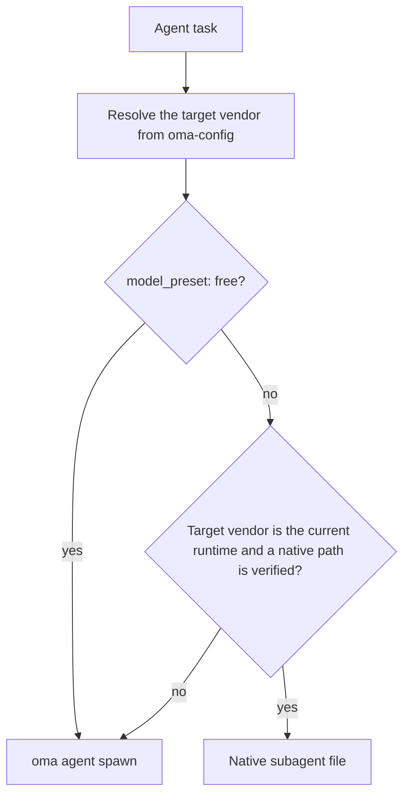
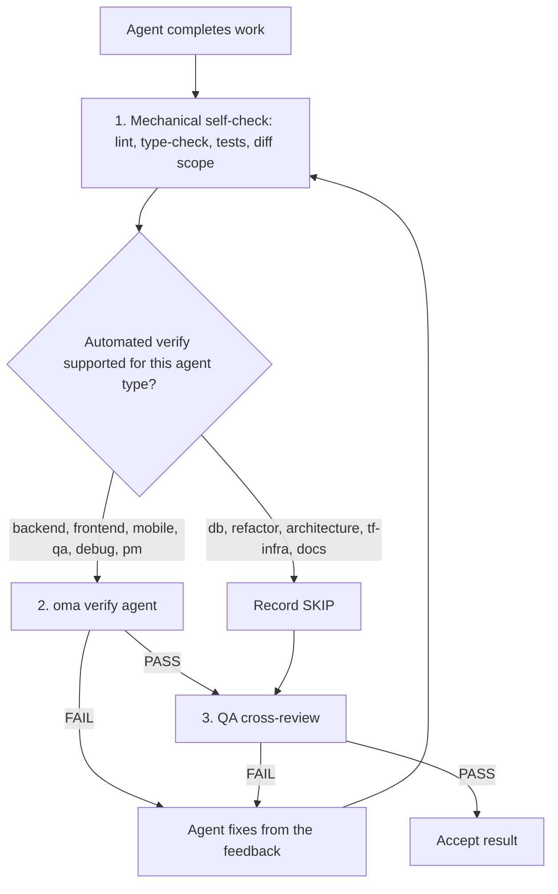

# Agenten

OMA houdt [skills](../getting-started/glossary.md#skill), dispatchrollen en [agentdefinities](../getting-started/glossary.md#agent-definition) uit elkaar. Een skill routeert domeinkennis en laadt die; een canonieke rol is de runtime-identiteit die voor dispatch wordt gebruikt; een ingecheckte definitie geeft een subagent een vendorspecifieke persona. Deze lagen overlappen bewust. Bepaal aan de hand van de taakgrens en de acceptatiecriteria of één skill volstaat.

---

## Skillcatalogus {#skill-catalog}

Deze tabel is de gezaghebbende lijst van geïnstalleerde skills. `cli/scripts/generate-skill-catalog.mjs` genereert hem uit de frontmatter van elke `.agents/skills/<name>/SKILL.md`; voer het script uit met `--check` om drift te detecteren. De sectie `## References` in de SKILL.md van elke skill somt de resourcebestanden op en vermeldt wanneer je ze leest.

<!-- oma:generated skill-catalog:start -->
<!-- Generated from .agents/skills/*/SKILL.md frontmatter by cli/scripts/generate-skill-catalog.mjs. Do not edit this block by hand. -->

| Skill | Use it for |
|---|---|
| [`oma-academic-writing`](https://github.com/first-fluke/oh-my-agent/blob/main/.agents/skills/oma-academic-writing/SKILL.md) | Draft and revise academic prose against a rubric, evidence, and citation requirements. Use for essays, reports, literature reviews, or academic style audits. |
| [`oma-architecture`](https://github.com/first-fluke/oh-my-agent/blob/main/.agents/skills/oma-architecture/SKILL.md) | Evaluate system boundaries and architectural tradeoffs. Use for architecture decisions, design reviews, and ADRs. |
| [`oma-backend`](https://github.com/first-fluke/oh-my-agent/blob/main/.agents/skills/oma-backend/SKILL.md) | Implement server APIs, authentication, and application data access. Schema modeling and query tuning use oma-db. |
| [`oma-brainstorm`](https://github.com/first-fluke/oh-my-agent/blob/main/.agents/skills/oma-brainstorm/SKILL.md) | Explore goals, constraints, and alternative approaches before choosing a design. Use when the user requests ideation or design exploration. |
| [`oma-coordination`](https://github.com/first-fluke/oh-my-agent/blob/main/.agents/skills/oma-coordination/SKILL.md) | Coordinate assigned specialist tasks and handoffs manually. Use when supervising a multi-agent project step by step. |
| [`oma-db`](https://github.com/first-fluke/oh-my-agent/blob/main/.agents/skills/oma-db/SKILL.md) | Design schemas and migrations, tune queries, or plan vector retrieval and database operations. Application API implementation uses oma-backend. |
| [`oma-debug`](https://github.com/first-fluke/oh-my-agent/blob/main/.agents/skills/oma-debug/SKILL.md) | Diagnose a reproducible failure, fix its cause, and verify the regression. Use for crashes, incorrect behavior, and failing tests. |
| [`oma-design`](https://github.com/first-fluke/oh-my-agent/blob/main/.agents/skills/oma-design/SKILL.md) | Define or review a visual system, DESIGN.md, or redesign direction. Use for typography, layout, color, motion, and interaction design decisions. |
| [`oma-dev-workflow`](https://github.com/first-fluke/oh-my-agent/blob/main/.agents/skills/oma-dev-workflow/SKILL.md) | Configure development tasks, git hooks, CI/CD, or release automation. Use when creating or fixing a repository development workflow. |
| [`oma-docs`](https://github.com/first-fluke/oh-my-agent/blob/main/.agents/skills/oma-docs/SKILL.md) | Check documentation references, sync docs to code changes, and detect translation drift. Use for documentation maintenance in a repository. |
| [`oma-explanation`](https://github.com/first-fluke/oh-my-agent/blob/main/.agents/skills/oma-explanation/SKILL.md) | Create an offline HTML explanation of a code change (diff, PR, branch) or of a topic, system, or question. Use when a visual walkthrough document is requested. |
| [`oma-frontend`](https://github.com/first-fluke/oh-my-agent/blob/main/.agents/skills/oma-frontend/SKILL.md) | Implement or modify web UI in React, Next.js, or Angular. Use for components, pages, styles, forms, and frontend state or data flows. |
| [`oma-hwp`](https://github.com/first-fluke/oh-my-agent/blob/main/.agents/skills/oma-hwp/SKILL.md) | Convert Hangul HWP, HWPX, or HWPML documents to Markdown with kordoc. Use for text, table, and image extraction from these formats. |
| [`oma-image`](https://github.com/first-fluke/oh-my-agent/blob/main/.agents/skills/oma-image/SKILL.md) | Generate raster images or reference-guided variations through the OMA image CLI. Use for image assets or explicit vendor comparisons; pixel editing uses an editor. |
| [`oma-market`](https://github.com/first-fluke/oh-my-agent/blob/main/.agents/skills/oma-market/SKILL.md) | Research customer pain points, trends, and competitors through the OMA market engine. Use for market discovery or voice-of-customer analysis. |
| [`oma-mobile`](https://github.com/first-fluke/oh-my-agent/blob/main/.agents/skills/oma-mobile/SKILL.md) | Implement Flutter, React Native, or native Swift apps. Use for mobile screens, widgets, platform integrations, and application data flows. |
| [`oma-observability`](https://github.com/first-fluke/oh-my-agent/blob/main/.agents/skills/oma-observability/SKILL.md) | Design or troubleshoot telemetry, SLOs, and incident diagnostics. Route to the relevant signal, system boundary, or vendor guide. |
| [`oma-orchestration`](https://github.com/first-fluke/oh-my-agent/blob/main/.agents/skills/oma-orchestration/SKILL.md) | Dispatch and supervise parallel specialist agents with durable task state. Use when automated multi-agent execution is requested. |
| [`oma-pdf`](https://github.com/first-fluke/oh-my-agent/blob/main/.agents/skills/oma-pdf/SKILL.md) | Extract PDF text, headings, tables, and images into Markdown using opendataloader-pdf. Use for PDF parsing, not PDF layout creation. |
| [`oma-pm`](https://github.com/first-fluke/oh-my-agent/blob/main/.agents/skills/oma-pm/SKILL.md) | Turn product requirements into scoped tasks with dependencies and acceptance criteria. Use for implementation planning and prioritization. |
| [`oma-qa`](https://github.com/first-fluke/oh-my-agent/blob/main/.agents/skills/oma-qa/SKILL.md) | Review changes for correctness, security, accessibility, and performance. Use for scoped quality reviews or verification plans; bug fixes use oma-debug. |
| [`oma-recap`](https://github.com/first-fluke/oh-my-agent/blob/main/.agents/skills/oma-recap/SKILL.md) | Summarize AI conversation histories for a specified date or period. Use for daily work recaps and cross-tool activity summaries. |
| [`oma-refactor`](https://github.com/first-fluke/oh-my-agent/blob/main/.agents/skills/oma-refactor/SKILL.md) | Restructure existing code while preserving observable behavior. Use for targeted technical debt or hotspot work with characterization tests. |
| [`oma-scholar`](https://github.com/first-fluke/oh-my-agent/blob/main/.agents/skills/oma-scholar/SKILL.md) | Search academic literature and generate, validate, or compare Knows paper sidecars. Use for claim/evidence analysis and literature synthesis. |
| [`oma-scm`](https://github.com/first-fluke/oh-my-agent/blob/main/.agents/skills/oma-scm/SKILL.md) | Manage Git branches, merges, conflicts, commits, and release baselines. Use for repository history and change-management operations. |
| [`oma-search`](https://github.com/first-fluke/oh-my-agent/blob/main/.agents/skills/oma-search/SKILL.md) | Find external documentation, web sources, or remote code with citations. Local code navigation uses the configured code tools. |
| [`oma-security`](https://github.com/first-fluke/oh-my-agent/blob/main/.agents/skills/oma-security/SKILL.md) | Scan application source, agent skills, and MCP components; run penetration tests against scoped web test deployments, validate findings, and configure scan gates. Use oma-qa for broad quality reviews and domain skills for remediation. |
| [`oma-skill-creation`](https://github.com/first-fluke/oh-my-agent/blob/main/.agents/skills/oma-skill-creation/SKILL.md) | Create or revise OMA skills and their references. Use for skill routing, execution contracts, conditional loading, and authoring validation. |
| [`oma-slide`](https://github.com/first-fluke/oh-my-agent/blob/main/.agents/skills/oma-slide/SKILL.md) | Create, import, revise, or export presentation decks through the OMA slide CLI. Use for HTML slides and PDF, PNG, or PPTX deck delivery. |
| [`oma-tf-infra`](https://github.com/first-fluke/oh-my-agent/blob/main/.agents/skills/oma-tf-infra/SKILL.md) | Create or review Terraform infrastructure and plans. Use for cloud resources, IAM, networking, state management, and infrastructure changes. |
| [`oma-translation`](https://github.com/first-fluke/oh-my-agent/blob/main/.agents/skills/oma-translation/SKILL.md) | Translate or revise localized UI strings and prose while preserving meaning, terminology, placeholders, and structure. |
| [`oma-video`](https://github.com/first-fluke/oh-my-agent/blob/main/.agents/skills/oma-video/SKILL.md) | Create short, explainer, or recorded-demo videos through the OMA video CLI. Use for scripts, narration, assets, composition, and video delivery. |
| [`oma-voice`](https://github.com/first-fluke/oh-my-agent/blob/main/.agents/skills/oma-voice/SKILL.md) | Generate speech or transcribe audio locally with Voicebox. Use for narration, voice assets, dictation, and meeting transcription. |
<!-- oma:generated skill-catalog:end -->

---

## Dispatchrollen {#dispatch-roles}

De runtime dispatcht op canonieke rol. Elke rol behalve `orchestrator` heeft één ingecheckte definitie onder `.agents/agents/`, waarvan de frontmatter `skills:` de skills noemt die worden geladen. De eerstgenoemde skill is eigenaar van de taak.

| Rol | Definitiebestand | Ook geaccepteerd | Skills |
|------|-----------------|---------------|--------|
| `orchestrator` | geen (runtimecoördinatierol) | | |
| `pm` | `pm-planner.md` | `pm-planner` | oma-pm |
| `architecture` | `architecture-reviewer.md` | `architecture-reviewer` | oma-architecture |
| `qa` | `qa-reviewer.md` | `qa-reviewer` | oma-qa |
| `backend` | `backend-engineer.md` | `backend-engineer` | oma-backend |
| `frontend` | `frontend-engineer.md` | `frontend-engineer` | oma-frontend, oma-design |
| `mobile` | `mobile-engineer.md` | `mobile-engineer` | oma-mobile |
| `db` | `db-engineer.md` | `db-engineer` | oma-db |
| `debug` | `debug-investigator.md` | `debug-investigator` | oma-debug |
| `refactor` | `refactor-engineer.md` | `refactor-engineer` | oma-refactor |
| `docs` | `docs-curator.md` | `docs-curator` | oma-docs |
| `tf-infra` | `tf-infra-engineer.md` | `tf-infra-engineer` | oma-tf-infra |
| `explore` | `research-explorer.md` | `research-explorer`, `explorer` | oma-search, oma-market, oma-scholar |

Een achtervoegsel `-agent` wordt ook geaccepteerd (`qa-agent` wordt opgelost naar `qa`).

### Native agentbestanden {#native-agent-files}

De agentdefinities onder `.agents/agents/` zijn de bron van waarheid. OMA projecteert ze naar vendorspecifieke bestanden voor runtimes die aangepaste subagenten ondersteunen:

| Runtime | Native agentbestanden |
|---------|--------------------|
| Claude Code | `.claude/agents/<name>.md` |
| Codex CLI | `.codex/agents/<name>.toml` |
| Cursor | `.cursor/agents/` |
| OpenCode | `.opencode/agents/` |
| Kiro | `.kiro/agents/` |
| Grok | `.grok/agents/` |
| CommandCode | `.commandcode/agents/` |
| Qwen Code | `.qwen/agents/` |

pi heeft geen systeem voor agentbestanden, dus `oma agent spawn` neemt de persona uit de definitie inline op in de prompt. De gegenereerde bestanden worden vernieuwd door `oma link`, `oma install` en `oma update`.

### Hoe een rol wordt gedispatcht {#how-a-role-is-dispatched}

Wanneer een workflow een agent aan dezelfde vendor koppelt als de huidige runtime, gebruikt de workflow eerst het native agentbestand van die runtime. Taken over vendors heen vallen terug op `oma agent spawn`.



> **Modeldispatch per agent:** vendor, model en inspanning van elke rol komen uit `.agents/oma-config.yaml` (of `.agents/oma-config.cue`, met een optionele `.local`-overlay). Met `model_preset: auto`, de standaard voor nieuwe installaties, volgen rollen zonder `agents:`-overschrijving de native agent- en modelinstellingen van de huidige runtime; `model_preset: free` dispatcht altijd via `oma agent spawn`. Zie [Modellen per agent](../guide/per-agent-models.md) voor configuratiedetails en [`oma doctor --profile`](../cli-interfaces/commands.md#doctor) om de actuele matrix te bekijken.

---

## Skillcategorieën {#agent-categories}

| Categorie | Skills | Verantwoordelijkheid |
|----------|--------|---------------|
| **Ideevorming** | oma-brainstorm | Ideeën verkennen, benaderingen voorstellen en ontwerpdocumenten maken |
| **Architectuur** | oma-architecture | Grenzen van systemen/modules/services, analyses in ADR/ATAM/CBAM-stijl en afwegingsrecords |
| **Planning** | oma-pm | Requirements opsplitsen, taken verdelen, API-contracten en prioriteiten vastleggen |
| **Implementatie** | oma-frontend, oma-backend, oma-mobile, oma-db | Code schrijven binnen hun eigen domein |
| **Design** | oma-design | Designsystemen, DESIGN.md, tokens, typografie, kleur, beweging en toegankelijkheid |
| **Infrastructuur** | oma-tf-infra | Multi-cloud Terraform-provisioning, IAM, kostenoptimalisatie en policy-as-code |
| **DevOps** | oma-dev-workflow | mise task runner, CI/CD, migraties, releasecoördinatie en monorepo-automatisering |
| **Observability** | oma-observability | Observability-pipelines, traceerbaarheidsrouting, MELT+P-signalen (metrics/logs/traces/profiles/cost/audit/privacy), SLO-beheer, incidentforensiek en transporttuning |
| **Kwaliteit** | oma-qa | Beveiligingsaudit (OWASP), prestaties, toegankelijkheid (WCAG) en codekwaliteitsreview |
| **Debugging** | oma-debug | Bugs reproduceren, oorzaken analyseren, minimale fixes en regressietests |
| **Lokalisatie** | oma-translation | Contextbewuste vertaling met behoud van toon, register en domeintermen |
| **Coördinatie** | oma-orchestration, oma-coordination | Geautomatiseerde en handmatige multi-agentorchestratie |
| **Git** | oma-scm | Conventional Commits genereren en commits per functie opsplitsen |
| **Zoeken en ophalen** | oma-search | Intentgebaseerde zoekrouter met trust scoring (Context7-documentatie, web, `gh`/`glab`-code en lokale code-intelligentie) |
| **Retrospectief** | oma-recap | Conversatiegeschiedenis over tools heen analyseren en thematische werksamenvattingen maken |
| **Documentverwerking** | oma-hwp, oma-pdf | HWP/HWPX/HWPML en PDF naar Markdown converteren voor LLM/RAG-inname |
| **Documentatie** | oma-docs | Documentatieonderhoud: kapotte verwijzingen, docs die door een diff worden geraakt, vertaaldrift en linting van vertaalde docs |
| **Uitleg** | oma-explanation | Offline HTML-uitleg van een codewijziging (diff, PR, branch, commitreeks) of van een onderwerp, systeem of vraag |
| **Academisch schrijven** | oma-academic-writing, oma-scholar | Publicatieklare academische tekst opstellen/controleren en Knows-sidecars voor onderzoek, zoeken en peerreview |
| **Beveiliging** | oma-security | Applicatiebroncode, agentskillpakketten, MCP-componenten en geautoriseerde webtestdeployments scannen (Deepsec, Cisco-scanners, ARTEX), met onafhankelijke validatie van bevindingen en CI-gates |
| **Refactoring** | oma-refactor | Gedragsbehoudende, stapsgewijze herstructurering met hotspotselectie, karakteriseringstests als vangnet en refactor-only commits |
| **Marktonderzoek** | oma-market | Communitysignalen onderzoeken naar pijnpunten, trends, concurrenten en discovery met intentafhankelijke SWOT/Porter's 5F/PESTEL-frameworks |
| **Skill-auteurschap** | oma-skill-creation | OMA-skills maken en valideren in SSL-lite-formaat |
| **Mediageneratie** | oma-image, oma-slide, oma-video, oma-voice | AI-afbeeldingen, HTML-presentaties, korte/uitleg/demo-video's en lokale TTS/STT |

---

## Gedetailleerde agentreferentie {#detailed-agent-reference}

Deze samenvattingen beschrijven het domein en de belangrijkste regels van elke skill. De eigen SKILL.md van de skill is de bron van waarheid: de sectie `## References` daarin somt de resourcebestanden op met de voorwaarde waaronder je elk bestand leest, dus deze pagina kopieert die lijsten niet.

### oma-brainstorm

**Domein:** Design-first ideevorming vóór planning of implementatie.

**Wanneer gebruiken:** Een nieuw feature-idee verkennen, gebruikersintentie begrijpen of benaderingen vergelijken. Gebruik deze skill vóór `/plan` bij complexe of ambigue verzoeken.

**Wanneer NIET gebruiken:** Duidelijke requirements (ga naar oma-pm), implementatie (ga naar domeinagenten), code review (ga naar oma-qa).

**Kernregels:**
- Geen implementatie of planning vóór goedkeuring van het ontwerp
- Eén verduidelijkende vraag per keer (geen batches)
- Vergelijk twee of drie haalbare benaderingen wanneer alternatieven de beslissing helpen; laten de beperkingen minder opties over, leg dan uit waarom in plaats van opties te verzinnen
- Werk het ontwerp sectie voor sectie uit en beslis alleen over open wezenlijke keuzes
- YAGNI: ontwerp alleen wat nodig is

**Workflow:** 7 fasen: Context, Questions, Approaches (optioneel gevoed met TRIZ-lite), Design, Blind Review, Documentation (opslaan in `docs/plans/designs/`) en overgang naar `/plan`.

---

### oma-architecture

**Domein:** Software- en systeemarchitectuur, waaronder grenzen van modules en services, afwegingsanalyse, synthese van stakeholders en beslissingsrecords.

**Wanneer gebruiken:** Systeemarchitectuur kiezen of beoordelen, grenzen van modules/services/eigenaarschap bepalen, architectuuropties met expliciete afwegingen vergelijken, architectuurpijn onderzoeken (change amplification, verborgen afhankelijkheden, onhandige API's), architectuurinvesteringen of refactorings prioriteren en architectuuraanbevelingen of ADR's schrijven.

**Wanneer NIET gebruiken:** Visuele/designsystemen (gebruik oma-design), featureplanning en taakdecompositie (gebruik oma-pm), Terraform-implementatie (gebruik oma-tf-infra), bugdiagnose (gebruik oma-debug) of beveiligings-, prestatie- en toegankelijkheidsreview (gebruik oma-qa).

**Methodologieën:** Diagnostische routering, design-twice-vergelijking, risicoanalyse in ATAM-stijl, prioritering in CBAM-stijl en beslissingsrecords in ADR-stijl.

**Kernregels:**
- Diagnoseer eerst het architectuurprobleem en kies daarna een methode
- Gebruik de lichtste methode die voor de huidige beslissing volstaat
- Houd architectuurontwerp, UI/visueel ontwerp en Terraform-delivery uit elkaar
- Raadpleeg stakeholderagents alleen wanneer de beslissing voldoende transversaal is om die kosten te rechtvaardigen
- De kwaliteit van de aanbeveling is belangrijker dan consensus als toneelstuk: raadpleeg breed en beslis expliciet
- Elke aanbeveling vermeldt aannames, afwegingen, risico's en validatiestappen
- Wees standaard kostenbewust: let op implementatiekosten, operationele kosten, teamcomplexiteit en toekomstige wijzigingskosten

---

### oma-pm

**Domein:** Productmanagement, waaronder requirementsanalyse, taakdecompositie en API-contracten.

**Wanneer gebruiken:** Complexe features opsplitsen, haalbaarheid bepalen, werk prioriteren en API-contracten definiëren.

**Kernregels:**
- API-first ontwerp: definieer contracten vóór implementatietaken
- Elke taak heeft een agent, titel, acceptatiecriteria, prioriteit en afhankelijkheden
- Minimaliseer afhankelijkheden voor maximale parallelle uitvoering
- Beveiliging en testen horen bij elke taak; het zijn geen aparte fasen
- Taken moeten door één agent te voltooien zijn
- Lever het JSON-plan plus een sessiegebonden task board voor orchestratorcompatibiliteit

**Uitvoer:** `.agents/results/plan-{sessionId}.json` met numerieke prioriteitstiers (`1` = onafhankelijk, lagere tiers draaien eerst), plus het rungebonden rapport `result-{agentId}-{taskId}-{runId}-{sessionId}.md` in de geconfigureerde geheugenopslag.

---

### oma-frontend

**Domein:** Web-UI in React/Next.js of Angular met TypeScript. React-projecten gebruiken FSD-lite; Angular-projecten volgen `resources/angular-rules.md`.

**Wanneer gebruiken:** Gebruikersinterfaces, componenten, clientlogica, styling, formuliervalidatie en API-integratie bouwen.

**Technologiestack:**
- React + Next.js (Server Components standaard, Client Components voor interactiviteit)
- TypeScript (strict)
- TailwindCSS v4 + shadcn/ui (alleen-lezenprimitieven, uitbreiden via cva/wrappers)
- FSD-lite: root `src/` + feature `src/features/*/` (geen cross-feature imports)

**Bibliotheken (React/Next.js-projecten):**
| Doel | Bibliotheek |
|---------|---------|
| Datums | luxon |
| Styling | TailwindCSS v4 + shadcn/ui |
| Hooks | ahooks of @mantine/hooks |
| Utils | es-toolkit |
| Types | type-fest |
| URL State | nuqs |
| Server State | TanStack Query (orval-gegenereerde hooks wanneer een OpenAPI-spec bestaat) |
| Client State | Jotai of Zustand, gekozen op intentie zonder standaard (minimaal gebruiken) |
| Formulieren | @tanstack/react-form + Zod |
| Auth | better-auth |
| Animatie | motion (`motion/react`) voor nieuwe projecten |

**Kernregels:**
- shadcn/ui eerst, uitbreiden via cva; wijzig `components/ui/*` nooit rechtstreeks
- Design tokens 1:1 mappen; hardcode nooit kleuren
- Request-proxy: behoud een bestaande Next.js 16+-conventie met `proxy.ts`; controleer de geïnstalleerde versie en routering voordat je voorstelt om naar `middleware.ts` te hernoemen
- Geen prop drilling voorbij 3 niveaus; gebruik de client-statebibliotheek van het project (Jotai-atoms of een Zustand-store)
- Absolute imports met `@/` zijn verplicht
- FCP-doel < 1s
- Responsive breakpoints: 320px, 768px, 1024px, 1440px

**Checklist voor de kwaliteitsgate:**
- Toegankelijkheid: ARIA-labels, semantische headings en toetsenbordnavigatie
- Mobiel: geverifieerd op mobiele viewports
- Prestaties: geen CLS en snelle laadtijd
- Veerkracht: Error Boundaries en Loading Skeletons
- Tests: logica gedekt door Vitest
- Kwaliteit: typecheck en lint slagen

---

### oma-backend

**Domein:** API's, serverlogica, authenticatie en databasebewerkingen.

**Wanneer gebruiken:** REST/GraphQL-API's, databasemigraties, auth, serverbedrijfslogica en achtergrondtaken.

**Architectuur:** Router (HTTP) -> Service (bedrijfslogica) -> Repository (datatoegang) -> Models.

**Stackdetectie:** Leest projectmanifesten (pyproject.toml, package.json, Cargo.toml, go.mod enzovoort) om taal en framework te bepalen. Als projectspecifieke conventies ontbreken, vraagt de agent om `/stack-set` uit te voeren; die opdracht materialiseert de opgeloste `stack/`-referenties uit de meegeleverde schema's en sjablonen.

**Kernregels:**
- Clean architecture: geen bedrijfslogica in route handlers
- Valideer alle invoer met de validatiebibliotheek van het project
- Gebruik alleen geparametriseerde queries; interpoleer nooit strings in SQL
- JWT + Argon2id voor auth (bcrypt is toegestaan voor legacycompatibiliteit); rate-limit auth-endpoints
- Gebruik async waar dat wordt ondersteund en type-annotaties op alle signatures
- Gebruik custom exceptions via een gecentraliseerde foutmodule
- Definieer expliciete ORM-laadstrategie, transactiegrenzen en een veilige levenscyclus

<!-- oma-docs:ignore-start -->
Projectspecifieke `stack/stack.yaml`, `stack/tech-stack.md`, snippets en API-sjablonen worden indien nodig gegenereerd door `/stack-set`; ze bestaan nog niet voordat de stack is gematerialiseerd.
<!-- oma-docs:ignore-end -->

---

### oma-mobile

**Domein:** Cross-platform en native mobiele apps (Flutter, React Native en native Swift iOS).

**Wanneer gebruiken:** Native mobiele apps (iOS + Android), mobielspecifieke UI-patronen, platformfuncties (camera, GPS, pushmeldingen), offline-first architectuur en native Swift iOS-apps met SwiftUI en `swift-openapi-generator`.

**Architectuur:** Clean Architecture: domain -> data -> presentation. Voor Swift iOS: de projectindeling `App/Core/Features/Shared`.

**Technologiestacks:**
- Flutter/Dart: Riverpod/Bloc (state management), Dio met interceptors (API), GoRouter (navigatie), Material Design 3 (Android) + iOS HIG.
- Native Swift iOS (iOS 17+): SwiftUI + `@Observable` (Observation-framework), Apple's `swift-openapi-generator` voor API-clients en indeling `App/Core/Features/Shared`.

**Kernregels:**
- Gebruik Riverpod/Bloc voor state management (geen kale setState voor complexe logica)
- Ruim alle controllers op in de methode `dispose()`
- Gebruik Dio met interceptors voor API-aanroepen en handel offline situaties netjes af
- Streef naar 60fps en test op beide platforms
- Swift: gebruik `@Observable` boven `ObservableObject` op iOS 17+; genereer API-clients uit OpenAPI-specs via `swift-openapi-generator`

**Platformseeds:** `variants/` levert `flutter/`, `react-native/` en `swift-ios/`, elk met `stack.yaml`, `tech-stack.md`, `snippets.md` en een API-sjabloon, plus het gedeelde `stack.schema.json`. Het is startmateriaal voor `/stack-set`, geen verplichte lectuur voor wijzigingen aan bestaande code.

---

### oma-db

**Domein:** Databasearchitectuur voor SQL-, NoSQL- en vectordatabases.

**Wanneer gebruiken:** Schemadesign, ERD's, normalisatie, indexering, transacties, capaciteitsplanning, back-upstrategie, migratieontwerp, vector-DB/RAG-architectuur, antipatronenreview en compliancebewust ontwerp (ISO 27001/27002/22301).

**Standaardworkflow:** Verkennen (entiteiten, toegangspatronen en volume bepalen) -> Ontwerpen (schema, constraints en transacties) -> Optimaliseren (indexen, partitionering, archivering en antipatronen).

**Kernregels:**
- Kies eerst het model en daarna de engine
- 3NF is de standaard voor relationele databases; documenteer BASE-afwegingen voor gedistribueerde systemen
- Documenteer alle drie schemalagen: extern, conceptueel en intern
- Integriteit staat centraal: entiteit, domein, referentieel en bedrijfsregel
- Concurrency is nooit impliciet: definieer transactiegrenzen en isolatieniveaus
- Vector-DB's zijn retrievalinfrastructuur, geen source of truth
- Behandel vector search nooit als directe vervanging voor lexicaal zoeken

**Vereiste deliverables:** Een samenvatting van het externe schema, conceptueel schema, intern schema, tabel met datastandaarden, woordenlijst, capaciteitsraming en back-up-/herstelstrategie. Voor vector/RAG: beleid voor embeddingversies en chunking plus een hybride retrievalstrategie.

---

### oma-design

**Domein:** Designsystemen, UI/UX en beheer van DESIGN.md.

**Wanneer gebruiken:** Designsystemen en DESIGN.md maken of herzien, een bestaande site of app herontwerpen (behouden of omgooien), landingspagina's, designtokens, kleurenpaletten, typografie, responsive layouts en toegankelijkheidsreview.

**Workflow:** 7 fasen: Setup (context verzamelen) -> Extract (optioneel, uit referentie-URL's) -> Enhance (vage prompt verrijken) -> Propose (2-3 ontwerprichtingen) -> Generate (DESIGN.md + tokens) -> Audit (responsive, WCAG, Nielsen, AI-slopcontrole) -> Handoff.

**Antipatroonhandhaving ("geen AI-slop"):**
- Typografie: standaard een systeemfontstack; geen standaard Google Fonts zonder onderbouwing
- Kleur: geen paars-naar-blauwe gradients, gradient-orbs of blobs, en geen puur wit op puur zwart
- Layout: geen geneste kaarten, desktop-only layouts of generieke statistieklayouts met drie metrieken
- Beweging: overal bounce easing gebruiken mag niet, animaties duren maximaal 800ms en moeten `prefers-reduced-motion` respecteren
- Componenten: geen glassmorphism overal; elk interactief element heeft een toetsenbord- en touchalternatief

**Kernregels:**
- Hergebruik `.design-context.md` en `DESIGN.md` wanneer ze bestaan; maak `.design-context.md` alleen aan wanneer een inhoudelijke verkenningsronde de beslissing onderbouwt
- Volg voor een bestaande site of app `resources/redesign-protocol.md` en classificeer Preserve versus Overhaul voordat je voorstellen doet
- Gebruik standaard een systeemfontstack (CJK-klare fonts voor ko/ja/zh)
- Hanteer minimaal WCAG AA voor elk ontwerp
- Werk responsive-first, met mobiel als uitgangspunt
- Presenteer 2-3 richtingen en vraag om bevestiging

---

### oma-tf-infra

**Domein:** Infrastructure-as-code met Terraform voor meerdere clouds.

**Wanneer gebruiken:** Provisioning op AWS/GCP/Azure/Oracle Cloud, Terraformconfiguratie, CI/CD-authenticatie (OIDC), CDN/load balancers/storage/netwerken, statebeheer en ISO-compliance-infrastructuur.

**Clouddetectie:** Leest Terraformproviders en resourceprefixen (`google_*` = GCP, `aws_*` = AWS, `azurerm_*` = Azure, `oci_*` = Oracle Cloud). Bevat een volledige mappingtabel voor multi-cloudresources.

**Kernregels:**
- Provideragnostisch: detecteer de cloud uit de projectcontext
- Gebruik remote state met versioning en locking
- Gebruik OIDC eerst voor CI/CD-auth
- Plan altijd vóór apply
- Hanteer least privilege voor IAM
- Tag alles (Environment, Project, Owner, CostCenter)
- Zet geen secrets in code
- Pin versies van alle providers en modules
- Gebruik geen auto-approve in productie

---

### oma-dev-workflow

**Domein:** Taakautomatisering en CI/CD voor monorepo's.

**Wanneer gebruiken:** Devservers draaien, lint/format/typecheck uitvoeren over apps, databasemigraties, API-generatie, i18n-builds, productiebuilds, CI/CD-optimalisatie en pre-commitvalidatie.

**Kernregels:**
- Gebruik altijd `mise run`-taken in plaats van directe package-managercommando's
- Draai lint/test alleen voor gewijzigde apps
- Valideer commitberichten met commitlint
- Laat CI ongewijzigde apps overslaan
- Gebruik nooit directe package-managercommando's wanneer er mise-taken bestaan

---

### oma-observability

**Domein:** Intentgebaseerde observability- en traceerbaarheidsroutering over lagen, grenzen en signalen.

**Wanneer gebruiken:**
- Pipeline opzetten: OTel SDK + Collector + vendorbackend
- Traceerbaarheid over service- en domeingrenzen heen: W3C-propagators, baggage, multi-tenant, multi-cloud
- Transporttuning: UDP/MTU-drempels, OTLP gRPC vs HTTP, Collector DaemonSet vs sidecartopologie, samplingrecepten
- Incidentforensiek: lokalisatie langs 6 dimensies (code / service / layer / host / region / infra)
- Vendorcategorie kiezen: OSS full-stack vs commerciële SaaS vs high-cardinality specialist vs profiling specialist
- Observability-as-code: Grafana Jsonnet-dashboards, PrometheusRule CRD, OpenSLO YAML, SLO burn-rate-alerts
- Meta-observability: pipeline-zelfgezondheid, clock skew, cardinality-guardrails, retentiematrix
- MELT+P-signaaldekking: metrics, logs, traces, profiles, cost, audit, privacy
- Migraties van logpipelines, beoordeeld tegen de huidige upstream-ondersteuning en de projectrequirements

**Wanneer NIET gebruiken:** LLM ops/gen_ai-observability (gebruik Langfuse, Arize Phoenix, LangSmith, Braintrust), data-pipeline-lineage (OpenLineage + Marquez, dbt test, Airflow lineage), IoT-/fysieke datacentertelemetrie (Nlyte, Sunbird, Device42), orchestratie van chaos engineering (Chaos Mesh, Litmus, Gremlin, ChaosToolkit), GPU-/TPU-infrastructuur (NVIDIA DCGM Exporter), software supply chain (sigstore, in-toto, SLSA), incidentresponsworkflow/paging (PagerDuty, OpsGenie, Grafana OnCall) of een single-vendor setup die al door de eigen skill van die vendor wordt gedekt.

**Kernregels:**
- Classificeer de intent vóór routering: setup | migrate | investigate | alert | trace | tune | route
- Kies eerst de categorie, niet het vendorregister: delegeer via `resources/vendor-categories.md` naar vendor-eigen skills en dupliceer geen vendordocumentatie
- Transporttuning is het onderscheidende onderdeel: UDP/MTU-drempels, OTLP-protocolkeuze, Collectortopologie en samplingrecepten worden elders niet diep behandeld
- Meta-observability is niet onderhandelbaar: valideer pipeline-zelfgezondheid, kloksynchronisatie (< 100 ms drift), cardinality en retentie vóór je een setup voltooid noemt
- Geef de voorkeur aan CNCF: Prometheus, Jaeger, Thanos, Fluent Bit, OpenTelemetry, Cortex, OpenCost, OpenFeature, Flagger, Falco
- Fluentd blijft CNCF Graduated; de CNCF-gids van 2025-10 over Fluentd naar Fluent Bit is een migratiegids, geen deprecation. Kies Fluentd, Fluent Bit of de OTel Collector op basis van workload-, plugin- en operationele requirements
- Gebruik W3C Trace Context als standaardpropagator; vertaal per cloud (AWS X-Ray `X-Amzn-Trace-Id`, GCP Cloud Trace, Datadog, Cloudflare, Linkerd)
- Privacy vóór features: pas PII-redactie, samplingbewuste baggage-regels en onveranderlijke SOC2/ISO-audit plus GDPR/PIPA-wissing toe bij collectie, niet alleen bij opslag

---

### oma-qa

**Domein:** Kwaliteitsborging voor beveiliging, prestaties, toegankelijkheid en codekwaliteit.

**Wanneer gebruiken:** Eindreview vóór deployment, beveiligingsaudits, prestatieanalyse, toegankelijkheidscompliance en analyse van testdekking.

**Reviewprioriteit:** Beveiliging > Prestaties > Toegankelijkheid > Codekwaliteit.

**Ernstniveaus:**
- **CRITICAL**: beveiligingsinbreuk of risico op dataverlies
- **HIGH**: blokkeert de release
- **MEDIUM**: in deze sprint oplossen
- **LOW**: backlog

**Kernregels:**
- Elke bevinding bevat bestand:regel, beschrijving en fix
- Draai eerst geautomatiseerde tools (npm audit, bandit, lighthouse)
- Geen false positives; elke bevinding moet reproduceerbaar zijn
- Lever remediatiecode, niet alleen een beschrijving

---

### oma-debug

**Domein:** Bugs diagnosticeren en oplossen.

**Wanneer gebruiken:** Bugs die gebruikers melden, crashes, prestatieproblemen, intermitterende fouten, race conditions en regressiebugs.

**Methodologie:** Reproduceer eerst en diagnoseer daarna. Raad nooit naar fixes.

**Kernregels:**
- Zoek de grondoorzaak, niet alleen de symptomen
- Minimale fix: verander alleen wat nodig is
- Elke fix krijgt een regressietest
- Zoek elders naar vergelijkbare patronen
- Documenteer in `.agents/results/`

**Gebruikte code-intelligentietools (Gortex of Serena):**
- `find_symbol("functionName")` of symbolnavigatie in Gortex: lokaliseer de functie
- `find_referencing_symbols("Component")` of impactanalyse in Gortex: vind alle gebruiken
- `search_for_pattern("error pattern")` of zoeken in Gortex: vind vergelijkbare problemen

---

### oma-translation

**Domein:** Contextbewuste meertalige vertaling.

**Wanneer gebruiken:** UI-teksten, documentatie en marketingteksten vertalen, bestaande vertalingen reviewen of woordenlijsten maken.

**Zes scènes:** Prepare, Acquire, Reason, Act, Verify en Finalize. De vertaalmethode heeft vier stappen: betekenis en beschermde syntax lezen, register kiezen, reconstrueren in de doeltaal en de auteursstijl behouden waar die past.

**Kernregels:**
- Scan eerst bestaande locale-bestanden om conventies te volgen
- Vertaal betekenis, geen woorden
- Behoud emotionele connotaties
- Lever nooit een woord-voor-woordvertaling
- Meng geen registers binnen één tekst
- Behoud domeinspecifieke terminologie onvertaald

---

### oma-orchestration

**Domein:** Geautomatiseerde multi-agentcoördinatie via CLI-spawning.

**Wanneer gebruiken:** Complexe features waarvoor meerdere agenten parallel nodig zijn, geautomatiseerde uitvoering en full-stackimplementatie.

**Configuratiestandaarden:**

| Instelling | Standaard | Beschrijving |
|---------|---------|-------------|
| MAX_PARALLEL | 3 | Maximum aantal gelijktijdige subagenten |
| MAX_RECOVERY_ATTEMPTS | 3 | Totaal aantal herhaalpogingen en exploratiehypotheses per taak, de oorspronkelijke poging inbegrepen |
| POLL_INTERVAL | 30s | Interval voor statuscontroles van `oma agent spawn`-runs (native subagenten van Claude Code keren synchroon terug) |

**Workflowfasen:** Plan → References (referenties per taak selecteren) → Setup (sessie- en task-board-artefacten) → Execute (gereedstaande taken dispatchen binnen MAX_PARALLEL) → Monitor → Verify (reviewlus) → Collect (claims en rungebonden rapporten).

**Reviewlus tussen agenten:** zie [Orchestratiestroom](#orchestration-flow) voor het diagram en de luslimieten.

**Sessie-evidence:** Legt waar nuttig wezenlijke correcties en beoordeelde reviewbevindingen vast, met oorzaak, impact en verificatie. Er geldt geen strafscore en geen door een score geactiveerde pauze.

---

### oma-scm

**Domein:** Software configuration management (SCM) en Git: branches, merges, worktrees, baselines, auditgereedheid en Conventional Commits.

**Wanneer gebruiken:** Na codewijzigingen (`/scm`), bij mergeconflicten, branchstrategie, releases/tags of een CM-vraag over de repository.

**Committypen:** feat, fix, docs, style, refactor, perf, test, chore, build, ci, revert.

**Workflow (commits):** Wijzigingen analyseren → per feature splitsen waar nodig → type → scope → beschrijving (imperatief, korter dan 72 tekens, kleine letters, geen punt aan het einde) → committen met expliciete paden.

**Regels:**
- Gebruik `git add -A` of `git add .` niet zonder expliciete toestemming
- Commit nooit secret-bestanden
- Specificeer altijd bestanden bij staging
- Schrijf het bericht naar een bestand en commit met `git commit -F <message-file>`
- Herschrijf gedeelde historie niet zonder expliciete toestemming; gebruik `--force-with-lease`, nooit kale `--force`
- Co-author-trailers worden alleen opgenomen wanneer de effectieve `scm.co_author`-configuratie ze inschakelt en naam en e-mail levert.

---

### oma-coordination

**Domein:** Handleiding voor handmatige, stapsgewijze multi-agentcoördinatie.

**Wanneer gebruiken:** Werk over meerdere domeinen waarbij je spawnen, monitoren, contractafstemming en QA stap voor stap wilt begeleiden in plaats van volledig geautomatiseerde orchestratie.

**Wanneer NIET gebruiken:** Volledig geautomatiseerde parallelle uitvoering (gebruik oma-orchestration) of taken binnen één domein (gebruik de domeinagent direct).

**Kernregels:**
- Hergebruik een geldig plan; roep oma-pm alleen aan wanneer de decompositie of contracten moeten veranderen
- Spawn onafhankelijke taken uit dezelfde prioriteitstier parallel, elk in een eigen werkruimte of met `--isolation worktree`
- Werk contracten voor gewijzigde API-grenzen bij vóór afhankelijk frontend- of mobile-werk
- QA-review is altijd de laatste stap
- Stuur blokkerende QA-defecten en ontbrekende vereiste verificatie terug naar de verantwoordelijke agent en draai daarna de betrokken controles opnieuw

**Workflow:** Plan (hergebruiken of PM) → spawnen per prioriteitstier → monitoren → QA-review → problemen oplossen → opleveren.

**Verschil met oma-orchestration:** Coordination is handmatig en begeleid (de gebruiker bepaalt het tempo); orchestrator is geautomatiseerd (agenten worden met minimale gebruikersinterventie gespawnd en uitgevoerd).

---

### oma-search

**Domein:** Intentgebaseerde zoekrouter met trust scoring per domein. Routeert queries naar Context7 (docs), native web search, `gh`/`glab` (code) en lokale code-intelligentie (Gortex of Serena).

**Wanneer gebruiken:** Officiële bibliotheek- en frameworkdocumentatie vinden, webonderzoek doen naar tutorials/voorbeelden/vergelijkingen/oplossingen, GitHub/GitLab-code zoeken naar implementatiepatronen, queries routeren waarvan het kanaal onduidelijk is (automatische routering) en zoekinfrastructuur leveren aan andere skills (gedeelde invocatie).

**Wanneer NIET gebruiken:** Alleen-lokale codebaseverkenning (gebruik de code-intelligentie-MCP direct), Git-historie of blame-analyse (gebruik oma-scm) of volledig architectuuronderzoek (gebruik oma-architecture, die deze skill intern kan aanroepen).

**Kernregels:**
- Een expliciete `--docs`, `--code` of `--web` kiest de route; classificeer anders de intent met `resources/intent-rules.md`
- Eén query, één beste route; vermijd redundante multi-route tenzij de intent ambigu is
- Geef elk resultaat een trust score; alle niet-lokale resultaten krijgen domeinlabels uit het register
- Overige vlaggen: `--strict` filtert resultaten na het scoren op trust, `--wide` behoudt gelabelde resultaten met lagere trust en `--gitlab` kiest GitLab als codehost
- Fail forward: valt de primaire route uit, val dan netjes terug (docs→web, web→`oma search fetch`-strategieën)
- Extra MCP is niet nodig: Context7 voor docs, runtime-native voor web, CLI voor code en de ingestelde provider (Gortex of Serena) voor lokaal
- Web search is vendoragnostisch: gebruik wat de huidige runtime biedt (WebSearch, Google, Bing)
- Ken trust alleen op domeinniveau toe; gebruik geen scores voor subpaden of afzonderlijke pagina's

---

### oma-recap

**Domein:** Conversatiegeschiedenis over meerdere AI-tools (Claude, Codex, Gemini, Antigravity, Qwen, Cursor, Grok) analyseren en thematische dagelijkse of periodieke werksamenvattingen maken.

**Wanneer gebruiken:** Een werkdag of periode samenvatten, de werkstroom over meerdere AI-tools begrijpen, tool-switching-patronen tussen sessies analyseren of dagelijkse stand-ups, weekretrospectives en werklogboeken voorbereiden.

**Wanneer NIET gebruiken:** Een retrospective op basis van Git-commits (gebruik `oma retro`), realtime agentmonitoring (gebruik `oma dashboard terminal`) of productiviteitsmetrieken (gebruik `oma stats get`).

**Proces:**
1. Los datum of tijdvenster op uit natuurlijke taal (today, yesterday, last Monday of een expliciete datum)
2. Haal conversatiegegevens op met `oma recap --date YYYY-MM-DD --json` voor een kalenderdag of `oma recap --window 7d --json` voor een rollend venster (`1d`, `3d`, `7d`, `2w`, `30d`); verfijn met `--tool`
3. Groepeer op inhoud (projecten en thema's), niet op tool; een venster van 3 dagen of meer groepeert per project in plaats van per dag
4. Extraheer thema's (features waaraan is gewerkt, bugs die zijn opgelost, tools die zijn verkend)
5. Render een thematische dag- of periodesamenvatting

---

### oma-hwp

**Domein:** HWP/HWPX/HWPML (Koreaanse tekstverwerker) naar Markdown converteren met `kordoc`.

**Wanneer gebruiken:** Koreaanse HWP-documenten (`.hwp`, `.hwpx`, `.hwpml`) naar Markdown converteren, Koreaanse overheids- of bedrijfsdocumenten voorbereiden voor LLM-context of RAG, en gestructureerde inhoud (tabellen, koppen, lijsten, afbeeldingen, voetnoten, hyperlinks) uit HWP halen.

**Wanneer NIET gebruiken:** PDF-bestanden (gebruik oma-pdf), XLSX/DOCX (buiten scope), HWP genereren/bewerken (buiten scope) of al-tekstbestanden (gebruik de Read-tool direct).

**Kernregels:**
- Gebruik `bunx kordoc@latest` (geen installatie nodig); geef altijd `@latest` of een gepinde versie door
- Het standaarduitvoerformaat is Markdown
- Zonder uitvoermap komt de uitvoer in dezelfde map als het invoerbestand
- kordoc behoudt structuur (koppen, tabellen, geneste tabellen, voetnoten, hyperlinks en afbeeldingen)
- kordoc levert beveiligingen tegen ZIP-bombs, XXE, SSRF en XSS; voeg geen eigen beveiligingen toe
- Meld de beperking duidelijk wanneer HWP versleuteld of met DRM vergrendeld is
- Gebruik daarna `resources/flatten-tables.ts` om HTML-`<table>`-blokken om te zetten naar GFM-pipe-tabellen en Hancom Private Use Area-tekens te verwijderen

---

### oma-pdf

**Domein:** PDF naar Markdown converteren met `opendataloader-pdf`.

**Wanneer gebruiken:** PDF's naar Markdown converteren voor LLM-context of RAG, gestructureerde inhoud (tabellen, koppen, lijsten) uit PDF's halen en PDF-gegevens voorbereiden voor AI-gebruik.

**Wanneer NIET gebruiken:** PDF's genereren of maken (gebruik passende documenttools), bestaande PDF's bewerken (buiten scope) of al-tekstbestanden eenvoudig lezen (gebruik de Read-tool direct).

**Kernregels:**
- Gebruik `uvx opendataloader-pdf` (geen installatie nodig)
- Het standaarduitvoerformaat is Markdown
- Zonder uitvoermap komt de uitvoer in dezelfde map als de invoer-PDF
- Behoud de documentstructuur (koppen, tabellen, lijsten en afbeeldingen)
- Gebruik voor gescande PDF's de hybride modus met OCR
- Voer altijd `uvx mdformat` uit op de uitvoer om Markdown te normaliseren
- Valideer dat de Markdown leesbaar en goed gestructureerd is
- Meld conversieproblemen (ontbrekende tabellen, verminkte tekst) aan de gebruiker

---

### oma-academic-writing

**Domein:** Publicatieklare academische Engelse tekst: essays, rapporten, analysesecties, executive summaries, conclusies en literatuuroverzichten opstellen, reviseren en auditen.

**Wanneer gebruiken:** Academische rapporten, essays of analysesecties opstellen of reviseren, executive summaries, conclusies of literatuuroverzichten schrijven, AI-achtig klinkende tekst herschrijven tot natuurlijk academisch Engels, een concept volgens de rubric reviseren, of tekst beoordelen op zinsvariatie, werkwoordkwaliteit, hedging en anti-AI-naleving.

**Wanneer NIET gebruiken:** Vertalen (gebruik oma-translation), bronnen zoeken, citaties verzamelen of literatuur doorzoeken (gebruik oma-scholar), rubric parsen en taken opsplitsen (gebruik oma-pm), codedocumentatie/README/API-referentietekst (gebruik de relevante domeinskill), informele of marketingtekst, of niet-Engelse academische tekst (schrijf eerst in het Engels en draag daarna over aan oma-translation).

**Modi:** `draft` (heading + prose + Writing Notes + Claim-Evidence Map), `revise` (origineel + revisie + lijst met wijzigingen) en `review` (PASS/FAIL-rapport over zinsstructuur, werkwoordkwaliteit, anti-AI, specificiteit, hedging, alineahelderheid, ritme en claim-evidence-alignment).

**Kernregels:**
- Citeer vóór je oordeelt: haal eerst de letterlijke rubric- of constrainttekst aan
- Elke zin moet verifieerbaar zijn; verzin geen gegevens, statistieken of citaties
- Verboden generieke werkwoorden (`show`, `have`, `make`, `do`, `get`, `use`, …) mogen geen hoofdwerkwoord zijn
- Varieer zinstype, lengte en openingswoorden; schrijf nooit drie of meer zinnen van hetzelfde type achter elkaar
- Stem de sterkte van hedging af op de sterkte van het bewijs; gebruik geen eerste persoon `I think`/`I believe`
- Koppel elke claim aan bewijs in de Claim-Evidence Map; verzwak of verwijder claims zonder bewijs

**Workflow:** 6 stappen — READ (rubric/concept lezen en constraints citeren), PLAN (alinea's plannen als Topic-Support-Conclude), DRAFT (schrijven volgens alle vier protocollen), AUDIT (toetsen aan de anti-AI-checklist), REVERSE-OUTLINE (plus Claim-Evidence Map opbouwen) en POLISH (hardop lezen, samenhang, specificiteit, woordenaantal en ritme).

---

### oma-security

**Domein:** Beveiligingsscans en -validatie voor applicatiebroncode, agentskillpakketten, MCP-componenten en geautoriseerde webtestdeployments.

**Wanneer gebruiken:** Een repository of een source-diff scannen; een skillpakket of een MCP-server of -configuratie inspecteren; een afgebakende penetratietest uitvoeren tegen een concrete, geautoriseerde testdeployment; kandidaten van scanners valideren; een engine-specifieke CI-gate configureren; problemen met credentials, dekking, matchers, quota of hervatbare state van een scanner oplossen.

**Wanneer NIET gebruiken:** Brede review van correctheid, prestaties, toegankelijkheid of kwaliteit (gebruik oma-qa), toolvergelijkingen of onderzoek zonder uitvoering (gebruik oma-search), beslissingen over beveiligingsarchitectuur (gebruik oma-architecture), remediatie in productcode (gebruik oma-debug of de verantwoordelijke backend-/frontend-/mobile-/infrastructuurskill).

**Standaardengine per doel:**

| Doel | Standaardengine |
|--------|----------------|
| Applicatiebroncode of source-diff | Deepsec (Cisco AI Deep SAST wanneer expliciet gekozen) |
| Map of pakket van een agentskill | Cisco Skill Scanner |
| MCP-broncode, -configuratie of -server | Cisco MCP Scanner |
| Webtestdeployment | ARTEX |
| Afgebakende lokale reproductie | Validatiemethode van Cloudflare (geen extern netwerk) |

**Kernregels:**
- Een algemene repositoryscan selecteert alleen broncode; skill-, MCP- en runtimescans worden niet impliciet toegevoegd
- Een mislukt of leeg resultaat selecteert nooit automatisch een andere engine, een ander model of een betaalde analyzer
- Behoud en hervat bestaande `.deepsec/`-state; initialiseer nooit opnieuw om een mislukte of rumoerige run te wissen
- Een geïnstalleerde key of tool geeft geen toestemming voor betaalde calls of een bredere scope; hergebruik bestaande autorisatie volgens het gedeelde uitvoeringsbeleid
- Elke unieke kandidaat gaat naar een nieuwe verifier die hem niet zelf heeft ontdekt; `confirmed` vereist onafhankelijk waargenomen bewijs
- Geen enkel resultaat bewijst dat een doel veilig is; een gate kan niet slagen zolang vereiste controles onvolledig zijn

**Uitvoer:** één `.agents/results/security/<run-id>/` per invocatie met `run.json`, `findings.json` en `report.md` (plus `runtime.json` voor webruntime en `gate.json` voor CI).

---

### oma-docs

**Domein:** Documentatieonderhoud in vier modi: `verify` (kapotte verwijzingen; genereert `docs/generated/doc-refs.json` opnieuw), `sync` (docs die verwijzen naar bestanden die in een diff zijn gewijzigd), `i18n` (vertaaldrift) en `lint` (stijlproblemen in vertaalde docs).

**Wanneer gebruiken:** Na een refactor, hernoeming of verwijdering van bestanden om verouderde verwijzingen in docs te vinden; vóór een release om te bevestigen dat CLI-commando's, bestandspaden en configkeys nog bestaan; na een omvangrijke git-diff om te vinden welke docs naar gewijzigde bestanden verwijzen; routinematige controles op vertaaldrift.

**Wanneer NIET gebruiken:** Algemeen bronnenonderzoek (gebruik oma-search), applicatie-implementatie (gebruik de verantwoordelijke specialist), bekende tekst vertalen (gebruik oma-translation).

**Kernregels:**
- Verzoeken om alleen een review leveren voorstellen op; een bestaand afgebakend bewerkingsverzoek geeft toestemming om die correcties toe te passen zonder nieuwe goedkeuring per bestand
- De CLI levert gestructureerde data; het host-LLM doet de synthese en het opstellen van patches. Verzin geen CLI-bevindingen en roep vanuit de docs-CLI geen vendor-LLM-API aan
- Bestanden met secrets (`.env*`, private keys, credentials) verschijnen nooit in diffrapporten of patches
- Respecteer ignore-blokken, `oma-docs: skip` en geconfigureerde uitsluitingen
- URL-controle wordt gedelegeerd aan `lychee` (optioneel); de workflowhook draait alleen wanneer `docs.auto_verify` is ingeschakeld en waarschuwt alleen

**Workflow:** `oma docs verify --json`, `oma docs sync <range> --json`, `oma docs i18n --json` of `oma docs lint --json` → de gestructureerde resultaten inspecteren → elke correctie verifiëren tegen de huidige code → geautoriseerde correcties toepassen → de betrokken controles opnieuw draaien. `verify` eindigt met exitcode 0 wanneer alles schoon is en met 1 wanneer het kapotte verwijzingen vindt.

---

### oma-explanation

**Domein:** Offline, zelfstandige HTML-uitleg in twee modi: wijzigingsmodus (een diff, PR, branch of commitreeks, met achtergrond, intuïtie, een codewalkthrough en een quiz van vijf vragen) en onderwerpmodus (een concept, systeem of vraag als visueel overzicht op één pagina).

**Wanneer gebruiken:** Een diff, pull request, branch of commitreeks, of een onderwerp, systeem of vraag, uitleggen als één HTML-pagina die offline werkt.

**Workflow:** Het model schrijft een Markdown-concept; `oma explain render` maakt daar één HTML-bestand van in `.agents/results/explain/{YYYY-MM-DD}-{slug}.html`, en `oma explain validate` controleert het. Activering gebeurt alleen via `/explain`, door de skill te noemen of via delegatie; de skill is uitgesloten van keywordhints.

**Wanneer NIET gebruiken:** Een gewone docs-pagina, live feature-implementatie of slide deck (gebruik `oma-slide` voor presentaties).

---

### oma-image

**Domein:** Multi-vendor AI-afbeeldingen genereren met auth-bewuste parallelle dispatch (Codex `gpt-image-2`, Antigravity Gemini-familie “nano-banana” via `agy` met intern geselecteerd model, Pollinations flux/zimage).

**Wanneer gebruiken:** Afbeeldingen, visuele assets, illustraties, productfoto's, concept art of mockups genereren; dezelfde prompt met meerdere beeldmodellen vergelijken; afbeeldingen uit prompts in editorworkflows maken.

**Wanneer NIET gebruiken:** Een bestaande afbeelding bewerken of foto's manipuleren, video of audio genereren (gebruik oma-video/oma-voice), inline vector/SVG-compositie uit gestructureerde data of eenvoudige asset-resizing/-conversie.

**Kernregels:**
- Verduidelijk vóór invocatie: als onderwerp, stijl, compositie of gebruik onduidelijk is, stel eerst een vraag of verrijk de prompt en toon de uitgebreide versie
- Auth-bewuste dispatch: voer alleen geauthenticeerde vendors uit; met `--vendor all` moet elke gevraagde vendor beschikbaar zijn
- Kostengate: bevestig runs met een geschatte kosten van ≥ $0.20 (`--yes`/`OMA_IMAGE_YES=1` omzeilt dit); `pollinations` en `antigravity` zijn standaard gratis
- Padveiligheid: output buiten `$PWD` vereist `--allow-external-output`; maximaal `n` = 5
- Geregistreerde output: elke run schrijft naast de afbeeldingen een `manifest.json` met prompt, vendor/model, inputs en artifactmetadata. Dit legt reproduceerbaarheidsgegevens vast, maar belooft geen pixelidentieke output.
- Stuur bijgevoegde referentieafbeeldingen automatisch door via `--reference <path>` (codex/antigravity)

**Workflow:** PREPARE (prompt verduidelijken/verrijken, vendor kiezen) → ACQUIRE (auth, referenties en outputpad valideren) → ACT (`oma image generate`) → VERIFY (manifest, bestanden en exitcode) → FINALIZE (outputpaden en waarschuwingen).

---

### oma-market

**Domein:** Marktonderzoek op basis van communitysignalen: pijnpunten, trends, concurrentiepositionering en discovery. Onderzoek gebruikt de upstream [`last30days`](https://github.com/mvanhorn/last30days-skill)-engine (Reddit, X, YouTube, TikTok, Instagram, HN, Polymarket, GitHub, arXiv, Techmeme, Digg, LinkedIn, StockTwits, Bluesky, web en meer), die OMA automatisch op de nieuwste release houdt.

**Wanneer gebruiken:** Echte pijnpunten uit communityposts halen, trends detecteren binnen een venster van 7/30/90/180 dagen, sentiment van concurrenten analyseren met SWOT/Porter's 5F, open discovery (`--discover`), personen/bedrijven/tickers onderzoeken, hiring-signalen zoeken of vervolgonderzoek uitvoeren.

**Wanneer NIET gebruiken:** Algemeen webonderzoek zonder marktframe (gebruik oma-search direct), academische literatuur (gebruik oma-scholar) of live dashboards/geplande monitoring (wikkel deze skill met `oma schedule <action>`).

**Kernregels:**
- Eerst detect-trap: start de engine nooit zonder preflight (`--force` alleen na expliciete bevestiging door de gebruiker)
- Eén engine, altijd de nieuwste: `oma market resolve` vernieuwt de beheerde kopie (`~/.cache/oma-market/last30days/<tag>/`) vóór gebruik; een stale lokaal geïnstalleerde kopie is alleen fallback wanneer offline niets gecached is
- Volg de `SKILL.md` van de opgeloste engine letterlijk; de enige vervanging is `oma market run <args>` in plaats van de ruwe aanroep `python3 scripts/last30days.py`
- Nooit alleen WebSearch: geen engine, geen Python 3.12+ of een niet-nul exitcode → stoppen en rapporteren
- Bronnen met keys worden alleen via de upstream setup wizard met gebruikersconsent ingeschakeld; overgeslagen bronnen blijven in de footer zichtbaar
- Frameworks citeren alleen engineclusters; badge op de eerste regel en upstream LAWs worden gehandhaafd vóór het bestand wordt geschreven
- Eén brief per run in `.agents/results/market/{topic-slug}-{YYYYMMDD}.md`; frameworks schakelen automatisch volgens intent (pain/trend → SWOT, competitor → SWOT + Porter's 5F, discovery → SWOT + PESTEL)

**Workflow:** detect-trap → `oma market resolve` → upstream SKILL.md lezen → upstream pre-research-stappen (setup wizard, handle/subreddit oplossen, queryplan) → `oma market run … --emit=compact` → synthese volgens upstream OUTPUT CONTRACT → frameworks toevoegen → self-check → schrijven.

---

### oma-refactor

**Domein:** Gedragsbehoudende refactoring: veilig en stapsgewijs herstructureren met code-smell/SATD/hotspotselectie, karakteriseringstests als vangnet en refactor-only commits.

**Wanneer gebruiken:** Refactoring uitvoeren op specifieke bestanden/modules (extract, move, rename, decompose, idiom alignment), voorbereidend refactoren vóór een feature, legacy/brownfield rescue (seams vinden + karakteriseringstests), refactordoelen kiezen op hotspot (churn × complexity) of auditen of code nu veilig te refactoren is.

**Wanneer NIET gebruiken:** Een gemeld defect of falend gedrag oplossen (gebruik oma-debug; refactoring mag gedrag niet veranderen), beveiligings-/prestatie-/toegankelijkheidsaudit (gebruik oma-qa), systeemontwerp/modulegrenzen/ADR's (gebruik oma-architecture), DB-schema- of migratiemechaniek (gebruik oma-db), commits splitsen/stagen (gebruik oma-scm) of performanceoptimalisatie als doel.

**Kernregels:**
- Gedrag behouden: het consumercontract (Hyrum-aware) is onaantastbaar; tuning is bijeffect, nooit doel
- Verifieerbaar: herstructureer nooit zonder vangnet; ontbreekt het of is het zwak, schrijf dan EERST karakteriseringstests (golden master) in aparte commits
- Incrementeel: één benoemde transformatie per commit; bij herhaald falen Mikado gebruiken (voorwaarde registreren, volledig terugdraaien, recursief werken)
- Gescheiden (twee petten): meng gedragswijzigingen nooit in refactor-commits (alleen `refactor:`-type)
- Economisch: leesbaarheid is het hoofddoel; refactor geen code die verdwijnt of koude code met weinig churn
- Afwijken van conventies vereist de ADR-route van oma-architecture, geen lokale wijziging; alle metrics zijn proxies (Goodhart)

**Workflow:** PREPARE (green/brownfield classificeren, size gates, hotspotrangschikking) → ACQUIRE (code lezen via symboltools, metrics + git-signalen verzamelen) → REASON (atomaire transformatievolgorde/expand-contract plannen) → ACT (één engine-first-transformatie) → VERIFY (tests ongewijzigd opnieuw draaien → commit, of Mikado revert) → FINALIZE (metricdelta + oordeel over leesbaarheid).

---

### oma-scholar

**Domein:** Scholarly research companion met de Knows `.knows.yaml`-sidecarspecificatie: gestructureerde paper-sidecars genereren, valideren, reviewen, opvragen en vergelijken, plus ophalen van knows.academy.

**Wanneer gebruiken:** Papers tokenefficiënt lezen via sidecars (~700 tokens claims-only versus ~10K volledige PDF), `.knows.yaml` genereren uit concepten/LaTeX/notities, sidecars valideren vóór delen, peerreviews als sidecars produceren, bestaande sidecars opvragen of samenvatten, twee papers structureel vergelijken, en zoeken/ophalen uit knows.academy.

**Wanneer NIET gebruiken:** Algemeen webonderzoek of niet-academische inhoud (gebruik oma-search), papers vertalen (gebruik oma-translation), alleen PDF-parsing zonder sidecar (gebruik oma-pdf) of een volledig peerreviewproces met editorsysteem.

**Modi:** Generate, Validate, Review, Analyze, Compare, Remote (search/fetch).

**Kernregels:**
- Doelspecificatie is v0.9.0 / `paper@1`-profiel; het host-LLM genereert sidecars (roep nooit een extern LLM-SDK aan)
- Anti-fabricatie: als DOI/venue/jaar niet in de bron staat, laat de key volledig weg; schrijf nooit `doi: TODO` en gok niet
- Gebruik exacte veldnamen, één `provenance.actor`-object, gesloten enums en ongequote getallen
- Claims met bewijs gebruiken `supported_by`; definities en open vragen mogen aan de bron verankerd blijven. `oma scholar lint` waarschuwt onder 1.5 relaties per statement, maar die verhouding is een diagnose, geen quotum
- Valideer vóór delen (`oma scholar lint`); gebruik `--lenient` voor sidecars van derden
- knows.academy → OpenAlex-fallback voor oudere of niet-2026 papers; de publieke proxy-API heeft geen auth nodig

**Workflow:** PREPARE (modus + bron) → ACQUIRE (metadata, secties of lokale tekst) → REASON (claims/evidence/relations extraheren) → ACT (generate/lint/review/analyze/compare/fetch) → VERIFY (schema, enums, ID's en relaties) → FINALIZE (sidecar/rapport/samenvatting met kanttekeningen).

---

### oma-skill-creation

**Domein:** OMA-skills maken en valideren in SSL-lite Markdown-formaat (Scheduling / Structural Flow / Logical Operations / References).

**Wanneer gebruiken:** Een nieuwe skill onder `.agents/skills/{name}/SKILL.md` maken, een bestaande skill naar SSL-lite omzetten, een canoniek commando- of workflowpad toevoegen aan een uitvoeringsintensieve skill, auditen of een skill genoeg routerings-, uitvoerings-, validatie- en herstel-detail heeft, of bepalen of voorbeelden inline of in `resources/` horen.

**Wanneer NIET gebruiken:** Externe skills installeren in `$CODEX_HOME/skills` (extern), een Codex-pluginbundle maken (extern), een algemeen projectplan zonder skill-auteurschap schrijven (gebruik oma-pm) of product-/infrastructuur-/frontend-/backend-/mobilecode direct bewerken (gebruik de passende specialistische skill).

**Kernregels:**
- Behoud exact de vier top-levelsecties: Scheduling, Structural Flow, Logical Operations, References
- Houd YAML-frontmatter met duidelijke `name` en `description`; voer `oma skill audit` uit na wijzigingen aan de description (waarschuwt bij ≥ 60%, faalt bij ≥ 75% TF-IDF-cosinecollision)
- Neem concrete `When NOT to use`-grenzen op met verwijzingen naar aangrenzende skills
- Voeg precies één inline canoniek pad toe (`Canonical command path` voor kwetsbare/herhaalbare commando's, `Canonical workflow path` voor oordeel-/onderzoeksstromen)
- Zet lange variantspecifieke details in `resources/`, niet in de hoofdtekst; maak geen README/changelog/install-docs in een skill

**Workflow:** PREPARE (doel, triggers, grenzen, I/O, afhankelijkheden) → ACQUIRE (1-3 vergelijkbare skills + conventies lezen) → REASON (inline versus `resources/`) → ACT (opstellen vanuit het SSL-lite-sjabloon) → VERIFY (structurele/routerings-/uitvoerings-/formattingchecks) → FINALIZE (gewijzigde bestanden + validatierapport).

---

### oma-slide

**Domein:** HTML-presentatiedecks met veel animatie op een vast podium van 1920×1080, met deterministische validate/bundle/export naar PDF/PNG/PPTX via de `oma slide`-CLI.

**Wanneer gebruiken:** Een nieuwe presentatie maken vanuit een onderwerp of outline, een bestaand deck verbeteren of herformatteren, per-slide HTML met animaties en design-doctrine-esthetiek genereren, een deck exporteren naar PDF/PNG/PPTX, een benoemde stijlpreset toepassen of exporteren naar/importeren uit Canva.

**Wanneer NIET gebruiken:** Gewone documentcreatie zonder slides, alleen beeldgeneratie (gebruik oma-image direct), een merk/designsysteem definiëren (gebruik oma-design) of deterministische CLI-operaties (validate/bundle/export) zonder generatie (roep de `oma slide`-CLI direct aan).

**Kernregels:**
- De skill schrijft HTML; de CLI doet de rest (scaffold, validate, bundle, export)
- Alleen lokale assets: geen remote URL's in ``/`<video src>`, alleen `./assets/<file>`
- CJK → Pretendard-font verplicht op elke Koreaanse/Japanse/Chinese slide
- `prefers-reduced-motion`-wrapper, zichtbare focus states en `data-om-validate` zijn op elke slide verplicht
- Maximaal 3 autofix-iteraties bij validatie; toon daarna de diff aan de gebruiker
- Delegeert beeldgeneratie naar oma-image; Canva MCP is optioneel en wordt alleen met expliciete gebruikersconsent automatisch geprovisioneerd

**Workflow:** 7 fasen — DETECT (modus), DISCOVER (verduidelijken + assets beoordelen), STYLE (3 live previews → gebruiker kiest), GENERATE (`slide-NN.html` op 1920×1080), VALIDATE (`oma slide validate`, ≤3 autofix-lussen), REVIEW (viewer + optionele bbox-editor), DELIVER (`bundle` + optionele PDF/PNG/PPTX-export).

---

### oma-video

**Domein:** Short-form-, uitleg- en door mensen opgenomen demovideo's genereren via de `oma video`-CLI, van script → narratie → visuals → captions → HyperFrames-render.

**Wanneer gebruiken:** Short-formvideo (shorts/reels, 9:16) genereren vanuit een onderwerp, explainers (16:9/9:16) uit een README/code/data, demo's/walkthroughs uit een schermopname (`--source file`) of begeleide capture in een zichtbaar browservenster van een willekeurige URL (`--source web`), of een bestaande run deterministisch opnieuw renderen.

**Wanneer NIET gebruiken:** Eén stilstaand beeld genereren (gebruik oma-image), een slide deck genereren (gebruik oma-slide; video gebruikt die intern voor explainerframes), alleen spraakaudio genereren (gebruik oma-voice), niet-lineair editen van een bestaand voltooid mp4-bestand of live streamen (begeleide webcapture valt wel binnen scope).

**Kernregels:**
- Verduidelijk of leid de modus af vóór invocatie; toon het afgeleide plan in plaats van stil te renderen vanuit een vage briefing
- Providerconfiguratie is optioneel voor ondersteunde asset-fallbacks; betaalde providers (Pexels, Pixelle) worden alleen automatisch ingeschakeld als hun env-key aanwezig is, terwijl een compositorfout nooit wordt vervangen door een fallbackvideo
- Kostengate bij ≥ `$0.20` (`--yes`/`OMA_VIDEO_YES=1` omzeilt); limieten van 180s duur / 40 scènes
- Renderinputs staan in `render-spec.json`, assets, seed en ingesloten Pretendard; `OMA_VIDEO_MOCK=1` is een testharnas voor golden fixtures, geen gebruikersdeliverable
- Demo is human-in-the-loop: webcapture opent alleen een headed browser en neemt op terwijl een mens de flow bestuurt — GEEN credentialautomatisering; `--url` en tokens worden gemaskeerd in logs/manifest
- Padveiligheid (`--allow-external-output` voor output buiten `$PWD`)

**Workflow:** PREPARE (modus/aspect/locale, briefing verduidelijken/versterken) → ACQUIRE (providerbeschikbaarheid peilen, capturepad valideren, kosten controleren) → ACT (script → voice ∥ visuals ∥ captions → render-spec → render) → VERIFY (schema, manifesthashes, exitcode, mp4) → FINALIZE (run-dir + mp4-pad + dekkingswaarschuwingen).

---

### oma-voice

**Domein:** Local-first text-to-speech en speech-to-text via de Voicebox MCP-server — volledig lokaal, zonder cloud, API-keys of kosten per call.

**Wanneer gebruiken:** Korte notificatieaudio genereren voor voltooide agenttaken of blockers, voice-over/narratie/audio-assets (mp3 of wav) maken, lokale audiobestanden (mp3, wav, m4a, webm, flac) naar Markdown transcriberen of voiceprofielen vergelijken door dezelfde tekst opnieuw te draaien met verschillende profiel-ID's.

**Wanneer NIET gebruiken:** Cloud-TTS of meertalige cloudstemmen met hoge fidelity, realtime terminalmicrofoondictatie (gebruik Voicebox' hotkey-dictation), sample-upload voor voice cloning/profielcreatie (doe dat in de UI van de Voicebox-desktopapp) of video-/muziek-/sounddesign.

**Kernregels:**
- Voicebox is vereist: bij een mislukte handshake/`GET /health` stop je met één installatie-/starttip; probeer niet opnieuw en herstart niet automatisch
- Een profiel is vereist: als `voicebox_list_profiles` leeg is, wijs je de gebruiker naar de app-UI en stop je
- Lengtelimieten: TTS maximaal 5000 tekens per call (waarschuw bij 2000), STT maximaal 30 minuten; v1 chunkt niet automatisch
- Transparantie bij auto-invocatie: notificaties alleen bij taken langer dan `auto_notify_after_sec` (standaard 60s); kondig de intent altijd in één regel aan
- Padveiligheid (waarschuw + bevestiging voor output buiten `$PWD`); SIGINT schrijft geen gedeeltelijke output
- Een manifest is vereist voor elke generatie; geen kostengate (Voicebox is gratis)

**Workflow:** PREPARE (tekst/audio/taal/pad/profiel valideren) → ACQUIRE (eenmalig verduidelijken als een signaal ontbreekt) → ACT (MCP `voicebox_speak` of `voicebox_transcribe`) → VERIFY (aanwezigheid van audio/transcript + manifestvelden) → FINALIZE (`manifest.json` schrijven, pad rapporteren).

---

## Autorisatie en verduidelijking {#charter-preflight-charter_check}

Agenten drukken geen vast preflightblok af. Elke definitie in `.agents/agents/` verwijst naar `.agents/skills/_shared/core/execution-policy.md`, dat `oma agent spawn` samen met `.agents/skills/_shared/runtime/result-contract.md` in elke subagentprompt injecteert.

| Situatie | Wat de agent doet |
|-----------|---------------------|
| Doel en autorisatie zijn duidelijk; er resten routinedetails | Gebruikt de conventies van de repository, vermeldt aannames met gevolgen en gaat verder |
| Een voorkeur zou het resultaat kunnen verbeteren | Stelt één beknopte optionele vraag en werkt door aan onafhankelijk werk |
| Ontbrekende informatie verandert de correctheid of scope wezenlijk | Stelt de specifieke vraag en pauzeert alleen het afhankelijke werk |
| Een actie vereist autorisatie die nog niet is gegeven | Bereidt het beoordeelbare resultaat voor, legt de actie uit en vraagt dan |

Een gespawnde subagent kan de gebruiker niet rechtstreeks vragen. Hij rapporteert het exacte ontbrekende feit en het onafhankelijke werk dat al is afgerond in een gestructureerd `blocked`- of `partial`-resultaat, en de coördinator antwoordt vanuit de bestaande context of vraagt het de gebruiker. Zie `.agents/skills/_shared/core/clarification-protocol.md`.

---

## Skills laden {#two-layer-skill-loading}

Een agent leest zijn verantwoordelijke SKILL.md volledig en leest `resources/`-bestanden één voor één, alleen wanneer de taak voldoet aan de vermelde trigger van elk bestand: checklistsecties voor onopgeloste verificatie, een error playbook pas na een waargenomen fout, `common-checklist.md` alleen voor een brede domeinoverstijgende review. De moeilijkheidsgraad bepaalt een zacht omvangbudget; die voegt nooit skills of volledige checklists toe. Zie [Skills](./skills.md) voor het laadmodel en [Resources laden per taak](./skills.md#resource-loading-by-task).

---

## Afgebakende uitvoering {#scoped-execution}

Agenten opereren binnen strikte domeingrenzen:

- Een frontend-agent wijzigt geen backendcode
- Een backend-agent raakt geen UI-componenten aan
- Een DB-agent implementeert geen API-endpoints
- Agenten documenteren out-of-scope afhankelijkheden voor andere agenten

Wanneer tijdens de uitvoering blijkt dat een taak bij een ander domein hoort, documenteert de agent dat als escalatie-item in het resultaatbestand in plaats van de taak zelf uit te voeren.

---

## Werkruimtestrategie {#workspace-strategy}

Voor multi-agentprojecten voorkomen gescheiden werkruimtes bestandsconflicten:

```text
./apps/api → backend agent workspace
./apps/web → frontend agent workspace
./apps/mobile → mobile agent workspace
```

Werkruimtes worden met de `-w`-vlag opgegeven bij het spawnen van agenten:

```bash
oma agent spawn backend "Implement auth API" session-01 -w ./apps/api
oma agent spawn frontend "Build login form" session-01 -w ./apps/web
```

`-w` is optioneel; zonder deze vlag wordt de werkruimte automatisch gedetecteerd. Gebruik `--task-id` zodat elke run bij zijn plantaak past, `--isolation worktree` om elke spawn een eigen git-worktree te geven en `--read-only` om een reviewronde te beperken tot niet-destructieve tools:

```bash
oma agent spawn backend prompts/auth-api.md session-01 --task-id task-2 --isolation worktree
oma agent spawn qa prompts/review.md session-01 --task-id task-5 --read-only
```

---

## Orchestratiestroom {#orchestration-flow}

Bij een multi-agentworkflow (`/orchestrate` of `/work`):

1. **PM-agent** splitst het verzoek op in taken met numerieke prioriteitstiers (`1` = geen afhankelijkheden; lagere tiers draaien eerst), afhankelijkheden en acceptatiecriteria. Een geldig bestaand plan wordt hergebruikt
2. **Sessie geïnitialiseerd:** sessie-ID gegenereerd, `orchestrator-session-{sessionId}.md` en `task-board-{sessionId}.md` aangemaakt in de geconfigureerde geheugenopslag
3. **Tier 1-taken** starten parallel (maximaal MAX_PARALLEL gelijktijdige agenten)
4. **Voortgang gemonitord:** voor `oma agent spawn`-runs pollt de orchestrator elke POLL_INTERVAL de rungebonden `progress-{agentId}-{taskId}-{runId}-{sessionId}.md`-bestanden; native subagenten van Claude Code keren synchroon terug
5. **Latere tiers** starten wanneer hun afhankelijkheden zijn voltooid
6. **Reviewlus** draait voor elke voltooide agent (zie hieronder)
7. **Resultaten verzameld** uit rungebonden resultaatbestanden en gestructureerde claims
8. **Eindrapport** met sessiesamenvatting, gewijzigde bestanden en resterende problemen

### Reviewlus tussen agenten {#agent-to-agent-review-loop}

Bron: `.agents/skills/oma-orchestration/SKILL.md` (PHASE 4.5).



De zelfcontrole is uitsluitend mechanisch. Ontwerpkwaliteit en acceptatiecriteria worden beoordeeld in de QA-cross-review, omdat agenten hun eigen output vaak overschatten.

| Teller | Max | Bij overschrijding |
|---------|-----|-------------|
| Cycli van zelfcontrole en fix | 3 | Hoe dan ook escaleren naar cross-review |
| Afwijzingen in cross-review | 2 | Aan de gebruiker rapporteren met de reviewgeschiedenis |
| Totaal aantal lusiteraties | 5 | Herstel stoppen; mislukte controles bewaren en `partial` of `failed` teruggeven |

---

## Agentdefinities {#agent-definitions}

`.agents/agents/` bevat 12 ingecheckte subagentdefinities die de bron van waarheid zijn, één per rol in de tabel [Dispatchrollen](#dispatch-roles). Elk bestand legt de identiteit van de agent en `skills:` vast, een sectie met het uitvoeringsprotocol die verwijst naar het gedeelde uitvoeringsbeleid en het resultaatcontract, en domeinregels; sommige voegen een samenvatting van architectuur of proces toe. Ze worden gebruikt bij het spawnen van subagenten via de Task/Agent-tool (Claude Code) of de CLI, en OMA projecteert ze naar de [native agentbestanden](#native-agent-files) voor elke runtime.

---

## Runtimestatus (projectgeheugenopslag) {#runtime-state-project-memory-store}

Tijdens orchestratiesessies coördineren agenten via gedeelde geheugenbestanden in `.agents/state/memories/` (oudere projecten vallen terug op het legacy-pad `.serena/memories/`). Wijzig het pad of de toolnamen met `memoryConfig` in `.agents/mcp.json`, niet in de `.mcp.json` in de root van de repository, want dat is de lijst met MCP-servers van Claude Code:

| Bestand | Eigenaar | Doel | Anderen |
|---------|----------|------|---------|
| `orchestrator-session-{sessionId}.md` | Orchestrator | Sessie-ID, status, starttijd en fasebewaking | Alleen-lezen |
| `task-board-{sessionId}.md` | Orchestrator | Taaktoewijzingen, prioriteiten en statusupdates | Alleen-lezen |
| `progress-{agentId}-{taskId}-{runId}-{sessionId}.md` | Die run | Voortgang per beurt: acties, gelezen/gewijzigde bestanden en huidige status | Orchestrator leest |
| `result-{agentId}-{taskId}-{runId}-{sessionId}.md` | Die run | Einduitvoer: status (voltooid/mislukt), samenvatting, gewijzigde bestanden en acceptatiecriteria-checklist | Orchestrator leest |
| `session-metrics-{sessionId}.md` | Orchestrator | Optioneel sessiebewijs: wezenlijke correcties, herwerk en beoordeelde reviewbevindingen | QA leest |
| `lessons-{sessionId}.md` | Orchestrator | Op bewijs gebaseerde lessen voor de sessie | Iedereen leest |
| `experiment-ledger-{sessionId}.md` | Orchestrator/QA | Bewijs voor daadwerkelijke experimenten | Iedereen leest |

Geheugentools zijn configureerbaar. Standaard lezen en schrijven agenten deze coördinatiebestanden rechtstreeks met hun native bestandstools (`Read`, `Write`, `Edit`), maar aangepaste tools en een aangepast basispad kunnen in `.agents/mcp.json` worden ingesteld:

```json
{
  "memoryConfig": {
    "provider": "file",
    "basePath": ".agents/state/memories",
    "tools": {
      "read": "Read",
      "write": "Write",
      "edit": "Edit"
    }
  }
}
```

Dashboards (`oma dashboard terminal` en `oma dashboard web`) bewaken deze geheugenbestanden voor realtime monitoring.

---

## Gerelateerd {#related}

- [Skills](./skills.md): hoe een skill wordt geselecteerd en hoe de resources ervan laden
- [Workflows](./workflows.md): slash-workflows die skills lezen
- [Parallelle uitvoering](./parallel-execution.md)
- [Agentresultaten en hervatten](../guide/agent-results-and-resume.md): de levenscyclus `oma agent begin` → `oma agent verify` → `oma agent finish`
- [Modellen per agent](../guide/per-agent-models.md)
- [Dashboardmonitoring](../guide/dashboard-monitoring.md)
