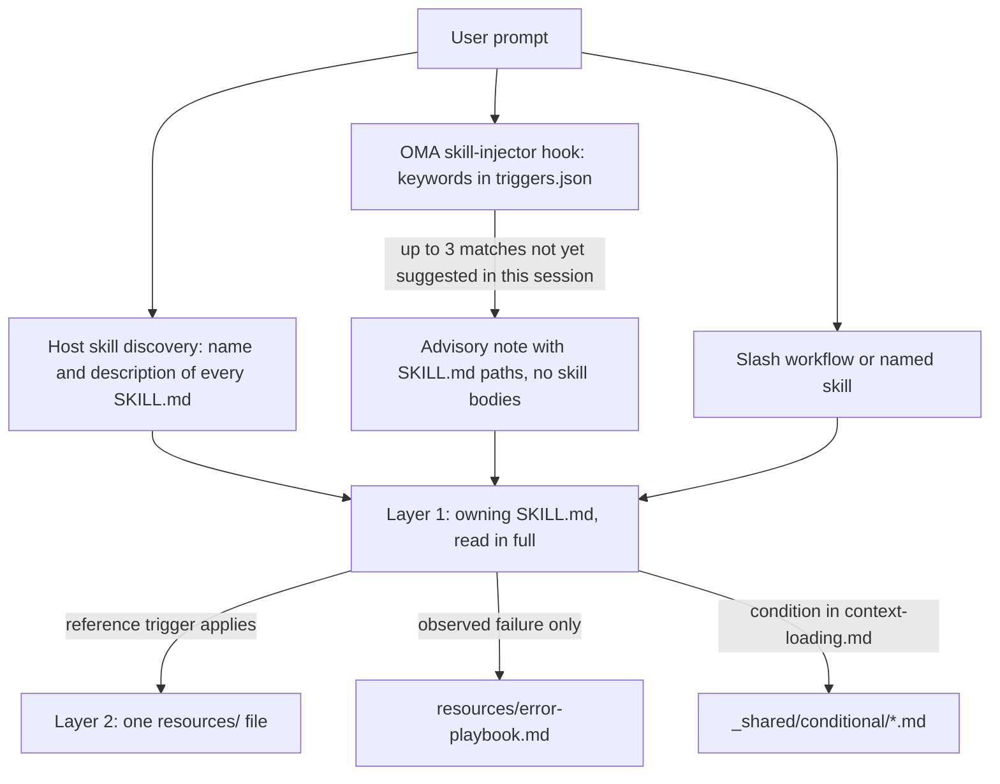
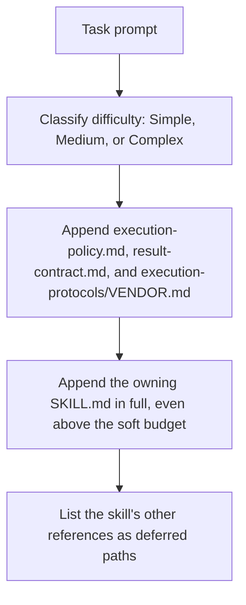

# Skills

[Skills](../getting-started/glossary.md#skill) zijn gestructureerde kennispakketten die een dispatchrol domeinrichtlijnen geven. Ze bevatten uitvoeringsprotocollen, verwijzingen naar technologiestacks, codesjablonen, error playbooks, kwaliteitschecklists en voorbeelden wanneer de skill die levert. Alles is georganiseerd in een tweelaagse architectuur die is ontworpen voor tokenefficiëntie. Zie de [skillcatalogus](./agents.md#skill-catalog) voor de lijst met geïnstalleerde skills.

---

## Het tweelaagse ontwerp {#the-two-layer-design}

Een skill komt in fasen in de context. Bij de selectie ziet het model alleen een pad of een beschrijving; de verantwoordelijke SKILL.md wordt volledig gelezen zodra de skill is gekozen; ondersteunende bestanden worden één voor één gelezen wanneer hun trigger van toepassing is.



Bronnen: `.agents/hooks/core/skill-injector.ts`, `.agents/skills/_shared/core/skill-routing.md` en `.agents/skills/_shared/core/context-loading.md`.

### Laag 1: SKILL.md (gelezen wanneer de skill wordt geselecteerd) {#layer-1-skillmd-read-when-the-skill-is-selected}

Elke skill heeft een `SKILL.md` in de root. De injector-hook geeft een **padverwijzing** door, niet de inhoud, dus een niet-geselecteerde skill kost niets bovenop zijn `description`. Elke `SKILL.md` heeft YAML-frontmatter en dezelfde vier top-levelsecties; `oma skill lint` meldt een skill waarin er een ontbreekt of waarvan de inhoud langer is dan 500 regels.

| Onderdeel | Inhoud |
|------|----------|
| Frontmatter | `name` en een routerende `description` (wat de skill doet en wanneer je hem gebruikt) |
| `## Scheduling` | Doel, intentsignatuur, wanneer gebruiken, wanneer NIET gebruiken, verwachte invoer en uitvoer, afhankelijkheden |
| `## Structural Flow` | Overgangen, falen en herstel, eindtoestanden |
| `## Logical Operations` | Canoniek commando- of workflowpad, resourcescope, guardrails |
| `## References` | Laag 2-bestanden, elk met de voorwaarde die het lezen ervan rechtvaardigt |

Huidige frontmatter van `oma-frontend`:

```yaml
---
name: oma-frontend
description: "Implement or modify web UI in React, Next.js, or Angular. Use for components, pages, styles, forms, and frontend state or data flows."
---
```

Hostruntimes tonen het model de `description` van elke skill, dus die is geschreven als een routeringszin. De keywordhook van OMA leest hem niet; de keywords daarvan staan in `.agents/hooks/core/triggers.json`.

### Laag 2: resources/ (op aanvraag geladen) {#layer-2-resources-loaded-on-demand}

De map `resources/` bevat diepgaande uitvoeringskennis. Deze bestanden worden alleen geladen wanneer:
1. de host of workflow de skill heeft geselecteerd (bijvoorbeeld via een native skillmatch of een expliciet commando);
2. de huidige taak voldoet aan de laadvoorwaarde van de referentie.

Dit laden op aanvraag wordt gestuurd door de context-loading guide (`.agents/skills/_shared/core/context-loading.md`), die entry-instructies onderscheidt van door de taak geselecteerde referenties.

### Wat `oma agent spawn` injecteert {#what-oma-agent-spawn-injects}

CLI-dispatch stelt de subagentprompt zelf samen, zodat de subagent start met de contracten en de verantwoordelijke skill al in de context:



Bron: `cli/commands/agent/spawn-status.ts`, `cli/platform/agent-config/loaders.ts` en `cli/platform/context-loader.ts`. Native subagenten krijgen dezelfde taakcontext via `oma agent context <agent-id>` en lezen het beleid en het resultaatcontract zelf als de runtime die niet heeft aangeleverd.

---

## Voorbeeld van bestandsstructuur {#file-structure-example}

```text
.agents/skills/oma-frontend/
├── SKILL.md                          ← Layer 1: read when selected
└── resources/
    ├── execution-protocol.md         ← Layer 2: step-by-step workflow
    ├── tech-stack.md                 ← Layer 2: detailed technology specs
    ├── tailwind-rules.md             ← Layer 2: Tailwind conventions
    ├── angular-rules.md              ← Layer 2: Angular-specific conventions
    ├── snippets.md                   ← Layer 2: copy-paste code patterns
    ├── error-playbook.md             ← Layer 2: error recovery procedures
    └── checklist.md                  ← Layer 2: quality verification checklist

.agents/skills/oma-backend/
├── SKILL.md
├── resources/
│   ├── execution-protocol.md
│   ├── orm-reference.md              ← Domain-specific (ORM queries, N+1, transactions)
│   ├── checklist.md
│   └── error-playbook.md
└── variants/                          ← Starter seeds for /stack-set
    ├── stack.schema.json
    ├── node/
    ├── python/
    └── rust/

.agents/skills/oma-mobile/
├── SKILL.md
├── resources/
│   ├── execution-protocol.md
│   ├── tech-stack.md
│   ├── screen-template.dart
│   ├── screen-template.swift         ← Swift native iOS screen template
│   ├── screen-template.tsx            ← React Native screen template
│   ├── checklist.md
│   └── error-playbook.md
└── variants/                          ← Platform seeds for /stack-set
    ├── README.md
    ├── stack.schema.json
    ├── flutter/                       ← stack.yaml, tech-stack.md, snippets.md, api-template.dart
    ├── react-native/                  ← stack.yaml, tech-stack.md, snippets.md, api-template.ts
    └── swift-ios/                     ← stack.yaml, tech-stack.md, snippets.md, api-template.swift

.agents/skills/oma-design/
├── SKILL.md
├── resources/
│   ├── execution-protocol.md
│   ├── anti-patterns.md
│   ├── asset-strategy.md
│   ├── checklist.md
│   ├── design-md-spec.md
│   ├── design-tokens.md
│   ├── getdesign-fetcher.md
│   ├── prompt-enhancement.md
│   ├── redesign-protocol.md
│   ├── stitch-integration.md
│   └── error-playbook.md
└── reference/                         ← Deep reference material
    ├── typography.md
    ├── color-and-contrast.md
    ├── spatial-design.md
    ├── motion-design.md
    ├── responsive-design.md
    ├── component-patterns.md
    ├── accessibility.md
    ├── visual-hierarchy.md
    └── shader-and-3d.md
```

---

## Resourcetypen per skill {#per-skill-resource-types}

| Resourcetype | Bestandsnaam-patroon | Doel | Wanneer geladen |
|--------------|-----------------|---------|-------------|
| **Execution Protocol** | `execution-protocol.md` | Stapsgewijze workflow: Analyze -> Plan -> Implement -> Verify | Geselecteerde bewerking heeft de commando- of contractdetails nodig |
| **Tech Stack** | `tech-stack.md` | Gedetailleerde technologiespecificaties, versies en configuratie | Geselecteerd framework of stackkeuze |
| **Error Playbook** | `error-playbook.md` | Herstelstappen van symptoom naar oplossing; ontbrekende informatie of bevoegdheid pauzeert alleen de afhankelijke actie | Alleen na een waargenomen fout |
| **Checklist** | `checklist.md` | Domeinspecifieke kwaliteitsverificatie | Relevante secties, voor onopgeloste verificatie |
| **Snippets** | `snippets.md` | Direct kopieerbare codepatronen | Onbekende implementatie of outputvorm |
| **Examples** | `examples.md` | Uitgewerkte input/output-voorbeelden (oma-pm, oma-db, oma-tf-infra, oma-observability, oma-search) | Onbekende implementatie of outputvorm |
| **Variants** | map `variants/` | Startseeds per taal of framework. Backend levert `node`, `python` en `rust`; mobile levert `flutter`, `react-native` en `swift-ios`. `/stack-set` gebruikt ze om de `stack/` van het project te genereren. | Wanneer een passende stack wordt opgezet |
| **Templates** | `screen-template.{dart,swift,tsx}` (oma-mobile), `variants/*/api-template.*` | Boilerplate voor een nieuw scherm of API-module | Bij het maken van dat bestand |
| **Domeinreferentie** | `orm-reference.md`, `anti-patterns.md`, enzovoort | Diepgaande domeinkennis voor specifieke subtaken | Afhankelijk van het taaktype |

---

## Gedeelde resources (_shared/) {#shared-resources-_shared}

Alle agenten delen gemeenschappelijke fundamenten uit `.agents/skills/_shared/`. Die zijn onderverdeeld in drie categorieën:

### Kernresources (`.agents/skills/_shared/core/`) {#core-resources-agentsskills_sharedcore}

| Resource | Doel | Wanneer geladen |
|----------|------|-------------|
| **`execution-policy.md`** | Regels voor autorisatie, verduidelijking, verificatie en voltooiing voor elke skill en workflow. | Geïnjecteerd in elke `oma agent spawn`-prompt; native agenten lezen het als het niet is aangeleverd |
| **`skill-routing.md`** | Routeert op basis van taakresultaat, eigenaarschap en daadwerkelijke afhankelijkheden; geen verplichte agentketen of beurtquotum. | Door orchestratie- en coördinatieskills geraadpleegd |
| **`context-loading.md`** | Entry van de verantwoordelijke skill, conditionele referenties en laadgrenzen van de runtime. | Bij het samenstellen van context |
| **`prompt-structure.md`** | Geeft richtlijnen voor overdrachten van onbekende taken met doel, context, echte beperkingen en acceptatiebewijs; geen verplicht sjabloon voor directe taken. | Bij het samenstellen van een onbekende overdracht; niet verplicht vooraf geladen |
| **`clarification-protocol.md`** | Lost routinedetails op uit de context en vraagt alleen om wezenlijke ontbrekende informatie of toestemming. | Bij ambigue requirements |
| **`code-intelligence.md`** | Gebruik de geconfigureerde code-intelligentie voor zoeken in code, navigatie en impactanalyse. | Zoeken of navigeren in code |
| **`test-approach.md`** | `test_approach` per taak uit het PM-plan en het `TDD_EVIDENCE`-blok voor `tdd`-taken. | Taken waarvan het plan `test_approach` instelt |
| **`context-budget.md`** | Schattingen van bestandsgrootte, daadwerkelijke promptmeting, afgebakende leesacties en checkpoints. | Lange taken of diagnose van contextoverhead |
| **`difficulty-guide.md`** | Kiest planningsdiepte en deliverables op basis van afhankelijkheden en verificatiebehoeften. | Wanneer decompositie een moeilijkheidsinschatting nodig heeft |
| **`quality-principles.md`** | Richtlijnen voor scope, onderhoudbaarheid, bewijs en evenredige verificatie. | Aan het begin van kwaliteitsworkflows (ultrawork) |
| **`vendor-detection.md`** | Bepaalt de doelvendor van elke agent uit de configuratie en kiest native dispatch of `oma agent spawn`. | Wanneer dispatchdetails nog niet vaststaan |
| **`session-metrics.md`** | Optioneel sessiebewijs zonder strafscores voor gesprekken of evaluators. | Gevraagde retrospective of wezenlijke correctie |
| **`common-checklist.md`** | Toepasselijke domeinoverstijgende controles; geen globale limieten op het aantal regels en geen algemene catch-verplichting. | Domeinoverstijgende review wanneer relevant |
| **`lessons-learned.md`** | Op bewijs gebaseerde lessen vastleggen en toepassen, met versie-/triggervoorwaarden; geen automatische RCA-drempel. | Na fouten en aan het einde van een sessie |
| **`anti-ai-prose.md`** | Gedeelde diagnostiek voor proza. | Audits van academische tekst en stijlreviews van vertalingen |
| **`stack-verify.schema.json`** | Gedeelde `verify:`-definities die de stackschema's van backend en mobile hergebruiken. | Validatie van stackschema's |
| **`api-contracts/`** | Optioneel contractsjabloon. Hergebruik projectschema's; gegenereerde contracten staan buiten de skillbron. | Wanneer werk over grenzen heen wordt gepland |

### Runtimeresources (`.agents/skills/_shared/runtime/`) {#runtime-resources-agentsskills_sharedruntime}

| Resource | Doel |
|---------|---------|
| **`result-contract.md`** | Runidentiteit, claimpad en voltooiingscontract voor agentresultaten. Geïnjecteerd in elke `oma agent spawn`-prompt; native agenten volgen het met `oma agent begin`, `oma agent verify` en `oma agent finish`. |
| **`memory-protocol.md`** | Formaat en bewerkingen van geheugenbestanden voor CLI-subagenten. Beschrijft On Start, During Execution en On Completion met configureerbare geheugentools (lezen/schrijven/bewerken), plus de extensie voor experimenttracking. |
| **`event-spec.md`** | Contract voor duurzame workflowevents, toegevoegd aan `events.jsonl` onder het OMA-homeprofiel en te inspecteren met `oma state get` of `oma state list`. |
| **`execution-protocols/claude.md`** | Claude Code-specifieke uitvoeringspatronen. Wordt door `oma agent spawn` geïnjecteerd wanneer de vendor claude is. |
| **`execution-protocols/antigravity.md`** | Uitvoeringspatronen voor de Antigravity CLI (`agy`). |
| **`execution-protocols/codex.md`** | Uitvoeringspatronen voor Codex CLI. |
| **`execution-protocols/commandcode.md`** | Uitvoeringspatronen voor CommandCode. |
| **`execution-protocols/grok.md`** | Uitvoeringspatronen voor Grok. |
| **`execution-protocols/kimi.md`** | Uitvoeringspatronen voor Kimi Code. |
| **`execution-protocols/kiro.md`** | Uitvoeringspatronen voor Kiro. |
| **`execution-protocols/opencode.md`** | Uitvoeringspatronen voor de OpenCode-extensie. |
| **`execution-protocols/pi.md`** | Uitvoeringspatronen voor de pi-extensie. |
| **`execution-protocols/qwen.md`** | Uitvoeringspatronen voor Qwen CLI. |

Vendor-specifieke uitvoeringsprotocollen worden automatisch geïnjecteerd bij CLI-gespawnde agenten via `oma agent spawn`. Native subagenten gebruiken de integratieregels van de geselecteerde vendor.

### Conditionele resources (`.agents/skills/_shared/conditional/`) {#conditional-resources-agentsskills_sharedconditional}

Deze worden alleen geladen wanneer tijdens de uitvoering aan specifieke voorwaarden is voldaan:

| Resource | Triggerconditie | Geladen door |
|----------|-----------------|--------------|
| **`quality-score.md`** | Een gedefinieerde baseline of experimentvergelijking is nodig | Orchestrator (geeft door aan QA-agentprompt) |
| **`experiment-ledger.md`** | Een daadwerkelijke hypothese wordt vergeleken met een baseline of een andere aanpak | Coördinator (beheert de gedeelde ledger; parallelle agenten schrijven taak-/rungebonden resultaten die hij samenvoegt) |
| **`exploration-loop.md`** | Herhaald herstel mislukt en alternatieven zijn binnen het budget het testen waard | Orchestrator (inline, vóór hypotheses te spawnen) |
| **`diagram-engine.md`** | Een workflow staat op het punt een structureel diagram te produceren (architectuur, sequence, dataflow, levenscyclus) | De workflow die het diagram produceert |

Deze resources worden uitgesteld totdat hun afzonderlijke triggers van toepassing zijn. De moeilijkheidsgraad alleen injecteert ze niet.

---

## Hoe een skill wordt geselecteerd {#how-skills-route-via-skill-routingmd}

Drie paden brengen een skill in de context. Geen van die paden start op zichzelf een workflow of geeft toestemming voor delegatie.

1. **Host-native discovery.** Runtimes met skillondersteuning tonen de `name` en `description` van elke skill; het model leest de SKILL.md waarvan de beschrijving past bij het gevraagde resultaat.
2. **OMA-keywordhint.** Waar OMA zijn prompthook installeert, matcht `skill-injector` de prompt met meertalige keywords in `.agents/hooks/core/triggers.json` en voegt een adviserende `[OMA SKILLS DETECTED: ...]`-notitie toe met maximaal drie SKILL.md-paden. Bij "Build a login form with Tailwind CSS" matcht alleen het keyword `tailwind`, dus de notitie stelt `oma-frontend` voor.
3. **Expliciete invocatie.** Een slash-workflow zoals `/plan`, `/review` of `/debug`, of de skill bij naam noemen in de prompt.

### Eigenaarschap per resultaat {#ownership-by-outcome}

Eén verantwoordelijke skill behandelt een afgebakende taak; voeg alleen een overdracht toe wanneer een andere skill een duidelijk eigen vermogen levert. Deze tabel weerspiegelt `.agents/skills/_shared/core/skill-routing.md`. Kies voor andere domeinen uit de beschrijvingen van geïnstalleerde skills in de [skillcatalogus](./agents.md#skill-catalog).

| Gevraagd resultaat | Verantwoordelijke skill |
|-------------------|--------------|
| Applicatie-API, serverauthenticatie, service-/datatoegangslogica | oma-backend |
| Schema, migratieontwerp, indexering, querytuning, databasebewerkingen | oma-db |
| Webcomponenten, pagina's, formulieren, client-state | oma-frontend |
| Mobiele schermen, widgets, platformintegratie | oma-mobile |
| Systeemgrenzen, architectuurafwegingen, ADR | oma-architecture |
| Onjuist gedrag diagnosticeren en oplossen | oma-debug |
| Correctheid, beveiliging, toegankelijkheid, prestaties reviewen | oma-qa |
| Visueel systeem, DESIGN.md, herontwerprichting | oma-design |
| Gevraagde ideevorming of verkenning van alternatieven | oma-brainstorm |
| Requirements, afhankelijkheden, acceptatiecriteria | oma-pm |
| Gevraagde parallelle uitvoering door specialisten | oma-orchestration |
| Gevraagde handmatige multi-agentcoördinatie | oma-coordination |
| Git-branches, commits, merges, repositoryhistorie | oma-scm |

### Afhankelijkheden tussen skills {#dependencies-between-skills}

Er is geen vaste uitvoeringsketen. Orden werk op basis van echte afhankelijkheden:

- Neem een openstaande architectuur- of productbeslissing vóór het werk dat ervan afhangt. Bestaande beslissingen hoeven niet opnieuw langs architectuur, brainstorming of PM.
- Backend- en clientwerk kunnen onafhankelijk doorgaan wanneer hun gedeelde API-contract bruikbaar is. Ontbreekt het, leg die grens dan eerst vast met de betrokken eigenaren.
- Review kan starten op een afgerond, reviewbaar deel terwijl onafhankelijke implementatie doorloopt. Review een instabiel artefact niet als definitief bewijs.
- Een bug die tijdens de implementatie wordt gevonden, kan door de eigenaar worden opgelost. Voeg debughulp toe wanneer de diagnose dat rechtvaardigt; er is geen verplichte keten van implementatie naar debug.
- Bepaal bij een defect over domeinen heen het falende contract en de verantwoordelijke eigenaar aan de hand van bewijs. Een API-mismatch betekent niet automatisch dat de backend moet veranderen.

### Wanneer een skillhint niet verschijnt {#when-a-skill-hint-does-not-appear}

Al dit gedrag komt uit `.agents/hooks/core/skill-injector.ts`.

| Symptoom | Oorzaak | Wat te doen |
|---------|-------|------------|
| Helemaal geen `[OMA SKILLS DETECTED]`-notitie | De prompt begint met `/`, er is een [persistente workflow](../getting-started/glossary.md#persistent-workflow) actief voor de sessie, of het bericht is een doorgestuurd agentbericht | Verwacht gedrag: de workflow beheert de context. Noem de skill als je hem nodig hebt |
| Een verwachte skill ontbreekt in de notitie | Alleen de top 3 matches worden getoond (10 punten per gematcht keyword) | Gebruik een specifiekere term of noem de skill |
| Een eerder voorgestelde skill wordt niet opnieuw voorgesteld | Een SKILL.md-pad wordt één keer per sessie voorgesteld; het record in `.agents/state/skill-sessions.json` verloopt na een uur zonder nieuwe voorstellen | Het eerdere voorstel blijft gelden |
| Een keyword wordt genegeerd | Tekst in code fences, backticks of dubbele aanhalingstekens wordt vóór het matchen verwijderd | Noem de term in gewone tekst |
| oma-academic-writing, oma-docs, oma-explanation, oma-scholar of oma-skill-creation wordt nooit voorgesteld | Deze skills hebben geen keywords in `triggers.json` | Gebruik `/docs` of `/explain`, of noem de skill; host-discovery ziet hun beschrijvingen nog steeds |
| De hint noemt een niet-gerelateerde skill | Matchen gebeurt op keywords en is adviserend | Formuleer het resultaat dat je wilt; de notitie vraagt het model zelf te oordelen |

---

## Tokenbesparingsberekening {#token-savings-math}

Meet contextkosten voordat je besparingen claimt. De woorden simple, medium en complex worden voor twee verschillende dingen gebruikt:

- **Scriptscenario's** (`routed`, `simple`, `medium`, `complex`, `all`) zijn cumulatieve vergelijkingen van bestandsgrootte die `scripts/measure-skill-context.ts` afdrukt. Het zijn geen laadbeleidsregels, en `all` is alleen een bovengrens.
- **Moeilijkheid in de loader** (Simple, Medium, Complex) kiest het zachte budget voor de context die CLI-dispatch injecteert. Zie [Resources laden per taak](#resource-loading-by-task).

```bash
bun scripts/measure-skill-context.ts
bun scripts/measure-skill-context.ts --skills oma-pm,oma-backend,oma-frontend --json
oma agent context backend --difficulty Medium
```

Het script rapporteert schattingen als UTF-8-bytes / 4. `routed` is alleen de entry; `simple`, `medium` en `complex` voegen hypothetische protocol-, voorbeeld- en stackbestanden toe ter vergelijking. Hun namen blijven behouden voor scriptcompatibiliteit, niet als instructies om vooraf te laden. Een verse checkout kan één platformseed als proxy voor de omvang gebruiken; er wordt niet elk platform geladen.

Het contextcommando toont de daadwerkelijke injectie van de taakcontext: een header `## Task context (graph-selected, approximately N tokens)`, de verantwoordelijke SKILL.md en de lijst met uitgestelde referenties. Het bevat niet de rest van het gesprek of elke instructie van de host of runtime, en een gespawnde prompt is groter omdat `oma agent spawn` ook het uitvoeringsbeleid, het resultaatcontract en het vendorprotocol toevoegt. Gebruik een samengestelde prompt of gebruikstelemetrie om de totale inputtokens, de latentie en de kosten op een benoemd model te meten. Leid die niet af uit de omvang van de repository of uit aantallen gegenereerde mirrors.

## Resources laden per taak {#resource-loading-by-task}

Elk moeilijkheidsniveau begint met de verantwoordelijke skill. De graaf is een referentie-index; aangrenzende knopen geven geen toestemming om een andere specialist, een error playbook of een conditionele experimentworkflow te laden.

De loader hanteert zachte budgetten van 1.500 / 4.000 / 8.000 geschatte tokens voor Simple / Medium / Complex. Een entry die het budget overschrijdt, blijft behouden en de overschrijding wordt gerapporteerd. Ondersteunende referenties blijven uitgesteld, tenzij ze expliciet worden geselecteerd nadat hun taaktrigger is vastgesteld. Een vereiste entry wordt nooit vervangen door kleinere, niet-gerelateerde documenten.

Verificatie volgt het risico van de taak en de requirements van het project. Een moeilijkheidslabel vereist geen volledige testsuite, geen vast preflightantwoord en geen tweede goedkeuring voor werk waarvoor al toestemming is verleend.

## Context-loading-taakkaarten (per agent) {#context-loading-task-maps-per-agent}

Dit zijn voorbeelden van referenties om te raadplegen wanneer de taak ze nodig heeft. Gebruik de actuele index van de verantwoordelijke skill en selecteer alleen toepasselijke secties:

### Backend-agent {#backend-agent}

<!-- oma-docs:ignore-start -->

| Taaktype | Vereiste resources |
|-----------|-------------------|
| CRUD-API maken | de `stack/snippets.md` en `stack/api-template.*` van het project (gegenereerd door `/stack-set`) wanneer aanwezig; anders bestaande projectcode |
| Authenticatie | `stack/snippets.md` + `stack/tech-stack.md` wanneer aanwezig |
| DB-migratie | `stack/snippets.md` wanneer aanwezig; schemaontwerp gaat naar oma-db |
| Performanceoptimalisatie | `orm-reference.md` en eventuele bijpassende voorbeelden die de skill levert |
| Bestaande code wijzigen | de projectprovider voor code-intelligentie en relevante uitvoeringsresources |

<!-- oma-docs:ignore-end -->

`variants/node`, `variants/python` en `variants/rust` zijn startseeds voor `/stack-set`; agenten lezen ze niet voor wijzigingen aan bestaande code.

### Frontend-agent {#frontend-agent}

| Taaktype | Vereiste resources |
|-----------|-------------------|
| Component maken | snippets.md + bestaande componentpatronen van het project |
| Formulierimplementatie | snippets.md (formulier + Zod) |
| API-integratie | snippets.md (TanStack Query) |
| Styling | tailwind-rules.md |
| Paginalayout | snippets.md (grid) |

### Design-agent {#design-agent}

| Taaktype | Vereiste resources |
|-----------|-------------------|
| Designsysteem maken | reference/typography.md + reference/color-and-contrast.md + reference/spatial-design.md + design-md-spec.md |
| Landingspagina ontwerpen | reference/component-patterns.md + reference/motion-design.md + prompt-enhancement.md |
| Designaudit | checklist.md + anti-patterns.md |
| Designtokens exporteren | design-tokens.md |
| 3D- en shadereffecten | reference/shader-and-3d.md + reference/motion-design.md |
| Toegankelijkheidsreview | reference/accessibility.md + checklist.md |

### QA-agent {#qa-agent}

| Taaktype | Vereiste resources |
|-----------|-------------------|
| Securityreview | checklist.md (sectie Security) |
| Performancereview | checklist.md (sectie Performance) |
| Toegankelijkheidsreview | checklist.md (sectie Accessibility) |
| Volledige audit | checklist.md (alle secties), plus iso-quality.md wanneer een review op basis van standaarden wordt gevraagd |
| Vergelijking van een gedefinieerde metric | quality-score.md (conditioneel) |

---

## Promptcompositie door de orchestrator {#orchestrator-prompt-composition}

Wanneer de orchestrator een subagentprompt schrijft (`oma-orchestration/resources/subagent-prompt-template.md`), levert hij alleen taakgegevens: agentrol, taak-ID, werkruimte, toegestane paden, taakbeschrijving, acceptatiecriteria, taakreferenties met hun laadvoorwaarden en wezenlijke beperkingen.

- Bij CLI-dispatch injecteert `oma agent spawn` al `execution-policy.md`, `result-contract.md`, het uitvoeringsprotocol van de vendor en de verantwoordelijke SKILL.md, dus de prompt herhaalt die niet.
- Geef bij native dispatch de paden van die bestanden en van de verantwoordelijke skill door als de runtime ze niet heeft aangeleverd.
- Voeg pas een error-playbook-sectie toe na een waargenomen fout, en `runtime/memory-protocol.md` alleen wanneer de agent duurzame taakstatus coördineert of hervat.

Deze gerichte samenstelling voorkomt dat onnodige resources worden geladen en laat de subagent zoveel mogelijk context overhouden voor het eigenlijke werk.

---

## Sessiebewijs en retrospectieve review {#session-evidence-and-retrospective-review}

Sessierecords leggen wezenlijke correcties, scopewijzigingen, herwerk en beslechte reviewbevindingen met bewijs vast. Noodzakelijke verduidelijking wordt niet bestraft. De voormalige gewogen CD- en EA-scores en de door drempels getriggerde RCA-regels zijn verwijderd; het waren promptinstructies, geen door de CLI berekende metrics.

Gebruik waar mogelijk bestaande taakresultaten. Een apart `session-metrics-{sessionId}.md` is optioneel in de geconfigureerde coördinatiestore. Een herhaalde fout of een gevraagde retrospective kan een les rechtvaardigen, maar een gewone mislukte controle of een betwiste bevinding levert niet automatisch een les op. Bewaar historische logboeken; herschrijf ze niet in het nieuwe formaat.

`oma stats` rapporteert productiviteit en samenvattingen van geregistreerd gebruik en geregistreerde kosten. `oma retro` groepeert daadwerkelijke gebeurtenissen rond gates, blockers en ontbrekende beslissingen tot suggesties. Geen van beide berekent CD- of EA-scores uit deze Markdown-artefacten.

## Taakdecompositie en contextherstel {#task-decomposition-and-context-recovery}

Plan rond afhankelijkheden en onafhankelijk verifieerbaar gedrag. Vaste sprintaantallen, bestandsaantallen en beurtschattingen bepalen de reviewdiepte of de voltooiing niet. Houd tests en foutafhandeling samen met het gedrag dat ze verifiëren.

Sla bij een waargenomen stilstand of verlies van bruikbare context het afgeronde werk, de resterende criteria, relevante paden en verificatiebewijs op voordat je hervat of opnieuw dispatcht. Behoud bestaand werk en voorkom dat een lopende poging wordt gedupliceerd. Een verhouding tussen beurten en voortgang vereist op zichzelf geen reset.

## Conditionele meting en exploratie {#conditional-measurement-and-exploration}

Een gedefinieerde baseline of experimentvergelijking activeert meetrichtlijnen; alleen het hebben van tests of lint doet dat niet. Leg vergelijkbare metrics vast met eenheden, methode, revisie en bewijs. Vereiste controles op correctheid en beveiliging blijven onafhankelijk. OMA heeft geen standaard samengestelde formule, geen gate op basis van lettercijfers en geen rollback die door een score wordt getriggerd.

Een daadwerkelijk experiment legt zijn hypothese, het bewijs voor baseline en kandidaat, de vereiste controles, de beslissing en de eigen bestanden vast. Herhaalde fouten kunnen het testen van een ander mechanisme rechtvaardigen, binnen het bestaande herstelbudget. Isoleer experimentwijzigingen, behoud niet-gerelateerde bewerkingen en verifieer de geïntegreerde kandidaat voordat je de gate hervat.

---

## Gerelateerd {#related}

- [Agenten](./agents.md): skillcatalogus, dispatchrollen, definities en native agentbestanden
- [Workflows](./workflows.md): slash-workflows die skills lezen
- [Projectstructuur](./project-structure.md): waar `.agents/skills/` na de installatie staat
- [Agentresultaten en hervatten](../guide/agent-results-and-resume.md): de native levenscyclus `oma agent begin` → `oma agent finish`
- [Skillevaluatie](../guide/skill-eval.md) en [Skilloptimalisatie](../guide/skill-opt.md)
- Auteurschap: gebruik de skill `oma-skill-creation` en voer daarna `oma skill lint` en `oma skill audit` uit
