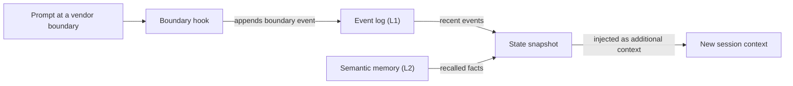

# Woordenlijst

Elke entry geeft een korte definitie en linkt naar de pagina die de term uitgebreid behandelt. Waar een woord in verschillende delen van OMA iets anders betekent, staat dat in de entry.

## Bouwstenen

### Skill {#skill}

Een skill is een pakket domeinkennis in `.agents/skills/oma-<name>/`. De `SKILL.md` komt in de context wanneer de skill wordt gerouteerd, en de bestanden in `resources/` worden alleen geladen wanneer de taak ze nodig heeft. Een skill stuurt hoe een agent binnen één domein werkt; hij definieert geen proces met meerdere stappen. Zie [Skills](../core-concepts/skills.md).

### Workflow {#workflow}

Een workflow is een proces met meerdere stappen, gedefinieerd in `.agents/workflows/<name>.md`. Je start er een met het bijbehorende slashcommando, zoals `/plan` of `/orchestrate`; waar de hook voor keyworddetectie is ingeschakeld, kan ook een passende triggerfrase hem injecteren. Workflows coördineren een of meer skills en agenten. Zie [Workflows](../core-concepts/workflows.md) en [Een skill of workflow kiezen](../core-concepts/workflows.md#choosing-a-skill-or-workflow).

### Agentdefinitie {#agent-definition}

Een agentdefinitie is een ingecheckt subagentbestand in `.agents/agents/`, zoals `backend-engineer.md` of `qa-reviewer.md`. Het legt de identiteit van de agent vast, de skills die hij laadt (`skills:`-frontmatter), een sectie met het uitvoeringsprotocol en domeinregels. OMA zet deze bestanden om naar vendor-native formaten zoals `.claude/agents/*.md` en `.codex/agents/*.toml`. De docs gebruiken "agent" ook voor een dispatchrol (`backend`, `qa`, `explore`) en voor een skill zoals `oma-backend`. Zie [Agentdefinities](../core-concepts/agents.md#agent-definitions).

## Presets

### Skillpreset {#skill-preset}

Een skillpreset is de bundel skills die de installer aan een project toevoegt, zoals `all`, `fullstack`, `backend` of `research`. De gedeelde `_shared/`-resources worden met elke preset geïnstalleerd. Een skillpreset heeft geen invloed op welk model een agent uitvoert. Zie [Presets](./installation.md#presets).

### Modelpreset {#model-preset}

De modelpreset is de waarde `model_preset` in `.agents/oma-config.yaml` (of `.cue`). Die bepaalt welke vendor en welk model elke agent gebruikt. `auto`, de standaard voor nieuwe installaties, volgt de eigen agent- en modelinstellingen van de huidige runtime; vaste presets zoals `claude`, `codex` of `mixed` leggen ze vast. Overrides onder `agents.<id>` gaan voor op de preset, behalve bij `free`, waar `free.model` de modelpins per agent vervangt. Zie [Ingebouwde presets](../guide/per-agent-models.md#built-in-presets).

## Workflowuitvoering

### Persistente workflow {#persistent-workflow}

Een persistente workflow blijft over meerdere beurten doorlopen tot het werk klaar is of jij hem deactiveert. De persistente workflows zijn `/orchestrate`, `/work`, `/ultrawork` en `/ralph`, en alleen een expliciete aanroep activeert de persistente modus. Zolang er een actief is, injecteert een hook bij elke prompt opnieuw `[OMA PERSISTENT MODE: ...]`, en de Stop-hook voorkomt dat de sessie eindigt tot een reinforcementlimiet of staleness-timeout is bereikt. Zeg `workflow done` om hem te deactiveren. Zie [Mechaniek van de persistente modus](../core-concepts/workflows.md#persistent-mode-mechanics).

### Stop gate {#stop-gate}

Een stop gate is een optionele voltooiingscontrole die je met `oma goal set --gate typecheck|test|lint` aan een actieve persistente workflow koppelt. De Stop-hook laat de workflow dan pas eindigen wanneer het `package.json`-script met die naam slaagt. Mislukte gates tellen mee voor de reinforcementlimiet, dus een falende gate kan het stoppen niet eindeloos blokkeren. Zie [`goal set`](../cli-interfaces/commands.md#goal-set).

## Sessies en status

"Sessie" heeft in OMA twee betekenissen: de sessie die OMA zelf bijhoudt, en de gesprekssessie van de AI-CLI of IDE die je gebruikt. Houd ze uit elkaar wanneer je statusbestanden of commando-opties leest.

### OMA-sessie {#oma-session}

Een OMA-sessie is werk dat OMA onder een eigen sessie-ID bijhoudt, los van elk vendorgesprek. Orchestratie gebruikt die ID om het plan, het taakbord, de voortgangs- en resultaatbestanden en de agentrunrecords te benoemen; de orchestrator genereert hem als `session-YYYYMMDD-HHMMSS`. Workflowstatus gebruikt een OMA-sessie-ID (`sid`) als sleutel voor het [eventlog](#event-log), dat je met `oma state list` en `oma state get <sid>` inspecteert. Zie [Sessie-ID-strategie](../guide/multi-agent-project.md#session-id-strategy).

### Vendorsessie-ID {#vendor-session-id}

Een vendorsessie-ID is de gespreks-ID die de AI-CLI of IDE toekent, zoals een sessie-ID van Claude Code of Codex. OMA legt hem vast als `vendorSid` op events, en statusbestanden van de persistente modus gebruiken hem als sleutel (`.agents/state/<workflow>-state-<vendor-session-id>.json`). Wanneer een OMA-sessie actief is en er een prompt binnenkomt vanuit een andere vendorsessie, een andere vendor of een sessie die net is gecompact, legt een hook een `boundary`-event vast en injecteert hij een statussnapshot, zodat het werk in de nieuwe context doorgaat. Zie [`state`](../cli-interfaces/commands.md#state).

Als semantisch geheugen niet beschikbaar is, gebruikt de snapshot alleen de lokale events.

### Eventlog {#event-log}

Het eventlog is het append-only verslag van een OMA-sessie, opgeslagen als `events.jsonl` onder `${OMA_STATE_HOME:-~/.oma}/u/<profile>/sessions/<sid>/`. Elke regel is één event, zoals `session.created`, `workflow.phase`, `gate.passed`, `decision.made` of `session.ended`. Workflows voegen vereiste beslissingen toe met `oma state emit` en controleren ze met `oma state verify`; lees het log met `oma state get` of `oma state trajectory` in plaats van het bestand te openen. Zie [`state`](../cli-interfaces/commands.md#state).

## Review en evidence

### Judge {#judge}

"Judge" heeft twee betekenissen. In `/ralph` is de judge de fase na elke ultrawork-iteratie die elk voltooiingscriterium toetst aan de werkelijke projectstatus en PASS, FAIL, REGRESSED of BLOCKED vastlegt. Een apart gespawnde agent met verse context voert die fase uit, zodat de orchestrator zijn eigen werk niet beoordeelt. Bij skillevaluatie en -optimalisatie is `judge` het standaardtype checker: een model beoordeelt de output van een arm aan de hand van een rubric en geeft PASS of FAIL terug. Zie [/ralph](../core-concepts/workflows.md#ralph) en [de judge-checker](../guide/skill-eval.md#judge-default).

### Cross-context review (CCR) {#cross-context-review-ccr}

Cross-context review is de regel dat elke reviewstap in `/ultrawork` draait in een verse, contextgeïsoleerde reviewer-subagent. De reviewer krijgt alleen de artefacten die worden beoordeeld, aangeduid met hun pad (diff, gewijzigde bestanden, plan, eerdere resultaten, testoutput), plus de handleiding voor die ene review; hij ziet nooit de geschiedenis van de hoofdsessie of de redenering van de implementer. Elke reviewer schrijft een gestructureerd oordeel dat de fasecoördinator verzamelt. Zie [/ultrawork](../core-concepts/workflows.md#ultrawork).

### Charter {#charter}

Het charter is het preflightblok `CHARTER_CHECK` dat implementatieagenten vroeger vóór elke regel code schreven. De huidige agentdefinities vereisen geen vaste preflightoutput. Agenten volgen in plaats daarvan het gedeelde uitvoeringsbeleid: ze benoemen wezenlijke aannames, vragen alleen iets wanneer ontbrekende informatie de correctheid of scope verandert, en pauzeren alleen het werk dat van het antwoord afhangt. Een gespawnde subagent kan jou niet rechtstreeks iets vragen, dus meldt hij het ontbrekende gegeven in een `blocked`- of `partial`-resultaat. Zie [Autorisatie en verduidelijking](../core-concepts/agents.md#charter-preflight-charter_check).

### Runrecord en claim {#run-record-and-claim}

Een runrecord is het machineleesbare bewijs van één agentpoging, opgeslagen in de statusdirectory per project van het profiel, `~/.oma/u/<profile>/projects/<project-hash>/agent-runs/` (oudere versies gebruikten `.agents/state/agent-runs/`); `oma agent begin` maakt het aan en legt een snapshot van het taakcontract vast. De claim is het eigen verslag van de agent op het bijbehorende `.claim.json`-pad, met de status `completed`, `partial`, `blocked` of `failed`, plus gewijzigde bestanden, openstaand werk en artefacten. `oma agent finish` toetst de claim aan het huidige contract, de verificatiereceipts en de artefacthashes, zodat een claim met verouderde evidence niet op completed blijft staan. Zie [Agentresultaten en hervatten](../guide/agent-results-and-resume.md).

## Geheugen en providers

### L1- en L2-geheugen {#l1-and-l2-memory}

L1 is het [eventlog](#event-log): lokale, append-only workflowstatus die `oma state verify` en de boundarysnapshot lezen. L2 is semantisch geheugen: opgeroepen feiten die de gekozen `providers.semantic_memory`-provider levert, namelijk `agentmemory` (de standaard), `honcho` of `none`. Vereiste beslissingen staan in L1, zodat ze sessiegrenzen overleven zonder L2. "L1" en "L2" betekenen ook nog iets anders: Laag 1 en Laag 2 van een skill zijn de `SKILL.md` en de on-demand directory `resources/`, en `oma docs verify` rapporteert "L2 references": de verwijzingen naar bestanden, URL's, CLI's, scripts, omgevingsvariabelen en configuratie die het uit documentatie haalt. Zie [`memory`](../cli-interfaces/commands.md#memory) en [Semantisch geheugen met Honcho](../guide/configuration-reference.md#honcho-semantic-memory).

### Capability-provider {#capability-provider}

Een capability-provider is de externe tool of dienst die OMA voor één capability gebruikt, gekozen onder `providers` in `.agents/oma-config.yaml`. De capabilities zijn documentatie (`docs`, standaard `context7`), webzoeken (`web`, standaard `native`), code-intelligence (`code_intelligence`, standaard `serena`) en semantisch geheugen (`semantic_memory`, standaard `agentmemory`). Voer `oma link` uit nadat je een provider hebt gewijzigd. Zie [Sleutels op het hoogste niveau](../guide/configuration-reference.md#top-level-keys) en [Belangrijke standaardinstellingen](./important-defaults.md).

## Plannen en bronbestanden

### Plan {#plan}

Een plan is de machineleesbare taakopdeling in `.agents/results/plan-<sessionId>.json`, geschreven door `/plan` en gebruikt door `/orchestrate` en `/work`; `/orchestrate` maakt er een aan wanneer er geen bruikbaar plan is. Elke taak noemt de agent, werkruimte, afhankelijkheden, acceptatiecriteria en vereiste checks, en runrecords leggen een snapshot van dit contract vast. Het staat los van de modelresolutie per agent die `oma doctor --profile` toont en die sommige pagina's een overgeërfd plan noemen. Zie [/plan](../core-concepts/workflows.md#plan) en [Een native run starten](../guide/agent-results-and-resume.md#start-a-native-run).

### SSOT {#ssot}

De single source of truth (SSOT) is de directory `.agents/`: `<project>/.agents/` voor een projectinstallatie, of `~/.oma/.agents/` voor een globale installatie. Skills, workflows, agentdefinities, regels en configuratie staan daar, en `oma install`, `oma update` en `oma link` genereren er de vendor-native bestanden (`.claude/`, `.codex/` en andere) uit. Bewerk `.agents/` en voer `oma link` uit in plaats van de gegenereerde bestanden te bewerken. Sommige pagina's gebruiken SSOT voor een smallere bron, zoals het manifest van geplande agenten. Zie [.agents/: de Source of Truth](../core-concepts/project-structure.md#agents-the-source-of-truth).
