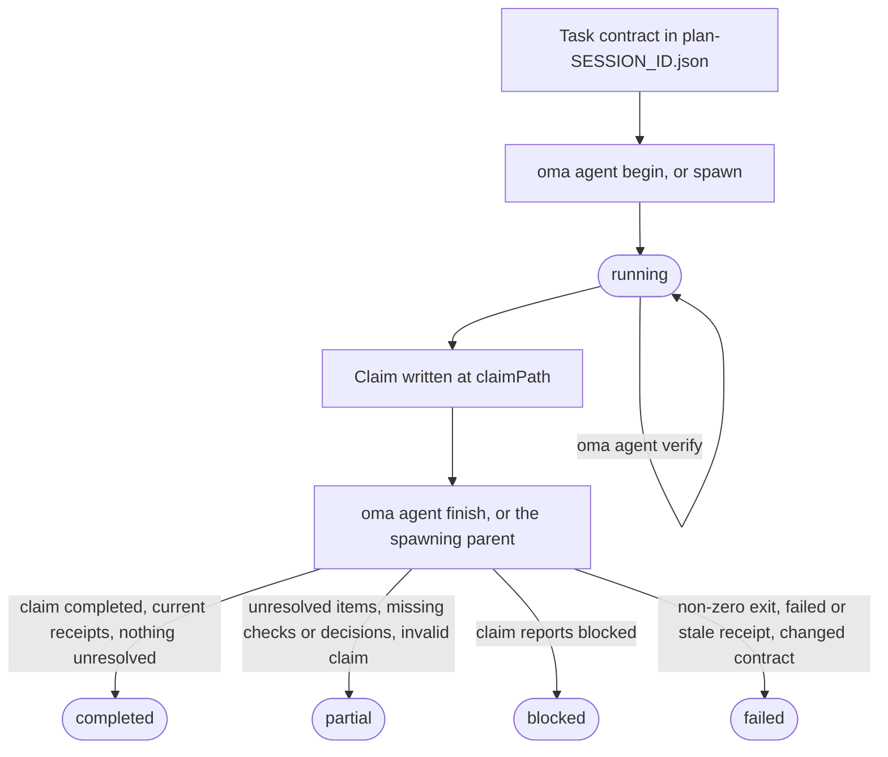
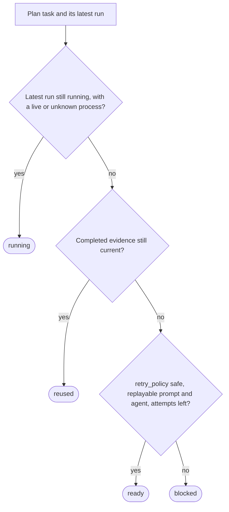

# Agentresultaten en hervatten {#agent-results-and-resume}

OMA behandelt een agentresultaat als een klein bewijsrecord, niet alleen als de exitcode van het proces. Een run legt de taak- en sessie-ID’s, de workspacefingerprint, verificatiereceipts, gewijzigde bestanden, onopgelost werk en artifact-hashes vast. Zo kan een coördinator een voltooide taak alleen opnieuw gebruiken zolang het acceptatiecontract en de inputs nog overeenkomen.

Gebruik de lifecycle rechtstreeks wanneer je een native agent uitvoert. Workflows en `oma agent spawn` maken dezelfde records voor je aan en laten de finalisering van de beheerde run over aan de parent-coördinator. Zie voor de hier gebruikte termen [Runrecord en claim](../getting-started/glossary.md#run-record-and-claim) en [Plan](../getting-started/glossary.md#plan) in de woordenlijst.

## Lifecycle in één oogopslag {#lifecycle-at-a-glance}

| Stap | Commando | Legt vast | Bewaar |
| --- | --- | --- | --- |
| 1. Contract | Bewerk `.agents/results/plan-SESSION_ID.json` | `acceptance_criteria` en `required_checks` van de taak | Sessie-ID, taak-ID |
| 2. Begin | `oma agent begin AGENT TASK SESSION_ID --workspace .` | Runrecord met status `running` | `runId`, `claimPath` |
| 3. Context (optioneel) | `oma agent context AGENT --difficulty Medium` | Niets | Promptcontext |
| 4. Verifiëren | `oma agent verify RUN_ID --required` | Eén receipt per controle | Exitcode |
| 5. Claim | Schrijf JSON op `claimPath` | Claimbestand | Niets |
| 6. Afronden | `oma agent finish RUN_ID CLAIM_PATH` | Eindstatus | `status` |
| 7. Herstellen | `oma agent resume SESSION_ID --dry-run`, daarna zonder `--dry-run` | Herstelcheckpoint en sessielease | Status per taak |

`oma agent spawn` en `oma agent parallel` voeren stap 2 en 6 voor je uit: het parentproces begint de run en finaliseert die wanneer de child eindigt.



Een claim kan ook rechtstreeks `partial` of `failed` melden. Finish waardeert een claim nooit op: het waardeert een `completed`-claim af waarvan het bewijs niet standhoudt, en een exitcode die niet nul is, maakt elke run `failed`.

## Start een native run {#start-a-native-run}

Definieer eerst de `acceptance_criteria` en `required_checks` van de taak in een plan op `.agents/results/plan-SESSION_ID.json`. Voor een kleine algemene projectcontrole kan het plan één taak bevatten:

```json
{
  "tasks": [
    {
      "id": "docs",
      "agent": "docs",
      "task": "Review README.md and report any documentation issues",
      "workspace": ".",
      "acceptance_criteria": [
        { "id": "diff-clean", "description": "The current Git diff has no whitespace errors" }
      ],
      "required_checks": [
        { "id": "whitespace", "criteria": ["diff-clean"], "command": ["git", "diff", "--check"], "cwd": "." }
      ],
      "retry_policy": "manual"
    }
  ]
}
```

Deze controle bewijst alleen dat de Git-diff geen witruimtefouten bevat; vervang de taak, het criterium en de controle door het echte acceptatiecontract van het project. Start de run vanuit de projectroot:

```bash
oma agent begin docs docs SESSION_ID --workspace .
```

Vervang `SESSION_ID` door de sessie-ID uit het plan. Het commando print JSON met een gegenereerde UUID `runId` en een `claimPath`, bijvoorbeeld:

```json
{
  "runId": "<generated-run-id>",
  "taskId": "docs",
  "sessionId": "<your-session-id>",
  "status": "running",
  "claimPath": ".agents/state/agent-runs/<generated-run-id>.claim.json"
}
```

De waarden tussen punthaken zijn placeholders; gebruik de echte waarden die je run print. Een geslaagde begin maakt de runrecord aan onder `.agents/state/agent-runs/` en legt het taakcontract vast. Het claimpad is altijd het pad van de runrecord, met `.claim.json` in plaats van `.json`.

## Laad context en voer de taak uit {#load-context-and-run-the-task}

Laad de door de graaf geselecteerde referenties voordat je bewerkt:

```bash
oma agent context docs --difficulty Medium
```

De moeilijkheid moet `Simple`, `Medium` of `Complex` zijn. Het commando print de context die voor de geselecteerde agent is samengesteld. Als er geen graafgestuurde context bestaat, herstel je de taakdefinitie of volg je het gedocumenteerde native zoekpad; verzin geen contextreceipt.

Voer de taak uit in de workspace die met `begin` is vastgelegd. Houd het sessieplan vast zolang de run actief is. Als de taak het acceptatiecontract of de vereiste controles moet wijzigen, begin je een nieuwe run nadat je het plan hebt bijgewerkt.

## Leg verificatie vast {#record-verification}

Voer elke controle uit die in het acceptatiecontract is vastgelegd:

```bash
oma agent verify RUN_ID --required
```

Vervang `RUN_ID` door de UUID die `begin` heeft teruggegeven. Het commando voert de gedeclareerde argv uit en registreert de echte exitcode en de workspacefingerprints voor en na de controle. Met de exacte-commandovorm kun je één controle vastleggen als die in het taakcontract staat:

```bash
oma agent verify RUN_ID -- git diff --check
```

Gebruik de exacte-commandovorm alleen voor een controle die bij het taakcontract hoort; houd anders `required_checks` uit het plan aan en gebruik `--required` zodat de receipt de gedeclareerde acceptatiecontrole bewijst.

Gebruik `--affected PATH...` alleen wanneer de graaf een volledige testselectie voor die paden heeft. Controles worden per run serieel uitgevoerd. Een exitcode die niet nul is, of een workspacewijziging tijdens een controle, maakt die receipt ongeldig.

## Schrijf de claim en rond de run af {#write-and-finish-the-claim}

Declareer voor taken die een API-contract, authenticatiebeleid, datamodel,
migratiestrategie, state-eigenaar, toegangsscope voor infrastructuur of een andere
beslissing kiezen waarvan later werk afhangt, vóór de dispatch `required_decisions` in de taak:

```json
"required_decisions": [
  {
    "subject": "db.migration-strategy",
    "description": "Choose the compatibility window and rollback strategy for the account migration."
  }
]
```

Laat dit veld weg bij taken die een bestaande beslissing volgen. Vereisten worden
met het taakcontract vastgezet en kunnen na de dispatch niet worden verwijderd of gewijzigd.
Toon voorgestelde onderwerpen voor een agent met
`oma state decisions list --agent db-engineer --json`. Deze onderwerpen zijn
keuzes om te gebruiken wanneer ze relevant zijn; de catalogus maakt niet elke keuze verplicht.

Schrijf het claimbestand op exact het pad dat `begin` heeft geprint:

```json
{
  "status": "completed",
  "changedFiles": [],
  "unresolved": [],
  "artifacts": []
}
```

`status` is een van `completed`, `partial`, `blocked` of `failed`. Paden zijn relatief aan de projectroot en elk artifact moet een gewoon bestand binnen de workspace zijn. Gebruik `verificationSkipped` alleen voor een specifieke review waarvoor geen uitvoerbare controle bestaat; daarmee wordt een mislukte controle niet alsnog geslaagd.

Neem inhoudelijke beslissingen op in de optionele array `decisions` van de claim:

```json
"decisions": [
  {
    "subject": "db.migration-strategy",
    "decision": "Use an expand-and-contract migration; retain the old column for one release.",
    "rationale": "Both deployed app versions must work during the rollout; rollback switches reads to the retained column.",
    "alternatives": ["Replace the column during a maintenance window"],
    "evidence": ["docs/account-migration.md"]
  }
]
```

De parent slaat elke beslissing op als een `decision.made`-event in de sessie van de run
en koppelt daaraan de werkelijke agent-, taak- en run-ID's. Een ontbrekende vereiste beslissing
houdt het resultaat partial, ook wanneer uitvoerbare controles slagen. Beslissingen uit
een andere taak of poging kunnen niet aan de vereiste voldoen. De receipt zet de
event-ID's en inhoudshashes van de beslissingen vast; hergebruik controleert of die events nog
bestaan, geldig zijn en een ongewijzigde inhoud hebben.
Optionele beslissingen worden ook vastgelegd. Read-only agenten retourneren dezelfde array in
hun `OMA_RESULT_JSON`-claim, zodat de parent die kan bewaren.

Finaliseer daarna een native run nadat je de claim hebt geschreven:

```bash
oma agent finish RUN_ID CLAIM_PATH
```

Vervang beide waarden door de UUID en het claimpad die `begin` heeft teruggegeven. `CLAIM_PATH` is het gegenereerde `.claim.json`-pad; verzin geen nieuwe bestandsnaam.

Het finishcommando valideert de claim, het huidige contract, de huidige receipts en de artifact-hashes. Een voltooide claim met verouderd bewijs wordt failed of partial. Het commando weigert een beheerde run af te ronden wanneer het parentproces eigenaar is van de lifecycle.

## Gedrag van gespawnde en native runs {#spawned-and-native-behavior}

`oma agent spawn` en `oma agent parallel` maken een run aan, voegen de runidentiteit en resultinstructies toe aan de childprompt en laten de parent de exitcode van de child vastleggen. Een child hoort zijn claim en artifacts te schrijven en die artifacts te melden; de parent finaliseert de beheerde receipt. Een read-only child retourneert één regel in de vorm `OMA_RESULT_JSON: {...}`; de parent bewaart die als inspectie en de status `verificationSkipped` ervan blijft onderscheiden van uitvoerbare verificatie.

De mensleesbare resultbestanden in `.agents/results/` en memorynotities in `.agents/state/memories/` helpen mensen het verloop te volgen. De machineleesbare receipt in `.agents/state/agent-runs/` is het bewijs dat voor hergebruik en hervatten wordt gebruikt.

## Inspecteer herstel voordat je opnieuw probeert {#inspect-recovery-before-retrying}

Vraag eerst wat OMA zou doen:

```bash
oma agent resume SESSION_ID --dry-run
```

Het rapport deelt elke taak in als `reused`, `ready`, `running` of `blocked` en vermeldt de reden:



Een afhankelijkheid die niet `reused` is, zet een afhankelijke `reused`-taak terug naar `ready` (of `blocked` wanneer die niet opnieuw kan worden afgespeeld), en een `ready`-taak waarvan de afhankelijkheid `blocked` of `running` is, wordt `blocked`. Een geldige voltooide receipt wordt alleen hergebruikt als het contract, de inputs, de artifact-hashes en het bewijs van afhankelijkheden nog actueel zijn. Een live beheerd proces of een native run zonder bewijs dat die nog leeft, wordt niet gedupliceerd.

Wanneer het rapport veilig uitvoeren aangeeft, hervat je de ready-taken in volgorde van afhankelijkheid:

```bash
oma agent resume SESSION_ID
```

Automatisch opnieuw afspelen vereist `retry_policy: "safe"` plus een opnieuw uitvoerbare prompt en agent in het plan of de opgeslagen dispatch. De standaard is `manual`. `--max-attempts` is standaard `3`, inclusief de oorspronkelijke poging:

```bash
oma agent resume SESSION_ID --max-attempts 2
```

OMA schrijft het herstelcheckpoint onder `.agents/state/agent-resume/` en gebruikt een sessielease zodat twee coördinatoren niet dezelfde sessie opnieuw proberen. Het plan blijft vastgezet tijdens herstel. Als het plan of een afhankelijkheid verandert, of een latere poging een eerdere input wijzigt, worden de betrokken taken geblokkeerd en is een nieuwe verificatierun nodig.

Hervatten start een nieuwe poging; het herstelt de onderbroken modelconversatie niet. Markeer voordat je een onderbroken native run hervat de oude run met het werkelijke resultaat als `partial` of `failed`, inclusief het onopgeloste werk. Bekijk daarna het dry-runrapport en probeer alleen taken met een veilig replaypad opnieuw.

## Herstelvoorbeelden {#recovery-examples}

| Situatie | Actie | Verwacht resultaat |
|---|---|---|
| Een vereiste controle is mislukt | Herstel de taak, voer opnieuw `oma agent verify RUN_ID --required` uit en rond daarna af met een nieuwe claim. | De nieuwste receipt vervangt het mislukte resultaat wanneer de workspacefingerprint actueel is. |
| Het proces stopte vóór er een claim was | Markeer de run als partial of failed en voer daarna `oma agent resume SESSION_ID --dry-run` uit. | De oude poging blijft behouden; een veilige taak is `ready`, terwijl een handmatige taak `blocked` is. |
| Een afhankelijkheid is gewijzigd | Voer de afhankelijkheid opnieuw uit en bekijk het rapport opnieuw. | Hergebruik van afhankelijke taken wordt ongeldig, ook wanneer hun eigen bestanden ongewijzigd zijn. |
| Het plan of de inputs zijn gewijzigd | Begin een nieuwe run nadat het plan stabiel is. | De nieuwe run legt het nieuwe contract vast; oud bewijs wordt niet hergebruikt. |
| Een taak heeft een beslissing nodig | Registreer de taak als `blocked` met uitleg. | Hervatten laat de taak geblokkeerd tot de beslissing en prompt beschikbaar zijn. |

## Volgende stappen {#next-steps}

- Foutmeldingen van `begin`, `verify`, `finish` en `resume`: [Probleemoplossing](./troubleshooting.md#find-your-error)
- Parsefouten, ontbrekende vendortools, dashboardstatus, planningen en verouderde evaluatiegegevens: [Probleemoplossing](./troubleshooting.md)
- Beheerde runs volgen terwijl ze werken: [Dashboardmonitoring](./dashboard-monitoring.md)
- Plannen met taakcontracten definiëren: [Multi-agentprojecten](./multi-agent-project.md)
