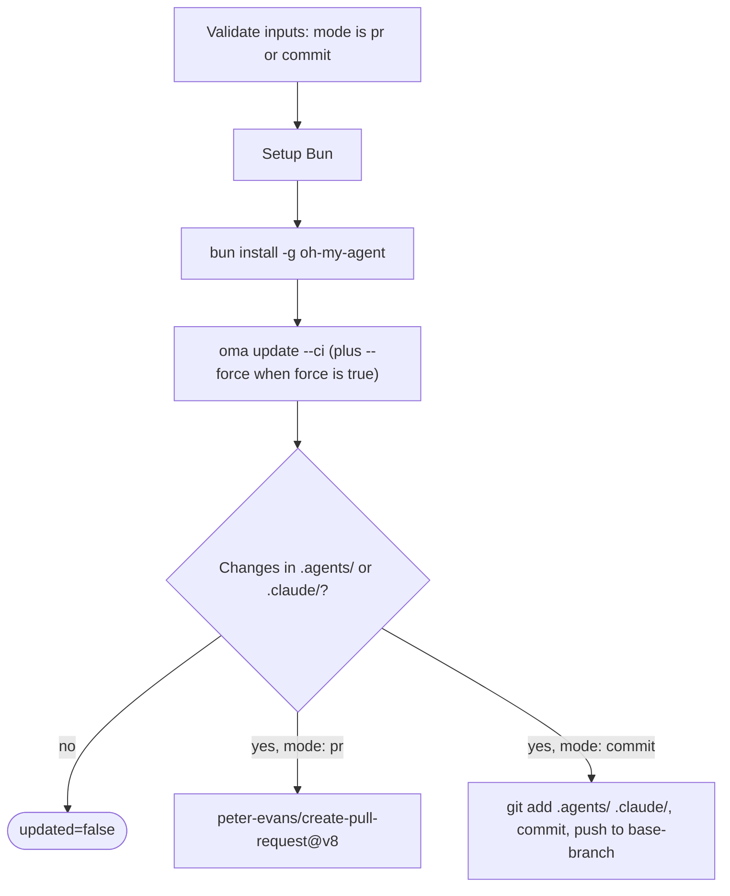

# Gids: Geautomatiseerde updates

## Overzicht

De oh-my-agent GitHub Action (`first-fluke/oma-update-action@v1`) werkt de agent-skills van je project automatisch bij door in CI `oma update` uit te voeren. De action ondersteunt twee modi: een pull request aanmaken voor review of rechtstreeks naar een branch committen.

---

## Snelle setup

<!-- oma-docs:ignore-start -->
Voeg dit bestand aan je project toe als `.github/workflows/update-oh-my-agent.yml`:
<!-- oma-docs:ignore-end -->

```yaml
name: Update oh-my-agent

on:
  schedule:
    - cron: '0 9 * * 1'  # Every Monday at 9am UTC
  workflow_dispatch:        # Allow manual trigger

permissions:
  contents: write
  pull-requests: write

jobs:
  update:
    runs-on: ubuntu-latest
    steps:
      - uses: actions/checkout@v4

      - uses: first-fluke/oma-update-action@v1
```

Dit is de minimale configuratie. Wanneer een geïnstalleerd component verandert, hoort de action af te sluiten met `updated=true`, een versie-uitvoer en een pull request. Als er geen bestanden veranderen, sluit hij af met `updated=false` en zonder PR.

---

## Alle action-inputs

| Input | Type | Vereist | Standaard | Beschrijving |
|:------|:-----|:---------|:--------|:-----------|
| `mode` | string | Nee | `"pr"` | Hoe wijzigingen worden toegepast. `"pr"` maakt een pull request. `"commit"` pusht rechtstreeks naar de basisbranch. |
| `base-branch` | string | Nee | `"main"` | Basisbranch voor de PR (in `pr`-modus) of doelbranch voor directe commits (in `commit`-modus). Dit verandert niet wat er wordt uitgecheckt; stel `ref:` van `actions/checkout` in op dezelfde branch. |
| `force` | string | Nee | `"false"` | Geeft `--force` door aan `oma update`. Bij `"true"` worden door de gebruiker aangepaste configuratiebestanden (`oma-config.yaml`, `mcp.json`) en mappen onder `stack/` overschreven. Normaal blijven deze behouden. |
| `pr-title` | string | Nee | `"chore(deps): update oh-my-agent skills"` | Aangepaste titel voor de pull request. Alleen gebruikt in `pr`-modus. |
| `pr-labels` | string | Nee | `"dependencies,automated"` | Door komma’s gescheiden labels die aan de PR worden toegevoegd. Alleen gebruikt in `pr`-modus. |
| `commit-message` | string | Nee | `"chore(deps): update oh-my-agent skills"` | Aangepast commitbericht. Gebruikt in beide modi, als commitbericht van de PR of als direct commitbericht. |
| `token` | string | Nee | `${{ github.token }}` | GitHub-token voor het maken van PR’s. Gebruik een Personal Access Token (PAT) als de PR andere workflows moet activeren; de standaard `GITHUB_TOKEN` start geen workflow-runs voor PR’s die de action zelf maakt. |

---

## Alle action-outputs

| Output | Type | Beschrijving | Beschikbaar |
|:-------|:-----|:-----------|:----------|
| `updated` | string | `"true"` als na `oma update` wijzigingen zijn gevonden. `"false"` als de installatie al bijgewerkt is. | Altijd |
| `version` | string | De oh-my-agent-versie na de update. Gelezen uit `.agents/skills/_version.json`. | Als `updated` `"true"` is |
| `pr-number` | string | Het nummer van de pull request. | Alleen in `pr`-modus wanneer een PR wordt aangemaakt |
| `pr-url` | string | De volledige URL van de aangemaakte pull request. | Alleen in `pr`-modus wanneer een PR wordt aangemaakt |

---

## Uitgewerkte voorbeelden

### Voorbeeld 1: standaardmodus voor pull requests

De meest gebruikelijke setup. Maakt elke maandag een PR als er updates beschikbaar zijn.

```yaml
name: Update oh-my-agent

on:
  schedule:
    - cron: '0 9 * * 1'
  workflow_dispatch:

permissions:
  contents: write
  pull-requests: write

jobs:
  update:
    runs-on: ubuntu-latest
    steps:
      - uses: actions/checkout@v4

      - uses: first-fluke/oma-update-action@v1
        id: update

      - name: Summary
        if: steps.update.outputs.updated == 'true'
        run: |
          echo "Updated to version ${{ steps.update.outputs.version }}"
          echo "PR: ${{ steps.update.outputs.pr-url }}"
```

**Wat er gebeurt:**

- De repository wordt uitgecheckt.
- Bun wordt geïnstalleerd en daarna wordt oh-my-agent globaal geïnstalleerd.
- `oma update --ci` wordt uitgevoerd.
- Er wordt gecontroleerd of `.agents/` of `.claude/` is gewijzigd.
- Als er wijzigingen zijn, gebruikt de action `peter-evans/create-pull-request@v8` om een PR te maken op branch `chore/update-oh-my-agent`.
- De PR krijgt de labels `dependencies,automated` en bevat het nieuwe versienummer in de body.

### Voorbeeld 2: directe commitmodus met PAT

Voor teams die updates meteen willen toepassen zonder een PR-reviewstap. Er wordt een PAT gebruikt, zodat de commit vervolgworkflows kan activeren.

```yaml
name: Update oh-my-agent (Direct)

on:
  schedule:
    - cron: '0 6 * * *'  # Daily at 6am UTC
  workflow_dispatch:

permissions:
  contents: write

jobs:
  update:
    runs-on: ubuntu-latest
    steps:
      - uses: actions/checkout@v4
        with:
          ref: develop
          token: ${{ secrets.OH_MY_AGENT_PAT }}

      - uses: first-fluke/oma-update-action@v1
        with:
          mode: commit
          token: ${{ secrets.OH_MY_AGENT_PAT }}
          commit-message: "chore: auto-update oh-my-agent skills"
          base-branch: develop
```

**Wat er gebeurt:**

- De branch `develop` wordt uitgecheckt met een PAT. `ref: develop` is vereist: `base-branch` stelt alleen het pushdoel in, en de action pusht de `HEAD` die de checkout heeft opgeleverd.
- `oma update --ci` wordt uitgevoerd.
- Als er wijzigingen zijn, configureert de action Git als `github-actions[bot]` en commit hij rechtstreeks naar `develop`.
- De PAT zorgt ervoor dat de commit workflows activeert die luisteren naar pushes op `develop`.

**Belangrijk:** gebruik `secrets.OH_MY_AGENT_PAT` (een Fine-Grained PAT met de machtiging Contents: Write) in plaats van `github.token`. De standaard `GITHUB_TOKEN` maakt commits die geen andere workflows activeren. Dat kan CI-pipelines breken die push-events verwachten.

### Voorbeeld 3: conditionele notificatie

Werk bij en stuur een Slack-notificatie wanneer een nieuwe versie beschikbaar is.

```yaml
name: Update oh-my-agent

on:
  schedule:
    - cron: '0 9 * * 1'
  workflow_dispatch:

permissions:
  contents: write
  pull-requests: write

jobs:
  update:
    runs-on: ubuntu-latest
    steps:
      - uses: actions/checkout@v4

      - uses: first-fluke/oma-update-action@v1
        id: update

      - name: Notify Slack
        if: steps.update.outputs.updated == 'true'
        uses: slackapi/slack-github-action@v2
        with:
          webhook: ${{ secrets.SLACK_WEBHOOK }}
          webhook-type: incoming-webhook
          payload: |
            {
              "text": "oh-my-agent updated to v${{ steps.update.outputs.version }}. PR: ${{ steps.update.outputs.pr-url }}"
            }

      - name: Skip notification
        if: steps.update.outputs.updated == 'false'
        run: echo "Already up to date, no notification needed."
```

**Belangrijk patroon:** gebruik `steps.update.outputs.updated == 'true'` om vervolgstappen alleen uit te voeren als er daadwerkelijk een update is uitgevoerd. Zo voorkom je meldingen voor runs waarin niets is veranderd.

### Voorbeeld 4: force-modus met aangepaste labels

Voor projecten die bij een update alle configuratiebestanden naar de standaardwaarden willen terugzetten.

```yaml
name: Update oh-my-agent (Force)

on:
  workflow_dispatch:  # Manual trigger only for force updates

permissions:
  contents: write
  pull-requests: write

jobs:
  update:
    runs-on: ubuntu-latest
    steps:
      - uses: actions/checkout@v4

      - uses: first-fluke/oma-update-action@v1
        with:
          force: 'true'
          pr-title: "chore(deps): force-update oh-my-agent skills (reset configs)"
          pr-labels: "dependencies,automated,force-update"
          commit-message: "chore(deps): force-update oh-my-agent skills"
```

**Waarschuwing:** force-modus overschrijft `oma-config.yaml`, `mcp.json` en mappen onder `stack/`. Gebruik deze modus alleen als je alle aanpassingen naar de standaard wilt terugzetten. Laat de input `force` bij gewone updates weg.

---

## Werking onder de motorkap

De action is een [composite action](https://docs.github.com/en/actions/creating-actions/creating-a-composite-action) die is gedefinieerd in `action/action.yml`. Ze valideert eerst dat `mode` gelijk is aan `pr` of `commit`, voert daarna de onderstaande stappen uit en eindigt met een pull request of een directe commit:



### Stap 1: Bun instellen

```yaml
- uses: oven-sh/setup-bun@v2
```

Installeert de Bun-runtime die nodig is om de oh-my-agent CLI uit te voeren.

### Stap 2: oh-my-agent installeren

```bash
bun install -g oh-my-agent
```

Installeert de CLI globaal uit het npm-register. Daarmee komt het commando `oma` beschikbaar.

### Stap 3: oma update uitvoeren

```yaml
- name: Run oma update
  shell: bash
  env:
    FORCE: ${{ inputs.force }}
  run: |
    FLAGS="--ci"
    if [ "$FORCE" = "true" ]; then
      FLAGS="$FLAGS --force"
    fi
    oma update $FLAGS
```

Inputs bereiken het script via `env:` in plaats van via `${{ }}`-interpolatie binnen `run:`, zodat een inputwaarde niet als shellcode kan worden uitgevoerd.


De vlag `--ci` voert de update niet-interactief uit: prompts worden overgeslagen en de uitvoer gebruikt gewone tekst in plaats van spinneranimaties. Als `--force` is ingeschakeld, overschrijft die vlag door de gebruiker aangepaste configuratiebestanden.

Wat `oma update --ci` intern doet:

1. Haalt `prompt-manifest.json` op uit de main-branch om het nieuwste versienummer te lezen.
2. Vergelijkt dat met de lokale versie in `.agents/skills/_version.json`.
3. Als de versies gelijk zijn, sluit het af met "Already up to date.".
4. Als er een nieuwe versie is, downloadt en pakt het de nieuwste tarball uit.
5. Behoudt aangepaste bestanden (zonder `--force`): `oma-config.yaml`, `mcp.json` en mappen onder stack/.
6. Kopieert nieuwe bestanden over de bestaande map `.agents/`.
7. Zet de bewaarde bestanden terug.
8. Werkt vendor-aanpassingen bij (hooks, settings en agentdefinities) voor de vendors in de lijst `vendors:` van de configuratie (een lege lijst betekent geen enkele). Zonder lijst `vendors:` worden alleen vendors bijgewerkt waarvan de projectmappen al bestaan.
9. Vernieuwt CLI-symlinks.

De action roept `oma update --ci` aan zonder `--with-new-skills`. Daarmee wordt de geïnstalleerde skillset bijgewerkt en worden nieuw beschikbare skills gemeld. Voer bewust `oma update --with-new-skills` uit wanneer een project nieuwe skills aan de installatie moet toevoegen.

### Stap 4: Wijzigingen controleren

```bash
if [ -n "$(git status --porcelain .agents/ .claude/ 2>/dev/null)" ]; then
  echo "updated=true" >> "$GITHUB_OUTPUT"
  if [ -f ".agents/skills/_version.json" ]; then
    VERSION=$(jq -r '.version' .agents/skills/_version.json)
    echo "version=$VERSION" >> "$GITHUB_OUTPUT"
  fi
else
  echo "updated=false" >> "$GITHUB_OUTPUT"
fi
```

Controleert of `oma update` daadwerkelijk bestanden in `.agents/` of `.claude/` heeft gewijzigd. De outputs `updated` en `version` worden overeenkomstig ingesteld. Wijzigingen buiten die twee mappen (bijvoorbeeld `.codex/` of `AGENTS.md`) zetten `updated=true` niet.

Daarna volgt, afhankelijk van de input `mode`:

- **`pr`-modus:** gebruikt `peter-evans/create-pull-request@v8` om een PR te maken op branch `chore/update-oh-my-agent`. De PR bevat het nieuwe versienummer, een link naar de oh-my-agent-repository en de ingestelde labels. Als de branch al bestaat, bijvoorbeeld door een eerdere open PR, wordt die bestaande PR bijgewerkt.
- **`commit`-modus:** configureert Git als `github-actions[bot]`, staged `.agents/` en `.claude/`, commit met het ingestelde bericht en pusht naar de basisbranch.

---

## Zie ook

- [Globale installatie](./global-install.md): `oma update --global` en CI-aandachtspunten voor gebruikersbrede installaties
- [Configuratiereferentie](./configuration-reference.md#update-and-ownership-rules): welke configuratiebestanden `oma update` behoudt
- [Integratie in een bestaand project](./integration.md): de bestanden die `oma update` in een project vernieuwt
