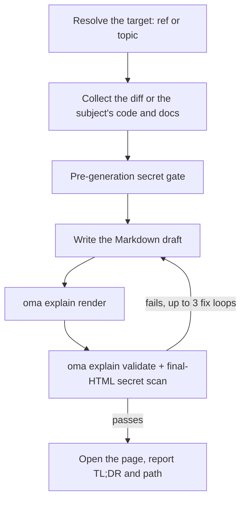

# Code-uitlegger {#code-explainer}

`/explain` maakt van een codewijziging een rijk, zelfstandig HTML-document dat uitlegt wat er veranderde en waarom — diepgaande achtergrond die nieuwkomers kunnen overslaan, een sectie met de kernintuïtie en toy-data, een codewalkthrough in volgorde van begrip en een quiz met vijf vragen. De uitvoer is één offline bruikbaar `.html`-bestand met diagrammen, callouts en een toegankelijke quiz, opgeslagen onder `.agents/results/explain/` en vóór oplevering gevalideerd tegen een deterministische checklist.

`/explain` is alleen een slash-commando — het wordt niet automatisch geactiveerd vanuit natuurlijke taal. "explain" is alledaagse woordenschat en wordt daarom bewust uitgesloten van keyworddetectie (hetzelfde precedent als `/convert`). Gebruik expliciet `/explain`, of vraag een andere skill om als gedelegeerde uitvoer een "explainer document" te maken.

## Twee modi {#two-modes}

| Modus | Je typt | Vereist git | Wat de pagina uitlegt |
|---|---|---|---|
| Change | `/explain`, `/explain #640`, `/explain a..b`, `/explain <branch>` | ja (`gh` voor PR-refs) | Een codewijziging: Background, Intuition, Code, Quiz |
| Topic | `/explain how does session windowing work` (tekst die niet naar een PR, branch of SHA-bereik resolveert) | nee | Een concept, een systeem of het antwoord op een vraag, als visueel overzicht op één pagina: een kernantwoord, gevolgd door panelen met diagrammen, tabellen en korte proza |

Als de tekst zowel een branchnaam als een onderwerp kan zijn, controleert de workflow hem eerst als git-ref; een ref wint.

---

## Wanneer gebruiken {#when-to-use}

- Een PR, branch, commitbereik of de huidige staged/unstaged wijziging als document uitleggen
- Een teamgenoot inwerken op een wijziging die diegene niet zelf heeft geschreven
- Na een grote of subtiele wijziging een controleerbaar onderwijsartifact produceren
- Een architectuur, een protocol, een vergelijking of een lang antwoord omzetten in één visuele pagina (topic-modus)

## Wanneer NIET gebruiken {#when-not-to-use}

- Explainer-*video* met vertelling → gebruik [`oma-video`](./video-generation.md) (explainer-modus); `/explain` produceert een HTML-document, geen video
- Controleren of documentatie nog overeenkomt met de codebase → gebruik `oma-docs` (driftdetectie)
- Presentatiedeck of dia's → gebruik `oma-slide` (vast deckcontract van 1920×1080)
- Defecten zoeken of reviewverdicts geven → gebruik `oma-qa` of de `/review`-workflow; `/explain` vertelt een wijziging voor educatieve doeleinden en beoordeelt die niet

---

## Snel starten {#quick-start}

```text
/explain
/explain 640
/explain a1b2c3d..e5f6a7b
/explain payments-refactor for reviewer
```

Het doelref wordt uit de formulering opgelost:

| Je typt | Resolutie van doel | Lezersniveau |
|----------|--------------------|--------------|
| `/explain` | Staged changes (`git diff --cached`), met fallback naar de dirty working tree | `onboarding` |
| `/explain 640`, `/explain #640` | PR #640 via `gh pr diff` | `onboarding` |
| `/explain a..b` | SHA-bereik `a..b` (of `a...b`) | `onboarding` |
| `/explain feature-branch for reviewer` | `git diff main...feature-branch` | `reviewer` |
| `/explain how does the row planner work` | Topic-modus: geen ref; de agent verzamelt de code en documentatie waar het onderwerp over gaat | n.v.t. |

Als er geen expliciete ref is gegeven en zowel de staged als dirty working tree leeg zijn, valt de resolutie terug op `HEAD~1..HEAD`.



---

## Volgorde van ref-resolutie {#ref-resolution-order}

Alleen in change-modus; topic-modus slaat ref-resolutie over.

1. **Expliciet argument** — een PR-nummer (`#640`), een branchnaam of een SHA-bereik (`a..b` / `a...b`)
2. **Staged changes** — `git diff --cached`
3. **Dirty working tree** — `git diff`
4. **Fallback** — `HEAD~1..HEAD`

Een lege diff of een onoplosbare ref stopt de workflow; er worden recente commits aangeboden als kandidaten in plaats van een alternatief te raden.

---

## Lezersniveaus {#reader-levels}

| Niveau | Effect |
|-------|--------|
| `onboarding` (standaard) | Volledige diepe achtergrond (Tier A), voor een lezer die het omringende systeem niet kent |
| `reviewer` | Verkort de laag met diepe achtergrond; de secties Intuition en Code blijven volledig |

Vraag om `reviewer` door "for reviewer" aan het commando toe te voegen, zoals bij `/explain feature-branch for reviewer`.

---

## Wat het document bevat {#what-the-document-contains}

Deze sectie beschrijft de change-modus. Een explainer in change-modus is één lange scrollpagina (geen tabs of navigatie over meerdere pagina's) met een inhoudsopgave, gevolgd door vier vaste secties in deze volgorde:

1. **Background** — Tier A (diepe systeem-/architectuurachtergrond, gemarkeerd als "skippable if you already know the system") en Tier B (beperkte context voor deze specifieke wijziging)
2. **Intuition** — de kern van de wijziging, met verplichte toy-data-voorbeelden, versterkt door 2–3 hergebruikte diagramfamilies (vereenvoudigde UI-mock, systeem-/datastroomdiagram met voorbeelddata, toestand voor/na), uitsluitend weergegeven als HTML/inline SVG — geen ASCII-art
3. **Code** — een walkthrough gegroepeerd voor menselijk begrip (niet alfabetisch of in difforde), met verwijzingen naar code via `file:line`
4. **Quiz** — standaard vijf vragen (parameteriseerbaar), elk gericht op een afzonderlijk aspect van de wijziging, met plausibele afleiders en feedbacktekst bij elke optie (goed en fout)

Proza en quizinhoud worden geschreven in de gevraagde uitvoertaal (prompttaal → `.agents/oma-config.yaml` `language` → Engels); code, identifiers en inline code blijven volgens de i18n-regels in het Engels. Het volledige inhoudscontract staat in `.agents/skills/oma-explanation/resources/document-structure.md`.

---

## Hoe de pagina wordt gebouwd {#how-the-page-is-built}

De agent schrijft een Markdown-draft, en `oma explain render` maakt daar de pagina van: lay-out, thema, diagramgeometrie en het quizscript komen van de renderer, niet van het model.

| Commando | Gebruik |
|---|---|
| `oma explain render draft.md` | Render een draft (een bestand of stdin) naar `.agents/results/explain/{YYYY-MM-DD}-{slug}.html`. Opties zijn onder meer `--template sheet\|doc`, `--theme`, `--mode`, `--archify` en `--open`. |
| `oma explain lint draft.md` | Controleer de proza zonder te renderen (`--style strict` eindigt met 1 bij een waarschuwing). |
| `oma explain components [name]` | Toon de componenten die een draft kan gebruiken (`flow`, `sequence`, `tree`, `timeline`, `limits`, `annot`, `kv`, `callout`, `quiz`), of druk de syntaxis van één component af. |
| `oma explain patch <page.html> --panel <id>` | Vervang één paneel van een gerenderde pagina (op letter of titel) en behoud de rest. |
| `oma explain validate <file>` | Voer de hieronder beschreven deterministische nacontroles uit. |

---

## HTML-contract {#the-html-contract}

Pagina's die `oma explain render` maakt, voldoen automatisch aan deze regels; ze zijn van belang wanneer je HTML controleert of met de hand bewerkt.

Het gegenereerde bestand moet offline correct openen via `file://` met **nul externe resource-ladingen** — geen CDN-scripts/stylesheets, geen webfonts, geen externe afbeeldingen (alleen inline SVG of data-URI's). Hyperlink-anchors (`<a href="https://...">`) zijn toegestaan; het verbod geldt alleen voor het *laden* van resources.

- Codeblokken gebruiken `<pre>`; elke aangepaste container declareert `white-space: pre-wrap`. Geen externe syntax-highlightinglibraries.
- Fontstack: een lokaal geïnstalleerde Pretendard, gevonden op familienaam (de pagina downloadt nooit fonts en gebruikt de CSS-functie `local()` niet), daarna `system-ui` en CJK-systeemfonts. Japanse en Chinese pagina's slaan Pretendard over en beginnen bij `system-ui` met fonts voor die taal.
- Responsive vanaf 375px, WCAG AA-contrast in lichte en donkere thema's, ondersteuning voor `prefers-color-scheme: dark` en respect voor `prefers-reduced-motion`.
- De quiz is vanilla JS: opties als `<button>`-elementen, directe feedback goed/fout aangekondigd via een `aria-live="polite"`-regio, correcte antwoorden willekeurig verdeeld over posities, een uiteindelijke score-samenvatting en volledige toetsenbordnavigatie.

Volledige gedragsspecificatie: `.agents/skills/oma-explanation/resources/html-contract.md`.

---

## Geheimen en verdediging tegen promptinjectie {#secrets-and-prompt-injection-defense}

Diffinhoud en PR-beschrijvingen worden strikt als **data** behandeld — instructies die in de uit te leggen wijziging zijn ingebed, worden genegeerd.

Geheimen worden tweemaal afgeschermd:

1. **Vóór generatie:** de verzamelde diff wordt gescand voordat er iets wordt geschreven.
2. **Na generatie:** de uiteindelijke HTML wordt ook gescand, omdat achtergrondproza ongewijzigde bestanden kan citeren die de diffscan alleen zou missen.

Bij een hit stopt de generatie onmiddellijk; alleen de gemaskeerde locaties worden gerapporteerd (nooit de waarde zelf), en voortzetting na redactie vereist expliciete bevestiging.

---

## Validatiechecklist {#validation-checklist}

Na generatie wordt met een grep-gebaseerde checklist het uitvoerbestand gecontroleerd: geen verwijzingen die externe resources laden, correcte `pre`/`pre-wrap` voor codecontainers, aanwezigheid van het quizscript, het bestandsnaamformaat `{YYYY-MM-DD}-{slug}.html` (datum in Asia/Seoul) en de secret-scan van de uiteindelijke HTML. Bij fouten herstelt en hervalideert de lus maximaal **3 iteraties** en stopt daarna met de resterende mislukte items in beeld in plaats van stilzwijgend op te leveren.

Dit is een v1-beperking: de validatie is gebaseerd op grep en bestanden en controleert alleen of het quizscript *aanwezig* is (niet of het gedrag volledig klopt). Gebruik een browser (of de chrome-devtools-MCP) om de quiz handmatig te doorlopen wanneer gedragsvertrouwen belangrijk is.

Je kunt een bestaand artifact valideren met het geregistreerde CLI-commando:

```bash
oma explain validate .agents/results/explain/2026-09-09-payment-refactor.html
oma explain validate --input-dir .agents/results/explain --output json
```

Verwachte uitvoer (illustratieve bestandsnamen):

```text
$ oma explain validate .agents/results/explain/2026-09-09-payment-refactor.html
✔ Explain validation passed: 1/1 file(s) valid

$ oma explain validate ".agents/results/explain/payment refactor.html"
✖ Explain validation failed: 1/1 file(s) failed
File: .agents/results/explain/payment refactor.html
  - [error] filename-format: Filename 'payment refactor.html' does not match format {YYYY-MM-DD}-{slug}.html
```

De eerste vorm controleert één HTML-bestand. De mapvorm controleert elk rapport in een map en levert een machineleesbaar rapport op. Gebruik `--report-file <path>` om het JSON-rapport te bewaren; de oude spelling `--out-file` faalt nu met `Removed option --out-file. Use --report-file.` Een exitcode ongelijk aan nul betekent dat minstens één artifact de deterministische controles niet doorstond; de didactische juistheid van de proza of de quizantwoorden wordt niet beoordeeld.

---

## Uitvoer {#output}

```text
.agents/results/explain/{YYYY-MM-DD}-{slug}.html
```

De datum wordt gelokaliseerd volgens Asia/Seoul. Opnieuw uitvoeren met dezelfde datum + slug overschrijft het eerdere bestand — het bewaren van een eerdere run is je eigen verantwoordelijkheid. Nadat validatie slaagt, probeert de workflow de pagina te openen (alleen waarschuwing; een headless omgeving valt gewoon terug op het rapporteren van het pad) en rapporteert hij een TL;DR plus het bestandspad. `oma explain render --open` opent de pagina direct in de browser.

---

## Optionele archify-sidecar {#optional-archify-sidecar}

Wanneer `diagram.explain_sidecar: true` in `oma-config.yaml` staat of je erom vraagt (`/explain 640 with archify`), rendert `/explain` met `--archify`: het leidt een interactieve `{date}-{slug}.archify.html` af uit een `flow`- of `sequence`-blok van de draft en koppelt die met een gewone anchor. Hij wordt nooit ingebed — de explainer blijft één zelfstandig bestand — en een fout in de sidecar blokkeert de oplevering nooit. Zie [Diagram Engine](./diagram-engine.md#explain).

## Randgevallen {#edge-cases}

| Situatie | Gedrag |
|-----------|----------|
| Lege diff / onoplosbare ref | Stop, bied recente commits als kandidaten aan — raad nooit een andere ref |
| Te grote diff | Sluit lockfiles/gegenereerde bestanden automatisch uit, groepeer de rest per bestand en vermeld uitsluitingen in de provenance-footer |
| Uitsluitend binaire of gegenereerde diff | Stop — niets om uit te leggen |
| `gh` CLI ontbreekt of is niet geauthenticeerd (PR-ref) | Installatie-/authenticatiehulp plus een lokaal alternatief op basis van een branch-diff |
| Merge/rebase bezig | Stop — worktree is instabiel |
| Map is geen git-repository | Change-modus: stop onmiddellijk. Topic-modus draait zonder git. |
| Validatie faalt na 3 herstellussen | Stop en toon de mislukte checklistitems |
| `open` faalt / headless omgeving | Alleen waarschuwing — het gerapporteerde pad volstaat |

---

## Volgende stappen {#next-steps}

- [`/explain`-workflow](../core-concepts/workflows.md#explain) — de pipeline ref-resolutie → verzamelen → secret-gate → genereren → valideren → opleveren
- [Diagram Engine](./diagram-engine.md) — de optionele archify-sidecar
- [CLI-commando's: explain](../cli-interfaces/commands.md#explain) — elke optie van `oma explain`
- [Video genereren](./video-generation.md) — de explainer-*modus* van `oma-video` produceert een video met vertelling in plaats van een HTML-document
- [Inhouds- en onderzoeksworkflows](./content-and-research.md) — andere document- en onderzoeksmogelijkheden
