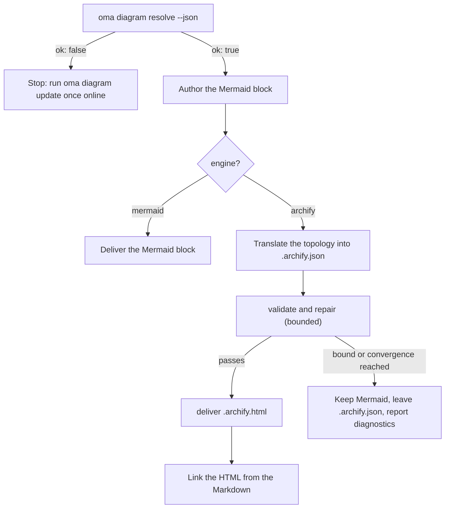

# Diagramengine {#diagram-engine}

`/architecture` (ADR's, aanbevelingen, reviews) en `/explain` (uitleggers van codewijzigingen) produceren structurele diagrammen. Het `/architecture`-artifact bevat altijd een **Mermaid**-blok in Markdown, en de `/explain`-workflow tekent inline SVG-diagrammen. Wanneer [archify](https://github.com/tt-a1i/archify) wordt opgelost, levert de architectuurworkflow daarnaast een **interactief, gevalideerd HTML-diagram** naast het artifact op. Het gebruikt een getypeerde JSON-specificatie en ondersteunt thema's voor donker/licht, pan-zoom, zoeken, relaties volgen en PNG/SVG/WebM-export.

Mermaid verdwijnt nooit: het is de tekstuele SSOT in Markdown en in git-diffs. archify is een afgeleid artifact.

---

<a id="always-the-latest-archify--nothing-to-install"></a>
## archify installeren {#install-archify}

archify is een MIT-gelicentieerde agent-skill (Node ≥ 18, nul runtime-afhankelijkheden). oh-my-agent gebruikt de kopie die via de [skills CLI](https://github.com/vercel-labs/skills) is geïnstalleerd en houdt geen eigen kopie bij:

- `oma diagram update` installeert archify wanneer het ontbreekt (`bunx skills add tt-a1i/archify --skill archify -g -y`) en werkt het anders bij (`bunx skills update archify -g -y`).
- `oma diagram resolve` leest alleen geïnstalleerde skillmappen en raakt het netwerk nooit aan. Zonder installatie valt `auto` terug op Mermaid en noemt het installatiecommando.
- `oma update` installeert archify niet.

```bash
# Illustrative output; the version, install path, and quality can vary.
oma diagram update
oma diagram resolve
# engine:   archify  (requested: auto)
# reason:   archify 2.15.0 via home:~/.agents/skills
# root:     /Users/you/.agents/skills/archify
# bin:      /Users/you/.agents/skills/archify/bin/archify.mjs
# version:  2.15.0
# quality:  showcase
# sidecar:  off (explain)
```

Volgorde van resolutie (eerste hit wint, identiek bij elke vendorruntime):

1. `diagram.archify.path` in `oma-config.yaml` — expliciete pin
2. Omgevingsvariabele `ARCHIFY_HOME` — expliciete pin
3. Geïnstalleerde skillmappen: project `.agents` / `.claude` / `.codex` / `.cursor` / `.qwen` / `.kiro` / `.gemini` / `.copilot` `/skills/archify`, daarna dezelfde onder `~`, daarna `~/.config/agents/skills/archify` en `~/.raven/workspace/skills/archify`

<!-- oma-docs:ignore-start -->
Voor een hit moet de geïnstalleerde of gepinde archify-map `bin/archify.mjs` bevatten.
<!-- oma-docs:ignore-end -->

Eerdere releases hielden een eigen kopie bij onder `~/.cache/oma-diagram/`. Die wordt niet meer gelezen; je kunt hem verwijderen.

---

## Configuratie {#configuration}

Sparse sectie in `.agents/oma-config.yaml` (ontbrekende keys gebruiken de getoonde standaardwaarden):

```yaml
diagram:
  engine: auto                # auto | archify | mermaid
  explain_sidecar: false      # /explain also writes an archify sidecar
  archify:
    path: null                # explicit install dir (pin)
    quality: showcase         # showcase | standard  → --quality
    open: false               # pass --open to deliver
```

`archify.managed`, `archify.channel` en `archify.check_interval_min` zijn verouderd: ze valideren nog, maar worden genegeerd, en `resolve` toont een waarschuwing zolang ze zijn ingesteld.

### Welke engine draait {#which-engine-runs}

Eén beslissing dekt de configuratiewaarde, of archify wordt opgelost en wat de workflow oplevert. "Opgelost" betekent dat een stap van de [resolutievolgorde](#always-the-latest-archify--nothing-to-install) een installatie vindt: een pin of een geïnstalleerde skillmap.

| `diagram.engine` | Wordt archify opgelost? | `oma diagram resolve --json` | Resultaat van `/architecture` |
|---|---|---|---|
| `auto` (standaard) | ja | `engine: archify`, `ok: true` | Mermaid-blok + gekoppelde `.archify.html` |
| `auto` | nee (archify niet geïnstalleerd) | `engine: mermaid`, `ok: true` | Alleen Mermaid; het rapport noemt `oma diagram update` |
| `archify` | ja | `engine: archify`, `ok: true` | Mermaid-blok + gekoppelde `.archify.html` |
| `archify` | nee | `engine: mermaid`, `ok: false`, exit 1 | De workflow stopt met de hint `oma diagram update` in plaats van stilzwijgend te downgraden |
| `mermaid` | niet gecontroleerd | `engine: mermaid`, `ok: true` | Alleen Mermaid; archify wordt nooit aangeroepen |

`oma diagram resolve --engine <auto|archify|mermaid>` overschrijft de configuratie voor één aanroep, en een prompt kan hetzelfde doen voor één run (`/explain 640 with archify`).

---

## CLI {#cli}

```bash
oma diagram resolve [--engine auto|archify|mermaid] [--json]
oma diagram update  [--json]
oma diagram archify <archify args…>
```

`oma diagram update` forceert een verversing en eindigt met 1 wanneer geen enkele archify-installatie kan worden opgelost.

`oma diagram archify` voert het opgeloste archify-executable uit met `ARCHIFY_UPDATE_CHECK_DISABLED=1` (geen netwerk) en geeft de exitcode door, zodat `validate` / `deliver` / `visual-check` zich precies gedragen zoals archify ze documenteert:

```bash
oma diagram archify guide "show the auth request lifecycle" --json
oma diagram archify validate architecture adr-auth.archify.json --quality showcase --json
oma diagram archify deliver  architecture adr-auth.archify.json adr-auth.archify.html --quality showcase --json
oma diagram archify visual-check adr-auth.archify.html --json   # exit 2 = no Chrome (skipped), or archify itself could not be resolved
```

`--json` op `resolve` retourneert `{ ok, requested, engine, quality, open, explainSidecar, archify?: { root, bin, version, source }, reason, probed, warnings }` — `source` is `config:…`, `env:…` of een label van een skillmap zoals `home:~/.agents/skills`; `warnings` somt genegeerde verouderde keys op. `--refresh` en `--offline` worden als verouderde no-ops geaccepteerd.

---

## Hoe workflows het gebruiken {#how-the-workflows-use-it}

Het gedeelde protocol staat in `.agents/skills/_shared/conditional/diagram-engine.md`. `/architecture` volgt deze reeks:

1. `oma diagram resolve --json`
2. Schrijf eerst het Mermaid-blok (altijd).
3. Als `engine: archify`: vertaal de Mermaid-topologie naar archify's JSON IR (`architecture` / `sequence` / `dataflow` / `lifecycle` / `workflow`) en lees alleen het bijbehorende schema en één voorbeeld uit de installatie.
4. `validate` → herstel → `deliver`, begrensd: stop wanneer de specificatie slaagt, wanneer de convergentieregel van archify afgaat, na 3 herstelpogingen, na in totaal 10 minuten, of wanneer dezelfde diagnose terugkeert. Semantische labels worden nooit alleen verwijderd om de controle te laten slagen.
5. Link naar de HTML — embed die nooit.



### `/architecture` {#architecture}

Alleen voor structurele beslissingen (grenzen, afhankelijkheden, datastroom). Output staat naast het Markdown-artifact onder `.agents/results/architecture/`:

```text
adr-notification-service.md            # Mermaid block + "Interactive:" link
adr-notification-service.archify.json  # frozen spec (kept even on failure)
adr-notification-service.archify.html  # delivered viewer
```

### `/explain` {#explain}

Opt-in, omdat het eigen contract van de explainer (één zelfstandig bestand, thematisering met CSS-variabelen) het insluiten van een tweede volledig HTML-document niet toestaat. Activeer dit met `diagram.explain_sidecar: true`, geef `oma explain render --archify` mee of vraag erom in de prompt ("with archify"). Er is geen Mermaid-blok en geen handgeschreven JSON: de renderer leidt de archify-specificatie af uit een `flow`- of `sequence`-blok van de draft (het paneel gemarkeerd met `{archify}`), voert `deliver` uit (met één keer een fallback van `showcase`- naar `standard`-kwaliteit) en koppelt `{date}-{slug}.archify.html` met een gewone `<a href>`. Het commando rapporteert `linked`, `skipped` (met de reden) of `failed` (eerste diagnose). De workflow herhaalt niet bij een mislukte sidecar, en een fout in de sidecar blokkeert de explainer nooit.

---

## Stack-posters (stack-diagram) {#stack-posters-stack-diagram}

Wanneer het diagram een tech-stack- of infrastructuurtopologie is waarvan de knooppunten vendorproducten zijn (AWS, Vercel, Postgres, …) en je om logo's vraagt, neemt `/architecture` de **stack-route** in plaats van archify. Het voert de upstream agent-skill [Caru-ini/stack-diagram](https://github.com/Caru-ini/stack-diagram) uit (MIT; Python 3.9+, netwerktoegang voor logo's) op dezelfde manier als `oma-slide` ppt-master uitvoert: er is geen oma-commando en geen configuratiekey. De routetabel staat in `.agents/skills/_shared/conditional/diagram-engine.md`.

- Resolutie: eerst de skillcatalogus van de runtime, anders `bunx skills use caru-ini/stack-diagram@stack-diagram`. Als die niet kan worden opgelost, valt de workflow terug op de archify ↔ Mermaid-beslissing hierboven en meldt dat.
- Output: `<artifact-stem>.stack.html` naast het Markdown-artifact, gekoppeld onder de sectie Diagram als `Stack: …`. Het Mermaid-blok blijft de SSOT.
- Alleen HTML. De PNG-export en de screenshotcontrole van upstream hebben Playwright + Chromium nodig; oma installeert of draait ze nooit.
- De upload naar de upstream-galerij (`share.py`) wordt overgeslagen, tenzij je expliciet vraagt om te publiceren.
- Grenzen: 2 build-pogingen, 5 minuten in totaal; een schone run van `build.py` geldt als acceptatie.
- `/explain` neemt deze route nooit; zijn sidecar wordt in code afgeleid uit de draft.

Zeg "archify" in de prompt om de structurele route af te dwingen, of "stack-diagram" / "with logos" om de stack-route af te dwingen.

---

## Foutmodi {#failure-modes}

Een archify die niet kan worden opgelost, wordt behandeld in de [beslistabel voor de engine](#which-engine-runs). De overige gevallen:

| Situatie | Resultaat |
|---|---|
| `oma diagram update` faalt (offline, `bunx` ontbreekt) | De fout van de skills CLI wordt getoond; een bestaande installatie blijft werken |
| `validate` convergeert nooit | Mermaid blijft het opgeleverde diagram; de laatste `.archify.json` blijft voor een mens liggen; diagnostics worden letterlijk gerapporteerd |
| Chrome ontbreekt voor `visual-check` | Gerapporteerd als `skipped`, nooit als geslaagd |
| `oma diagram archify …` eindigt met 2 | Chrome ontbreekt (`visual-check`) of archify kon niet worden opgelost; controleer eerst `oma diagram resolve --json` |

---

## Volgende stappen {#next-steps}

- [Code-uitlegger](./code-explainer.md) — de `/explain`-workflow en de optionele archify-sidecar
- [`/architecture`-workflow](../core-concepts/workflows.md#architecture) — ADR's en reviews met het Mermaid-blok
- [Semantiek van oma-config.yaml](./oma-config-semantics.md) — hoe de sectie `diagram:` wordt samengevoegd
- [CLI-commando's: diagram](../cli-interfaces/commands.md#diagram) — volledige optielijst
- [Marktonderzoek](./market-research.md) — hetzelfde installatiepatroon via de skills CLI voor de last30days-engine
- upstream van archify: [tt-a1i/archify](https://github.com/tt-a1i/archify)
- upstream van stack-diagram: [Caru-ini/stack-diagram](https://github.com/Caru-ini/stack-diagram)
