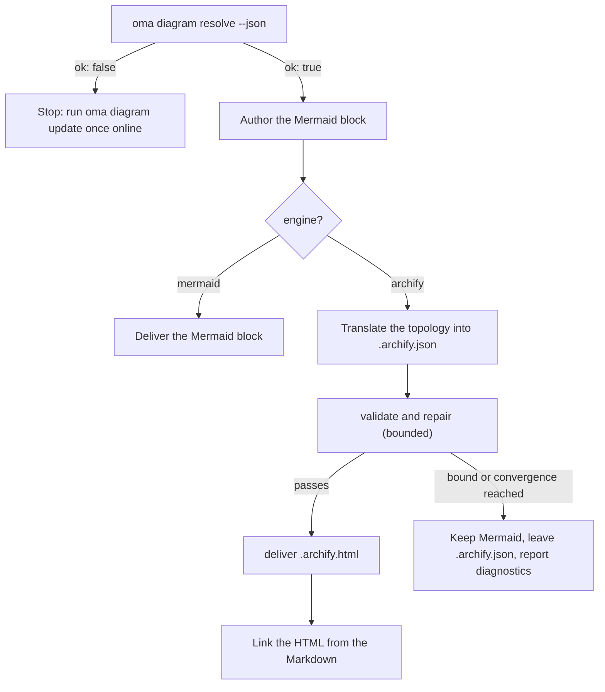

# Diagramengine {#diagram-engine}

`/architecture` (ADR's, aanbevelingen, reviews) en `/explain` (uitleggers van codewijzigingen) produceren allebei structurele diagrammen. Bij `/architecture` zijn dat altijd **Mermaid**-blokken in het Markdown-artifact (`/explain` tekent zijn eigen inline SVG-diagrammen) en — wanneer [archify](https://github.com/tt-a1i/archify) kan worden opgelost, wat normaal het geval is — daarnaast een **interactief, gevalideerd HTML-diagram** naast het artifact: thema voor donker/licht, pan-zoom, zoeken, relaties volgen, PNG/SVG/WebM-export en rendering vanuit een getypeerde JSON-specificatie.

Mermaid verdwijnt nooit: het is de tekstuele SSOT in Markdown en in git-diffs. archify is een afgeleid artifact.

---

## Altijd de nieuwste archify — niets installeren {#always-the-latest-archify--nothing-to-install}

archify is een MIT-gelicentieerde agent-skill (Node ≥ 18, nul runtime-afhankelijkheden). oh-my-agent vertrouwt niet op een kopie die je ooit hebt geïnstalleerd; het houdt een **eigen beheerde kopie** bij en volgt de nieuwste release:

- Cache: `~/.cache/oma-diagram/archify/<tag>/` plus een pointer in `state.json`.
- Voor elk gebruik vraagt `oma diagram resolve` GitHub om de nieuwste releasetag (beperkt tot één keer per `check_interval_min`, standaard 60 min), downloadt het de brontarball wanneer er een nieuwere tag is (atomische map per tag; oude tags worden verwijderd) en gebruikt het anders de gecachte kopie opnieuw.
- Netwerkfouten zijn nooit fataal: de gecachte kopie wordt gebruikt en als `stale` met de reden gerapporteerd. Alleen een eerste run zonder netwerk en zonder cache valt terug op een door de gebruiker geïnstalleerde skill-kopie en daarna op Mermaid.

```bash
# Illustrative output; the release tag, cache path, and quality can vary.
oma diagram update          # force a check / download now
oma diagram resolve
# engine:   archify  (requested: auto)
# reason:   archify 2.15.0 via managed:v2.15.0 (current)
# root:     /Users/you/.cache/oma-diagram/archify/v2.15.0
# bin:      /Users/you/.cache/oma-diagram/archify/v2.15.0/bin/archify.mjs
# version:  2.15.0
# quality:  showcase
# sidecar:  off (explain)
oma diagram resolve --offline   # never touch the network
```

Volgorde van resolutie (eerste hit wint, identiek bij elke vendorruntime):

1. `diagram.archify.path` in `oma-config.yaml` — expliciete pin, schakelt auto-latest uit
2. Omgevingsvariabele `ARCHIFY_HOME` — expliciete pin
3. **Managed latest** (`~/.cache/oma-diagram/archify`)
4. Door de gebruiker geïnstalleerde skillmappen: project `.agents` / `.claude` / `.codex` / `.cursor` / `.qwen` / `.kiro` `/skills/archify`, daarna dezelfde onder `~`, plus `~/.raven/workspace/skills/archify`

<!-- oma-docs:ignore-start -->
Voor een hit moet de beheerde of gepinde archify-installatie `bin/archify.mjs` bevatten.
<!-- oma-docs:ignore-end -->

---

## Configuratie {#configuration}

Sparse sectie in `.agents/oma-config.yaml` (ontbrekende keys gebruiken de getoonde standaardwaarden):

```yaml
diagram:
  engine: auto                # auto | archify | mermaid
  explain_sidecar: false      # /explain also writes an archify sidecar
  archify:
    managed: true             # false = never download; use pins / skill dirs only
    channel: stable           # stable (latest GitHub Release) | main (HEAD of main)
    check_interval_min: 60    # minutes between remote checks; 0 = every call
    path: null                # explicit install dir (pin)
    quality: showcase         # showcase | standard  → --quality
    open: false               # pass --open to deliver
```

### Welke engine draait {#which-engine-runs}

Eén beslissing dekt de configuratiewaarde, of archify wordt opgelost en wat de workflow oplevert. "Opgelost" betekent dat een stap van de [resolutievolgorde](#always-the-latest-archify--nothing-to-install) een installatie vindt: een pin, de beheerde nieuwste kopie of een door de gebruiker geïnstalleerde skillmap.

| `diagram.engine` | Wordt archify opgelost? | `oma diagram resolve --json` | Resultaat van `/architecture` |
|---|---|---|---|
| `auto` (standaard) | ja | `engine: archify`, `ok: true` | Mermaid-blok + gekoppelde `.archify.html` |
| `auto` | nee (bijvoorbeeld eerste run offline, of `managed: false` zonder skillmap) | `engine: mermaid`, `ok: true` | Alleen Mermaid; het rapport zegt dat je één keer online `oma diagram update` moet uitvoeren |
| `archify` | ja | `engine: archify`, `ok: true` | Mermaid-blok + gekoppelde `.archify.html` |
| `archify` | nee | `engine: mermaid`, `ok: false`, exit 1 | De workflow stopt met de hint `oma diagram update` in plaats van stilzwijgend te downgraden |
| `mermaid` | niet gecontroleerd | `engine: mermaid`, `ok: true` | Alleen Mermaid; archify wordt nooit aangeroepen |

`oma diagram resolve --engine <auto|archify|mermaid>` overschrijft de configuratie voor één aanroep, en een prompt kan hetzelfde doen voor één run (`/explain 640 with archify`).

---

## CLI {#cli}

```bash
oma diagram resolve [--engine auto|archify|mermaid] [--refresh] [--offline] [--json]
oma diagram update  [--json]
oma diagram archify <archify args…>
```

`oma diagram update` forceert een verversing en eindigt met 1 wanneer geen enkele archify-installatie kan worden opgelost.

`oma diagram archify` voert het opgeloste archify-executable uit met `ARCHIFY_UPDATE_CHECK_DISABLED=1` (geen netwerk) en geeft de exitcode door, zodat `validate` / `deliver` / `visual-check` zich precies gedragen zoals archify ze documenteert:

```bash
oma diagram archify guide "show the auth request lifecycle" --json
oma diagram archify validate architecture adr-auth.archify.json --quality showcase --json
oma diagram archify deliver  architecture adr-auth.archify.json adr-auth.archify.html --quality showcase --json
oma diagram archify visual-check adr-auth.archify.html --json   # exit 2 = no Chrome (skipped), or archify itself could not be resolved
```

`--json` op `resolve` retourneert `{ ok, requested, engine, quality, open, explainSidecar, archify?: { root, bin, version, source, status?, note? }, reason, probed }` — `source` is `managed:<tag>`, `config:…`, `env:…` of een label van een skillmap; `status` (`fresh` / `current` / `stale`) en `note` worden voor beheerde kopieën ingesteld.

---

## Hoe workflows het gebruiken {#how-the-workflows-use-it}

Het gedeelde protocol staat in `.agents/skills/_shared/conditional/diagram-engine.md`. `/architecture` volgt deze reeks:

1. `oma diagram resolve --json`
2. Schrijf eerst het Mermaid-blok (altijd).
3. Als `engine: archify`: vertaal de Mermaid-topologie naar archify's JSON IR (`architecture` / `sequence` / `dataflow` / `lifecycle` / `workflow`) en lees alleen het bijbehorende schema en één voorbeeld uit de installatie.
4. `validate` → herstel → `deliver`, begrensd: stop wanneer de specificatie slaagt, wanneer de convergentieregel van archify afgaat, na 3 herstelpogingen, na in totaal 10 minuten, of wanneer dezelfde diagnose terugkeert. Semantische labels worden nooit alleen verwijderd om de controle te laten slagen.
5. Link naar de HTML — embed die nooit.



### `/architecture` {#architecture}

Alleen voor structurele beslissingen (grenzen, afhankelijkheden, datastroom). Output staat naast het Markdown-artifact onder `.agents/results/architecture/`:

```text
adr-notification-service.md            # Mermaid block + "Interactive:" link
adr-notification-service.archify.json  # frozen spec (kept even on failure)
adr-notification-service.archify.html  # delivered viewer
```

### `/explain` {#explain}

Opt-in, omdat het eigen contract van de explainer (één zelfstandig bestand, thematisering met CSS-variabelen) het insluiten van een tweede volledig HTML-document niet toestaat. Activeer dit met `diagram.explain_sidecar: true`, geef `oma explain render --archify` mee of vraag erom in de prompt ("with archify"). Er is geen Mermaid-blok en geen handgeschreven JSON: de renderer leidt de archify-specificatie af uit een `flow`- of `sequence`-blok van de draft (het paneel gemarkeerd met `{archify}`), voert `deliver` uit (met één keer een fallback van `showcase`- naar `standard`-kwaliteit) en koppelt `{date}-{slug}.archify.html` met een gewone `<a href>`. Het commando rapporteert `linked`, `skipped` (met de reden) of `failed` (eerste diagnose). De workflow herhaalt niet bij een mislukte sidecar, en een fout in de sidecar blokkeert de explainer nooit.

---

## Foutmodi {#failure-modes}

Een archify die niet kan worden opgelost, wordt behandeld in de [beslistabel voor de engine](#which-engine-runs). De overige gevallen:

| Situatie | Resultaat |
|---|---|
| Updatecontrole faalt (offline, rate-limited) | Gecachte kopie wordt gebruikt en met de reden als `stale` gerapporteerd |
| `validate` convergeert nooit | Mermaid blijft het opgeleverde diagram; de laatste `.archify.json` blijft voor een mens liggen; diagnostics worden letterlijk gerapporteerd |
| Chrome ontbreekt voor `visual-check` | Gerapporteerd als `skipped`, nooit als geslaagd |
| `oma diagram archify …` eindigt met 2 | Chrome ontbreekt (`visual-check`) of archify kon niet worden opgelost; controleer eerst `oma diagram resolve --json` |

---

## Volgende stappen {#next-steps}

- [Code-uitlegger](./code-explainer.md) — de `/explain`-workflow en de optionele archify-sidecar
- [`/architecture`-workflow](../core-concepts/workflows.md#architecture) — ADR's en reviews met het Mermaid-blok
- [Semantiek van oma-config.yaml](./oma-config-semantics.md) — hoe de sectie `diagram:` wordt samengevoegd
- [CLI-commando's: diagram](../cli-interfaces/commands.md#diagram) — volledige optielijst
- [Marktonderzoek](./market-research.md) — hetzelfde managed-latest-patroon voor de last30days-engine
- upstream van archify: [tt-a1i/archify](https://github.com/tt-a1i/archify)
