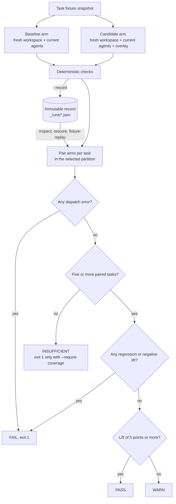

# Evaluatie van de harness {#harness-evaluation}

:::tip Hoe deze onderdelen samenhangen
[Skill-evaluatie](./skill-eval.md) meet of één `SKILL.md` helpt, en [skilloptimalisatie](./skill-opt.md) bewerkt die body onder held-out-gates. Harness-evaluatie (deze pagina) vergelijkt een volledige `.agents/`-overlay op repositorytaken. [Incidentregressiegevallen](./harness-incidents.md) zetten waargenomen fouten om in evaluatiegevallen en skill-fixtures. [Evolutie van de projectharness](./harness-evolution.md) voert het vastleggen van incidenten en skilloptimalisatie uit als een cyclus met budget, en [geplande agents](./scheduled-agents.md) is de OS-scheduler die die cyclus start.
:::

`oma harness eval` meet of een kandidaat-OMA-harness een vaste doelagent verbetert zonder het model van die agent te wijzigen. De opdracht past het evaluatiepatroon uit [AI4AI at Test-Time: Strong-to-Weak Capability Transfer via Harnesses](https://arxiv.org/abs/2608.12307) aan: houd het doelmodel vast, verander de harness en vergelijk de uitkomsten voor dezelfde taken.

Deze opdracht evalueert een grotere eenheid dan `oma skill eval`:

| Opdracht | Behandeling | Scoredoel |
|:--------|:----------|:-------------|
| `oma skill eval` | Eén `SKILL.md`-body | Agentuitvoer |
| `oma harness eval` | Een afgebakende `.agents/`-overlay | Bestanden en uitvoer die in een repository-workspace worden geproduceerd |

Gebruik skill eval om de vraag “helpt deze skill?” te beantwoorden. Gebruik harness eval om te bepalen of deze combinatie van skills, workflows, regels en agentinstructies de vaste agent repositorytaken betrouwbaarder laat voltooien.

**Vóór de eerste run:**

- Leg de eerste run vast met `--live --record`. `inspect` (de standaardactie), `rescore`, `fixture-replay` en `rerun` lezen allemaal dat record.
- Een oordeel vereist minstens vijf gescoorde taken in de geselecteerde partitie. `pass` vereist minstens 5 punten lift en geen regressies.
- `inspect`, `rescore` en `fixture-replay` doen geen modelaanroepen. `--live` en `--action rerun` doen er twee per geselecteerde taak.
- `promotionReady` is altijd `false`. Een pass is bewijs voor een menselijke beslissing, geen automatische promotie.
- Live runs hebben een vendor nodig met project-lokale skill-discovery (zie [Uitvoeren en vastleggen](#run-and-record)).

## Evaluatiemodel {#evaluation-model}

Een live run evalueert elke taak als een gepaard experiment:

1. OMA legt de begintoestand van de taakfixture vast. Een volledige momentopname dient als vertrekpunt voor beide armen, zodat ze met dezelfde bestanden beginnen, ook als de bronfixture tijdens de uitvoering verandert.
2. OMA kopieert de huidige definities van `agents`, `config`, `rules`, `skills` en `workflows` naar die workspace en projecteert ze naar het formaat van de geselecteerde vendor.
3. OMA herhaalt de setup in een tweede nieuwe workspace en past daar de kandidaat-overlay toe.
4. Voor beide armen worden dezelfde primaire agent, vendorroute, prompt, schrijfrechten en time-out gebruikt.
5. Deterministische controles inspecteren de resulterende workspace en optionele agentuitvoer. Vertrouwde commandocontroles draaien daarna in een verse kopie van de taakartifacts.

Het echte project wordt nooit als werkmap van een arm gebruikt. OMA legt de ruwe uitvoer en de uiteindelijke taakartifacts vast vóór de controles en het opruimen van de tijdelijke workspace. De eigen processandbox van de geselecteerde vendor blijft de autoriteit voor toegang buiten de werkmap.

Het diagram toont hoe gepaarde armen tot een beslissing komen. Offline acties stappen vanuit een opgeslagen record weer in bij de koppelstap.



## Indeling van de kandidaat {#candidate-layout}

Het kandidaatpad is een map met een gedeeltelijke `.agents/`-boom:

```text
candidate/
└── .agents/
    ├── agents/
    │   └── docs-curator.md
    ├── rules/
    │   └── documentation.md
    ├── skills/
    │   └── project-docs/
    │       └── SKILL.md
    └── workflows/
        └── docs-check.md
```

Alleen bestanden onder `.agents/agents`, `.agents/rules`, `.agents/skills` en `.agents/workflows` worden geaccepteerd. Hooks, evaluatiefixtures, state, resultaten, configuratiebestanden, symlinks en vendor-skillvarianten worden geweigerd. Beschermde frontmattervelden van de agent, zoals `model`, `tools`, `effort` en uitvoeringslimieten, moeten gelijk zijn aan de baseline. Een arm faalt ook als de uitvoerende agent vóór het scoren beschermde `.agents/`-definities wijzigt.

## Suiteformaat {#suite-format}

Een suite bestaat uit één YAML-bestand en één fixturemap per taak:

```text
harness-eval/
├── suite.yaml
└── fixtures/
    ├── stale-api-doc/
    │   ├── docs/api.md
    │   └── src/session.ts
    └── missing-guide/
        ├── docs/
        └── src/feature.ts
```

```yaml
schema_version: 2
id: docs-harness
agent: docs-curator
tasks:
  - id: stale-api-doc
    partition: validation
    prompt: Update the API documentation to match the implementation.
    workspace: fixtures/stale-api-doc
    weight: 1
    checks:
      - type: file_contains
        path: docs/api.md
        value: openSession
      - type: file_not_contains
        path: docs/api.md
        value: createSession
  - id: missing-guide
    partition: final-test
    prompt: Write the missing guide for the feature in this fixture.
    workspace: fixtures/missing-guide
    checks:
      - type: file_exists
        path: docs/feature.md
```

Versie 2 vereist zowel `validation`- als `final-test`-taken. Elke taak moet zijn partitie declareren. Validatie is de standaard; gebruik `--partition final-test` voor een afzonderlijke eindrun nadat de kandidaat is geselecteerd. Elke run scoort alleen de geselecteerde partitie, dus een beslissende validatierun vereist minstens vijf `validation`-taken en een final-test-run minstens vijf `final-test`-taken. Het voorbeeld hierboven is kort gehouden voor de leesbaarheid en rapporteert altijd `INSUFFICIENT`. De twee partities mogen geen fixturemappen delen of in elkaar nesten. Houd opnamebestanden buiten fixturemappen, kandidaat-overlays en evaluatorinvoer; deze locaties worden geweigerd om te voorkomen dat latere runs de finale controles zien. Suites van versie 1 draaien nog steeds als `exploratory`; ze kunnen niet als final-test worden geselecteerd.

Taak-ID’s moeten uniek zijn. Fixturepaden en controlepaden moeten binnen het project en de workspace van de taak blijven. Suites en fixtures moeten bovendien buiten de baselinedefinities blijven die naar elke arm worden gekopieerd. Fixtures mogen geen symlinks of besturingsoppervlakken van de agent-harness bevatten, zoals `.agents`, `.codex`, `.claude`, vendorskilmappen of rootbestanden met agentinstructies. Zo kan taakdata de gecontroleerde harness van geen van beide armen overschaduwen.

Gegenereerde afhankelijkheidsmappen zoals `node_modules` en `.venv` worden niet uit de baseline-harness gekopieerd. Commit deterministische helperbron en dependency-manifests in de skill; voorzie runtimeafhankelijkheden in de taakfixture wanneer een controle die nodig heeft.

### Typen controles {#check-types}

| Type | Velden | Voorwaarde voor slagen |
|:-----|:-------|:---------------|
| `file_exists` | `path` | Het pad bestaat nadat de arm klaar is. |
| `file_not_exists` | `path` | Het pad bestaat niet. |
| `file_contains` | `path`, `value` | Het bestand bestaat en bevat de waarde. |
| `file_not_contains` | `path`, `value` | Het bestand bestaat en bevat de waarde niet. |
| `output_contains` | `value` | De vastgelegde agentuitvoer bevat de waarde. |
| `output_not_contains` | `value` | De vastgelegde agentuitvoer bevat de waarde niet. |
| `output_judge` | `rubric` | Beoordeeld contract dat in incidenten wordt opgenomen; de mechanische evaluator meldt het als niet geëvalueerd (zie [Incidentregressiegevallen](./harness-incidents.md)). |
| `file_json_equals` | `path`, `value`, optioneel `pointer` | De geparste JSON van het bestand is gelijk aan `value`, eventueel op een JSON Pointer. |
| `output_json_equals` | `value`, optioneel `pointer` | De vastgelegde uitvoer is geldige JSON en is gelijk aan `value`, eventueel op een JSON Pointer. |
| `command` | `argv`, `checker`, `timeout_ms`, `expected_exit_code` | Het vertrouwde subproces eindigt binnen zijn time-out en geeft de opgegeven exitcode terug. |

JSON-asserties vergelijken geparste waarden, inclusief typen; een tekst die succes meldt, kan niet voldoen aan een JSON-statusassertie. `pointer` gebruikt de JSON Pointer-syntaxis, zoals `/result/count`, en verwijst standaard naar de volledige waarde.

Commandocontroles worden geschreven door de vertrouwde eigenaar van de suite:

```yaml
- type: command
  argv: [/absolute/path/to/node, "{checker}", state.json]
  checker: checkers/verify-state.mjs
  timeout_ms: 5000
  expected_exit_code: 0
```

`checker` wordt relatief aan het suitebestand opgelost. Het moet een zelfstandig, regulier bronbestand zijn dat buiten elke fixture, de kandidaat-overlay en de `.agents`-definities van de baseline is opgeslagen. `argv[0]` moet een absoluut pad naar een uitvoerbaar bestand buiten het project zijn; `{checker}` moet een volledig argument zijn. OMA geeft argumenten rechtstreeks door, zonder shell-interpolatie. Time-outs moeten positieve gehele getallen zijn van hoogstens 300.000 milliseconden. Exitcodes zijn gehele getallen van 0 tot en met 255.

Vóór de dispatch maakt OMA een momentopname van de bronbytes van de checker en berekent hashes van de evaluatordefinities en het uitvoerbare bestand. Na de dispatch kopieert OMA de taakartifacts naar een aparte tijdelijke workspace, schrijft de checker uit de momentopname buiten die artifacts weg en roept die daar aan. Elk commando krijgt een verse kopie; één checker kan de invoer van de volgende controle niet wijzigen. Gegenereerde harnessprojecties worden uitgesloten en symlinks in artifacts worden geweigerd. Als de checkerbron tijdens een arm verandert, faalt die arm; gewijzigde bron wordt nooit in de plaats van de momentopname gebruikt. De checker moet vaste asserties gebruiken tegen artifacts of applicatiegedrag en zijn oordeel niet delegeren aan tests of pakketscripts die de kandidaat kan bewerken.

Controles en checkerpaden worden niet aan de agentprompt of de fixture toegevoegd. De invoer van de geselecteerde taak is tijdens de run noodzakelijkerwijs zichtbaar. Dit beschermt de integriteit van de evaluator en scheidt de partities; het verhindert niet dat een proces van dezelfde gebruiker andere bestanden op de host leest.

## Uitvoeren en vastleggen {#run-and-record}

Live-modus voert per geselecteerde taak twee dispatches uit, print een dispatchpreview en vraagt om bevestiging:

```bash
oma harness eval \
  --suite harness-eval/suite.yaml \
  --candidate candidate \
  --live --record \
  --record-file harness-eval/_runs/trial-1.json
```

Gebruik `--yes` voor niet-interactieve uitvoering en `--timeout <duration>` om dezelfde wall-clocklimiet per arm in te stellen (standaard `15m`; een eenheid is verplicht, bijvoorbeeld `--timeout 45m`). `oma harness incident reproduce` accepteert dezelfde vlag. Live-uitvoering vereist een vendor die harnessbestanden relatief aan de projectworkspace ontdekt. OMA weigert HOME-gebaseerde discovery omdat de baseline dan kandidaatinhoud die globaal is geïnstalleerd zou kunnen zien.

De vendor komt uit de `agent` van de suite, opgelost via de modelconfiguratie van het project:

| Vendor | Live `harness eval`, `--action rerun`, `incident reproduce` |
|---|---|
| `claude`, `codex`, `commandcode`, `copilot`, `cursor`, `kiro`, `opencode`, `qwen` | Toegestaan: project-lokale skillmap |
| `antigravity`, `hermes`, `kimi` | Geweigerd: HOME-gebaseerde skill-discovery |
| Elke vendor zonder bekende project-skillmap | Geweigerd |

Offline acties (`inspect`, `rescore`, `fixture-replay`) doen geen dispatch, dus deze controle is daarop niet van toepassing.

Met `--record` wordt een onveranderlijk JSON-record van versie 2 geschreven. De standaardlocatie is `_runs/` naast de suite, met de baseline-/kandidaathashes in de bestandsnaam. Gebruik voor een andere live run een nieuw `--record-file`; een bestaande bestemming wordt vóór de dispatch geweigerd. Records bewaren:

- de identiteit van de suite, de partitie, de provenance van prompts en fixtures, de baseline-/kandidaathashes en de hashes van evaluator, checker en uitvoerbaar bestand;
- de oorspronkelijke uitvoer en de hash ervan, inclusief beschikbare diagnostische stdout van mislukte dispatches;
- manifesten van de begin- en eindartifacts met bestandsbytes, hashes per bestand, bestands- en mapmodi en een manifestdigest;
- verwijzingen naar checkers, uitkomsten per arm, de incidentidentiteit wanneer die is meegegeven en de hash van het bronrecord bij een rerun.

Taakmomentopnames zijn begrensd tot 5 MiB per bestand, 32 MiB in totaal en 2.000 items. Symlinks, speciale bestanden, paden die geheimen bevatten, onleesbare bestanden en te grote data worden als weglatingen vastgelegd. Gekopieerde besturingsoppervlakken van de harness worden uitgesloten van de uiteindelijke taakartifacts. Onvolledige momentopnames blijven expliciete beperkingen van de evidence; ze kunnen niet dienen als basis voor een vastgezette rerun en volstaan niet voor rescoring van bestanden. Ruwe uitvoer kan nog steeds controles ondersteunen die alleen op uitvoer zijn gebaseerd, wanneer de oorspronkelijke dispatch is geslaagd.

Records hebben een eigen integriteitshash. Een gewijzigd record of een gewijzigde artifacthash wordt geweigerd. Deze hashes identificeren evidence; ze bevestigen niet dat het proces was afgeschermd en maken een resultaat niet promotieklaar.

### Uitvoeringsomstandigheden {#execution-conditions}

Elke live- of rerun-evaluatie bepaalt vóór de eerste dispatch een uitvoeringsmanifest en slaat dat als `manifest` op in het record. Het benoemt de omstandigheden waarop een oordeel betrekking heeft, zodat een opgeslagen score nooit wordt aangezien voor bewijs over een ander model, een andere CLI of een andere OMA-build:

| Veld | Betekenis |
|---|---|
| `vendor`, `dispatchMode`, `runtimeVendor`, `command` | Opgeloste dispatchroute en de naam van het CLI-programma. |
| `model`, `modelSource` | Het model dat OMA uit het agentplan of de vendorstandaard heeft bepaald. `vendor-session` betekent dat de eigen sessieconfiguratie van de vendor het model kiest en OMA het niet heeft vastgezet. |
| `effort`, `thinking` | Redeneerinstellingen uit het agentplan, indien aanwezig. |
| `cliVersion`, `cliVersionStatus` | Eerste regel van `<command> --version` (`probed`), of `unavailable` wanneer de probe is mislukt. |
| `omaVersion`, `platform`, `arch`, `node` | Host en OMA-build. |
| `environmentPolicy` | Namen van de omgevingsvariabelen die de armen hebben ontvangen, de afgedwongen items en hoeveel er zijn uitgefilterd. Waarden worden nooit vastgelegd. |
| `memory`, `confinement` | `memory: disabled` voor elke arm; `confinement` vermeldt wat de dispatch wel en niet beperkt (tijdelijke workspace, onbeperkt netwerk, overgenomen credentials, standaardtools van de vendor). |
| `manifestHash` | Identiteit van de bovenstaande omstandigheden. |

Het manifest is een beschrijving en geen bevestiging: het legt vast wat OMA heeft bepaald, en de `confinement`-velden vermelden uitdrukkelijk dat isolatie van netwerk en credentials niet wordt afgedwongen. `promotionReady` blijft `false`.

### Omgevingsbeleid {#environment-policy}

Beide armen krijgen dezelfde omgeving, gefilterd via een allowlist. Basisvariabelen (`PATH`, `HOME`, locale-, temp-, proxy- en certificaatinstellingen), elke `OMA_*`-variabele en de prefixen voor credentials en runtimedetectie van de doelvendor worden doorgelaten; items die een dispatchbuilder voor de aanroep toevoegt, blijven behouden. Al het andere wordt uitgefilterd, zodat een kandidaat niet per ongeluk bij een deploytoken of de sleutel van een andere provider kan komen. `OMA_NO_AGENTMEMORY=1` wordt afgedwongen, zodat het geheugen van de vendor geen context kan meenemen tussen de baseline- en de kandidaatarm.

Stel `OMA_HARNESS_ENV_PASSTHROUGH=NAME1,NAME2` in om extra variabelen door te geven die een taak echt nodig heeft. De namen verschijnen in het manifest onder `environmentPolicy.extra`. Voor een vendor zonder bekende prefixset meldt het manifest `vendorKnown: false` en bereiken alleen basisvariabelen, `OMA_*`-variabelen en doorgegeven variabelen het proces.

## Een opname hergebruiken {#reuse-a-recording}

De opdracht onderscheidt vier acties:

| Actie | Uitgevoerd werk | Agent-/modelaanroepen |
|:-------|:---------------|:------------------|
| `inspect` | Aggregeert opgeslagen oordelen per arm na validatie van de provenance. Er draaien geen controles. | Geen |
| `rescore` | Past de huidige uitvoer- en bestandscontroles toe op de oorspronkelijke ruwe uitvoer en artifactbytes. | Geen |
| `fixture-replay` | Matcht een aangeleverd transcript van toolverzoeken, speelt de fixturereacties en bestandswijzigingen ervan af en past daarna ondersteunde controles toe. | Geen |
| `rerun` | Voert de geconfigureerde agent uit in verse workspaces die zijn gevuld vanuit de vastgelegde beginmomentopnames. | Twee per geselecteerde taak |

`--action inspect` is de standaard. `--mock` is een alias voor inspectie en kan niet met een andere actie worden gecombineerd. Noch inspectie noch fixture-replay voert een agent opnieuw uit.

### Opgeslagen oordelen inspecteren {#inspect-stored-verdicts}

```bash
oma harness eval \
  --suite harness-eval/suite.yaml \
  --candidate candidate \
  --action inspect \
  --record-file harness-eval/_runs/trial-1.json
```

Inspectie vereist dat de hashes van de oorspronkelijke suite, partitie, evaluator, baseline en kandidaat overeenkomen. Het toont de vastgelegde scores zonder checkers aan te roepen of uitvoer opnieuw te evalueren. Records van versie 1 blijven beschikbaar voor inspectie wanneer hun vereiste provenance overeenkomt. Oudere records zonder provenance voor partitie/evaluator doorstaan de huidige CLI-validatie niet. Legacy-oordelen kunnen niet worden herlabeld als nieuwe ruwe evidence: verzamel een nieuw live record voor rescoring, fixture-replay of een vastgezette rerun.

### Oorspronkelijke evidence opnieuw scoren {#rescore-original-evidence}

```bash
oma harness eval \
  --suite harness-eval/suite.yaml \
  --candidate candidate \
  --action rescore \
  --record-file harness-eval/_runs/trial-1.json
```

Rescoring gebruikt de huidige controles en negeert de oorspronkelijke `passed`-waarden en controleoordelen. De identiteit van de suite, de taak-ID, de prompt en het incident, de baseline, de kandidaat en de geselecteerde partitie moeten nog steeds overeenkomen. Checkerdefinities mogen veranderen; het nieuwe resultaat beschrijft hoe de oorspronkelijke bytes presteren tegen die controles. Wijzigingen in de fixturebestanden van vandaag vervangen de vastgelegde eindartifacts niet.

Commandocontroles volstaan niet voor offline rescoring, omdat het record de externe runtime en omgeving niet vastzet. Controles die gericht zijn op uitgesloten of onvolledige artifacts volstaan evenmin. Een mislukte oorspronkelijke dispatch laat diagnostische uitvoer achter, die door rescoring geen geldige meting kan worden. Gebruik een live rerun wanneer de huidige acceptatiecriteria uitvoering van commando’s vereisen.

### Toolfixtures opnieuw afspelen {#replay-tool-fixtures}

Een transcriptbestand bevat één object of een array van objecten met unieke taak-ID’s. Lever één transcript per geselecteerde taak aan:

```json
{
  "schemaVersion": 1,
  "taskId": "stale-api-doc",
  "requests": [
    { "tool": "documentation", "request": { "path": "docs/api.md" } }
  ],
  "steps": [
    {
      "tool": "documentation",
      "request": { "path": "docs/api.md" },
      "response": { "body": "Use openSession." },
      "writes": [
        { "path": "docs/api.md", "content": "Use openSession.\n" }
      ],
      "removes": []
    }
  ],
  "output": "Fixture completed.",
  "dependencies": [
    { "name": "documentation", "repeatability": "fixture" }
  ]
}
```

```bash
oma harness eval \
  --suite harness-eval/suite.yaml \
  --candidate candidate \
  --action fixture-replay \
  --record-file harness-eval/_runs/trial-1.json \
  --transcript harness-eval/tool-fixtures.json
```

Verzoeken moeten exact overeenkomen met de stapvolgorde, op toolnaam en verzoekwaarde. `writes` en `removes` zijn optionele wijzigingen aan relatieve taakbestanden; ze kunnen de workspace niet verlaten of besturingsoppervlakken van de harness wijzigen. Toolnamen zijn data en er wordt geen transcriptcommando uitgevoerd. `output` is fixturedata en is vereist wanneer een uitvoercontrole die nodig heeft.

Elke gedeclareerde afhankelijkheid heeft een `name`, `repeatability` (`fixture`, `live` of `unavailable`) en een optionele `reason` en `fixture`-verwijzing. Een fixture-afhankelijkheid vereist een overeenkomende stap met die toolnaam. Live of niet-beschikbare afhankelijkheden maken de replay onvoldoende. Het optionele veld `fixture` is beschrijvend; replay verwerkt de aangeleverde stappen in plaats van dat pad te laden. Transcriptreplay valideert gedeclareerde afhankelijkheden en stelt niet vast dat elke historische afhankelijkheid is vastgelegd.

Beide vastgelegde armen moeten dezelfde volledige beginmomentopname hebben. OMA past hetzelfde transcript op elke arm toe en voert de huidige uitvoer- en bestandscontroles uit. Commandocontroles vereisen een live rerun. Deze resultaten tonen aan dat de aangeleverde fixturevolgorde kan worden afgespeeld; ze kunnen geen gedragsverbetering van de kandidaat of reproduceerbaarheid van het model vaststellen.

### De agent opnieuw uitvoeren vanuit vastgezette beginbestanden {#rerun-the-agent-from-pinned-initial-files}

```bash
oma harness eval \
  --suite harness-eval/suite.yaml \
  --candidate candidate \
  --action rerun \
  --record-file harness-eval/_runs/trial-1.json
```

Een rerun vereist een overeenkomende suite-/taakidentiteit en identieke, volledige beginmomentopnames voor beide oorspronkelijke armen. Het start echte agentaanroepen met de huidige baseline, kandidaat, geconfigureerde vendor-/modelroute en huidige controles. De oorspronkelijke eindartifacts worden niet als begintoestand gebruikt. Een latere wijziging aan de bronfixture kan de vastgelegde begintoestand daarom niet ongemerkt veranderen.

Reruns hebben dezelfde dispatchpreview, bevestiging en time-outgedrag als live runs. Ze kunnen een gewijzigde kandidaat gebruiken; selecteer de oorspronkelijke bron expliciet met `--record-file`. Voeg `--record` toe om naast het bronrecord een nieuw bestand op te slaan waarvan de naam eindigt op `-rerun-<timestamp>.json`; het is gekoppeld aan de hash van het bronrecord. Het oorspronkelijke record blijft behouden.

Vastgezette bestanden reproduceren geen toestand van externe diensten, klokgedrag of modelsampling. Een rerun is nieuw gedragsbewijs onder de vermelde omstandigheden en geen bewering dat het oorspronkelijke agenttraject deterministisch is gereproduceerd.

### Vastgelegde omstandigheden bij replay {#recorded-conditions-on-replay}

`inspect`, `rescore` en `fixture-replay` rapporteren het manifest dat in het record is opgeslagen met `conditions: "recorded"`, of `conditions: "unavailable"` voor een record van vóór de manifesten. OMA bepaalt ook de huidige omstandigheden en vermeldt elk verschil in vendor, dispatchmodus, model, effort, thinking, CLI-versie, OMA-versie of host als replaybeperking en promotieblokkade:

```text
replay limitation: Recorded conditions differ from current: model: recorded "gpt-5.4", current "gpt-5.5"
```

De CLI-versie wordt bij replay alleen uitgelezen wanneer het record zelf een uitgelezen versie bevat; een niet-uitgelezen paar wordt als niet vergelijkbaar gerapporteerd en niet als gelijk. Vastgelegde oordelen blijven zichtbaar onder hun oorspronkelijke omstandigheden. Ze zijn geen bewijs voor de kandidaat onder de huidige omstandigheden totdat een live- of rerun-evaluatie een record oplevert waarvan het manifest overeenkomt.

### Verbruik {#usage}

Elke arm slaat `usage` op wanneer de vendor die heeft gerapporteerd: invoer- en uitvoertokens, kosten in USD, wall-clocktijd en het model dat de meeste uitvoer produceerde. De evaluatie telt ze op als `usage` met `status` `actual`, `partial` (sommige armen rapporteerden niets) of `unknown`. Resultaatenveloppen van de vendor worden uitgepakt voordat de controles draaien en voordat de uitvoer wordt vastgelegd, zodat `output_contains` en `output_json_equals` het antwoord van de agent zien in plaats van de JSON-administratie eromheen; het verbruik in de envelop is wat dit veld voedt.

### Rapportlabels {#report-labels}

Rapporten bevatten `executionMode`, `evidenceStatus` (`complete`, `insufficient` of `legacy`), `replayLimitations` en, indien beschikbaar, een `sourceRecordHash`. Live- en rerun-rapporten voegen `manifest`, `conditions: "current"` en `traceSession` toe. De volledigheid van de evidence beschrijft wat de huidige actie kan inspecteren of evalueren. Overgenomen incidentbeperkingen blijven zichtbaar, ook wanneer de huidige bestandsvastlegging compleet is. `promotionReady` blijft in elke modus `false`.

## Tracegebeurtenissen {#trace-events}

Elke live- of rerun-evaluatie schrijft gekoppelde gebeurtenissen naar de lokale sessie `oma-harness-<suite-id>`:

| Gebeurtenis | Payload |
|---|---|
| `harness.eval.started` | Actie, hashes van suite, baseline, kandidaat en evaluator, partitie, manifesthash, opgeloste vendor, model, CLI-versie en aantal taken. |
| `harness.arm.completed` | Eén per arm: taak, arm, slaagstatus, duur, uitvoerhash, dispatchfout, exitcode, time-outvlag en de armtrace. `parentEventId` verwijst naar de startgebeurtenis. |
| `harness.eval.completed` | Beslissing, lift, evidencestatus en, wanneer `--record` is gebruikt, het recordpad en de hash. |

Alle gebeurtenissen van één evaluatie delen een `causalityKey`. Wanneer een gebeurtenis niet kan worden geschreven, vermeldt het rapport `Trace event <kind> was not recorded` als replaybeperking in plaats van die stilzwijgend weg te laten.

Elke armrun slaat ook `diagnostics` en `trace` op in het record:

- `diagnostics`: exitcode, signaal, time-outvlag en de laatste 8 KiB van stderr met `stderrStatus` (`captured`, `truncated` of `unavailable`).
- `trace`: wat de harness kon waarnemen. `output` is `complete`, `partial` (een mislukt proces leverde toch stdout op) of `unavailable`; `artifacts` geeft aan of de eindmomentopname compleet is; `changedPaths` somt de bestanden op die de arm heeft toegevoegd, gewijzigd of verwijderd ten opzichte van de vastgezette beginworkspace (begrensd op 200, met `changedPathsTruncated`); `toolCalls` is altijd `unsupported`, omdat vendor-CLI’s geen waarnemingen per tool aan de harness blootstellen.

Een mislukte arm behoudt daarom zijn gedeeltelijke uitvoer, de staart van stderr, de exitstatus en de bestandswijzigingen, zodat de laatste fout kan worden herleid tot wat de arm heeft gewijzigd. Ontbrekende waarneming wordt als toestand vastgelegd; ze wordt nooit gelezen als een schone run.

## Metrics en beslissingsgate {#metrics-and-decision-gate}

Elke taak slaagt alleen wanneer elke controle slaagt. Scores zijn gewogen gemiddelden over gepaarde taken:

```text
lift = candidateScore - baselineScore
```

OMA rapporteert ook:

- gecorrigeerde taken: baseline faalde en kandidaat slaagde;
- teruggevallen taken: baseline slaagde en kandidaat faalde;
- dekking: er zijn minstens vijf gepaarde, scorebare taken in de geselecteerde partitie vereist.

De scorebeslissing is `pass` wanneer de lift minstens 5 procentpunten is en er geen regressies zijn. Elke regressie of negatieve lift laat de kandidaat falen. Een niet-negatieve lift onder 5 punten geeft een waarschuwing en minder dan vijf gepaarde taken leidt tot de beslissing `insufficient`. Voeg `--require-coverage` toe om onvoldoende dekking in CI met een niet-nul exitcode te laten eindigen. Een score is geen bewijs als een arm ontbreekt, een recordhash verouderd is of een deterministische controle niet compleet is. Fouten bij de live dispatch en integriteitsfouten van de evaluator forceren een falende beslissing; ze kunnen niet als succesvolle lift meetellen. Rescoring en fixture-replay laten armen met onvoldoende evidence buiten de scorebare paren en rapporteren een beslissing `insufficient`, in plaats van ontbrekende evidence als regressie van de kandidaat te behandelen.

Een geslaagde score bewijst nog niet dat de kandidaat voor promotie in aanmerking komt. Rapporten bevatten de partitie, de evaluatorhash, `promotionReady: false` en expliciete blokkades. Legacy- en validatieruns missen final-test-evidence. Huidige dispatchroutes bevestigen niet dat de toegang tot het bestandssysteem is afgeschermd, dus zelfs een final-test-run kan geen beschermde finale evaluatie claimen of promotie autoriseren. Dit veld blijft `false` totdat een uitvoeringsprovider die grens kan vaststellen.

## Probleemoplossing {#troubleshooting}

| Melding of symptoom | Oorzaak | Oplossing |
|---|---|---|
| `No matching harness recording found: <path>. Run --live --record first.` | De standaardactie is `inspect`, die een opgeslagen record leest. | Voer één keer `--live --record` uit, of geef een bestaand record mee met `--record-file`. |
| `Harness recording is stale; suite, partition, evaluator, baseline, or candidate inputs changed` | `inspect` vereist dat elke vastgelegde hash overeenkomt. | Leg een nieuwe run vast met een nieuw `--record-file`. Gebruik `--action rescore` als je de huidige controles op de opgeslagen bytes wilt toepassen. |
| `Recorded evidence belongs to a different baseline, candidate, or partition` | `rescore` of `fixture-replay` wees naar een record van andere invoer. | Selecteer het overeenkomende `--record-file` en `--partition`, of leg opnieuw vast. |
| `Harness recording is immutable; choose a new --record-file before dispatch` | `--record` zou een bestaand bestand overschrijven. | Geef een nieuw pad voor `--record-file` op. |
| `--record requires --live or --action rerun` | `--record` werd gecombineerd met een offline actie. | Laat `--record` weg, of gebruik `--live`. |
| `--action fixture-replay requires --transcript` | Er is geen transcript aangeleverd. | Voeg `--transcript <path>` toe. |
| `Removed option --timeout-minutes. Use --timeout.` | Oude spelling van de vlag. | Gebruik `--timeout 30m` (een eenheid is verplicht). |
| `Vendor <vendor> cannot provide project-local isolated harness discovery` | De suite-agent wordt opgelost naar een vendor met HOME-discovery of een vendor zonder project-skillmap. | Routeer de suite-agent naar een vendor uit de tabel onder [Uitvoeren en vastleggen](#run-and-record). |
| `Candidate overlay must be stored separately from the baseline .agents tree` | `--candidate .` of een pad binnen `.agents/`. | Bewaar overlays elders, bijvoorbeeld `candidates/fix/.agents/`. |
| `Candidate file is not allowed: <path>` | De overlay bevat bestanden buiten `agents/`, `rules/`, `skills/` of `workflows/`. | Verwijder die bestanden uit de overlay. |
| `Candidate agent field <field> cannot change model or execution controls: <path>` | Beschermde frontmatter wijkt af van de baseline. | Herstel `model`, `tools`, `effort` en de andere beschermde velden. |
| `Suite requires at least one final-test task` | Een suite met `schema_version: 2` heeft beide partities nodig. | Voeg een taak toe met `partition: final-test`. |
| `decision: INSUFFICIENT` | Minder dan vijf gescoorde taken in de geselecteerde partitie, of ontbrekende armen. | Voeg taken toe tot de partitie er vijf heeft, en lees de regels `replay limitation:`. |
| `decision: FAIL` | Een dispatchfout (gevolgd door regels `<task>/<arm>: ...`), een regressie (taak-ID's onder `regressed:`) of negatieve lift. | Lees bij een dispatchfout de regel `exit=... timedOut=... stderr=...` onder elke mislukte arm. Vergelijk bij een regressie de twee armen van de vermelde taken. |

## Huidige begrenzing {#current-boundary}

Kandidaat-overlays worden extern geproduceerd; deze opdracht implementeert geen builder en ook geen geautomatiseerde lus `harness opt`. Artifactvastlegging, offline rescoring, replay van toolfixtures, reruns vanuit vastgezette bestanden, partitieselectie, momentopnames van evaluators, uitvoeringsmanifesten, een omgevingsallowlist en gekoppelde tracegebeurtenissen zijn beschikbaar, maar geheimhouding van held-out data op OS-niveau, afscherming van netwerk of credentials, herhaalde stochastische proeven en verplichte modelpinnen voor geneste subagentaanroepen zijn niet vastgesteld. Token- en kostenverbruik wordt per arm vastgelegd en opgeteld wanneer de vendor het rapporteert (zie [Verbruik](#usage)). De omgevingsallowlist beperkt welke variabelen een vendorproces erft; ze weerhoudt een vendor-CLI er niet van zijn eigen credentialopslag te lezen of het netwerk te bereiken. Tot er pinning voor geneste aanroepen bestaat, vermijd je in suites die één vast model willen meten kandidaatworkflows die andere geconfigureerde agentrollen spawnen.
