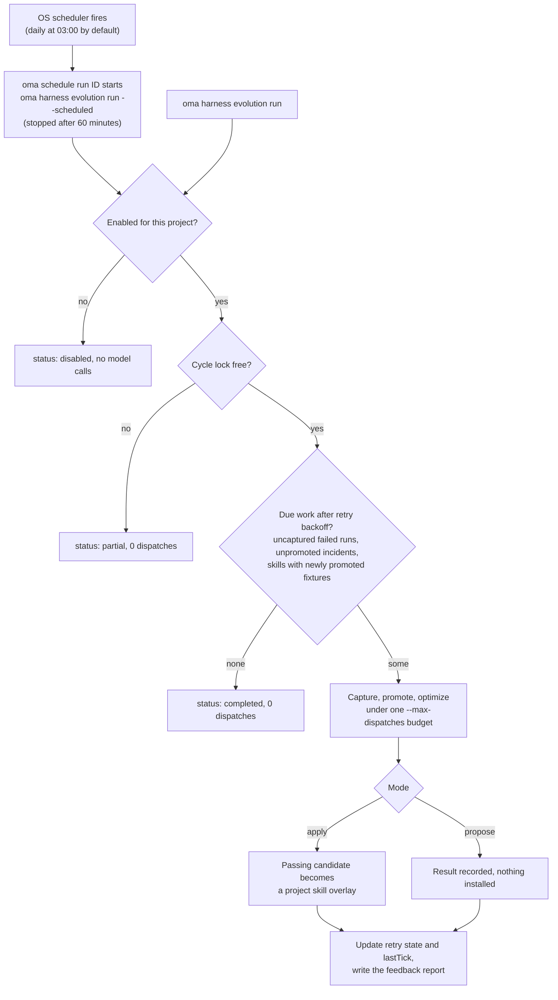

# Evolutie van de projectharness

OMA kan evidence verzamelen uit bijgehouden agentruns en mislukkingen verwerken in een geplande feedbackcyclus. Automatische skillwijzigingen staan **uit totdat je ze voor een project inschakelt**. Elke cyclus heeft een eindig budget aan modelaanroepen en een toegepaste wijziging moet de bestaande evaluatiegates voor skills doorstaan.

Het geautomatiseerde pad verbetert skilldocumenten. Wijzigingen aan de procedure van de optimizer of maintainer blijven een afzonderlijke, handmatig aangeroepen [meta-optimalisatie](./skill-opt.md#meta-optimization-the-procedure-as-the-candidate).

## Een project inschakelen {#enable-a-project}

Voer dit uit vanuit de projectroot:

```bash
# Example allowance: at most 300 model dispatches per scheduled cycle
oma harness evolution enable --max-dispatches 300

# Evaluate proposals without applying them
oma harness evolution enable --max-dispatches 300 --mode propose

# Choose a schedule in the operating system's local time
oma harness evolution enable --max-dispatches 300 --cron "0 3 * * *"

oma harness evolution status --json
```

`enable` toont de opgeslagen instellingen en de job-ID in de scheduler:

```json
{
  "enabled": true,
  "scheduleId": "sch_abcdefgh2345",
  "mode": "apply",
  "maxDispatches": 300
}
```

`status --json` retourneert `config`, `schedule` (de schedulervermelding, of `exists: false`), `pending` (het aantal onvoltooide nieuwe pogingen), `conflicts` (overlayconflicten per skill) en `state` (nieuwe pogingen en `lastTick`).

Het standaardschema is dagelijks om 03:00 lokale tijd en de standaardmodus is `apply`. `--max-dispatches` is verplicht bij het inschakelen en moet een positief geheel getal zijn. De voorbeeldwaarde is een aanroeplimiet, geen prijsschatting en geen belofte dat een cyclus wordt voltooid. Grotere fixturesuites en herhaalde beoordeling verbruiken meer aanroepen.

<!-- oma-docs:ignore-start -->
Instellingen worden opgeslagen in `.agents/evolution/harness-evolution.json`. Gegenereerde evidence, de status voor nieuwe pogingen en de cyclusvergrendeling staan onder `.agents/state/harness-evolution/`.
<!-- oma-docs:ignore-end -->

Bij het inschakelen wordt een ingebouwde job geregistreerd bij de bestaande [OS-scheduler](./scheduled-agents.md) van OMA; die verschijnt in `oma schedule list` met agent `__builtin__`. Op het geplande moment start `oma schedule run <id>` in dit project `oma harness evolution run --scheduled` en stopt die na 60 minuten, dus stem `--max-dispatches` af op een cyclus die binnen een uur past. Opnieuw inschakelen werkt de job van het project bij in plaats van een tweede aan te maken. Stop het schema met `oma harness evolution disable` in plaats van `oma schedule delete`, zodat de opgeslagen instellingen consistent blijven.

```bash
# Run one cycle now under the saved mode and budget
oma harness evolution run --json

# Stop future cycles; retain evidence and applied improvements
oma harness evolution disable
```

`run --json` retourneert `status` (`completed`, `partial` of `disabled`), `dispatchesUsed` en `maxDispatches`. Wanneer een andere cyclus de vergrendeling heeft, retourneert `run` `partial` met 0 dispatches. Een cyclus die met een fout stopt, bijvoorbeeld omdat de limiet is opgebruikt, eindigt met die fout en legt `partial` of `failed` vast in `state.lastTick`.

Een uitgeschakeld project voert geen modelwerk uit via het evolutiecommando, ook niet bij een vertraagde geplande aanroep. Uitschakelen draait reeds toegepaste wijzigingen niet terug.

## Wat er automatisch gebeurt {#what-happens-automatically}

Het diagram toont één cyclus, ongeacht of de scheduler die start of je hem handmatig uitvoert.



1. **Voltooiingsevidence vastleggen.** Door OMA bijgehouden runs laten lokale verwijzingen achter naar hun uitkomst en verificatie-evidence. Deze voltooiingsstap doet geen extra modelaanroepen. Herhaald voltooien van dezelfde run maakt geen dubbele evidence aan.
2. **Mislukkingen volgens schema verzamelen.** De cyclus scant in aanmerking komende mislukte runs, leidt verwachtingen af uit hun vastgelegde taakcontracten en controleert of een voorgestelde regressiefixture de bewaarde falende uitvoer daadwerkelijk afwijst.
3. **Getroffen skills optimaliseren.** Incidenten worden per skill gegroepeerd. Elke skill wordt geoptimaliseerd onder de bestaande controles voor training, validatie, final-test, isolatie en negative transfer.
4. **Toepassen of rapporteren.** In de modus `apply` wordt een geslaagde kandidaat een skilloverlay voor het project. In de modus `propose` legt de cyclus het resultaat vast zonder het te installeren.
5. **Wijzigingen rapporteren.** Gebruik status en de bestaande promotiegeschiedenis om resultaten te inspecteren. Toegepaste wijzigingen voeden ook de evolutiemelding van de volgende sessie.

OMA observeert niet automatisch elk native gesprek of elke correctie van de gebruiker. De invoer is de runevidence die OMA daadwerkelijk bijhoudt. Een run zonder bewaarde uitvoer of acceptatiecontract kan een handmatig opgestelde [incidentspecificatie](./harness-incidents.md#capture-an-incident) nodig hebben.

## Budget en nieuwe pogingen {#budget-and-retries}

De cyclus deelt één aanroeplimiet over vastlegging, het opstellen van rubrics, routing, beoordeling, skilloptimalisatie, buurtaken en finale evaluatie. Een modelaanroep wordt vóór de dispatch van de limiet afgetrokken. Aanroepen die door de uitvoeringslaag opnieuw worden geprobeerd, tellen ook mee. Een strengere constitution-limiet van een skill blijft gelden.

Wanneer de limiet is opgebruikt, blijft de evaluatie onvolledig en kan de betrokken kandidaat niet worden toegepast. Het rapport legt het verbruik en het openstaande werk vast. Er draait steeds maar één projectcyclus tegelijk.

Het aanmaken van een fixture markeert de optimalisatie van het incident niet als voltooid. Onderbroken of mislukte optimalisatie blijft openstaan en kan na backoff worden hervat zonder de fixture te dupliceren. De backoff verdubbelt per mislukte poging: 2, 4, 8, … minuten, tot maximaal 1024 minuten (ongeveer 17 uur). Een volledig geëvalueerd resultaat zonder aanvaardbare wijziging wordt als verwerkt vastgelegd, zodat dezelfde evidence niet tot onbeperkt herhaalde optimalisatie leidt. Nieuwe evidence kan een nieuwe poging in gang zetten.

Overschakelen van de modus `propose` naar de modus `apply` maakt nog niet toegepaste proposals geschikt voor verwerking. Toepassen vereist nog steeds een actuele evaluatie en ongewijzigde broninhoud; een oud proposal is geen onvoorwaardelijke schrijfinstructie.

## Persistente skilloverlays {#persistent-skill-overlays}

Automatische wijzigingen worden gescheiden van de beheerde skilldefinities opgeslagen, in het evolutiegebied van het project dat eigendom is van de gebruiker, `.agents/evolution/skills/<skill>/` (met een `overlay.json`-record). Evaluatie en projectlokale vendor-skilllinks gebruiken de effectieve body die is geselecteerd uit de beheerde basis en de bijbehorende in aanmerking komende overlay. Vendorinstallaties met home-scope worden niet omgeleid naar een projectoverlay. Een onbeheerde kopie in een vendormap van het project moet worden opgelost voordat automatische toepassing mogelijk is. Skillresources blijven beschikbaar op hun relatieve paden.

Een overlay legt de basis vast waartegen die is geëvalueerd. Na `oma update`:

- Een ongewijzigde basis blijft zijn overlay gebruiken.
- Bij een gewijzigde basis blijft de overlay bewaard, maar wordt die als conflict gemarkeerd en wordt de bijgewerkte basis gebruikt. De oude evaluatie kan niet vaststellen dat de overlay veilig is op de nieuwe basis.

Een wijziging die tijdens een lopende optimalisatie wordt aangebracht, voorkomt dat de kandidaat die gewijzigde inhoud overschrijft. Status meldt conflicten ter beoordeling.

## Inspecteren en ongedaan maken {#inspect-and-undo}

```bash
oma harness evolution status --json
oma skill promotions --all
oma skill rollback --skill oma-docs
```

Promotierecords bewaren de hashes van kandidaat en ouder, de evaluatie-evidence en een beoordeelbare patch. Het terugdraaien van de eerste overlay herstelt het gebruik van de beheerde basis; het terugdraaien van een latere overlay herstelt de vorige overlay. Onbekende wijzigingen blijven behouden: rollback weigert inhoud weg te gooien die niet meer overeenkomt met de vastgelegde kandidaat.

Handmatig `oma skill optimize --apply` schrijft nog steeds naar de beheerde `SKILL.md`, maar weigert zolang er voor die skill een projectoverlay actief is (`[oma skill opt] an active project overlay owns this skill; ...`). Draai de overlay eerst terug met `oma skill rollback --skill <id>`, of laat de evolutiecyclus de wijziging toepassen. Geplande evolutie kiest expliciet het toepassingspad via overlays.

## Reikwijdte van de evidence {#scope-of-the-evidence}

Een geslaagde softwaretest bevestigt de koppeling van de onderdelen en de evaluatieregels. Hij toont niet aan dat herhaalde automatische wijzigingen het echte werk van een project na verloop van tijd verbeteren. Inspecteer de daadwerkelijke promoties, kosten, regressies en rollbackgeschiedenis voordat je de limiet verhoogt of de automatisering uitbreidt. Promotie van de L5-procedure wordt door deze geplande feedbacklus niet aangeroepen.

## Zie ook {#see-also}

- [Incidentregressiegevallen](./harness-incidents.md) — leg de incidenten vast die deze cyclus verwerkt, promoveer ze en reproduceer ze.
- [Skilloptimalisatie](./skill-opt.md) — de gates die elke toegepaste wijziging doorloopt.
- [Geplande agents](./scheduled-agents.md) — de OS-scheduler die de cyclus start.
