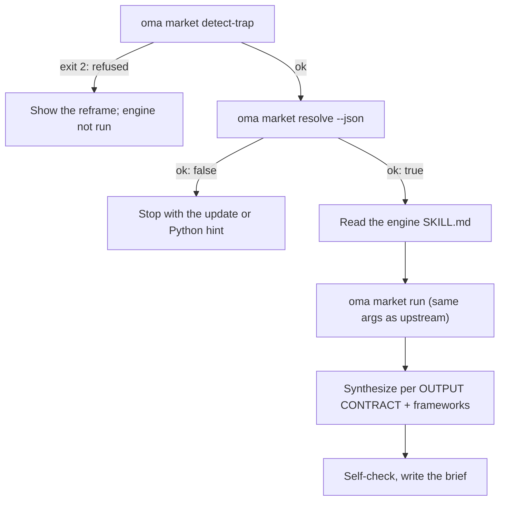

# Marktonderzoek {#market-research}

`oma-market` beantwoordt de vraag "wat zeggen mensen echt over X in de afgelopen N dagen" — pijnpunten, trends, concurrentensentiment en discovery — op basis van communitybronnen met echte engagementcijfers: Reddit (upvotes en topcomments), X, YouTube-transcripten, TikTok, Instagram, Hacker News, Polymarket, GitHub, arXiv, Techmeme, Digg, LinkedIn, StockTwits, Bluesky, het web en meer.

Het onderzoek zelf draait op de upstream-engine [**last30days**](https://github.com/mvanhorn/last30days-skill) (MIT, Python 3.12+). oh-my-agent forkt die engine niet: het houdt een **altijd actuele beheerde kopie** bij, voert voor elke run gates uit en voegt een laag met strategische frameworks toe. Releasecadans, aantal stars en providerdekking horen bij het upstreamproject en kunnen veranderen.

---

## Snel aan de slag {#quick-start}

Vraag het je agent in gewone taal. Formuleringen als "market research", "pain points", "competitor analysis", "voice of customer" of "trend detection" activeren de `oma-market`-skill:

```text
Zoek de belangrijkste pijnpunten die developers de afgelopen 30 dagen melden over VS Code remote containers.
Vergelijk het communitysentiment over Cursor vs Windsurf in de afgelopen 90 dagen, frameworks swot,5f.
```

| Sturen met | Effect |
|---|---|
| "A vs B", of `--vs B` | Concurrentie-intent: upstream-vergelijkingsflow + SWOT + Porter's 5F |
| `--days 7`, `30`, `90` of `180` | Onderzoeksvenster |
| `--intent pain`, `trend`, `competitor` of `discovery` | Overschrijft de automatische intentclassificatie |
| `--frameworks none`, of een lijst zoals `swot,5f,pestel` | Zet frameworksecties uit, of kiest ze |

Het resultaat is één brief in `.agents/results/market/{topic-slug}-{YYYYMMDD}.md`. De eerste regel is de engine-badge (`🌐 last30days v<version> · synced <date>`), gevolgd door gerangschikte evidenceclusters met links, de frameworksecties en de engine-footer met de overgeslagen bronnen.

| Werkt zonder keys | Vereist de upstream-setupwizard (keys of cookies) |
|---|---|
| Reddit, Hacker News, GitHub, Polymarket, arXiv, Techmeme, Digg, web | X, YouTube-transcripten, TikTok, Instagram en andere bronnen met keys; overgeslagen bronnen worden in de footer vermeld |

---

## Altijd de nieuwste engine (Python 3.12+ vereist) {#always-the-latest-engine--nothing-to-install}

```bash
# Illustrative output; the release tag, cache path, and Python version vary.
oma market resolve
# engine:   last30days
# reason:   last30days 3.21.1 via managed:v3.21.1 (current)
# root:     ~/.cache/oma-market/last30days/v3.21.1
# skill:    ~/.cache/oma-market/last30days/v3.21.1/SKILL.md
# version:  3.21.1
# python:   python3.14 (3.14.7, PATH)
# save_dir: <workspace>/.agents/results/market/raw
```

- Cache: `~/.cache/oma-market/last30days/<tag>/` + `state.json`.
- Voor elk gebruik vraagt `resolve` GitHub om de nieuwste release (beperkt tot één keer per `check_interval_min`, standaard 60 min), downloadt het een nieuwere tag naar zijn eigen map (oude tags worden verwijderd) en gebruikt het anders de cache opnieuw. Bij netwerkfouten wordt de gecachte kopie opnieuw gebruikt en als `stale` gerapporteerd.
- Python: `LAST30DAYS_PYTHON` → `market.python` → `python3.14`, `python3.13`, `python3.12`, `python3`, `python` op PATH (moet ≥ 3.12 zijn) → `uv python find '>=3.12'`. Als niets wordt gevonden, is `resolve` niet ok en geeft het de installatietip; de skill stopt in plaats van terug te vallen op onderzoek dat alleen via websearch werkt.
- Engineconfiguratie en API-keys staan in `~/.config/last30days/` (geschreven door de upstream-setupwizard met jouw toestemming), zodat ze upgrades van de engine overleven.

De volgorde van resolutie (eerste hit wint) is: `market.path` → `LAST30DAYS_HOME` → **managed latest** → door de gebruiker geïnstalleerde kopieën (`.agents|.claude|.codex|.cursor|.qwen|.kiro/skills/last30days` in het project en onder `~`, daarna de Claude Code-plugin-cache).

```bash
oma market update            # force a check / download now
oma market resolve --offline # never touch the network
oma market run -- --help     # the engine's own flags (without `--`, oma prints its own help)
```

---

## Configuratie {#configuration}

```yaml
market:
  managed: true                   # false = never download; pins / skill dirs only
  channel: stable                 # stable (latest Release) | main (HEAD)
  check_interval_min: 60          # 0 = check on every call
  path: null                      # explicit engine dir (pin)
  python: null                    # interpreter override
  save_dir: .agents/results/market/raw
```

---

## Hoe een run werkt {#how-a-run-works}



1. `oma market detect-trap "<topic>"` — weigert keyword-trap- en demographic-shopping-onderwerpen (exit 2) met een voorstel om de vraag te herformuleren. Een leeg onderwerp of een onderwerp van meer dan 200 tekens eindigt met exit 4.
2. `oma market resolve --json` — engine plus Python; stopt bij `ok: false`.
3. De agent leest de `SKILL.md` van de opgeloste engine van boven tot onder en volgt die: setupwizard voor het eerste gebruik, voorafgaand aan onderzoek handles / subreddits / hashtags oplossen (wanneer WebSearch beschikbaar is), queryplanning en de precondition-gate.
4. `oma market run "<topic>" <flags> --emit=compact` — identieke argumenten als de upstream-call `python3 scripts/last30days.py`; `--save-dir` wordt toegevoegd vanuit `market.save_dir`.
5. Synthese volgt het upstream OUTPUT CONTRACT (eerste regel is de badge, daarna gerangschikte evidenceclusters en LAWs 1–8), waarna oma frameworksecties toevoegt die alleen naar engineclusters verwijzen:

| Intent | Vormgeving door engine | Frameworks |
|---|---|---|
| pain | klachtvormig onderwerp, `--days 30`, `--deep` wanneer de resultaten dun zijn | SWOT |
| trend | `--days 7/30/90/180`, `--discover "<domain>"` voor "what's hot" | SWOT |
| competitor | `"A vs B"` → upstream-vergelijkingsflow | SWOT + Porter's 5F |
| discovery | `--discover`, daarna follow-ups met `--drill` | SWOT + PESTEL |

6. Voer een self-check uit en schrijf daarna `.agents/results/market/{topic-slug}-{YYYYMMDD}.md`.

---

## Foutmodi {#failure-modes}

| Situatie | Resultaat |
|---|---|
| Onderwerp geweigerd door detect-trap | Herformulering getoond; engine wordt niet uitgevoerd. `--force` alleen na expliciete herbevestiging van de gebruiker |
| Geen engine gecachet en offline | `ok: false` → voer één keer online `oma market update` uit |
| Geen Python 3.12+ | `ok: false` met installatietip (brew / apt / `uv python install 3.12`), of stel `LAST30DAYS_PYTHON` / `market.python` in; geen vervanging die alleen websearch gebruikt |
| Releasecontrole faalt | Gecachte engine wordt gebruikt en als `stale` gerapporteerd |
| Bronnen zonder keys | Binnen de engine overgeslagen en in de footer vermeld; activeer ze via de upstream-setupwizard |

---

## Volgende stappen {#next-steps}

- [Inhouds- en onderzoeksworkflows](./content-and-research.md) — kies de juiste capability voor andere onderzoeks- en documenttaken
- [Diagramengine](./diagram-engine.md) — hetzelfde patroon van een altijd actuele beheerde engine als voor archify
- [oma-config.yaml-semantiek](./oma-config-semantics.md) — hoe de sectie `market:` wordt samengevoegd
- [CLI-commando's: market](../cli-interfaces/commands.md#market) — volledige lijst met opties
- Upstream: [mvanhorn/last30days-skill](https://github.com/mvanhorn/last30days-skill)
