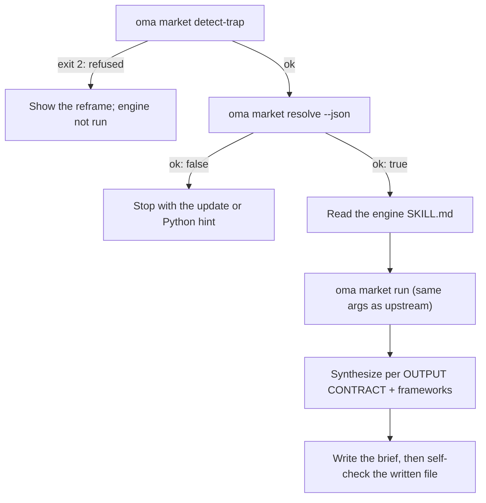

# Marktonderzoek {#market-research}

`oma-market` beantwoordt de vraag "wat zeggen mensen echt over X in de afgelopen N dagen" — pijnpunten, trends, concurrentensentiment en discovery — op basis van communitybronnen met echte engagementcijfers: Reddit (upvotes en topcomments), X, YouTube-transcripten, TikTok, Instagram, Hacker News, Polymarket, GitHub, arXiv, Techmeme, Digg, LinkedIn, StockTwits, Bluesky, het web en meer.

Het onderzoek draait op de upstream-engine [**last30days**](https://github.com/mvanhorn/last30days-skill) (MIT, Python 3.12+). oh-my-agent forkt die engine niet: de engine wordt geïnstalleerd als agent-skill via de [skills CLI](https://github.com/vercel-labs/skills), en oh-my-agent gatet elke run en voegt daarbovenop een laag met strategische frameworks toe. Releasecadans, aantal stars en providerdekking horen bij het upstreamproject en kunnen veranderen.

---

## Snel aan de slag {#quick-start}

Vraag het je agent in gewone taal. Formuleringen als "market research", "pain points", "competitor analysis", "voice of customer" of "trend detection" activeren de `oma-market`-skill:

```text
Zoek de belangrijkste pijnpunten die developers de afgelopen 30 dagen melden over VS Code remote containers.
Vergelijk het communitysentiment over Cursor vs Windsurf in de afgelopen 90 dagen, frameworks swot,5f.
```

| Sturen met | Effect |
|---|---|
| "A vs B", of `--vs B` | Concurrentie-intent: upstream-vergelijkingsflow + SWOT + Porter's 5F |
| `--days 7`, `30`, `90` of `180` | Onderzoeksvenster |
| `--intent pain`, `trend`, `competitor` of `discovery` | Overschrijft de automatische intentclassificatie |
| `--frameworks none`, of een lijst zoals `swot,5f,pestel` | Zet frameworksecties uit, of kiest ze |

Het resultaat is één brief in `.agents/results/market/{topic-slug}-{YYYYMMDD}.md`. De eerste regel is de engine-badge (`🌐 last30days v<version> · synced <date>`), gevolgd door gerangschikte evidenceclusters met links, de frameworksecties en de engine-footer met de overgeslagen bronnen.

| Werkt zonder keys | Vereist de upstream-setupwizard (keys of cookies) |
|---|---|
| Reddit, Hacker News, GitHub, Polymarket, arXiv, Techmeme, Digg, web | X, YouTube-transcripten, TikTok, Instagram en andere bronnen met keys; overgeslagen bronnen worden in de footer vermeld |

---

## De engine installeren (Python 3.12+ vereist) {#always-the-latest-engine--nothing-to-install}

```bash
oma market update   # installs last30days when missing, otherwise updates it
# runs: bunx skills add mvanhorn/last30days-skill --skill last30days -g -y
#   or: bunx skills update last30days -g -y
```

```bash
# Illustrative output; the version, install path, and Python version vary.
oma market resolve
# engine:   last30days
# reason:   last30days 3.21.1 via home:~/.agents/skills
# root:     ~/.agents/skills/last30days
# skill:    ~/.agents/skills/last30days/SKILL.md
# version:  3.21.1
# python:   python3.14 (3.14.7, PATH)
# save_dir: <workspace>/.agents/results/market/raw
```

- `resolve` leest alleen geïnstalleerde skillmappen en raakt het netwerk nooit aan. Wanneer niets is geïnstalleerd, is `resolve` niet ok en noemt het het installatiecommando; de skill vraagt eerst toestemming voordat `oma market update` wordt uitgevoerd.
- `oma update` installeert de engine niet. Werk hem bij met `oma market update` (of `bunx skills update last30days -g -y`).
- Python: `LAST30DAYS_PYTHON` → `market.python` → `python3.14`, `python3.13`, `python3.12`, `python3`, `python` op PATH (moet ≥ 3.12 zijn) → `uv python find '>=3.12'`. Als niets wordt gevonden, is `resolve` niet ok en geeft het de installatietip; de skill stopt in plaats van terug te vallen op onderzoek dat alleen via websearch werkt.
- Engineconfiguratie en API-keys staan in `~/.config/last30days/` (geschreven door de upstream-setupwizard met jouw toestemming), zodat ze updates van de engine overleven.

De volgorde van resolutie (eerste hit wint): `market.path` → `LAST30DAYS_HOME` → geïnstalleerde skillmappen (`.agents|.claude|.codex|.cursor|.qwen|.kiro|.gemini|.copilot/skills/last30days` in het project, daarna onder `~`, daarna `~/.config/agents/skills/last30days` en de Claude Code-plugin-cache). Een Claude Code-plugininstallatie wordt bijgewerkt via `/plugin`, niet via `oma market update`.

```bash
oma market run -- --help     # the engine's own flags (without `--`, oma prints its own help)
```

Eerdere releases bewaarden hun eigen kopie onder `~/.cache/oma-market/`. Die wordt niet meer gelezen; je kunt die verwijderen.

---

## Configuratie {#configuration}

```yaml
market:
  path: null                      # explicit engine dir (pin)
  python: null                    # interpreter override
  save_dir: .agents/results/market/raw
```

`managed`, `channel` en `check_interval_min` zijn verouderd: ze valideren nog steeds maar worden genegeerd, en `resolve` print een waarschuwing zolang ze zijn ingesteld.

---

## Hoe een run werkt {#how-a-run-works}



1. `oma market detect-trap "<topic>"` — weigert keyword-trap- en demographic-shopping-onderwerpen (exit 2) met een voorstel om de vraag te herformuleren. Een leeg onderwerp of een onderwerp van meer dan 200 tekens eindigt met exit 4.
2. `oma market resolve --json` — engine plus Python; stopt bij `ok: false`.
3. De agent leest de `SKILL.md` van de opgeloste engine van boven tot onder en volgt die: setupwizard voor het eerste gebruik, voorafgaand aan onderzoek handles / subreddits / hashtags oplossen (wanneer WebSearch beschikbaar is), queryplanning en de precondition-gate.
4. `oma market run "<topic>" <flags> --emit=compact` — identieke argumenten als de upstream-call `python3 scripts/last30days.py`; `--save-dir` wordt toegevoegd vanuit `market.save_dir`.
5. Synthese volgt het upstream OUTPUT CONTRACT (eerste regel is de badge, daarna gerangschikte evidenceclusters en LAWs 1–8), waarna oma frameworksecties toevoegt, geplaatst tussen de engine-body en de engine-footer, die alleen naar engineclusters verwijzen:

| Intent | Vormgeving door engine | Frameworks |
|---|---|---|
| pain | klachtvormig onderwerp, `--days 30`, `--deep` wanneer de resultaten dun zijn | SWOT |
| trend | `--days 7/30/90/180`, `--discover "<domain>"` voor "what's hot" | SWOT |
| competitor | `"A vs B"` → upstream-vergelijkingsflow | SWOT + Porter's 5F |
| discovery | `--discover`, daarna follow-ups met `--drill` | SWOT + PESTEL |

6. Schrijf `.agents/results/market/{topic-slug}-{YYYYMMDD}.md` en voer daarna de self-check uit tegen het geschreven bestand; herstel en controleer opnieuw voordat de brief wordt opgeleverd.

---

## Foutmodi {#failure-modes}

| Situatie | Resultaat |
|---|---|
| Onderwerp geweigerd door detect-trap | Herformulering getoond; engine wordt niet uitgevoerd. `--force` alleen na expliciete herbevestiging van de gebruiker |
| Engine niet geïnstalleerd | `ok: false` → `oma market update` (installeert deze met de skills CLI) |
| Geen Python 3.12+ | `ok: false` met installatietip (brew / apt / `uv python install 3.12`), of stel `LAST30DAYS_PYTHON` / `market.python` in; geen vervanging die alleen websearch gebruikt |
| `oma market update` faalt | De foutmelding van de skills CLI wordt getoond; een bestaande installatie blijft werken |
| Bronnen zonder keys | Binnen de engine overgeslagen en in de footer vermeld; activeer ze via de upstream-setupwizard |

---

## Volgende stappen {#next-steps}

- [Inhouds- en onderzoeksworkflows](./content-and-research.md) — kies de juiste capability voor andere onderzoeks- en documenttaken
- [Diagramengine](./diagram-engine.md) — hetzelfde installatiepatroon via de skills-CLI als voor archify
- [oma-config.yaml-semantiek](./oma-config-semantics.md) — hoe de sectie `market:` wordt samengevoegd
- [CLI-commando's: market](../cli-interfaces/commands.md#market) — volledige lijst met opties
- Upstream: [mvanhorn/last30days-skill](https://github.com/mvanhorn/last30days-skill)
