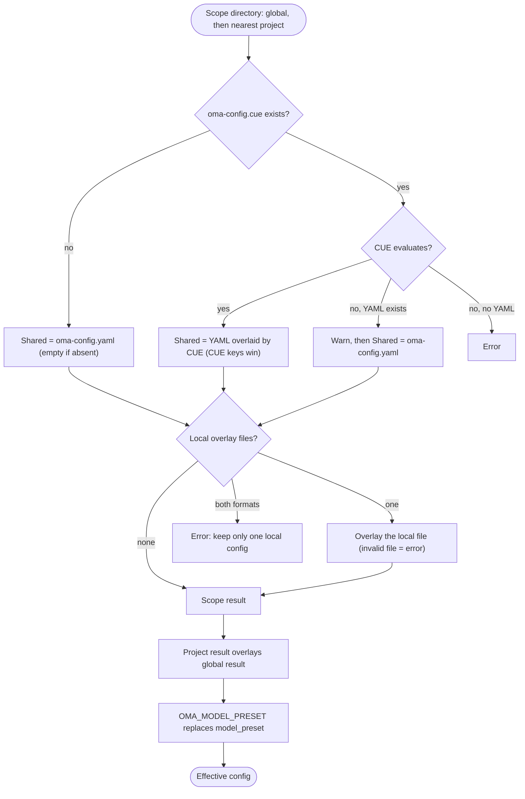

## Overzicht

OMA leest globale standaardwaarden uit `$OMA_HOME/.agents/` (standaard `~/.oma/.agents/`)
en legt daar de dichtstbijzijnde project-`.agents/` overheen die boven de werkmap wordt gevonden.
Elke scope kan deze lagen hebben:

- **Gedeeld**: `.agents/oma-config.yaml` en `.agents/oma-config.cue`. Als beide bestaan en het CUE-bestand kan worden geëvalueerd, overschrijft elke sleutel die het CUE-bestand instelt dezelfde sleutel in het YAML-bestand; sleutels die alleen in het YAML-bestand staan, blijven gelden als standaardwaarde. Als het CUE-bestand niet kan worden geëvalueerd, geeft OMA een waarschuwing en gebruikt het alleen het YAML-bestand.
- **Lokaal**: `.agents/oma-config.local.cue` of `.agents/oma-config.local.yaml` (één bestand dat boven op het gedeelde resultaat wordt gelegd; houd dit bestand privé).

Gedeelde en lokale projectinstellingen overschrijven globale instellingen. Verschillende
bovenliggende projectroots worden nooit samengevoegd; een lege dichtstbijzijnde `.agents/` is nog steeds een
projectgrens. Globale standaardwaarden veranderen de projectidentiteit niet. Zie de
[configuratiereferentie](/docs/guide/configuration-reference) voor ondersteunde sleutels en standaardwaarden.

## Resolutieproces

OMA voert dezelfde stappen uit voor de globale scope en voor de dichtstbijzijnde projectscope, en voegt daarna de twee resultaten samen:



Als er geen project-`.agents/` wordt gevonden, of als de zoektocht de globale `.agents/`-map zelf bereikt, wordt alleen het globale resultaat gebruikt.

## Voorrangstabel {#precedence-table}

Latere rijen winnen. Gewone maps worden recursief samengevoegd; arrays, scalars en `null` vervangen de eerdere waarde.

| Volgorde | Laag | Regel |
|:-----:|-------|------|
| 1 | Globale `oma-config.yaml` | Standaardwaarden onder het globale CUE-bestand wanneer beide bestaan. |
| 2 | Globale `oma-config.cue` | Overschrijft de globale YAML per sleutel. Als de evaluatie faalt (bijvoorbeeld omdat de `cue`-CLI ontbreekt) en YAML bestaat, print OMA `[config] CUE evaluation failed at ... Falling back to oma-config.yaml` en gebruikt het alleen de YAML. |
| 3 | Globale `oma-config.local.cue` of `oma-config.local.yaml` | Slechts één bestand. Een ongeldig lokaal bestand is een fout. |
| 4 | Project-`oma-config.yaml` | Dichtstbijzijnde project-`.agents/` in of boven de werkmap. |
| 5 | Project-`oma-config.cue` | Overschrijft rij 4 per sleutel, met dezelfde fallback als rij 2. |
| 6 | Project-`oma-config.local.cue` of `oma-config.local.yaml` | Slechts één bestand. Een ongeldig lokaal bestand is een fout. |
| 7 | `OMA_MODEL_PRESET` | Een niet-lege waarde vervangt `model_preset` voor dat proces. Een lege waarde is een fout. |

:::tip[Welk bestand bewerk ik?]
Als `.agents/oma-config.cue` bestaat, overschrijft een sleutel die daar is ingesteld dezelfde sleutel in `oma-config.yaml`. Wijzig die sleutel in het CUE-bestand, of zet een machinespecifieke waarde in een lokale overlay. `oma doctor --profile` toont de geladen bestanden onder **Configuration sources**.
:::

Zet voor een projectlokale override alleen de gewijzigde leaves in het lokale bestand. Zo houd je bijvoorbeeld een lokale modelkeuze buiten het gedeelde bestand:

```yaml
# .agents/oma-config.local.yaml
model_preset: claude
agents:
  backend:
    model: anthropic/claude-sonnet-4-6
```

Voer de opdracht vanuit het project uit, zodat de dichtstbijzijnde `.agents/`-map wordt geselecteerd. Een ongeldig lokaal bestand geeft een duidelijke fout; herstel of verwijder het voordat je opnieuw probeert.

## Je configuratie controleren

```bash
oma doctor --profile                           # loaded files, resolved preset, per-role model and CLI
cue export --out json .agents/oma-config.cue   # what the CUE layer evaluates to (requires the cue CLI)
```

| Symptoom of melding | Oorzaak | Oplossing |
|--------------------|-------|-----|
| Een YAML-wijziging heeft geen effect | `oma-config.cue` stelt dezelfde sleutel in | Wijzig de sleutel in het CUE-bestand, of overschrijf hem in een lokaal bestand |
| `[config] CUE evaluation failed at ... Falling back to oma-config.yaml` | De `cue`-CLI ontbreekt, of het CUE-bestand kan niet worden geëvalueerd | Installeer `cue`, of herstel de fout die `cue export` meldt |
| `Both local CUE and YAML configs exist in ...; keep only one local config.` | Twee lokale overlaybestanden | Verwijder een van beide |
| `OMA_MODEL_PRESET must be non-empty` | De variabele is geëxporteerd maar leeg | `unset OMA_MODEL_PRESET` |
| `Unknown model_preset "..."` | Typfout, of een ontbrekende vermelding in `custom_presets` | Gebruik een preset die in de foutmelding wordt genoemd |
| `Legacy preset name "..." is no longer valid` | Een sleutel van vóór de hernoeming, zoals `claude-only` | Hernoem hem zoals de melding aangeeft, of voer `oma update` uit |
| `[model-registry] User inline model "..." failed validation` | Een onvolledige of ongeldige vermelding in `models:` | Zie [Modelslugs inline opnemen](/docs/guide/per-agent-models#inlining-model-slugs) |

## Standaardwaarden

| Sleutel | Standaard | Wanneer toegepast |
|-----|---------|--------------|
| `auto_update_cli` | `true` | Beide bestanden ontbreken of de sleutel ontbreekt |
| `serena.mode` | `bridge` | Beide bestanden ontbreken of de sleutel ontbreekt |
| `serena.auto_update` | `true` | Beide bestanden ontbreken of de sleutel ontbreekt |
| `telemetry` | `false` | Beide bestanden ontbreken of de sleutel ontbreekt |
| `language` | `en` | Beide bestanden ontbreken of de sleutel ontbreekt |
| `model_preset` | Vereist | De meegeleverde projectsjabloon gebruikt `auto`; het schema vereist een niet-lege waarde. |
| `translation_voice` | `balanced` | Beide bestanden ontbreken of de sleutel ontbreekt |
| `timezone` | Systeemtijdzone | Beide bestanden ontbreken of de sleutel ontbreekt |

## Reden voor de leesvolgorde

Bewerk `~/.oma/.agents/oma-config.yaml` (met `OMA_HOME` ingesteld: `<OMA_HOME>/.agents/oma-config.yaml`)
voor gebruikersbrede standaardwaarden. Gedeelde/lokale projectbestanden overschrijven die standaardwaarden
zonder niet-gerelateerde bovenliggende projecten te erven. Een projectselectie `none`
voor semantisch geheugen overschrijft de globale AgentMemory-selectie.

## Opmerkingen

- `language` in `oma-config.yaml` bepaalt de antwoordtaal van agenten. Deze sleutel bepaalt **niet** de waarschuwingsteksten bij installatie en updates: die gebruiken de systeemlocale (`$LANG`), omdat `oma-config.yaml` bij het installeren nog niet is geladen.
- `auto_update_cli` gebruikt projectoverrides vóór globale standaardwaarden en staat standaard aan wanneer geen van beide scopes de sleutel instelt.
- `telemetry` (standaard `false`) wordt vertaald naar de eigen opt-out van elke vendor. `oma install`, `oma update` en `oma link` schrijven die waarden als volgt: Claude `DISABLE_TELEMETRY` + `CLAUDE_CODE_DISABLE_FEEDBACK_SURVEY`, Gemini/Qwen `privacy.usageStatisticsEnabled`, Codex `analytics.enabled` + `feedback.enabled`, Grok `[features] telemetry` en Antigravity (agy) `enableTelemetry` in `~/.gemini/antigravity-cli/settings.json`. Met `telemetry: true` meld je je opnieuw aan door oma’s opt-out voor die vendor te verwijderen.
- `diagram` (engines `auto` / `archify` / `mermaid`, `explain_sidecar`, `archify.managed|channel|check_interval_min|path|quality|open`) is een sparse skill-override-sectie zoals `video` en `image`; zie [Diagram Engine](/docs/guide/diagram-engine).
- `video.hyperframes.check_interval_min` beperkt hoe vaak wordt gecontroleerd op de nieuwste versies van de HyperFrames-toolchain en heygen-com/hyperframes per run (`oma video compose`, `oma update`). Het meegeleverde CUE-schema definieert `video.hyperframes` nog niet, dus `cue export` weigert de sleutel binnen het schemablok (`field not allowed`); stel hem in `oma-config.yaml` of in een lokale YAML-overlay in.
- `market` (`managed|channel|check_interval_min|path|python|save_dir`) configureert de altijd actuele `last30days`-engine achter `oma market`; zie [Market Research](/docs/guide/market-research).
- Het getypeerde runtime-schema dekt `providers`, `free`, `agents`, `models`, `custom_presets`, `vendors`, `session`, `docs` en de sparse skillsecties. Meegeleverde sjablonen bevatten ook blokken die door consumers worden beheerd, zoals `scm`, `memory`, `serena_reaper` en `mcp`; hun consumers beheren de geneste sleutels. Leid geen sleutel af uit deze lijst: gebruik de [configuratiereferentie](/docs/guide/configuration-reference) en de featuregids voor dat blok.
- `oma-config.yaml` rechtstreeks bewerken is veilig. `oma install` en `oma update` gebruiken veldvervanging op regexniveau en behouden door de gebruiker bewerkte sleutels die ze niet beheren, zoals aangepaste `agents:`-overrides en `session.quota_cap`.
- `oma update` voegt bovendien top-level sleutels toe die het meegeleverde sjabloon definieert maar die in jouw bestand ontbreken, met de standaardwaarden uit het sjabloon, onder een marker `# Added by oma update`. Sleutels die al bestaan worden nooit aangepast: bestaande inhoud blijft byte-identiek. Sleutels die je bewust hebt verwijderd, verschijnen opnieuw met de standaardwaarde uit het sjabloon. Stel de waarde expliciet in in plaats van de sleutel te verwijderen als je daarvan wilt afwijken.
