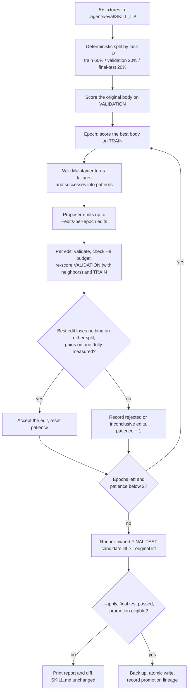

# Skilloptimalisatie {#skill-optimization}

`oma skill optimize` ontwikkelt de `SKILL.md` van een skill om de gemeten `utilityLift` van `oma skill eval` te maximaliseren. Het scheidt ruwe rollout-evidence, persistente afgebakende kennis en de uitvoerbare skill. Een Wiki Maintainer voegt waarneembare successen en mislukkingen samen; een Proposer gebruikt die kennis om begrensde add/delete/replace-edits te maken. Kandidaten moeten de utility op de training- of validatieset verbeteren zonder dat een van beide splitsingen terugvalt, met volledige taak- en negative-transfermetingen. `--apply` vereist daarnaast een volledig gemeten, door de runner beheerde final test zonder terugval en geverifieerde live isolatie. Bij deployment is er geen extra wiki-lookup tijdens inference: de uitvoer blijft een `SKILL.md`.

Onderzoeksbasis: Tang, L., Rashtchian, C., Ferng, C.-S., Tomkins, A., Juan, D.-C., & Vu, T. (2026). *WikiSkill: Compiling agent experience into persistent knowledge for skill evolution* [Preprint]. arXiv. https://doi.org/10.48550/arXiv.2608.27454

CLI-optimalisatie vereist momenteel `--live` en brengt modelaanroepen met zich mee. Het standaardpad (niet-live) en `--mock` kunnen geen proposals genereren of opnieuw afspelen, omdat er nog geen loader voor vastgelegde proposals is geïmplementeerd; ze stoppen vóór de evaluatie. Gebruik `oma skill eval --mock` voor offline replay. Geïnjecteerde optimizer-/scorer-API’s blijven beschikbaar voor offline tests. Het combineren van `--live` en `--mock` is een fout.

---

## Harde afhankelijkheid: evaluatietaakfixtures {#hard-dependency-eval-task-fixtures}

`oma skill optimize` kan niet zonder evaluatietaakfixtures draaien. Het vereist minstens **5 taakfixtures** (`MIN_TASKS = 5`) in `.agents/eval/<skill>/`. Als er minder worden gevonden, geeft het commando onmiddellijk een fout:

```text
[oma skill opt] no eval coverage for skill "oma-scholar": found 2 task fixture(s), need at least 5. Author tasks first — see web/docs/guide/skill-eval.md
```

Zie de [gids voor Skill Utility Eval](./skill-eval.md) voor de conventie voor de map `.agents/eval/<skill>/`, het fixtureschema, checkertypen en het vullen van rollouts voor mock-replay.

Promotie vereist ook een niet-lege set buurtaken uit hetzelfde domein die bij andere skills horen. Elke validatiescore van een kandidaat en de uiteindelijke kandidaatscore moeten de buren van de geëvalueerde splitsing meten met precies de kandidaatbody. Ontbrekende buren of onvolledige gepaarde opnames kunnen niet vaststellen dat er geen negative transfer is. Offline evaluatie kan alleen overeenkomende kandidaatopnames opnieuw afspelen; gebruik live optimalisatie om nieuwe kandidaten te genereren en te evalueren.

Replay en suitegebonden kennis zijn gekoppeld aan het volledige taak-/evaluatorcontract, inclusief de effectieve standaard-judge-rubric en de revisie van het scorerprotocol. Oudere opnames en eerdere kennisscopes vereisen verse evidence na deze provenance-upgrade; het herlabelen van oude scores met nieuwe hashes levert geen geldige meting op.

---

## Hoe het werkt {#how-it-works}

Het diagram toont één optimalisatierun. Een onvolledige evaluatie of een uitgeput budget beëindigt de epoch-lus ook voortijdig.



Fixtures worden op taak-ID gesorteerd en deterministisch opgesplitst in sets voor **train**, **held-out validation** en de **runner-owned final-test**. Met minstens vijf fixtures zijn de doelverhoudingen 60/20/20 en bevat elke partitie minstens één taak. Acht fixtures leveren bijvoorbeeld na afronding vier train-, één validatie- en drie final-testtaken op. Fixtures die dezelfde `group` declareren, worden samen toegewezen, zodat een herformuleerde verwante fixture niet in train kan zitten terwijl het origineel in de final test zit; met minder dan drie groepen valt de splitsing terug op taak-ID’s en geeft ze een waarschuwing. De final-testtaken komen uit deze lokale fixtureset en worden achtergehouden voor de Maintainer en Proposer. Dubbele final-testtaak-ID’s en overlap met een ontwikkelsplitsing worden geweigerd.

Voor elke epoch (maximaal `--max-epochs`, standaard 8):

1. **Scoor de huidige beste `SKILL.md` op de TRAIN-splitsing** — `oma skill eval` retourneert waarneembare prompts, outputs en lift per taak. Elke taak in een interne splitsing moet beide gescoorde armen hebben; mislukte of ontbrekende vergelijkingen kunnen de noemer niet verkleinen.
2. **Wiki Maintainer voegt evidence samen** — maximaal vijf mislukkingen en drie successen worden patronen met evidence-links. Mislukkingen worden gekozen op leerwaarde: eerst regressies, daarna de diepste gedeelde mislukkingen; taken waarop beide armen al slagen, blijven buiten beschouwing omdat ze niets zeggen over de volgende edit. Successen worden op lift gerangschikt. Afgebakende patronen en eerdere gate-uitkomsten worden uit OMA’s L1/L2/L3-geheugensysteem opgehaald.
3. **Proposer levert K kandidaat-edits** (maximaal `--edits-per-epoch`, standaard 4). Exacte edits die al in de persistente afwijzingsgeschiedenis staan, worden overgeslagen.
4. **Voor elke kandidaat-edit:**
   - Pas de edit toe op een in-memorykopie van `SKILL.md`.
   - Valideer de kandidaat (frontmatter `name`/`description` moet behouden blijven; de body moet kunnen worden geparsed).
   - Handhaaf het tekstuele learning-ratebudget: verwerp edits waarvan de netto wijziging in tekens groter is dan `--lr` (standaard 600 tekens).
   - Scoor elke taak in de **held-out validation-splitsing** opnieuw (met gepaarde baseline-/kandidaatvergelijkingen op buurtaken) en elke taak in de **held-in training-splitsing** (geen buurvergelijkingen).
5. **Accepteer de beste geldige kandidaat** volgens de held-in/held-out-regel: de kandidaat verliest op geen van beide splitsingen iets (`Δval ≥ 0` en `Δtrain ≥ 0`) en verbetert op minstens één van beide. Kandidaten worden gerangschikt op `Δval + Δtrain`. Een strikte validatiewinst is niet vereist, omdat een body die al elke validatietaak doorstaat nog steeds kan worden hersteld op een trainingsmislukking zonder terrein te verliezen op de held-out-splitsing; de final test beslist of die reparatie generaliseert. De taakdekking moet volledig zijn, de niet-lege negative-transfersteekproef moet volledig zijn gemeten en geen enkele buurtaak mag een bevestigde regressie tonen op of onder `NEG_TRANSFER_FAIL = -0.1`. In live runs wordt een buurtaak die bij de eerste gepaarde vergelijking terugvalt, één keer opnieuw gemeten; de vastgelegde delta is het gemiddelde van beide vergelijkingen en alleen een gereproduceerde regressie (`confirmed: true`) wijst de kandidaat af. Mock-replays kunnen niet opnieuw meten, dus een regressie bij één enkele proef blijft staan. Live-rapporten moeten `isolation: "enforced"` declareren. Uitkomsten van proposal-gates worden vastgelegd met `deltaLift` (validatie), `deltaTrainLift` en de buurdeltas achter het oordeel.
6. **Stop vroeg** na 2 opeenvolgende epochs zonder geaccepteerde edit (`OPT_EARLY_STOP_PATIENCE = 2`).
7. **Voer na de evolutie de door de runner beheerde final test uit.** Zowel de originele body als de validatiewinnaar moeten elke final-testtaak dekken. De kandidaat mag geen final-testlift verliezen (`candidateLift >= baselineLift`; de winst waarvoor de kandidaat is geaccepteerd, is al aangetoond op de ontwikkelsplitsingen, en een strikte winst op een kleine bevroren test zou de meeste reparaties niet promoveerbaar maken) en moet nog een volledige, kandidaatspecifieke negative-transfercontrole doorstaan. `finalTest.findings` somt de lift per taak van de originele body en de kandidaat op, zodat een mislukte test kan worden gelezen als een echte regressie of als één enkele ruisige taak. Ontbrekende, onvolledige of mislukte final tests verhinderen promotie. Gemeten finale mislukkingen blijven auditrecords en worden geen afwijzingskennis voor latere optimalisatie.

De optimizer werkt tijdens de lus op een in-memory kandidaatkopie.

Ongemeten kandidaten worden vastgelegd als `inconclusive`, met redenen zoals `insufficient-coverage`, `negative-transfer-unmeasured` of `unverified-isolation`. Ze worden uitgesloten van de geleerde afwijzingsgeschiedenis en komen in aanmerking voor een nieuwe poging nadat de evaluatieomstandigheden zijn hersteld. Een bevestigde regressie van een buurtaak, een verlies op een van beide splitsingen (`split-regression`) of het uitblijven van verbetering op beide splitsingen (`no-validation-lift`) is een afwijzing. Diagnostiek die wijst op onvolledige evaluatie of een gedegradeerde Maintainer blokkeert promotie.

---

## Gebruik {#usage}

```bash
oma skill optimize --skill <id> --live
               [--dry-run | --apply]
               [--max-epochs <n>] [--edits-per-epoch <k>] [--lr <chars>]
               [--memory recall|none] [--yes]
               [--json] [--output <format>]
```

### Vlaggen {#flags}

| Vlag | Standaard | Beschrijving |
|:-----|:--------|:-----------|
| `--skill <id>` | verplicht | Skill-ID die moet worden geoptimaliseerd (eenvoudige naam, zonder padscheidingstekens). Zonder deze vlag leest het commando `.agents/eval/_all/` en stopt het met `no eval coverage for skill "_all"`; er is geen modus voor alle skills. |
| `--dry-run` | **yes (default)** | Stel edits voor en print het diff zonder `SKILL.md` te wijzigen; gegenereerde evidence en evolutie-events blijven wel bewaard. |
| `--apply` | — | Schrijf de gevalideerde kandidaat weg nadat alle promotiegates zijn geslaagd, inclusief volledige final-test- en negative-transfer-evidence, en maak vóór een atomische write een backup van het origineel. Een OMA-owned skill vereist ook `--yes`. |
| `--mock` | Standaard (niet-live) | Proposal-replay via de CLI is niet geïmplementeerd, dus dit pad stopt vóór de evaluatie. Gebruik `oma skill eval --mock` voor offline replay van evaluaties. |
| `--live` | — | Vereist voor de huidige CLI-optimalisatie. Brengt echte modelaanroepen met zich mee, print een kostenpreview en vraagt om bevestiging tenzij `--yes` is ingesteld. |
| `--max-epochs <n>` | `8` | Maximumaantal optimalisatie-epochs. |
| `--edits-per-epoch <k>` | `4` | Aantal kandidaat-edits dat de optimizer-LLM per epoch voorstelt. |
| `--lr <chars>` | `600` | Tekstueel learning-ratebudget: maximale netto wijziging in tekens per geaccepteerde edit. |
| `--memory <mode>` | `recall` | `none` start vanuit lege evolutiekennis voor een vergelijking met hetzelfde budget (zie [Geheugenablatie](#memory-ablation-and-long-run-statistics)). |
| `--yes` | — | Sla de bevestiging van de live kostenpreview over en bevestig het overschrijfgedrag bij het toepassen van een OMA-owned skill. |
| `--json` | — | Uitvoer als JSON voor CI/CD. |
| `--output <format>` | `text` | Uitvoerformaat (`text` of `json`). |

---

## Minimaal end-to-end-voorbeeld {#minimal-end-to-end-example}

```bash
# Evaluate one epoch and print a candidate diff without applying it
oma skill optimize --skill oma-scholar --live --dry-run --max-epochs 1
```

Illustratieve output voor acht fixtures en een kandidaat die alle promotiegates doorstaat:

```text
[oma skill opt] skill: oma-scholar, tasks: 8 (train: 4, val: 1, test: 3), dry-run: true

Skill opt  (skill: oma-scholar)
  applied: false
  baselineLift: 0.0%  finalLift: 100.0%  (train 50.0% → 100.0%)
  epochs: 1  acceptedEdits: 1  rejected: 0
  budget: 42 model calls used (no limit)
  finalTest: pass baseline=0.0000 candidate=0.3333

  diff:
--- a/SKILL.md
+++ b/SKILL.md
@@ -12,6 +12,9 @@
 ### When to use
 - User asks to look up an academic paper or technical claim.
+- User asks for a summary of arxiv abstracts or DOI-linked documents.
 - User wants citations or sources for a factual statement.
```

Het diff toont wat de optimizer zou schrijven. `SKILL.md` blijft ongewijzigd, terwijl gegenereerde evidence over de evolutie en afgebakende gate-uitkomsten voor toekomstige runs worden bewaard.

---

## Een gevalideerde verbetering toepassen {#applying-a-validated-improvement}

Als je tevreden bent met het voorgestelde diff, voer je de opdracht opnieuw uit met `--apply`:

```bash
# Apply accepted edits to a user-authored skill (backs up the original first)
oma skill optimize --skill my-skill --live --apply --yes
```

### De procedure als artifact {#the-procedure-as-an-artifact}

De prompts van de optimizer en de maintainer vormen de verbeterprocedure. Ze worden meegeleverd als ingebouwde standaardwaarden en kunnen worden overschreven door bestanden onder `.agents/evolution/` (eigendom van de gebruiker: nooit gekopieerd door het installatiemanifest en nooit verwijderd door `oma update`, anders dan `.agents/eval/`):

| Bestand | Rol | Vereiste placeholders |
|---|---|---|
| `optimizer.md` | Stelt SKILL.md-edits voor op basis van trainingsevidence en persistente kennis | `{{body}}`, `{{findings}}`, `{{editsPerEpoch}}` (ook `{{knowledge}}`) |
| `maintainer.md` | Voegt evidence samen tot herbruikbare patronen | `{{evidence}}`, `{{priorFacts}}` (ook `{{skillId}}`, `{{suiteHash}}`, `{{epoch}}`) |
| `constitution.yaml` | Oppervlakken waarnaar de lus nooit mag schrijven, welke procedureonderdelen een meta-optimalisatie mag wijzigen, standaard ground-truth-`anchors` voor meta-runs en een dispatchbudget | moet zichzelf vermelden onder `immutable` |

`budget.max_dispatches_per_run` (standaard `null`, onbeperkt) wordt in live runs afgedwongen: elke onderliggende modelaanroep (taakarm, buurarm, judge, optimizer, maintainer) kost één eenheid en de aanroep die de limiet zou overschrijden, wordt geweigerd voordat die wordt gedaan. De lus stopt dan met een diagnose `budget:exhausted`, de final test wordt overgeslagen, promotie wordt geblokkeerd en het resultaat rapporteert `budget: { limit, used }`. Het verbruik wordt in beide gevallen in de runsamenvatting vastgelegd, zodat procedures zowel op kosten als op winst kunnen worden vergeleken.

`oma skill procedure` print de actieve bronnen en hashes; `--export` schrijft de standaardwaarden weg om te bewerken, zonder bestaande bestanden te overschrijven. Een template die een vereiste placeholder weglaat, wordt geweigerd in plaats van stilzwijgend verslechterd. Elke run legt `procedure` (hash per onderdeel plus een gecombineerde hash) en `memory` vast in zijn resultaat, zijn runsamenvatting en de promotielineage, zodat evidence die onder de ene procedure is geproduceerd nooit met die van een andere wordt verward.

Het antwoord van de optimizer wordt alleen qua opmaak soepel gelezen: code fences en lege regels worden genegeerd, maar elke inhoudsregel die geen geldige `EDIT:`-regel is (of een losse `NO_ACTION`), is een `parse-error`, en de diagnose bevat nu de eerste afwijkende regel, zodat de fout kan worden getraceerd.

### Geheugenablatie en statistieken over lange termijn {#memory-ablation-and-long-run-statistics}

`--memory none` start een run vanuit lege kennis (geen opgehaalde patronen of gate-geschiedenis) en legt de run toch vast. Het vergelijken van runs onder `--memory recall` (standaard) en `--memory none` met hetzelfde budget is de test of persistente kennis helpt; de bewering dat de lus van ervaring leert, heeft die vergelijking nodig en niet het bestaan van een geheugen.

`oma skill evolution-stats --skill <id>` aggregeert elke vastgelegde run van een skill uit `.agents/results/skill-evolution/<id>/*.jsonl`: runs per status, proposals per gate-uitkomst en het acceptatiepercentage, geverifieerde verbeteringen (final test geslaagd en in aanmerking komend voor promotie), toepassingen en rollbacks, gemiddelde finale lift, modelaanroepen over runs met gemeten verbruik en aanroepen per geverifieerde verbetering (de kosten van het proces in plaats van van één run), en dezelfde cijfers uitgesplitst naar geheugenmodus en procedurehash. Het meta-optimalisatierapport toont het gemiddelde aantal aanroepen per binnenste run voor de huidige procedure en elke kandidaat, zodat een procedure die op winst scoort door meer uit te geven, als zodanig zichtbaar is.

### Meta-optimalisatie: de procedure als kandidaat {#meta-optimization-the-procedure-as-the-candidate}

| Vlag | Standaard | Beschrijving |
|:-----|:--------|:-----------|
| `--target <part>` | `optimizer` | Te optimaliseren procedureonderdeel: `optimizer` of `maintainer`. |
| `--skill <ids...>` | — | Held-out skills waarop de kandidaatprocedure wordt gescoord (gescheiden door spaties). |
| `--anchor <ids...>` | `anchors` uit de constitution | Skills die nooit voor selectie worden gebruikt; ervoor en erna gerapporteerd om drift te tonen. |
| `--repeats <n>` | `3` | Binnenste runs per skill en procedure. |
| `--candidates <n>` | `2` | Aantal voor te stellen procedurekandidaten. |
| `--max-epochs <n>` | `1` | Epochs per binnenste run, gelijk voor elke arm. |
| `--edits-per-epoch <k>` | `4` | Edits per epoch in de binnenste run, gelijk voor elke arm. |
| `--live` | — | Vereist: binnenste runs roepen echte modellen aan. |
| `--apply` | — | Schrijf het winnende procedurebestand weg met lineage. |
| `--memory <mode>` | `none` | Geheugenmodus van de binnenste run: `recall` of `none`. |
| `--yes` | — | Sla de kostenbevestiging over. |

`oma skill meta-optimize --target optimizer --skill <a> <b> ... --live` behandelt de prompt van de optimizer (of maintainer) als het testobject. Het voert de binnenste lus (`oma skill optimize --dry-run`) uit op elke genoemde held-out skill, `--repeats` keer, onder de huidige procedure; vraagt een proposer om maximaal `--candidates` kleine edits aan het template; voert de binnenste lus opnieuw uit onder elke kandidaat met hetzelfde budget voor `--max-epochs` en `--edits-per-epoch`; en vergelijkt elke kandidaat paarsgewijs met de huidige procedure per (skill, herhaling) op de som van de training-lift- en validatie-liftwinsten die de binnenste lus heeft behaald.

Een kandidaat wordt alleen gepromoveerd wanneer het gepaarde bootstrap-95%-interval van zijn winstverschil boven nul ligt (met vaste seed, 1000 resamples), er minstens drie paren bestaan en geen enkele skill die onder de huidige procedure verbeterde, meer dan de helft van die winst verliest onder de kandidaat. Een binnenste run waarvan de evaluatie was geblokkeerd (onvoldoende dekking, niet-geverifieerde isolatie, uitgeput budget) wordt als mislukt gerapporteerd en uitgesloten van de paren, zodat een storing niet als nulwinst voor één arm kan meetellen. Held-out skills moeten ruimte voor verbetering hebben: een skill waarop de huidige body al perfect scoort, kan onder geen enkele procedure winst tonen. `--anchor` noemt skills die nooit voor selectie worden gebruikt, maar eenmaal onder de huidige en de winnende procedure worden uitgevoerd om drift te tonen; zonder de vlag geldt de `anchors`-lijst van de constitution, zodat een ground-truth-set die één keer is gedeclareerd bij elke meta-run wordt gecontroleerd. Met `--apply` wordt het winnende template weggeschreven naar `.agents/evolution/<target>.md`, met een backup met tijdstempel, een unified-diff-patch en een record in `.agents/results/skill-evolution/_procedure/promotions.jsonl` met de hashes van ouder en kandidaat, de hash van de constitution en de evidence (skills, herhalingen, budget, paren, interval). Zonder `--apply` wordt niets geschreven.

Wat bevroren blijft: de final-testpartitie van elke skill wordt nooit voor selectie gelezen (de maatstaf is training- plus validatiewinst), de evaluator en de optimalisatiecode staan als immutable in de constitution, de constitution zelf kan geen doel zijn en een doel moet voorkomen in `meta_targets`. Binnenste runs gebruiken standaard `--memory none`, zodat een procedure wordt beoordeeld op de edits die ze oplevert en niet op kennis die uit eerdere runs is opgehaald. Binnenste runs van één arm overlappen over skills heen (`OMA_META_CONCURRENCY`, standaard maximaal 4), terwijl de herhalingen van één skill serieel blijven, omdat de evidence van elke skill in een eigen artifactbestand terechtkomt. Elke binnenste run legt de gecombineerde procedurehash vast waaronder die draaide, zodat `oma skill evolution-stats` latere resultaten kan toeschrijven aan de procedure die ze heeft geproduceerd.

Dit is de level-5-vorm die wordt beschreven in het overzicht van zelfverbeterende systemen (Self-Harness held-in/held-out-promotie, ADAS herhaalde evaluatie met bootstrap-intervallen, bevroren evaluators zoals in AlphaEvolve): de procedure wordt door het systeem herzien, maar het buitenste oordeel blijft buiten het bereik van de lus. De kosten schalen als skills × herhalingen × (1 + kandidaten) binnenste runs; het commando print de bovengrens en vraagt om bevestiging tenzij `--yes`.

### Promotielineage {#promotion-lineage}

Elke `--apply`-write voegt een record toe aan `.agents/results/skill-evolution/<skill>/promotions.jsonl` en schrijft ernaast een beoordeelbare unified diff naar `promotions/<candidate-hash>.patch`. Het record noemt de bodyhashes van ouder en kandidaat, het geïnstalleerde pad, het backuppad en de evidence achter de write: validatie- en final-testlifts, de promotiebeslissing, de hash van de fixturesuite, de revisie van het evaluatorprotocol en de bron- en doelruntimes. `oma skill promotions --skill <id>` toont het logboek.

`oma skill rollback --skill <id>` herstelt de body die door de meest recente apply is vervangen. Het weigert wanneer het geïnstalleerde bestand niet meer overeenkomt met de kandidaat van die apply (een latere handmatige edit zou verloren gaan), wanneer de backup niet overeenkomt met de vastgelegde ouder, of wanneer die apply al is teruggedraaid; een geslaagde rollback wordt aan hetzelfde logboek toegevoegd, met `reverses` dat naar de apply wijst. Voor een OMA-owned skill is de patch het artifact dat je naar de bronrepository of een gebruikersoverlay meeneemt, omdat `oma update` de geïnstalleerde kopie overschrijft; het record markeert `omaOwned: true`, zodat een latere update niet voor een regressie wordt aangezien.

`--apply` vereist minstens één geaccepteerde edit zonder validatieverlies, `finalTest.passed: true` en `promotion.eligible: true`. Deze gates vereisen volledige interne taakdekking, een niet-lege en volledig gemeten kandidaatspecifieke negative-transfersteekproef en afgedwongen live isolatie. Een ontbrekende final test, onvolledige metingen of gedegradeerde compilerdiagnostiek verhinderen de write. Vóór de atomische write wordt een backup van het originele `SKILL.md` gemaakt en het diff wordt ter beoordeling geprint.

Live evaluatie kan de isolatiegate doorstaan via het beschermde Claude- of het native Codex-profiel. Claude behoudt de HOME-/doelcontroles. Codex verifieert dat de ephemeral app-server-thread geen instructiebronnen of toolomgevingen heeft voordat de prompt wordt ingediend. Andere runtimeprofielen blijven exploratief.

### Zien wat er is geëvolueerd {#seeing-what-evolved}

De lus meldt zich op drie plaatsen, allemaal gelezen uit de append-only lineage-logboeken en niet uit enige bewering:

- `oma skill promotions --all` print één zin per wijziging voor elke skill en de procedure: wat is bewerkt (het anchor en de vervanging van de geaccepteerde edit), de held-in- en held-out-lifts ervoor en erna, of de final test standhield en, bij een procedurepromotie, het gepaarde winstverschil, het interval en de skills waarop het is gemeten. `--skill <id>` beperkt tot één skill. Apply-records die door deze versie zijn geschreven, bevatten de geaccepteerde edits en training-lifts; oudere records vallen terug op hashes.
- `oma doctor` toont een notitie **Evolution**: toegepaste en teruggedraaide skill-edits, de laatste wijziging per skill, procedurepromoties en wat wacht om te worden teruggekoppeld (vastgelegde incidenten zonder fixture, mislukte runs die nog niet zijn vastgelegd), met het commando dat ze zou verwerken.
- Aan het begin van een sessie injecteren de hooks voor de momentopname van de staat een blok `harness evolved since your last session` met de promoties die zijn vastgelegd sinds de laatste sessie die er een toonde; elke wijziging wordt één keer aangekondigd. De markering staat in `.agents/state/evolution-notice.json`.

Schakel de [evolutie van de projectharness](./harness-evolution.md) in om feedbackcycli met een budget volgens een schema uit te voeren:

```bash
oma harness evolution enable --max-dispatches 300
oma harness evolution status --json
```

Automatische cycli passen geslaagde wijzigingen toe als projectoverlays, bewaren onvoltooid werk voor een nieuwe poging en delen één dispatchlimiet over de hele cyclus. Het standaardschema is dagelijks om 03:00 lokale tijd. Gebruik `--mode propose` voor evaluatie zonder toepassing en `oma harness evolution disable` om het schema te stoppen. Meta-optimalisatie van de procedure blijft een afzonderlijk handmatig commando.

---

## Live-modus {#live-mode}

Live-modus roept de echte Maintainer en Proposer aan en voert per epoch opnieuw live eval-armen uit. Dit is duur: elke gescoorde taak heeft baseline- en behandelingsaanroepen, judge-fixtures voegen beoordelingsaanroepen toe en de final test scoort de originele en kandidaatbody. De preview meldt een bovengrens uit de werkelijke splitsing, inclusief de initiële validatiebaseline, trainings- en compileraanroepen, validatieaanroepen van kandidaten, twee final-testscores en gepaarde buurcontroles voor elke kandidaat plus de uiteindelijke kandidaat. Elke aanroep wordt na `OMA_SKILL_EVAL_TIMEOUT_MS` milliseconden afgebroken (standaard 180000, dezelfde limiet als bij `oma skill eval`). Beschermde Claude- en Codex-armen schakelen tools, automatische instructiediscovery, MCP en optimalisatiegeheugen uit.

```bash
# Cost preview + confirm
oma skill optimize --skill oma-scholar --live

# Skip confirmation
oma skill optimize --skill oma-scholar --live --yes

# Live opt, then apply if improved (user-authored skill)
oma skill optimize --skill my-skill --live --apply --yes
```

De kostenpreview toont de bovengrens van de onderliggende modelaanroepen voordat er een LLM-aanroep wordt gedaan.

De Maintainer, Proposer, evaluatiearmen en judges delen het beschermde teksttransport dat wordt beschreven in [Skill-isolatie](./skill-eval.md#skill-isolation-keeping-the-baseline-honest): het beperkte CLI-profiel van Claude of het native Codex-profiel `app-server`, elk in een verse tijdelijke map met tools, ontdekking van startinstructies, MCP-toegang en sessiepersistentie uitgeschakeld, zodat compilerprocessen achtergehouden fixtures niet via agenttools kunnen lezen. Andere compilervendors stoppen met `[oma skill opt] protected compiler is unavailable for <vendor>` totdat ze een geverifieerd transport hebben. De Maintainer en Proposer gebruiken de rol `opt-agent`, die `model_preset` of `default_cli` volgt; armen en judges gebruiken de rol `eval` (zie [De evaluatie- en optimizermodellen kiezen](./skill-eval.md#choose-the-evaluation-and-optimizer-models)).

De optimizer rapporteert `proposed` voor geldige edits en `no-action` alleen bij een expliciet `NO_ACTION`-antwoord. Proces-/API-fouten worden `dispatch-error`; misvormde antwoorden zonder geldige edits worden `parse-error`. Deze fouten kunnen geen lege editlijsten worden. Als de Maintainer geen gevalideerde patronen kan leveren, rapporteert die `degraded` met een dispatch- of parsingreden; fallbackpatronen worden uitgesloten van persistente kennis en de run kan geen kandidaat promoveren. Evaluatiefouten verschijnen in `diagnostics` en in proposal-gaterecords en niet in de geleerde afwijzingsgeschiedenis.

---

## JSON-uitvoer {#json-output}

```bash
oma skill optimize --skill oma-scholar --live --dry-run --max-epochs 1 --json
```

```json
{
  "ok": true,
  "skill": "oma-scholar",
  "baselineLift": 0.0,
  "finalLift": 1.0,
  "baselineTrainLift": 0.5,
  "finalTrainLift": 1.0,
  "epochCount": 1,
  "acceptedEdits": [
    { "op": "add", "anchor": "### When to use", "after": "\n- User asks for a summary of arxiv abstracts or DOI-linked documents." }
  ],
  "rejectedCount": 0,
  "applied": false,
  "diff": "--- a/SKILL.md\n+++ b/SKILL.md\n...",
  "_dryRun": true,
  "finalTest": {
    "baselineLift": 0.0,
    "candidateLift": 0.3333,
    "passed": true,
    "findings": [
      { "taskId": "oma-scholar-doi-summary", "original": 0, "candidate": 1 },
      { "taskId": "oma-scholar-citation-format", "original": 0, "candidate": 0 },
      { "taskId": "oma-scholar-claim-check", "original": 0, "candidate": 0 }
    ]
  },
  "promotion": { "eligible": true, "reasons": [] },
  "diagnostics": [],
  "budget": { "limit": null, "used": 42 },
  "_split": { "trainCount": 4, "valCount": 1, "testCount": 3 }
}
```

`ok` vereist `(applied || (acceptedEdits.length > 0 && finalLift >= baselineLift))`, `finalTest.passed === true` en `promotion.eligible === true`. `baselineTrainLift` en `finalTrainLift` rapporteren de held-in splitsing naast de validatielifts. Dezelfde voorwaarde bepaalt `--apply`: een edit die alleen voor een trainingsreparatie is geaccepteerd, wordt alleen weggeschreven wanneer ook de final test slaagt. Een ontbrekende final test of een ontbrekend promotieobject kan geen `ok: true` opleveren. De `_split`-aantallen tonen de werkelijke lokale fixturepartitie van de run.

Een ongemeten kandidaat kan bijvoorbeeld dit rapportfragment opleveren:

```json
{
  "ok": false,
  "acceptedEdits": [],
  "rejectedCount": 0,
  "finalTest": { "baselineLift": 0.0, "candidateLift": 0.0, "passed": false },
  "promotion": {
    "eligible": false,
    "reasons": ["validation:inconclusive", "final-test-failed", "no-validated-candidate"]
  },
  "diagnostics": [
    {
      "stage": "validation",
      "status": "inconclusive",
      "message": "Candidate evaluation is incomplete; retry after repairing the evaluation conditions."
    }
  ]
}
```

Inspecteer `diagnostics`, `promotion.reasons` en eventuele `finalTest.blocker` voordat je het opnieuw probeert. `rejectedCount` neemt niet toe voor een inconclusive proposal. Een gemeten final-testfout kan het auditaantal afwijzingen van de run verhogen, terwijl die uitgesloten blijft van persistente afwijzingskennis.

---

## SSOT-waarschuwing voor `oma-*`-skills {#ssot-caveat-for-oma-skills}

Skills waarvan de ID met `oma-` begint, zijn eigendom van oh-my-agent en worden **overschreven door `oma update`**. Voor deze skills wordt `--apply` afgeraden — gebruik `--dry-run` (de standaard), beoordeel het voorgestelde diff en upstream wijzigingen naar het register als de verbetering betekenisvol is. Voor door gebruikers geschreven skills is `--apply` veilig.

Wanneer elke gate slaagt maar het doel een oma-owned skill is en `--yes` ontbreekt, schrijft `--apply` niets weg en print het:

```text
[oma skill opt] WARNING: "oma-scholar" is an oma-owned skill. oma-owned skills are overwritten by `oma update` — applying edits here may be lost. Re-run with --yes to proceed, or use --dry-run to review the proposed diff.
```

Met `--yes` wordt er geen waarschuwing geprint en gaat de write door.

---

## Guard tegen overfitting {#overfitting-guard}

De Maintainer en Proposer ontvangen TRAIN-rollout-evidence. De kandidaatselectie gebruikt de niet-gebruikte VALIDATION-splitsing en de runner beheert de afzonderlijke TEST-splitsing. Compilerexecutie zonder tools voorkomt workspacetoegang tot die achtergehouden fixtures en evaluators.

Een final-testfout verhindert toepassing. De uitkomst blijft beschikbaar voor audits, maar noch de gate-uitkomsten van de final test noch inconclusive proposals voeden persistente optimalisatiekennis. De paden van de recorder, het herladen van de geschiedenis en de semantische recall sluiten ook legacy-uitkomsten van de final test uit, zodat een latere run eerder succes of eerdere mislukking van de final test niet als trainingsfeedback kan gebruiken.

---

## CI-integratie {#ci-integration}

Gebruik evaluatiereplay voor een offline CI-controle van bestaande kandidaatspecifieke opnames:

```bash
oma skill eval --skill oma-scholar --mock --neg-transfer --require-coverage --json
```

CLI-optimalisatie zelf vereist `--live`; er is nog geen adapter voor replay van vastgelegde proposals. Eerdere richtlijnen die `oma skill optimize --mock` beschreven als een volledige offline optimizer, waren onjuist. Verplaats offline replay-jobs naar `oma skill eval --mock`, of schakel live optimalisatie en de bijbehorende modelkosten expliciet in. Inspecteer bij optimalisatieruns de JSON-waarden `ok` en `promotion.eligible`: exit nul dekt ook voltooide runs die geen promoveerbare kandidaat hebben gevonden. Zie voor foutmeldingen [Probleemoplossing](./skill-eval.md#troubleshooting).

Exitcodes van optimalisatie:
- `0` — optimalisatie voltooid (met of zonder verbetering)
- `1` — ongeldige invoer of uitvoeringsfout, waaronder niet-live CLI-optimalisatie, conflicterende vlaggen `--live --mock`, onvoldoende aantal fixtures, niet-ondersteunde compilervendor, dispatchfout van de optimizer of misvormde optimizeruitvoer

---

## Zie ook {#see-also}

- [Skill Utility Eval](./skill-eval.md) — taakfixtures schrijven, checkertypen, mock/live-modi, de map `_rollouts/` en probleemoplossing.
- [Evolutie van de projectharness](./harness-evolution.md) — geplande optimalisatie met budget en projectoverlays.
- [Regressiecases voor incidenten](./harness-incidents.md) — waargenomen fouten omzetten in skill-fixtures.
- [CLI-commando's](../cli-interfaces/commands.md) — vlagreferentie voor alle commando’s voor skillbeheer.
