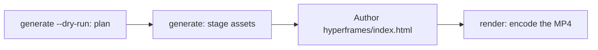

# Video genereren {#video-generation}

`oma-video` is de videorouter van oh-my-agent. Vanuit een briefing van één regel stelt hij een script, vertelling, visuals en captions samen en legt hij het plan vast in een runmap. Providerfasen hebben optioneel keys en kunnen lokale of deterministische fallbacks gebruiken; voor een echte MP4 zijn nog steeds een werkende compositor en een geldige compositie nodig.

De skill wordt actief bij "shorts", "reels", "screencast" of zinnen als "make a video", "explainer video", "demo video", "walkthrough video" of "video from README", of wanneer een andere skill een video als neveneffect nodig heeft.

> **Let op:** `oma video generate` plant een run en zet assets klaar. Met de standaard HyperFrames-compositor encodeert het geen MP4: schrijf `<runDir>/hyperframes/index.html` (de `/video`-workflow doet dit voor je) en voer daarna `oma video render <runDir>` uit. Begin bij de eerste run met `oma video doctor --install`.

---

## Wanneer gebruiken {#when-to-use}

- Een briefing, README, code of data omzetten in een korte clip.
- Een explainer met vertelling of een demo-/walkthrough-opname maken.
- Elke reproduceerbare pipeline van "briefing → `.mp4`" die je deterministisch opnieuw wilt uitvoeren.

## Wanneer NIET gebruiken {#when-not-to-use}

- Eén stilstaand beeld → gebruik [`oma-image`](/docs/guide/image-generation).
- Live schermuitzendingen of streaming → valt buiten de scope (oma neemt het scherm nooit op; jij levert de opname aan).
- Zelfstandig vertellingsaudio → gebruik `oma-voice`.

---

## Modi in één oogopslag {#modes-at-a-glance}

| Modus | Beeldverhouding | Wat wordt samengesteld |
|------|--------|------------------|
| `shorts` | 9:16 | Korte verticale clip (script → vertelling → visuals → captions). |
| `explainer` | 16:9 | Horizontale explainer op basis van een README, code of databriefing. |
| `demo` | afgeleid | Een walkthrough op basis van je eigen schermopname, aangeleverd met `--capture <file>`. `--source web --url <url>` slaat alleen de gemaskeerde URL op als context; oma opent nooit een browser, neemt het scherm nooit op en automatiseert nooit een login. |

De modus kiest verstandige standaardwaarden; geef de relevante vlaggen door wanneer je andere waarden nodig hebt.

---

## Snel starten {#quick-start}

In een agent voert `/video three quick tips for better focus` alle onderstaande stappen voor je uit. Handmatig bestaat de pipeline uit vier stappen:



```bash
oma video doctor --install   # first run only: HyperFrames toolchain, Chrome Headless Shell, Pretendard

# 1. Plan from an agent-authored script (schema: .agents/skills/oma-video/resources/script-schema.md)
oma video generate "three quick tips for better focus" --mode shorts --script ./script.json --dry-run --output json

# 2. Stage assets (narration needs --voice <profile>; the default is a silent video)
oma video generate "three quick tips for better focus" --mode shorts --script ./script.json --output json

# 3. Author <runDir>/hyperframes/index.html per its AUTHORING.md, then encode
oma video compose <runDir>
oma video render <runDir> --output json

# Demo from your own recording; without --polish the recording itself becomes the output
oma video generate "product walkthrough" --mode demo --capture ./capture.mp4
```

<!-- oma-docs:ignore-start -->

| Stap | Commando | Resultaat |
|---|---|---|
| Plannen | `generate --dry-run` | `script.json`, `render-spec.json`, `manifest.json`; geen rendering |
| Assets klaarzetten | `generate` | visuals, captions, optionele audio en muziek, een `hyperframes/`-scaffold en de waarschuwing `composition pending` |
| Schrijven | `hyperframes/index.html` bewerken | de compositie |
| Renderen | `render <runDir>` | `{mode}-{slug}.mp4` en een bijgewerkt manifest |

<!-- oma-docs:ignore-end -->

Zonder `--script` bouwt de CLI een deterministisch skelet van drie scènes uit de tekst van de briefing. `--locale` stelt de taal-tag voor vertelling en captions in, maar vertaalt ze niet; schrijf de briefing of `script.json` in de doeltaal.

Elke run print de runmap. Een vaste `--seed` stabiliseert de deterministische planningsinvoer; live provideruitvoer en capturebeelden kunnen nog steeds variëren. Render een bestaande runmap opnieuw wanneer je de opgeslagen renderspecificatie en assets wilt hergebruiken.

Andere tools die `oma video generate --output json` als shell-opdracht aanroepen, parsen een JSON-envelope uit stdout: `{exitCode, runDir, manifestPath, scriptPath, renderSpecPath, warnings, error}`. Er is geen key `outputs` — lees de paden naar uitvoer en assets uit het manifest op `manifestPath`.

---

## Beheerde HyperFrames-toolchain; jij schrijft de compositie {#always-latest-hyperframes-you-author-the-composition}

oh-my-agent levert **geen HyperFrames-compositiecode** mee. Elke run krijgt een eigen project op `<runDir>/hyperframes/`, dat door `oma video compose` wordt gescaffold op de nieuwste npm-HyperFrames (toolchain-cache `~/.cache/oma-video/hyperframes/<version>/`, gedeeld via een `node_modules`-symlink), met [heygen-com/hyperframes](https://github.com/heygen-com/hyperframes) op HEAD (`~/.cache/oma-video/hyperframes-skills/`). De agent schrijft de bron van de gegenereerde compositie volgens de `AUTHORING.md` van de scaffold, de skills en de modespecificatie in `.agents/skills/oma-video/resources/hyperframes-authoring/`.

```bash
oma video generate "…"                     # → render-spec.json + <runDir>/hyperframes/ (composition pending)
oma video compose <runDir> --output json   # refresh scaffold / print the contract (idempotent)
#   author hyperframes/index.html as instructed by AUTHORING.md
oma video render <runDir> --output json    # lint → render with the cached HyperFrames CLI → ffprobe; exit 1 on any failure
```

- Controles op de nieuwste versie (npm + GitHub) worden gethrottled door `video.hyperframes.check_interval_min` (standaard 60; `0` = bij elke compose). `oma update` respecteert het interval; `oma video doctor --upgrade` forceert een controle; offline-runs gebruiken de gecachte toolchain en melden `stale`.
- Reproduceerbaarheid zit in de runmap: `render-spec.json`, de geschreven compositiebron en de toolchainversie in de gegenereerde HyperFrames-package metadata. Opnieuw renderen van dezelfde run hergebruikt dat rendercontract; een nieuwe run controleert de nieuwste HyperFrames.
- Een lint- of renderfout wordt **niet** verborgen achter een placeholder (die bestaat alleen voor `OMA_VIDEO_MOCK=1`): `oma video render` eindigt met exitcode 1 en diagnostics, en de agent herstelt de compositie met de nieuwste skills. Breuk op een nieuwe HyperFrames-release is een compositiefout en nooit een reden om te pinnen.

```yaml
video:
  hyperframes:
    check_interval_min: 60    # 0 = check on every compose
```

---

## CLI-referentie {#cli-reference}

```bash
oma video generate <brief...> [options]
oma video doctor [--install|--upgrade|--install-mpt|--install-strudel]  # toolchain readiness / provisioning
oma video compose <runDir>       # prepare HTML project and authoring contract
oma video render <runDir>        # re-render from render-spec.json (deterministic)
oma video provider list         # provider availability + key/fallback status
```

### Belangrijke vlaggen {#key-flags}

| Vlag | Doel |
|------|---------|
| `--mode <m>` | `shorts` \| `explainer` \| `demo`. |
| `--aspect <a>` | `9:16` \| `16:9` \| `1:1` \| `auto`. |
| `--locale <lang>` | Taal-tag voor vertelling/captions. |
| `--captions <s>` | `tiktok` \| `lower-third` \| `none` (key-vrije uitlijning). |
| `--visual <m>` | `auto` \| `generate` \| `stock` \| `aigc` \| `slide`. |
| `--voice <profile>` | Stem voor vertelling, of `none` (de standaard; laat je deze weg, dan rendert de video zonder geluid met geschatte captiontiming). |
| `--music <mode>` | `upbeat`, `calm`, `cinematic`, `lofi`, `piano` of `none`. |
| `--compositor <c>` | `hyperframes` (standaard) \| `mpt`. |
| `--capture <path>` | Je opname voor demomodus: `.mp4`, `.mov`, `.webm` of `.mkv`, opgeslagen binnen het project. |
| `--source <k>` | Capturebron voor demo's: `file` of `web` (standaard: `file`). |
| `--url <url>` | Context-URL voor `--source web`, gemaskeerd opgeslagen in `manifest.json`. Verplicht bij `--source web`; start nooit een capture en vervangt `--capture` niet. |
| `--polish` | Legt de HyperFrames-compositie over opgenomen beeld heen. |
| `--device`, `--ready-selector`, `--show-cursor`, `--capture-timeout`, `--capture-stop` | Geaccepteerd maar niet gebruikt: oma bestuurt geen browser en neemt het scherm niet op. |
| `--output-dir <path>` | Basismap voor uitvoer. Paden buiten `$PWD` vereisen `--allow-external-output`. |
| `--allow-external-output` | Staat uitvoerpaden buiten `$PWD` toe. |
| `--max-usd <n>` | Kostenplafond (standaard `0.2`). Wanneer de lopende schatting het bereikt, stopt de run met exitcode 1; voer opnieuw uit met `-y` of een hogere waarde. |
| `--duration <sec>` | Gewenste lengte in seconden (1–180), of `auto`. |
| `--seed <n>` | Deterministische seed. |
| `--dry-run` | Geeft script / render-spec / manifest uit en slaat renderen over. |
| `--script <path>` | Door de agent geschreven `script.json` om in te voegen (overschrijft het skelet; stuurt vertelling, tekst op het scherm en visuele prompts per scène). |
| `-y, --yes` | Staat providers toe waarvan de schatting `--max-usd` bereikt (hetzelfde als `OMA_VIDEO_YES=1`). |
| `--timeout <sec>` | Tijdslimiet in hele seconden voor elke aanroep van een visual- of muziekprovider (standaard `600`). Eenheidsachtervoegsels worden niet geparst: `2m` betekent 2 seconden. |
| `--output <f>` | CLI-uitvoer: `text` (standaard) of `json`. |
| `--no-brief-in-manifest` | Slaat een SHA-256 van de briefing op in plaats van de onbewerkte briefing. |

---

## Providers zonder verplichte keys {#key-optional-providers}

Providerfasen lossen op naar een **echte branch** en, waar de fase dat ondersteunt, een **deterministische fallback**. Ontbrekende keys kunnen een geplande run dus voorzien van geschatte timing of lokale assets. De compositor is een verplichte eindfase en heeft geen normale placeholder-fallback:

| Capability | Echte branch (wat deze inschakelt) | Fallback |
|------------|-------------|----------|
| script | door de agent geschreven `script.json`, doorgegeven met `--script <path>` (de `/video`-workflow schrijft die) | deterministisch skelet van drie scènes uit de tekst van de briefing |
| voice | `oma-voice` (Voicebox of VoiceStudio, lokaal; gekozen via `voice.backend`) met `--voice <profile>` | stille video met geschatte timing (`--voice none`, de standaard) |
| visual | `oma-image`, `oma-slide`, Pexels-stockclips wanneer `PEXELS_API_KEY` is ingesteld | placeholder-asset |
| visual: `aigc` | nog niet aangesloten; `RUNNINGHUB_API_KEY` schakelt de provider in, die nog steeds placeholders schrijft | placeholder-asset |
| caption | `.srt` en `.vtt`, uitgelijnd op `timing.json`, in de taal van het script | hetzelfde; vertaling naar `--locale` is nog niet aangesloten |
| music | Strudel-achtergrondmuziek na `oma video doctor --install-strudel` | geen muziektrack |
| capture | een opname die je aanlevert met `--capture <file>` | geen: zonder `--capture` print de demomodus opname-instructies en sluit af met exitcode 3 |
| compositor | HyperFrames (beheerd) of MoneyPrinterTurbo | geen compositor-fallback; de run faalt met diagnostics |

Er is geen credential-automatisering: jij voert elke login op het scherm uit tijdens het opnemen; URL's en querytokens worden gemaskeerd in logs en het manifest.

Captions worden weergegeven als **statische cues met vensters** — de ene captionregel die in het huidige frame actief is, met CSS-wrapping en zonder animatie per woord.

---

## Toolchain en `doctor` {#toolchain-and-doctor}

De zware toolchain (de `node_modules` van het beheerde HyperFrames-project, het ingebedde Pretendard-lettertype, de checkout van MoneyPrinterTurbo, het Strudel-muziekproject en Chrome Headless Shell) wordt **on demand** ingericht en nooit in het package meegeleverd. Een gewone `doctor` rapporteert alleen — hij installeert nooit iets:

```bash
oma video doctor
```

Hij rapporteert `node`, `chromium`, `ffmpeg`, `ffprobe`, `hyperframes-toolchain`, `hyperframes-skills`, `pretendard-font`, `mpt-project`, `strudel`, `voicebox`, `voicestudio`, `oma-image`, `pixelle` en `cap`, en geeft voor ontbrekende onderdelen de installatietip. Voer `oma video doctor --output json` uit voor de gezaghebbende lijst. De basis vereist Node.js 22+, de HyperFrames-toolchain met bijbehorende Chrome-browser, FFmpeg/FFprobe en `oma-image`. Voor een echte MP4 is ook geschreven HTML nodig.

Gebruik de installvlaggen om de toolchain in te richten:

```bash
oma video doctor --install             # warm the latest HyperFrames toolchain + Chrome Headless Shell + Pretendard + heygen-com/hyperframes
oma video doctor --upgrade             # force a latest-version check now
oma video doctor --install-mpt         # MoneyPrinterTurbo checkout (clone + venv + deps) for --compositor mpt
oma video doctor --install-strudel     # Strudel music renderer for --music (installs AGPL-3.0-or-later packages locally)
```

`--install` haalt ook het ingebedde Pretendard-lettertype (een gepinde release) op naar de gedeelde toolchain-cache — dit valt binnen de determinismegrens. Bij een netwerkfout geeft de tool een waarschuwing en valt de render terug op systeemlettertypen; browser- en OS-verschillen kunnen de geëncodeerde uitvoer nog steeds beïnvloeden.

---

## Uitvoermap {#output-layout}

```text
.agents/results/videos/{timestamp}-{shortid}-{mode}/
├── script.json          # scenes + narration
├── render-spec.json     # the deterministic render contract
├── timing.json          # per-segment timing (voicebox-stt, voicestudio-stt, or estimated)
├── captions.srt / .vtt
├── audio/narration-01.wav     # one track; absent when the video is silent
├── music/                     # pattern.strudel, bgm.wav, bgm.mp3 (with --music and Strudel installed)
├── visuals/scene-*.{png,svg,…}
├── hyperframes/         # index.html, AUTHORING.md, local assets and toolchain link
├── {mode}-{slug}.mp4    # the rendered output (slug derived from the script title)
└── manifest.json        # providers, assets, cost, warnings
```

De `render-spec.json` plus assets vormen de determinismegrens.

---

## Probleemoplossing {#troubleshooting}

<!-- oma-docs:ignore-start -->

| Symptoom | Oorzaak / oplossing |
|---------|-------------|
| Er wordt geen MP4 geproduceerd | Een controle van compositor, compositie of toolchain is mislukt. Voer `oma video doctor` uit, daarna `oma video compose <runDir>`, herstel de gemelde compositie en voer opnieuw `oma video render <runDir>` uit. |
| De vertelling is stil (`source: estimated`) | `--voice` staat standaard op `none`, of geen spraakbackend is bereikbaar. Geef `--voice <profile>` mee met een profiel van de gekozen backend (de Voicebox-app, of een VoiceStudio-profiel-ID bij `voice.backend: voicestudio` of `auto`) en start die app, of accepteer geschatte timing. |
| Een demorun sluit af met exitcode 3 en opname-instructies | Er is geen `--capture`-bestand opgegeven (ook bij `--source web`); oma neemt het scherm niet op. Neem de flow op met Cap, QuickTime of OBS, sla de opname op binnen het project en voer opnieuw uit met `--capture ./walkthrough.mp4`. |
| `--capture` geweigerd (exitcode 4) | Het bestand bestaat niet, staat buiten de projectmap of is geen `.mp4` / `.mov` / `.webm` / `.mkv`. Kopieer de opname naar het project, bijvoorbeeld `./captures/demo.mp4`. |
| De run stopt bij het kostenplafond (exitcode 1) | De lopende schatting heeft `--max-usd` bereikt. Voer opnieuw uit met `-y` of een hogere `--max-usd`. |
| `--out path "…" is outside $PWD. Use --allow-external-out to override.` (exitcode 1) | `--output-dir` wijst naar een locatie buiten het project. Voer opnieuw uit met `--allow-external-output` (de melding toont nog de oude flagnaam), of kies een map binnen het project. |
| `oma video doctor` meldt `oma-image` als ontbrekend | Als het detail `Removed option --format. Use --output.` luidt, is de readiness-probe zelf mislukt en zegt die niets over je vendors; controleer ze direct met `oma image doctor`. Anders is er geen afbeeldingsvendor gereed, zodat visuals terugvallen op placeholders: voer `oma image doctor` uit en richt één vendor in. |
| De eerste render is traag | De HyperFrames-browser of MPT-checkout wordt eenmalig ingericht; volgende runs hergebruiken de cache. |

<!-- oma-docs:ignore-end -->

---

## Volgende stappen {#next-steps}

- [`/video`-workflow](../core-concepts/workflows.md#video) — de briefing → script → assets → render-spec → HyperFrames-pipeline.
- [Afbeeldingen genereren](./image-generation.md) — de still-image-router die opnieuw wordt gebruikt als videovisualprovider.
- [Inhouds- en onderzoeksworkflows](./content-and-research.md) — voice, slides en andere contentmogelijkheden.
- [CLI-commando's: video](../cli-interfaces/commands.md#video) — volledige lijst met opties voor `oma video`.
