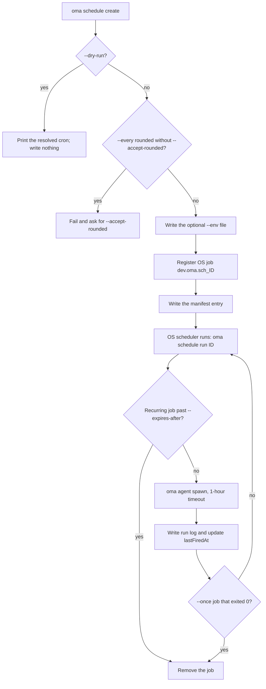
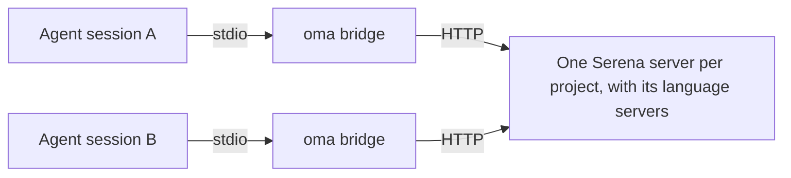
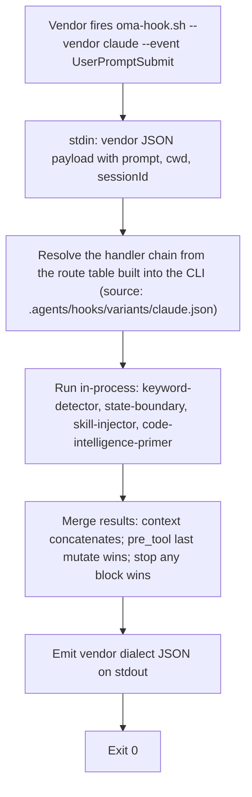

# Polecenia CLI

Po instalacji globalnej (`bun install --global oh-my-agent`) używaj `oma` lub `oh-my-agent`. Aby uruchomić narzędzie jednorazowo bez instalacji, użyj `npx oh-my-agent`.

Zmienną środowiskową `OH_MY_AG_OUTPUT_FORMAT` można ustawić na `json`, aby JSON był domyślnym wyjściem w poleceniach korzystających ze wspólnych opcji `--json` / `--output`. Jawne `--output text` nadal ma pierwszeństwo.

Jeśli polecenie kończy się błędem `Unknown command`, `Unexpected argument` lub `Removed option`, zajrzyj do sekcji [Usunięte formy zapisu](#aliases) na tej stronie; problemy z instalacją, hookami i działaniem opisuje [Rozwiązywanie problemów](../guide/troubleshooting.md).

## Zacznij od zadania {#start-with-a-task}

Wybierz najmniejsze polecenie, które odpowiada na Twoje pytanie. Każde z poniższych poleceń wypisuje ścieżkę lub raport, który możesz sprawdzić przed przejściem dalej.

| Zadanie | Zacznij tutaj | Oczekiwany wynik |
|:-----|:-----------|:----------------|
| Instalacja lub naprawa projektu | `oma install` następnie `oma doctor` | Zainstalowane zasoby i raport zdrowia; użyj `oma doctor --profile`, gdy chodzi o wybór modelu. |
| Znalezienie polecenia lub opcji agenta | `oma describe` lub `oma describe "image generate"` | JSON opisujący argumenty, opcje i zagnieżdżone polecenia. |
| Generowanie obrazu | `oma image generate "<prompt>" --output json` | Ścieżki obrazów i manifest w `.agents/results/images/`. |
| Planowanie lub renderowanie wideo | `oma video generate "<brief>" --dry-run` | Katalog uruchomienia z artefaktami planowania; compose i render uruchamiaj dopiero po utworzeniu kompozycji. |
| Utworzenie interaktywnego objaśnienia kodu | `/explain` | Zweryfikowany, samowystarczalny artefakt HTML w `.agents/results/explain/`. |
| Wybór silnika diagramów | `oma diagram resolve --output json` | Wybrany silnik Mermaid lub archify oraz uzasadnienie wyboru. |
| Badanie sygnałów społeczności | `oma market detect-trap "<topic>"` | Wynik preflight; kontynuuj przez `oma market resolve --output json` i uruchomienie upstream dopiero po pomyślnym przejściu. |
| Konwersja lub inspekcja artykułu | `oma scholar search "<query>"` | Wyniki wyszukiwania z Knows, OpenAlex lub Semantic Scholar; pobierz sidecar przez `oma scholar get`. |
| Utworzenie prezentacji | `oma slide create --output-dir <dir>` | Katalog roboczy, który można wypełnić, zweryfikować, zbundlować i wyeksportować. |
| Przegląd rozbieżności dokumentacji | `oma docs verify --json` | Ustrukturyzowany raport uszkodzonych odwołań i odtworzony indeks referencji. |
| Zaplanowanie cyklicznego agenta | `oma schedule create backend "<task>" --every 2h --dry-run` | Rozpoznane wyrażenie cron; nic nie zostanie zarejestrowane, dopóki nie uruchomisz polecenia ponownie bez `--dry-run`. |
| Sprawdzenie jakości umiejętności lub harness | `oma skill lint` lub `oma skill audit` | Raporty offline; przed każdym poleceniem wywołującym modele zajrzyj do sekcji [Wybór polecenia dla umiejętności lub harness](#choosing-a-skill-or-harness-command). |

Poniższe kanoniczne nazwy pochodzą z `oma describe`. Akceptowane są wyłącznie te ścieżki rozdzielone spacjami: starsze formy, takie jak `slide new`, `slide viewer`, `image list-vendors`, `video list-providers`, formy z dwukropkiem, takie jak `agent:parallel`, oraz krótkie nazwy `viz`, `s` i `img` kończą się błędem `Unknown command` lub `Unexpected argument`. Zobacz [Aliasy i usunięte formy zapisu](#aliases).

## Bieżąca lista poleceń {#current-command-surface}

Użyj `--help` danej rodziny albo `oma describe <path>`, aby poznać dokładną składnię argumentów; [Opcje CLI](./options.md) zawierają kompletną macierz flag rejestru.

| Rodzina | Zarejestrowane ścieżki |
|:-------|:-----------------|
| `install` | `install` |
| `describe` | `describe` |
| `uninstall` | `uninstall` |
| `update` | `update`, `update mcp` |
| `link` | `link` |
| `intel` | `intel`, `intel suggest` |
| `market` | `market`, `market detect-trap`, `market resolve`, `market update`, `market run` |
| `doctor` | `doctor` |
| `profile` | `profile`, `profile list`, `profile show`, `profile create`, `profile use`, `profile run` |
| `home` | `home`, `home migrate` |
| `retro` | `retro` |
| `recap` | `recap` |
| `docs` | `docs`, `docs verify`, `docs sync`, `docs i18n`, `docs lint` |
| `emit` | `emit` |
| `cleanup` | `cleanup` |
| `bridge` | `bridge` |
| `verify` | `verify`, `verify agent`, `verify triggers` |
| `vault` | `vault`, `vault store`, `vault get`, `vault list`, `vault delete` |
| `star` | `star` |
| `visualize` | `visualize` |
| `search` | `search`, `search providers`, `search web`, `search fetch`, `search meta`, `search media`, `search archive`, `search trust`, `search code`, `search doctor`, `search api`, `search api fetch`, `search api search`, `search rss`, `search rss fetch`, `search rss google` |
| `harness` | `harness`, `harness eval`, `harness incident`, `harness incident scan`, `harness incident capture`, `harness incident show`, `harness incident export`, `harness incident promote`, `harness incident reproduce`, `harness feedback`, `harness evolution`, `harness evolution enable`, `harness evolution status`, `harness evolution disable`, `harness evolution run` |
| `slide` | `slide`, `slide validate`, `slide bundle`, `slide edit`, `slide doctor`, `slide create`, `slide preview`, `slide export`, `slide export pdf`, `slide export png`, `slide export pptx`, `slide import`, `slide import pptx`, `slide asset`, `slide asset fetch-video`, `slide style`, `slide style list`, `slide style preview`, `slide style get` |
| `scholar` | `scholar`, `scholar search`, `scholar resolve`, `scholar get`, `scholar lint` |
| `image` | `image`, `image generate`, `image doctor`, `image vendor`, `image vendor list` |
| `video` | `video`, `video generate`, `video doctor`, `video compose`, `video render`, `video provider`, `video provider list` |
| `serena` | `serena`, `serena check`, `serena setup`, `serena reap`, `serena daemon`, `serena daemon gc`, `serena reaper`, `serena reaper enable`, `serena reaper disable` |
| `explain` | `explain`, `explain render`, `explain lint`, `explain patch`, `explain components`, `explain validate` |
| `diagram` | `diagram`, `diagram resolve`, `diagram update`, `diagram archify` |
| `help` | `help` |
| `version` | `version` |
| `dashboard` | `dashboard`, `dashboard terminal`, `dashboard web` |
| `auth` | `auth`, `auth status` |
| `hook` | `hook`, `hook run`, `hook probe` |
| `state` | `state`, `state emit`, `state migrate`, `state get`, `state list`, `state repair`, `state verify`, `state decisions`, `state decisions list`, `state inject-log`, `state inject-log list`, `state inject-log get`, `state summary`, `state trajectory`, `state heal-check`, `state activate`, `state archive`, `state purge` |
| `ralph` | `ralph`, `ralph verify` |
| `goal` | `goal`, `goal set` |
| `stats` | `stats`, `stats get`, `stats reset` |
| `agent` | `agent`, `agent context`, `agent resume`, `agent begin`, `agent verify`, `agent finish`, `agent spawn`, `agent status`, `agent parallel`, `agent review` |
| `model` | `model`, `model check`, `model probe`, `model propose` |
| `memory` | `memory`, `memory keys`, `memory init`, `memory setup`, `memory daemon`, `memory daemon status`, `memory daemon start`, `memory daemon stop`, `memory daemon restart`, `memory service`, `memory service install`, `memory service uninstall`, `memory status`, `memory retry`, `memory retry drain`, `memory import`, `memory maintain`, `memory maintain backup`, `memory maintain prune`, `memory maintain vacuum`, `memory gc`, `memory upgrade` |
| `skill` | `skill`, `skill audit`, `skill lint`, `skill eval`, `skill optimize`, `skill meta-optimize`, `skill procedure`, `skill evolution-stats`, `skill promotions`, `skill rollback`, `skill matrix` |
| `schedule` | `schedule`, `schedule create`, `schedule list`, `schedule delete`, `schedule run`, `schedule sync` |

Inne procesy OMA wywołują kilka wewnętrznych punktów wejścia (`agent parallel-supervisor`, `hook script`, `schedule inspect`, `schedule builtin-evolution-add`). Nadal działają, ale pomoc i `oma describe` je ukrywają; nie musisz uruchamiać ich ręcznie.

Gdy polecenie przekazuje pozostałe argumenty innemu narzędziu, rejestr celowo pozostawia jego opcje otwarte. Dotyczy to `market run` i `diagram archify`; przed operacją zmieniającą dane lub korzystającą z sieci przeczytaj pomoc rozpoznanego narzędzia nadrzędnego.

---

## Konfiguracja i instalacja {#setup--installation}

### install

`oma` bez argumentów uruchamia instalator interaktywny. `oma install` jest jawną formą i przyjmuje opcje wyboru dostawców.

```bash
oma
oma install
oma install --web-search native --code-intelligence gortex --semantic-memory agentmemory
```

| Opcja | Akceptowane wartości |
|:-------|:----------------|
| `--web-search <provider>` | `native`, `brave` |
| `--code-intelligence <provider>` | `serena`, `gortex` |
| `--semantic-memory <provider>` | `agentmemory`, `honcho`, `none` |
| `--honcho-url <url>` | Origin API Honcho (domyślnie dla nowego połączenia: `http://127.0.0.1:8000`) |
| `--honcho-workspace <id>` | ID workspace Honcho (domyślnie dla nowego połączenia: `oma`) |

Pominięte `--web-search`, `--code-intelligence` i `--semantic-memory` zachowują zapisany wybór dostawcy. `--honcho-url` i `--honcho-workspace` konfigurują nowe połączenie Honcho, gdy wybrano tego dostawcę. Główna flaga `-y, --yes` pomija pytania i używa wartości domyślnych; `--global` kieruje instalację do `$OMA_HOME/.agents/` (domyślnie `~/.oma/.agents/`). Instalacja projektowa pozostaje w `<cwd>/.agents/` nawet wtedy, gdy ustawiono `OMA_HOME`.

**Co robi:**
1. Sprawdza obecność starego katalogu `.agent/` i w razie potrzeby migruje go do `.agents/`.
2. Wykrywa konkurencyjne narzędzia i oferuje ich usunięcie.
3. Pyta o typ projektu (All, Fullstack, Frontend, Backend, Mobile, DevOps, Custom).
4. Jeśli wybrano backend, pyta o wariant języka (Python, Node.js, Rust, Other).
5. Pyta o dowiązania symboliczne GitHub Copilot.
6. Pobiera najnowszy tarball z rejestru.
7. Instaluje współdzielone zasoby, workflow, konfiguracje i wybrane umiejętności.
8. Instaluje adaptacje dla wybranych dostawców (ustawienia lokalne projektu; bez cichych zapisów dostawcy w HOME).
9. Tworzy dowiązania symboliczne CLI.
10. Oferuje zalecaną **globalną** konfigurację git (wymaga jawnej zgody):
    - `rerere.enabled=true` — ponowne używanie rozwiązań konfliktów merge wielu agentów
    - `init.defaultBranch=main` — spójna domyślna gałąź dla nowych repozytoriów
    - Całkowicie pomijana przy `--yes` / CI (zamiast tego wypisywane są wskazówki ręcznej naprawy)
11. Oferuje konfigurację MCP tam, gdzie ma to zastosowanie.
12. Prosi o dodanie gwiazdki GitHub, jeśli `gh` jest uwierzytelnione.

**Przykład:**
```bash
cd /path/to/my-project
oma
# Follow the interactive prompts
```

### doctor

Kontrola instalacji CLI, konfiguracji MCP i statusu umiejętności.

```text
oma doctor [--json] [--output <format>] [--profile] [--heal-check <agent-type>]
```

**Opcje:**

| Flaga | Opis |
|:-----|:-----------|
| `--json` | Wyjście w formacie JSON. Polecenie kończy się kodem `1`, gdy licznik `issues` w raporcie jest większy od zera. |
| `--output <format>` | Format wyjścia (`text` lub `json`) |
| `--profile` | Wyświetla macierz zdrowia profilu: rozpoznany slug modelu, CLI i status uwierzytelnienia dla każdego agenta z aktywnego `model_preset` oraz nadpisań `agents:`. Zobacz [Modele per agent](../guide/per-agent-models.md). |
| `--heal-check <agent-type>` | Dołącza do raportu kontrolę bramki samonaprawy dla tego agenta. |

**Co sprawdza:**
- Instalacje CLI: `claude`, `codex`, `qwen`, `agy`, `grok`, `kiro-cli`, `kimi` i `pi` (wersja i ścieżka).
- Status uwierzytelnienia każdego CLI.
- Konfigurację MCP dla Claude Code (`~/.claude.json`) i Codex (`~/.codex/config.toml`).
- Zainstalowane umiejętności: które są obecne i jaki mają status.
- Katalog pamięci: obecność `.agents/state/memories/` i liczba plików (starsze projekty używają starszej ścieżki `.serena/memories/`).
- Znaczniki podwójnej instalacji (projektowa i globalna) oraz powiązane ostrzeżenia.
- Zalecaną **globalną** konfigurację git (`gitRecommended` w JSON):
  - `rerere.enabled=true`
  - `init.defaultBranch=main`
  - Każda niezgodność zwiększa łączną liczbę problemów (`issues` w JSON)
- Plik kontekstu dostawcy projektu (blok OMA w `AGENTS.md`, gdy zainstalowano Codex, Qwen lub Claude Code ≥ 2.1.277).
- Zdrowie AgentMemory, stanu i hooków, diagnostykę reapera Serena oraz powiązane liczniki problemów.

**Automatyczna naprawa:** Jeśli wykryto brakujące umiejętności, `doctor` oferuje ich interaktywną instalację. Jeśli zalecana konfiguracja git jest nieobecna lub błędna, oferuje te same globalne poprawki wymagające zgody co install/update.

**Przykłady:**
```bash
# Interactive text output
oma doctor

# JSON output for CI pipelines
oma doctor --json

# Pipe to jq for specific checks
oma doctor --json | jq '.clis[] | select(.installed == false)'

# Inspect the profile resolution matrix
oma doctor --profile
```

### update

Aktualizuje umiejętności do najnowszej wersji z rejestru.

```text
oma update [-f, --force] [--with-new-skills] [--ci] [-y, --yes] [--all] [--vendor <vendors>]
```

**Opcje:**

| Flaga | Opis |
|:-----|:-----------|
| `-f, --force` | Nadpisuje konfiguracyjne pliki użytkownika (`oma-config.yaml`, `mcp.json`, katalogi `stack/`) |
| `--with-new-skills` | Instaluje umiejętności nowe w tym wydaniu; bez tej flagi odświeża tylko już zainstalowane. |
| `--ci` | Uruchamia nieinteraktywny tryb CI (pomija pytania, zwykłe wyjście tekstowe) |
| `-y, --yes` | Pomija pytania. Zakres dostawców się nie zmienia: aktualizowane są tylko istniejące katalogi dostawców, chyba że podano `--all` lub `--vendor`. |
| `--all` | Tworzy lub aktualizuje wszystkich obsługiwanych dostawców zakresu projektu. |
| `--vendor <vendors>` | Tworzy lub aktualizuje wskazanych dostawców. Przyjmuje listę rozdzielaną przecinkami, np. `claude,qwen`. |

**Co robi:**
1. Pobiera `prompt-manifest.json` z rejestru, aby sprawdzić najnowszą wersję.
2. Porównuje ją z lokalną wersją w `.agents/skills/_version.json`.
3. Jeśli wersja jest aktualna, kończy działanie.
4. Pobiera i rozpakowuje najnowszy tarball.
5. Zachowuje pliki dostosowane przez użytkownika (chyba że podano `--force`).
6. Kopiuje nowe pliki do `.agents/`.
7. Przywraca zachowane pliki.
8. Aktualizuje adaptacje dostawców i odświeża dowiązania symboliczne. Domyślnie dotyka tylko katalogów dostawców, które już istnieją w projekcie.
9. Oferuje zalecaną **globalną** konfigurację git (taką samą, jak przy install: `rerere.enabled`, `init.defaultBranch`). Pomijana przy `--yes` / `--ci`.

**Przykłady:**
```bash
# Standard update (preserves config)
oma update

# Force update (resets all config to defaults)
oma update --force

# CI mode (no prompts, no spinners)
oma update --ci

# CI mode with force
oma update --ci --force

# Update existing vendors without prompts
oma update --yes

# Create/update every supported project-scoped vendor
oma update --all

# Create/update only Claude and Qwen integrations
oma update --vendor claude,qwen

# Also refresh browser MCP selections
oma update mcp --ci
```

`oma update mcp` ma własne opcje `--yes`, `--ci`, `--all` i `--vendor <vendors>`. Wybiera obsługiwane serwery MCP przeglądarki (Aside, Chrome DevTools lub Firefox DevTools) dla wybranych dostawców zakresu projektu.

### uninstall

Wyświetla podgląd lub usuwa pliki należące do OMA z wybranego katalogu instalacji:

```bash
oma uninstall --dry-run
oma uninstall --yes
```

`--dry-run` wyświetla pliki do usunięcia bez ich zmieniania. `--yes` pomija pytanie o potwierdzenie. Polecenie zachowuje `oma-config.yaml`, `mcp.json` i umiejętności użytkownika zgodnie z opisem zarejestrowanego polecenia. Jeśli podgląd obejmuje potrzebny Ci plik, przerwij i zachowaj wynik dry-run do przeglądu.

### link

Regeneruje pliki właściwe dla dostawców z jedynego źródła prawdy `.agents/`, bez ponownej instalacji.

```text
oma link [vendors...] [--dry-run] [--global]
```

`--dry-run` pokazuje, co zostałoby zapisane, bez zmieniania plików.

**Przykłady:**

```bash
# Preview the files link would write
oma link --dry-run

# Regenerate all configured vendors
oma link

# Regenerate only Claude and Codex files
oma link claude codex

# Regenerate the global install (~/.oma/.agents/) from any directory
oma link opencode --global
```

Bez `--global` link kieruje do `<cwd>/.agents/`, a z nim do `~/.oma/.agents/` (lub `$OMA_HOME/.agents/`). `OMA_HOME` nie zmienia celu projektowego. Zobacz [Instalacja globalna](../guide/global-install.md).

**Co robi:**
1. Ponownie buduje pliki agentów właściwe dla dostawcy z `.agents/agents/`
2. Odświeża hooki i ustawienia lokalne wybranych dostawców
3. Regeneruje blok integracji `AGENTS.md` dla każdego skonfigurowanego dostawcy, w tym Claude Code. `CLAUDE.md` i `GEMINI.md` nigdy nie są tworzone ani nie otrzymują bloku OMA. Claude Code ≥ 2.1.277 odczytuje `AGENTS.md` natywnie, ale ignoruje go za każdym razem, gdy istnieje `CLAUDE.md`, więc gdy obecny jest należący do użytkownika `CLAUDE.md`, link dopisuje pojedynczą linię importu `@AGENTS.md`; `oma update` usuwa też starszy blok OMA z `CLAUDE.md`, gdy wykryje tę wersję
4. Odświeża powiązanie MCP Cursor i dowiązania symboliczne umiejętności CLI, gdy ma to zastosowanie

Użyj tego po edycji `.agents/agents/`, `.agents/workflows/`, `.agents/rules/` lub definicji hooków.

**Zachowanie modeli:**
- Natywny dispatch tego samego dostawcy używa modelu z wygenerowanego pliku agenta dostawcy.
- Zewnętrzny dispatch awaryjny używa `default_model` każdego dostawcy z `.agents/skills/oma-orchestration/config/cli-config.yaml`.

**Zachowanie dispatchu:**
- Jeśli docelowy dostawca odpowiada bieżącemu runtime i runtime obsługuje natywne agenty ról, OMA używa natywnego dispatchu.
- W przeciwnym razie OMA przechodzi do `oma agent spawn`.

### Ponowna konfiguracja istniejącej instalacji {#setup-workflow}

Nie ma workflow `/setup`. Aby zmienić zainstalowany projekt, uruchom ponownie `oma install`, użyj `oma update mcp` wyłącznie dla serwerów MCP przeglądarki albo uruchom `/tools` w sesji agenta, aby włączyć lub wyłączyć narzędzia MCP. Wybór modelu dla każdego agenta sprawdzisz przez `oma doctor --profile`; przypięcia modeli per agent znajdują się w sekcji `agents:` pliku `.agents/oma-config.yaml` ([Modele per agent](../guide/per-agent-models.md)).

---

## Monitoring i metryki {#monitoring--metrics}

### dashboard terminal {#dashboard}

Uruchamia terminalowy dashboard do monitorowania agentów w czasie rzeczywistym.

```text
oma dashboard terminal [--project-root <path>]
```

Obserwuje `<project>/.agents/state/memories/`, gdzie projekt to `--project-root` (domyślnie bieżący katalog). Nie ma automatycznego przejścia na starszą ścieżkę `.serena/memories/`. Renderuje interfejs z obramowaniem, statusem sesji, tabelą agentów i kanałem aktywności. Aktualizuje się po każdej zmianie pliku. Naciśnij `Ctrl+C`, aby wyjść.

Katalog pamięci można nadpisać zmienną środowiskową `MEMORIES_DIR`.

**Przykład:**
```bash
# Standard usage
oma dashboard terminal

# Custom memories directory
MEMORIES_DIR=/path/to/.agents/state/memories oma dashboard terminal
```

### dashboard web

Uruchamia dashboard webowy.

```text
oma dashboard web [--project-root <path>]
```

Uruchamia serwer HTTP pod adresem `http://127.0.0.1:9847` z połączeniem WebSocket do aktualizacji na żywo. Otwórz wypisany adres w przeglądarce, aby zobaczyć dashboard.

**Zmienne środowiskowe:**

| Zmienna | Domyślnie | Opis |
|:---------|:--------|:-----------|
| `DASHBOARD_PORT` | `9847` | Port serwera HTTP/WebSocket |
| `MEMORIES_DIR` | `<project-root>/.agents/state/memories` | Ścieżka katalogu pamięci; ma pierwszeństwo przed `--project-root` |

**Przykład:**
```bash
# Standard usage
oma dashboard web

# Custom port
DASHBOARD_PORT=8080 oma dashboard web
```

### stats

Wyświetla metryki produktywności.

```text
oma stats get [--json] [--output <format>]
oma stats reset [--json] [--output <format>]
```

**Opcje:**

| Flaga | Opis |
|:-----|:-----------|
| `--json` | Wyjście w formacie JSON |
| `--output <format>` | Format wyjścia (`text` lub `json`) |

**Śledzone metryki:**
- Liczba sesji
- Użyte umiejętności (z częstotliwością)
- Ukończone zadania
- Łączny czas sesji
- Zmienione pliki, dodane i usunięte wiersze
- Znacznik czasu ostatniej aktualizacji

**Telemetria kosztów** (agregowana ze wszystkich plików `session-cost-*.md` w `.agents/state/memories/`):
- Łączna liczba tokenów wejściowych (przybliżenie na podstawie znaków promptu; tokeny wyjściowe nie są jeszcze liczone)
- Łączna liczba uruchomień
- Szacunkowa kwota USD według ostrożnej tabeli stawek tokenów wejściowych dostawców (Claude $3/M, Codex $5/M, Gemini $0.3/M, Qwen $0/M, Cursor $5/M, Antigravity $0.3/M)
- Rozbicie według dostawcy (tokeny · uruchomienia · USD)

To dolna granica, a nie kwota zgodna z rzeczywistym rozliczeniem. Skonfiguruj `session.quota_cap` w `.agents/oma-config.yaml`, aby wymuszać twarde budżety podczas uruchamiania; strona Dlaczego oh-my-agent w sekcji Wprowadzenie opisuje zestaw jakościowy, do którego należą te limity.

Metryki są przechowywane w `.agents/state/metrics.json`; gdy istnieje, odczytywany jest starszy `.serena/metrics.json`. Dane pochodzą ze statystyk git i plików pamięci.

**Przykłady:**
```bash
# View current metrics
oma stats get

# JSON output
oma stats get --json

# Reset all metrics
oma stats reset
```

### recap

Tworzy podsumowanie historii rozmów narzędzi AI z sesji Claude, Codex, Gemini, Antigravity, Qwen, Cursor i Grok.

```text
oma recap [--window <period>] [--date <date>] [--tool <tools>] [--top <n>] [--sort <metric>] [--mermaid] [--graph] [--json] [--output <format>]
```

**Opcje:**

| Flaga | Opis | Domyślnie |
|:-----|:-----------|:--------|
| `--window <period>` | Okno czasowe: `1d`, `3d`, `7d`, `2w`, `30d` | `1d` |
| `--date <date>` | Konkretna data (`YYYY-MM-DD`); ma pierwszeństwo przed `--window` | |
| `--tool <tools>` | Filtr rozdzielany przecinkami: `grok,claude,codex,gemini,qwen,cursor,antigravity` | wszystkie |
| `--top <n>` | Pokazuje N najważniejszych projektów/tematów | |
| `--sort <metric>` | Sortuje według `count` lub `duration` | `count` |
| `--mermaid` | Wyjście jako wykres Gantta Mermaid | |
| `--graph` | Otwiera interaktywny graf w przeglądarce | |
| `--json` / `--output <format>` | Wyjście maszynowe | `text` |

**Przykłady:**

```bash
oma recap                                     # Today (1d)
oma recap --window 7d                         # Last week
oma recap --date 2026-04-20 --tool grok,claude
oma recap --window 7d --mermaid > week.mmd
oma recap --window 30d --graph                # Interactive browser graph
```

### retro

Retrospektywa inżynierska z metrykami i trendami.

```text
oma retro [window] [--json] [--output <format>] [--interactive] [--compare]
```

**Argumenty:**

| Argument | Opis | Domyślnie |
|:---------|:-----------|:--------|
| `window` | Okno czasowe `<n>h`, `<n>d` lub `<n>w` (na przykład `24h`, `7d`, `2w`). Miesiące nie są akceptowane; użyj `30d`. | Ostatnie 7 dni |

**Opcje:**

| Flaga | Opis |
|:-----|:-----------|
| `--json` | Wyjście w formacie JSON |
| `--output <format>` | Format wyjścia (`text` lub `json`) |
| `--interactive` | Tryb interaktywny z ręcznym wprowadzaniem |
| `--compare` | Porównuje bieżące okno z wcześniejszym oknem o tej samej długości |

**Co wyświetla:**
- Podsumowanie gotowe do publikacji (metryki w jednym wierszu)
- Tabelę podsumowania (commity, zmienione pliki, dodane/usunięte wiersze, kontrybutorzy)
- Trendy względem ostatniej retrospektywy (jeśli istnieje poprzedni snapshot)
- Ranking kontrybutorów
- Rozkład czasu commitów (histogram godzinowy)
- Sesje pracy
- Rozbicie typów commitów (feat, fix, chore itd.)
- Hotspoty (najczęściej zmieniane pliki)

**Przykłady:**
```bash
# Last 7 days (default)
oma retro

# Last 30 days
oma retro 30d

# Last 2 weeks
oma retro 2w

# Compare with previous period
oma retro 7d --compare

# Interactive mode
oma retro --interactive

# JSON for automation
oma retro 7d --json
```

---

## Globalny katalog domowy, sesje i profile lokalne {#global-home-sessions-and-local-profiles}

### home migrate

Kopiuje należące do OMA globalne definicje i metadane runtime do ujednoliconego katalogu domowego:

```bash
oma home migrate --dry-run --json
oma home migrate --json
oma schedule sync
```

`OMA_HOME` wybiera globalny katalog główny przechowywania, domyślnie `~/.oma`. Definicje
używają jego `.agents/`; harmonogramy używają `schedule/`; Serena i indeks nazw kluczy vault
używają `state/`. Przechowywanie profili używa `u/`, chyba że `OMA_STATE_HOME` jawnie wskazuje
inny katalog główny profili.

Migracja zachowuje oryginalną zawartość, pomija identyczne kopie, scala nazwy kluczy
vault i raportuje konflikty w miejscu docelowym lub dane w użyciu. Zweryfikowane katalogi
umiejętności należące do OMA mogą zostać zarchiwizowane w `$OMA_HOME/backup/legacy-global-skills/`,
zanim ich stare ścieżki wykrywania staną się zarządzanymi dowiązaniami do zmigrowanych kopii.
Umiejętności użytkownika i obce dowiązania pozostają na miejscu. Migracja nie przenosi
uwierzytelnienia dostawców, sekretów OS Keychain ani danych pamięci zewnętrznej. Globalne
install/update uruchamiają tę migrację automatycznie. Rejestracja zadań systemowych jest osobna:
po migracji uruchom `oma schedule sync`, jeśli istnieją harmonogramy.

### state list

Wyświetla sesje workflow OMA bieżącego projektu. Jawne globalne wyszukiwanie
wyświetla sesje ze wszystkich projektów w wybranym profilu lokalnym:

```bash
oma state list
oma state list --all-projects --json
oma state list --all-projects --project /path/to/project
oma state list --all-projects --search migration
```

`--all-projects` działa tylko do odczytu. Nie można go łączyć z aktywacją sesji ani
konserwacją. Zwykłe odczyty i zapisy sesji zachowują zakres projektu.
Starsze sesje z innych repozytoriów muszą najpierw zostać zmigrowane do pamięci domowej, zanim
pojawią się na zbiorczej liście.

### profile

Zarządza lokalnymi profilami przechowywania w `~/.oma/u/<slot>/`. Sloty to
nieujemne liczby dziesiętne; są niezależne od presetów modeli i
kont logowania dostawców.

```bash
oma profile list --json
oma profile create 1
oma profile show
eval "$(oma profile use 1 --shell zsh)"
oma profile show
oma profile run 1 -- oma state list --all-projects --json
```

`profile use` wypisuje aktywację powłoki; jej ewaluacja ustawia `OMA_PROFILE` w
bieżącej powłoce. Samo uruchomienie nie modyfikuje powłoki nadrzędnej, nie zmienia
już działających aplikacji ani nie zapisuje osobnego domyślnego ustawienia tylko dla CLI. Polecenia CLI
i hooki dostawców uruchomione z aktywowanej powłoki dziedziczą ten sam profil.
Domyślny jest profil `0`; przechowywanie podąża za `OMA_HOME` (domyślnie `~/.oma`). Jawne `OMA_STATE_HOME` nadpisuje wyłącznie przechowywanie profili.
`profile run <slot> -- <command> [args...]` wybiera profil tylko dla tego
polecenia i jego procesów potomnych. Separator zachowuje opcje potomnego polecenia, takie jak `--help`
i `--json`, przy tym poleceniu.

---

## Zarządzanie agentami {#agent-management}

### agent spawn

Uruchamia proces subagenta.

```text
oma agent spawn <agent-id> <prompt> <session-id> [--vendor <vendor>] [-w <workspace>] [--isolation <mode>]
```

**Argumenty:**

| Argument | Wymagane | Opis |
|:---------|:---------|:-----------|
| `agent-id` | Tak | Typ agenta. Jedna z wartości: `orchestrator`, `architecture`, `qa`, `pm`, `backend`, `frontend`, `mobile`, `db`, `debug`, `refactor`, `docs`, `tf-infra`, `explore` |
| `prompt` | Tak | Opis zadania. Tekst inline lub ścieżka do pliku. |
| `session-id` | Tak | Identyfikator sesji (format: `session-YYYYMMDD-HHMMSS`) |

**Opcje:**

| Flaga | Opis |
|:-----|:-----------|
| `--vendor <vendor>` | Nadpisanie dostawcy CLI: `antigravity`, `claude`, `codex`, `cursor`, `opencode`, `qwen`, `grok`, `pi` |
| `-w, --workspace <path>` | Katalog roboczy agenta. Jeśli pominięty, wykrywany z konfiguracji monorepo. |
| `--resumed-from <run-id>` | Łączy ponowną próbę z identyfikatorem poprzedniego uruchomienia. |
| `--task-id <id>` | Identyfikator zadania z planu sesji. Domyślnie identyfikator agenta. |
| `--isolation <mode>` | Izolacja pojedynczego uruchomienia. Obecnie obsługuje `worktree`: tworzy świeży git worktree w `${tmpdir}/oma-worktrees/{sessionId}/{agentId}` na gałęzi `oma/{sessionId}/{agentId}` i uruchamia tam agenta. Worktree pozostaje po zakończeniu; polecenia scalania lub odrzucenia są wypisywane do ręcznego przeglądu (bez auto-merge). |
| `--read-only` | Ogranicza uruchomionego agenta do narzędzi niedestrukcyjnych (wyłącza flagi automatycznej zgody). Wewnętrznie używane przez `oma skill eval --live` dla obu wariantów oceny. |
| `--fallback-vendors <vendors>` | Włącza uporządkowany, rozdzielany przecinkami łańcuch maksymalnie trzech skonfigurowanych dostawców CLI. Kontynuacja wymaga rozpoznanego wyczerpania limitu, limitu szybkości lub błędu przejściowego oraz nowego bezpiecznego punktu przekazania. |

**Kolejność wyboru dostawcy:** flaga `--vendor` > nadpisanie `agents:` w `oma-config.yaml` > domyślne wartości agenta z aktywnego `model_preset`.

**Rozpoznawanie promptu:** Jeśli argument promptu jest ścieżką do istniejącego pliku, jego zawartość staje się promptem. W przeciwnym razie argument jest traktowany jako tekst inline. Protokoły wykonania właściwe dla dostawcy są dołączane automatycznie.

**Kody wyjścia:**

| Kod | Znaczenie |
|:-----|:--------|
| `0` | Rekord uruchomienia zakończył się statusem `completed`. |
| `3` | Proces dostawcy zakończył się kodem 0, ale uruchomienie nie zakończyło się jako zweryfikowane uruchomienie `completed` (na przykład `partial`, `blocked` lub `failed`), a w zapisie pojawia się zdarzenie `blocker.raised` z kodem `spawn.incomplete-result`. Ten kod jest zwracany także wtedy, gdy nie może wystartować następca z `--fallback-vendors`. Nie uznawaj takiego uruchomienia za ukończone. |
| `130` | Przerwane (Ctrl+C lub SIGTERM). |
| inny | Sam proces dostawcy zakończył się błędem; jego kod wyjścia jest przekazywany dalej. |

Rekord uruchomienia i zgłoszenie, które decydują o statusie `completed`, opisuje [Wyniki agentów i wznawianie](../guide/agent-results-and-resume.md).

**Przykłady:**
```bash
# Inline prompt, auto-detect workspace
oma agent spawn backend "Implement /api/users CRUD endpoint" session-20260324-143000

# Prompt from file, explicit workspace
oma agent spawn frontend ./prompts/dashboard.md session-20260324-143000 -w ./apps/web

# Override vendor to Claude
oma agent spawn backend "Implement auth" session-20260324-143000 --vendor claude -w ./api

# Allow a prepared task handoff to another configured vendor
oma agent spawn backend "Implement auth" session-20260324-143000 --vendor claude --fallback-vendors codex,qwen -w ./api

# Mobile agent with auto-detected workspace
oma agent spawn mobile "Add biometric login" session-20260324-143000

# Run inside an isolated git worktree (useful for hypothesis spawns or
# when parallel agents would touch shared files)
oma agent spawn backend "Try a Drizzle-based rewrite" session-20260324-143000 --isolation worktree
```

**Przełączenie dostawcy:** kandydaci fallbacku muszą mieć wpis dostawcy w
zainstalowanej konfiguracji CLI. Każda próba używa konfiguracji modelu swojego dostawcy docelowego
i przechodzi przez istniejące kontrole limitu sesji. Proxy wielodostawcowe `pi`
jest wyłączone z tej początkowej funkcji fallbacku dostawców.
Nie są tworzone dodatkowe dane uwierzytelniające dostawców ani płatna trasa API.

Po włączeniu failover zadanie otrzymuje instrukcje przygotowania
bezpiecznego rekordu przekazania dla danego uruchomienia w `.agents/results/`. Następca odczytuje
ten rekord i sprawdza workspace przed kontynuowaniem pozostałej pracy.
Wyczerpanie limitu bez użytecznego punktu kontrolnego kończy się rekordem
wymagającym przeglądu. Anulowanie, zwykłe błędy zadania i ukończone uruchomienia nie rozpoczynają
kolejnej próby. `--read-only` nie znosi wymogu punktu kontrolnego.

Zdarzenia sesji zapisują powód przejścia oraz dostawcę źródłowego/docelowego; każda
próba ma własną tożsamość uruchomienia, a następca odwołuje się do poprzednika.
Dotyczy to podprocesów uruchamianych przez `oma agent spawn`; nie
przełącza automatycznie istniejącej interaktywnej rozmowy w aplikacji dostawcy.
Pominięcie `--fallback-vendors` zachowuje zwykłe uruchomienie z jednym dostawcą.

### agent status

Sprawdza status jednego lub większej liczby subagentów.

```text
oma agent status <session-id> [agent-ids...] [--project-root <path>]
```

**Argumenty:**

| Argument | Wymagane | Opis |
|:---------|:---------|:-----------|
| `session-id` | Tak | Identyfikator sprawdzanej sesji |
| `agent-ids` | Nie | Lista identyfikatorów agentów rozdzielonych spacjami. Jeśli ją pominiesz, polecenie niczego nie wypisze. |

**Opcje:**

| Flaga | Opis | Domyślnie |
|:-----|:-----------|:--------|
| `--project-root <path>` | Projekt, którego rekordy uruchomień, pamięci i pliki PID są sprawdzane | Bieżący katalog |

**Wartości statusu:**
- `running`, `completed`, `partial`, `blocked`, `failed`: status najnowszego rekordu uruchomienia tego agenta w sesji. Rekord `running`, którego proces wykonawczy już nie istnieje, jest zgłaszany jako `failed`.
- `stale`: uruchomienie jest zapisane jako `completed`, ale jego dowody przestały przechodzić walidację.
- `legacy-<status>`, `unverified`, `legacy-completed`: odczytane ze starszego pliku `result-<agent>.md` lub tymczasowego pliku statusu, gdy nie istnieje rekord uruchomienia.
- `running` / `crashed` z pliku PID: proces działa albo już nie istnieje.
- `crashed`: nie znaleziono rekordu uruchomienia, pliku wyniku, pliku statusu ani pliku PID.

**Format wyjścia:** Jeden wiersz na agenta: `{agent-id}:{status}`

**Przykłady:**
```bash
# Check specific agents
oma agent status session-20260324-143000 backend frontend

# Output:
# backend:running
# frontend:completed

# Check another project
oma agent status session-20260324-143000 qa --project-root /path/to/project
```

### agent parallel

Uruchamia wiele subagentów równolegle.

```text
oma agent parallel [tasks...] [--session-id <id>] [--vendor <vendor>] [-i, --inline] [--no-wait]
```

**Argumenty:**

| Argument | Wymagane | Opis |
|:---------|:---------|:-----------|
| `tasks` | Tak | Ścieżka do pliku zadań YAML albo (z `--inline`) specyfikacje zadań inline |

**Opcje:**

| Flaga | Opis |
|:-----|:-----------|
| `--session-id <id>` | Wiąże wyniki z istniejącą sesją; wartości `id` z YAML stają się identyfikatorami zadań |
| `--vendor <vendor>` | Nadpisanie dostawcy CLI dla wszystkich agentów |
| `-i, --inline` | Tryb inline: zadania podawane jako argumenty `agent:task[:workspace]` |
| `--no-wait` | Tryb w tle (uruchamia agentów i natychmiast wraca) |

**Format pliku z zadaniami YAML:**
```yaml
tasks:
  - id: user-api        # optional task ID
    agent: backend
    task: "Implement user API"
    workspace: ./api    # optional, auto-detected if omitted
  - agent: frontend
    task: "Build user dashboard"
    workspace: ./web
```

`id`, `agent`, `task` i `workspace` należą do tego samego elementu listy, więc wcinaj je pod `-`.

**Format zadań inline:** `agent:task` lub `agent:task:workspace` (workspace musi być `.` albo zaczynać się od `./` lub `/`).

**Katalog wyników:** `<project-root>/.agents/results/parallel-<timestamp>-<id>/` zawiera pliki dziennika każdego agenta.

**Przykłady:**
```bash
# From YAML file
oma agent parallel tasks.yaml

# Inline mode
oma agent parallel --inline "backend:Implement auth API:./api" "frontend:Build login:./web"

# Background mode (no wait)
oma agent parallel tasks.yaml --no-wait

# Override vendor for all agents
oma agent parallel tasks.yaml --vendor claude
```

### agent review

Uruchamia przegląd kodu za pomocą zewnętrznego CLI AI (codex, claude, qwen lub grok).

```text
oma agent review [--vendor <vendor>] [-p <prompt>] [-w <path>] [--no-uncommitted]
```

**Opcje:**

| Flaga | Opis |
|:-----|:-----------|
| `--vendor <vendor>` | Używany dostawca CLI: `codex`, `claude`, `qwen` lub `grok`. Gdy dostawca z konfiguracji nie jest obsługiwany, domyślnie używany jest `codex`. |
| `-p, --prompt <prompt>` | Własny prompt przeglądu. Jeśli go pominiesz, używany jest domyślny prompt przeglądu kodu. |
| `-w, --workspace <path>` | Ścieżka do przeglądu. Domyślnie bieżący katalog roboczy. |
| `--no-uncommitted` | Pomija przegląd niezacommitowanych zmian. Po ustawieniu przeglądane są tylko zmiany zacommitowane w sesji. |

**Co robi:**
- Automatycznie wykrywa bieżący identyfikator sesji ze środowiska lub ostatniej aktywności git.
- Dla `codex`: używa natywnego podpolecenia `codex review`.
- Dla `claude`, `qwen`: buduje żądanie przeglądu na podstawie promptu i wywołuje CLI z promptem przeglądu.
- Domyślnie przegląda niezacommitowane zmiany w katalogu roboczym.
- Z `--no-uncommitted` ogranicza przegląd do zmian zacommitowanych w bieżącej sesji.

**Przykłady:**
```bash
# Review uncommitted changes with default vendor
oma agent review

# Review with codex (uses native codex review command)
oma agent review --vendor codex

# Review with claude using a custom prompt
oma agent review --vendor claude -p "Focus on security vulnerabilities and input validation"

# Review a specific path
oma agent review -w ./apps/api

# Review only committed changes (skip working tree)
oma agent review --no-uncommitted

# Review committed changes in a specific workspace with qwen
oma agent review --vendor qwen -w ./apps/web --no-uncommitted
```

### goal set {#goal-set}

Dołącza kontrakt celu do aktywnego trwałego workflow (orchestrate, ultrawork, work, ralph). Kontrakt jest mechanicznie egzekwowany przez hook Stop trybu trwałego, więc ukończenie nie jest już oceną modelu.

```text
oma goal set [--workflow <name>] [--session-id <id>] [--gate <keyword>] [--budget-minutes <n>] [--description <text>]
```

Podaj co najmniej jedną z opcji `--gate`, `--budget-minutes` lub `--description`; w przeciwnym razie polecenie kończy się błędem `Nothing to set`. Zobacz hasła [trwały workflow](../getting-started/glossary.md#persistent-workflow) i [bramka zatrzymania](../getting-started/glossary.md#stop-gate) w słowniku.

**Opcje:**

| Flaga | Opis |
|:-----|:-----------|
| `--gate <keyword>` | Deterministyczna bramka zatrzymania: `typecheck`, `test` lub `lint`. Mapuje się na skrypt o tej samej nazwie w package.json i jest uruchamiana jako tablica argv, bez powłoki. Gdy ustawiona, hook Stop pozwala zakończyć workflow **tylko po pomyślnym przejściu skryptu**; przy błędzie blokuje zakończenie i pokazuje końcówkę wyjścia, aby agent wiedział, co naprawić. Polecenia dowolne są odrzucane — wartość bramki znajduje się w pliku stanu zapisywalnym przez agenta, więc wykonanie dowolnego tekstu omijałoby warstwę uprawnień. |
| `--budget-minutes <n>` | Budżet czasu rzeczywistego liczony od aktywacji workflow. Po przekroczeniu hook Stop dezaktywuje workflow i pozwala na uczciwe częściowe zatrzymanie (werdykt maszynowy zapisany jako `gate.failed` z `gate: "budget"` w śladzie zdarzeń sesji). |
| `--description <text>` | Zrozumiały dla człowieka opis celu. Tylko informacyjny. |
| `--workflow <name>` | Docelowy workflow, gdy aktywnych jest kilka trwałych workflow. |
| `--session-id <id>` | Przyrostek identyfikatora sesji dostawcy w nazwie pliku stanu; potrzebny tylko wtedy, gdy aktywnych jest kilka trwałych workflow. |

**Uwagi dotyczące działania:**
- Przejście bramki → workflow zostaje dezaktywowany, emitowane jest `gate.passed`, a zatrzymanie jest dozwolone.
- Każde uruchomienie bramki ma budżet 25 sekund (`OMA_GATE_TIMEOUT_MS` może go tylko obniżyć). Błąd bramki i timeout liczą się do limitu wzmocnień (5), więc stale niespełniona bramka nie może blokować zatrzymania bez końca; końcowym zabezpieczeniem pozostaje wygaśnięcie nieaktualności po 2 godzinach. Wybieraj `--gate test` tylko wtedy, gdy skrypt `test` kończy się z dużym zapasem w tym budżecie.
- Bez kontraktu celu tryb trwały działa dokładnie jak wcześniej (tylko monity wzmacniające) — kontrakt jest w pełni opcjonalny.

**Przykłady:**
```bash
# After starting /ultrawork: require typecheck to pass before the session may end
oma goal set --gate typecheck

# Bound an autonomous run: stop honestly after 2 hours even if incomplete
oma goal set --workflow ultrawork --gate typecheck --budget-minutes 120
```

---

## Agenci zaplanowani {#scheduled-agents}

### Cykl życia harmonogramu {#schedule-lifecycle}

Zaplanowane zadanie przechodzi przez poniższe polecenia. Każde uruchomienie wyzwala systemowy harmonogram, a nie działający proces `oma`.



| Etap | Wyzwalany przez | Co się dzieje | Gdzie jest zapisywane |
|:------|:-------------|:-------------|:------------|
| Podgląd | `schedule create ... --dry-run` | Rozpoznaje wyrażenie cron i wypisuje ewentualną uwagę o zaokrągleniu `--every` | tylko stdout |
| Rejestracja | `schedule create` | Zapisuje plik `--env`, jeśli o to poproszono, rejestruje zadanie systemowe, a następnie zapisuje wpis manifestu | systemowy harmonogram; `~/.oma/schedule/schedules.json`; `~/.oma/schedule/env/<id>` |
| Wyzwolenie | Systemowy harmonogram | Uruchamia `oma schedule run <id>`; cykliczne zadanie, które przekroczyło wiek `--expires-after`, zostaje usunięte zamiast uruchomione | — |
| Uruchomienie | `schedule run` | Uruchamia `oma agent spawn` dla zadania z timeoutem 1 godziny | `~/.oma/schedule/runs/<id>/` |
| Zapis | `schedule run` | Aktualizuje `lastFiredAt`; zadanie `--once` usuwa dopiero po uruchomieniu zakończonym kodem 0 | manifest |
| Inspekcja i naprawa | `schedule list`, `schedule sync` | Porównuje manifest z systemowym harmonogramem i naprawia rozbieżności | — |
| Usunięcie | `schedule delete <id>` | Usuwa zadanie z manifestu i systemowego harmonogramu | — |

`~/.oma` to domyślna wartość `OMA_HOME`. Objawy takie jak zadanie, które nigdy się nie uruchamia, opisuje [Rozwiązywanie problemów](../guide/troubleshooting.md).

### schedule create

Rejestruje zadanie agenta uruchamiane według harmonogramu. Wymagane jest dokładnie jedno z `--cron` lub `--every`.

```text
oma schedule create <agent-id> <prompt> (--cron <expr> | --every <phrase>) [--vendor <vendor>] [-w <path>] [--once] [--expires-after <duration>] [--env <KEY1,KEY2>] [--dry-run] [--accept-rounded]
```

**Argumenty:**

| Argument | Wymagane | Opis |
|:---------|:---------|:-----------|
| `agent-id` | Tak | ID agenta przekazywane do `oma agent spawn` w chwili uruchomienia, na przykład `backend`, `frontend`, `qa` albo alias pliku agenta, taki jak `qa-reviewer`. Nie jest weryfikowane, dopóki zadanie się nie uruchomi. |
| `prompt` | Tak | Opis zadania przekazywany agentowi w chwili uruchomienia |

**Opcje:**

| Flaga | Opis |
|:-----|:-----------|
| `--cron "<expr>"` | Pięciopolowe wyrażenie cron (np. `"0 9 * * *"`). Wyklucza się z `--every`. |
| `--every "<phrase>"` | Interwał w języku naturalnym: `5m`, `2h`, `1d`, `every 20m`, `every 5 minutes`. Wartość, która nie jest czystym krokiem cron (na przykład `7m`), zostaje zaokrąglona, a zadanie **nie** jest rejestrowane, dopóki nie dodasz `--accept-rounded`. Wyklucza się z `--cron`. |
| `--vendor <vendor>` | Nadpisanie dostawcy CLI przekazywane do `oma agent spawn`: `antigravity`, `claude`, `codex`, `cursor`, `opencode`, `qwen`, `grok`, `pi`. Domyślnie automatyczne wykrywanie. |
| `-w, --workspace <path>` | Katalog roboczy agenta. Domyślnie bieżący katalog w chwili rejestracji. |
| `--once` | Tryb jednorazowy: uruchamia się raz, a po udanym uruchomieniu sam się usuwa. |
| `--expires-after <duration>` | Usuwa cykliczne zadanie przy pierwszym uruchomieniu po osiągnięciu tego wieku. Podaj pełne dni z jednostką `d`, na przykład `30d`; `0` oznacza bezterminowo. Sama liczba, taka jak `30`, oraz wartości takie jak `12h` lub `2w` są odrzucane. |
| `--env <KEY1,KEY2>` | Zapisuje nazwane zmienne środowiskowe w `~/.oma/schedule/env/<id>` (0600), aby wstrzyknąć je podczas uruchomienia. Zapisywane są tylko wymienione klucze, nigdy pełny zrzut środowiska. |
| `--dry-run` | Wypisuje rozpoznane wyrażenie cron i ewentualną uwagę o zaokrągleniu bez tworzenia zadania systemowego, wpisu manifestu ani pliku env. |
| `--accept-rounded` | Rejestruje interwał zaokrąglony przez `--every` po przejrzeniu podglądu. |

**Co robi:**
1. Analizuje i sprawdza wyrażenie cron (albo konwertuje frazę `--every` na cron). Z `--dry-run` kończy w tym miejscu.
2. Z `--env` zapisuje wymienione zmienne w `~/.oma/schedule/env/<id>`.
3. Rejestruje zadanie w systemowym harmonogramie: launchd w macOS; w Linuksie timer systemd `--user` albo crontab użytkownika, gdy systemd jest niedostępny; Harmonogram zadań (`schtasks`) w Windows; crontab w innych systemach POSIX. Zadanie systemowe wywołuje `oma schedule run <id>` w skonfigurowanym interwale.
4. Zapisuje zadanie w `~/.oma/schedule/schedules.json` (globalny manifest, uprawnienia 0600).

**Przykłady:**
```bash
# Exact cron: weekdays at 9 AM
oma schedule create qa-reviewer "Run QA review on latest changes" --cron "0 9 * * 1-5"

# Natural language: every 2 hours
oma schedule create backend "Check for slow queries" --every "2h"

# One-shot, pinned vendor and workspace
oma schedule create pm "Generate sprint plan" --cron "0 9 * * 1" --once --vendor claude -w /path/to/project

# Capture specific env vars for the job
oma schedule create backend "Sync external data" --cron "0 * * * *" --env SYNC_API_KEY,SYNC_TARGET_URL

# Expire a recurring job after 30 days
oma schedule create backend "Check for slow queries" --every "2h" --expires-after 30d

# Preview a rounded interval, then register it
oma schedule create backend "Check logs" --every 7m --dry-run
oma schedule create backend "Check logs" --every 7m --accept-rounded
```

Podgląd dla `--every 7m` wypisuje:

```text
Preview: requested interval resolves to */6 * * * *
Note: Requested every 7m -- 7 is not a divisor of 60; rounded to every 6m (*/6 * * * *).
Preview only: no OS job, manifest entry, or env file was written.
```

Pełną instrukcję znajdziesz w przewodniku [Agenci zaplanowani](../guide/scheduled-agents.md).

### schedule list

Wyświetla wszystkie zaplanowane zadania ze wszystkich projektów, pogrupowane według projektu, wraz ze stanem rozbieżności z systemem operacyjnym.

```text
oma schedule list [--json] [--output <format>]
```

**Opcje:**

| Flaga | Opis |
|:-----|:-----------|
| `--json` | Wyjście w formacie JSON |
| `--output <format>` | Format wyjścia (`text` lub `json`) |

**Stany rozbieżności:**

| Stan | Znaczenie | Naprawa |
|:------|:--------|:-------|
| `synced` | Wpis manifestu i zadanie systemowe są zgodne | — |
| `stale` | Rejestracja w systemie wywołuje polecenie, którego bieżące CLI już nie akceptuje | `oma schedule sync` (robi to także `oma update`) |
| `missing-in-os` | Wpis manifestu nie ma zadania systemowego | `oma schedule sync` |
| `orphan-in-os` | System ma zadanie nieobecne w manifeście | `oma schedule sync --prune` |

**Przykłady:**
```bash
oma schedule list
oma schedule list --json | jq '.jobs[] | select(.drift != "synced")'
```

### schedule delete

Usuwa zaplanowane zadanie zarówno z manifestu, jak i z systemowego harmonogramu.

```text
oma schedule delete <id>
```

**Argumenty:**

| Argument | Wymagane | Opis |
|:---------|:---------|:-----------|
| `id` | Tak | ID zadania z `schedule list` (format: `sch_`, po którym następuje 12 znaków z zakresu `a-z` i `2-7`) |

**Przykład:**
```bash
oma schedule delete sch_k7d2mq4xa3pz
```

### schedule run

Uruchamia zaplanowane zadanie po ID. To punkt wejścia wywoływany przez systemowy harmonogram w chwili uruchomienia. Zwykle nie wywołuje się go ręcznie, ale służy do debugowania zadania.

```text
oma schedule run <id>
```

**Co robi:**
1. Wyszukuje `<id>` w manifeście (kończy się niezerowym kodem, jeśli go nie znaleziono).
2. Usuwa cykliczne zadanie, którego wiek `--expires-after` minął, zamiast je uruchamiać.
3. Ładuje zapisane zmienne środowiskowe z `~/.oma/schedule/env/<id>` i wstrzykuje je.
4. Wywołuje `oma agent spawn <agentId> <prompt> schedule-<id>-<epoch-ms> [--vendor <vendor>] --workspace <workspace>` z timeoutem 1 godziny. `--vendor` jest przekazywane tylko wtedy, gdy zadanie je ma.
5. Zapisuje wynik w `~/.oma/schedule/runs/<id>/<timestamp>.md`.
6. Aktualizuje `lastFiredAt` w manifeście. Zadanie `--once` jest usuwane dopiero po uruchomieniu zakończonym kodem 0; nieudane zadanie jednorazowe uruchomi się ponownie w następnym pasującym terminie.
7. Wyraźnie zgłasza wygaśnięcie uwierzytelnienia: kończy się niezerowo i wypisuje `re-auth required: <vendor>` na stderr. Inne błędy także kończą się niezerowym kodem. Nigdy nie kończy się po cichu sukcesem.

**Przykład:**
```bash
# Invoke manually to debug a job
oma schedule run sch_k7d2mq4xa3pz
```

### schedule sync

Ponownie synchronizuje manifest z systemowym harmonogramem. Naprawia rozbieżności po migracji systemu lub zresetowaniu harmonogramu.

```text
oma schedule sync [--prune]
```

**Opcje:**

| Flaga | Opis |
|:-----|:-----------|
| `--prune` | Usuwa również zadania systemowe nieobecne w manifeście (orphan-in-os). Bez `--prune` osierocone zadania są tylko zgłaszane. |

**Przykłady:**
```bash
# Repair missing-in-os jobs
oma schedule sync

# Repair missing-in-os AND remove orphans
oma schedule sync --prune
```

---

## Zarządzanie pamięcią {#memory-management}

### memory init

Inicjalizuje schemat pamięci koordynacji.

```text
oma memory init [--json] [--output <format>] [--force]
```

**Opcje:**

| Flaga | Opis |
|:-----|:-----------|
| `--json` | Wyjście w formacie JSON |
| `--output <format>` | Format wyjścia (`text` lub `json`) |
| `--force` | Nadpisuje puste lub istniejące pliki schematu |

**Co robi:** Tworzy strukturę katalogów `.agents/state/memories/` z początkowymi plikami schematu, których agenci i workflow używają do odczytu i zapisu stanu koordynacji.

**Przykłady:**
```bash
# Initialize memory
oma memory init

# Force overwrite existing schema
oma memory init --force
```

---

## Integracje i narzędzia {#integration--utilities}

### auth status

Sprawdza status uwierzytelnienia wszystkich obsługiwanych CLI.

```text
oma auth status [--json] [--output <format>]
```

**Opcje:**

| Flaga | Opis |
|:-----|:-----------|
| `--json` | Wyjście w formacie JSON |
| `--output <format>` | Format wyjścia (`text` lub `json`) |

**Sprawdza:** GitHub CLI (`gh`), Claude CLI, Codex CLI, Command Code, Cursor CLI, Qwen CLI, Antigravity CLI (`agy`), Grok, Kimi Code CLI, Kiro CLI, pi i OpenCode CLI. `--json` wypisuje jedną wartość logiczną na klucz, na przykład `{ "github": true, "claude": true, "codex": false, ... }`.

**Przykłady:**
```bash
oma auth status
oma auth status --json
```

### bridge

Przekazuje MCP stdio do współdzielonego serwera Serena dla projektu.

```text
oma bridge [url] [--context <name>]
```

**Argumenty:**

| Argument | Wymagane | Opis |
|:---------|:---------|:-----------|
| `url` | Nie | Łączy z punktem końcowym zarządzanym przez wywołującego zamiast rozpoznawać współdzielonego daemona. `OMA_BRIDGE_URL` działa tak samo. |

**Opcje:**

| Flaga | Opis |
|:-----|:-----------|
| `--context <name>` | Kontekst Serena dla daemona (domyślnie `ide`); daemony są identyfikowane tym kontekstem |

**Co robi:** To polecenie domyślnie uruchamia wpis MCP serena każdego dostawcy —
nie wywołujesz go ręcznie. Transport stdio Sereny daje każdej sesji agenta
własny proces Pythona i pełny stos serwera językowego, więc koszt rośnie
wraz z liczbą otwartych sesji. Bridge ogranicza to do jednego serwera na
projekt: rozpoznaje katalog główny projektu z katalogu roboczego, uruchamia
serwer HTTP Serena przypięty przez `--project`, jeśli żaden nie działa, i przekazuje
do niego sesję.

Przypięcie `--project` ma znaczenie — serwer uruchomiony bez niego udostępnia
narzędzie `activate_project`, dzięki któremu dowolna sesja może zmienić projekt pod
pozostałymi sesjami.

**Architektura:**



**Cykl życia:** pierwsza sesja uruchamia serwer, kolejne go wykorzystują, a
każdy proxy rejestruje się jako klient. Gdy ostatnia sesja się odłącza,
serwer pozostaje rozgrzany przez 10 minut — restart ponownie się podłącza — a w innym przypadku
jest wyłączany przy uruchomieniu następnego bridge. Nie ma automatycznego przejścia na stdio: jeśli
współdzielony serwer nie może wystartować, połączenie MCP kończy się błędem
`Shared Serena is unavailable for <root>`. Uruchom `oma doctor`, a następnie ponów
połączenie MCP.

Wyłącz tę funkcję przez `serena.mode: stdio` w `.agents/oma-config.yaml`.

**Przykład:**
```bash
# Connect to a server you manage yourself
oma bridge http://localhost:12341/mcp
```

### verify

Weryfikuje wynik subagenta względem oczekiwanych kryteriów.

```text
oma verify agent <agent-type> [-w <workspace>] [--session-id <id>] [--task-id <id>] [--run-id <id>] [--json] [--output <format>]
oma verify triggers [--corpus <path>] [--max-false-fire <pct>] [--max-missed-fire <pct>] [--json] [--output <format>]
```

**Argumenty `verify agent`:**

| Argument | Wymagane | Opis |
|:---------|:---------|:-----------|
| `agent-type` | Tak | Jedna z wartości: `backend`, `frontend`, `mobile`, `qa`, `debug`, `pm` |

**Opcje:**

| Flaga | Opis | Domyślnie |
|:-----|:-----------|:--------|
| `-w, --workspace <path>` | Ścieżka workspace do weryfikacji | Bieżący katalog |
| `--session-id <id>` | Wybiera plan sesji i raporty | |
| `--task-id <id>` | Wybiera zakres i raport jednego zadania; wymaga ID sesji lub uruchomienia | |
| `--run-id <id>` | Wybiera dokładny raport uruchomienia; sesję i zadanie wnioskuje z lokalnego potwierdzenia uruchomienia | |
| `--json` | Wyjście w formacie JSON | |
| `--output <format>` | Format wyjścia (`text` lub `json`) | |

**Co robi:** Uruchamia skonfigurowane kontrole dla wskazanego typu agenta, w tym testy, inspekcje statyczne i zgodność zakresu. Kontrole kodu workspace nadal sprawdzają workspace, gdy wybrano zadanie lub uruchomienie.

Gdy pasuje kilka planów sesji lub potwierdzeń uruchomień, weryfikacja kończy się błędem i prosi o jawną tożsamość zamiast wybierać plik po nazwie. Nowe uruchomienie bez raportu nie może ponownie użyć raportu wcześniejszego uruchomienia. `--run-id` sprawdza agenta i workspace z potwierdzenia, zanim użyje jego sesji i zadania. Bez lokalnego potwierdzenia podaj wszystkie trzy identyfikatory. Starsze raporty TDD bez zakresu są akceptowane tylko ze starszym planem `.agents/plan.json`.

`verify triggers` mierzy dokładność detektora słów kluczowych na oznaczonym korpusie promptów. Progi procentowe są bramkami. Zarejestrowana ścieżka to `verify agent`; stara forma najwyższego poziomu `oma verify <agent-type>` jest odrzucana z błędem `Unexpected argument`.

**Wspólne kontrole (wszystkie typy agentów):**
- **Kontrola zakresu**: Odczytuje zakresy zadań z `.agents/results/plan-{sessionId}.json`. Porównuje zmienione pliki z `git diff` ze zdefiniowanymi wzorcami zakresu. Kończy się błędem, jeśli pliki zmieniono poza zakresem agenta.
- **Preflight statutu**: Sprawdza, czy wybrany raport wyniku zawiera poprawnie wypełniony blok `CHARTER_CHECK:` bez pustych placeholderów.
- **Dowody TDD**: Wymaga, aby wybrany raport każdego objętego zadania zawierał jego dokładne ID zadania oraz własne niepuste wpisy `red:` i `green:`. Raporty z innej sesji lub ponownej próby nie mogą zastąpić wybranego raportu.
- **Sekrety zakodowane na stałe**: Skanuje pliki `.py`, `.ts`, `.tsx`, `.js`, `.dart` pod kątem wzorców takich jak `password = "..."`, `api_key = "..."` (z wyłączeniem plików testowych/przykładowych).
- **Komentarze TODO/FIXME**: Zlicza komentarze `TODO`, `FIXME`, `HACK`, `XXX` (ostrzega, jeśli znajdzie któryś z nich).

**Kontrole specyficzne dla agenta:**

| Typ agenta | Dodatkowe kontrole |
|:-----------|:-----------------|
| `backend` | Walidacja składni, wykrywanie SQL injection (wzorce surowego SQL) i testy, wszystko z poleceń `verify` w `.agents/skills/oma-backend/stack/stack.yaml` (zapisywanym przez `/stack-set`). Pomijane, gdy tego pliku brak |
| `frontend` | Walidacja składni i testy z poleceń `verify` w `.agents/skills/oma-frontend/stack/stack.yaml` (lub `.agents/skills/angular-developer/stack/stack.yaml`, jeśli ta umiejętność jest zainstalowana); bez tego pliku kompilacja TypeScript (`tsc --noEmit`) i testy frontendu (`vitest`). Zawsze: wykrywanie stylów inline (`style={{`, tylko ostrzeżenie), użycie typu `any` (błąd powyżej 3) |
| `mobile` | Walidacja składni i testy z poleceń `verify` w `.agents/skills/oma-mobile/stack/stack.yaml`; bez tego pliku analiza Flutter/Dart (`flutter analyze` lub `dart analyze`) i testy Flutter (`flutter test`) |
| `qa` | Brak sprawdzeń mechanicznych; zapisuje jedno sprawdzenie `QA Report` jako `PASS` |
| `debug` | Uruchamia testy Pythona lub frontendu na podstawie wykrytego typu projektu |
| `pm` | Sprawdza, czy `.agents/results/plan-{sessionId}.json` istnieje i zawiera poprawny JSON |

**Format wyjścia:**
Każda kontrola zgłasza `PASS`, `FAIL`, `WARN` albo `SKIP` wraz ze szczegółowym komunikatem. Wynik ogólny ma `ok: true` tylko wtedy, gdy żadna kontrola nie zakończyła się błędem.

**Przykłady:**
```bash
# Verify backend output in default workspace
oma verify agent backend

# Verify frontend in specific workspace
oma verify agent frontend -w ./apps/web

# JSON output for CI
oma verify agent backend --json

# Verify one run's scope and evidence
oma verify agent backend --run-id run-123 --json
```

### hook run {#hook}

Przekazuje zdarzenie hooka dostawcy przez jeden punkt wejścia hooków oma. To kanoniczne ABI wywoływane przez wygenerowany wrapper `oma-hook.sh` każdego dostawcy. Można go także użyć bezpośrednio do debugowania lub testowania łańcuchów handlerów w izolacji.

```text
oma hook run --vendor <v> --event <nativeEvent> [--matcher <tool>]
```

**Opcje:**

| Flaga | Wymagane | Opis |
|:-----|:---------|:-----------|
| `--vendor <v>` | Tak | Tożsamość dostawcy. Jedna z wartości: `antigravity`, `claude`, `codex`, `commandcode`, `cursor`, `grok`, `kimi`, `kiro` lub `qwen`. (Dostawca `pi` jest tutaj **nieprawidłowy** — używa mostu `installPiExtension` w procesie zamiast `oma hook run`.) |
| `--event <e>` | Tak | Natywna nazwa zdarzenia hooka zarejestrowana w ustawieniach dostawcy (np. `UserPromptSubmit`, `PreToolUse`, `Stop`) |
| `--matcher <m>` | Nie | Opcjonalna nazwa narzędzia / matcher przekazany z rejestracji hooka (np. `Bash`) |

**Kontrakt stdin / stdout:**
- **stdin**: natywny dla dostawcy ładunek JSON (ten sam obiekt, który dostawca przekazuje procesom hooka).
- **stdout**: JSON w dialekcie dostawcy (lub zwykły tekst dla promptów kiro), gdy handler zadziała; pusty, gdy żaden handler nie wytworzy wyjścia.
- **kod wyjścia**: zawsze `0` (fail-open — błędy są zapisywane na stderr, a agent nigdy nie jest blokowany).

**Przepływ danych w czasie działania:**



**Debugowanie łańcuchów handlerów w izolacji:**

```bash
# Test what keyword-detector injects for a given prompt (Claude)
echo '{"prompt":"orchestrate the auth feature","cwd":"/path/to/project"}' \
  | oma hook run --vendor claude --event UserPromptSubmit

# Test a Bash pre_tool block (Claude): scm-guard denies staging a likely-secret file
echo '{"tool_name":"Bash","tool_input":{"command":"git add .env"},"cwd":"/path/to/project"}' \
  | oma hook run --vendor claude --event PreToolUse --matcher Bash

# Test persistent-mode Stop enforcement (Codex)
echo '{"cwd":"/path/to/project"}' \
  | oma hook run --vendor codex --event Stop

# Test Antigravity prompt-time injection (agy fires PreInvocation)
echo '{"prompt":"brainstorm","cwd":"/path/to/project"}' \
  | oma hook run --vendor antigravity --event PreInvocation
```

Pusty stdout oznacza, że łańcuch nie wykonał działania dla tego zdarzenia. Nazwa zdarzenia, której tabela tras dostawcy nie rejestruje (na przykład `BeforeTool` dla `antigravity`), uruchamia pusty łańcuch i niczego nie wypisuje. Obiekt JSON na stdout jest dialektem dostawcy, który otrzymałaby sesja agenta.

**Uwagi dotyczące zakresu:**
- Wpisy `statusLine`/hud nie przechodzą przez `oma hook run` (wyświetlanie na szybkiej ścieżce pozostaje na bezpośredniej ścieżce `bun`).
- Dostawca pi używa mostu `installPiExtension` w procesie, a nie `oma hook run`.
- Zduplikowane dostarczenia z podwójnej instalacji (projektowej i globalnej) są odrzucane wewnątrz `oma hook run` (identyczny payload uruchomiony przez inny skrypt opakowujący `oma-hook.sh`); odrębne zdarzenia, w tym równoległe wywołania narzędzi, zawsze są wykonywane.

Implementację routera znajdziesz w `cli/commands/hook/command.ts`, a macierz zgodności dostawców w `cli/commands/hook/probe/`.

**Przykłady:**
```bash
# Inspect Claude keyword-detection output for a real prompt
echo '{"prompt":"plan the new checkout feature","cwd":"'$(pwd)'"}' \
  | oma hook run --vendor claude --event UserPromptSubmit

# Verify a Qwen Stop event fires the persistent-mode block
echo '{"cwd":"'$(pwd)'"}' | oma hook run --vendor qwen --event Stop

# Check Antigravity hook output format
echo '{"prompt":"brainstorm","cwd":"'$(pwd)'"}' \
  | oma hook run --vendor antigravity --event PreInvocation
```

`oma hook script --vendor <v> --script <name>` uruchamia jeden zainstalowany handler hooka przez adapter pamięci CLI.

---

### hook probe

Bada zgodność hooków każdego dostawcy i wyświetla macierz pokrycia.

```text
oma hook probe [--vendor <list>] [--output <fmt>] [--hooks-dir <dir>]
```

**Opcje:**

| Flaga | Opis | Domyślnie |
|:-----|:-----------|:--------|
| `--vendor <list>` | Dostawcy do zbadania, rozdzieleni przecinkami | `claude,codex,cursor,grok,kimi,kiro,qwen,antigravity` |
| `--output <fmt>` | Format wyjścia: `text`, `md` lub `json` | `text` |
| `--hooks-dir <dir>` | Nadpisuje katalog `.agents/hooks/core` | Automatycznie wykrywany |

**Co sprawdza:** Dla każdego dostawcy bada, czy obecne są główne skrypty hooków (`keyword-detector`, `persistent-mode` itd.) oraz czy wariantowy JSON poprawnie mapuje zdarzenia na łańcuchy handlerów. Kod wyjścia `1`, jeśli którykolwiek dostawca zgłosi status `failed`.

**Przykłady:**
```bash
# Text matrix for all vendors
oma hook probe

# Markdown matrix (useful in CI PR comments)
oma hook probe --output md

# JSON for programmatic consumption
oma hook probe --output json | jq '.results[] | select(.status == "failed")'

# Probe a subset of vendors
oma hook probe --vendor claude,codex,antigravity
```

---

### vault

Zarządza kluczami API i innymi sekretami w magazynie kluczy systemu (macOS Keychain, Linux Secret Service lub Windows Credential Manager), obsługiwanym przez `@napi-rs/keyring`. Wartości nigdy nie trafiają do historii powłoki ani plików środowiskowych; w `~/.oma/state/vault-index.json` zapisywane są tylko nazwy kluczy, aby `oma vault list` mogło je wyświetlić bez ujawniania sekretów.

```text
oma vault store <name> [--value <value>]
oma vault get <name>
oma vault list [--json]
oma vault delete <name>
```

**Podpolecenia:**

| Podpolecenie | Opis |
|:------------|:-----------|
| `store <name>` | Pyta o wartość sekretu (ukryte wejście) i zapisuje ją pod `name` w systemowym magazynie kluczy. `--value <value>` przyjmuje wartość inline do użycia nieinteraktywnego (jest widoczna w historii powłoki; preferuj prompt). |
| `get <name>` | Wypisuje zapisaną wartość na stdout bez ozdobników, aby można było użyć jej w powłoce: `export ANTHROPIC_API_KEY=$(oma vault get anthropic)`. Kończy się kodem `2`, gdy klucz nie istnieje. |
| `list` | Wyświetla nazwy zapisanych kluczy ze znacznikami czasu `createdAt`. Wartości nigdy nie są wyświetlane. |
| `delete <name>` | Usuwa sekret z magazynu kluczy i indeksu. Stara forma `vault rm` jest odrzucana. |

**Reguły nazw kluczy:** 1–64 znaki z `[A-Za-z0-9._-]`. Przykłady: `anthropic`, `openai-prod`, `github_pat`, `sentry.dsn`.

**Zależność natywna:** Natywny moduł `@napi-rs/keyring` jest ładowany leniwie; jeśli ładowanie się nie powiedzie (np. na bezgłowym Linuksie bez `libsecret` lub `gnome-keyring`), polecenie pokazuje jawny błąd ze wskazówką instalacji zamiast po cichu korzystać z fallbacku.

**Przykłady:**
```bash
# Store with a hidden interactive prompt
oma vault store anthropic

# Non-interactive (note: value is visible in shell history)
oma vault store openai --value sk-test-...

# Use in a shell pipeline
export ANTHROPIC_API_KEY=$(oma vault get anthropic)
oma agent spawn backend "Refactor /api/auth" session-20260517-150000

# List entries (names only)
oma vault list

# Remove
oma vault delete anthropic
```

### cleanup

Czyści osierocone procesy subagentów i pliki tymczasowe.

```text
oma cleanup [--dry-run] [-y, --yes] [--json] [--output <format>]
```

**Opcje:**

| Flaga | Opis |
|:-----|:-----------|
| `--dry-run` | Pokazuje, co zostałoby wyczyszczone, bez wprowadzania zmian |
| `-y, --yes` | Pomija pytania o potwierdzenie i czyści wszystko |
| `--json` | Wyjście w formacie JSON |
| `--output <format>` | Format wyjścia (`text` lub `json`) |

**Co czyści:**
- Osierocone pliki `subagent-*.pid` w systemowym katalogu tymczasowym (`os.tmpdir()`: zwykle `/tmp` w Linuksie, `$TMPDIR` w macOS, `%TEMP%` w Windows).
- Osierocone pliki `subagent-*.log` w tym samym katalogu.
- **Osierocone serwery językowe Serena** — gdy klient MCP (np. Claude) kończy pracę, jego `serena start-mcp-server` zostaje przypięty do init, a procesy potomne LSP (`tsserver`, `pyright`, …, setki MB) nadal działają bez klienta. Są tutaj usuwane. Przypadek *bezczynnego, ale nadal podłączonego* procesu obsługuje osobno [`serena reap`](#serena).
- Katalogi Gemini Antigravity (brain, implicit, knowledge) pod `.gemini/antigravity/`.

**Przykłady:**
```bash
# Preview what would be cleaned
oma cleanup --dry-run

# Clean with confirmation prompts
oma cleanup

# Clean everything without prompts
oma cleanup --yes

# JSON output for automation
oma cleanup --json
```

### serena

Odzyskuje pamięć zajmowaną przez serwery językowe Serena dla poszczególnych projektów. Serena uruchamia stos LSP
(`tsserver`, `pyright`, …, ~300 MB) dla każdego otwartego projektu i utrzymuje go przez
całą sesję — przy wielu otwartych projektach zużycie się sumuje. Reaper kończy
bezczynne procesy potomne LSP; Serena sama je odtwarza przy następnym wywołaniu narzędzia (bez
potrzeby restartu).

```text
oma serena reap [--dry-run] [--quiet]
oma serena reaper enable [--dry-run]
oma serena reaper disable [--dry-run]
oma serena daemon gc [--quiet]
oma serena check [--project <path>] [--dart-sdk <path>] [--timeout <duration>] [--staged]
oma serena setup
```

**Podpolecenia:**

| Polecenie | Opis |
|:--------|:-----------|
| `serena reap` | Jednorazowo usuwa teraz bezczynne LSP. Uruchomienie interaktywne zawsze działa; `--quiet` (ścieżka harmonogramu) respektuje opcję `enabled`. |
| `serena reap --dry-run` | Pokazuje cele i przewidywaną odzyskaną pamięć — nigdy niczego nie kończy. |
| `serena reaper enable` | Instaluje zadanie w tle uruchamiające `serena reap --quiet` co 5 minut (launchd / timer systemd / Harmonogram zadań Windows). |
| `serena reaper disable` | Usuwa zadanie w tle. |
| `serena daemon gc` | Zatrzymuje współdzielone daemony Serena, które nie miały klientów przez okres karencji bezczynności. `--quiet` wycisza wyjście dla okresowego zadania czyszczącego. |
| `serena check` | Analizuje pakiet Dart przez zarządzany współdzielony LSP Serena. `--project` domyślnie wskazuje `apps/mobile`; `--timeout` (domyślnie `60s`) dotyczy uruchamiania i analizy; `--staged` odrzuca dane wejściowe różniące się od indeksu Git. |
| `serena setup` | Naprawia zarządzany adapter i instaluje launcher zgodności `oma-dart-check`. |

**Zasady:** `lru` (domyślnie) utrzymuje aktywne projekty o najnowszym użyciu w liczbie `keepWarm`
i usuwa resztę; `idle` usuwa każdy projekt bezczynny dłużej niż `idleMinutes`. Okno
`graceSeconds` chroni wywołania narzędzi będące w toku.

**Konfiguracja** (`.agents/oma-config.yaml`, opcjonalna — domyślnie wyłączona):

```yaml
serena_reaper:
  enabled: false     # gates the scheduled (--quiet) path; interactive reap always runs
  policy: lru        # lru | idle
  keepWarm: 2        # LRU: keep this many most-recently-active projects warm
  idleMinutes: 10    # idle threshold / LRU secondary floor
  graceSeconds: 90   # in-flight protection; SIGTERM→SIGKILL window
```

Diagnostyka (stan KEEP/REAP dla projektu i źródło sygnału aktywności) jest
pokazywana przez [`oma doctor`](#doctor). Osierocone LSP Sereny (z martwym klientem) są usuwane
przez [`oma cleanup`](#cleanup) niezależnie od tego ustawienia.

**Przykłady:**
```bash
# See what would be reclaimed across all open projects
oma serena reap --dry-run

# Reap idle LSPs once, right now
oma serena reap

# Turn on automatic 5-minute background reaping
#   (set serena_reaper.enabled: true in oma-config.yaml first)
oma serena reaper enable

# Turn it back off
oma serena reaper disable
```

### visualize

Wizualizuje strukturę projektu jako graf zależności.

```text
oma visualize [--focus <node-or-path>] [--affected <paths...>] [--json] [--output <format>]
```

**Opcje:**

| Flaga | Opis |
|:-----|:-----------|
| `--focus <node-or-path>` | Wybiera tylko referencje wymagane (przechodnio) przez węzeł lub ścieżkę |
| `--affected <paths...>` | Znajduje definicje, workflow i kontrole, na które wpływają zmiany w tych ścieżkach |
| `--json` | Wyjście w formacie JSON |
| `--output <format>` | Format wyjścia (`text` lub `json`) |

**Co robi:** Analizuje strukturę projektu i generuje graf zależności pokazujący relacje między umiejętnościami, agentami, workflow i współdzielonymi zasobami.

**Przykłady:**
```bash
oma visualize
oma visualize --json
```

### search

Mechanizmy wyszukiwania obejmujące pobieranie, metadane, RSS, media, kod i ocenę zaufania. Większość podpoleceń wypisuje JSON na stdout (z formatowaniem przy `--pretty`); `rss google` wypisuje URL.

```text
oma search <subcommand> ...
```

**Podpolecenia:**

| Podpolecenie | Cel |
|:-----------|:--------|
| `fetch <url>` | Pobiera URL przez potok strategii o rosnącym poziomie (api → probe → impersonate → browser → archive) |
| `api fetch <url>` | Pobiera przez dopasowany handler API platformy (pierwsza strategia, którą próbuje `fetch`) |
| `api search <query>` | Rozsyła wyszukiwanie słów kluczowych do obsługujących je platform (`--platforms <list>`) |
| `meta <url>` | Wyodrębnia metadane OGP / JSON-LD / Schema.org |
| `rss fetch <url>` | Wykrywa i analizuje kanał RSS / Atom |
| `rss google <query>` | Buduje adres RSS Google News dla zapytania (`--locale`, domyślnie `en-US`) |
| `web <query>` | Wyszukuje przez wybranego dostawcę web (`--provider`, `--limit`, `--timeout`) |
| `providers` | Wyświetla zarejestrowanych dostawców bez wykonywania żądania sieciowego |
| `media <url>` | Wyodrębnia metadane mediów przez `yt-dlp` (1858 witryn) |
| `archive <url>` | Pobiera przez fallback AMP / archive.today / Wayback |
| `trust <domain>` | Rozpoznaje poziom / wynik zaufania domeny |
| `code <query>` | Wyszukuje kod przez `gh` (GitHub) lub `glab` (GitLab) |
| `doctor` | Sprawdza zależności (Chrome, `python3` + `curl_cffi`, `yt-dlp`, `gh`) |

**Wspólne opcje podpoleceń URL/zapytania:**

| Flaga | Opis | Domyślnie |
|:-----|:-----------|:--------|
| `--timeout <duration>` | Timeout każdej strategii, na przykład `15s` (nieakceptowany przez `trust` ani `code`) | `15s` (`30s` dla `media`) |
| `--locale <value>` | Nagłówek `Accept-Language` | `en-US,en;q=0.9` |
| `--pretty` | Formatuje wyjście JSON | `false` |

**Dodatkowe opcje `fetch`:**

| Flaga | Opis |
|:-----|:-----------|
| `--only <strategies>` | Strategie do uruchomienia, rozdzielone przecinkami (`api,probe,impersonate,browser,archive`) |
| `--skip <strategies>` | Strategie do pominięcia, rozdzielone przecinkami |
| `--include-archive` | Dodaje strategię archive jako ostatni fallback |

**Dodatkowe opcje `media`:**

| Flaga | Opis |
|:-----|:-----------|
| `--subs` | Zapisuje napisy |
| `--sub-lang <list>` | Języki napisów, rozdzielone przecinkami (domyślnie: `en`) |
| `--format <spec>` | Specyfikacja formatu yt-dlp |

**Dodatkowe opcje `code`:**

| Flaga | Opis | Domyślnie |
|:-----|:-----------|:--------|
| `--host <github\|gitlab>` | Host | `github` |
| `--language <lang>` | Filtr języka | |
| `--repo <owner/repo>` | Ogranicza do repozytorium | |
| `--limit <n>` | Maksymalna liczba wyników | `20` |

**Kody wyjścia:** `0` powodzenie, `1` błąd, `2` zablokowane, `3` nie znaleziono, `4` nieprawidłowe dane wejściowe, `5` wymagane uwierzytelnienie, `6` timeout.

**Przykłady:**

```bash
# Auto-escalating fetch
oma search fetch https://example.com/article --pretty

# Force a single strategy
oma search fetch https://example.com --only browser

# Cross-platform keyword search via API handlers
oma search api search "RAG patterns" --platforms hackernews,reddit

# Find a repo's trust score
oma search trust github.com

# Code search (defaults to GitHub)
oma search code "useEffect cleanup" --language ts --limit 10

# Verify your local dependencies
oma search doctor
```

Rejestr udostępnia też następujące jawne pomocnicze polecenia wykrywania:

```bash
# Inspect which providers are registered without making a network request
oma search providers --json

# Use the selected web provider with bounded output
oma search web "latest browser automation" --limit 10 --timeout 30s --pretty

# Fetch metadata and feeds directly
oma search meta https://example.com/article --pretty
oma search media https://example.com/video --subs --sub-lang en --pretty
oma search archive https://example.com/article --pretty

# Platform API and RSS routes
oma search api fetch https://example.com/article --pretty
oma search api search "RAG patterns" --platforms hackernews,reddit --pretty
oma search rss fetch https://example.com/feed.xml --pretty
oma search rss google "browser automation"
```

`search` emituje JSON nawet bez `--json` (z wyjątkiem `rss google`, które wypisuje URL). `--pretty` zmienia tylko sposób prezentacji, nie schemat wyniku. `search web` przyjmuje `--provider`, `--limit`, `--timeout`, `--json` i `--pretty`. Jeśli strategia jest zablokowana lub brakuje zależności, użyj tabeli kodów wyjścia powyżej i ponownie uruchom `oma search doctor` przed zmianą strategii.

### image

Generowanie obrazów AI u wielu dostawców z równoległym dispatchingiem uwzględniającym uwierzytelnienie.

```text
oma image <subcommand> ...
```

**Podpolecenia:**

| Podpolecenie | Cel |
|:-----------|:--------|
| `generate <prompt...>` | Generuje obrazy przez `pollinations` (flux/zimage, bezpłatne), `codex` (gpt-image-2 przez OAuth ChatGPT) lub `antigravity` (nano-banana przez subskrypcję Gemini Code Assist, bez klucza) |
| `doctor` | Sprawdza uwierzytelnienie i status instalacji każdego dostawcy |
| `vendor list` | Wyświetla zarejestrowanych dostawców i obsługiwane modele |

**Opcje `image generate`:**

| Flaga | Opis | Domyślnie |
|:-----|:-----------|:--------|
| `--vendor <name>` | `auto` \| `pollinations` \| `codex` \| `antigravity` \| `all` | `auto` |
| `--size <size>` | Dowolne `WxH` z krawędziami podzielnymi przez 16, w zakresie 16–3840 i proporcją 1:3–3:1; akceptowane jest też `auto`. | `1024x1024` |
| `--quality <level>` | `low` \| `medium` \| `high` \| `auto` | `auto` |
| `-n, --count <n>` | Liczba obrazów (1..5) | `1` |
| `--output-dir <path>` | Katalog wyjściowy | `.agents/results/images/{timestamp}-{shortid}/` (z przyrostkiem `-compare`, gdy działa kilku dostawców) |
| `--allow-external-output` | Zezwala na ścieżki wyjściowe poza `$PWD` | `false` |
| `--model <name>` | Nadpisanie modelu dostawcy; ignorowane przez `antigravity`, którego model jest niejawny. | domyślne dostawcy |
| `--timeout <duration>` | Timeout pojedynczego obrazu | `180s` |
| `-r, --reference <path>` | Obrazy referencyjne; opcję można powtarzać lub podać listę rozdzielaną przecinkami. Obsługiwane przez `codex` i `antigravity`, odrzucane przez `pollinations`. Każdy ≤5 MB PNG/JPEG/GIF/WebP (sprawdzany po magic bytes), maks. 10. | |
| `-y, --yes` | Pomija potwierdzenie kosztu | `false` |
| `--no-prompt-in-manifest` | Zapisuje SHA256 promptu zamiast tekstu źródłowego | `false` |
| `--dry-run` | Wypisuje plan i szacowany koszt; niczego nie uruchamia | `false` |
| `--output <format>` | Format wyjścia CLI: `text` \| `json` | `text` |

Każde uruchomienie zapisuje obok wygenerowanych obrazów `manifest.json` z dostawcą, modelem, promptem (lub hashem), rozmiarem, jakością i kosztem.

**Przykłady:**

```bash
# Needs at least one authenticated vendor: POLLINATIONS_API_KEY (free key),
# a Codex login, or a signed-in agy. Check first with: oma image doctor
oma image generate "minimalist sunrise over mountains"

# Specific vendor + size + count, skip cost prompt
oma image generate "logo concept" --vendor codex --size 1024x1024 -n 3 -y

# All vendors in parallel for comparison
oma image generate "cat astronaut" --vendor all

# Cost estimate without spending
oma image generate "test prompt" --dry-run

# Use a reference image to guide style / subject (codex or antigravity)
oma image generate "same otter in dramatic lighting" --vendor codex -r ~/Downloads/otter.jpeg

# Multiple references (repeatable or comma-separated)
oma image generate "blend these styles" --vendor antigravity -r a.png -r b.png
oma image generate "blend these styles" --vendor antigravity -r a.png,b.png

# Per-vendor doctor check
oma image doctor --output json
```

### video

Planuje, tworzy i renderuje krótkie filmy, materiały objaśniające i dema. `generate` tworzy brief, skrypt, specyfikację renderowania i manifest uruchomienia; przed wygenerowaniem prawdziwego MP4 potrzebna jest kompozycja i działający kompozytor.

```text
oma video generate "three ways to reduce build times" --mode shorts --dry-run --output json
oma video generate "product walkthrough" --mode demo --capture ./capture.mp4 --output json
oma video doctor --output json
oma video provider list --output json
oma video compose <runDir> --output json
oma video render <runDir> --output json
```

`generate` przyjmuje `--mode shorts|explainer|demo`, `--aspect`, `--locale`, `--captions`, `--visual`, `--voice`, `--music`, `--duration`, `--compositor hyperframes|mpt`, `--capture`, `--source file|web`, `--url`, `--device`, `--ready-selector`, `--show-cursor`, `--polish`, `--capture-timeout` i `--capture-stop duration:<seconds>|selector:<css>`. Do przechwytywania przeglądarki użyj `--source web --url <url>`; domyślne źródło to `--source file`. `--output-dir` wybiera katalog główny uruchomienia, `--allow-external-output` zezwala na ścieżkę poza `$PWD`, `--max-usd` ustawia limit kosztu, `-y, --yes` pomija potwierdzenie kosztu, `--seed` stabilizuje dane planowania, `--timeout` ogranicza czas każdego wywołania dostawcy materiałów wizualnych lub muzyki, `--script` wstrzykuje `script.json` napisany przez agenta, a `--no-brief-in-manifest` zapisuje hash briefu zamiast jego tekstu. `--dry-run` kończy działanie po planowaniu. `--output text|json` steruje obudową odpowiedzi CLI.

`doctor` sprawdza buforowany toolchain HyperFrames/MPT i przyjmuje `--install`, `--upgrade`, `--install-mpt` oraz `--install-strudel`. `provider list` raportuje dostępność dostawców i status kluczy. `compose` tworzy szkielet lub odświeża kompozycję uruchomienia i raportuje kontrakt autorstwa; `render` lintuje, renderuje i bada wynik. Brak kompozytora, kompozycji lub zależności toolchainu jest błędem. Jedynym trybem placeholdera jest ścieżka testowa `OMA_VIDEO_MOCK=1`; zwykłe uruchomienie nigdy nie zastępuje MP4 tekstem ani małym plikiem.

Pomyślne wyjście JSON zawiera `runDir`, `manifestPath`, `scriptPath` i `renderSpecPath`; manifest zapisuje wybranych dostawców, dane wejściowe i wygenerowane zasoby. Po `compose` opracuj wygenerowaną kompozycję zgodnie z jej `AUTHORING.md`, a następnie ponownie uruchom `render`. Jeśli klucz dostawcy jest niedostępny, uruchom `oma video doctor`; jeśli przechwytywanie się nie powiedzie, sprawdź URL, selektor, urządzenie i timeout; jeśli renderowanie się nie powiedzie, przed ponowieniem napraw diagnostykę kompozycji.

### star

Dodaje gwiazdkę repozytorium oh-my-agent na GitHubie.

```text
oma star
```

Nie ma opcji. Wymaga zainstalowanego i uwierzytelnionego CLI `gh`. Dodaje gwiazdkę repozytorium `first-fluke/oh-my-agent`.

**Przykład:**
```bash
oma star
```

### describe

Opisuje polecenia CLI jako JSON do introspekcji w czasie działania.

```text
oma describe [command-path]
```

**Argumenty:**

| Argument | Wymagane | Opis |
|:---------|:---------|:-----------|
| `command-path` | Nie | Polecenie do opisania. Jeśli pominięte, opisuje program główny. |

**Co robi:** Wypisuje obiekt JSON z nazwą, opisem, argumentami, opcjami i podpoleceniami. Agenci AI używają go do poznania możliwości CLI. Ścieżki zapisuje się ze spacjami, na przykład `skill eval`; formy z dwukropkiem i inne usunięte formy zwracają `Unknown command`.

**Przykłady:**
```bash
# Describe all commands
oma describe

# Describe a specific command
oma describe "agent spawn"

# Describe a subcommand
oma describe "agent parallel"
```

---

## Polecenia badań i artefaktów {#research-and-artifact-commands}

Te rodziny przydają się, gdy wynikiem jest artefakt badawczy, prezentacja lub raport. Opisy są tu celowo krótkie; powiązane przewodniki wyjaśniają workflow i sposoby odzyskiwania po błędach.

### intel suggest

Sugeruje pracę nad produktem na podstawie sygnałów rynkowych i sygnałów z repozytorium:

```bash
oma intel suggest --topic "developer onboarding" --target ./my-product --dry-run
oma intel suggest --config .agents/intel.yaml --json
```

`--config` dostarcza pełną konfigurację. Przy uruchomieniach jednorazowych `--topic`, `--target`, `--repos`, `--since` i `--last-commits` wybierają dane wejściowe. `--output-dir` steruje lokalnymi raportami, a `--fixture` dostarcza lokalny fixture JSON do deterministycznego przeglądu. `--create-issue` zgłasza zaakceptowanych kandydatów w GitHubie i wymaga skonfigurowanego celu oraz potwierdzenia; połącz je z `--base-repo <owner/name>`, aby wybrać repozytorium, a `--yes` stosuj tylko w zatwierdzonym kontekście automatyzacji. `--dry-run` i `--json` są bezpiecznymi ścieżkami inspekcji.

### market

Rodzina market przekazuje pracę rozpoznanemu nadrzędnemu silnikowi `last30days`. Zacznij od bramki i resolvera:

```bash
TOPIC="browser automation pain points"
oma market detect-trap "$TOPIC"
oma market resolve --output json
oma market run "$TOPIC" --days 30 --emit=compact
```

`market detect-trap` zwraca kod 2 i propozycję przeformułowania dla pułapki słów kluczowych lub zbyt szerokich tematów; `--force` omija tę bramkę tylko wtedy, gdy użytkownik jawnie chce kontynuować. `market resolve` przyjmuje `--refresh` i `--offline`, a `market update` odświeża pamięć podręczną zarządzanego silnika. `market run` przekazuje pozostałe argumenty rozpoznanemu silnikowi Pythona i dodaje `--save-dir` z `market.save_dir`, gdy podano temat. Przed wyborem flag upstream przeczytaj [Badania rynku](../guide/market-research.md); wynik `--help` należy do zarządzanego silnika i zmienia się wraz z wydaniem.

### docs

Użyj rodziny docs do sprawdzenia rozbieżności w dokumentacji. Polecenia służą do raportowania; `sync` wyświetla kandydatów dla agenta hosta i samo nie edytuje plików.

```bash
oma docs verify --json
oma docs verify --no-urls --report-file .agents/results/docs-drift.md
oma docs sync HEAD~3..HEAD --json
oma docs i18n --json --min-severity HIGH
oma docs lint --json --locales ko,ja
```

`verify` sprawdza lokalne referencje i regeneruje `docs/generated/doc-refs.json`; `--urls-sync` czeka na opcjonalny przebieg URL `lychee`. `sync` domyślnie używa zmian staged, a następnie `HEAD~1..HEAD`, i emituje kandydatów `{doc, changedFiles, matchedRefs}`. `i18n` raportuje strukturalne rozbieżności między angielskim źródłem a tłumaczeniem, a `lint` raportuje problemy stylu przetłumaczonego dokumentu. Żadne z tych podpoleceń nie edytuje dokumentacji automatycznie.

### slide

`oma slide` działa na katalogu roboczym z fragmentami slajdów HTML 1920×1080. Minimalna ścieżka pracy wygląda tak:

```bash
oma slide create --output-dir .agents/results/slides/demo
# author slide-01.html and meta.json in that directory
oma slide validate --workspace .agents/results/slides/demo --output json
oma slide preview --workspace .agents/results/slides/demo
oma slide bundle --workspace .agents/results/slides/demo
```

Bramka jakości raportuje przepełnienia, nakładanie się elementów i problemy z rozmiarem czcionki. Użyj `--slide <file>` do sprawdzenia pojedynczego slajdu i `--report-file <path>` z wyjściem JSON. Eksportuj dopiero po walidacji:

```text
oma slide export pdf --workspace <dir> --output-file <file> --mode capture
oma slide export png --workspace <dir> --output-dir <dir> --resolution 1080p
oma slide export pptx --workspace <dir> --output-file <file>
```

Eksport PPTX jest eksperymentalny i oparty na rastrze. `slide import pptx <file>`, `slide asset fetch-video <url>` oraz `slide style list|preview|get <slug>` obsługują zasoby wejściowe i wykrywanie stylów. Decyzje autorskie oraz ograniczenia stałego obszaru opisuje [oma-slide](../guide/content-and-research.md#slides-and-presentations).

### scholar

Wyszukuje artykuły i metadane prac, a następnie weryfikuje sidecary przed udostępnieniem:

```bash
oma scholar search "vision language action" --limit 10
oma scholar resolve "Attention Is All You Need"
oma scholar get --section statements "knows:generated/reconvla/1.0.0"
oma scholar get "10.48550/arXiv.1706.03762"
oma scholar lint paper.knows.yaml
```

`search` może ograniczyć wyniki OpenAlex przez `--year-min` i wymusić dostawców fallbacku przez `--always-fallback`. `get --section` przyjmuje `statements`, `evidence`, `relations`, `artifacts` lub `citation`. `lint --lenient` obniża wiszące referencje między rekordami do ostrzeżeń; `--fail-on-warning` traktuje ostrzeżenia jako błąd CI. CLI najpierw przeszukuje Knows, a potem fallbacki OpenAlex i Semantic Scholar; nie przesyła sidecarów upstream.

### explain

`/explain` to workflow służący do pisania. CLI renderuje szkic napisany przez ten workflow i weryfikuje wynik:

```bash
oma explain render draft.md --archify
oma explain render draft.md --template doc --theme card
oma explain lint draft.md
oma explain components flow
oma explain patch .agents/results/explain/2026-09-09-change.html --panel C panel.md
oma explain validate .agents/results/explain/2026-09-09-change.html
oma explain validate --input-dir .agents/results/explain --output json --report-file .agents/results/explain/report.json
```

`render` zamienia szkic Markdown (plik albo stdin przez `-`) w jedną samodzielną stronę HTML zapisywaną w `.agents/results/explain/{YYYY-MM-DD}-{slug}.html`; inną ścieżkę wskazuje `--output-file`. Szkic zawiera wyłącznie treść: jeden panel na każdy nagłówek `## `, a w nim bloki komponentów (`flow`, `sequence`, `tree`, `timeline`, `limits`, `annot`, `kv`, `callout`, `quiz`). Renderer oblicza układ diagramów, rozkłada panele w wierszach i nakłada motyw (`--theme blueprint|card`, `--mode auto|light|dark`). `--style off|warn|strict` ustawia kontrolę tekstu; przy `strict` już jedno ostrzeżenie przerywa renderowanie. `--archify` tworzy interaktywny diagram archify z bloku `flow` lub `sequence` i dodaje do niego link; jeśli ten krok się nie powiedzie, strona i tak zostanie zapisana. `components [name]` wypisuje składnię komponentu. `patch` podmienia jeden panel na podstawie szkicu osadzonego w stronie. `render --template sheet|doc` wybiera między siatką paneli a jedną kolumną ze spisem treści. `lint` sprawdza sam tekst szkicu, bez renderowania.

Przekaż plik albo `--input-dir`, nie oba naraz. Walidacja obejmuje kontrakt samowystarczalnego HTML i raportuje błędy maszynowo; nie ocenia poprawności objaśnienia. Zobacz [Objaśnianie kodu](../guide/code-explainer.md).

### diagram

Rozpoznaj silnik, zanim workflow wygeneruje diagram strukturalny:

```text
oma diagram resolve --output json
oma diagram resolve --engine mermaid --offline
oma diagram update
oma diagram archify validate architecture <stem>.archify.json --quality showcase --json
oma diagram archify deliver architecture <stem>.archify.json <stem>.archify.html --quality showcase --json
```

`diagram resolve` przyjmuje `--engine auto|archify|mermaid`, `--refresh` i `--offline`. `diagram update` odświeża zarządzaną kopię archify. `diagram archify` przekazuje pozostałe argumenty rozpoznanemu plikowi wykonywalnemu upstream i przekazuje jego kod wyjścia. Mermaid pozostaje źródłem prawdy w Markdownie, a HTML jest artefaktem pochodnym. Zobacz [Silnik diagramów](../guide/diagram-engine.md).

## Inspekcja stanu, modeli i pamięci {#state-model-and-memory-inspection}

Poniższe rodziny udostępniają trwały stan workflow oraz diagnostykę modeli i dostawców. W działaniach czyszczących preferuj `--dry-run`, a gdy wynik ma zostać użyty przez inny program, wybierz `--json`.

### state

```text
oma state list --json
oma state list --all-projects --project /path/to/project --search migration
oma state get <session-id> --json
oma state trajectory <session-id>
oma state trajectory <session-id> --open
oma state decisions list work --json
oma state verify --workflow work --checkpoint remediation-choice --instance <finding-id> --json
oma state archive --older-than 90d --dry-run --json
oma state purge --older-than 90d --dry-run --json
```

`state verify` wymaga `--workflow`, `--checkpoint` i `--instance`; punkty kontrolne workflow wyświetlisz przez `state decisions list <workflow>`. `state summary [session-id]` eksportuje podsumowanie sesji do magazynu koordynacji, a `state heal-check --agent <type>` raportuje, czy samonaprawa jest dozwolona dla agenta.

`state emit` zapisuje jedno zdarzenie [L1](../getting-started/glossary.md#l1-and-l2-memory) z jawną kategorią i metadanymi sesji. `state migrate` przenosi starsze sesje do wybranego profilu. `state repair` naprawia nieprawidłowe pliki stanu. `state decisions list` i `state inject-log list|get` sprawdzają wymagane decyzje oraz wpisy audytu wstrzyknięć. `state trajectory` łączy zdarzenia L1 sesji z transkryptami sesji dostawców, w których działała. Wynikiem jest jeden rejestr, tura po turze, z promptami, odpowiedziami modelu, wywołaniami narzędzi, czasami trwania i zużyciem tokenów; `--open` wyświetla go w dashboardzie webowym pod adresem `/trajectory`. Transkrypty są odczytywane z magazynu sesji każdego dostawcy: Claude Code, Codex, Antigravity, Grok, Qwen Code, Kiro, pi, Command Code, Kimi, DeepSeek Harness i Cursor. Uwzględniane są `CLAUDE_CONFIG_DIR`, `CODEX_HOME`, `KIMI_SHARE_DIR` i `DSH_HOME`. Kiro zapisuje czas tylko dla promptów, a Cursor nie zapisuje ani czasu, ani wyników narzędzi, dlatego transkrypt Cursora jest pokazywany w całości, bez przycinania do sesji. Dostawca bez czytelnego transkryptu pojawia się tylko ze swoimi zdarzeniami L1. `state activate`, `state archive` i `state purge` są jawnymi działaniami; stare flagi działań boolowskich są odrzucane. Archiwizuj lub usuwaj dopiero po przejrzeniu dry-run, bo te polecenia zmieniają stan lokalny.

### model

```bash
oma model check --json
oma model check --owner openai --fail-on-drift
oma model probe openai/gpt-5 --timeout 30s --json
oma model propose --owner anthropic --json
```

`model check` porównuje rejestr z bieżącymi listami dostawców i może badać nowych kandydatów. `model probe` testuje jeden slug przez CLI dostawcy. `model propose` emituje łatkę `oma-config` `models:`; używaj `--write` tylko wtedy, gdy zamierzasz zmienić konfigurację. Dostępność dostawcy i limity mogą spowodować błąd badania, nawet gdy wpis rejestru jest prawidłowy.

### agent evidence commands

Natywne uruchomienia agentów korzystają z sekwencji opartej na dowodach:

```bash
SESSION_ID="session-$(date +%Y%m%d-%H%M%S)"
oma agent context docs --difficulty Medium
oma agent begin docs docs "$SESSION_ID" --workspace .
# Use the runId and claimPath printed by begin.
oma agent verify "<run-id>" --required
# Or record one check and its real exit code
oma agent verify "<run-id>" -- bun run test
oma agent finish "<run-id>" "<claim-path>"
# Inspect, then resume a session
oma agent resume "$SESSION_ID" --dry-run
```

`agent context` ładuje kontekst wybrany przez graf; `begin` rozpoczyna uruchomienie i wypisuje wygenerowany identyfikator uruchomienia oraz ścieżkę zgłoszenia; `verify` otrzymuje ten identyfikator i wykonuje przypięte kontrole (`--required`), zawęża je przez `--affected` albo uruchamia polecenie podane po `--` i zapisuje jego kod wyjścia; `finish` otrzymuje identyfikator uruchomienia i ścieżkę pliku zgłoszenia. `agent resume <session-id> --dry-run` raportuje gotowe i możliwe do ponownego użycia zadania, a `agent resume <session-id> --max-attempts <n>` (domyślnie `3`) ponawia tylko zadania dozwolone przez plan. `agent verify` i `agent resume` przyjmują `--project-root <path>`, aby wskazać inny projekt. Kształt planu i zgłoszenia opisuje [Wyniki agentów i wznawianie](../guide/agent-results-and-resume.md). Te polecenia służą kontraktowi wykonania OMA; zwykła praca może korzystać z `agent spawn`, `agent parallel` lub `agent review`.

### memory

```bash
oma memory status --json
oma memory keys --kind connection --dry-run --json
oma memory init --json
oma memory setup --port 3111 --dry-run --json
oma memory import --source claude --since 7d --dry-run --json
oma memory gc --scope sessions --keep 20 --dry-run --json
```

`memory gc --scope` przyjmuje `all` (domyślnie), `sessions` lub `serena`. `--max-age <duration>` wymaga jednostki, na przykład `50d`; `0` wyłącza przycinanie według wieku.

`memory keys` konfiguruje połączenie Honcho lub dane uwierzytelniające embeddingów; `--dry-run` pokazuje miejsca docelowe bez odczytu ani zapisu kluczy. `memory setup` przygotowuje punkt końcowy AgentMemory i może opcjonalnie wykonać `--install` lub `--start`. `memory daemon` i `memory service` zarządzają lokalnym procesem lub integracją usługi systemowej. `memory maintain backup|prune|vacuum`, `memory retry drain`, `memory upgrade` i `memory gc` są działaniami konserwacyjnymi; przed ich zastosowaniem sprawdź ich JSON lub wynik dry-run.

## Zarządzanie umiejętnościami {#skill-management}

### Wybór polecenia dla umiejętności lub harness {#choosing-a-skill-or-harness-command}

Zacznij od poleceń offline. Polecenia oznaczone jako **na żywo** wywołują modele przez skonfigurowane CLI dostawców, co zużywa limit lub kosztuje pieniądze; większość z nich wypisuje podgląd kosztu i prosi o potwierdzenie, chyba że podasz `--yes`.

| Cel | Polecenie | Wywołania modeli | Zapisuje | Warunek wstępny |
|:-----|:--------|:------------|:-------|:-------------|
| Sprawdzenie nakładania się opisów umiejętności | `oma skill audit` | Brak | Nic | Zainstalowane umiejętności |
| Lint autorstwa SKILL.md | `oma skill lint [--skill <id>]` | Brak | Nic | Zainstalowane umiejętności |
| Odtworzenie zapisanych werdyktów użyteczności | `oma skill eval --skill <id>` (mock, domyślnie) | Brak | Nic | Fixture zadań w `.agents/eval/<id>/` z zapisanymi `_rollouts/`; do podjęcia decyzji co najmniej 5 zadań możliwych do oceny |
| Pomiar użyteczności umiejętności | `oma skill eval --skill <id> --live [--record]` | **Na żywo**: wariant baseline i treatment dla każdego zadania (powtarzane przy `--trials`) oraz wywołania sędziego | `_rollouts/` tylko z `--record` | Fixture zadań |
| Propozycja edycji SKILL.md | `oma skill optimize --skill <id> --live` | **Na żywo**, w każdej epoce | Dowody ewolucji; SKILL.md pozostaje bez zmian | Co najmniej 5 fixture zadań |
| Zastosowanie poprawiającej edycji | `oma skill optimize --skill <id> --live --apply` | **Na żywo**, w każdej epoce | SKILL.md (najpierw kopia zapasowa oryginału); umiejętności `oma-*` wymagają też `--yes` | Wzrost na walidacji i teście końcowym jest ściśle lepszy |
| Cofnięcie ostatnio zastosowanej edycji | `oma skill rollback --skill <id>` | Brak | SKILL.md | Zapisana promocja |
| Przegląd historii ewolucji | `oma skill promotions --skill <id>`, `oma skill evolution-stats --skill <id>` | Brak | Nic | Zapisane uruchomienia optymalizacji |
| Dostrojenie samego optymalizatora | `oma skill meta-optimize --skill <ids...> --live` | **Na żywo**, wiele wewnętrznych uruchomień (`--live` jest wymagane) | Plik procedury tylko z `--apply` | Odłożone umiejętności z fixture |
| Sprawdzenie natywnego wykrywania umiejętności | `oma skill matrix [--live]` | **Na żywo** tylko z `--live` (uruchamia CLI `claude` i `codex`); w przeciwnym razie wypisuje plan | Raport JSON tylko z `--report <path>` | Zainstalowane CLI dostawców |
| Odtworzenie porównania harness | `oma harness eval --suite <yaml> --candidate <dir>` (mock, domyślnie) | Brak | Nic | Zapisane uruchomienie zgodne z pakietem, baseline i kandydatem |
| Porównanie nakładki harness | `oma harness eval --suite <yaml> --candidate <dir> --live [--record]` | **Na żywo**: wariant baseline i wariant kandydata dla każdego zadania | Nagranie tylko z `--record` | Pakiet i fixture wewnątrz projektu |
| Zamiana nieudanego uruchomienia w fixture | `oma harness incident scan`, potem `capture --spec <file>`, potem `promote <id>` | Tylko `promote`: wywołanie routingu, gdy pominięto `--skill`; z `--draft` szkic rubryki od opt-agent i kontrola sędziego | Rekord incydentu; fixture regresji | Nieudane, zablokowane lub częściowe uruchomienie agenta |
| Optymalizacja umiejętności stojących za incydentami | `oma harness feedback [--live \| --apply]` | **Na żywo** tylko z `--live` lub `--apply` | Fixture; zaakceptowane edycje SKILL.md tylko z `--apply` | Zapisane incydenty lub `--scan-runs` |
| Uruchamianie feedbacku według harmonogramu | `oma harness evolution enable --max-dispatches <n>` | **Na żywo**, do wysokości budżetu na każde zaplanowane uruchomienie | Zaplanowane zadanie (zobacz [Agenci zaplanowani](#scheduled-agents)); domyślnie `--mode apply` albo `--mode propose` | Systemowy harmonogram |

`skill optimize` bez `--live` kończy się kodem `1`: CLI nie ma zapisanego źródła propozycji dla optymalizacji w trybie mock. Aby odtworzyć oceny offline, użyj `oma skill eval`. Wyniki „no coverage” lub „insufficient” opisuje [Rozwiązywanie problemów](../guide/troubleshooting.md).

### skill audit {#skills-audit}

Sprawdza zainstalowane umiejętności pod kątem nakładających się opisów, ogólnej specjalizacji typu black hole i spadku jakości routingu przy dużej bibliotece.

```text
oma skill audit [--json] [--output <format>]
```

**Opcje:**

| Flaga | Opis |
|:-----|:-----------|
| `--json` | Wyjście JSON dla CI/CD |
| `--output <format>` | Format wyjścia (`text` lub `json`) |

**Co sprawdza:**
- **Podobieństwo opisów parami**: podobieństwo cosinusowe TF-IDF między każdą parą zainstalowanych umiejętności. Ostrzega od ≥ 60%, kończy się błędem od ≥ 75%.
- **Wykrywanie black hole**: oznacza umiejętność, której średnie podobieństwo do wszystkich innych jest dodatnim odstępstwem (≥ średnia + 1,5 × odchylenie standardowe), co wskazuje na zbyt ogólny opis mogący przejąć routing.
- **Spadek jakości wraz z rozmiarem biblioteki**: ostrzega, gdy zainstalowano ponad 60 umiejętności (dokładność routingu spada logarytmicznie wraz ze wzrostem biblioteki).
- **Kontrola skupienia**: ostrzega, gdy umiejętność rozrasta się w pakiet — ponad 20 dokumentów referencyjnych (pliki `.md` poza `SKILL.md`, z wyłączeniem drzew vendored) lub treść `SKILL.md` przekracza 25 000 znaków. Skupione umiejętności działają lepiej niż pakiety (SkillsBench, arXiv:2602.12670); rozwiązaniem jest podział, nie usunięcie.

**Kody wyjścia:** `0`, gdy wszystkie wyniki są w paśmie ostrzeżeń lub nie ma wyników; `1`, gdy co najmniej jedna para jest w paśmie błędu.

**Przykłady:**
```bash
oma skill audit
oma skill audit --json | jq '.findings'
```

### skill lint {#skills-lint}

Wykrywa problemy autorskie pojedynczej umiejętności: wady jakościowe wewnątrz jednego `SKILL.md`, podczas gdy `skill audit` sprawdza relacje *między* umiejętnościami. Opiera się na taksonomii problemów umiejętności z arXiv:2607.01456 (ponad 99% rzeczywistych plików SKILL.md zawiera co najmniej jeden problem).

```text
oma skill lint [--skill <id>] [--json] [--output <format>]
```

**Opcje:**

| Flaga | Opis |
|:-----|:-----------|
| `--skill <id>` | Lintuje jedną umiejętność |
| `--json` | Wyjście JSON dla CI/CD |
| `--output <format>` | Format wyjścia (`text` lub `json`) |

**Problemy ogólne (każda umiejętność):**

| Problem | Ważność | Znaczenie |
|:------|:---------|:--------|
| `missing-name` | fail | brak `name` we frontmatter lub pusta wartość |
| `missing-description` | fail | brak `description` we frontmatter lub pusta wartość — zależy od niego routing |
| `weak-description` | warn | opis krótszy niż 40 znaków — zbyt ubogi, by na nim routować |
| `body-too-long` | warn | Treść SKILL.md przekracza 500 wierszy — przenieś szczegóły do `resources/` za mechanizmem stopniowego ujawniania |
| `template-placeholder` | warn | pozostawiony tekst `{Placeholder}` poza fragmentami kodu |
| `broken-reference` | fail | odwołuje się do nieistniejącego pliku w `resources/`, `config/`, `scripts/` lub `assets/` |
| `verbose-description` | warn | opis dłuższy niż 350 znaków — zostaw w nim wyzwalacze routingu i wykluczenia, a szczegóły działania przenieś do referencji |
| `malformed-frontmatter` | fail | SKILL.md nie zaczyna się od poprawnego mapowania frontmatter YAML |
| `invalid-directory`, `missing-skill-file`, `unreadable-skill-file` | fail | umiejętność wybrana przez `--skill` nie jest katalogiem, nie ma SKILL.md lub nie da się jej odczytać |

**Problemy SSL-lite** (walidacja SSL-lite jest wymagana, gdy zadeklarowana nazwa umiejętności albo nazwa jej udostępnionego katalogu/aliasu zaczyna się od `oma-`, nawet bez `## Scheduling`; alias bez prefiksu nie może obejść zadeklarowanej nazwy `oma-`. Zwykłe umiejętności bez prefiksu wybierają ten format przez dodanie `## Scheduling`):

| Problem | Ważność | Znaczenie |
|:------|:---------|:--------|
| `ssl-structure` | fail | sekcje najwyższego poziomu odbiegają od `Scheduling / Structural Flow / Logical Operations / References` |
| `canonical-path` | fail | brak dokładnie jednej sekcji `### Canonical command path` lub `### Canonical workflow path` |
| `missing-boundaries` | warn | brak `### When NOT to use` — umiejętności bez granic przejmują routing |
| `empty-failure-recovery` | warn | Brak `### Failure and recovery` lub pusta sekcja (akceptuje listy i wiersze tabeli) — opisz mechanizmy błędów zgodnie z SkillLens |

**Kody wyjścia:** `0`, gdy nie ma problemu o ważności fail; `1`, gdy występuje co najmniej jeden problem fail.

**Przykłady:**
```bash
oma skill lint
oma skill lint --skill oma-scholar
oma skill lint --json | jq '.smells'
```

### skill eval {#skills-eval}

`audit` sprawdza nakładanie się opisów; `eval` mierzy, czy załadowanie umiejętności poprawia wyniki zadań odłożonych do testu. Polecenie `skill audit` służy do pomiaru tej pierwszej właściwości.

```text
oma skill eval [--skill <id>] [--mock | --live] [--record] [--yes]
               [--task-dir <path>] [--max-tasks <n>] [--trials <n>]
               [--neg-transfer] [--routing] [--require-coverage]
               [--json] [--output <format>]
```

**Opcje:**

| Flaga | Opis |
|:-----|:-----------|
| `--skill <id>` | ID umiejętności do oceny (prosta nazwa, bez separatorów ścieżki). Domyślnie `_all`. |
| `--mock` | Odtwarza zapisane rollouts z `_rollouts/` (domyślnie; deterministyczne, bez dispatchu LLM). Bezpieczne dla CI. |
| `--live` | Dispatch agenta na żywo — dla każdego zadania uruchamia dwa warianty (baseline i treatment) przez wewnętrzny dispatch. Pokazuje podgląd kosztu i pyta o potwierdzenie, chyba że podano `--yes`. |
| `--record` | Zapisuje przechwycone rollouts na żywo (w tym werdykty sędziego) w `_rollouts/` do przyszłego odtwarzania `--mock`. Ma znaczenie tylko z `--live`. |
| `--yes` | Pomija pytanie o potwierdzenie podglądu kosztu. Ma znaczenie tylko z `--live`. |
| `--task-dir <path>` | Nadpisuje katalog fixture zadań (musi znajdować się w katalogu głównym workspace). Domyślnie: `.agents/eval/<skill>/`. |
| `--max-tasks <n>` | Ogranicza liczbę ocenianych zadań (stosowane w deterministycznej kolejności sortowania). |
| `--trials <n>` | Powtarza każdy wariant n razy w naprzemiennej kolejności (1–10; tylko z `--live`). |
| `--neg-transfer` | Dodatkowo próbkuje sąsiednie zadania z tej samej domeny, aby wykryć transfer negatywny (domyślnie wyłączone). |
| `--routing` | Mierzy aktywację: którą zainstalowaną umiejętność model załadowałby dla każdego zadania (`--live` mierzy; mock odtwarza nagranie). |
| `--require-coverage` | Kończy się niezerowo, gdy znaleziono mniej niż 5 zadań (zapobiega cichemu sukcesowi w CI). |
| `--json` | Wyjście JSON dla CI/CD |
| `--output <format>` | Format wyjścia (`text` lub `json`) |

**Jak to działa:**

Dla każdego fixture zadania w `.agents/eval/<skill>/`:
1. **Wariant baseline** — prompt zadania jest wysyłany bez załadowanej umiejętności.
2. **Wariant treatment** — `SKILL.md` zostaje dodany przed promptem, a następnie prompt jest wysyłany.
3. Każdy wariant jest oceniany przez własny checker (domyślnie judge; assert lub regex dla deterministycznych ustawień).
4. `utilityLift = weighted_mean(treatment scores) − weighted_mean(baseline scores)`.

**Decyzje:**

| Decyzja | Warunek |
|:---------|:---------|
| `pass` | `utilityLift ≥ 5%` |
| `warn` | `0% < utilityLift < 5%` |
| `fail` | `utilityLift ≤ 0%` (kod wyjścia 1) |
| `insufficient` | Mniej niż 5 zadań możliwych do oceny (kod wyjścia 1 tylko z `--require-coverage`) |

**Zalecany tryb:** Użyj `--live` z checkerami judge, aby zmierzyć rzeczywistą użyteczność umiejętności. Użyj `--mock`, aby odtwarzać zapisane werdykty judge offline lub uruchamiać deterministyczne kontrole kontraktu `assert`/`regex`.

**Wybór trybu:** o trybie decydują wyłącznie flagi. Uruchomienie jest na żywo tylko po podaniu `--live`; domyślnie działa odtwarzanie mock. Żadna zmienna środowiskowa tego nie nadpisuje, więc nie umieszczaj `--live` w poleceniach CI.

**Kody wyjścia:** `0` dla pass lub warn; `1` dla fail albo insufficient z `--require-coverage`.

**Przykłady:**
```bash
# Replay recorded rollouts (CI-safe)
oma skill eval --skill oma-scholar

# Live run with cost preview
oma skill eval --skill oma-scholar --live

# Live run, record results for future mock replay, skip prompt
oma skill eval --skill oma-scholar --live --record --yes

# JSON output for CI
oma skill eval --skill oma-scholar --json

# Fail CI when no tasks exist
oma skill eval --skill oma-scholar --require-coverage

# Limit to 10 tasks
oma skill eval --skill oma-scholar --max-tasks 10
```

Format fixture `.agents/eval/` i typy checkerów opisuje przewodnik [Ocena użyteczności umiejętności](../guide/skill-eval.md).

---

### skill optimize {#skills-opt}

Optymalizuje `SKILL.md` umiejętności w stylu trwałej ewolucji WikiSkill. Maintainer scala obserwowalne dowody rolloutów w wiedzę o określonym zakresie, Proposer tworzy ograniczone edycje dodaj/usuń/zastąp, a odrzucone wyniki są zachowywane między uruchomieniami. Kandydaci muszą ściśle poprawić wynik na odłożonym podziale walidacyjnym; `--apply` wymaga dodatkowo ścisłej poprawy na podziale testowym należącym do runnera. Podstawa badawcza: WikiSkill (arXiv:2608.27454).

```text
oma skill optimize [--skill <id>] --live [--dry-run | --apply]
                   [--max-epochs <n>] [--edits-per-epoch <k>] [--lr <chars>]
                   [--memory <mode>] [--yes] [--json] [--output <format>]
```

**Opcje:**

| Flaga | Domyślnie | Opis |
|:-----|:--------|:-----------|
| `--skill <id>` | `_all` | ID umiejętności do optymalizacji (prosta nazwa, bez separatorów ścieżki). |
| `--dry-run` | **tak (domyślnie)** | Proponuje edycje i wyświetla diff bez zmiany `SKILL.md`; wygenerowane dowody ewolucji nadal są zapisywane. |
| `--apply` | — | Stosuje zaakceptowane edycje; przed atomowym zapisem tworzy kopię oryginału i zapisuje tylko zweryfikowaną poprawę. |
| `--mock` | — | Nie da się go uruchomić z CLI: optymalizacja nie ma zapisanego źródła propozycji i kończy się kodem `1`. Aby odtworzyć oceny, użyj `oma skill eval --mock`. |
| `--live` | wymagane | Dispatch optymalizatora LLM na żywo — w każdej epoce wykonuje rzeczywiste wywołania modelu. Pokazuje podgląd kosztu i pyta o potwierdzenie, chyba że podano `--yes`. |
| `--max-epochs <n>` | `8` | Maksymalna liczba epok optymalizacji. |
| `--edits-per-epoch <k>` | `4` | Liczba proponowanych edycji kandydata na epokę. |
| `--lr <chars>` | `600` | Budżet tekstowego learning rate: maksymalna netto zmiana znaków na edycję. |
| `--memory <mode>` | `recall` | `recall` ponownie używa trwałej wiedzy ewolucyjnej; `none` zaczyna od pustej pamięci do porównania przy tym samym budżecie. |
| `--yes` | — | Pomija potwierdzenie podglądu kosztu (tylko z `--live`). |
| `--json` | — | Wyjście JSON dla CI/CD. |
| `--output <format>` | `text` | Format wyjścia (`text` lub `json`). |

**Twarda zależność:** Wymaga co najmniej 5 fixture zadań w `.agents/eval/<skill>/`. Przy mniejszej liczbie kończy się czytelnym komunikatem błędu. Sposób ich tworzenia opisuje przewodnik [Ocena użyteczności umiejętności](../guide/skill-eval.md).

**Podział train/validation/test:** Fixture są deterministycznie dzielone w proporcji 60/20/20. Maintainer i Proposer widzą tylko dowody TRAIN, wybór kandydata korzysta z odłożonych zadań VALIDATION, a należący do runnera podział TEST pozostaje ukryty do końca ewolucji. `--apply` zapisuje tylko wtedy, gdy poprawa na walidacji i teście końcowym jest ścisła.

**Uwaga dotycząca SSOT:** Umiejętności, których ID zaczyna się od `oma-`, są nadpisywane przez `oma update`. Dla nich odradza się `--apply` — użyj domyślnego `--dry-run` i przekaż proponowany diff upstream. Dla umiejętności `oma-*` `--apply` zapisuje zmiany tylko wtedy, gdy podano także `--yes`; w przeciwnym razie wypisuje ostrzeżenie i niczego nie zapisuje. Umiejętności użytkownika można stosować bez ograniczeń.

**Kody wyjścia:** `0`, gdy optymalizacja się zakończyła; `1`, gdy fixture jest za mało, uruchomiono bez `--live` lub argument jest nieprawidłowy.

**Przykłady:**
```bash
# Propose edits with a cost preview (SKILL.md unchanged)
oma skill optimize --skill oma-scholar --live

# Skip confirmation and apply only if validation and final-test lift improve
# (--yes is also required to apply to an oma-* skill)
oma skill optimize --skill oma-scholar --live --apply --yes

# JSON output
oma skill optimize --skill oma-scholar --live --json

# Tune epochs and edits budget
oma skill optimize --skill oma-scholar --live --max-epochs 4 --edits-per-epoch 2 --lr 300

# Offline alternative: replay recorded evaluations
oma skill eval --skill oma-scholar --json
```

Pełny przebieg oraz ochronę SSOT i guard przed overfittingiem opisuje [Przewodnik optymalizacji umiejętności](../guide/skill-opt.md).

---

### harness eval

Porównuje nakładkę kandydata `.agents/` z bieżącym harness OMA na sparowanych, izolowanych zadaniach repozytorium. Agent docelowy i trasa dostawcy pozostają stałe; deterministyczne kontrole oceniają pliki i wyniki wytworzone przez każdy wariant.

```text
oma harness eval --suite <path> --candidate <path> [--partition <name>]
                 [--mock | --live | --action <mode>] [--transcript <path>]
                 [--record] [--record-file <path>] [--yes]
                 [--timeout <duration>] [--require-coverage]
                 [--json] [--output <format>]
```

| Flaga | Opis |
|:-----|:------------|
| `--suite <path>` | Wymagany pakiet YAML. Pakiet i workspace fixture muszą znajdować się w katalogu głównym projektu. |
| `--candidate <path>` | Wymagany katalog kandydata zawierający ograniczoną nakładkę `.agents/`. |
| `--partition <name>` | `validation` (domyślnie) lub `final-test`. |
| `--mock` | Sprawdza zapisane werdykty zgodne z pakietem, baseline i kandydatem (domyślnie; bez ponownego uruchamiania agenta). |
| `--action <mode>` | `inspect`, `rescore`, `fixture-replay` lub `rerun`. |
| `--transcript <path>` | Transkrypt fixture narzędzi dla `fixture-replay`. |
| `--live` | Uruchamia wariant baseline i kandydata przez agenta docelowego pakietu. |
| `--record` | Zachowuje uruchomienie na żywo do późniejszego odtwarzania mock. Wymaga `--live`. |
| `--record-file <path>` | Nadpisuje ścieżkę zapisu; musi pozostać w katalogu głównym projektu. |
| `--yes` | Pomija potwierdzenie kosztu uruchomienia na żywo. |
| `--timeout <duration>` | Timeout każdego wariantu z jednostką, taki sam dla baseline i kandydata. Domyślnie: `15m`. Stara forma `--timeout-minutes` jest odrzucana. |
| `--require-coverage` | Kończy się niezerowo, gdy można ocenić mniej niż pięć sparowanych zadań. |
| `--json` | Pełna ocena jako JSON. |
| `--output <format>` | Format wyjścia (`text` lub `json`). |

**Bramka decyzji:** pass wymaga co najmniej 5 ocenionych sparowanych zadań, wzrostu o co najmniej 5 punktów procentowych i zera regresji. Przy co najmniej 5 parach każda regresja lub ujemny wzrost oznacza błąd, a wzrost poniżej 5 punktów bez regresji daje `warn`. Błąd dispatchu zawsze oznacza błąd. Pokrycie poniżej minimum ma status `insufficient` i kończy się niezerowo tylko z `--require-coverage`.

**Izolacja:** pliki kandydata mogą zastępować wyłącznie zawartość `.agents/agents`, `.agents/rules`, `.agents/skills` i `.agents/workflows` w tymczasowym wariancie kandydata. Hooki, konfiguracja, stan, fixture eval, dowiązania symboliczne, warianty dostawców, chronione zmiany frontmatter wykonania agenta oraz pliki harness dostawcy należące do fixture są odrzucane. Gałąź kończy się błędem, jeśli podczas wykonania zmodyfikuje chronione definicje. Wykrywanie dostawcy z HOME jest odmawiane przy ocenie live. Trasa głównego agenta jest stała; przypinanie modeli zagnieżdżonych subagentów nie jest jeszcze wymuszane.

```bash
# Generate a live measurement and recording
oma harness eval --suite harness-eval/suite.yaml --candidate candidate --live --record

# Replay the same measurement in CI
oma harness eval --suite harness-eval/suite.yaml --candidate candidate --mock --require-coverage --json
```

Schemat pakietu, obsługiwane kontrole, model izolacji i obecne ograniczenia opisuje [Przewodnik oceny harness](../guide/harness-eval.md).

### harness incident promote

Zamienia zapisany incydent w fixture regresji dla umiejętności, którą wykonywał agent z nieudanym uruchomieniem.

```text
oma harness incident promote <id> [--skill <id>] [--draft] [--force] [--json]
```

Bez `--skill` umiejętność wybiera wywołanie routingu na żywo, a awaryjnie używana jest umiejętność z definicji agenta. `--draft` prosi opt-agent o szkic rubryki sędziego, gdy kontrole nie są asercjami wyjścia. `--force` dopuszcza fixture, którego nie można zweryfikować względem zaobserwowanego wyjścia.

Pozostałe polecenia incydentów:

| Polecenie | Cel | Kluczowe opcje |
|:--------|:--------|:------------|
| `oma harness incident scan` | Wyświetla nieudane, zablokowane lub częściowe uruchomienia agentów, do których nie odwołuje się jeszcze żaden zapisany incydent | `--limit <n>`, `--skeleton <run-id>` (wypisuje szkielet specyfikacji) |
| `oma harness incident capture --spec <path>` | Zapisuje incydent na podstawie specyfikacji JSON | `--run <id>` importuje obserwowalne metadane z uruchomienia agenta |
| `oma harness incident show <id>` | Pokazuje pochodzenie incydentu | `--json` |
| `oma harness incident export <id>` | Eksportuje fixture incydentu | `--json` |
| `oma harness incident reproduce <id> --candidate <path>` | Ocenia nakładkę kandydata `.agents/` na incydencie; bez `--action` rozpoczyna nowe uruchomienie na żywo | `--action inspect\|rescore\|fixture-replay\|rerun`, `--record`, `--record-file`, `--transcript`, `--yes`, `--timeout <duration>` (`15m`) |

### harness feedback

Promuje każdy niepromowany incydent i, z `--live` lub `--apply`, optymalizuje każdą objętą umiejętność względem jej powiększonego zestawu.

```text
oma harness feedback [--scan-runs] [--live] [--apply] [--max-epochs <n>] [--incident <ids...>] [--json]
```

`--apply` implikuje `--live` i zapisuje tylko zaakceptowane edycje, które przechodzą wszystkie bramki. `--max-epochs` domyślnie wynosi `1`. `--scan-runs` najpierw zapisuje jako incydenty nieudane uruchomienia, które jeszcze nie zostały zapisane, na podstawie ich kontraktów zadań.

Zobacz [Przewodnik po przypadkach regresji incydentów](../guide/harness-incidents.md).

### harness evolution

Planuje cykle feedbacku z budżetem dla bieżącego projektu.

```text
oma harness evolution enable --max-dispatches <n> [--cron <expr>] [--mode apply|propose]
oma harness evolution status
oma harness evolution run
oma harness evolution disable
```

`enable` rejestruje zaplanowane zadanie (domyślny cron `0 3 * * *`, domyślny tryb `apply`) ze skończonym budżetem dispatchu modeli na uruchomienie; `disable` je usuwa. `run` uruchamia jeden cykl od razu, a `status` pokazuje konfigurację i jej zaplanowane zadanie. Zobacz [Ewolucja harnessu projektu](../guide/harness-evolution.md).

---

### help

Wyświetla informacje pomocy.

```text
oma help
```

Wyświetla pełny tekst pomocy ze wszystkimi dostępnymi poleceniami.

### version

Wyświetla numer wersji.

```text
oma version
```

Wypisuje bieżącą wersję CLI i kończy działanie.

---

## Rozwiązywanie problemów {#troubleshooting}

| Objaw | Przyczyna | Rozwiązanie |
|:--------|:------|:----|
| `Unknown command: ... Use oma --help.` | Krótki alias (`viz`, `s`, `img`), forma z dwukropkiem (`agent:parallel`, `memory:init`) lub forma mnoga `skills audit` / `lint` / `eval` / `opt` | Użyj kanonicznej ścieżki z sekcji [Aliasy i usunięte formy zapisu](#aliases) |
| `Unexpected argument for oma <path>. Use oma <replacement>.` | Podpolecenie o zmienionej nazwie, takie jak `vault rm`, `search api <url>` lub `verify backend` | `vault delete`, `search api fetch <url>`, `verify agent backend` |
| `Removed option -r. Use --project-root.` (także `--root`, `--session`, `--timeout-minutes`, `--max-age-days`) | Nazwa opcji została zmieniona | Użyj formy wypisanej w komunikacie: `--project-root`, `--session-id`, `--timeout`, `--expires-after` lub `--max-age` |
| `Invalid duration: 30. Include a unit, e.g. 30s or 2m.` | Opcja czasu trwania, taka jak `--expires-after` lub `--max-age`, otrzymała samą liczbę | Dodaj jednostkę, na przykład `30d` |
| `Interval was rounded. Review with --dry-run, then re-run with --accept-rounded to register it.` | Wartość `--every` nie jest czystym krokiem cron | Sprawdź podgląd przez `--dry-run`, a następnie dodaj `--accept-rounded` lub użyj `--cron` |
| `Nothing to set: pass at least one of --gate, --budget-minutes, --description` | `oma goal set` uruchomiono bez kontraktu | Dodaj `--gate`, `--budget-minutes` lub `--description` |

Problemy z instalacją, dostawcami, hookami, dashboardem i harmonogramami opisuje przewodnik [Rozwiązywanie problemów](../guide/troubleshooting.md).

---

## Zmienne środowiskowe {#environment-variables}

| Zmienna | Opis | Używane przez |
|:---------|:-----------|:--------|
| `OH_MY_AG_OUTPUT_FORMAT` | Ustaw `json`, aby JSON był domyślnym wyjściem; jawne `--output text` ma pierwszeństwo | Polecenia korzystające ze wspólnych opcji `--json` / `--output` |
| `DASHBOARD_PORT` | Port dashboardu webowego | `dashboard web` |
| `MEMORIES_DIR` | Nadpisuje ścieżkę katalogu pamięci | `dashboard terminal`, `dashboard web` |
| `OMA_BRIDGE_URL` | Łączy `oma bridge` z punktem końcowym Serena zarządzanym przez wywołującego, tak jak argument `url` | `bridge` |
| `OMA_GATE_TIMEOUT_MS` | Obniża 25-sekundowy budżet bramki zatrzymania ustawiany przez `oma goal set --gate` | hook Stop trybu trwałego |
| `OMA_HOOK_DEDUP` | Ustaw `0`, aby wyłączyć tłumienie zduplikowanych dostarczeń w `oma hook run`. | `hook run` |
| `OMA_HOOK_DEDUP_DIR` | Nadpisuje prywatny katalog claim używany do tłumienia zduplikowanych dostarczeń hooków (domyślnie: `$XDG_RUNTIME_DIR/oma-hook-dedup`, w przeciwnym razie `<tmpdir>/oma-hook-dedup-<uid>`). | `hook run` |

`oma skill eval` nie ma zmiennej środowiskowej nadpisującej tryb; uruchomienie na żywo włącza wyłącznie `--live`.

---

## Aliasy i usunięte formy zapisu {#aliases}

`oma` to jedyny alias: krótka nazwa pliku wykonywalnego dla `oh-my-agent`; oba są instalowane z pakietem.

Starsze formy zapisu są odrzucane z błędem `Unknown command`, `Unexpected argument` lub `Removed option`. Używaj formy kanonicznej:

| Stara forma | Użyj |
|:-------------|:----|
| `viz`, `s`, `img`, `vid`, `sl` | `visualize`, `search`, `image`, `video`, `slide` |
| Formy z dwukropkiem, takie jak `agent:parallel`, `memory:init`, `schedule:add` | `agent parallel`, `memory init`, `schedule create` |
| `skills audit`, `skills lint`, `skills eval`, `skills opt`, `skills matrix` | `skill audit`, `skill lint`, `skill eval`, `skill optimize`, `skill matrix` |
| `verify <agent-type>` | `verify agent <agent-type>` |
| `vault rm` | `vault delete` |
| `search api <url>`, `search api:search`, `search rss <url>`, `search rss:google` | `search api fetch <url>`, `search api search`, `search rss fetch <url>`, `search rss google` |
| `slide new`, `slide viewer`, `image list-vendors`, `video list-providers` | `slide create`, `slide preview`, `image vendor list`, `video provider list` |
| `-r`, `--root` | `--project-root` |
| `--session` | `--session-id` |
| `--timeout-minutes <n>` | `--timeout <duration>` |
| `--max-age-days <n>` | `--expires-after <duration>` (`schedule create`) lub `--max-age <duration>` (`memory gc`) |

Nadal rozpoznawane są tylko `schedule:run` i `serena daemon:gc`, dzięki czemu wpisy systemowego harmonogramu zarejestrowane przez starsze wersje nadal działają.
