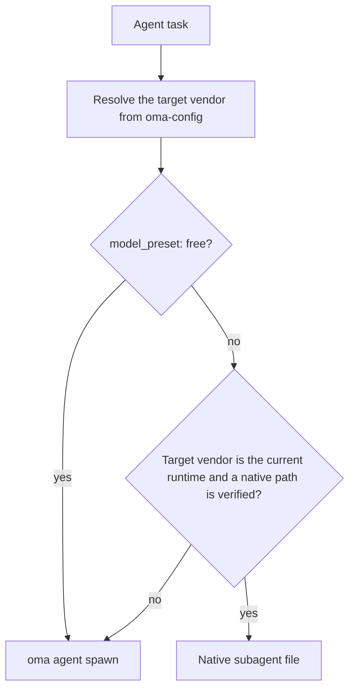
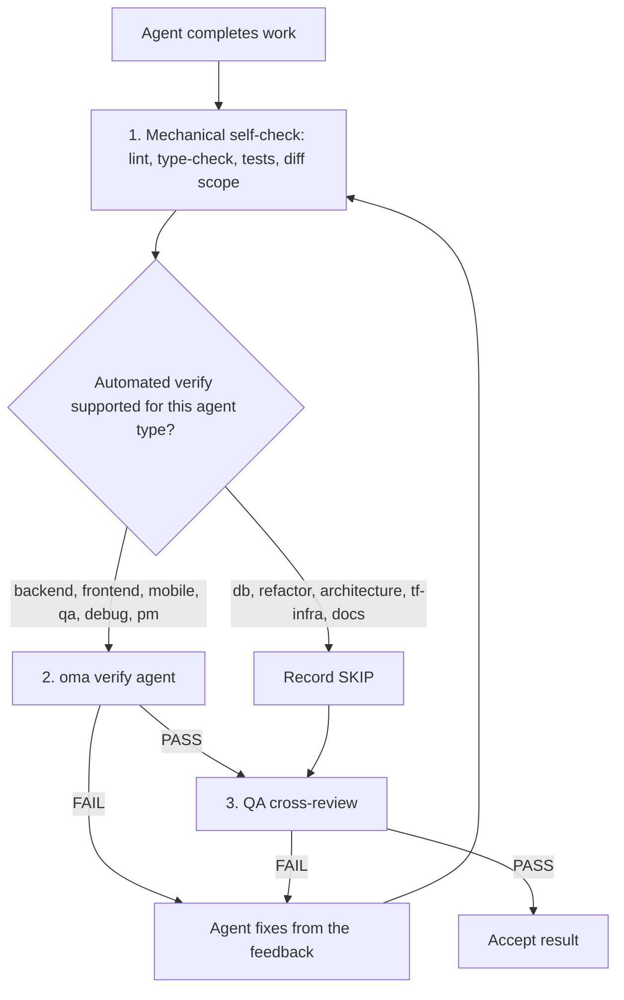

# Agenci {#agents}

OMA rozdziela [umiejętności](../getting-started/glossary.md#skill), role dispatchu i [definicje agentów](../getting-started/glossary.md#agent-definition). Umiejętność kieruje do wskazówek domenowych i je ładuje, kanoniczna rola jest tożsamością runtime używaną przy dispatchu, a definicja śledzona nadaje subagentowi personę właściwą dla dostawcy. Warstwy te celowo się pokrywają, dlatego o tym, czy wystarczy jedna umiejętność, decydują granice zadania i kryteria akceptacji.

---

## Katalog umiejętności {#skill-catalog}

Ta tabela jest autorytatywną listą zainstalowanych umiejętności. Generuje ją `cli/scripts/generate-skill-catalog.mjs` z frontmattera każdego pliku `.agents/skills/<name>/SKILL.md`; uruchom skrypt z `--check`, aby wykryć dryf. Sekcja `## References` w SKILL.md każdej umiejętności wymienia jej pliki zasobów i to, kiedy należy je czytać.

<!-- oma:generated skill-catalog:start -->
<!-- Generated from SKILL.md frontmatter under .agents/skills by cli/scripts/generate-skill-catalog.mjs. Do not edit this block by hand. -->

| Skill | Use it for |
|---|---|
| [`oma-academic-writing`](https://github.com/first-fluke/oh-my-agent/blob/main/.agents/skills/oma-academic-writing/SKILL.md) | Draft and revise academic prose against a rubric, evidence, and citation requirements. Use for essays, reports, literature reviews, or academic style audits. |
| [`oma-architecture`](https://github.com/first-fluke/oh-my-agent/blob/main/.agents/skills/oma-architecture/SKILL.md) | Evaluate system boundaries and architectural tradeoffs. Use for architecture decisions, design reviews, and ADRs. |
| [`oma-backend`](https://github.com/first-fluke/oh-my-agent/blob/main/.agents/skills/oma-backend/SKILL.md) | Implement server APIs, authentication, and application data access. Schema modeling and query tuning use oma-db. |
| [`oma-brainstorm`](https://github.com/first-fluke/oh-my-agent/blob/main/.agents/skills/oma-brainstorm/SKILL.md) | Explore goals, constraints, and alternative approaches before choosing a design. Use when the user requests ideation or design exploration. |
| [`oma-coordination`](https://github.com/first-fluke/oh-my-agent/blob/main/.agents/skills/oma-coordination/SKILL.md) | Coordinate assigned specialist tasks and handoffs manually. Use when supervising a multi-agent project step by step. |
| [`oma-db`](https://github.com/first-fluke/oh-my-agent/blob/main/.agents/skills/oma-db/SKILL.md) | Design schemas and migrations, tune queries, or plan vector retrieval and database operations. Application API implementation uses oma-backend. |
| [`oma-debug`](https://github.com/first-fluke/oh-my-agent/blob/main/.agents/skills/oma-debug/SKILL.md) | Diagnose a reproducible failure, fix its cause, and verify the regression. Use for crashes, incorrect behavior, and failing tests. |
| [`oma-design`](https://github.com/first-fluke/oh-my-agent/blob/main/.agents/skills/oma-design/SKILL.md) | Define or review a visual system, DESIGN.md, or redesign direction. Use for typography, layout, color, motion, and interaction design decisions. |
| [`oma-dev-workflow`](https://github.com/first-fluke/oh-my-agent/blob/main/.agents/skills/oma-dev-workflow/SKILL.md) | Configure development tasks, git hooks, CI/CD, or release automation. Use when creating or fixing a repository development workflow. |
| [`oma-docs`](https://github.com/first-fluke/oh-my-agent/blob/main/.agents/skills/oma-docs/SKILL.md) | Check documentation references, sync docs to code changes, and detect translation drift. Use for documentation maintenance in a repository. |
| [`oma-explanation`](https://github.com/first-fluke/oh-my-agent/blob/main/.agents/skills/oma-explanation/SKILL.md) | Create an offline HTML explanation of a code change (diff, PR, branch) or of a topic, system, or question. Use when a visual walkthrough document is requested. |
| [`oma-frontend`](https://github.com/first-fluke/oh-my-agent/blob/main/.agents/skills/oma-frontend/SKILL.md) | Implement or modify web UI in React, Next.js, or Angular. Use for components, pages, styles, forms, and frontend state or data flows. |
| [`oma-hwp`](https://github.com/first-fluke/oh-my-agent/blob/main/.agents/skills/oma-hwp/SKILL.md) | Convert Hangul HWP, HWPX, or HWPML documents to Markdown with kordoc. Use for text, table, and image extraction from these formats. |
| [`oma-image`](https://github.com/first-fluke/oh-my-agent/blob/main/.agents/skills/oma-image/SKILL.md) | Generate raster images or reference-guided variations through the OMA image CLI. Use for image assets or explicit vendor comparisons; pixel editing uses an editor. |
| [`oma-market`](https://github.com/first-fluke/oh-my-agent/blob/main/.agents/skills/oma-market/SKILL.md) | Research customer pain points, trends, and competitors through the OMA market engine. Use for market discovery or voice-of-customer analysis. |
| [`oma-mobile`](https://github.com/first-fluke/oh-my-agent/blob/main/.agents/skills/oma-mobile/SKILL.md) | Implement Flutter, React Native, native Swift, or native Kotlin Android apps. Use for mobile screens, widgets, platform integrations, and application data flows. |
| [`oma-observability`](https://github.com/first-fluke/oh-my-agent/blob/main/.agents/skills/oma-observability/SKILL.md) | Design or troubleshoot telemetry, SLOs, and incident diagnostics. Route to the relevant signal, system boundary, or vendor guide. |
| [`oma-orchestration`](https://github.com/first-fluke/oh-my-agent/blob/main/.agents/skills/oma-orchestration/SKILL.md) | Dispatch and supervise parallel specialist agents with durable task state. Use when automated multi-agent execution is requested. |
| [`oma-pdf`](https://github.com/first-fluke/oh-my-agent/blob/main/.agents/skills/oma-pdf/SKILL.md) | Extract PDF text, headings, tables, and images into Markdown using opendataloader-pdf. Use for PDF parsing, not PDF layout creation. |
| [`oma-pm`](https://github.com/first-fluke/oh-my-agent/blob/main/.agents/skills/oma-pm/SKILL.md) | Turn product requirements into scoped tasks with dependencies and acceptance criteria. Use for implementation planning and prioritization. |
| [`oma-qa`](https://github.com/first-fluke/oh-my-agent/blob/main/.agents/skills/oma-qa/SKILL.md) | Review changes for correctness, security, accessibility, and performance. Use for scoped quality reviews or verification plans; bug fixes use oma-debug. |
| [`oma-recap`](https://github.com/first-fluke/oh-my-agent/blob/main/.agents/skills/oma-recap/SKILL.md) | Summarize AI conversation histories for a specified date or period. Use for daily work recaps and cross-tool activity summaries. |
| [`oma-refactor`](https://github.com/first-fluke/oh-my-agent/blob/main/.agents/skills/oma-refactor/SKILL.md) | Restructure existing code while preserving observable behavior. Use for targeted technical debt or hotspot work with characterization tests. |
| [`oma-scholar`](https://github.com/first-fluke/oh-my-agent/blob/main/.agents/skills/oma-scholar/SKILL.md) | Search academic literature and generate, validate, or compare Knows paper sidecars. Use for claim/evidence analysis and literature synthesis. |
| [`oma-scm`](https://github.com/first-fluke/oh-my-agent/blob/main/.agents/skills/oma-scm/SKILL.md) | Manage Git branches, merges, conflicts, commits, and release baselines. Use for repository history and change-management operations. |
| [`oma-search`](https://github.com/first-fluke/oh-my-agent/blob/main/.agents/skills/oma-search/SKILL.md) | Find external documentation, web sources, or remote code with citations. Local code navigation uses the configured code tools. |
| [`oma-security`](https://github.com/first-fluke/oh-my-agent/blob/main/.agents/skills/oma-security/SKILL.md) | Scan application source, agent skills, and MCP components; run penetration tests against scoped web test deployments, validate findings, and configure scan gates. Use oma-qa for broad quality reviews and domain skills for remediation. |
| [`oma-skill-creation`](https://github.com/first-fluke/oh-my-agent/blob/main/.agents/skills/oma-skill-creation/SKILL.md) | Create or revise OMA skills and their references. Use for skill routing, execution contracts, conditional loading, and authoring validation. |
| [`oma-slide`](https://github.com/first-fluke/oh-my-agent/blob/main/.agents/skills/oma-slide/SKILL.md) | Create, import, revise, or export presentation decks through the OMA slide CLI or the ppt-master route. Use for HTML slides, editable PPTX, and PDF, PNG, or PPTX deck delivery. |
| [`oma-tf-infra`](https://github.com/first-fluke/oh-my-agent/blob/main/.agents/skills/oma-tf-infra/SKILL.md) | Create or review Terraform infrastructure and plans. Use for cloud resources, IAM, networking, state management, and infrastructure changes. |
| [`oma-translation`](https://github.com/first-fluke/oh-my-agent/blob/main/.agents/skills/oma-translation/SKILL.md) | Translate or revise localized UI strings and prose while preserving meaning, terminology, placeholders, and structure. |
| [`oma-video`](https://github.com/first-fluke/oh-my-agent/blob/main/.agents/skills/oma-video/SKILL.md) | Create videos through the OMA video CLI, or analyze and edit existing clips with media tools. Use for frame extraction, visual analysis, silence cuts, dubbing assembly, sound effects, scripts, and composition; audio-only work uses oma-voice. |
| [`oma-voice`](https://github.com/first-fluke/oh-my-agent/blob/main/.agents/skills/oma-voice/SKILL.md) | Generate or transcribe speech with Voicebox or VoiceStudio, or process existing audio locally. Use for narration, transcripts, timed speech, and loudness conversion; video editing uses oma-video. |
<!-- oma:generated skill-catalog:end -->

---

## Role dispatchu {#dispatch-roles}

Runtime wykonuje dispatch według kanonicznej roli. Każda rola z wyjątkiem `orchestrator` ma jedną śledzoną definicję w `.agents/agents/`, której frontmatter `skills:` wskazuje ładowane umiejętności. Pierwsza wymieniona umiejętność jest właścicielem zadania.

| Rola | Plik definicji | Akceptowane także | Umiejętności |
|------|-----------------|---------------|--------|
| `orchestrator` | brak (rola koordynacyjna runtime) | | |
| `pm` | `pm-planner.md` | `pm-planner` | oma-pm |
| `architecture` | `architecture-reviewer.md` | `architecture-reviewer` | oma-architecture |
| `qa` | `qa-reviewer.md` | `qa-reviewer` | oma-qa |
| `backend` | `backend-engineer.md` | `backend-engineer` | oma-backend |
| `frontend` | `frontend-engineer.md` | `frontend-engineer` | oma-frontend, oma-design |
| `mobile` | `mobile-engineer.md` | `mobile-engineer` | oma-mobile |
| `db` | `db-engineer.md` | `db-engineer` | oma-db |
| `debug` | `debug-investigator.md` | `debug-investigator` | oma-debug |
| `refactor` | `refactor-engineer.md` | `refactor-engineer` | oma-refactor |
| `docs` | `docs-curator.md` | `docs-curator` | oma-docs |
| `tf-infra` | `tf-infra-engineer.md` | `tf-infra-engineer` | oma-tf-infra |
| `explore` | `research-explorer.md` | `research-explorer`, `explorer` | oma-search, oma-market, oma-scholar |

Akceptowany jest też końcowy przyrostek `-agent` (`qa-agent` jest rozstrzygany jako `qa`).

### Natywne pliki agentów {#native-agent-files}

Definicje agentów w katalogu `.agents/agents/` są źródłem prawdy. OMA projektuje je do plików natywnych dla dostawcy w runtime'ach obsługujących własne subagenty:

| Runtime | Natywne pliki agentów |
|---------|--------------------|
| Claude Code | `.claude/agents/<name>.md` |
| Codex CLI | `.codex/agents/<name>.toml` |
| Cursor | `.cursor/agents/` |
| OpenCode | `.opencode/agents/` |
| Kiro | `.kiro/agents/` |
| Grok | `.grok/agents/` |
| CommandCode | `.commandcode/agents/` |
| Qwen Code | `.qwen/agents/` |

pi nie ma systemu plików agentów, więc `oma agent spawn` wstawia personę z definicji bezpośrednio do promptu. Wygenerowane pliki odświeżają się przez `oma link`, `oma install` i `oma update`.

### Jak przebiega dispatch roli {#how-a-role-is-dispatched}

Gdy workflow mapuje agenta na tego samego dostawcę co bieżący runtime, najpierw używa natywnego pliku agenta tego runtime'u. Zadania między dostawcami przechodzą do `oma agent spawn`.



> **Dispatch modeli per agent:** dostawca, model i nakład rozumowania każdej roli pochodzą z `.agents/oma-config.yaml` (lub `.agents/oma-config.cue`, z opcjonalną nakładką `.local`). Przy `model_preset: auto`, domyślnym dla nowych instalacji, role bez nadpisania `agents:` stosują natywne ustawienia agenta i modelu bieżącego runtime'u; `model_preset: free` zawsze kieruje dispatch przez `oma agent spawn`. Zobacz [Modele per agent](../guide/per-agent-models.md), aby poznać szczegóły konfiguracji, oraz [`oma doctor --profile`](../cli-interfaces/commands.md#doctor), aby sprawdzić bieżącą macierz.

---

## Kategorie umiejętności {#agent-categories}

| Kategoria | Umiejętności | Odpowiedzialność |
|----------|--------|---------------|
| **Ideacja** | oma-brainstorm | Eksplorowanie pomysłów, proponowanie podejść, tworzenie dokumentów projektowych |
| **Architektura** | oma-architecture | Granice systemu/modułu/usługi, analiza w stylu ADR/ATAM/CBAM, rejestry kompromisów |
| **Planowanie** | oma-pm | Dekompozycja wymagań, podział zadań, kontrakty API, przypisywanie priorytetów |
| **Implementacja** | oma-frontend, oma-backend, oma-mobile, oma-db | Pisanie kodu w odpowiednich domenach |
| **Projektowanie** | oma-design | Systemy projektowe, DESIGN.md, tokeny, typografia, kolor, ruch, dostępność |
| **Infrastruktura** | oma-tf-infra | Wielochmurowe provisionowanie Terraform, IAM, optymalizacja kosztów, polityka jako kod |
| **DevOps** | oma-dev-workflow | Runner zadań mise, CI/CD, migracje, koordynacja wydań, automatyzacja monorepo |
| **Obserwowalność** | oma-observability | Potoki obserwowalności, routing śledzenia, sygnały MELT+P (metrics/logs/traces/profiles/cost/audit/privacy), zarządzanie SLO, analiza śledcza incydentów, strojenie transportu |
| **Jakość** | oma-qa | Audyt bezpieczeństwa (OWASP), wydajność, dostępność (WCAG), przegląd jakości kodu |
| **Debugowanie** | oma-debug | Reprodukcja błędów, analiza przyczyn źródłowych, minimalne poprawki, testy regresji |
| **Lokalizacja** | oma-translation | Tłumaczenie uwzględniające kontekst, z zachowaniem tonu, rejestru i terminów domenowych |
| **Koordynacja** | oma-orchestration, oma-coordination | Automatyczna i ręczna orkiestracja wieloagentowa |
| **Git** | oma-scm | Generowanie Conventional Commits, dzielenie commitów według funkcjonalności |
| **Wyszukiwanie i pobieranie** | oma-search | Router wyszukiwania oparty na intencji z oceną zaufania (dokumenty Context7, web, kod `gh`/`glab`, lokalne code intelligence) |
| **Retrospektywa** | oma-recap | Analiza historii konwersacji z wielu narzędzi i tematyczne podsumowania pracy |
| **Przetwarzanie dokumentów** | oma-hwp, oma-pdf | Konwersja HWP/HWPX/HWPML i PDF do Markdown na potrzeby ingestii LLM/RAG |
| **Dokumentacja** | oma-docs | Utrzymanie dokumentacji: uszkodzone odwołania, dokumenty dotknięte diffem, dryf tłumaczeń i lintowanie przetłumaczonych dokumentów |
| **Objaśnienia** | oma-explanation | Offline'owe objaśnienia HTML dla zmiany w kodzie (diff, PR, branch, zakres commitów) albo dla tematu, systemu lub pytania |
| **Pisanie akademickie** | oma-academic-writing, oma-scholar | Tworzenie i audyt publikacyjnej prozy akademickiej oraz badania naukowe, wyszukiwanie i recenzowanie z sidecarami Knows |
| **Bezpieczeństwo** | oma-security | Skanowanie kodu źródłowego aplikacji, pakietów umiejętności agentów, komponentów MCP i autoryzowanych testowych wdrożeń webowych (Deepsec, skanery Cisco, ARTEX), z niezależną walidacją ustaleń i bramkami CI |
| **Refaktoryzacja** | oma-refactor | Stopniowa restrukturyzacja zachowująca działanie, kierowanie hotspotami, testy charakterystyki jako siatka bezpieczeństwa, commity tylko refaktoryzacyjne |
| **Badania rynku** | oma-market | Badanie bólu, trendów, konkurencji i odkrywania sygnałów społecznościowych z frameworkami SWOT/5F Portera/PESTEL dobieranymi do intencji |
| **Tworzenie umiejętności** | oma-skill-creation | Tworzenie i walidowanie umiejętności OMA w formacie SSL-lite |
| **Generowanie mediów** | oma-image, oma-slide, oma-video, oma-voice | Generowanie obrazów AI, prezentacje HTML, krótkie/objaśniające/demonstracyjne wideo oraz lokalne TTS/STT |

---

## Szczegółowa referencja agentów {#detailed-agent-reference}

Te podsumowania wyjaśniają domenę i kluczowe reguły każdej umiejętności. Źródłem prawdy jest SKILL.md danej umiejętności: jej sekcja `## References` wymienia pliki zasobów i warunek odczytu każdego z nich, dlatego ta strona nie powiela tych list.

### oma-brainstorm

**Domena:** Ideacja projektowa przed planowaniem lub implementacją.

**Kiedy używać:** Eksplorowanie pomysłu na funkcję, rozumienie intencji użytkownika i porównywanie podejść. Przed `/plan` używaj go przy złożonych lub niejednoznacznych żądaniach.

**Kiedy NIE używać:** Jasne wymagania (przejdź do oma-pm), implementacja (przejdź do agentów domenowych), przegląd kodu (przejdź do oma-qa).

**Podstawowe reguły:**
- Nie implementuj ani nie planuj przed zatwierdzeniem projektu
- Zadawaj jedno pytanie wyjaśniające naraz, a nie w partiach
- Porównaj dwa lub trzy realne podejścia, gdy alternatywy pomagają w decyzji; jeśli ograniczenia zostawiają mniej możliwości, wyjaśnij dlaczego, zamiast wymyślać opcje
- Przedstawiaj projekt sekcja po sekcji, rozstrzygając tylko otwarte istotne wybory
- YAGNI: projektuj tylko to, co jest potrzebne

**Workflow:** 7 faz: kontekst, pytania, podejścia (opcjonalnie zainicjowane przez TRIZ-lite), projekt, ślepy przegląd, dokumentacja (zapis do `docs/plans/designs/`), przejście do `/plan`.

---

### oma-architecture

**Domena:** Architektura oprogramowania/systemu, w tym granice modułów i usług, analiza kompromisów, synteza interesariuszy i rejestry decyzji.

**Kiedy używać:** Wybór lub przegląd architektury systemu, definiowanie granic modułu/usługi/własności, porównywanie opcji architektonicznych z jawnymi kompromisami, badanie problemów architektonicznych (amplifikacja zmian, ukryte zależności, niewygodne API), priorytetyzacja inwestycji lub refaktoryzacji architektonicznych, pisanie rekomendacji architektonicznych lub ADR-ów.

**Kiedy NIE używać:** Systemy wizualne/projektowe (użyj oma-design), planowanie funkcjonalności i dekompozycja zadań (użyj oma-pm), implementacja Terraform (użyj oma-tf-infra), diagnoza błędów (użyj oma-debug), przegląd bezpieczeństwa/wydajności/dostępności (użyj oma-qa).

**Metodologie:** Routing diagnostyczny, porównanie design-twice, analiza ryzyka w stylu ATAM, priorytetyzacja w stylu CBAM, zapisy decyzji w stylu ADR.

**Podstawowe reguły:**
- Zdiagnozuj problem architektoniczny przed wyborem metody
- Użyj najlżejszej wystarczającej metodologii dla bieżącej decyzji
- Odróżnij projekt architektoniczny od projektu UI/wizualnego oraz od dostarczenia Terraform
- Konsultuj agentów interesariuszy tylko wtedy, gdy decyzja jest na tyle przekrojowa, by uzasadnić koszt
- Jakość rekomendacji jest ważniejsza niż pozory konsensusu: konsultuj szeroko, ale decyduj jawnie
- Każda rekomendacja musi podawać założenia, kompromisy, ryzyka i kroki walidacji
- Domyślnie uwzględniaj koszty: implementacji, operacyjne, złożoność zespołu i przyszłe zmiany

---

### oma-pm

**Domena:** Zarządzanie produktem, w tym analiza wymagań, dekompozycja zadań i kontrakty API.

**Kiedy używać:** Rozkładanie złożonych funkcji, określanie wykonalności, priorytetyzacja pracy i definiowanie kontraktów API.

**Podstawowe reguły:**
- Projektuj API-first: definiuj kontrakty przed zadaniami implementacyjnymi
- Każde zadanie ma: agenta, tytuł, kryteria akceptacji, priorytet i zależności
- Minimalizuj zależności, aby maksymalizować wykonanie równoległe
- Bezpieczeństwo i testowanie należą do każdego zadania, a nie do oddzielnych faz
- Zadania muszą być wykonalne przez jednego agenta
- Zwróć plan JSON oraz task board przypisany do sesji, aby orkiestrator mógł z niego korzystać

**Wyjście:** `.agents/results/plan-{sessionId}.json` z numerycznymi poziomami priorytetu (`1` = zadania niezależne, niższe poziomy uruchamiają się najpierw) oraz raport przypisany do uruchomienia `result-{agentId}-{taskId}-{runId}-{sessionId}.md` w skonfigurowanym magazynie pamięci.

---

### oma-frontend

**Domena:** Interfejs webowy w React/Next.js lub Angular z TypeScript. Projekty React używają FSD-lite; projekty Angular stosują się do `resources/angular-rules.md`.

**Kiedy używać:** Budowanie interfejsów użytkownika, komponentów, logiki klienckiej, stylowania, walidacji formularzy i integracji z API.

**Stos technologiczny:**
- React + Next.js (domyślnie Server Components, Client Components dla interaktywności)
- TypeScript (strict)
- TailwindCSS v4 + shadcn/ui (prymitywy tylko do odczytu, rozszerzaj przez cva/wrappery)
- FSD-lite: główny `src/` + funkcje `src/features/*/` (bez importów między funkcjami)

**Biblioteki (projekty React/Next.js):**
| Przeznaczenie | Biblioteka |
|---------|---------|
| Daty | luxon |
| Stylowanie | TailwindCSS v4 + shadcn/ui |
| Hooki | ahooks lub @mantine/hooks |
| Narzędzia | es-toolkit |
| Typy | type-fest |
| Stan URL | nuqs |
| Stan serwera | TanStack Query (hooki generowane przez orval, gdy istnieje specyfikacja OpenAPI) |
| Stan klienta | Jotai lub Zustand, wybierane według intencji, bez domyślnego wyboru (używaj oszczędnie) |
| Formularze | @tanstack/react-form + Zod |
| Uwierzytelnianie | better-auth |
| Animacje | motion (`motion/react`) w nowych projektach |

**Podstawowe reguły:**
- Najpierw shadcn/ui, rozszerzaj przez cva, nigdy nie modyfikuj bezpośrednio `components/ui/*`
- Mapuj tokeny projektowe 1:1, nigdy nie koduj kolorów na stałe
- Proxy żądań: zachowaj istniejącą konwencję `proxy.ts` z Next.js 16+; zanim zaproponujesz zmianę nazwy na `middleware.ts`, sprawdź zainstalowaną wersję i routing
- Nie stosuj prop drillingu ponad 3 poziomy; używaj biblioteki stanu klienta przyjętej w projekcie (atomów Jotai lub store'u Zustand)
- Importy absolutne z `@/` są obowiązkowe
- Cel FCP < 1 s
- Responsywne breakpointy: 320px, 768px, 1024px, 1440px

**Lista kontrolna bramki jakości:**
- Dostępność: etykiety ARIA, semantyczne nagłówki, nawigacja klawiaturą
- Mobile: weryfikacja w widokach mobilnych
- Wydajność: brak CLS, szybkie ładowanie
- Odporność: Error Boundaries i Loading Skeletons
- Testy: logika pokryta przez Vitest
- Jakość: typecheck i lint przechodzą

---

### oma-backend

**Domena:** API, logika po stronie serwera, uwierzytelnianie i operacje bazodanowe.

**Kiedy używać:** API REST/GraphQL, migracje baz danych, uwierzytelnianie, logika biznesowa serwera i zadania w tle.

**Architektura:** Router (HTTP) -> Service (logika biznesowa) -> Repository (dostęp do danych) -> Models.

**Wykrywanie stosu:** Odczytuje manifesty projektu (pyproject.toml, package.json, Cargo.toml, go.mod itd.), aby ustalić język i framework. Jeśli brakuje konwencji właściwych dla projektu, prosi użytkownika o uruchomienie `/stack-set`; ta komenda materializuje rozstrzygnięte odwołania `stack/` z dostarczonego schematu i szablonów.

**Podstawowe reguły:**
- Czysta architektura: żadnej logiki biznesowej w handlerach tras
- Wszystkie dane wejściowe waliduj biblioteką walidacyjną projektu
- Używaj wyłącznie zapytań parametryzowanych (nigdy interpolacji ciągów w SQL)
- JWT + Argon2id do uwierzytelniania (bcrypt jest dopuszczalny dla zgodności ze starszym kodem); ograniczaj częstotliwość wywołań endpointów uwierzytelniania
- Stosuj async, gdy jest obsługiwane; dodaj adnotacje typów do wszystkich sygnatur
- Własne wyjątki obsługuj przez scentralizowany moduł błędów
- Jawnie określ strategię ładowania ORM, granice transakcji i bezpieczny cykl życia

<!-- oma-docs:ignore-start -->
Właściwe dla projektu `stack/stack.yaml`, `stack/tech-stack.md`, fragmenty i szablony API są generowane przez `/stack-set`, gdy są potrzebne; nie istnieją, dopóki stos nie zostanie zmaterializowany.
<!-- oma-docs:ignore-end -->

---

### oma-mobile

**Domena:** Aplikacje mobilne międzyplatformowe i natywne (Flutter, React Native oraz natywny Swift na iOS).

**Kiedy używać:** Natywne aplikacje mobilne (iOS + Android), wzorce UI właściwe dla urządzeń mobilnych, funkcje platformy (kamera, GPS, powiadomienia push), architektura offline-first; natywne aplikacje iOS w Swift korzystające z SwiftUI i `swift-openapi-generator`.

**Architektura:** Clean Architecture: domain -> data -> presentation. Dla natywnego Swift iOS: układ projektu `App/Core/Features/Shared`.

**Stosy technologiczne:**
- Flutter/Dart: Riverpod/Bloc (zarządzanie stanem), Dio z interceptorami (API), GoRouter (nawigacja), Material Design 3 (Android) + iOS HIG.
- Natywny Swift iOS (iOS 17+): SwiftUI + `@Observable` (framework Observation), Apple `swift-openapi-generator` dla klientów API, układ `App/Core/Features/Shared`.

**Podstawowe reguły:**
- Riverpod/Bloc do zarządzania stanem (bez surowego setState dla złożonej logiki)
- Wszystkie kontrolery usuwaj w metodzie `dispose()`
- Używaj Dio z interceptorami do wywołań API i płynnie obsługuj tryb offline
- Celuj w 60 kl./s; testuj na obu platformach
- Swift: na iOS 17+ używaj `@Observable` zamiast `ObservableObject`; generuj klientów API ze specyfikacji OpenAPI przez `swift-openapi-generator`

**Ziarna platform:** `variants/` dostarcza `flutter/`, `react-native/` i `swift-ios/`, każde z `stack.yaml`, `tech-stack.md`, `snippets.md` i szablonem API, a także współdzielony `stack.schema.json`. To materiał startowy dla `/stack-set`, a nie obowiązkowa lektura przy edycji istniejącego kodu.

---

### oma-db

**Domena:** Architektura baz danych SQL, NoSQL i wektorowych.

**Kiedy używać:** Projektowanie schematów, ERD, normalizacja, indeksowanie, transakcje, szacowanie pojemności, strategia backupu, projektowanie migracji, architektura wektorowych baz danych/RAG, przegląd antywzorców, projektowanie z uwzględnieniem zgodności (ISO 27001/27002/22301).

**Domyślny workflow:** Eksploruj (ustal encje, wzorce dostępu i wolumen) -> Projektuj (schemat, ograniczenia, transakcje) -> Optymalizuj (indeksy, partycjonowanie, archiwizacja, antywzorce).

**Podstawowe reguły:**
- Najpierw wybierz model, potem silnik
- Domyślnie stosuj 3NF dla relacyjnych baz; dokumentuj kompromisy BASE dla rozproszonych
- Dokumentuj wszystkie trzy warstwy schematu: zewnętrzną, koncepcyjną i wewnętrzną
- Integralność traktuj jako podstawę: encji, domeny, referencyjna i reguł biznesowych
- Współbieżność nigdy nie jest niejawna: zdefiniuj granice transakcji i poziomy izolacji
- Bazy wektorowe są infrastrukturą wyszukiwania, nie źródłem prawdy
- Nigdy nie traktuj wyszukiwania wektorowego jako zamiennika wyszukiwania leksykalnego

**Wymagane rezultaty:** Podsumowanie schematu zewnętrznego, schemat koncepcyjny, schemat wewnętrzny, tabela standardów danych, glosariusz, szacowanie pojemności oraz strategia backupu/odzyskiwania. Dla wektorowych baz/RAG: polityka wersjonowania embeddingów, polityka chunkowania i strategia wyszukiwania hybrydowego.

---

### oma-design

**Domena:** Systemy projektowe, UI/UX i zarządzanie DESIGN.md.

**Kiedy używać:** Tworzenie lub zmiana systemów projektowych i DESIGN.md, redesign istniejącej strony lub aplikacji (z zachowaniem lub gruntowną przebudową), strony docelowe, tokeny projektowe, palety kolorów, typografia, układy responsywne i przeglądy dostępności.

**Workflow:** 7 faz: konfiguracja (zbieranie kontekstu) -> ekstrakcja (opcjonalnie z URL-i referencyjnych) -> ulepszenie (rozszerzenie niejasnego promptu) -> propozycja (2–3 kierunki projektowe) -> generowanie (DESIGN.md + tokeny) -> audyt (responsywność, WCAG, Nielsen, kontrola AI slop) -> przekazanie.

**Wymuszanie antywzorców („bez AI slop”):**
- Typografia: domyślnie systemowy stos fontów; żadnych domyślnych Google Fonts bez uzasadnienia
- Kolor: żadnych fioletowo-niebieskich gradientów, gradientowych kul/blobów ani czystej bieli na czystej czerni
- Układ: żadnych zagnieżdżonych kart, układów wyłącznie desktopowych ani sztampowych układów z 3 metrykami
- Ruch: żadnego bounce easing wszędzie ani animacji > 800 ms; trzeba respektować prefers-reduced-motion
- Komponenty: żadnego glassmorphismu wszędzie; każdy element interaktywny potrzebuje alternatywy klawiaturowej/dotykowej

**Podstawowe reguły:**
- Używaj ponownie `.design-context.md` i `DESIGN.md`, jeśli istnieją; twórz `.design-context.md` tylko wtedy, gdy decyzję wspiera rzeczywisty etap rozpoznania
- Dla istniejącej strony lub aplikacji postępuj według `resources/redesign-protocol.md` i przed złożeniem propozycji sklasyfikuj zadanie jako Preserve albo Overhaul
- Domyślnie stosuj systemowy stos fontów (fonty gotowe na CJK dla ko/ja/zh)
- Minimum WCAG AA dla każdego projektu
- Responsive-first (mobile jako domyślne)
- Przedstaw 2–3 kierunki i uzyskaj potwierdzenie

---

### oma-tf-infra

**Domena:** Infrastruktura jako kod z Terraformem i obsługa wielu chmur.

**Kiedy używać:** Provisionowanie na AWS/GCP/Azure/Oracle Cloud, konfiguracja Terraform, uwierzytelnianie CI/CD (OIDC), CDN/load balancers/storage/networking, zarządzanie stanem i infrastruktura zgodna z ISO.

**Wykrywanie chmury:** Odczytuje providery Terraform i prefiksy zasobów (`google_*` = GCP, `aws_*` = AWS, `azurerm_*` = Azure, `oci_*` = Oracle Cloud). Zawiera pełną tabelę mapowania zasobów wielochmurowych.

**Podstawowe reguły:**
- Niezależność od providera: wykryj chmurę z kontekstu projektu
- Zdalny stan z wersjonowaniem i blokadą
- OIDC jako pierwszy wybór uwierzytelniania CI/CD
- Zawsze wykonaj plan przed apply
- Uprawnienia IAM zgodne z zasadą najmniejszych uprawnień
- Otaguj wszystko (Environment, Project, Owner, CostCenter)
- Żadnych sekretów w kodzie
- Przypnij wersje wszystkich providerów i modułów
- Żadnego auto-approve na produkcji

---

### oma-dev-workflow

**Domena:** Automatyzacja zadań monorepo i CI/CD.

**Kiedy używać:** Uruchamianie serwerów deweloperskich, wykonywanie lint/format/typecheck w aplikacjach, migracje baz danych, generowanie API, buildy i18n, buildy produkcyjne, optymalizacja CI/CD oraz walidacja pre-commit.

**Podstawowe reguły:**
- Zawsze używaj zadań `mise run` zamiast bezpośrednich poleceń menedżera pakietów
- Uruchamiaj lint/test tylko dla zmienionych aplikacji
- Weryfikuj komunikaty commitów przez commitlint
- CI powinno pomijać niezmienione aplikacje
- Gdy istnieją zadania mise, nigdy nie używaj bezpośrednich poleceń menedżera pakietów

---

### oma-observability

**Domena:** Router obserwowalności i śledzenia oparty na intencji, działający przez warstwy, granice i sygnały.

**Kiedy używać:**
- Konfiguracja potoku: SDK OTel + Collector + backend dostawcy
- Śledzenie przez granice usług i domen: propagatory W3C, baggage, multi-tenant, multi-cloud
- Strojenie transportu: progi UDP/MTU, OTLP gRPC vs HTTP, topologia Collector DaemonSet vs sidecar, receptury samplingu
- Analiza śledcza incydentów: lokalizacja w 6 wymiarach (kod / usługa / warstwa / host / region / infra)
- Wybór kategorii dostawcy: pełny stos OSS vs komercyjny SaaS vs specjalista high-cardinality vs specjalista profilowania
- Obserwowalność jako kod: dashboardy Grafana Jsonnet, CRD PrometheusRule, OpenSLO YAML, alerty SLO burn-rate
- Metaobserwowalność: samo‑zdrowie potoku, przesunięcie zegara, ograniczenia cardinality, macierz retencji
- Pokrycie sygnałów MELT+P: metrics, logs, traces, profiles, cost, audit, privacy
- Migracje potoków logów oceniane względem bieżącego wsparcia upstream i wymagań projektu

**Kiedy NIE używać:** Operacje LLM / obserwowalność gen_ai (użyj Langfuse, Arize Phoenix, LangSmith, Braintrust), lineage potoków danych (OpenLineage + Marquez, test dbt, lineage Airflow), telemetria fizycznej warstwy IoT / data center (Nlyte, Sunbird, Device42), orkiestracja chaos engineering (Chaos Mesh, Litmus, Gremlin, ChaosToolkit), infrastruktura GPU / TPU (NVIDIA DCGM Exporter), łańcuch dostaw oprogramowania (sigstore, in-toto, SLSA), workflow reagowania na incydenty / paging (PagerDuty, OpsGenie, Grafana OnCall), konfiguracja pojedynczego dostawcy już objęta jego własną umiejętnością.

**Podstawowe reguły:**
- Najpierw sklasyfikuj intencję: setup | migrate | investigate | alert | trace | tune | route
- Najpierw kategoria, nie rejestr dostawców: deleguj do umiejętności należących do dostawcy przez `resources/vendor-categories.md`; nie duplikuj dokumentacji dostawcy
- Strojenie transportu to przewaga: progi UDP/MTU, wybór protokołu OTLP, topologia Collectora i receptury samplingu to głębia, której nie pokrywają inne umiejętności
- Metaobserwowalność jest obowiązkowa: sprawdź samo‑zdrowie potoku, synchronizację zegara (< 100 ms dryfu), cardinality i retencję przed uznaniem konfiguracji za ukończoną
- Preferuj CNCF: Prometheus, Jaeger, Thanos, Fluent Bit, OpenTelemetry, Cortex, OpenCost, OpenFeature, Flagger, Falco
- Fluentd pozostaje projektem CNCF Graduated; przewodnik CNCF 2025-10 dotyczący przejścia z Fluentd na Fluent Bit jest przewodnikiem migracji, a nie wycofaniem. Fluentd, Fluent Bit lub OTel Collector wybieraj na podstawie obciążenia, wtyczek i wymagań operacyjnych
- Domyślnie propaguj W3C Trace Context; tłumacz per chmura (AWS X-Ray `X-Amzn-Trace-Id`, GCP Cloud Trace, Datadog, Cloudflare, Linkerd)
- Prywatność przed funkcjami: redakcja PII, reguły baggage uwzględniające sampling, niezmienny audyt SOC2/ISO i usuwanie GDPR/PIPA stosuj podczas zbierania, nie tylko w magazynie

---

### oma-qa

**Domena:** Zapewnianie jakości obejmujące bezpieczeństwo, wydajność, dostępność i jakość kodu.

**Kiedy używać:** Końcowy przegląd przed wdrożeniem, audyty bezpieczeństwa, analiza wydajności, zgodność z dostępnością i analiza pokrycia testami.

**Kolejność przeglądu:** Bezpieczeństwo > wydajność > dostępność > jakość kodu.

**Poziomy ważności:**
- **CRITICAL**: naruszenie bezpieczeństwa, ryzyko utraty danych
- **HIGH**: blokuje wydanie
- **MEDIUM**: napraw w tym sprincie
- **LOW**: backlog

**Podstawowe reguły:**
- Każde ustalenie musi zawierać plik:wiersz, opis i poprawkę
- Najpierw uruchamiaj narzędzia automatyczne (npm audit, bandit, lighthouse)
- Żadnych fałszywych alarmów; każde ustalenie musi dać się odtworzyć
- Dostarczaj kod remediacji, a nie tylko opisy

---

### oma-debug

**Domena:** Diagnozowanie i naprawianie błędów.

**Kiedy używać:** Błędy zgłaszane przez użytkowników, crashe, problemy z wydajnością, sporadyczne awarie, wyścigi i regresje.

**Metodyka:** Najpierw odtwórz, potem diagnozuj. Nigdy nie zgaduj poprawek.

**Podstawowe reguły:**
- Ustal przyczynę źródłową, nie tylko objawy
- Minimalna poprawka: zmieniaj tylko to, co konieczne
- Każda poprawka otrzymuje test regresji
- Wyszukaj podobne wzorce w innych miejscach
- Udokumentuj wynik w `.agents/results/`

**Narzędzia code intelligence (Gortex lub Serena):**
- `find_symbol("functionName")` lub nawigacja po symbolach Gortex: znajdź funkcję
- `find_referencing_symbols("Component")` lub analiza wpływu Gortex: znajdź wszystkie użycia
- `search_for_pattern("error pattern")` lub wyszukiwanie Gortex: znajdź podobne problemy

---

### oma-translation

**Domena:** Wielojęzyczne tłumaczenie uwzględniające kontekst.

**Kiedy używać:** Tłumaczenie tekstów UI, dokumentacji i marketingu, przegląd istniejących tłumaczeń, tworzenie glosariuszy.

**Sześć scen:** Przygotuj, pozyskaj, rozumuj, działaj, zweryfikuj i sfinalizuj. Metoda tłumaczenia ma cztery kroki: przeczytaj znaczenie i chronioną składnię, wybierz rejestr, odtwórz tekst w języku docelowym i zachowaj styl autora tam, gdzie jest to właściwe.

**Podstawowe reguły:**
- Najpierw przejrzyj pliki istniejącej lokalizacji, aby dopasować konwencje
- Tłumacz znaczenie, nie słowa
- Zachowaj konotacje emocjonalne
- Nigdy nie twórz tłumaczenia słowo w słowo
- Nie mieszaj rejestrów w jednym tekście
- Zachowuj terminologię właściwą dla domeny bez zmian

---

### oma-orchestration

**Domena:** Automatyczna koordynacja wieloagentowa przez uruchamianie CLI.

**Kiedy używać:** Złożone funkcje wymagające wielu agentów działających równolegle, automatyczne wykonywanie i implementacja full-stack.

**Domyślna konfiguracja:**

| Ustawienie | Domyślnie | Opis |
|---------|---------|-------------|
| MAX_PARALLEL | 3 | Maksymalna liczba równoczesnych subagentów |
| MAX_RECOVERY_ATTEMPTS | 3 | Łączna liczba ponowień i hipotez eksploracyjnych na zadanie, wliczając pierwotną próbę |
| POLL_INTERVAL | 30s | Interwał sprawdzania stanu uruchomień `oma agent spawn` (natywni subagenci Claude Code zwracają wynik synchronicznie) |

**Fazy workflowu:** Plan → referencje (wybór referencji dla każdego zadania) → konfiguracja (artefakty sesji i task boardu) → wykonanie (dispatch gotowych zadań w ramach MAX_PARALLEL) → monitorowanie → weryfikacja (pętla przeglądu) → zebranie wyników (zgłoszenia i raporty przypisane do uruchomień).

**Pętla przeglądu agent-agent:** diagram i limity pętli znajdziesz w sekcji [Przepływ orkiestracji](#orchestration-flow).

**Dowody sesji:** Zapisuje istotne korekty i rozstrzygnięte ustalenia przeglądu, gdy jest to pomocne, wraz z przyczyną, wpływem i weryfikacją. Nie obowiązuje żadna punktacja karna ani wstrzymanie sesji wyzwalane punktami.

---

### oma-scm

**Domena:** Zarządzanie konfiguracją oprogramowania (SCM) i Git, obejmujące gałęzie, scalenia, worktree, baseline'y, gotowość audytową i Conventional Commits.

**Kiedy używać:** Po zmianach kodu (`/scm`), przy konfliktach scalania, strategii branchy, wydaniach/tagach albo dowolnym pytaniu o zarządzanie konfiguracją repozytorium.

**Typy commitów:** feat, fix, docs, style, refactor, perf, test, chore, build, ci, revert.

**Workflow (commity):** Przeanalizuj zmiany → w razie potrzeby podziel według funkcji → type → scope → description (tryb rozkazujący, poniżej 72 znaków, małe litery, bez kropki na końcu) → commit z jawnymi ścieżkami.

**Reguły:**
- Nie używaj `git add -A` ani `git add .` bez jawnej autoryzacji
- Nigdy nie commituj plików z sekretami
- Zawsze podawaj pliki podczas stagingu
- Zapisz komunikat do pliku i wykonaj commit przez `git commit -F <message-file>`
- Nie przepisuj współdzielonej historii bez jawnej autoryzacji; używaj `--force-with-lease`, nigdy samego `--force`
- Przyczepy współautora są dodawane tylko wtedy, gdy aktywna konfiguracja `scm.co_author` je włącza i podaje nazwę oraz adres e-mail.

---

### oma-coordination

**Domena:** Ręczny przewodnik krok po kroku po koordynacji wieloagentowej.

**Kiedy używać:** Praca wielodomenowa, gdy chcesz krok po kroku nadzorować uruchamianie, monitorowanie, uzgadnianie kontraktów i QA zamiast w pełni automatycznej orkiestracji.

**Kiedy NIE używać:** W pełni automatyczne wykonanie równoległe (użyj oma-orchestration), zadania w jednej domenie (użyj bezpośrednio właściwego agenta domenowego).

**Podstawowe reguły:**
- Używaj ponownie poprawnego planu; wywołuj oma-pm tylko wtedy, gdy trzeba zmienić dekompozycję lub kontrakty
- Niezależne zadania z tego samego poziomu priorytetu uruchamiaj równolegle, każde we własnej przestrzeni roboczej lub z `--isolation worktree`
- Przed zależną pracą nad frontendem lub mobile zaktualizuj kontrakty zmienionych granic API
- Przegląd QA jest zawsze ostatnim krokiem
- Blokujące defekty wykryte przez QA i braki w wymaganej weryfikacji kieruj z powrotem do odpowiedzialnego agenta, a następnie ponownie uruchom objęte nimi kontrole

**Workflow:** Plan (ponowne użycie lub PM) → uruchamianie według poziomów priorytetu → monitorowanie → przegląd QA → poprawa problemów → dostarczenie.

**Różnica względem oma-orchestration:** Koordynacja jest ręczna i prowadzona (użytkownik kontroluje tempo), a orkiestrator działa automatycznie (agenci uruchamiają się i pracują przy minimalnej interwencji użytkownika).

---

### oma-search

**Domena:** Router wyszukiwania oparty na intencji i ocenie zaufania domeny. Kieruje zapytania do Context7 (dokumentacja), natywnego wyszukiwania webowego, `gh`/`glab` (kod) i lokalnego code intelligence (Gortex lub Serena).

**Kiedy używać:** Wyszukiwanie oficjalnej dokumentacji bibliotek/frameworków, badania webowe poradników/przykładów/porównań/rozwiązań, wyszukiwanie wzorców implementacyjnych w GitHub/GitLab, dowolne zapytanie, gdy kanał wyszukiwania jest niejasny (automatyczny routing), oraz jako infrastruktura wyszukiwania dla innych umiejętności (wspólne wywołanie).

**Kiedy NIE używać:** Eksploracja wyłącznie lokalnej bazy kodu (użyj bezpośrednio MCP code intelligence), analiza historii Git lub blame (użyj oma-scm), pełne badania architektury (użyj oma-architecture, która może wewnętrznie wywołać tę umiejętność).

**Podstawowe reguły:**
- Jawne `--docs`, `--code` lub `--web` wybiera trasę; w przeciwnym razie sklasyfikuj intencję według `resources/intent-rules.md`
- Jedno zapytanie, jedna najlepsza trasa; unikaj redundantnych tras, chyba że intencja jest niejednoznaczna
- Oceniaj zaufanie każdego wyniku; wyniki nielokalne otrzymują etykiety zaufania domeny z rejestru
- Inne flagi: `--strict` po ocenie filtruje wyniki według zaufania, `--wide` zachowuje oznaczone wyniki o niższym zaufaniu, a `--gitlab` wybiera GitLab jako hosting kodu
- Posuwaj pracę naprzód mimo błędu: jeśli główna trasa nie działa, płynnie przejdź do zapasowej (docs→web, web→strategie `oma search fetch`)
- Nie jest potrzebny dodatkowy MCP: Context7 dla dokumentacji, natywne mechanizmy runtime'u dla webu, CLI dla kodu, skonfigurowany provider (Gortex lub Serena) lokalnie
- Wyszukiwanie webowe niezależne od dostawcy: użyj tego, co udostępnia bieżący runtime (WebSearch, Google, Bing)
- Zaufanie oceniaj na poziomie domeny, bez punktacji ścieżek podrzędnych ani pojedynczych stron

---

### oma-recap

**Domena:** Analiza historii konwersacji z wielu narzędzi AI (Claude, Codex, Gemini, Antigravity, Qwen, Cursor, Grok) i tematyczne podsumowania dzienne/okresowe.

**Kiedy używać:** Podsumowanie dnia lub okresu pracy, zrozumienie przebiegu pracy w wielu narzędziach AI, analiza przełączania narzędzi między sesjami, przygotowanie codziennych stand-upów, tygodniowych retrospektyw i dzienników pracy.

**Kiedy NIE używać:** Retrospektywa zmian kodu oparta na commitach Git (użyj `oma retro`), monitorowanie agentów w czasie rzeczywistym (użyj `oma dashboard terminal`), metryki produktywności (użyj `oma stats get`).

**Proces:**
1. Rozstrzygnij datę lub okno czasowe z języka naturalnego (dzisiaj, wczoraj, ostatni poniedziałek, jawna data)
2. Pobierz dane rozmów przez `oma recap --date YYYY-MM-DD --json` dla dnia kalendarzowego albo `oma recap --window 7d --json` dla przesuwanego okna (`1d`, `3d`, `7d`, `2w`, `30d`); zawęź je przez `--tool`
3. Grupuj według treści (projektów i tematów), a nie według narzędzia; okno 3-dniowe lub dłuższe grupuje według projektu zamiast według dnia
4. Wyodrębnij tematy (funkcje, nad którymi pracowano, naprawione błędy, poznane narzędzia)
5. Wygeneruj tematyczne podsumowanie dnia/okresu

---

### oma-hwp

**Domena:** Konwersja HWP / HWPX / HWPML (koreański edytor dokumentów) do Markdown za pomocą `kordoc`.

**Kiedy używać:** Konwersja koreańskich dokumentów HWP (`.hwp`, `.hwpx`, `.hwpml`) do Markdown, przygotowanie koreańskich dokumentów rządowych/firmowych dla kontekstu LLM lub RAG, wydobywanie struktury (tabele, nagłówki, listy, obrazy, przypisy, hiperłącza) z HWP.

**Kiedy NIE używać:** Pliki PDF (użyj oma-pdf), XLSX/DOCX (poza zakresem), generowanie/edycja HWP (poza zakresem), pliki już tekstowe (użyj bezpośrednio narzędzia Read).

**Podstawowe reguły:**
- Uruchamiaj przez `bunx kordoc@latest` (bez instalacji); zawsze podawaj `@latest` albo przypiętą wersję
- Domyślny format wyniku to Markdown
- Gdy nie podasz katalogu wyjściowego, zapisuj do tego samego katalogu co plik wejściowy
- kordoc zachowuje strukturę (nagłówki, tabele, tabele zagnieżdżone, przypisy, hiperłącza, obrazy)
- kordoc zapewnia ochronę (ZIP bomb, XXE, SSRF, XSS); nie dodawaj własnych zabezpieczeń
- Przy HWP zaszyfrowanym lub z DRM jasno zgłoś użytkownikowi ograniczenie
- Po konwersji użyj `resources/flatten-tables.ts`, aby przekształcić bloki HTML `<table>` w tabele GFM i usunąć znaki Hancom z obszaru Private Use Area

---

### oma-pdf

**Domena:** Konwersja PDF do Markdown za pomocą `opendataloader-pdf`.

**Kiedy używać:** Konwersja PDF do Markdown na potrzeby kontekstu LLM lub RAG, wydobywanie uporządkowanej treści (tabel, nagłówków, list) z PDF-ów, przygotowanie danych z PDF do użycia przez AI.

**Kiedy NIE używać:** Generowanie PDF-ów (użyj właściwych narzędzi dokumentowych), edycja istniejących PDF-ów (poza zakresem), proste czytanie już tekstowych plików (użyj bezpośrednio narzędzia Read).

**Podstawowe reguły:**
- Uruchamiaj przez `uvx opendataloader-pdf` (bez instalacji)
- Domyślny format wyniku to Markdown
- Gdy nie podasz katalogu wyjściowego, zapisuj do tego samego katalogu co wejściowy PDF
- Zachowuj strukturę dokumentu (nagłówki, tabele, listy, obrazy)
- Dla skanowanych PDF-ów używaj trybu hybrydowego z OCR
- Zawsze uruchamiaj `uvx mdformat` na wyjściu, aby ujednolicić formatowanie Markdown
- Zweryfikuj, czy wynikowy Markdown jest czytelny i ma dobrą strukturę
- Zgłoś użytkownikowi problemy z konwersją (brakujące tabele, zniekształcony tekst)

---

### oma-academic-writing

**Domena:** Publikacyjna proza akademicka po angielsku: tworzenie, redagowanie i audyt esejów, raportów, sekcji analitycznych, podsumowań dla kadry kierowniczej, zakończeń i przeglądów literatury.

**Kiedy używać:** Tworzenie lub redagowanie raportów/esejów/sekcji analitycznych, pisanie podsumowań, zakończeń albo przeglądów literatury, przepisywanie prozy brzmiącej jak AI na naturalny akademicki angielski, dopracowywanie tekstu do najwyższego poziomu rubryki (HD, A, top-band), przegląd zróżnicowania zdań, jakości czasowników, hedgingu i zgodności z regułami anty-AI.

**Kiedy NIE używać:** Tłumaczenie (użyj oma-translation), wyszukiwanie źródeł/cytowań/literatury (użyj oma-scholar), interpretacja rubryki i dekompozycja zadań (użyj oma-pm), dokumentacja kodu / README / tekst referencji API (użyj odpowiedniej umiejętności domenowej), tekst nieformalny lub marketingowy, tekst akademicki w innym języku (najpierw napisz po angielsku, potem przekaż do oma-translation).

**Tryby:** `draft` (nagłówek + proza + Writing Notes + Claim-Evidence Map), `revise` (oryginał + wersja poprawiona + lista zmian), `review` (raport PASS/FAIL dla struktury zdań, jakości czasowników, anty-AI, konkretności, hedgingu, jasności akapitów, rytmu i zgodności twierdzeń z dowodami).

**Podstawowe reguły:**
- Najpierw zacytuj, potem oceniaj: przytocz dosłowny tekst rubryki/ograniczenia przed zastosowaniem reguły
- Każde zdanie musi dać się zweryfikować; nigdy nie wymyślaj danych, statystyk ani cytowań
- Zakazane czasowniki ogólne (`show`, `have`, `make`, `do`, `get`, `use`, …) nie mogą być czasownikami głównymi
- Zmieniaj typ, długość i początek zdań; nigdy nie twórz 3+ zdań tego samego typu z rzędu
- Siłę hedgingu dopasuj do siły dowodów; nie używaj pierwszoosobowego `I think`/`I believe`
- Każde twierdzenie mapuj do dowodu w Claim-Evidence Map; osłab lub usuń twierdzenia bez poparcia

**Workflow:** 6 kroków — przeczytaj rubrykę/projekt i zacytuj ograniczenia, zaplanuj akapity jako Topic-Support-Conclude, napisz według wszystkich czterech protokołów, przeprowadź audyt względem checklisty anty-AI, zrób REVERSE-OUTLINE + Claim-Evidence Map, dopracuj (czytanie na głos, spójność, konkretność, liczba słów, rytm).

---

### oma-security

**Domena:** Skanowanie bezpieczeństwa i walidacja kodu źródłowego aplikacji, pakietów umiejętności agentów, komponentów MCP i autoryzowanych testowych wdrożeń webowych.

**Kiedy używać:** Skanowanie repozytorium lub diffu kodu źródłowego; inspekcja pakietu umiejętności albo serwera lub konfiguracji MCP; ograniczony test penetracyjny konkretnego, autoryzowanego wdrożenia testowego; walidacja kandydatów zgłoszonych przez skaner; konfiguracja bramki CI właściwej dla silnika; diagnozowanie poświadczeń, pokrycia, matcherów, limitów lub wznawialnego stanu skanera.

**Kiedy NIE używać:** Ogólny przegląd poprawności, wydajności, dostępności lub jakości (użyj oma-qa), porównania narzędzi lub badania bez wykonywania (użyj oma-search), decyzje dotyczące architektury bezpieczeństwa (użyj oma-architecture), remediacja w kodzie produktu (użyj oma-debug albo właścicielskiej umiejętności backendu/frontendu/mobile/infrastruktury).

**Domyślny silnik według celu:**

| Cel | Domyślny silnik |
|--------|----------------|
| Kod źródłowy aplikacji lub diff kodu źródłowego | Deepsec (Cisco AI Deep SAST, gdy zostanie jawnie wybrany) |
| Katalog lub pakiet umiejętności agenta | Cisco Skill Scanner |
| Kod źródłowy, konfiguracja lub serwer MCP | Cisco MCP Scanner |
| Testowe wdrożenie webowe | ARTEX |
| Ograniczona lokalna reprodukcja | Metoda walidacji Cloudflare (bez sieci zewnętrznej) |

**Podstawowe reguły:**
- Ogólny skan repozytorium obejmuje tylko kod źródłowy; skany umiejętności, MCP i runtime nie są dodawane domyślnie
- Nieudany lub pusty wynik nigdy nie wybiera automatycznie innego silnika, modelu ani płatnego analizatora
- Zachowuj i wznawiaj istniejący stan `.deepsec/`; nigdy nie inicjalizuj go ponownie, aby wymazać nieudany lub zaszumiony przebieg
- Zainstalowany klucz lub narzędzie nie upoważnia do płatnych wywołań ani szerszego zakresu; korzystaj z istniejącej autoryzacji zgodnie ze współdzieloną polityką wykonywania
- Każdy unikalny kandydat trafia do nowego weryfikatora, który go nie wykrył; status `confirmed` wymaga niezależnego, zaobserwowanego dowodu
- Żaden wynik nie dowodzi, że cel jest bezpieczny; bramka nie może przejść, dopóki wymagane kontrole są niekompletne

**Wyjście:** jeden katalog `.agents/results/security/<run-id>/` na wywołanie z `run.json`, `findings.json` i `report.md` (oraz `runtime.json` dla runtime webowego i `gate.json` dla CI).

---

### oma-docs

**Domena:** Utrzymanie dokumentacji w czterech trybach: `verify` (uszkodzone odwołania; ponownie generuje `docs/generated/doc-refs.json`), `sync` (dokumenty odwołujące się do plików zmienionych w diffie), `i18n` (dryf tłumaczeń) i `lint` (problemy stylistyczne w przetłumaczonych dokumentach).

**Kiedy używać:** Po refaktoryzacji, zmianie nazwy lub usunięciu pliku w celu znalezienia nieaktualnych odwołań w dokumentacji; przed wydaniem w celu potwierdzenia, że komendy CLI, ścieżki plików i klucze konfiguracji nadal istnieją; po znaczącym diffie Git w celu znalezienia dokumentów odwołujących się do zmienionych plików; przy rutynowych kontrolach dryfu tłumaczeń.

**Kiedy NIE używać:** Ogólne badanie kodu źródłowego (użyj oma-search), implementacja aplikacji (użyj właścicielskiego specjalisty), tłumaczenie znanego tekstu (użyj oma-translation).

**Podstawowe reguły:**
- Żądania samego przeglądu kończą się propozycjami; istniejące żądanie edycji o określonym zakresie upoważnia do zastosowania tych poprawek bez kolejnego zatwierdzania każdego pliku
- CLI emituje dane strukturalne, a syntezę i szkice poprawek wykonuje host LLM. Nie wymyślaj ustaleń CLI i nie wywołuj API LLM dostawcy z CLI dokumentacji
- Pliki zawierające sekrety (`.env*`, klucze prywatne, poświadczenia) nigdy nie pojawiają się w raportach diffu ani w poprawkach
- Respektuj bloki ignorowania, `oma-docs: skip` i skonfigurowane wykluczenia
- Sprawdzanie URL-i jest delegowane do `lychee` (opcjonalnie); hook workflowu działa tylko wtedy, gdy włączono `docs.auto_verify`, i jedynie ostrzega

**Workflow:** `oma docs verify --json`, `oma docs sync <range> --json`, `oma docs i18n --json` lub `oma docs lint --json` → przejrzyj ustrukturyzowane wyniki → zweryfikuj każdą poprawkę względem bieżącego kodu → zastosuj autoryzowane poprawki → ponownie uruchom objęte nimi kontrole. `verify` kończy się kodem 0, gdy wynik jest czysty, i kodem 1, gdy znajdzie uszkodzone odwołania.

---

### oma-explanation

**Domena:** Offline'owe, samodzielne objaśnienia HTML w dwóch trybach: tryb zmiany (diff, PR, branch lub zakres commitów, z tłem, intuicją, przejściem po kodzie i quizem z pięcioma pytaniami) oraz tryb tematu (pojęcie, system lub pytanie jako jednostronicowy arkusz wizualny).

**Kiedy używać:** Objaśnianie diffu, pull requestu, brancha lub zakresu commitów albo tematu, systemu lub pytania w postaci jednej strony HTML działającej offline.

**Workflow:** Model pisze szkic w Markdown; `oma explain render` zamienia go w jeden plik HTML w `.agents/results/explain/{YYYY-MM-DD}-{slug}.html`, a `oma explain validate` go sprawdza. Umiejętność aktywuje się wyłącznie przez `/explain`, podanie jej nazwy lub delegowanie; jest wykluczona z podpowiedzi słów kluczowych.

**Kiedy NIE używać:** Zwykła strona dokumentacji, implementacja działającej funkcji albo talia slajdów (prezentacji używa `oma-slide`).

---

### oma-image

**Domena:** Wielodostawcowe generowanie obrazów AI z dispatchem uwzględniającym uwierzytelnianie (Codex `gpt-image-2`, modele rodziny Antigravity Gemini „nano-banana” przez `agy` z dokładnym modelem wybieranym wewnętrznie, Pollinations flux/zimage).

**Kiedy używać:** Generowanie obrazów, zasobów wizualnych, ilustracji, zdjęć produktu, concept artu lub makiet; porównywanie wyników wielu modeli obrazu dla tego samego promptu; generowanie obrazów z promptów w workflowach edytora.

**Kiedy NIE używać:** Edycja istniejącego obrazu lub manipulacja zdjęciem, generowanie wideo albo audio (użyj oma-video / oma-voice), składanie wektorów/SVG z danych strukturalnych w treści, proste zmiany rozmiaru lub konwersja formatów.

**Podstawowe reguły:**
- Przed wywołaniem doprecyzuj: jeśli temat/styl/kompozycja/zastosowanie są niejasne, zapytaj albo rozbuduj prompt i pokaż użytkownikowi rozszerzoną wersję
- Dispatch uwzględniający uwierzytelnianie: uruchamiaj tylko uwierzytelnionych dostawców; przy `--vendor all` każdy żądany dostawca musi być dostępny
- Bramka kosztów: potwierdź przed przebiegami o szacowanym koszcie ≥ $0.20 (`--yes`/`OMA_IMAGE_YES=1` omija); domyślne `pollinations` i `antigravity` są darmowe
- Bezpieczeństwo ścieżki: wynik poza `$PWD` wymaga `--allow-external-output`; maksymalne `n` = 5
- Rejestrowane wyniki: każdy przebieg zapisuje obok obrazów `manifest.json` z promptem, dostawcą/modelem, wejściami i metadanymi artefaktów. Zapisuje dane odtwarzalności, ale nie obiecuje identyczności pikseli.
- Dołączone obrazy referencyjne automatycznie przekaż przez `--reference <path>` (codex/antigravity)

**Workflow:** PREPARE (doprecyzuj/rozszerz prompt, wybierz dostawcę) → ACQUIRE (zweryfikuj uwierzytelnienie, referencje i ścieżkę wyniku) → ACT (`oma image generate`) → VERIFY (manifest, pliki, kod wyjścia) → FINALIZE (ścieżki wyników + ostrzeżenia).

---

### oma-market

**Domena:** Badania rynku oparte na sygnałach społeczności: wydobywanie problemów, wykrywanie trendów, pozycjonowanie konkurencji i odkrywanie. Badania korzystają z upstreamowego silnika [`last30days`](https://github.com/mvanhorn/last30days-skill) (Reddit, X, YouTube, TikTok, Instagram, HN, Polymarket, GitHub, arXiv, Techmeme, Digg, LinkedIn, StockTwits, Bluesky, web i inne), który oma automatycznie utrzymuje przy najnowszym wydaniu.

**Kiedy używać:** Wydobywanie prawdziwych problemów użytkowników z postów społeczności, wykrywanie trendów w kategorii w oknie 7/30/90/180 dni, analiza sentymentu konkurencji i pozycjonowanie SWOT / 5F Portera, otwarte odkrywanie (`--discover`), badania osoby / firmy / tickera, sygnały rekrutacyjne i dalsze analizy.

**Kiedy NIE używać:** Ogólne badania webowe bez ram rynkowych (użyj bezpośrednio oma-search), literatura akademicka (użyj oma-scholar), aktywne dashboardy lub monitorowanie harmonogramu (opakuj tę umiejętność w `oma schedule <action>`).

**Podstawowe reguły:**
- Najpierw detect-trap: nigdy nie uruchamiaj silnika bez preflight (`--force` tylko po jawnym ponownym potwierdzeniu użytkownika)
- Jeden silnik, zawsze najnowszy: `oma market resolve` odświeża zarządzaną kopię (`~/.cache/oma-market/last30days/<tag>/`) przed użyciem; stara kopia zainstalowana przez użytkownika jest zapasowa tylko wtedy, gdy nic nie jest zapisane w cache offline
- Postępuj dokładnie według rozstrzygniętego `SKILL.md` silnika; jedyna zamiana to `oma market run <args>` zamiast surowego wywołania `python3 scripts/last30days.py`
- Nigdy tylko WebSearch: brak silnika, brak Pythona 3.12+ lub kod wyjścia różny od zera → zatrzymaj i zgłoś
- Źródła wymagające klucza są włączane tylko przez kreator konfiguracji upstream za zgodą użytkownika; pominięte źródła pozostają widoczne w stopce
- Frameworki cytują wyłącznie klastry silnika; pierwsza linia odznaki i upstreamowe LAWs muszą być spełnione przed zapisem pliku
- Jeden brief na przebieg w `.agents/results/market/{topic-slug}-{YYYYMMDD}.md`; framework dobiera się automatycznie do intencji (ból/trend → SWOT, konkurencja → SWOT + 5F Portera, odkrywanie → SWOT + PESTEL)

**Workflow:** detect-trap → `oma market resolve` → odczytaj upstream SKILL.md → upstreamowe kroki przed badaniem (kreator konfiguracji, rozstrzyganie handle/subreddit, plan zapytań) → `oma market run … --emit=compact` → synteza zgodnie z upstreamowym kontraktem OUTPUT → dołącz frameworki → samokontrola → zapis.

---

### oma-refactor

**Domena:** Refaktoryzacja zachowująca działanie: bezpieczna, stopniowa restrukturyzacja z kierowaniem przez code smell / SATD / hotspoty, testami charakterystyki jako siatką bezpieczeństwa i commitami wyłącznie refaktoryzacyjnymi.

**Kiedy używać:** Refaktoryzacja wskazanych plików/modułów (extract, move, rename, decompose, dostosowanie idiomów), refaktoryzacja przygotowująca funkcję, ratowanie legacy/brownfield (odkrywanie seamów + testy charakterystyki), wybór celu przez hotspot (churn × complexity), audyt gotowości do refaktoryzacji.

**Kiedy NIE używać:** Naprawa zgłoszonego błędu lub niepoprawnego działania (użyj oma-debug; refaktoryzacja nie może zmienić zachowania), audyt bezpieczeństwa/wydajności/dostępności (użyj oma-qa), projekt systemu/granice modułów/ADR-y (użyj oma-architecture), projektowanie schematu lub mechanika migracji bazy (użyj oma-db), dzielenie commitów/staging (użyj oma-scm), optymalizacja wydajności jako cel.

**Podstawowe reguły:**
- Zachowanie bez zmian: kontrakt konsumenta (świadomy Hyruma) jest nienaruszalny; strojenie jest skutkiem ubocznym, nigdy celem
- Weryfikowalność: nigdy nie restrukturyzuj bez siatki; jeśli jest nieobecna/słaba, NAJPIERW napisz testy charakterystyki (golden-master) jako oddzielne commity
- Przyrostowość: jedna nazwana transformacja na commit; przy powtarzającym się niepowodzeniu użyj Mikado (zapisz warunek wstępny, w pełni cofnij, rekurencyjnie)
- Rozdzielenie (dwa kapelusze): nigdy nie mieszaj zmian zachowania z commitami refaktoryzacyjnymi (tylko typ `refactor:`)
- Ekonomika: czytelność jest głównym celem; nie refaktoryzuj kodu przeznaczonego do usunięcia ani zimnego kodu o małej liczbie zmian
- Odstępstwo od konwencji wymaga ścieżki ADR oma-architecture, a nie lokalnej zmiany; wszystkie metryki są przybliżeniami (Goodhart)

**Workflow:** PREPARE (sklasyfikuj green/brownfield, bramki rozmiaru, ranking hotspotów) → ACQUIRE (odczytaj kod przez narzędzia symboli, zbierz metryki + sygnały git) → REASON (zaplanuj sekwencję atomowych transformacji / expand-contract) → ACT (jedna transformacja engine-first) → VERIFY (ponownie uruchom niezmienione testy → commit albo cofnięcie Mikado) → FINALIZE (delta metryk + werdykt czytelności).

---

### oma-scholar

**Domena:** Towarzysz badań naukowych korzystający ze specyfikacji sidecarów Knows `.knows.yaml`: generowanie, walidowanie, przeglądanie, odpytywanie i porównywanie sidecarów artykułów oraz pobieranie z knows.academy.

**Kiedy używać:** Czytanie artykułów przez sidecary oszczędzające tokeny (około 700 tokenów tylko dla twierdzeń zamiast około 10 tys. pełnego PDF), generowanie `.knows.yaml` z draftów/LaTeX/notatek, walidowanie struktury przed udostępnieniem, tworzenie recenzji jako sidecarów, odpytywanie lub podsumowywanie istniejących sidecarów, strukturalne porównywanie dwóch artykułów, wyszukiwanie/pobieranie z knows.academy.

**Kiedy NIE używać:** Ogólne wyszukiwanie webowe lub treści nieakademickie (użyj oma-search), tłumaczenie artykułów (użyj oma-translation), samo parsowanie PDF bez sidecara (użyj oma-pdf), pełny workflow recenzji z systemem redakcyjnym.

**Tryby:** Generate, Validate, Review, Analyze, Compare, Remote (search/fetch).

**Podstawowe reguły:**
- Docelowa specyfikacja to profil v0.9.0 / `paper@1`; host LLM generuje sidecary (nigdy nie uruchamiaj zewnętrznego SDK LLM z shella)
- Nie fabrykuj: jeśli DOI/wydawca/rok nie są widoczne w źródle, pomiń klucz całkowicie; nigdy nie wpisuj `doi: TODO` ani nie zgaduj
- Dokładne nazwy pól, pojedynczy obiekt `provenance.actor`, zamknięte enumy, liczby bez cudzysłowów
- Twierdzenia z dowodami używają `supported_by`; definicje i otwarte pytania mogą pozostać zakotwiczone w źródle. `oma scholar lint` ostrzega poniżej 1.5 relacji na stwierdzenie, ale ten stosunek jest diagnostyką, a nie limitem do wypełnienia
- Waliduj przed udostępnieniem (`oma scholar lint`); dla sidecarów zewnętrznych użyj `--lenient`
- knows.academy → OpenAlex jako fallback dla starszych/nie-2026 artykułów; publiczne API proxy nie wymaga uwierzytelniania

**Workflow:** PREPARE (tryb + źródło) → ACQUIRE (metadane, sekcje lub lokalny tekst) → REASON (wydobądź twierdzenia/dowody/relacje) → ACT (generuj/lintuj/recenzuj/analizuj/porównuj/pobierz) → VERIFY (schemat, enumy, ID, relacje) → FINALIZE (sidecar/raport/podsumowanie z zastrzeżeniami).

---

### oma-skill-creation

**Domena:** Tworzenie i walidowanie umiejętności OMA w formacie Markdown SSL-lite (Scheduling / Structural Flow / Logical Operations / References).

**Kiedy używać:** Tworzenie umiejętności pod `.agents/skills/{name}/SKILL.md`, aktualizacja umiejętności do formatu SSL-lite, dodanie kanonicznej ścieżki komendy/workflowu do umiejętności wymagającej wykonania, audyt wystarczalności routingu/wykonania/walidacji/odzyskiwania, rozstrzyganie, czy przykłady umieścić inline, czy w `resources/`.

**Kiedy NIE używać:** Instalowanie zewnętrznych umiejętności do `$CODEX_HOME/skills` (zewnętrzne), tworzenie pakietu pluginu Codex (zewnętrzne), pisanie ogólnego planu projektu niezwiązanego z tworzeniem umiejętności (użyj oma-pm), bezpośrednia edycja kodu produktu/infrastruktury/frontend/backend/mobile (użyj właściwej umiejętności specjalistycznej).

**Podstawowe reguły:**
- Zachowaj dokładnie cztery sekcje najwyższego poziomu: Scheduling, Structural Flow, Logical Operations, References
- Zachowaj frontmatter YAML z czytelnymi `name` i `description`; po edycji opisu uruchom `oma skill audit` (ostrzeżenie przy ≥ 60%, błąd przy ≥ 75% kolizji cosinusowej TF-IDF)
- Zawieraj konkretne granice `When NOT to use` z trasami do sąsiednich umiejętności
- Dodaj dokładnie jedną kanoniczną ścieżkę inline (`Canonical command path` dla kruchych/powtarzalnych komend, `Canonical workflow path` dla przepływów wymagających osądu/badań)
- Długie szczegóły wariantów umieszczaj w `resources/`, nie w głównej treści; nie twórz README/changelog/install docs w umiejętności

**Workflow:** PREPARE (cel, wyzwalacze, granice, I/O, zależności) → ACQUIRE (przeczytaj 1–3 analogiczne umiejętności i konwencje) → REASON (inline czy `resources/`) → ACT (utwórz draft na podstawie szablonu SSL-lite) → VERIFY (sprawdzenia struktury/routingu/wykonania/formatu) → FINALIZE (zmienione pliki + raport walidacji).

---

### oma-slide

**Domena:** Generowanie bogatych animacyjnie prezentacji HTML na stałej planszy 1920×1080, z deterministyczną walidacją, bundlowaniem i eksportem do PDF/PNG/PPTX przez CLI `oma slide`.

**Kiedy używać:** Tworzenie prezentacji na podstawie tematu lub konspektu, ulepszanie albo przeformatowanie istniejącej talii, generowanie per-slajdowego HTML z animacjami i estetyką zgodną z doktryną projektu, eksport talii do PDF/PNG/PPTX, zastosowanie nazwanego presetu stylu, eksport do Canvy lub import z Canvy.

**Kiedy NIE używać:** Zwykłe tworzenie dokumentu bez slajdów, samo generowanie obrazów (użyj bezpośrednio oma-image), definiowanie marki/systemu projektowego (użyj oma-design), deterministyczne operacje CLI (validate/bundle/export) bez generowania (wywołaj bezpośrednio CLI `oma slide`).

**Podstawowe reguły:**
- Umiejętność tworzy HTML, a CLI wykonuje resztę (scaffold, validate, bundle, export)
- Tylko lokalne zasoby: żadnych zdalnych URL-i w ``/`<video src>`, wyłącznie `./assets/<file>`
- CJK → na każdym slajdzie koreańskim/japońskim/chińskim wymagany jest font Pretendard
- Opakowanie `prefers-reduced-motion`, widoczne stany focus i `data-om-validate` są wymagane na każdym slajdzie
- Maksymalnie 3 iteracje automatycznej poprawki podczas walidacji, potem pokaż użytkownikowi diff
- Generowanie obrazów przekazuj do oma-image; Canva MCP jest opcjonalny i dostarczany automatycznie wyłącznie po jawnym potwierdzeniu użytkownika

**Workflow:** 7 faz — DETECT (tryb), DISCOVER (doprecyzuj + oceń zasoby), STYLE (3 podglądy na żywo → użytkownik wybiera), GENERATE (`slide-NN.html` w 1920×1080), VALIDATE (`oma slide validate`, maks. 3 pętle automatycznej poprawki), REVIEW (viewer + opcjonalny edytor bbox), DELIVER (`bundle` + opcjonalny eksport PDF/PNG/PPTX).

---

### oma-video

**Domena:** Generowanie krótkich, objaśniających i nagrywanych przez człowieka filmów przez CLI `oma video`, które składa skrypt → narrację → wizualia → napisy → render HyperFrames.

**Kiedy używać:** Generowanie krótkich filmów (shorts/reels, 9:16) na podstawie tematu, objaśnień (16:9/9:16) z README/kodu/danych, demonstracji/walkthroughów z przechwycenia ekranu (`--source file`) albo nadzorowanego przechwycenia aplikacji webowej w przeglądarce z widocznym interfejsem dla dowolnego URL-a (`--source web`), deterministyczne ponowne renderowanie istniejącego uruchomienia.

**Kiedy NIE używać:** Generowanie pojedynczego obrazu (użyj oma-image), generowanie talii slajdów (użyj oma-slide; video wywołuje je wewnętrznie dla klatek objaśnień), generowanie samego audio mowy (użyj oma-voice), nieliniowa edycja istniejącego gotowego mp4, transmisja na żywo (nadzorowane przechwycenie webowe jest objęte zakresem).

**Podstawowe reguły:**
- Przed wywołaniem doprecyzuj lub wywnioskuj tryb; pokaż użytkownikowi wywnioskowany plan zamiast po cichu renderować niejasny brief
- Konfiguracja dostawcy jest opcjonalna pod względem klucza dla obsługiwanych fallbacków zasobów; płatni dostawcy (Pexels, Pixelle) włączają się automatycznie tylko, gdy istnieje ich klucz środowiskowy, a błąd kompozytora nigdy nie jest zastępowany zapasowym wideo
- Bramka kosztów od ≥ `$0.20` (`--yes`/`OMA_VIDEO_YES=1` omija); limit 180 s / 40 scen
- Wejścia renderowania zapisują się w `render-spec.json`, zasobach, seedzie i osadzonym Pretendard; `OMA_VIDEO_MOCK=1` to harness testowy dla złotych fixture'ów, nie artefakt dla użytkownika
- Demo jest human-in-the-loop: przechwycenie webu otwiera tylko przeglądarkę z widocznym interfejsem i nagrywa, gdy człowiek prowadzi przebieg — ŻADNEJ automatyzacji poświadczeń; `--url` i tokeny są maskowane w logach/manifeście
- Bezpieczeństwo ścieżki (`--allow-external-output` dla wyniku poza `$PWD`)

**Workflow:** PREPARE (tryb/proporcje/locale, doprecyzuj/rozszerz brief) → ACQUIRE (sprawdź dostępność dostawców, zweryfikuj ścieżkę przechwytywania i koszt) → ACT (skrypt → voice ∥ wizualia ∥ napisy → render-spec → render) → VERIFY (schemat, hashe manifestu, kod wyjścia, mp4) → FINALIZE (katalog uruchomienia + ścieżka mp4 + ostrzeżenia o pokryciu).

---

### oma-voice

**Domena:** Lokalne, działające na urządzeniu zamiany tekstu na mowę i mowy na tekst przez serwer MCP Voicebox — bez chmury, kluczy API i kosztu za wywołanie.

**Kiedy używać:** Generowanie krótkiego audio powiadomień o ukończeniu zadań agenta lub blokadach, tworzenie voiceoveru/narracji/zasobów audio (mp3 lub wav), transkrypcja lokalnych plików audio (mp3, wav, m4a, webm, flac) do Markdown, porównywanie profili głosu przez ponowne uruchomienie tego samego tekstu z różnymi identyfikatorami profili.

**Kiedy NIE używać:** Chmurowe TTS lub wysokiej jakości wielojęzyczne głosy chmurowe, dyktowanie z mikrofonu terminala w czasie rzeczywistym (użyj dyktowania skrótem Voicebox), przesyłanie próbki do klonowania głosu / tworzenie profilu (odbywa się w UI aplikacji Voicebox), projektowanie wideo/muzyki/dźwięku.

**Podstawowe reguły:**
- Voicebox jest wymagany: po nieudanym handshake / `GET /health` zakończ z jednorazową wskazówką instalacji/uruchomienia; nie ponawiaj i nie uruchamiaj automatycznie ponownie
- Profil jest wymagany: jeśli `voicebox_list_profiles` zwróci pustą listę, wskaż użytkownikowi UI aplikacji i zakończ
- Limity długości: TTS maksymalnie 5000 znaków na wywołanie (ostrzeż przy 2000), STT 30 minut; v1 nie dzieli automatycznie tekstu na części
- Przejrzystość automatycznego wywołania: powiadomienia pojawiają się dopiero, gdy zadanie przekracza `auto_notify_after_sec` (domyślnie 60 s); zawsze ogłoś zamiar w jednej linii
- Bezpieczeństwo ścieżki (ostrzeż + potwierdź dla wyniku poza `$PWD`); SIGINT nie zapisuje częściowego wyniku
- Manifest wymagany przy każdej generacji; brak bramki kosztów (Voicebox jest darmowy)

**Workflow:** PREPARE (zweryfikuj tekst/audio/język/ścieżkę/profil) → ACQUIRE (raz doprecyzuj, jeśli brakuje sygnału) → ACT (MCP `voicebox_speak` lub `voicebox_transcribe`) → VERIFY (obecność audio/transkryptu + pola manifestu) → FINALIZE (zapisz `manifest.json`, zaraportuj ścieżkę).

---

## Autoryzacja i doprecyzowanie {#charter-preflight-charter_check}

Agenci nie wypisują stałego bloku preflight. Każda definicja w `.agents/agents/` odsyła do `.agents/skills/_shared/core/execution-policy.md`, który `oma agent spawn` wstrzykuje do promptu każdego subagenta razem z `.agents/skills/_shared/runtime/result-contract.md`.

| Sytuacja | Co robi agent |
|-----------|---------------------|
| Cel i autoryzacja są jasne; pozostają rutynowe szczegóły | Stosuje konwencje repozytorium, podaje istotne założenia i działa dalej |
| Preferencja mogłaby poprawić wynik | Zadaje jedno zwięzłe, opcjonalne pytanie i kontynuuje niezależną pracę |
| Brakujące informacje istotnie zmieniają poprawność lub zakres | Zadaje konkretne pytanie i wstrzymuje tylko zależną pracę |
| Działanie wymaga autoryzacji, której jeszcze nie udzielono | Przygotowuje wynik do przeglądu, wyjaśnia działanie, a dopiero potem pyta |

Uruchomiony subagent nie może pytać użytkownika bezpośrednio. Zgłasza dokładny brakujący fakt i każdą ukończoną niezależną pracę w ustrukturyzowanym wyniku `blocked` lub `partial`, a koordynator odpowiada na podstawie istniejącego kontekstu albo pyta użytkownika. Zobacz `.agents/skills/_shared/core/clarification-protocol.md`.

---

## Ładowanie umiejętności {#two-layer-skill-loading}

Agent odczytuje swój właścicielski SKILL.md w całości, a pliki `resources/` pojedynczo i tylko wtedy, gdy zadanie spełnia warunek wyzwalający danego pliku: sekcje checklisty przy nierozstrzygniętej weryfikacji, podręcznik błędów dopiero po zaobserwowanym niepowodzeniu, `common-checklist.md` tylko przy szerokim przeglądzie międzydomenowym. Poziom trudności wyznacza miękki budżet rozmiaru; nigdy nie dodaje umiejętności ani pełnych checklist. Model ładowania opisuje strona [Umiejętności](./skills.md), a szczegóły znajdziesz w sekcji [Ładowanie zasobów według zadania](./skills.md#resource-loading-by-task).

---

## Wykonanie w zakresie {#scoped-execution}

Agenci działają w ścisłych granicach domen:

- Agent frontendowy nie modyfikuje kodu backendu
- Agent backendowy nie dotyka komponentów UI
- Agent DB nie implementuje endpointów API
- Agenci dokumentują zależności spoza zakresu dla innych agentów

Jeśli podczas wykonywania okaże się, że zadanie należy do innej domeny, agent zapisuje to jako eskalację w pliku wyniku zamiast próbować je obsłużyć.

---

## Strategia przestrzeni roboczych {#workspace-strategy}

W projektach wieloagentowych oddzielne przestrzenie robocze zapobiegają konfliktom plików:

```text
./apps/api → backend agent workspace
./apps/web → frontend agent workspace
./apps/mobile → mobile agent workspace
```

Przestrzenie robocze podaje się przez flagę `-w` podczas uruchamiania agentów:

```bash
oma agent spawn backend "Implement auth API" session-01 -w ./apps/api
oma agent spawn frontend "Build login form" session-01 -w ./apps/web
```

`-w` jest opcjonalne; gdy go pominiesz, przestrzeń robocza jest wykrywana automatycznie. Użyj `--task-id`, aby każde uruchomienie odpowiadało zadaniu z planu, `--isolation worktree`, aby każde uruchomienie dostało własny git worktree, oraz `--read-only`, aby ograniczyć przebieg przeglądu do nieniszczących narzędzi:

```bash
oma agent spawn backend prompts/auth-api.md session-01 --task-id task-2 --isolation worktree
oma agent spawn qa prompts/review.md session-01 --task-id task-5 --read-only
```

---

## Przepływ orkiestracji {#orchestration-flow}

Podczas workflowu wieloagentowego (`/orchestrate` lub `/work`):

1. **Agent PM** rozkłada żądanie na zadania z numerycznymi poziomami priorytetu (`1` = brak zależności; niższe poziomy uruchamiają się najpierw), zależnościami i kryteriami akceptacji. Poprawny istniejący plan jest używany ponownie
2. **Inicjalizacja sesji:** generowane jest ID sesji, a `orchestrator-session-{sessionId}.md` i `task-board-{sessionId}.md` są tworzone w skonfigurowanym magazynie pamięci
3. **Zadania z poziomu 1** uruchamiają się równolegle (maksymalnie MAX_PARALLEL równoczesnych agentów)
4. **Monitorowanie postępu:** przy uruchomieniach `oma agent spawn` orkiestrator co POLL_INTERVAL odczytuje przypisane do uruchomień pliki `progress-{agentId}-{taskId}-{runId}-{sessionId}.md`; natywni subagenci Claude Code zwracają wynik synchronicznie
5. **Kolejne poziomy** uruchamiają się po ukończeniu ich zależności
6. **Pętla przeglądu** działa dla każdego ukończonego agenta (zobacz niżej)
7. **Zebranie wyników** z plików wyników przypisanych do uruchomień i ustrukturyzowanych twierdzeń
8. **Raport końcowy** z podsumowaniem sesji, zmienionymi plikami i pozostałymi problemami

### Pętla przeglądu agent-agent {#agent-to-agent-review-loop}

Źródło: `.agents/skills/oma-orchestration/SKILL.md` (PHASE 4.5).



Samokontrola jest wyłącznie mechaniczna. Jakość projektu i spełnienie kryteriów akceptacji ocenia przegląd krzyżowy QA, ponieważ agenci mają skłonność do przeceniania własnych wyników.

| Licznik | Maks. | Po przekroczeniu |
|---------|-----|-------------|
| Cykle samokontroli i poprawek | 3 | Mimo to przejdź do przeglądu krzyżowego |
| Odrzucenia w przeglądzie krzyżowym | 2 | Zgłoś użytkownikowi wraz z historią przeglądów |
| Łączna liczba iteracji pętli | 5 | Przerwij odzyskiwanie; zachowaj nieudane kontrole i zwróć `partial` lub `failed` |

---

## Definicje agentów {#agent-definitions}

`.agents/agents/` zawiera 12 śledzonych, źródłowych definicji subagentów, po jednej dla każdej roli z tabeli [Role dispatchu](#dispatch-roles). Każdy plik ustala tożsamość agenta i `skills:`, zawiera sekcję protokołu wykonywania odsyłającą do współdzielonej polityki wykonywania i kontraktu wyniku oraz reguły domenowe; niektóre dodają podsumowanie architektury lub procesu. Służą do uruchamiania subagentów przez narzędzie Task/Agent (Claude Code) albo CLI, a OMA projektuje je do [natywnych plików agentów](#native-agent-files) każdego runtime'u.

---

## Stan runtime (magazyn pamięci projektu) {#runtime-state-project-memory-store}

Podczas sesji orkiestracji agenci koordynują się przez współdzielone pliki pamięci w `.agents/state/memories/` (starsze projekty przechodzą do starszej ścieżki `.serena/memories/`). Ścieżkę lub nazwy narzędzi zmienia się przez `memoryConfig` w `.agents/mcp.json`, a nie w `.mcp.json` w katalogu głównym repozytorium, który jest listą serwerów MCP Claude Code:

| Plik | Właściciel | Cel | Inni |
|------|------------|-----|------|
| `orchestrator-session-{sessionId}.md` | Orchestrator | ID sesji, status, czas rozpoczęcia, śledzenie faz | Tylko odczyt |
| `task-board-{sessionId}.md` | Orchestrator | Przydziały zadań, priorytety, statusy | Tylko odczyt |
| `progress-{agentId}-{taskId}-{runId}-{sessionId}.md` | To uruchomienie | Postęp tura po turze: wykonane działania, przeczytane/zmodyfikowane pliki, bieżący status | Orchestrator odczytuje |
| `result-{agentId}-{taskId}-{runId}-{sessionId}.md` | To uruchomienie | Wynik końcowy: status (completed/failed), podsumowanie, zmienione pliki, checklista kryteriów akceptacji | Orchestrator odczytuje |
| `session-metrics-{sessionId}.md` | Orchestrator | Opcjonalne dowody sesji: istotne korekty, ponowna praca, rozstrzygnięte ustalenia przeglądu | QA odczytuje |
| `lessons-{sessionId}.md` | Orchestrator | Poparte dowodami wnioski z sesji | Wszyscy odczytują |
| `experiment-ledger-{sessionId}.md` | Orchestrator/QA | Dowody dla rzeczywistych eksperymentów | Wszyscy odczytują |

Narzędzia pamięci można konfigurować. Domyślnie agenci odczytują i zapisują te pliki koordynacji bezpośrednio przez natywne narzędzia plikowe (`Read`, `Write`, `Edit`), ale w `.agents/mcp.json` można skonfigurować własne narzędzia i własną ścieżkę bazową:

```json
{
  "memoryConfig": {
    "provider": "file",
    "basePath": ".agents/state/memories",
    "tools": {
      "read": "Read",
      "write": "Write",
      "edit": "Edit"
    }
  }
}
```

Dashboardy (`oma dashboard terminal` i `oma dashboard web`) obserwują te pliki pamięci, zapewniając monitorowanie w czasie rzeczywistym.

---

## Powiązane {#related}

- [Umiejętności](./skills.md): jak wybierana jest umiejętność i jak ładują się jej zasoby
- [Workflowy](./workflows.md): workflowy slash, które odczytują umiejętności
- [Wykonanie równoległe](./parallel-execution.md)
- [Wyniki agentów i wznawianie](../guide/agent-results-and-resume.md): cykl życia `oma agent begin` → `oma agent verify` → `oma agent finish`
- [Modele per agent](../guide/per-agent-models.md)
- [Monitorowanie w dashboardzie](../guide/dashboard-monitoring.md)
