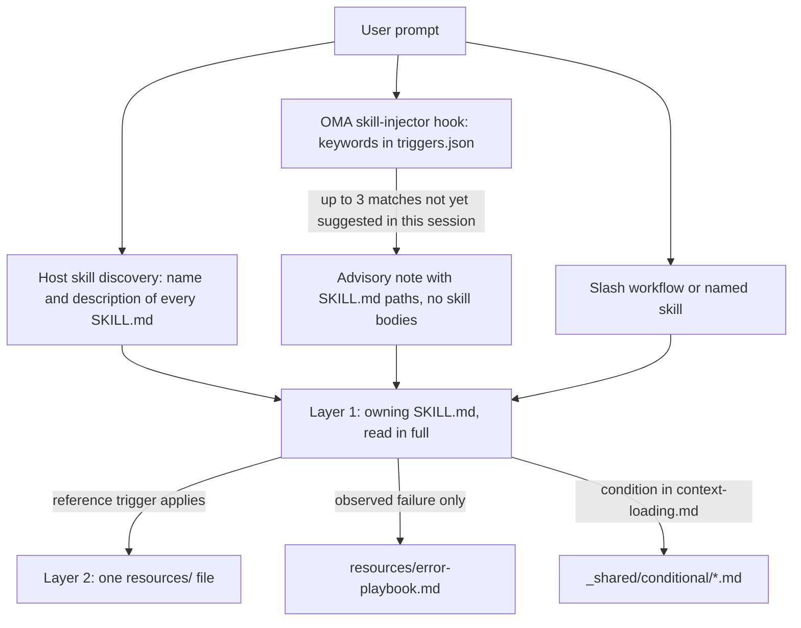
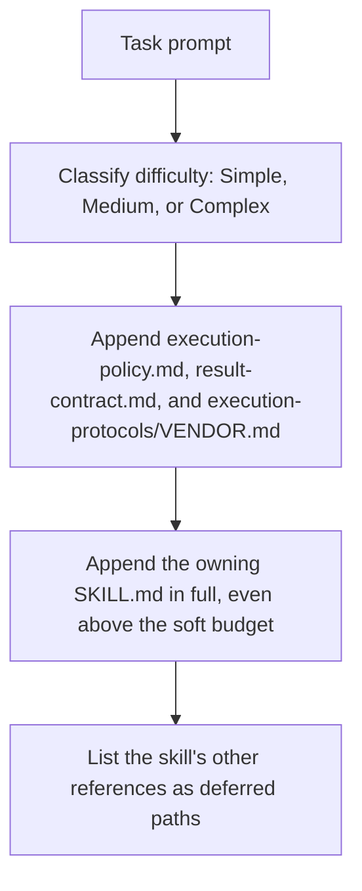

# Umiejętności {#skills}

[Umiejętności](../getting-started/glossary.md#skill) to uporządkowane pakiety wiedzy, które dostarczają roli dispatchu wskazówek z jej domeny. Zawierają protokoły wykonywania, referencje stosu technologicznego, szablony kodu, podręczniki błędów, checklisty jakości i przykłady, jeśli dana umiejętność je udostępnia. Architektura dzieli ładowanie na dwie warstwy, aby ograniczyć kontekst do wybranej umiejętności i wymaganych plików. Listę zainstalowanych umiejętności znajdziesz w [katalogu umiejętności](./agents.md#skill-catalog).

---

## Architektura dwuwarstwowa {#the-two-layer-design}

Umiejętność trafia do kontekstu etapami. Na etapie wyboru model widzi tylko ścieżkę lub opis; właścicielski SKILL.md jest odczytywany w całości dopiero po wybraniu umiejętności, a pliki pomocnicze są odczytywane pojedynczo, gdy zachodzi ich warunek wyzwalający.



Źródła: `.agents/hooks/core/skill-injector.ts`, `.agents/skills/_shared/core/skill-routing.md` i `.agents/skills/_shared/core/context-loading.md`.

### Warstwa 1: SKILL.md (odczytywany po wybraniu umiejętności) {#layer-1-skillmd-read-when-the-skill-is-selected}

Każda umiejętność ma w katalogu głównym plik `SKILL.md`. Hook injectora przekazuje **referencję ścieżki**, a nie treść, więc niewybrana umiejętność nie kosztuje nic poza swoim `description`. Każdy `SKILL.md` ma frontmatter YAML i te same cztery sekcje najwyższego poziomu; `oma skill lint` zgłasza umiejętność, w której brakuje którejś z nich lub której treść przekracza 500 wierszy.

| Część | Zawartość |
|------|----------|
| Frontmatter | `name` i routingowy `description` (co umiejętność robi i kiedy jej używać) |
| `## Scheduling` | Cel, sygnatura intencji, kiedy używać, kiedy NIE używać, oczekiwane wejścia i wyjścia, zależności |
| `## Structural Flow` | Przejścia, niepowodzenia i odzyskiwanie, stany końcowe |
| `## Logical Operations` | Kanoniczna ścieżka polecenia lub workflowu, zakres zasobów, zabezpieczenia |
| `## References` | Pliki warstwy 2, każdy z warunkiem uzasadniającym jego odczyt |

Bieżący frontmatter `oma-frontend`:

```yaml
---
name: oma-frontend
description: "Implement or modify web UI in React, Next.js, or Angular. Use for components, pages, styles, forms, and frontend state or data flows."
---
```

Runtime'y hostów pokazują modelowi `description` każdej umiejętności, dlatego jest on napisany jako zdanie routingowe. Hook słów kluczowych OMA go nie odczytuje; jego słowa kluczowe znajdują się w `.agents/hooks/core/triggers.json`.

### Warstwa 2: resources/ (ładowana na żądanie) {#layer-2-resources-loaded-on-demand}

Katalog `resources/` zawiera pogłębioną wiedzę o wykonywaniu. Pliki te są ładowane tylko wtedy, gdy:
1. Host lub workflow wybrał umiejętność (np. przez natywne dopasowanie umiejętności albo jawne polecenie)
2. Bieżące zadanie spełnia warunek ładowania referencji

To ładowanie na żądanie podlega przewodnikowi ładowania kontekstu (`.agents/skills/_shared/core/context-loading.md`), który odróżnia instrukcje punktu wejścia od referencji wybieranych na podstawie zadania.

### Co wstrzykuje `oma agent spawn` {#what-oma-agent-spawn-injects}

Dispatch przez CLI sam składa prompt subagenta, więc subagent zaczyna pracę z kontraktami i właścicielską umiejętnością już obecnymi w kontekście:



Źródło: `cli/commands/agent/spawn-status.ts`, `cli/platform/agent-config/loaders.ts` i `cli/platform/context-loader.ts`. Natywni subagenci otrzymują ten sam kontekst zadania z `oma agent context <agent-id>` i sami odczytują politykę oraz kontrakt wyniku, jeśli runtime ich nie dostarczył.

---

## Przykład struktury plików {#file-structure-example}

```text
.agents/skills/oma-frontend/
├── SKILL.md                          ← Layer 1: read when selected
└── resources/
    ├── execution-protocol.md         ← Layer 2: step-by-step workflow
    ├── tech-stack.md                 ← Layer 2: detailed technology specs
    ├── tailwind-rules.md             ← Layer 2: Tailwind conventions
    ├── angular-rules.md              ← Layer 2: Angular-specific conventions
    ├── snippets.md                   ← Layer 2: copy-paste code patterns
    ├── error-playbook.md             ← Layer 2: error recovery procedures
    └── checklist.md                  ← Layer 2: quality verification checklist

.agents/skills/oma-backend/
├── SKILL.md
├── resources/
│   ├── execution-protocol.md
│   ├── orm-reference.md              ← Domain-specific (ORM queries, N+1, transactions)
│   ├── checklist.md
│   └── error-playbook.md
└── variants/                          ← Starter seeds for /stack-set
    ├── stack.schema.json
    ├── node/
    ├── python/
    └── rust/

.agents/skills/oma-mobile/
├── SKILL.md
├── resources/
│   ├── execution-protocol.md
│   ├── tech-stack.md
│   ├── screen-template.dart
│   ├── screen-template.swift         ← Swift native iOS screen template
│   ├── screen-template.tsx            ← React Native screen template
│   ├── checklist.md
│   └── error-playbook.md
└── variants/                          ← Platform seeds for /stack-set
    ├── README.md
    ├── stack.schema.json
    ├── flutter/                       ← stack.yaml, tech-stack.md, snippets.md, api-template.dart
    ├── react-native/                  ← stack.yaml, tech-stack.md, snippets.md, api-template.ts
    └── swift-ios/                     ← stack.yaml, tech-stack.md, snippets.md, api-template.swift

.agents/skills/oma-design/
├── SKILL.md
├── resources/
│   ├── execution-protocol.md
│   ├── anti-patterns.md
│   ├── asset-strategy.md
│   ├── checklist.md
│   ├── design-md-spec.md
│   ├── design-tokens.md
│   ├── getdesign-fetcher.md
│   ├── prompt-enhancement.md
│   ├── redesign-protocol.md
│   ├── stitch-integration.md
│   └── error-playbook.md
└── reference/                         ← Deep reference material
    ├── typography.md
    ├── color-and-contrast.md
    ├── spatial-design.md
    ├── motion-design.md
    ├── responsive-design.md
    ├── component-patterns.md
    ├── accessibility.md
    ├── visual-hierarchy.md
    └── shader-and-3d.md
```

---

## Typy zasobów per umiejętność {#per-skill-resource-types}

| Typ zasobu | Wzorzec nazwy pliku | Przeznaczenie | Kiedy ładowany |
|--------------|-----------------|---------|-------------|
| **Protokół wykonywania** | `execution-protocol.md` | Workflow krok po kroku: Analyze -> Plan -> Implement -> Verify | Wybrana operacja wymaga szczegółów swojego polecenia lub kontraktu |
| **Stos technologiczny** | `tech-stack.md` | Szczegółowe specyfikacje technologii, wersje i konfiguracja | Wybrany framework lub decyzja dotycząca stosu |
| **Podręcznik błędów** | `error-playbook.md` | Kroki od objawu do odzyskania; brak informacji lub uprawnień wstrzymuje tylko zależne działanie | Tylko po zaobserwowanym niepowodzeniu |
| **Checklista** | `checklist.md` | Weryfikacja jakości właściwa dla domeny | Odpowiednie sekcje, gdy weryfikacja nie jest jeszcze rozstrzygnięta |
| **Snippety** | `snippets.md` | Gotowe do skopiowania wzorce kodu | Nieznana implementacja lub nieznany kształt wyniku |
| **Przykłady** | `examples.md` | Opracowane przykłady wejścia/wyjścia (oma-pm, oma-db, oma-tf-infra, oma-observability, oma-search) | Nieznana implementacja lub nieznany kształt wyniku |
| **Warianty** | katalog `variants/` | Ziarna startowe dla języków/frameworków. Backend dostarcza `node`, `python` i `rust`; mobile dostarcza `flutter`, `react-native` i `swift-ios`. `/stack-set` używa ich do wygenerowania katalogu `stack/` projektu. | Gdy konfigurowany jest pasujący stos |
| **Szablony** | `screen-template.{dart,swift,tsx}` (oma-mobile), `variants/*/api-template.*` | Boilerplate nowego ekranu lub modułu API | Przy tworzeniu takiego pliku |
| **Referencja domenowa** | `orm-reference.md`, `anti-patterns.md` itd. | Pogłębiona wiedza domenowa dla konkretnych podzadań | Zależnie od typu zadania |

---

## Zasoby współdzielone (_shared/) {#shared-resources-_shared}

Wszyscy agenci współdzielą podstawy z `.agents/skills/_shared/`. Są one uporządkowane w trzech kategoriach:

### Zasoby podstawowe (`.agents/skills/_shared/core/`) {#core-resources-agentsskills_sharedcore}

| Zasób | Przeznaczenie | Kiedy ładowany |
|----------|---------|-------------|
| **`execution-policy.md`** | Reguły autoryzacji, doprecyzowania, weryfikacji i ukończenia dla każdej umiejętności i każdego workflowu. | Wstrzykiwany do każdego promptu `oma agent spawn`; natywni agenci odczytują go, jeśli nie został dostarczony |
| **`skill-routing.md`** | Kieruje według wyniku zadania, właściciela i rzeczywistych zależności; bez obowiązkowego łańcucha agentów ani limitu tur. | Referencja dla umiejętności orkiestratora i koordynacji |
| **`context-loading.md`** | Właścicielski punkt wejścia, referencje warunkowe i granice ładowania w runtime. | Przy komponowaniu kontekstu |
| **`prompt-structure.md`** | Wskazuje, co zawrzeć przy przekazaniu nieznanego zadania: cel, kontekst, rzeczywiste ograniczenia i dowody akceptacji; bez obowiązkowego szablonu dla zadań bezpośrednich. | Przy komponowaniu przekazania nieznanego zadania; nie jest obowiązkowo ładowany z góry |
| **`clarification-protocol.md`** | Rozstrzyga rutynowe szczegóły na podstawie kontekstu i pyta tylko o istotne brakujące informacje lub autoryzację. | Gdy wymagania są niejednoznaczne |
| **`code-intelligence.md`** | Do wyszukiwania kodu, nawigacji i analizy wpływu używaj skonfigurowanego mechanizmu code intelligence. | Wyszukiwanie kodu lub nawigacja po nim |
| **`test-approach.md`** | `test_approach` dla każdego zadania z planu PM oraz blok `TDD_EVIDENCE` dla zadań `tdd`. | Zadania, których plan ustawia `test_approach` |
| **`context-budget.md`** | Szacunki rozmiaru plików, pomiar rzeczywistego promptu, zawężone odczyty i checkpointy. | Długie zadania lub diagnozowanie narzutu kontekstu |
| **`difficulty-guide.md`** | Dobiera głębokość planowania i rezultaty na podstawie zależności i potrzeb weryfikacji. | Gdy dekompozycja wymaga oszacowania trudności |
| **`quality-principles.md`** | Wskazówki dotyczące zakresu, łatwości utrzymania, dowodów i proporcjonalnej weryfikacji. | Na początku workflowów skupionych na jakości (ultrawork) |
| **`vendor-detection.md`** | Ustala docelowego dostawcę każdego agenta na podstawie konfiguracji i wybiera natywny dispatch albo `oma agent spawn`. | Gdy szczegóły dispatchu nie są rozstrzygnięte |
| **`session-metrics.md`** | Opcjonalne dowody sesji, bez punktacji karnej rozmowy ani ewaluatora. | Zlecona retrospektywa lub istotna korekta |
| **`common-checklist.md`** | Stosowne kontrole międzydomenowe; bez globalnych limitów liczby wierszy ani ogólnego wymogu catch. | Przegląd międzydomenowy, gdy jest to istotne |
| **`lessons-learned.md`** | Utrwalaj i stosuj wnioski poparte dowodami, z warunkami wersji/wyzwalacza; bez automatycznego progu RCA. | Referencja po błędach i na końcu sesji |
| **`anti-ai-prose.md`** | Współdzielona diagnostyka prozy. | Audyty prozy akademickiej i przeglądy stylu tłumaczeń |
| **`stack-verify.schema.json`** | Współdzielone definicje `verify:`, z których korzystają schematy stosu backendu i mobile. | Walidacja schematu stosu |
| **`api-contracts/`** | Opcjonalny szablon kontraktu. Używaj ponownie schematów projektu; wygenerowane kontrakty znajdują się poza źródłem umiejętności. | Gdy planowana jest praca na granicy |

### Zasoby runtime (`.agents/skills/_shared/runtime/`) {#runtime-resources-agentsskills_sharedruntime}

| Zasób | Przeznaczenie |
|----------|---------|
| **`result-contract.md`** | Tożsamość uruchomienia, ścieżka zgłoszenia i kontrakt ukończenia dla wyników agentów. Wstrzykiwany do każdego promptu `oma agent spawn`; natywni agenci stosują go przez `oma agent begin`, `oma agent verify` i `oma agent finish`. |
| **`memory-protocol.md`** | Format i operacje plików pamięci dla subagentów CLI. Definiuje protokoły On Start, During Execution i On Completion z konfigurowalnymi narzędziami pamięci (read/write/edit). Obejmuje rozszerzenie śledzenia eksperymentów. |
| **`event-spec.md`** | Kontrakt trwałych zdarzeń workflowu, dopisywanych do `events.jsonl` w profilu domowym OMA i sprawdzanych przez `oma state get` lub `oma state list`. |
| **`execution-protocols/claude.md`** | Wzorce wykonywania właściwe dla Claude Code. Wstrzykiwane przez `oma agent spawn`, gdy dostawcą jest claude. |
| **`execution-protocols/antigravity.md`** | Wzorce wykonywania CLI Antigravity (`agy`). |
| **`execution-protocols/codex.md`** | Wzorce wykonywania właściwe dla Codex CLI. |
| **`execution-protocols/commandcode.md`** | Wzorce wykonywania CommandCode. |
| **`execution-protocols/grok.md`** | Wzorce wykonywania Grok. |
| **`execution-protocols/kimi.md`** | Wzorce wykonywania Kimi Code. |
| **`execution-protocols/kiro.md`** | Wzorce wykonywania Kiro. |
| **`execution-protocols/opencode.md`** | Wzorce wykonywania rozszerzeń OpenCode. |
| **`execution-protocols/pi.md`** | Wzorce wykonywania rozszerzeń pi. |
| **`execution-protocols/qwen.md`** | Wzorce wykonywania właściwe dla Qwen CLI. |

Protokoły wykonywania właściwe dla dostawcy są automatycznie wstrzykiwane agentom uruchamianym przez CLI przez `oma agent spawn`. Natywni subagenci korzystają z reguł integracji wybranego dostawcy.

### Zasoby warunkowe (`.agents/skills/_shared/conditional/`) {#conditional-resources-agentsskills_sharedconditional}

Są one ładowane tylko wtedy, gdy w trakcie wykonywania spełnione są określone warunki:

| Zasób | Warunek wyzwalający | Ładowany przez |
|----------|-------------------|-----------|
| **`quality-score.md`** | Potrzebny jest zdefiniowany baseline lub porównanie eksperymentów | Orchestrator (przekazuje promptowi agenta QA) |
| **`experiment-ledger.md`** | Rzeczywista hipoteza jest porównywana z baseline'em lub innym podejściem | Koordynator (prowadzi współdzielony rejestr; agenci działający równolegle zapisują wyniki przypisane do zadania/uruchomienia, które on scala) |
| **`exploration-loop.md`** | Odzyskiwanie wielokrotnie zawodzi, a alternatywy warto przetestować w ramach budżetu | Orchestrator (inline, przed uruchomieniem agentów hipotez) |
| **`diagram-engine.md`** | Workflow ma wygenerować diagram strukturalny (architektura, sekwencja, przepływ danych, cykl życia) | Workflow generujący diagram |

Zasoby te są odroczone do czasu spełnienia ich indywidualnych warunków wyzwalających. Sam poziom trudności ich nie wstrzykuje.

---

## Jak wybierana jest umiejętność {#how-skills-route-via-skill-routingmd}

Umiejętność trafia do kontekstu jedną z trzech ścieżek. Żadna z nich sama nie uruchamia workflowu ani nie upoważnia do delegowania.

1. **Natywne wykrywanie przez hosta.** Runtime'y obsługujące umiejętności wyświetlają `name` i `description` każdej umiejętności; model odczytuje ten SKILL.md, którego opis pasuje do żądanego wyniku.
2. **Podpowiedź słów kluczowych OMA.** Tam, gdzie OMA instaluje swój hook promptu, `skill-injector` dopasowuje prompt do wielojęzycznych słów kluczowych z `.agents/hooks/core/triggers.json` i dodaje doradczą notatkę `[OMA SKILLS DETECTED: ...]` z maksymalnie trzema ścieżkami SKILL.md. Dla promptu „Zbuduj formularz logowania z Tailwind CSS” pasuje tylko słowo kluczowe `tailwind`, więc notatka sugeruje `oma-frontend`.
3. **Jawne wywołanie.** Workflow slash, taki jak `/plan`, `/review` lub `/debug`, albo podanie nazwy umiejętności w prompcie.

### Własność według wyniku {#ownership-by-outcome}

Zadaniem o określonym zakresie zajmuje się jedna właścicielska umiejętność; przekazanie dodawaj tylko wtedy, gdy inna umiejętność wnosi odrębną zdolność. Ta tabela odzwierciedla `.agents/skills/_shared/core/skill-routing.md`. W pozostałych domenach wybieraj na podstawie opisów zainstalowanych umiejętności w [katalogu umiejętności](./agents.md#skill-catalog).

| Żądany wynik | Właścicielska umiejętność |
|-------------------|--------------|
| API aplikacji, uwierzytelnianie po stronie serwera, logika usług/dostępu do danych | oma-backend |
| Schemat, projekt migracji, indeksowanie, strojenie zapytań, operacje bazodanowe | oma-db |
| Komponenty webowe, strony, formularze, stan klienta | oma-frontend |
| Ekrany mobilne, widżety, integracja z platformą | oma-mobile |
| Granice systemu, kompromisy architektoniczne, ADR | oma-architecture |
| Diagnozowanie i naprawa niepoprawnego działania | oma-debug |
| Przegląd poprawności, bezpieczeństwa, dostępności i wydajności | oma-qa |
| System wizualny, DESIGN.md, kierunek redesignu | oma-design |
| Zlecona ideacja lub eksploracja alternatyw | oma-brainstorm |
| Wymagania, zależności, kryteria akceptacji | oma-pm |
| Zlecone równoległe wykonanie przez specjalistów | oma-orchestration |
| Zlecona ręczna koordynacja wieloagentowa | oma-coordination |
| Gałęzie Git, commity, scalenia, historia repozytorium | oma-scm |

### Zależności między umiejętnościami {#dependencies-between-skills}

Nie ma stałego łańcucha wykonywania. Porządkuj pracę według rzeczywistych zależności:

- Nierozstrzygniętą decyzję architektoniczną lub produktową ustal przed pracą, która od niej zależy. Istniejące decyzje nie muszą ponownie przechodzić przez architekturę, burzę mózgów ani PM.
- Prace nad backendem i klientem mogą toczyć się niezależnie, gdy ich wspólny kontrakt API nadaje się do użycia. Jeśli go brakuje, najpierw ustal tę granicę z odpowiednimi właścicielami.
- Przegląd może objąć ukończoną część gotową do przeglądu, podczas gdy niezależna implementacja trwa dalej. Nie traktuj niestabilnego artefaktu jako ostatecznego dowodu w przeglądzie.
- Błąd znaleziony podczas implementacji może naprawić jego właściciel. Wsparcie debugowania dodaj wtedy, gdy wymaga tego diagnoza; nie ma obowiązkowego łańcucha implementacja -> debug.
- Przy defekcie międzydomenowym ustal na podstawie dowodów, który kontrakt zawodzi i kto za niego odpowiada. Niezgodność API nie oznacza automatycznie, że zmienić musi się backend.

### Gdy podpowiedź umiejętności się nie pojawia {#when-a-skill-hint-does-not-appear}

Wszystkie te zachowania wynikają z `.agents/hooks/core/skill-injector.ts`.

| Objaw | Przyczyna | Co zrobić |
|---------|-------|------------|
| W ogóle brak notatki `[OMA SKILLS DETECTED]` | Prompt zaczyna się od `/`, w sesji aktywny jest [trwały workflow](../getting-started/glossary.md#persistent-workflow) albo wiadomość jest przekazaną wiadomością agenta | To oczekiwane: kontekstem zarządza workflow. Jeśli potrzebujesz umiejętności, podaj jej nazwę |
| W notatce brakuje oczekiwanej umiejętności | Wyświetlane są tylko 3 najlepsze dopasowania (10 punktów za każde dopasowane słowo kluczowe) | Użyj bardziej konkretnego terminu albo podaj nazwę umiejętności |
| Umiejętność zasugerowana wcześniej nie jest sugerowana ponownie | Ścieżka SKILL.md jest sugerowana raz na sesję; wpis w `.agents/state/skill-sessions.json` wygasa po godzinie bez nowych sugestii | Wcześniejsza sugestia nadal obowiązuje |
| Słowo kluczowe jest ignorowane | Tekst w blokach kodu, backtickach lub podwójnych cudzysłowach jest usuwany przed dopasowaniem | Użyj terminu w zwykłym tekście |
| oma-academic-writing, oma-docs, oma-explanation, oma-scholar lub oma-skill-creation nigdy nie są sugerowane | Te umiejętności nie mają słów kluczowych w `triggers.json` | Użyj `/docs` lub `/explain` albo podaj nazwę umiejętności; wykrywanie przez hosta nadal widzi ich opisy |
| Podpowiedź wskazuje niezwiązaną umiejętność | Dopasowanie opiera się na słowach kluczowych i ma charakter doradczy | Opisz oczekiwany wynik; notatka poleca modelowi kierować się własnym osądem |

---

## Matematyka oszczędności tokenów {#token-savings-math}

Zmierz koszt kontekstu, zanim zadeklarujesz oszczędności. Słów simple, medium i complex używają dwa różne mechanizmy:

- **Scenariusze skryptu** (`routed`, `simple`, `medium`, `complex`, `all`) to skumulowane porównania rozmiarów plików wypisywane przez `scripts/measure-skill-context.ts`. Nie są politykami ładowania, a `all` to tylko górna granica.
- **Poziom trudności loadera** (Simple, Medium, Complex) wybiera miękki budżet dla kontekstu wstrzykiwanego przez dispatch CLI. Zobacz [Ładowanie zasobów według zadania](#resource-loading-by-task).

```bash
bun scripts/measure-skill-context.ts
bun scripts/measure-skill-context.ts --skills oma-pm,oma-backend,oma-frontend --json
oma agent context backend --difficulty Medium
```

Skrypt raportuje szacunki obliczone jako bajty UTF-8 / 4. `routed` to sam punkt wejścia; `simple`, `medium` i `complex` dodają hipotetyczne pliki protokołu, przykładów i stosu dla porównania. Ich nazwy zachowano dla zgodności ze skryptem, a nie jako instrukcje ładowania z góry. Świeży checkout może użyć jednego ziarna platformy jako przybliżenia rozmiaru; nie ładuje wszystkich platform.

Polecenie context wypisuje rzeczywiście wstrzykiwany kontekst zadania: nagłówek `## Task context (graph-selected, approximately N tokens)`, właścicielski SKILL.md i listę odroczonych referencji. Nie obejmuje reszty rozmowy ani wszystkich instrukcji hosta/runtime, a prompt uruchomionego subagenta jest większy, ponieważ `oma agent spawn` dodaje jeszcze politykę wykonywania, kontrakt wyniku i protokół dostawcy. Użyj zestawionego promptu albo telemetrii użycia, aby zmierzyć łączną liczbę tokenów wejściowych, opóźnienie i koszt na konkretnym modelu. Nie wnioskuj o tych wartościach z rozmiaru repozytorium ani z liczby wygenerowanych kopii lustrzanych.

## Ładowanie zasobów według zadania {#resource-loading-by-task}

Każdy poziom trudności zaczyna się od właścicielskiej umiejętności. Graf jest indeksem referencji; sąsiedztwo nie upoważnia do ładowania innego specjalisty, podręcznika błędów ani warunkowego workflowu eksperymentów.

Mechanizm ładowania stosuje miękkie budżety 1500 / 4000 / 8000 szacowanych tokenów dla Simple / Medium / Complex. Punkt wejścia przekraczający budżet jest zachowywany, a przekroczenie jest raportowane. Referencje pomocnicze pozostają odroczone, chyba że zostaną jawnie wybrane po ustaleniu, że zadanie spełnia ich warunek wyzwalający. Wymagany punkt wejścia nigdy nie jest zastępowany mniejszymi, niezwiązanymi dokumentami.

Weryfikacja zależy od ryzyka zadania i wymagań projektu. Etykieta trudności nie wymaga pełnego zestawu testów, stałej odpowiedzi preflight ani ponownego zatwierdzenia już autoryzowanej pracy.

## Mapy ładowania kontekstu (per agent) {#context-loading-task-maps-per-agent}

To przykłady referencji, do których należy sięgać, gdy zadanie ich wymaga. Korzystaj z bieżącego indeksu właścicielskiej umiejętności i wybieraj tylko stosowne sekcje:

### Agent backendu {#backend-agent}

<!-- oma-docs:ignore-start -->

| Typ zadania | Wymagane zasoby |
|-----------|-------------------|
| Tworzenie API CRUD | `stack/snippets.md` i `stack/api-template.*` projektu (generowane przez `/stack-set`), gdy istnieją; w przeciwnym razie istniejący kod projektu |
| Uwierzytelnianie | `stack/snippets.md` + `stack/tech-stack.md`, gdy istnieją |
| Migracja bazy danych | `stack/snippets.md`, gdy istnieje; projekt schematu należy do oma-db |
| Optymalizacja wydajności | `orm-reference.md` i pasujące przykłady dostarczone przez umiejętność |
| Modyfikacja istniejącego kodu | dostawca code intelligence projektu i właściwe zasoby wykonywania |

<!-- oma-docs:ignore-end -->

`variants/node`, `variants/python` i `variants/rust` to ziarna startowe dla `/stack-set`; agenci nie odczytują ich przy edycji istniejącego kodu.

### Agent frontendu {#frontend-agent}

| Typ zadania | Wymagane zasoby |
|-----------|-------------------|
| Tworzenie komponentu | snippets.md + istniejące wzorce komponentów projektu |
| Implementacja formularza | snippets.md (formularz + Zod) |
| Integracja API | snippets.md (TanStack Query) |
| Stylowanie | tailwind-rules.md |
| Układ strony | snippets.md (grid) |

### Agent designu {#design-agent}

| Typ zadania | Wymagane zasoby |
|-----------|-------------------|
| Tworzenie systemu designu | reference/typography.md + reference/color-and-contrast.md + reference/spatial-design.md + design-md-spec.md |
| Projektowanie landing page | reference/component-patterns.md + reference/motion-design.md + prompt-enhancement.md |
| Audyt designu | checklist.md + anti-patterns.md |
| Eksport tokenów designu | design-tokens.md |
| Efekty 3D / shader | reference/shader-and-3d.md + reference/motion-design.md |
| Przegląd dostępności | reference/accessibility.md + checklist.md |

### Agent QA {#qa-agent}

| Typ zadania | Wymagane zasoby |
|-----------|-------------------|
| Przegląd bezpieczeństwa | checklist.md (sekcja Security) |
| Przegląd wydajności | checklist.md (sekcja Performance) |
| Przegląd dostępności | checklist.md (sekcja Accessibility) |
| Pełny audyt | checklist.md (wszystkie sekcje), a także iso-quality.md, gdy zlecono przegląd oparty na standardach |
| Porównanie zdefiniowanych metryk | quality-score.md (warunkowe) |

---

## Kompozycja promptu orkiestratora {#orchestrator-prompt-composition}

Gdy orkiestrator pisze prompt subagenta (`oma-orchestration/resources/subagent-prompt-template.md`), dostarcza wyłącznie dane zadania: rolę agenta, ID zadania, przestrzeń roboczą, dozwolone ścieżki, opis zadania, kryteria akceptacji, referencje zadania z warunkami ich ładowania oraz istotne ograniczenia.

- Przy dispatchu przez CLI `oma agent spawn` już wstrzykuje `execution-policy.md`, `result-contract.md`, protokół wykonywania dostawcy i właścicielski SKILL.md, więc prompt ich nie powtarza.
- Przy natywnym dispatchu przekaż ścieżki tych plików i właścicielskiej umiejętności, jeśli runtime ich nie dostarczył.
- Sekcję error-playbook dodawaj dopiero po zaobserwowanym niepowodzeniu, a `runtime/memory-protocol.md` tylko wtedy, gdy agent koordynuje lub wznawia trwały stan zadania.

Dzięki temu prompt zawiera tylko potrzebne zasoby, a reszta jego kontekstu pozostaje dostępna na zadanie.

---

## Dowody sesji i przegląd retrospektywny {#session-evidence-and-retrospective-review}

Zapisy sesji odnotowują istotne korekty, zmiany zakresu, ponowną pracę i rozstrzygnięte ustalenia przeglądu wraz z dowodami. Niezbędne doprecyzowanie nie pociąga za sobą kary. Dawne ważone wyniki CD i EA oraz reguły RCA wyzwalane progami zostały usunięte; były to instrukcje promptu, a nie metryki obliczane przez CLI.

Tam, gdzie to możliwe, korzystaj z istniejących wyników zadań. Osobny plik `session-metrics-{sessionId}.md` jest opcjonalny w skonfigurowanym magazynie koordynacji. Powtarzające się niepowodzenie lub zlecona retrospektywa może uzasadniać wniosek, ale zwykła nieudana kontrola lub sporne ustalenie nie stanowi go automatycznie. Zachowaj historyczne dzienniki; nie przepisuj ich do nowego formatu.

`oma stats` raportuje produktywność oraz zapisane podsumowania użycia/kosztów. `oma retro` grupuje rzeczywiste zdarzenia bramek, blokad i brakujących decyzji w sugestie. Żadne z nich nie oblicza wyników CD/EA na podstawie tych artefaktów Markdown.

## Dekompozycja zadań i odzyskiwanie kontekstu {#task-decomposition-and-context-recovery}

Planuj na podstawie zależności i niezależnie weryfikowalnych zachowań. Z góry ustalone liczby sprintów i plików oraz szacunki tur nie decydują o głębokości przeglądu ani o ukończeniu zadania. Trzymaj testy i obsługę błędów razem z zachowaniem, które weryfikują.

W razie zaobserwowanego zastoju lub utraty przydatnego kontekstu zapisz ukończoną pracę, pozostałe kryteria, istotne ścieżki i dowody weryfikacji przed wznowieniem lub ponownym dispatchem. Zachowaj istniejącą pracę i unikaj powielania trwającej próby. Sam stosunek tur do postępu nie wymaga resetu.

## Warunkowy pomiar i eksploracja {#conditional-measurement-and-exploration}

Zdefiniowany baseline lub porównanie eksperymentów aktywuje wskazówki dotyczące pomiaru; samo posiadanie testów lub lintu ich nie aktywuje. Zapisuj porównywalne metryki wraz z jednostkami, metodą, rewizją i dowodami. Wymagane kontrole poprawności i bezpieczeństwa pozostają niezależne. OMA nie ma domyślnej formuły zbiorczej, bramki opartej na ocenie literowej ani wycofania wyzwalanego wynikiem.

Rzeczywisty eksperyment zapisuje swoją hipotezę, dowody dla baseline'u i kandydata, wymagane kontrole, decyzję oraz należące do niego pliki. Powtarzające się niepowodzenia mogą uzasadniać przetestowanie innego mechanizmu w ramach istniejącego budżetu odzyskiwania. Izoluj zmiany eksperymentu, zachowaj niezwiązane edycje i zweryfikuj zintegrowanego kandydata przed wznowieniem bramki.

---

## Powiązane {#related}

- [Agenci](./agents.md): katalog umiejętności, role dispatchu, definicje i natywne pliki agentów
- [Workflowy](./workflows.md): workflowy slash, które odczytują umiejętności
- [Struktura projektu](./project-structure.md): gdzie po instalacji znajduje się `.agents/skills/`
- [Wyniki agentów i wznawianie](../guide/agent-results-and-resume.md): natywny cykl życia `oma agent begin` → `oma agent finish`
- [Ewaluacja umiejętności](../guide/skill-eval.md) i [Optymalizacja umiejętności](../guide/skill-opt.md)
- Tworzenie umiejętności: użyj umiejętności `oma-skill-creation`, a następnie uruchom `oma skill lint` i `oma skill audit`
