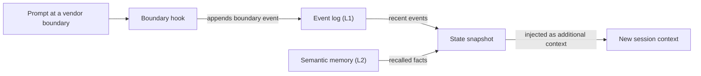

# Słownik {#glossary}

Każdy wpis zawiera krótką definicję i odnośnik do strony, która szczegółowo omawia dane pojęcie. Jeśli słowo znaczy co innego w różnych częściach OMA, wpis to zaznacza.

## Elementy składowe {#building-blocks}

### Umiejętność (skill) {#skill}

Umiejętność to pakiet wiedzy domenowej w `.agents/skills/oma-<name>/`. Jej `SKILL.md` trafia do kontekstu, gdy umiejętność zostanie wybrana przez routing, a pliki w `resources/` ładują się tylko wtedy, gdy zadanie ich potrzebuje. Umiejętność określa, jak agent pracuje w jednej domenie; nie definiuje procesu wielokrokowego. Zobacz [Umiejętności](../core-concepts/skills.md).

### Workflow {#workflow}

Workflow to wielokrokowy proces zdefiniowany w `.agents/workflows/<name>.md`. Uruchamiasz go jego komendą slash, np. `/plan` albo `/orchestrate`; gdy hook wykrywania słów kluczowych jest włączony, może go też wstrzyknąć pasująca fraza wyzwalająca. Workflowy koordynują jedną lub więcej umiejętności i agentów. Zobacz [Workflowy](../core-concepts/workflows.md) oraz [Wybór umiejętności lub workflowu](../core-concepts/workflows.md#choosing-a-skill-or-workflow).

### Definicja agenta {#agent-definition}

Definicja agenta to plik subagenta przechowywany w repozytorium w `.agents/agents/`, np. `backend-engineer.md` albo `qa-reviewer.md`. Określa tożsamość agenta, ładowane umiejętności (frontmatter `skills:`), sekcję protokołu wykonywania i reguły domenowe. OMA przekształca te pliki do natywnych formatów dostawców, takich jak `.claude/agents/*.md` i `.codex/agents/*.toml`. Dokumentacja używa słowa „agent” także na określenie roli dispatchu (`backend`, `qa`, `explore`) oraz umiejętności, np. `oma-backend`. Zobacz [Definicje agentów](../core-concepts/agents.md#agent-definitions).

## Presety {#presets}

### Preset umiejętności {#skill-preset}

Preset umiejętności to zestaw umiejętności, który instalator dodaje do projektu, np. `all`, `fullstack`, `backend` albo `research`. Współdzielone zasoby `_shared/` są instalowane z każdym presetem. Preset umiejętności nie wpływa na to, który model obsługuje agenta. Zobacz [Presety](./installation.md#presets).

### Preset modelu {#model-preset}

Preset modelu to wartość `model_preset` w `.agents/oma-config.yaml` (lub `.cue`). Decyduje, którego dostawcy i modelu używa każdy agent. `auto`, domyślny dla nowych instalacji, stosuje własne ustawienia agentów i modeli bieżącego runtime'u; stałe presety, takie jak `claude`, `codex` czy `mixed`, przypinają je na sztywno. Nadpisania `agents.<id>` mają pierwszeństwo przed presetem, z wyjątkiem `free`, gdzie `free.model` zastępuje przypięcia modeli per agent. Zobacz [Wbudowane presety](../guide/per-agent-models.md#built-in-presets).

## Wykonywanie workflowów {#workflow-execution}

### Workflow trwały {#persistent-workflow}

Workflow trwały działa przez kolejne tury, dopóki jego praca nie zostanie ukończona albo dopóki go nie dezaktywujesz. Workflowy trwałe to `/orchestrate`, `/work`, `/ultrawork` i `/ralph`, a tryb trwały aktywuje wyłącznie jawne wywołanie. Gdy taki workflow jest aktywny, hook ponownie wstrzykuje `[OMA PERSISTENT MODE: ...]` przy każdym prompcie, a hook Stop nie pozwala zakończyć sesji, dopóki nie zostanie osiągnięty limit wzmocnień albo timeout nieaktualności. Powiedz `workflow done`, aby go dezaktywować. Zobacz [Mechanika trybu trwałego](../core-concepts/workflows.md#persistent-mode-mechanics).

### Bramka zatrzymania (stop gate) {#stop-gate}

Bramka zatrzymania to opcjonalna kontrola ukończenia, którą dołączasz do aktywnego workflowu trwałego poleceniem `oma goal set --gate typecheck|test|lint`. Hook Stop pozwala wtedy zakończyć workflow tylko wtedy, gdy przejdzie skrypt `package.json` o tej nazwie. Niepowodzenia bramki liczą się do limitu wzmocnień, więc nieprzechodząca bramka nie może blokować zatrzymania w nieskończoność. Zobacz [`goal set`](../cli-interfaces/commands.md#goal-set).

## Sesje i stan {#sessions-and-state}

„Sesja” ma w OMA dwa znaczenia: sesję śledzoną przez samo OMA oraz sesję rozmowy w używanym AI CLI lub IDE. Rozróżniaj je podczas czytania plików stanu i opcji poleceń.

### Sesja OMA {#oma-session}

Sesja OMA to praca, którą OMA śledzi pod własnym ID sesji, niezależnie od jakiejkolwiek rozmowy u dostawcy. Orkiestracja używa tego ID w nazwach planu, tablicy zadań, plików postępu i wyników oraz rekordów uruchomień agentów; orchestrator generuje je w formacie `session-YYYYMMDD-HHMMSS`. Stan workflowu używa ID sesji OMA (`sid`) jako klucza [dziennika zdarzeń](#event-log), który sprawdzają `oma state list` i `oma state get <sid>`. Zobacz [Strategia identyfikatora sesji](../guide/multi-agent-project.md#session-id-strategy).

### ID sesji dostawcy {#vendor-session-id}

ID sesji dostawcy to identyfikator rozmowy nadawany przez AI CLI lub IDE, np. ID sesji Claude Code albo Codex. OMA zapisuje go w zdarzeniach jako `vendorSid`, a pliki stanu trybu trwałego są według niego kluczowane (`.agents/state/<workflow>-state-<vendor-session-id>.json`). Gdy sesja OMA jest aktywna, a prompt nadchodzi z innej sesji dostawcy, od innego dostawcy albo z sesji, która właśnie została skompaktowana, hook zapisuje zdarzenie `boundary` i wstrzykuje migawkę stanu, aby praca była kontynuowana w nowym kontekście. Zobacz [`state`](../cli-interfaces/commands.md#state).

Jeśli pamięć semantyczna jest niedostępna, migawka korzysta wyłącznie z lokalnych zdarzeń.

### Dziennik zdarzeń {#event-log}

Dziennik zdarzeń to zapis sesji OMA, do którego można tylko dopisywać, przechowywany jako `events.jsonl` w `${OMA_STATE_HOME:-~/.oma}/u/<profile>/sessions/<sid>/`. Każda linia to jedno zdarzenie, np. `session.created`, `workflow.phase`, `gate.passed`, `decision.made` albo `session.ended`. Workflowy dopisują wymagane decyzje przez `oma state emit` i sprawdzają je przez `oma state verify`; odczytuj dziennik poleceniem `oma state get` albo `oma state trajectory`, zamiast otwierać plik. Zobacz [`state`](../cli-interfaces/commands.md#state).

## Przegląd i dowody {#review-and-evidence}

### Sędzia (judge) {#judge}

„Sędzia” ma dwa znaczenia. W `/ralph` sędzia to faza po każdej iteracji ultrawork, która sprawdza każde kryterium ukończenia wobec rzeczywistego stanu projektu i zapisuje PASS, FAIL, REGRESSED lub BLOCKED. Wykonuje ją osobno uruchomiony agent ze świeżym kontekstem, więc orchestrator nie ocenia własnej pracy. W ewaluacji i optymalizacji umiejętności `judge` to domyślny typ checkera: model ocenia wynik danego wariantu według rubryki i zwraca PASS albo FAIL. Zobacz [/ralph](../core-concepts/workflows.md#ralph) oraz [checker judge](../guide/skill-eval.md#judge-default).

### Przegląd międzykontekstowy (CCR) {#cross-context-review-ccr}

Przegląd międzykontekstowy (Cross-Context Review) to reguła, zgodnie z którą każdy etap przeglądu w `/ultrawork` działa w świeżym, odizolowanym kontekstowo subagencie recenzującym. Recenzent otrzymuje wyłącznie przeglądane artefakty, wskazane ścieżkami (diff, zmienione pliki, plan, wcześniejsze wyniki, wyjście testów), oraz przewodnik dla tego jednego przeglądu; nigdy nie widzi historii głównej sesji ani rozumowania implementującego. Każdy recenzent zapisuje ustrukturyzowany werdykt, który zbiera koordynator fazy. Zobacz [/ultrawork](../core-concepts/workflows.md#ultrawork).

### Charter {#charter}

Charter to blok preflight `CHARTER_CHECK`, który agenci implementacji pisali wcześniej przed jakimkolwiek kodem. Obecne definicje agentów nie wymagają stałego wyjścia preflight. Agenci stosują zamiast tego wspólną politykę wykonywania: podają istotne założenia, pytają tylko wtedy, gdy brakująca informacja zmienia poprawność lub zakres, i wstrzymują wyłącznie pracę zależną od odpowiedzi. Uruchomiony subagent nie może zapytać Cię bezpośrednio, więc zgłasza brakujący fakt w wyniku `blocked` albo `partial`. Zobacz [Autoryzacja i doprecyzowanie](../core-concepts/agents.md#charter-preflight-charter_check).

### Rekord uruchomienia i zgłoszenie {#run-record-and-claim}

Rekord uruchomienia to maszynowo czytelne potwierdzenie jednej próby agenta, przechowywane w katalogu stanu danego projektu w profilu, `~/.oma/u/<profile>/projects/<project-hash>/agent-runs/` (starsze wersje używały `.agents/state/agent-runs/`); tworzy go `oma agent begin`, który zapisuje też migawkę kontraktu zadania. Zgłoszenie (claim) to własny raport agenta w odpowiadającej ścieżce `.claim.json`, ze statusem `completed`, `partial`, `blocked` lub `failed`, a także zmienionymi plikami, nierozwiązaną pracą i artefaktami. `oma agent finish` sprawdza zgłoszenie wobec bieżącego kontraktu, potwierdzeń weryfikacji i hashy artefaktów, więc zgłoszenie z nieaktualnymi dowodami nie pozostaje ukończone. Zobacz [Wyniki agentów i wznawianie](../guide/agent-results-and-resume.md).

## Pamięć i dostawcy {#memory-and-providers}

### Pamięć L1 i L2 {#l1-and-l2-memory}

L1 to [dziennik zdarzeń](#event-log): lokalny stan workflowu, do którego można tylko dopisywać, odczytywany przez `oma state verify` i migawkę granicy sesji. L2 to pamięć semantyczna, czyli przywoływane fakty dostarczane przez wybranego dostawcę `providers.semantic_memory`: `agentmemory` (domyślny), `honcho` albo `none`. Wymagane decyzje są przechowywane w L1, więc przetrwają granice sesji bez L2. „L1” i „L2” znaczą też coś innego: warstwa 1 i warstwa 2 umiejętności to jej `SKILL.md` oraz ładowany na żądanie katalog `resources/`, a `oma docs verify` raportuje „L2 references”, czyli referencje do plików, URL-i, CLI, skryptów, środowiska i konfiguracji, które wyodrębnia z dokumentacji. Zobacz [`memory`](../cli-interfaces/commands.md#memory) oraz [Pamięć semantyczna Honcho](../guide/configuration-reference.md#honcho-semantic-memory).

### Dostawca możliwości {#capability-provider}

Dostawca możliwości to zewnętrzne narzędzie lub usługa, z której OMA korzysta dla jednej możliwości, wybierane w sekcji `providers` w `.agents/oma-config.yaml`. Możliwości to dokumentacja (`docs`, domyślnie `context7`), wyszukiwanie w sieci (`web`, domyślnie `native`), inteligencja kodu (`code_intelligence`, domyślnie `serena`) oraz pamięć semantyczna (`semantic_memory`, domyślnie `agentmemory`). Po zmianie dostawcy uruchom `oma link`. Zobacz [Klucze najwyższego poziomu](../guide/configuration-reference.md#top-level-keys) oraz [Ważne wartości domyślne](./important-defaults.md).

## Plany i pliki źródłowe {#plans-and-source-files}

### Plan {#plan}

Plan to maszynowo czytelny podział zadań w `.agents/results/plan-<sessionId>.json`, zapisywany przez `/plan` i używany przez `/orchestrate` oraz `/work`; `/orchestrate` tworzy go, gdy nie istnieje żaden nadający się do użycia plan. Każde zadanie wskazuje swojego agenta, workspace, zależności, kryteria akceptacji i wymagane kontrole, a rekordy uruchomień zapisują migawkę tego kontraktu. Nie ma związku z rozstrzyganiem modeli per agent, które pokazuje `oma doctor --profile` i które niektóre strony nazywają planem dziedziczonym. Zobacz [/plan](../core-concepts/workflows.md#plan) oraz [Rozpocznij natywne uruchomienie](../guide/agent-results-and-resume.md#start-a-native-run).

### SSOT {#ssot}

Jedyne źródło prawdy (SSOT, single source of truth) to katalog `.agents/`: `<project>/.agents/` przy instalacji projektowej albo `~/.oma/.agents/` przy instalacji globalnej. Znajdują się w nim umiejętności, workflowy, definicje agentów, reguły i konfiguracja, a `oma install`, `oma update` i `oma link` generują z niego natywne pliki dostawców (`.claude/`, `.codex/` i inne). Edytuj `.agents/` i uruchamiaj `oma link`, zamiast edytować wygenerowane pliki. Niektóre strony używają określenia SSOT dla węższego źródła, np. manifestu zaplanowanych agentów. Zobacz [.agents/: źródło prawdy](../core-concepts/project-structure.md#agents-the-source-of-truth).
