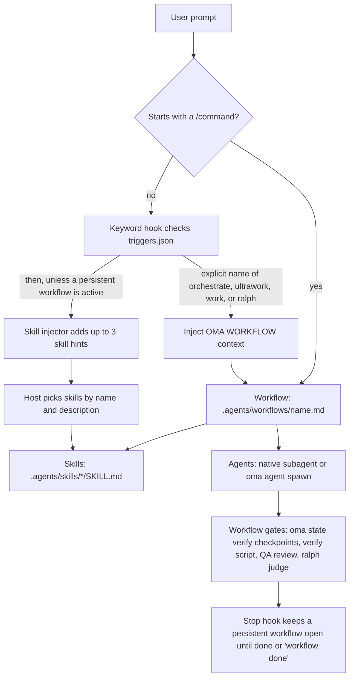

# Wprowadzenie {#introduction}

oh-my-agent to wieloagentowy framework orkiestracji dla IDE i narzędzi CLI opartych na AI. Zamiast polegać na jednym asystencie AI do wszystkiego, oh-my-agent kieruje pracę przez 33 pakiety umiejętności i 13 kanonicznych ról dispatchu. Dwanaście plików definicji subagentów znajdujących się w repozytorium dostarcza wielokrotnego użytku persony do implementacji, review, planowania, debugowania, dokumentacji, badań i infrastruktury. `research-explorer.md` mapuje się na kanoniczną rolę `explore`; `orchestrator` jest rolą koordynacji runtime'u bez osobnego pliku definicji.

OMA wykonuje mechaniczne kontrole, gdy je wywołasz lub wybierzesz workflow, który je zawiera. `oma verify agent <agent-type>` uruchamia kontrole dla wybranego typu agenta; `/ralph` dodaje weryfikację opartą na artefaktach i pętlę [sędziego](./glossary.md#judge); włączone hooki Stop dostawcy ([bramka zatrzymania](./glossary.md#stop-gate)) mogą utrzymywać workflow otwarty, dopóki wykonywane są jego skonfigurowane kontrole. Samo ładowanie umiejętności nie ustanawia akceptacji, a zwykły prompt nie uruchamia automatycznie każdej bramki workflowu. Użyj kryteriów akceptacji workflowu i powstałych plików, aby zdecydować, co jest ukończone.

Cały system znajduje się w przenośnym katalogu `.agents/` wewnątrz projektu. Możesz przełączać się między Claude Code, Codex CLI, Antigravity CLI lub IDE, Cursorem, OpenCode i innymi obsługiwanymi narzędziami, a konfiguracja agentów podróżuje razem z kodem.

Zacznij od [Wybierz konfigurację](./choose-setup.md): załaduj jedną umiejętność do zadania w bieżącym agencie, wybierz preset umiejętności runtime'u dla hooków i workflowów albo zainstaluj wtyczkę Claude Code. Tymczasowe ładowanie umiejętności dostarcza instrukcje i pliki pomocnicze; zależności CLI, reguł projektu i usług zewnętrznych pozostają jawne. Instalacja runtime'u tworzy [SSOT](./glossary.md#ssot) i integracje dostawców.

[Szybki start](./quick-start.md) poprowadzi przez pierwsze zadanie i zaobserwowane kontrole. `oma doctor` sprawdza instalację runtime'u; [Ważne ustawienia domyślne](./important-defaults.md) wyjaśniają dostawców i konfigurację. Przejdź do `/work` albo `/orchestrate`, gdy potrzebna jest koordynacja i zainstalowane są umiejętności, do których te workflowy się odwołują.

---

## Paradygmat wieloagentowy {#the-multi-agent-paradigm}

Tradycyjni asystenci AI do kodowania często obsługują frontend, backend, bazy danych, bezpieczeństwo i infrastrukturę z jednego kontekstu promptu. To może prowadzić do:

- **Rozmycia kontekstu:** ładowanie wiedzy dla każdej domeny marnuje okno kontekstowe
- **Niejasnego właścicielstwa:** zadanie obejmujące wiele domen nie ma wyraźnej granicy odpowiedzialności dla każdej części
- **Ręcznej koordynacji:** złożone funkcje obejmujące wiele domen wymagają przekazań wybieranych przez hosta lub użytkownika

OMA przypisuje domeny umiejętnościom i kieruje pracę nad zadaniem do agentów:

1. **Każda umiejętność ma główną domenę.** Umiejętność frontendowa zna React/Next.js, shadcn/ui, TailwindCSS v4 i architekturę FSD-lite. Umiejętność backendowa zna wzorzec Repository-Service-Router, zapytania parametryzowane i uwierzytelnianie JWT. Domeny mogą nakładać się na granicach, dlatego użyj kryteriów akceptacji zadania, aby zdecydować, czy potrzebna jest druga umiejętność lub workflow koordynujący.
2. **Agenci mogą działać równolegle.** Gdy agent backendowy buduje API, agent frontendowy może pracować we własnym workspace'ie. Orchestrator koordynuje działania za pomocą trwałych plików i potwierdzeń przypisanych do runu.
3. **Wskazówki jakości są wbudowane.** Umiejętności zawierają listy kontroli domeny, podręczniki błędów i reguły [charteru](./glossary.md#charter). Preflight charteru zawęża zakres przed napisaniem kodu; przegląd QA uruchamia się, gdy zawiera go wybrany workflow lub gdy o niego poprosisz.

---

## Obecny katalog: 33 umiejętności, 12 definicji, 20 workflowów {#the-current-catalog-33-skills-12-definitions-20-workflows}

Katalog rozdziela trzy rzeczy, które łatwo pomylić:

- **[Umiejętności](./glossary.md#skill)** to 33 pakiety wiedzy domenowej w `.agents/skills/*/SKILL.md`. Kierują na podstawie intencji wyrażonej naturalnym językiem i progresywnie ładują zasoby.
- **[Definicje agentów](./glossary.md#agent-definition)** to 12 plików w `.agents/agents/`. Dostarczają natywne dla dostawcy persony subagentów i odwołują się do co najmniej jednej umiejętności.
- **[Workflowy](./glossary.md#workflow)** to 20 definicji procesów w `.agents/workflows/`. Cztery są [trwałe](./glossary.md#persistent-workflow) (`orchestrate`, `work`, `ultrawork` i `ralph`); pozostałe kończą się raportem i nie utrzymują aktywnego trybu trwałego.

Poniższe sekcje zachowują szczegółowy katalog umiejętności. Gdy nazwa albo opis się zmienia, rozstrzygający jest frontmatter bieżącego `SKILL.md`.

Dwanaście plików definicji znajdujących się w repozytorium obejmuje 13 ról runtime'u dzięki aliasom: `research-explorer.md` mapuje się na `explore`, a `orchestrator` istnieje tylko w runtime'ie. Pozostałe pliki definicji mapują się na nazwane role wymienione w [Agentach](../core-concepts/agents.md).

### Pomysły, architektura i planowanie {#ideation-architecture-and-planning}

| Agent | Rola | Kluczowe możliwości |
|-------|------|-----------------|
| **oma-brainstorm** | Ideacja z podejściem design-first | Bada intencję użytkownika, proponuje 2–3 podejścia z analizą kompromisów i tworzy dokumenty projektowe przed napisaniem kodu. Workflow `/brainstorm` wykonuje 7 kroków: Context, Questions, Approaches, Design, Blind Review, Documentation (`docs/decisions/`), Transition to `/plan`. |
| **oma-architecture** | Specjalista architektury systemów | Granice modułów, usług i własności, analiza kompromisów, synteza perspektyw interesariuszy. Metody: routing diagnostyczny, porównanie design-twice, analiza w stylu ATAM, priorytetyzacja w stylu CBAM i decyzje w formie ADR. Domyślnie uwzględnia koszty. |
| **oma-pm** | Product manager | Rozkłada wymagania na zadania uporządkowane według priorytetów i zależności. Definiuje kontrakty API. Tworzy `.agents/results/plan-{sessionId}.json` jako przekazanie do orkiestratora; orkiestrator tworzy tablicę zadań i jest jej właścicielem. Obsługuje koncepcje ISO 21500, analizę ryzyka ISO 31000 i zarządzanie ISO 38500. |

### Implementacja {#implementation}

| Agent | Rola | Stos technologiczny i zasoby |
|-------|------|----------------------|
| **oma-frontend** | Specjalista UI/UX | React, Next.js, TypeScript, TailwindCSS v4, shadcn/ui i architektura FSD-lite. Biblioteki: luxon (daty), ahooks lub @mantine/hooks (hooki), es-toolkit (narzędzia), Jotai/Zustand (stan klienta), TanStack Query przez hooki generowane przez orval (stan serwera), @tanstack/react-form + Zod (formularze), better-auth (uwierzytelnianie), nuqs (stan URL). Zasoby: `execution-protocol.md`, `tech-stack.md`, `tailwind-rules.md`, `snippets.md`, `angular-rules.md`, `error-playbook.md`, `checklist.md`. |
| **oma-backend** | Specjalista API i serwera | Czysta architektura (Router-Service-Repository-Models). Niezależny od stosu; wykrywa Python/Node.js/Rust/Go/Java/Elixir/Ruby/.NET na podstawie manifestów projektu. JWT + Argon2id do uwierzytelniania. Dostarczane presety: Python (Litestar z asynchronicznym SQLAlchemy 2 przez Advanced Alchemy, modele msgspec, wbudowane uwierzytelnianie JWT), Node.js (NestJS + Prisma, testowane w Vitest) oraz Rust (Axum + SQLx); projekt zainstalowany z wcześniejszym presetem FastAPI zachowuje FastAPI. Zasoby: `execution-protocol.md`, `orm-reference.md`, `checklist.md`, `error-playbook.md` oraz dokumentacja referencyjna stosu (`stack/`, gdy istnieje, a w przeciwnym razie pasujący katalog `variants/<language>/`). Obsługuje `/stack-set` do generowania referencji `stack/` specyficznych dla języka. |
| **oma-mobile** | Programowanie mobilne międzyplatformowe | Flutter, Dart, Riverpod/Bloc do zarządzania stanem, Dio z interceptorami do wywoływań API i GoRouter do nawigacji. Czysta architektura: domain-data-presentation. Material Design 3 (Android) + iOS HIG. Cel 60 kl./s. Obsługuje też React Native, natywne iOS w Swift (SwiftUI + `@Observable` od iOS 17+, Apple `swift-openapi-generator` dla klientów API, układ projektu `App/Core/Features/Shared`) oraz natywne Android w Kotlinie (Jetpack Compose, Hilt, generowani klienci `*Api` nad Ktor). Zasoby: `execution-protocol.md`, `tech-stack.md`, `checklist.md`, `error-playbook.md`; pliki `stack.yaml`, `tech-stack.md` i `snippets.md` dla każdej platformy (ekrany, stan, warstwa danych i wzorce API) znajdują się w `variants/<platform>/`. Umiejętność czyta `stack/`, gdy `/stack-set` go wygeneruje, a w przeciwnym razie pasujący wariant. |
| **oma-db** | Architektura baz danych | Modelowanie baz SQL, NoSQL i wektorowych. Projektowanie schematów (domyślnie 3NF), normalizacja, indeksowanie, transakcje, planowanie pojemności i strategia kopii zapasowych. Obsługuje projektowanie uwzględniające ISO 27001/27002/22301. Zasoby: `execution-protocol.md`, `document-templates.md`, `anti-patterns.md`, `vector-db.md`, `migration-playbook.md`, `query-tuning.md`, `iso-controls.md`, `checklist.md`, `error-playbook.md`, `examples.md`. |

### Projektowanie {#design}

| Agent | Rola | Kluczowe możliwości |
|-------|------|-----------------|
| **oma-design** | System wizualny i kierunek projektowy | Definiuje lub przegląda system wizualny, `DESIGN.md` albo kierunek przeprojektowania: typografię, układ, kolory, ruch i decyzje interakcyjne. Określa intencję projektową projektu i ładuje jedną zewnętrzną umiejętność projektową na operację (Interface Design dla interfejsów produktowych, Impeccable do krytyki, audytu i dopracowania, Taste dla pozostałych kierunków artystycznych w sieci); zadania wyłącznie dokumentacyjne oraz kontrakty tokenów pozostają lokalne. Zachowuje istniejącą markę, stos i pokrycie czcionek CJK, przyjmując WCAG AA jako domyślny cel dostępności. Pyta tylko o istotną nierozstrzygniętą decyzję i przedstawia alternatywne kierunki wyłącznie wtedy, gdy dany wybór jest otwarty. Nie pisze kodu implementacyjnego; przekazuje pracę do `oma-frontend` lub `oma-mobile`. Opcjonalne dane wejściowe ze Stitch i getdesign. Zasoby: `execution-protocol.md`, `external-design-skills.md`, `product-interface-review.md`, `redesign-protocol.md`, `design-md-spec.md`, `design-tokens.md`, `data-grid.md`, `asset-strategy.md`, `getdesign-fetcher.md`, `stitch-integration.md`, `checklist.md`, `error-playbook.md`. |

### Infrastruktura, DevOps i obserwowalność {#infrastructure-devops-and-observability}

| Agent | Rola | Kluczowe możliwości |
|-------|------|-----------------|
| **oma-tf-infra** | Infrastruktura jako kod | Wielochmurowy Terraform (AWS, GCP, Azure, Oracle Cloud). Uwierzytelnianie OIDC-first, IAM z zasadą minimalnych uprawnień, polityka jako kod (OPA/Sentinel), optymalizacja kosztów. Obsługuje kontrole AI ISO/IEC 42001, ciągłość działania ISO 22301 i dokumentację architektury ISO/IEC/IEEE 42010. Zasoby: `multi-cloud-examples.md`, `cost-optimization.md`, `policy-testing-examples.md`, `iso-42001-infra.md`, `checklist.md`. |
| **oma-dev-workflow** | Automatyzacja zadań monorepo | Menedżer zadań mise, pipeline'y CI/CD, migracje baz danych, koordynacja wydań, hooki git i walidacja pre-commit. Konfiguruje też narzędzia lint, format i typecheck specyficzne dla języka oraz commitlint. Zasoby: `mise-basics.md`, `tooling-profiles.md`, `validation-pipeline.md`, `example-task-wiring.md` (migracje, generowanie klienta API, budowanie i18n), `release-coordination.md`, `troubleshooting.md`. |
| **oma-observability** | Router obserwowalności oparty na intencji | Pokrycie sygnałów MELT+P (metrics/logs/traces/profiles/cost/audit/privacy), strojenie transportu (UDP/MTU, OTLP gRPC vs HTTP, topologia Collectora, próbkowanie), propagacja W3C Trace Context, zarządzanie SLO i alerty burn-rate, analiza śledcza incydentów (lokalizacja 6-wymiarowa), meta-obserwowalność (self-health, synchronizacja zegara, kardynalność, retencja). Zasoby ładują się na swoje wyzwalacze; Fluentd, Fluent Bit lub OTel Collector jest dobierany na podstawie obciążenia, wtyczek i wymagań operacyjnych. |

### Jakość i debugowanie {#quality-and-debugging}

| Agent | Rola | Kluczowe możliwości |
|-------|------|-----------------|
| **oma-qa** | Zapewnianie jakości | Audyt bezpieczeństwa (OWASP Top 10), analiza wydajności, dostępność (WCAG 2.2 AA) i przegląd jakości kodu. Poziomy: CRITICAL/HIGH/MEDIUM/LOW z file:line i kodem remediacji. Obsługuje charakterystyki jakości ISO/IEC 25010 i dopasowanie testów ISO/IEC 29119. Skanowania oparte na skanerach i testy penetracyjne należą do `oma-security`. Zasoby: `execution-protocol.md`, `iso-quality.md`, `checklist.md`, `error-playbook.md`. |
| **oma-debug** | Diagnozowanie i naprawa błędów | Metodologia reproduce-first. Analiza przyczyn źródłowych, minimalne poprawki, obowiązkowe testy regresji i skanowanie podobnych wzorców. Używa narzędzi MCP do inteligencji kodu (Gortex lub Serena) do śledzenia symboli. Zasoby: `execution-protocol.md`, `checklist.md`, `debugging-checklist.md` (skondensowany raport błędu, referencja narzędzi, routing przekazania), `bug-report-template.md` (błędy Complex lub CRITICAL/HIGH), `error-playbook.md`. |
| **oma-refactor** | Refaktoryzacja zachowująca działanie | Bezpieczna, przyrostowa restrukturyzacja zabezpieczona testami charakterystyki. Wyszukiwanie hotspotów (złożoność × churn), wybór code smell/SATD, odwrócenie metodą Mikado przy niepowodzeniu, expand-contract dla zmian stanowych, commity tylko refaktoryzujące (bez mieszania zmiany zachowania). Transformacje engine-first (zmiana nazwy w IDE, jscodeshift/ast-grep), metryki przez `uvx lizard` / `uvx radon`. Czytelność jest kryterium sukcesu; metryki są przybliżeniami. |

### Lokalizacja, koordynacja i Git {#localization-coordination-and-git}

| Agent | Rola | Kluczowe możliwości |
|-------|------|-----------------|
| **oma-translation** | Tłumaczenie uwzględniające kontekst | Metoda tłumaczenia ma cztery kroki: odczytanie znaczenia i chronionej składni, wybór rejestru, rekonstrukcja w języku docelowym i zachowanie stylu autora tam, gdzie ma to zastosowanie. Profile języków docelowych (`resources/lang/{code}.md`) zawierają zasady rejestru i typografii. Zasoby: `translation-rubric.md`, `anti-ai-patterns.md`, `style-skills.md`, `lang/{ko,ja,zh,en}.md`. |
| **oma-orchestration** | Automatyczny koordynator wieloagentowy | Uruchamia subagentów CLI równolegle, koordynuje ich przez trwałą sesję, tablicę zadań, pliki postępu i wyników oraz monitoruje pętle weryfikacji. Wartości domyślne: MAX_PARALLEL 3 i MAX_RECOVERY_ATTEMPTS 3 (ponowienia oraz hipotezy eksploracyjne na zadanie, łącznie z pierwszą próbą); odpytywanie postępu używa ograniczonego backoffu i działa tylko wtedy, gdy powiadomienia o zakończeniu nie są dostępne. Dobiera referencje umiejętności dla każdego zadania i zapisuje je jako notatki koordynatora. Zawiera pętlę review między agentami i opcjonalne dowody sesji. Zasoby: `subagent-prompt-template.md`, `memory-schema.md`. |
| **oma-scm** | Zarządzanie konfiguracją oprogramowania (SCM) i Git | Obsługuje strategie branchowania, workflowy merge/rebase/conflict, worktree'y, baseline'y i śledzenie stanu wydań. Prowadzi też przez Conventional Commit z bezpiecznym stagingiem; traile co-author pochodzą z aktywnej konfiguracji `scm.co_author`, gdy jest włączona. |
| **oma-coordination** | Wspólne zasady koordynacji | Zasady koordynacji pracy wieloagentowej: ponowne użycie planu, uzgadnianie kontraktów, własność workspace'u i przekazanie do QA. Ładowane przez workflowy `/work`, `/orchestrate` i `/ultrawork`, a także przydatne do ręcznej koordynacji krok po kroku za pomocą `oma agent spawn`: ponowne użycie lub utworzenie planu, uruchamianie zadań o tym samym priorytecie w osobnych workspace'ach, monitorowanie plików postępu i wyników przypisanych do runu, uzgadnianie kontraktów API/danych przed pracą frontendową i mobilną oraz zakończenie przeglądem QA. Za automatyczne wykonanie odpowiada `oma-orchestration`. |


### Wyszukiwanie, retrospektywa i przetwarzanie dokumentów {#search-retrospective-and-document-processing}

| Agent | Rola | Kluczowe możliwości |
|-------|------|-----------------|
| **oma-search** | Router wyszukiwania zewnętrznych źródeł | Wybiera jedną główną trasę na zapytanie: `docs` (Context7, wykrywanie oficjalnych stron w razie potrzeby), `web` (skonfigurowany dostawca `native`, `brave` lub `exa`), `code` (`oma search code` nad `gh`/`glab`) albo `fetch` (znany URL). Zwraca źródła z trasą, rzeczywistym dostawcą, statusem odczytu treści, dowodami wspierającymi i ograniczeniami; nie przypisuje liczbowych ocen wiarygodności. Kolejna trasa jest dodawana tylko wtedy, gdy wymaga tego luka dowodowa, a nieudany jawny dostawca jest raportowany, a nie po cichu zastępowany. Flagi: `--docs`, `--code`, `--web`, `--strict`, `--wide`, `--gitlab`. Lokalna nawigacja po kodzie używa skonfigurowanych narzędzi kodu. |
| **oma-recap** | Retrospektywa pracy między narzędziami | Analizuje historię rozmów z Grok, Claude, Codex, Gemini, Qwen, Cursor i Antigravity. Rozpoznaje daty i zakresy podane językiem naturalnym, grupuje dane według treści pracy (według projektu dla zakresów 3 dni i dłuższych), wyodrębnia tematy, tworzy podsumowania dzienne lub okresowe oraz odnotowuje, gdy CLI ogranicza żądany zakres do 30 dni. |
| **oma-hwp** | HWP/HWPX/HWPML → Markdown | Konwertuje koreańskie dokumenty edytorów tekstu za pomocą `bunx kordoc@latest`. Zachowuje nagłówki, tabele (w tym zagnieżdżone), przypisy, hiperłącza i obrazy. Usuwa znaki Hancom Private Use Area za pomocą postprocesora `flatten-tables.ts`. |
| **oma-pdf** | PDF → Markdown | Konwertuje dokumenty PDF za pomocą `uvx opendataloader-pdf`. Zachowuje nagłówki, tabele, listy i obrazy; dla skanowanych plików używa hybrydowego trybu OCR, a wynik normalizuje przez `uvx mdformat`. |

### Pisanie akademickie i badawcze {#academic-and-research-writing}

| Agent | Rola | Kluczowe możliwości |
|-------|------|-----------------|
| **oma-academic-writing** | Proza angielska na poziomie publikacji | Tworzy, poprawia i audytuje eseje, raporty, abstrakty, podsumowania dla kadry kierowniczej, wnioski i przeglądy literatury. Stosuje wskazówki dotyczące struktury zdań (rytm, otwarcia, spójność akapitów), doboru czasowników (`academic-verb-guide.md`: dokładne znaczenie i siła dowodów), hedging dopasowany do dowodów oraz audyt prozy Anti-AI. Cytuje dostarczone ograniczenia rubryki przed oceną oraz używa mapy Claim-Evidence i odwrotnego konspektowania. Tryby: `draft` / `revise` / `review`. |
| **oma-scholar** | Towarzysz sidecarów artykułów badawczych | Wyszukuje, generuje, sprawdza, recenzuje i porównuje publikacje naukowe za pomocą specyfikacji sidecarów Knows `.knows.yaml` (v0.9.0 / `paper@1`). Zapewnia oszczędny dostęp do twierdzeń, dowodów i relacji (~700 tokenów tylko dla twierdzeń wobec ~10 tys. dla pełnego PDF-a). `oma scholar search/resolve/get/lint` działa przez knows.academy z przejściem awaryjnym do OpenAlex i Semantic Scholar dla prac, których nie ma w knows.academy. Ochrona przed konfabulacją: pomija nieznane pola zamiast zgadywać. |

### Bezpieczeństwo {#security}

| Agent | Rola | Kluczowe możliwości |
|-------|------|-----------------|
| **oma-security** | Skanowanie i walidacja bezpieczeństwa | Skanuje kod źródłowy aplikacji, umiejętności agentów i komponenty MCP, weryfikuje ustalenia i konfiguruje bramki skanowania. Domyślne silniki według celu: Deepsec dla kodu źródłowego aplikacji lub diffów, Cisco Skill Scanner dla pakietów umiejętności agentów oraz Cisco MCP Scanner dla komponentów MCP. Testy penetracyjne w runtime nie mają domyślnego silnika: test penetracyjny ograniczonego zakresem testowego wdrożenia webowego działa wyłącznie na wyraźne żądanie ARTEX, na dostarczonej przez użytkownika i zweryfikowanej platformie ARTEX. Do szerokich przeglądów jakości używaj `oma-qa`, a do remediacji umiejętności domenowych. |

### Dokumentacja i metanarzędzia {#documentation-and-meta-tooling}

| Agent | Rola | Kluczowe możliwości |
|-------|------|-----------------|
| **oma-docs** | Wykrywanie dryfu dokumentacji | Tryb `verify` deterministycznie sprawdza `docs/**/*.md` pod kątem uszkodzonych odwołań (ścieżki plików, polecenia CLI, klucze konfiguracji, zmienne środowiskowe, skrypty) i kończy działanie kodem 0/1; tryb `sync` koreluje diff gita z kandydackimi dokumentami i tworzy propozycje poprawek hosta LLM, zatwierdzane osobno dla każdego dokumentu (nigdy nie stosuje ich automatycznie). Sprawdzanie URL-i deleguje do `lychee`; CLI emituje uporządkowany JSON, a host LLM wykonuje całą syntezę (bez wywołań SDK dostawcy). Nigdy nie modyfikuje `.agents/`. |
| **oma-skill-creation** | Specjalista tworzenia umiejętności w formacie SSL-lite | Tworzy, aktualizuje i audytuje umiejętności OMA w formacie SSL-lite z czterema wymaganymi sekcjami (Scheduling / Structural Flow / Logical Operations / References). Klasyfikuje typ umiejętności, wstawia dokładnie jedną kanoniczną ścieżkę inline, egzekwuje trasy krzyżowe `When NOT to use` i uruchamia `oma skill audit`, aby wykrywać kolizje opisów (ostrzeżenie przy ≥ 60%, błąd przy ≥ 75% cosinusowego podobieństwa TF-IDF). Długi wariant szczegółów przenosi do `resources/`. |
| **oma-explanation** | Objaśnianie zmian i tematów | Zamienia diff, PR, branch lub zakres commitów w samodzielne objaśnienie HTML działające offline, z sekcjami Background, Intuition, Code i Quiz, albo objaśnia temat jako jednostronicowy arkusz wizualny. Model przygotowuje szkic, `oma explain render` zapisuje stronę w `.agents/results/explain/`, `oma explain validate` ją sprawdza, a `oma explain render --open` ją otwiera. |

### Badania rynku {#market-research}

| Agent | Rola | Kluczowe możliwości |
|-------|------|-----------------|
| **oma-market** | Inteligencja sygnałów społecznościowych | Uruchamia nadrzędny silnik `last30days` (Reddit z rzeczywistymi głosami i komentarzami, X, transkrypcje YouTube, TikTok, HN, Polymarket, GitHub, arXiv, Techmeme, Bluesky, sieć i inne) przez `oma market run`; silnik jest instalacją skills CLI (`oma market update`), a oma przepuszcza każdy przebieg przez `detect-trap`, klasyfikuje intencję (pain / trend / competitor / discovery) i dołącza sekcje SWOT / Porter's 5F / PESTEL. Tworzy jeden brief zgodny z LAW w `.agents/results/market/{slug}-{YYYYMMDD}.md`. |

### Generowanie mediów i treści {#media-and-content-generation}

| Agent | Rola | Kluczowe możliwości |
|-------|------|-----------------|
| **oma-image** | Router obrazów obsługujący wielu dostawców | Świadomy uwierzytelniania równoległy dispatch do Codex (`gpt-image-2` przez OAuth ChatGPT, najpierw CLI), modeli z rodziny Gemini „nano-banana” w Antigravity przez CLI `agy` + Gemini Code Assist (dokładny model wybierany wewnętrznie) oraz Pollinations (darmowe `flux`/`zimage`). Doprecyzowuje zlecenie na podstawie podanych szczegółów i rozsądnych wartości domyślnych, pytając tylko o istotny brakujący wybór; obsługuje do 10 obrazów referencyjnych, ma strażnika kosztów (potwierdzenie przy ≥ $0.20) i zapisuje `manifest.json` dla odtwarzalności. Ustawienia znajdują się w sekcji `image:` pliku `.agents/oma-config.yaml`. CLI: `oma image generate`, `oma image doctor` i `oma image vendor list`. |
| **oma-slide** | Generator bogatych w animacje prezentacji HTML | Generuje charakterystyczne prezentacje, bez „AI slop”, na stałej scenie 1920×1080, następnie deterministycznie sprawdza geometrię, pakuje wynik do jednoplikowego HTML i eksportuje do PDF/PNG/PPTX przez CLI `oma slide`. Oferuje presety stylu i odważne szablony, regułę CJK→Pretendard, wymaga `prefers-reduced-motion` i widocznego fokusu oraz stosuje pętlę walidacji z maksymalnie 3 automatycznymi poprawkami. Obrazy deleguje do `oma-image`; opcjonalnie eksportuje/importuje przez Canva MCP. CLI: `oma slide create`, `oma slide style get`, `oma slide asset fetch-video`, `oma slide validate`, `oma slide bundle`, `oma slide export pdf|png|pptx`. |
| **oma-video** | Router krótkich form, objaśnień i demonstracji | Tworzy shorty/reels (9:16), objaśnienia (16:9) i nagrywane przez człowieka demonstracje (16:9) przez CLI `oma video`. Deterministyczna magistrala zasobów (`script.json` → `timing.json` → `render-spec.json`) zasila zarządzany kompozytor HyperFrames; dostawcy zasobów mogą używać lokalnych fallbacków, a brak kompozycji/toolchainu lub błąd renderowania kończy przebieg niepowodzeniem. Materiały stockowe i AIGC są dostępne przez `--visual stock|aigc`; wizualizacja typu slajd wymaga `visual.ref` wskazującego istniejącą prezentację. Demo wymaga `--polish`, aby wygenerować zamaskowane, gotowe wideo; bez niego wynikiem jest surowe nagranie. Nagrywanie przez człowieka nigdy nie automatyzuje poświadczeń. Ustawienia znajdują się w sekcji `video:` pliku `.agents/oma-config.yaml`. |
| **oma-voice** | Lokalne TTS i STT | Steruje serwerem Voicebox MCP dla powiadomień na urządzeniu, TTS zasobów i transkrypcji bez wywołań chmurowych ani kosztu za wywołanie. TTS domyślnie używa WAV i może lokalnie transkodować do MP3; transkrypcja przyjmuje ścieżki audio lub base64. Wywołania TTS są ograniczone do 5000 znaków, a wejścia STT do 30 minut; zapisane przebiegi zasobów/transkrypcji tworzą manifest. |

---

## Model progresywnego ujawniania {#progressive-disclosure-model}

oh-my-agent używa dwuwarstwowej architektury umiejętności, aby nie wyczerpać okna kontekstowego:

**Warstwa 1: SKILL.md (ładowana po routingu umiejętności)**
Zawiera tożsamość agenta, warunki routingu, główne reguły oraz wskazówki „kiedy używać / kiedy NIE używać”. To wszystko jest ładowane, gdy agent nie pracuje aktywnie.

**Warstwa 2: resources/ (ładowana na żądanie)**
Zawiera protokoły wykonania, referencje stosu technologicznego, fragmenty kodu, podręczniki błędów, checklisty i przykłady. Zasoby są ładowane tylko po wywołaniu agenta i tylko te potrzebne dla konkretnego typu zadania (na podstawie oceny trudności i mapowania zadanie–zasób w `context-loading.md`).

Ile kontekstu to oszczędza, zależy od umiejętności i zadania, więc zmierz to, zamiast zakładać konkretną liczbę. Zobacz [matematykę oszczędności tokenów](../core-concepts/skills.md#token-savings-math), aby poznać skrypt i to, co obejmują jego szacunki.

---

## .agents/: jedyne źródło prawdy (SSOT) {#.agents-the-single-source-of-truth-ssot}

Wszystko, czego potrzebuje oh-my-agent, znajduje się w katalogu `.agents/`:

```text
.agents/
├── oma-config.yaml   # Shared preferences and provider/model settings
├── oma-config.cue    # Optional schema-backed configuration
├── mcp.json          # MCP server configuration
├── skills/           # 33 skill directories + _shared resources
│   ├── _shared/      # Core resources used by all agents
│   └── oma-{skill}/  # Per-skill SKILL.md + resources/variants
├── workflows/        # 20 workflow definitions
├── agents/           # 12 subagent definitions
├── hooks/            # Hook sources, including core/triggers.json
├── rules/            # Project rules projected into vendor files
├── results/          # Plans (plan-{sessionId}.json) and agent results
└── state/            # Active workflow state files
```

Katalog `.claude/` istnieje wyłącznie jako warstwa integracji z IDE. Zawiera dowiązania symboliczne prowadzące z powrotem do `.agents/` oraz hooki do wykrywania słów kluczowych i paska HUD. Katalog `.agents/state/memories/` przechowuje stan koordynacji w czasie wykonywania sesji orkiestracji (starsze projekty korzystają awaryjnie ze starszej ścieżki `.serena/memories/`).

Ta architektura sprawia, że konfiguracja agenta jest:
- **Przenośna:** możesz zmieniać IDE bez ponownej konfiguracji
- **Wersjonowana:** commituj `.agents/` razem z kodem
- **Współdzielona:** członkowie zespołu otrzymują tę samą konfigurację agentów

---

## Obsługiwane IDE i narzędzia CLI {#supported-ides-and-cli-tools}

oh-my-agent współpracuje z wybranymi IDE i CLI opartymi na AI przez natywne ładowanie umiejętności i promptów albo wygenerowane pliki integracji:

| Narzędzie | Metoda integracji | Agenci równolegli |
|------|-------------------|----------------|
| **Claude Code** | Natywne umiejętności + narzędzie Agent | Narzędzie Agent zapewnia prawdziwą równoległość |
| **Antigravity CLI/IDE** | Umiejętności i ustawienia MCP projektowane dla `agy` | `oma agent spawn` |
| **Codex CLI** | Umiejętności ładowane automatycznie | Równoległe żądania mediowane przez model |
| **Cursor** | Umiejętności przez integrację `.cursor/` | `@agent-name` + `oma agent spawn` |
| **OpenCode** | Umiejętności + mostek w procesie + wygenerowani subagenci (`.opencode/agents/`) | `oma agent spawn --vendor opencode` |
| **Kimi Code CLI** | Hooki + umiejętności w `~/.kimi-code/` (zapis HOME wymagający zgody; natywnie odczytuje też SSOT `.agents/skills/`); Serena MCP w zakresie projektu | `oma agent spawn --vendor kimi` |

Uruchamianie agentów dostosowuje się do każdego wybranego dostawcy przez wykrywanie dostawcy i aktywną konfigurację. Runtime tego samego dostawcy może użyć natywnych subagentów; praca między dostawcami przechodzi do `oma agent spawn`. Reguły dispatchu opisano w [równoległym wykonywaniu](../core-concepts/parallel-execution.md).

---

## Jak przebiega żądanie {#how-a-request-flows}

Hook słów kluczowych, injector umiejętności i hook Stop działają tylko na hostach z włączoną integracją hooków. Hook słów kluczowych i injector umiejętności działają kolejno na tym samym prompcie, a wstrzyknięty przez nie kontekst jest łączony.



Źródła: `.agents/hooks/core/keyword-detector.ts` (pomijanie poleceń slash, dopasowywanie jawnej nazwy trybu), `.agents/hooks/core/skill-injector.ts`, `.agents/hooks/core/persistent-mode.ts` oraz pliki workflowów w `.agents/workflows/`. Nie każdy workflow ma każdą bramkę: `/orchestrate` uruchamia skrypt weryfikacji, `/review` uruchamia przegląd QA, a `/ralph` dodaje [sędziego](./glossary.md#judge).

---

## System routingu umiejętności {#skill-routing-system}

Host wybiera umiejętność na podstawie nazw i opisów zainstalowanych umiejętności. Mapa routingu OMA (`.agents/skills/_shared/core/skill-routing.md`) określa, która umiejętność odpowiada za który rezultat; kieruj według żądanego rezultatu i jego zależności, a nie samego słowa kluczowego. Wybór umiejętności nie uruchamia workflowu ani nie autoryzuje delegowania.

| Żądany rezultat | Odpowiedzialna umiejętność |
|---|---|
| API aplikacji, uwierzytelnianie po stronie serwera, logika serwisów i dostępu do danych | oma-backend |
| Schemat, projekt migracji, indeksowanie, strojenie zapytań, operacje bazodanowe | oma-db |
| Komponenty webowe, strony, formularze, stan klienta | oma-frontend |
| Ekrany mobilne, widżety, integracja z platformą | oma-mobile |
| Granice systemu, kompromisy architektoniczne, ADR | oma-architecture |
| Diagnoza i naprawa nieprawidłowego działania | oma-debug |
| Przegląd poprawności, bezpieczeństwa, dostępności, wydajności | oma-qa |
| System wizualny, DESIGN.md, kierunek redesignu | oma-design |
| Żądana ideacja albo eksploracja alternatyw | oma-brainstorm |
| Wymagania, zależności, kryteria akceptacji | oma-pm |
| Żądane równoległe wykonanie przez specjalistów | oma-orchestration |
| Żądana ręczna koordynacja wieloagentowa | oma-coordination |
| Branche Git, commity, merge, historia repozytorium | oma-scm |

W innych domenach host wybiera spośród opisów zainstalowanych umiejętności. Praca wielodomenowa nie ma stałego łańcucha: nierozstrzygnięta decyzja architektoniczna lub produktowa jest rozwiązywana najpierw, a prace backendowe i klienckie mogą przebiegać równolegle, gdy ich wspólny kontrakt API nadaje się do użycia.

---

## Pasek HUD {#hud-statusline}

Podczas pracy w Claude Code oh-my-agent wyświetla na pasku stanu trwały wskaźnik `[OMA]` zawierający:
- nazwę modelu (np. Opus, Sonnet)
- użycie kontekstu z kodami kolorów (zielony < 70%, żółty 70–85%, czerwony > 85%)
- stan aktywnego workflowu (gdy działa workflow trwały)

HUD korzysta z `.claude/hooks/hud.ts` i funkcji hooka `statusLine` Claude Code.

---

## Automatyczne wykrywanie {#automatic-workflow-detection}

Workflow uruchamia polecenie slash. Dla zwykłego zapytania system hooków oh-my-agent skanuje wejście względem tabel słów kluczowych w `.agents/hooks/core/triggers.json` (wbudowanych w plik binarny `oma` i współdzielonych przez każdego dostawcę), które obejmują 11 języków (angielski, koreański, japoński, chiński, hiszpański, francuski, niemiecki, portugalski, rosyjski, niderlandzki i polski).

- **Podpowiedzi umiejętności** (np. „run a security audit”) → injector umiejętności wskazuje maksymalnie trzy pasujące umiejętności; notatka ma charakter doradczy i nie uruchamia żadnego workflowu
- **Workflowy trwałe** (`orchestrate`, `work`, `ultrawork`, `ralph`) → uruchamiają się ze zwykłego tekstu tylko wtedy, gdy prompt używa jawnej nazwy workflowu (na przykład `ultrawork: add rate limiting`)
- **Każdy inny workflow** → uruchamia się wyłącznie ze swojego `/command`
- **Dane informacyjne** (np. „what is orchestrate?”) → odfiltrowane, nie uruchamiają workflowu
- **Jawne `/command`** → hook pomija wykrywanie, aby uniknąć duplikacji
- **Aktywne workflowy trwałe** ponownie wstrzykują kontekst przy każdej wiadomości, dopóki nie powiesz „workflow done”

Każde zdarzenie hooka jest dostarczane przez kanoniczne ABI `oma hook run`: dostawca uruchamia `oma-hook.sh --vendor <v> --event <nativeEvent>`, które kieruje zdarzenie do łańcucha handlerów działającego w procesie i emituje dialekt właściwy dla dostawcy na stdout (zawsze exit 0, fail-open).

---

## Obsługa wielu dostawców {#cross-vendor-support}

oh-my-agent nie ogranicza się do Claude Code. Dostawcy obsługujący hooki współdzielą to samo ABI `oma hook run`, a dostawcy rozszerzeń używają mostka działającego w procesie:

| Dostawca | Dostarczanie hooków | StatusLine |
|--------|--------------|------------|
| **Claude Code** | `oma-hook.sh --vendor claude --event UserPromptSubmit` / `PreToolUse` / `Stop` | `bun .claude/hooks/hud.ts` (bezpośrednio, bez zmian) |
| **Codex CLI** | `oma-hook.sh --vendor codex --event UserPromptSubmit` / `PreToolUse` / `Stop` | — |
| **Qwen Code** | `oma-hook.sh --vendor qwen --event UserPromptSubmit` / `PreToolUse` / `Stop` | Ścieżka `bun` przez `ui.statusLine` |
| **Cursor** | `oma-hook.sh --vendor cursor --event beforeSubmitPrompt` / `preToolUse` / `stop` | — |
| **Grok** | `oma-hook.sh --vendor grok --event UserPromptSubmit` / `PreToolUse` / `Stop` | — |
| **Kiro** | `oma-hook.sh --vendor kiro --event userPromptSubmit` / `preToolUse` / `stop` | — |
| **Kimi Code** | `oma-hook.sh --vendor kimi --event UserPromptSubmit` / `PreToolUse` / `Stop` (globalny TOML zawierający tylko `[[hooks]]` w `~/.kimi-code/config.toml`) | — |
| **Antigravity** | `.agents/hooks.json` → `bun .agents/hooks/core/*.ts` (`PreInvocation` / `PostToolUse` / `Stop`) | `statusLine` → `~/.gemini/antigravity-cli/settings.json` |
| **CommandCode** | `oma-hook.sh --vendor commandcode --event SessionStart` / `PostToolUse` / `Stop` | — |
| **OpenCode** | Mostek w procesie (`installOpencodePlugin`) — nie jest kierowany przez `oma hook run` | — |
| **pi** | Mostek w procesie (`installPiExtension`) — nie jest kierowany przez `oma hook run` | — |

Katalog `.agents/` pozostaje źródłem prawdy. Instalacja tworzy dowiązania lub projektuje jego umiejętności, workflowy, hooki i definicje agentów do wybranych dostawców; możliwości różnią się zależnie od dostawcy. Zarówno natywni subagenci tego samego dostawcy, jak i agenci między dostawcami uruchamiani przez CLI odczytują to źródło.

---

## Co dalej {#what-is-next}

- **[Instalacja](./installation.md)**: trzy metody instalacji, presety, konfiguracja CLI i weryfikacja
- **[Agenci](/docs/core-concepts/agents)**: szczegółowe omówienie 33 umiejętności, 13 ról dispatchu oraz polityki autoryzacji i doprecyzowania
- **[Umiejętności](/docs/core-concepts/skills)**: wyjaśnienie architektury dwuwarstwowej
- **[Workflowy](/docs/core-concepts/workflows)**: wszystkie 20 workflowów z wyzwalaczami i fazami
- **[Przewodnik użycia](/docs/guide/usage)**: rzeczywiste przykłady od pojedynczych zadań po pełną orkiestrację
