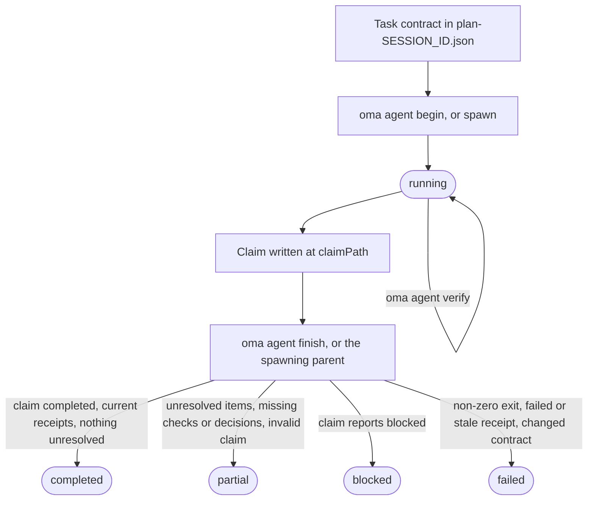
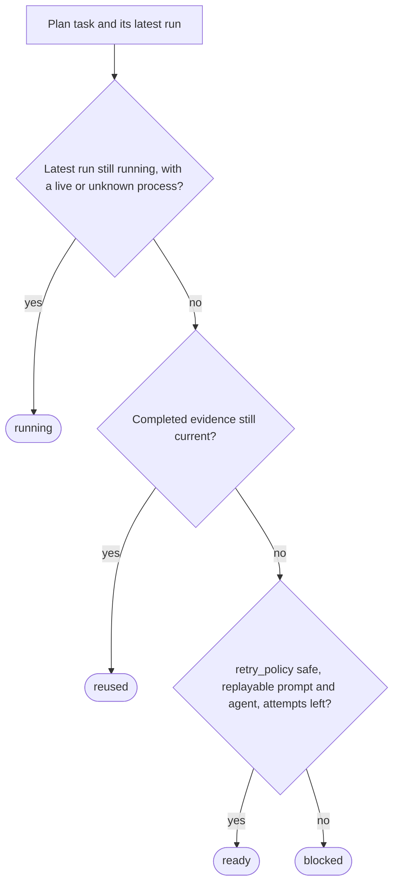

# Wyniki agentów i wznawianie

OMA traktuje wynik agenta jako mały rekord dowodowy, a nie tylko kod wyjścia procesu. Uruchomienie zapisuje ID zadania i sesji, odcisk workspace’u, pokwitowania weryfikacji, zmienione pliki, nierozwiązaną pracę i skróty artefaktów. Dzięki temu koordynator może ponownie wykorzystać zakończone zadanie tylko tak długo, jak jego kontrakt akceptacji i dane wejściowe nadal pasują.

Używaj tego cyklu bezpośrednio, gdy uruchamiasz natywnego agenta. Workflowy i `oma agent spawn` tworzą te same rekordy za Ciebie i pozostawiają finalizację zarządzanego uruchomienia koordynatorowi nadrzędnemu. Terminy używane na tej stronie wyjaśniają hasła [Rekord uruchomienia i zgłoszenie](../getting-started/glossary.md#run-record-and-claim) oraz [Plan](../getting-started/glossary.md#plan) w słowniku.

## Cykl życia w skrócie

| Krok | Polecenie | Zapisuje | Zachowaj |
| --- | --- | --- | --- |
| 1. Kontrakt | Edytuj `.agents/results/plan-SESSION_ID.json` | `acceptance_criteria` i `required_checks` zadania | ID sesji, ID zadania |
| 2. Rozpoczęcie | `oma agent begin AGENT TASK SESSION_ID --workspace .` | Rekord uruchomienia ze statusem `running` | `runId`, `claimPath` |
| 3. Kontekst (opcjonalnie) | `oma agent context AGENT --difficulty Medium` | Nic | Kontekst promptu |
| 4. Weryfikacja | `oma agent verify RUN_ID --required` | Jedno pokwitowanie na kontrolę | Kod wyjścia |
| 5. Zgłoszenie | Zapisz JSON pod `claimPath` | Plik zgłoszenia | Nic |
| 6. Zakończenie | `oma agent finish RUN_ID CLAIM_PATH` | Status końcowy | `status` |
| 7. Odzyskiwanie | `oma agent resume SESSION_ID --dry-run`, a potem bez `--dry-run` | Punkt kontrolny odzyskiwania i dzierżawa sesji | Status każdego zadania |

`oma agent spawn` i `oma agent parallel` wykonują kroki 2 i 6 za Ciebie: proces nadrzędny rozpoczyna uruchomienie i finalizuje je, gdy proces potomny się zakończy.



Zgłoszenie może też bezpośrednio raportować `partial` albo `failed`. Zakończenie nigdy nie podnosi statusu zgłoszenia: obniża zgłoszenie `completed`, którego dowody się nie potwierdzają, a niezerowy kod wyjścia oznacza każde uruchomienie jako `failed`.

## Rozpocznij natywne uruchomienie {#start-a-native-run}

Najpierw zdefiniuj zadanie oraz jego `acceptance_criteria` i `required_checks` w planie `.agents/results/plan-SESSION_ID.json`. Przy małej, ogólnej kontroli projektu plan może zawierać jedno zadanie, na przykład:

```json
{
  "tasks": [
    {
      "id": "docs",
      "agent": "docs",
      "task": "Review README.md and report any documentation issues",
      "workspace": ".",
      "acceptance_criteria": [
        { "id": "diff-clean", "description": "The current Git diff has no whitespace errors" }
      ],
      "required_checks": [
        { "id": "whitespace", "criteria": ["diff-clean"], "command": ["git", "diff", "--check"], "cwd": "." }
      ],
      "retry_policy": "manual"
    }
  ]
}
```

Ta kontrola dowodzi wyłącznie czystości białych znaków w diffie Git; zastąp zadanie, kryterium i kontrolę rzeczywistym kontraktem akceptacji projektu. Z katalogu głównego projektu rozpocznij uruchomienie:

```bash
oma agent begin docs docs SESSION_ID --workspace .
```

Zastąp `SESSION_ID` ID sesji użytym w planie. Polecenie wypisuje JSON zawierający wygenerowany UUID `runId` i `claimPath`, na przykład:

```json
{
  "runId": "<generated-run-id>",
  "taskId": "docs",
  "sessionId": "<your-session-id>",
  "status": "running",
  "claimPath": ".agents/state/agent-runs/<generated-run-id>.claim.json"
}
```

Wartości w nawiasach ostrych są placeholderami; użyj rzeczywistych wartości wypisanych przez uruchomienie. Udane rozpoczęcie tworzy rekord uruchomienia w `.agents/state/agent-runs/` i zapisuje migawkę kontraktu zadania. Ścieżka zgłoszenia jest zawsze ścieżką rekordu uruchomienia z `.claim.json` zamiast `.json`.

## Załaduj kontekst i uruchom zadanie

Przed edycją załaduj odwołania wybrane przez graf:

```bash
oma agent context docs --difficulty Medium
```

Poziom trudności musi być `Simple`, `Medium` albo `Complex`. Polecenie wypisuje kontekst zebrany dla wybranego agenta. Jeśli nie istnieje kontekst oparty na grafie, popraw definicję zadania albo kontynuuj udokumentowaną natywną ścieżką wyszukiwania; nie twórz fikcyjnego pokwitowania kontekstu.

Uruchom zadanie w workspace zapisanym przez `begin`. Podczas aktywnego uruchomienia zachowaj plan sesji bez zmian. Jeśli zadanie zmieni kryteria akceptacji albo wymagane kontrole, rozpocznij nowe uruchomienie po zaktualizowaniu planu.

## Zapisz weryfikację

Uruchom każdą kontrolę przypiętą do kontraktu akceptacji:

```bash
oma agent verify RUN_ID --required
```

Zastąp `RUN_ID` UUID-em zwróconym przez `begin`. Polecenie wykonuje zadeklarowane argv i zapisuje rzeczywisty kod wyjścia oraz odciski workspace’u przed i po. Pojedyncze dokładne polecenie można zapisać, gdy kontrakt zadania je obejmuje:

```bash
oma agent verify RUN_ID -- git diff --check
```

Używaj formy z dokładnym poleceniem tylko dla kontroli należącej do kontraktu zadania; w przeciwnym razie zachowaj `required_checks` z planu i użyj `--required`, aby pokwitowanie dowodziło zadeklarowanych kryteriów akceptacji.

Używaj `--affected PATH...` tylko wtedy, gdy graf ma pełny wybór testów dla tych ścieżek. Kontrole są uruchamiane szeregowo dla każdego uruchomienia. Niezerowy kod wyjścia albo zmiana workspace’u podczas kontroli unieważnia to pokwitowanie.

## Zapisz i zakończ zgłoszenie

W przypadku zadań, które wybierają kontrakt API, politykę uwierzytelniania, model danych,
strategię migracji, właściciela stanu, zakres dostępu do infrastruktury albo inną
decyzję, od której zależy dalsza praca, zadeklaruj w zadaniu `required_decisions`
przed dispatchem:

```json
"required_decisions": [
  {
    "subject": "db.migration-strategy",
    "description": "Choose the compatibility window and rollback strategy for the account migration."
  }
]
```

Pomiń to pole w zadaniach, które realizują istniejącą decyzję. Wymagania są
przypinane razem z kontraktem zadania i nie można ich usunąć ani zmienić po dispatchu.
Sugerowane tematy dla agenta wyświetlisz poleceniem
`oma state decisions list --agent db-engineer --json`. Te tematy są
wyborami do użycia, gdy mają zastosowanie; katalog nie czyni każdego wyboru obowiązkowym.

Zapisz plik zgłoszenia pod dokładną ścieżką wypisaną przez `begin`:

```json
{
  "status": "completed",
  "changedFiles": [],
  "unresolved": [],
  "artifacts": []
}
```

`status` przyjmuje jedną z wartości `completed`, `partial`, `blocked` albo `failed`. Ścieżki są względne względem katalogu głównego projektu, a każdy artefakt musi być zwykłym plikiem w workspace. Używaj `verificationSkipped` tylko dla konkretnego przeglądu, dla którego nie istnieje wykonywalna kontrola; nie zamienia ono nieudanej kontroli w zaliczoną.

Istotne decyzje umieść w opcjonalnej tablicy `decisions` zgłoszenia:

```json
"decisions": [
  {
    "subject": "db.migration-strategy",
    "decision": "Use an expand-and-contract migration; retain the old column for one release.",
    "rationale": "Both deployed app versions must work during the rollout; rollback switches reads to the retained column.",
    "alternatives": ["Replace the column during a maintenance window"],
    "evidence": ["docs/account-migration.md"]
  }
]
```

Proces nadrzędny zapisuje każdą decyzję jako zdarzenie `decision.made` w sesji uruchomienia
i dołącza do niej rzeczywiste ID agenta, zadania i uruchomienia. Brak wymaganej decyzji
pozostawia wynik jako częściowy, także wtedy, gdy wykonywalne kontrole przechodzą. Decyzje z
innego zadania albo innej próby nie spełniają wymagania. Pokwitowanie przypina ID zdarzeń
decyzji i skróty ich zawartości; ponowne użycie sprawdza, czy te zdarzenia nadal
istnieją, są prawidłowe i mają niezmienioną zawartość.
Decyzje opcjonalne również są zapisywane. Agenci tylko do odczytu zwracają tę samą tablicę w
swoim zgłoszeniu `OMA_RESULT_JSON`, aby proces nadrzędny mógł ją utrwalić.

Po zapisaniu zgłoszenia sfinalizuj natywne uruchomienie:

```bash
oma agent finish RUN_ID CLAIM_PATH
```

Podstaw oba parametry wartościami z JSON-a `begin`. `CLAIM_PATH` to wygenerowana ścieżka `.claim.json`; nie wymyślaj nowej nazwy pliku.

Polecenie finish sprawdza zgłoszenie, bieżący kontrakt, aktualne pokwitowania i skróty artefaktów. Zakończone zgłoszenie z nieaktualnym dowodem staje się nieudane albo częściowe. Polecenie odmawia finalizacji zarządzanego uruchomienia, którego cyklem życia zarządza proces nadrzędny.

## Zachowanie uruchomień zlecanych i natywnych

`oma agent spawn` i `oma agent parallel` tworzą uruchomienie, wstrzykują do promptu dziecka jego tożsamość oraz instrukcje dotyczące wyniku i pozwalają rodzicowi przechwycić kod wyjścia dziecka. Dziecko powinno zapisać zgłoszenie i zaraportować artefakty; rodzic finalizuje zarządzane pokwitowanie. Dziecko tylko do odczytu zwraca jedną linię `OMA_RESULT_JSON: {...}`; rodzic ją utrwala, a wyjaśnienie `verificationSkipped` pozostaje odrębne od wykonywalnej weryfikacji.

Czytelne dla człowieka pliki wyników w `.agents/results/` i notatki pamięci w `.agents/state/memories/` pomagają śledzić postęp. Pokwitowanie czytelne maszynowo w `.agents/state/agent-runs/` jest dowodem używanym do ponownego wykorzystania i wznawiania.

## Sprawdź odzyskiwanie przed ponowieniem próby

Najpierw sprawdź, co zrobiłoby OMA:

```bash
oma agent resume SESSION_ID --dry-run
```

Raport klasyfikuje każde zadanie jako `reused`, `ready`, `running` albo `blocked` i podaje przyczynę:



Zależność, która nie ma statusu `reused`, zmienia zależne zadanie `reused` z powrotem na `ready` (albo na `blocked`, gdy nie można go odtworzyć), a zadanie `ready`, którego zależność ma status `blocked` albo `running`, staje się `blocked`. Prawidłowe zakończone pokwitowanie jest używane ponownie tylko wtedy, gdy jego kontrakt, dane wejściowe, skróty artefaktów i dowody zależności są nadal aktualne. Aktywny proces zarządzany albo natywne uruchomienie bez dowodu aktywności nie jest duplikowane.

Gdy raport pozwala bezpiecznie wykonać operację, wznów gotowe zadania w kolejności zależności:

```bash
oma agent resume SESSION_ID
```

Automatyczne odtworzenie wymaga `retry_policy: "safe"`, odtwarzalnego promptu oraz agenta w planie albo zapisanym dispatchu. Wartością domyślną jest `manual`. `--max-attempts` ma domyślnie wartość `3`, wliczając pierwszą próbę:

```bash
oma agent resume SESSION_ID --max-attempts 2
```

OMA zapisuje punkt kontrolny odzyskiwania w `.agents/state/agent-resume/` i używa dzierżawy sesji, aby dwaj koordynatorzy nie mogli ponowić tej samej sesji. Podczas odzyskiwania przypina plan. Jeśli zmieni się plan, zależność albo późniejsza próba zmieni wcześniejsze dane wejściowe, zadania, których to dotyczy, stają się zablokowane i wymagają nowego uruchomienia weryfikacji.

Wznowienie rozpoczyna nową próbę; nie przywraca przerwanej rozmowy z modelem. Przed wznowieniem przerwanego natywnego uruchomienia oznacz stare uruchomienie jako `partial` albo `failed`, podając rzeczywisty wynik i nierozwiązaną pracę. Następnie sprawdź raport podglądu i ponów tylko zadania z bezpieczną ścieżką odtworzenia.

## Przykłady odzyskiwania

| Sytuacja | Działanie | Oczekiwany wynik |
| --- | --- | --- |
| Wymagana kontrola nie powiodła się | Napraw zadanie, ponownie uruchom `oma agent verify RUN_ID --required`, a następnie zakończ je nowym zgłoszeniem. | Najnowsze pokwitowanie zastępuje nieudany wynik, gdy odcisk workspace’u jest aktualny. |
| Proces zakończył się przed zgłoszeniem | Oznacz uruchomienie jako częściowe albo nieudane, a następnie uruchom `oma agent resume SESSION_ID --dry-run`. | Stara próba zostaje zachowana; bezpieczne zadanie ma status `ready`, a ręczne `blocked`. |
| Zmieniła się zależność | Ponownie uruchom zależność i jeszcze raz sprawdź raport. | Możliwość ponownego użycia zależnego zadania zostaje unieważniona, nawet gdy jego pliki się nie zmieniły. |
| Zmieniono plan albo dane wejściowe | Rozpocznij nowe uruchomienie po ustabilizowaniu planu. | Nowe uruchomienie zapisuje migawkę nowego kontraktu; stary dowód nie jest używany ponownie. |
| Zadanie wymaga decyzji | Zapisz je jako `blocked` wraz z wyjaśnieniem. | Wznowienie pozostawi je zablokowane do czasu udostępnienia decyzji i promptu. |

## Następne kroki

- Komunikaty błędów z `begin`, `verify`, `finish` i `resume`: [Rozwiązywanie problemów](./troubleshooting.md#find-your-error)
- Błędy parsowania, brakujące narzędzia dostawcy, stan dashboardu, harmonogramy i nieaktualne dane ewaluacji: [Rozwiązywanie problemów](./troubleshooting.md)
- Obserwowanie zarządzanych uruchomień w trakcie pracy: [Monitorowanie w dashboardzie](./dashboard-monitoring.md)
- Definiowanie planów z kontraktami zadań: [Projekty wieloagentowe](./multi-agent-project.md)
