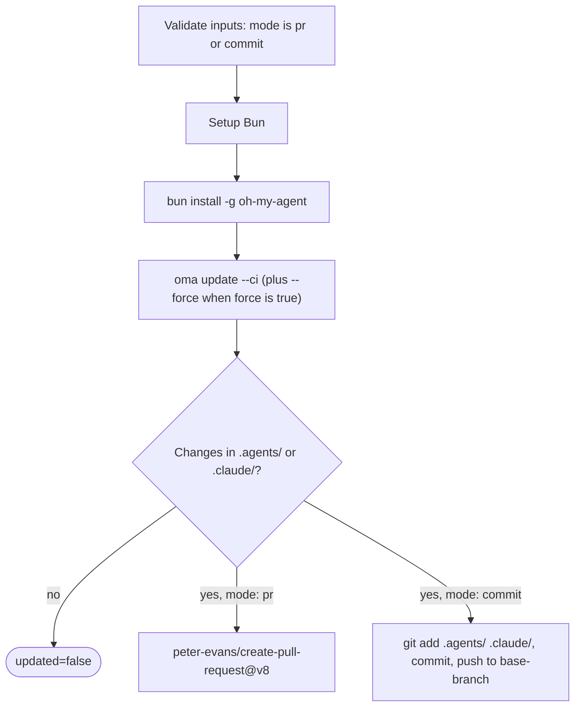

# Przewodnik: automatyczne aktualizacje

## Przegląd

GitHub Action oh-my-agent (`first-fluke/oma-update-action@v1`) automatycznie aktualizuje umiejętności agentów w projekcie, uruchamiając `oma update` w CI. Obsługuje dwa tryby: tworzenie pull requestu do przeglądu albo bezpośrednie zatwierdzanie zmian w gałęzi.

---

## Szybka konfiguracja

<!-- oma-docs:ignore-start -->
Dodaj ten plik do projektu jako `.github/workflows/update-oh-my-agent.yml`:
<!-- oma-docs:ignore-end -->

```yaml
name: Update oh-my-agent

on:
  schedule:
    - cron: '0 9 * * 1'  # Every Monday at 9am UTC
  workflow_dispatch:        # Allow manual trigger

permissions:
  contents: write
  pull-requests: write

jobs:
  update:
    runs-on: ubuntu-latest
    steps:
      - uses: actions/checkout@v4

      - uses: first-fluke/oma-update-action@v1
```

Ta konfiguracja tworzy pull request z nową wersją, gdy zainstalowany komponent się zmieni i akcja zakończy się z `updated=true`. Gdy nie ma zmian plików, kończy się z `updated=false` i bez PR.

---

## Wszystkie dane wejściowe akcji

| Wejście | Typ | Wymagane | Domyślne | Opis |
|:------|:-----|:---------|:--------|:-----------|
| `mode` | string | Nie | `"pr"` | Sposób stosowania zmian. `"pr"` tworzy pull request. `"commit"` wypycha zmiany bezpośrednio do gałęzi bazowej. |
| `base-branch` | string | Nie | `"main"` | Gałąź bazowa dla PR (w trybie `pr`) albo docelowa gałąź dla bezpośrednich commitów (w trybie `commit`). Nie zmienia tego, co jest pobierane; ustaw `ref:` w `actions/checkout` na tę samą gałąź. |
| `force` | string | Nie | `"false"` | Przekazuje `--force` do `oma update`. Gdy ma wartość `"true"`, nadpisuje dostosowane przez użytkownika pliki konfiguracyjne (`oma-config.yaml`, `mcp.json`) i katalogi `stack/`. Zwykle są one zachowywane. |
| `pr-title` | string | Nie | `"chore(deps): update oh-my-agent skills"` | Własny tytuł pull requestu. Używany tylko w trybie `pr`. |
| `pr-labels` | string | Nie | `"dependencies,automated"` | Etykiety rozdzielone przecinkami, które zostaną dodane do PR. Używane tylko w trybie `pr`. |
| `commit-message` | string | Nie | `"chore(deps): update oh-my-agent skills"` | Własny komunikat commita. Używany w obu trybach (jako komunikat commita PR albo bezpośredniego commita). |
| `token` | string | Nie | `${{ github.token }}` | Token GitHub do tworzenia PR. Użyj Personal Access Token (PAT), jeśli PR ma uruchamiać inne workflowy (domyślny `GITHUB_TOKEN` nie uruchamia workflowów dla PR-ów, które sam tworzy). |

---

## Wszystkie wyjścia akcji

| Wyjście | Typ | Opis | Dostępność |
|:-------|:-----|:-----------|:----------|
| `updated` | string | `"true"`, gdy po uruchomieniu `oma update` wykryto zmiany. `"false"`, gdy wszystko było już aktualne. | Zawsze |
| `version` | string | Wersja oh-my-agent po aktualizacji. Odczytywana z `.agents/skills/_version.json`. | Gdy `updated` ma wartość `"true"` |
| `pr-number` | string | Numer pull requestu. | Tylko w trybie `pr`, gdy utworzono PR |
| `pr-url` | string | Pełny URL utworzonego pull requestu. | Tylko w trybie `pr`, gdy utworzono PR |

---

## Szczegółowe przykłady

### Przykład 1: domyślny tryb PR

Ten przykład tworzy PR w każdy poniedziałek, gdy są dostępne aktualizacje.

```yaml
name: Update oh-my-agent

on:
  schedule:
    - cron: '0 9 * * 1'
  workflow_dispatch:

permissions:
  contents: write
  pull-requests: write

jobs:
  update:
    runs-on: ubuntu-latest
    steps:
      - uses: actions/checkout@v4

      - uses: first-fluke/oma-update-action@v1
        id: update

      - name: Summary
        if: steps.update.outputs.updated == 'true'
        run: |
          echo "Updated to version ${{ steps.update.outputs.version }}"
          echo "PR: ${{ steps.update.outputs.pr-url }}"
```

**Co się dzieje:**
- Pobierane jest repozytorium.
- Instalowany jest Bun, a następnie globalnie instalowany jest oh-my-agent.
- Uruchamiane jest `oma update --ci`.
- Sprawdzane jest, czy w `.agents/` albo `.claude/` zaszły zmiany.
- Jeśli istnieją zmiany, `peter-evans/create-pull-request@v8` tworzy PR w gałęzi `chore/update-oh-my-agent`.
- PR otrzymuje etykiety `dependencies,automated`, a jego treść zawiera nowy numer wersji.

### Przykład 2: tryb bezpośredniego commita z PAT

Dla zespołów, które chcą stosować aktualizacje od razu, bez etapu przeglądu PR. Używa PAT, aby commit mógł uruchamiać dalsze workflowy.

```yaml
name: Update oh-my-agent (Direct)

on:
  schedule:
    - cron: '0 6 * * *'  # Daily at 6am UTC
  workflow_dispatch:

permissions:
  contents: write

jobs:
  update:
    runs-on: ubuntu-latest
    steps:
      - uses: actions/checkout@v4
        with:
          ref: develop
          token: ${{ secrets.OH_MY_AGENT_PAT }}

      - uses: first-fluke/oma-update-action@v1
        with:
          mode: commit
          token: ${{ secrets.OH_MY_AGENT_PAT }}
          commit-message: "chore: auto-update oh-my-agent skills"
          base-branch: develop
```

**Co się dzieje:**
- Pobierana jest gałąź `develop` z użyciem PAT. `ref: develop` jest wymagane: `base-branch` ustawia tylko cel pushu, a akcja wypycha dowolny `HEAD`, który powstał w wyniku checkoutu.
- Uruchamiane jest `oma update --ci`.
- Jeśli są zmiany, git jest konfigurowany jako `github-actions[bot]`, a zmiany są commitowane bezpośrednio do `develop`.
- PAT gwarantuje, że commit uruchomi wszystkie workflowy nasłuchujące pushy do `develop`.

**Ważne:** użyj `secrets.OH_MY_AGENT_PAT` (Fine-Grained PAT z uprawnieniem Contents: Write) zamiast `github.token`. Domyślny `GITHUB_TOKEN` tworzy commity, które nie uruchamiają innych workflowów, co może zepsuć potoki CI oczekujące na zdarzenia push.

### Przykład 3: warunkowe powiadomienie

Aktualizacja z powiadomieniem Slack, gdy dostępna jest nowa wersja.

```yaml
name: Update oh-my-agent

on:
  schedule:
    - cron: '0 9 * * 1'
  workflow_dispatch:

permissions:
  contents: write
  pull-requests: write

jobs:
  update:
    runs-on: ubuntu-latest
    steps:
      - uses: actions/checkout@v4

      - uses: first-fluke/oma-update-action@v1
        id: update

      - name: Notify Slack
        if: steps.update.outputs.updated == 'true'
        uses: slackapi/slack-github-action@v2
        with:
          webhook: ${{ secrets.SLACK_WEBHOOK }}
          webhook-type: incoming-webhook
          payload: |
            {
              "text": "oh-my-agent updated to v${{ steps.update.outputs.version }}. PR: ${{ steps.update.outputs.pr-url }}"
            }

      - name: Skip notification
        if: steps.update.outputs.updated == 'false'
        run: echo "Already up to date, no notification needed."
```

Warunkuj dalsze kroki wyrażeniem `steps.update.outputs.updated == 'true'`, aby uruchamiały się tylko po wykryciu aktualizacji. Dzięki temu uruchomienia bez zmian nie generują zbędnych powiadomień.

### Przykład 4: tryb force z własnymi etykietami

Dla projektów, które chcą podczas aktualizacji przywrócić wszystkim plikom konfiguracji wartości domyślne.

```yaml
name: Update oh-my-agent (Force)

on:
  workflow_dispatch:  # Manual trigger only for force updates

permissions:
  contents: write
  pull-requests: write

jobs:
  update:
    runs-on: ubuntu-latest
    steps:
      - uses: actions/checkout@v4

      - uses: first-fluke/oma-update-action@v1
        with:
          force: 'true'
          pr-title: "chore(deps): force-update oh-my-agent skills (reset configs)"
          pr-labels: "dependencies,automated,force-update"
          commit-message: "chore(deps): force-update oh-my-agent skills"
```

**Ostrzeżenie:** tryb force nadpisuje `oma-config.yaml`, `mcp.json` i katalogi `stack/`. Używaj go tylko wtedy, gdy chcesz przywrócić wszystkie dostosowania do wartości domyślnych. Przy zwykłych aktualizacjach pomiń wejście `force`.

---

<a id="jak-to-działa-pod-spodem"></a>

## Implementacja akcji

Akcja jest [akcją złożoną](https://docs.github.com/en/actions/creating-actions/creating-a-composite-action) zdefiniowaną w `action/action.yml`. Najpierw sprawdza, czy `mode` ma wartość `pr` albo `commit`, następnie wykonuje poniższe kroki i kończy pull requestem albo bezpośrednim commitem:



### Krok 1: konfiguracja Bun

```yaml
- uses: oven-sh/setup-bun@v2
```

Instaluje runtime Bun, wymagany do uruchomienia CLI oh-my-agent.

### Krok 2: instalacja oh-my-agent

```bash
bun install -g oh-my-agent
```

Instaluje CLI globalnie z rejestru npm. Zapewnia to dostęp do polecenia `oma`.

### Krok 3: uruchomienie oma update

```yaml
- name: Run oma update
  shell: bash
  env:
    FORCE: ${{ inputs.force }}
  run: |
    FLAGS="--ci"
    if [ "$FORCE" = "true" ]; then
      FLAGS="$FLAGS --force"
    fi
    oma update $FLAGS
```

Dane wejściowe trafiają do skryptu przez `env:`, a nie przez interpolację `${{ }}` wewnątrz `run:`, dzięki czemu wartość wejścia nie może zostać wykonana jako kod powłoki.

Flaga `--ci` uruchamia aktualizację w trybie nieinteraktywnym (pomija wszystkie pytania i wypisuje zwykły tekst zamiast animacji spinnera). Flaga `--force`, gdy jest włączona, nadpisuje dostosowane przez użytkownika pliki konfiguracji.

Polecenie `oma update --ci` wykonuje następujące kroki:

1. Pobiera `prompt-manifest.json` z głównej gałęzi, aby uzyskać najnowszy numer wersji.
2. Porównuje go z lokalną wersją w `.agents/skills/_version.json`.
3. Jeśli wersje są takie same, kończy się komunikatem „Already up to date.”.
4. Jeśli dostępna jest nowa wersja, pobiera i rozpakowuje najnowszy tarball.
5. Zachowuje pliki dostosowane przez użytkownika (o ile nie użyto `--force`): `oma-config.yaml`, `mcp.json` i katalogi stack.
6. Kopiuje nowe pliki do istniejącego katalogu `.agents/`.
7. Przywraca zachowane pliki.
8. Aktualizuje dostosowania vendorów (hooki, ustawienia, definicje agentów) dla vendorów z listy `vendors:` w konfiguracji (pusta lista oznacza brak vendorów). Bez listy `vendors:` aktualizuje tylko vendorów, których katalogi projektowe już istnieją.
9. Odświeża dowiązania symboliczne CLI.

Akcja wywołuje `oma update --ci` bez `--with-new-skills`. Odświeża to zainstalowany zestaw umiejętności i zgłasza nowo dostępne umiejętności; uruchom celowo `oma update --with-new-skills`, gdy projekt ma dodać nowe umiejętności w ramach aktualizacji.

### Krok 4: sprawdzenie zmian

```bash
if [ -n "$(git status --porcelain .agents/ .claude/ 2>/dev/null)" ]; then
  echo "updated=true" >> "$GITHUB_OUTPUT"
  if [ -f ".agents/skills/_version.json" ]; then
    VERSION=$(jq -r '.version' .agents/skills/_version.json)
    echo "version=$VERSION" >> "$GITHUB_OUTPUT"
  fi
else
  echo "updated=false" >> "$GITHUB_OUTPUT"
fi
```

Sprawdza, czy `oma update` rzeczywiście zmieniło pliki w `.agents/` lub `.claude/`. Odpowiednio ustawia wyjścia `updated` i `version`. Zmiany poza tymi dwoma katalogami (na przykład `.codex/` albo `AGENTS.md`) nie ustawiają `updated=true`.

Następnie, zależnie od wejścia `mode`:

- **Tryb `pr`:** używa `peter-evans/create-pull-request@v8`, aby utworzyć PR w gałęzi `chore/update-oh-my-agent`. PR zawiera nowy numer wersji, odsyłacz do repozytorium oh-my-agent i skonfigurowane etykiety. Jeśli gałąź już istnieje (z poprzedniego niezamkniętego PR), aktualizuje istniejący PR.

- **Tryb `commit`:** konfiguruje git jako `github-actions[bot]`, dodaje `.agents/` i `.claude/`, tworzy commit z ustawionym komunikatem i wypycha go do gałęzi bazowej.

---

## Zobacz także

- [Instalacja globalna](./global-install.md): `oma update --global` i zastrzeżenia CI dla instalacji ogólnoużytkownikowych
- [Konfiguracja referencyjna](./configuration-reference.md#update-and-ownership-rules): które pliki konfiguracyjne `oma update` zachowuje
- [Integracja z istniejącym projektem](./integration.md): pliki, które `oma update` odświeża w projekcie
