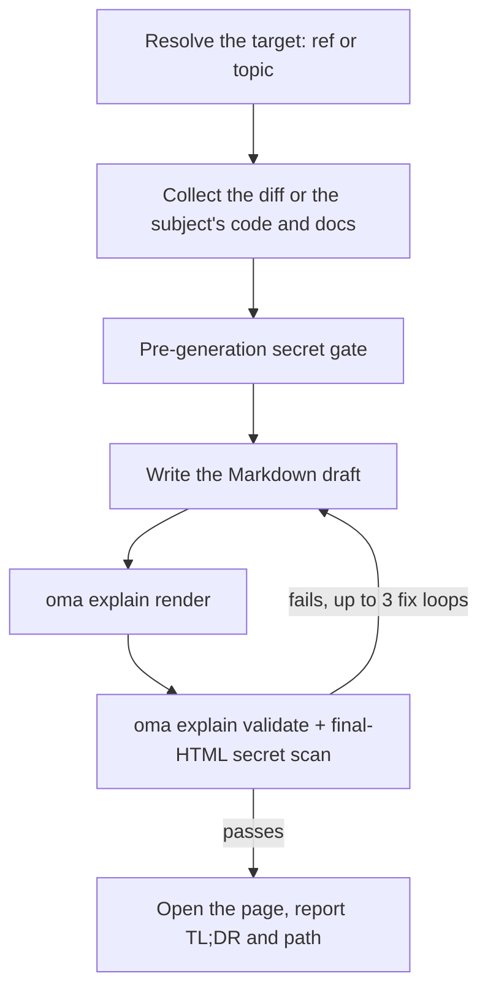

# Objaśnianie kodu

`/explain` zamienia zmianę kodu w samodzielny dokument HTML, który wyjaśnia, co się zmieniło i dlaczego — z pomijalnym, pogłębionym tłem dla początkujących, sekcją intuicji z danymi przykładowymi, uporządkowanym pod kątem zrozumienia omówieniem kodu i quizem z pięcioma pytaniami. Wynikiem jest pojedynczy plik `.html` działający offline, z diagramami, objaśnieniami i dostępnym quizem; zapisuje się go w `.agents/results/explain/` i sprawdza deterministyczną listą kontrolną przed dostarczeniem.

`/explain` działa wyłącznie jako slash command — nie aktywuje się automatycznie z języka naturalnego. „explain” jest codziennym słowem, dlatego celowo wykluczono je z wykrywania słów kluczowych (tak samo jak `/convert`). Wpisz jawnie `/explain` albo poproś inną umiejętność o utworzenie „dokumentu objaśniającego” jako wyniku delegowanego.

## Dwa tryby

| Tryb | Wpisujesz | Wymaga git | Co objaśnia strona |
|---|---|---|---|
| Zmiana | `/explain`, `/explain #640`, `/explain a..b`, `/explain <branch>` | tak (`gh` dla refów PR) | Zmianę kodu: Background, Intuition, Code, Quiz |
| Temat | `/explain how does session windowing work` (tekst, który nie wskazuje żadnego PR-a, gałęzi ani zakresu SHA) | nie | Pojęcie, system albo odpowiedź na pytanie w formie jednostronicowego arkusza wizualnego: najpierw zwięzła odpowiedź, potem panele z diagramami, tabelami i krótką prozą |

Jeśli tekst może być zarówno nazwą gałęzi, jak i tematem, workflow najpierw sprawdza go jako ref git; ref wygrywa.

---

## Kiedy używać

- Wyjaśnianie PR-a, gałęzi, zakresu commitów albo bieżącej zmiany staged/unstaged w formie dokumentu
- Wprowadzanie członka zespołu w zmianę, której nie napisał
- Tworzenie artefaktu dydaktycznego do przejrzenia po dużej albo subtelnej zmianie
- Zamiana architektury, protokołu, porównania albo długiej odpowiedzi w jedną wizualną stronę (tryb tematu)

## Kiedy NIE używać

- Objaśniające *wideo* z narracją → użyj [`oma-video`](./video-generation.md) (tryb explainer); `/explain` tworzy dokument HTML, nie wideo
- Sprawdzanie, czy dokumentacja nadal pasuje do codebase’u → użyj `oma-docs` (wykrywanie dryfu)
- Prezentacja / slajdy → użyj `oma-slide` (stały kontrakt decku 1920×1080)
- Szukanie defektów albo wydawanie werdyktów przeglądu → użyj `oma-qa` albo workflow `/review`; `/explain` opisuje zmianę edukacyjnie, ale jej nie ocenia

---

## Szybki start

```text
/explain
/explain 640
/explain a1b2c3d..e5f6a7b
/explain payments-refactor for reviewer
```

Docelowy ref jest rozstrzygany na podstawie sformułowania:

| Wpisujesz | Rozstrzygnięcie celu | Poziom czytelnika |
|----------|--------------------|--------------|
| `/explain` | Zmiany staged (`git diff --cached`), a gdy ich nie ma — zabrudzone drzewo robocze | `onboarding` |
| `/explain 640`, `/explain #640` | PR #640 przez `gh pr diff` | `onboarding` |
| `/explain a..b` | Zakres SHA `a..b` (albo `a...b`) | `onboarding` |
| `/explain feature-branch for reviewer` | `git diff main...feature-branch` | `reviewer` |
| `/explain how does the row planner work` | Tryb tematu: bez refa; agent zbiera kod i dokumentację, których dotyczy temat | n/d |

Jeśli nie podano jawnego refa, a zarówno zmiany staged, jak i zabrudzone drzewo robocze są puste, rozstrzygnięcie wraca do `HEAD~1..HEAD`.



---

## Kolejność rozstrzygania refa

Dotyczy tylko trybu zmiany; tryb tematu pomija rozstrzyganie refa.

1. **Jawny argument** — numer PR-a (`#640`), nazwa gałęzi albo zakres SHA (`a..b` / `a...b`)
2. **Zmiany staged** — `git diff --cached`
3. **Zabrudzone drzewo robocze** — `git diff`
4. **Zapasowy zakres** — `HEAD~1..HEAD`

Pusty diff albo ref, którego nie można rozstrzygnąć, zatrzymuje workflow; oferuje on ostatnie commity jako kandydatów zamiast zgadywać inną możliwość.

---

## Poziomy czytelnika

| Poziom | Skutek |
|-------|--------|
| `onboarding` (domyślny) | Pełne, pogłębione tło (Tier A) dla czytelnika, który nie zna otaczającego systemu |
| `reviewer` | Skraca pogłębioną warstwę tła; sekcje Intuition i Code pozostają pełne |

Poproś o `reviewer`, dodając „for reviewer” do polecenia, na przykład `/explain feature-branch for reviewer`.

---

## Co zawiera dokument

W trybie zmiany powstaje jedna długa, przewijana strona (bez kart i wielostronicowej nawigacji) ze spisem treści, po którym następują cztery stałe sekcje w tej kolejności:

1. **Background** — Tier A (pogłębione tło systemu/architektury, oznaczone „można pominąć, jeśli znasz już system”) oraz Tier B (wąski kontekst tej konkretnej zmiany)
2. **Intuition** — istota zmiany z obowiązkowymi przykładami na danych przykładowych, wzmocniona przez 2–3 ponownie użyte rodziny diagramów (uproszczony mock UI, diagram systemu/przepływu danych z danymi przykładowymi, stan przed/po), renderowane wyłącznie jako HTML/inline SVG — bez ASCII art
3. **Code** — omówienie pogrupowane pod kątem ludzkiego rozumienia (nie alfabetycznie ani w kolejności diffu), z odwołaniami do kodu w formacie `file:line`
4. **Quiz** — domyślnie 5 pytań (liczbę można ustawić), każde dotyczące innego aspektu zmiany, z wiarygodnymi dystraktorami i tekstem informacji zwrotnej dla każdej opcji (poprawnej i błędnej)

Proza i treść quizu są pisane w żądanym języku wyjściowym (język promptu → `.agents/oma-config.yaml` `language` → angielski); kod, identyfikatory i inline code pozostają po angielsku zgodnie z regułami i18n. Pełny kontrakt treści znajduje się w `.agents/skills/oma-explanation/resources/document-structure.md`.

---

## Jak powstaje strona

Agent pisze szkic w Markdown, a `oma explain render` zamienia go w stronę: układ, motyw, geometria diagramów i skrypt quizu pochodzą z renderera, nie z modelu.

| Polecenie | Zastosowanie |
|---|---|
| `oma explain render draft.md` | Renderuje szkic (plik albo stdin) do `.agents/results/explain/{YYYY-MM-DD}-{slug}.html`. Opcje obejmują `--template sheet\|doc`, `--theme`, `--mode`, `--archify` i `--open`. |
| `oma explain lint draft.md` | Sprawdza prozę bez renderowania (`--style strict` kończy się kodem 1 przy ostrzeżeniu). |
| `oma explain components [name]` | Wypisuje komponenty, których może używać szkic (`flow`, `sequence`, `tree`, `timeline`, `limits`, `annot`, `kv`, `callout`, `quiz`), albo składnię jednego komponentu. |
| `oma explain patch <page.html> --panel <id>` | Zastępuje jeden panel wyrenderowanej strony (według litery albo tytułu), a resztę zachowuje. |
| `oma explain validate <file>` | Uruchamia opisane niżej deterministyczne kontrole końcowe. |

---

## Kontrakt HTML

Strony tworzone przez `oma explain render` automatycznie spełniają te reguły; mają one znaczenie, gdy sprawdzasz albo ręcznie edytujesz HTML.

Wygenerowany plik musi poprawnie otwierać się offline przez `file://` przy **zerowej liczbie zewnętrznych ładowań zasobów** — bez skryptów i arkuszy CDN, fontów webowych ani zewnętrznych obrazów (tylko inline SVG albo data URI). Dozwolone są kotwice hyperlinków (`<a href="https://...">`); zakaz dotyczy wyłącznie *ładowania* zasobów.

- Bloki kodu używają `<pre>`; każdy niestandardowy kontener deklaruje `white-space: pre-wrap`. Nie wolno używać zewnętrznych bibliotek podświetlania składni.
- Stos fontów: lokalnie zainstalowany Pretendard, dopasowywany po nazwie rodziny (strona nigdy nie pobiera fontów i nie używa funkcji CSS `local()`), potem `system-ui` i systemowe fonty CJK. Strony japońskie i chińskie pomijają Pretendard i zaczynają od `system-ui` z fontami dla danego języka.
- Responsywność od 375px, kontrast WCAG AA w jasnym i ciemnym motywie, obsługa `prefers-color-scheme: dark` oraz respektowanie `prefers-reduced-motion`.
- Quiz to vanilla JS: opcje jako elementy `<button>`, natychmiastowa informacja o poprawności ogłaszana przez region `aria-live="polite"`, losowe rozłożenie poprawnych odpowiedzi na pozycjach, podsumowanie końcowego wyniku i pełna obsługa klawiatury.

Pełna specyfikacja zachowania: `.agents/skills/oma-explanation/resources/html-contract.md`.

---

## Sekrety i obrona przed prompt injection

Treść diffu i opisy PR-ów są traktowane wyłącznie jako **dane** — wszelkie instrukcje osadzone w objaśnianej zmianie są ignorowane.

Sekrety są blokowane dwukrotnie:

1. **Przed generowaniem:** zebrany diff jest skanowany przed napisaniem czegokolwiek.
2. **Po generowaniu:** końcowy HTML również jest skanowany, ponieważ proza tła może zacytować niezmienione pliki, których samo skanowanie diffu by nie wykryło.

Po każdym trafieniu generowanie natychmiast się zatrzymuje, zgłaszane są wyłącznie zamaskowane lokalizacje (nigdy właściwa wartość), a kontynuacja po redakcji wymaga jawnego potwierdzenia.

---

## Lista kontrolna walidacji

Po generowaniu wobec pliku wynikowego uruchamiana jest lista kontrolna oparta na grep: brak odwołań do ładowania zewnętrznych zasobów, zgodność kontenerów kodu z `pre`/`pre-wrap`, obecność skryptu quizu, format nazwy `{YYYY-MM-DD}-{slug}.html` (data w strefie `timezone` z oma-config, a gdy jej brak — w strefie czasowej systemu) i skan sekretów końcowego HTML. Po niepowodzeniu pętla naprawia i ponownie waliduje do **3 iteracji**, a następnie zatrzymuje się i pokazuje pozostałe nieudane elementy zamiast po cichu dostarczyć wynik.

To ograniczenie v1: walidacja działa na plikach i grep, a sprawdza tylko *obecność* skryptu quizu, nie pełną poprawność zachowania. Gdy ważna jest pewność zachowania, użyj przeglądarki (albo MCP chrome-devtools), aby ręcznie przećwiczyć quiz.

Istniejący artefakt można zwalidować zarejestrowanym poleceniem CLI:

```bash
oma explain validate .agents/results/explain/2026-09-09-payment-refactor.html
oma explain validate --input-dir .agents/results/explain --output json
```

Oczekiwany wynik (przykładowe nazwy plików):

```text
$ oma explain validate .agents/results/explain/2026-09-09-payment-refactor.html
✔ Explain validation passed: 1/1 file(s) valid

$ oma explain validate ".agents/results/explain/payment refactor.html"
✖ Explain validation failed: 1/1 file(s) failed
File: .agents/results/explain/payment refactor.html
  - [error] filename-format: Filename 'payment refactor.html' does not match format {YYYY-MM-DD}-{slug}.html
```

Pierwsza forma sprawdza jeden plik HTML. Forma katalogowa sprawdza każdy raport w katalogu i zwraca raport czytelny maszynowo. Użyj `--report-file <path>`, aby zapisać raport JSON; stara pisownia `--out-file` kończy się teraz błędem `Removed option --out-file. Use --report-file.` Niezerowy kod wyjścia oznacza, że co najmniej jeden artefakt nie przeszedł deterministycznych kontroli; nie sprawdza on dydaktycznej poprawności prozy ani odpowiedzi quizu.

---

## Wynik

```text
.agents/results/explain/{YYYY-MM-DD}-{slug}.html
```

Data jest liczona w strefie `timezone` z oma-config, a gdy jej brak — w strefie czasowej systemu. Ponowne uruchomienie z tą samą datą i slugiem nadpisuje wcześniejszy plik — zachowanie wcześniejszego uruchomienia jest Twoją odpowiedzialnością. Po przejściu walidacji workflow próbuje otworzyć stronę (tylko ostrzeżenie; środowisko bez interfejsu po prostu zgłasza ścieżkę) i raportuje TL;DR wraz ze ścieżką pliku. `oma explain render --open` otwiera stronę bezpośrednio w przeglądarce.

---

## Opcjonalny sidecar archify

Gdy ustawiono `diagram.explain_sidecar: true` w `oma-config.yaml` albo poprosisz o to (`/explain 640 with archify`), `/explain` renderuje z `--archify`: tworzy interaktywny `{date}-{slug}.archify.html` na podstawie bloku `flow` albo `sequence` ze szkicu i łączy go zwykłą kotwicą. Nigdy nie jest osadzany — objaśnienie pozostaje pojedynczym samodzielnym plikiem — a błąd sidecara nigdy nie blokuje dostarczenia. Zobacz [Silnik diagramów](./diagram-engine.md#explain).

## Przypadki brzegowe

| Sytuacja | Zachowanie |
|-----------|----------|
| Pusty diff / nierozstrzygalny ref | Zatrzymaj się i zaoferuj ostatnie commity jako kandydatów — nigdy nie zgaduj innego refa |
| Zbyt duży diff | Automatycznie wyklucz lockfile i pliki generowane, pogrupuj resztę według pliku i wypisz wykluczenia w stopce pochodzenia |
| Diff zawiera wyłącznie pliki binarne lub generowane | Zatrzymaj się — nie ma czego objaśniać |
| Brak `gh` CLI albo brak uwierzytelnienia (ref PR-a) | Wskazówki instalacji/uwierzytelnienia oraz alternatywa lokalnego diffu gałęzi |
| Trwa scalanie/rebase | Zatrzymaj się — workspace jest niestabilny |
| Katalog nie jest repozytorium git | Tryb zmiany: zatrzymaj się natychmiast. Tryb tematu działa bez git. |
| Walidacja nie przechodzi po 3 pętlach naprawczych | Zatrzymaj się i pokaż nieudane elementy listy kontrolnej |
| `open` kończy się błędem / środowisko bez interfejsu | Tylko ostrzeżenie — zgłoszona ścieżka wystarcza |

---

## Następne kroki

- [Workflow `/explain`](../core-concepts/workflows.md#explain) — potok rozstrzygania refa → zbierania → bramki sekretów → generowania → walidacji → dostarczenia
- [Silnik diagramów](./diagram-engine.md) — opcjonalny sidecar archify
- [Polecenia CLI: explain](../cli-interfaces/commands.md#explain) — wszystkie opcje `oma explain`
- [Generowanie wideo](./video-generation.md) — *tryb* explainer `oma-video` tworzy narracyjne wideo zamiast dokumentu HTML
- [Workflowy treści i badań](./content-and-research.md) — inne możliwości dotyczące dokumentów i badań
