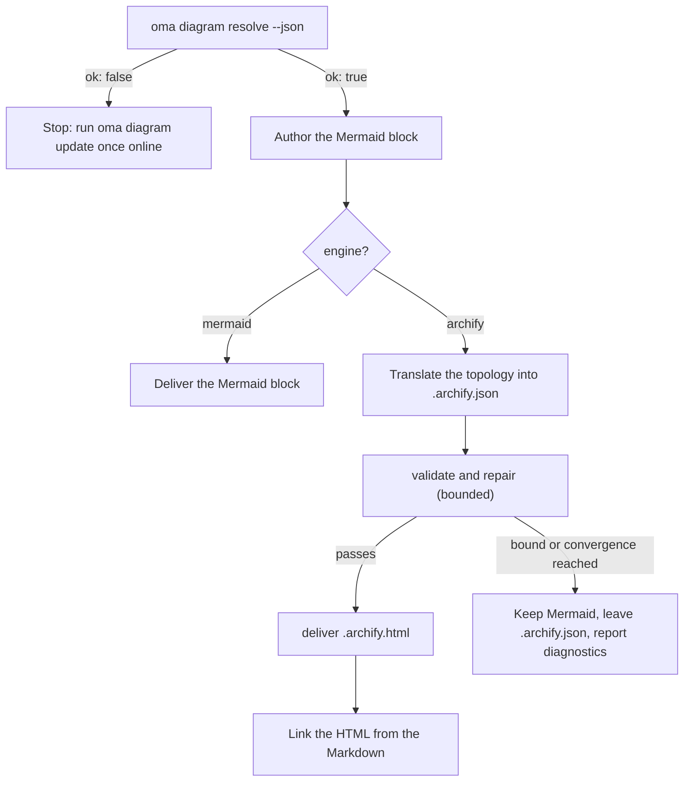

# Silnik diagramów

`/architecture` (ADR-y, rekomendacje, przeglądy) i `/explain` (objaśnienia zmian kodu) emitują diagramy strukturalne. W przypadku `/architecture` są to zawsze bloki **Mermaid** wewnątrz artefaktu Markdown (`/explain` rysuje własne diagramy inline SVG), a — gdy można rozstrzygnąć [archify](https://github.com/tt-a1i/archify) — dodatkowo **interaktywny, zwalidowany diagram HTML** obok artefaktu: z motywem ciemnym/jasnym, przesuwaniem i powiększaniem, wyszukiwaniem, śledzeniem relacji, eksportem PNG/SVG/WebM oraz renderowaniem z typowanej specyfikacji JSON.

Mermaid nigdy nie znika: to tekstowy SSOT obecny w Markdownie i diffach Git. archify jest artefaktem pochodnym.

---

<a id="always-the-latest-archify--nothing-to-install"></a>
## Instalacja archify {#install-archify}

archify to umiejętność agenta na licencji MIT (Node ≥ 18, zero zależności runtime’u). oh-my-agent używa kopii zainstalowanej przez [skills CLI](https://github.com/vercel-labs/skills) i nie utrzymuje własnej kopii:

- `oma diagram update` instaluje archify, gdy go brakuje (`bunx skills add tt-a1i/archify --skill archify -g -y`), a w przeciwnym razie go aktualizuje (`bunx skills update archify -g -y`).
- `oma diagram resolve` tylko odczytuje zainstalowane katalogi umiejętności i nigdy nie korzysta z sieci. Bez instalacji `auto` wraca do Mermaid i podaje polecenie instalacji.
- `oma update` nie instaluje archify.

```bash
# Illustrative output; the version, install path, and quality can vary.
oma diagram update
oma diagram resolve
# engine:   archify  (requested: auto)
# reason:   archify 2.15.0 via home:~/.agents/skills
# root:     /Users/you/.agents/skills/archify
# bin:      /Users/you/.agents/skills/archify/bin/archify.mjs
# version:  2.15.0
# quality:  showcase
# sidecar:  off (explain)
```

Kolejność rozstrzygania (wygrywa pierwsze trafienie, identyczna w każdym runtime’ie dostawcy):

1. `diagram.archify.path` w `oma-config.yaml` — jawne przypięcie
2. Zmienna środowiskowa `ARCHIFY_HOME` — jawne przypięcie
3. Zainstalowane katalogi umiejętności: projektowe `.agents` / `.claude` / `.codex` / `.cursor` / `.qwen` / `.kiro` / `.gemini` / `.copilot` `/skills/archify`, następnie te same ścieżki pod `~`, a potem `~/.config/agents/skills/archify` i `~/.raven/workspace/skills/archify`

<!-- oma-docs:ignore-start -->
Trafienie wymaga, aby zainstalowany albo przypięty katalog archify zawierał `bin/archify.mjs`.
<!-- oma-docs:ignore-end -->

Wcześniejsze wydania utrzymywały własną kopię w `~/.cache/oma-diagram/`. Nie jest już odczytywana; możesz ją usunąć.

---

## Konfiguracja {#configuration}

Częściowa sekcja w `.agents/oma-config.yaml` (brakujące klucze używają pokazanych wartości domyślnych):

```yaml
diagram:
  engine: auto                # auto | archify | mermaid
  explain_sidecar: false      # /explain also writes an archify sidecar
  archify:
    path: null                # explicit install dir (pin)
    quality: showcase         # showcase | standard  → --quality
    open: false               # pass --open to deliver
```

`archify.managed`, `archify.channel` i `archify.check_interval_min` są przestarzałe: nadal przechodzą walidację, ale są ignorowane, a `resolve` wypisuje ostrzeżenie, dopóki są ustawione.

### Który silnik jest używany {#which-engine-runs}

Jedna decyzja obejmuje wartość konfiguracji, to, czy archify zostaje rozstrzygnięty, oraz to, co dostarcza workflow. „Rozstrzygnięty” oznacza, że dowolny krok [kolejności rozstrzygania](#always-the-latest-archify--nothing-to-install) znajduje instalację: przypięcie albo zainstalowany katalog umiejętności.

| `diagram.engine` | Czy archify zostaje rozstrzygnięty? | `oma diagram resolve --json` | Wynik `/architecture` |
|---|---|---|---|
| `auto` (domyślnie) | tak | `engine: archify`, `ok: true` | Blok Mermaid + połączony `.archify.html` |
| `auto` | nie (archify nie jest zainstalowany) | `engine: mermaid`, `ok: true` | Tylko Mermaid; raport podaje `oma diagram update` |
| `archify` | tak | `engine: archify`, `ok: true` | Blok Mermaid + połączony `.archify.html` |
| `archify` | nie | `engine: mermaid`, `ok: false`, kod wyjścia 1 | Workflow zatrzymuje się ze wskazówką `oma diagram update` zamiast po cichu obniżać możliwości |
| `mermaid` | niesprawdzane | `engine: mermaid`, `ok: true` | Tylko Mermaid; archify nigdy nie jest wywoływany |

`oma diagram resolve --engine <auto|archify|mermaid>` nadpisuje konfigurację dla jednego wywołania, a prompt może zrobić to samo dla jednego uruchomienia (`/explain 640 with archify`).

---

## CLI {#cli}

```bash
oma diagram resolve [--engine auto|archify|mermaid] [--json]
oma diagram update  [--json]
oma diagram archify <archify args…>
```

`oma diagram update` wymusza odświeżenie i kończy się kodem 1, gdy nie można rozstrzygnąć żadnej instalacji archify.

`oma diagram archify` uruchamia rozstrzygnięty plik wykonywalny archify z `ARCHIFY_UPDATE_CHECK_DISABLED=1` (bez sieci) i przekazuje kod wyjścia, więc `validate` / `deliver` / `visual-check` zachowują się dokładnie tak, jak opisuje archify:

```bash
oma diagram archify guide "show the auth request lifecycle" --json
oma diagram archify validate architecture adr-auth.archify.json --quality showcase --json
oma diagram archify deliver  architecture adr-auth.archify.json adr-auth.archify.html --quality showcase --json
oma diagram archify visual-check adr-auth.archify.html --json   # exit 2 = no Chrome (skipped), or archify itself could not be resolved
```

`--json` przy `resolve` zwraca `{ ok, requested, engine, quality, open, explainSidecar, archify?: { root, bin, version, source }, reason, probed, warnings }` — `source` to `config:…`, `env:…` albo etykieta katalogu umiejętności, na przykład `home:~/.agents/skills`; `warnings` wymienia ignorowane przestarzałe klucze. `--refresh` i `--offline` są akceptowane jako przestarzałe opcje bez efektu.

---

## Jak workflowy tego używają {#how-the-workflows-use-it}

Wspólny protokół znajduje się w `.agents/skills/_shared/conditional/diagram-engine.md`. `/architecture` wykonuje tę sekwencję:

1. `oma diagram resolve --json`
2. Najpierw zawsze napisz blok Mermaid.
3. Gdy `engine: archify`: przetłumacz topologię Mermaid na JSON IR archify (`architecture` / `sequence` / `dataflow` / `lifecycle` / `workflow`), odczytując z instalacji tylko pasujący schemat i jeden przykład.
4. `validate` → naprawa → `deliver` z ograniczeniem: zatrzymaj się, gdy specyfikacja przejdzie, gdy zadziała reguła zbieżności archify, po 3 próbach naprawy, po łącznie 10 minutach albo gdy powtórzy się ta sama diagnostyka. Etykiety semantyczne nigdy nie są usuwane tylko po to, aby przejść kontrolę.
5. Połącz HTML — nigdy go nie osadzaj.



### `/architecture` {#architecture}

Tylko dla decyzji strukturalnych (granice, zależności, przepływ danych). Wynik obok artefaktu Markdown w `.agents/results/architecture/`:

```text
adr-notification-service.md            # Mermaid block + "Interactive:" link
adr-notification-service.archify.json  # frozen spec (kept even on failure)
adr-notification-service.archify.html  # delivered viewer
```

### `/explain` {#explain}

Opcjonalne, ponieważ własny kontrakt objaśnienia (pojedynczy samodzielny plik, motywowanie zmiennymi CSS) nie pozwala osadzić drugiego pełnego dokumentu HTML. Włącz przez `diagram.explain_sidecar: true`, przekaż `oma explain render --archify` albo poproś w prompcie („with archify”). Nie ma bloku Mermaid ani ręcznie pisanego JSON-a: renderer wyprowadza specyfikację archify z bloku `flow` albo `sequence` w szkicu (panelu oznaczonego `{archify}`), uruchamia `deliver` (jednokrotnie przechodząc z jakości `showcase` na `standard` w razie niepowodzenia) i łączy `{date}-{slug}.archify.html` zwykłym `<a href>`. Polecenie raportuje `linked`, `skipped` (z przyczyną) albo `failed` (pierwsza diagnostyka). Workflow nie zapętla się na nieudanym sidecarze, a błąd sidecara nigdy nie blokuje objaśnienia.

---

## Plakaty stosu (stack-diagram) {#stack-posters-stack-diagram}

Gdy diagram przedstawia stos technologiczny albo topologię infrastruktury, której węzłami są produkty dostawców (AWS, Vercel, Postgres, …), a Ty prosisz o logo, `/architecture` wybiera **ścieżkę stack** zamiast archify. Uruchamia nadrzędną umiejętność agenta [Caru-ini/stack-diagram](https://github.com/Caru-ini/stack-diagram) (MIT; Python 3.9+, dostęp do sieci dla logo) w ten sam sposób, w jaki `oma-slide` uruchamia ppt-master: nie ma polecenia oma ani klucza konfiguracji. Tabela ścieżek znajduje się w `.agents/skills/_shared/conditional/diagram-engine.md`.

- Rozstrzyganie: najpierw katalog umiejętności runtime’u, w przeciwnym razie `bunx skills use caru-ini/stack-diagram@stack-diagram`. Jeśli nie można rozstrzygnąć, workflow wraca do opisanej wyżej decyzji archify ↔ Mermaid i to zgłasza.
- Wynik: `<artifact-stem>.stack.html` obok artefaktu Markdown, połączony w sekcji Diagram jako `Stack: …`. Blok Mermaid pozostaje SSOT.
- Tylko HTML. Eksport PNG i kontrola zrzutu ekranu z nadrzędnej umiejętności wymagają Playwright + Chromium; oma nigdy ich nie instaluje ani nie uruchamia.
- Przesyłanie do galerii nadrzędnej umiejętności (`share.py`) jest pomijane, chyba że jawnie poprosisz o publikację.
- Ograniczenia: 2 próby budowania, łącznie 5 minut; akceptacją jest czyste uruchomienie `build.py`.
- `/explain` nigdy nie wybiera tej ścieżki; jego sidecar jest wyprowadzany w kodzie ze szkicu.

Napisz „archify” w prompcie, aby wymusić ścieżkę strukturalną, albo „stack-diagram” / „with logos”, aby wymusić ścieżkę stack.

---

## Tryby awarii {#failure-modes}

Nierozstrzygalny archify opisuje [tabela decyzji o silniku](#which-engine-runs). Pozostałe przypadki:

| Sytuacja | Wynik |
|---|---|
| `oma diagram update` kończy się niepowodzeniem (offline, brak `bunx`) | Wyświetlany jest błąd skills CLI; istniejąca instalacja nadal działa |
| `validate` nigdy nie osiąga zbieżności | Dostarczony pozostaje Mermaid; ostatni `.archify.json` zostaje dla człowieka, a diagnostyka jest raportowana dosłownie |
| Brak Chrome dla `visual-check` | Raportowane jako `skipped`, nigdy jako przejście |
| `oma diagram archify …` kończy się kodem 2 | Brakuje Chrome (`visual-check`) albo nie można rozstrzygnąć archify; najpierw sprawdź `oma diagram resolve --json` |

---

## Następne kroki {#next-steps}

- [Objaśnianie kodu](./code-explainer.md) — workflow `/explain` i jego opcjonalny sidecar archify
- [Workflow `/architecture`](../core-concepts/workflows.md#architecture) — ADR-y i przeglądy zawierające blok Mermaid
- [Semantyka oma-config.yaml](./oma-config-semantics.md) — jak scalana jest sekcja `diagram:`
- [Polecenia CLI: diagram](../cli-interfaces/commands.md#diagram) — pełna lista opcji
- [Badanie rynku](./market-research.md) — ten sam wzorzec instalacji przez skills CLI dla silnika last30days
- Upstream archify: [tt-a1i/archify](https://github.com/tt-a1i/archify)
- Upstream stack-diagram: [Caru-ini/stack-diagram](https://github.com/Caru-ini/stack-diagram)
