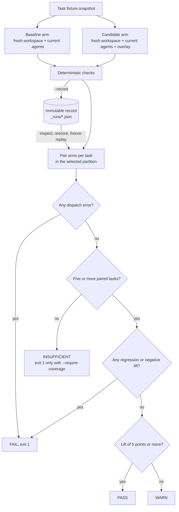

# Ewaluacja harnessu

:::tip Jak to się łączy
[Ewaluacja umiejętności](./skill-eval.md) mierzy, czy jeden `SKILL.md` pomaga, a [optymalizacja umiejętności](./skill-opt.md) edytuje jego treść pod kontrolą bramek held-out. Ewaluacja harnessu (ta strona) porównuje całą nakładkę `.agents/` na zadaniach repozytorium. [Przypadki regresji z incydentów](./harness-incidents.md) zamieniają zaobserwowane porażki w przypadki ewaluacyjne i fixture’y umiejętności. [Ewolucja harnessu projektu](./harness-evolution.md) uruchamia przechwytywanie incydentów i optymalizację umiejętności jako cykl z budżetem, a [zaplanowani agenci](./scheduled-agents.md) to harmonogram systemu operacyjnego, który go wyzwala.
:::

`oma harness eval` mierzy, czy kandydat na harness OMA poprawia działanie ustalonego agenta bez zmiany jego modelu. Polecenie adaptuje wzorzec ewaluacji w czasie testu z pracy [AI4AI at Test-Time: Strong-to-Weak Capability Transfer via Harnesses](https://arxiv.org/abs/2608.12307): pozostaw model docelowy bez zmian, zmień harness i porównaj wyniki dla tych samych zadań.

To polecenie ocenia większą jednostkę niż `oma skill eval`:

| Polecenie | Badany wariant | Cel wyniku |
|:--------|:----------|:-------------|
| `oma skill eval` | Jedno ciało `SKILL.md` | Wynik agenta |
| `oma harness eval` | Ograniczona nakładka `.agents/` | Pliki i wynik utworzone w workspace repozytorium |

Użyj ewaluacji umiejętności, aby odpowiedzieć na pytanie „czy ta umiejętność pomaga?”. Użyj ewaluacji harnessu, aby sprawdzić, czy ta kombinacja umiejętności, workflowów, reguł i instrukcji agenta sprawia, że ustalony agent bardziej niezawodnie kończy zadania repozytorium.

**Przed pierwszym uruchomieniem:**

- Zapisz pierwsze uruchomienie z `--live --record`. `inspect` (akcja domyślna), `rescore`, `fixture-replay` i `rerun` odczytują ten zapis.
- Werdykt wymaga co najmniej pięciu ocenionych zadań w wybranej partycji. `pass` wymaga przyrostu co najmniej 5 punktów i braku regresji.
- `inspect`, `rescore` i `fixture-replay` nie wywołują modeli. `--live` i `--action rerun` wykonują dwa wywołania na każde wybrane zadanie.
- `promotionReady` ma zawsze wartość `false`. Wynik pozytywny jest dowodem do decyzji człowieka, a nie automatyczną promocją.
- Uruchomienia live wymagają dostawcy z wyszukiwaniem umiejętności lokalnym dla projektu (zobacz [Uruchomienie i zapis](#run-and-record)).

## Model ewaluacji

Uruchomienie live ocenia każde zadanie jako sparowany eksperyment:

1. OMA przechwytuje początkowy fixture zadania. Kompletna migawka inicjuje oba warianty, dzięki czemu zaczynają od tych samych plików, nawet jeśli źródłowy fixture zmieni się w trakcie wykonania.
2. OMA kopiuje bieżące definicje `agents`, `config`, `rules`, `skills` i `workflows` do tego workspace’u i projektuje je na wybrany format dostawcy.
3. OMA powtarza konfigurację w drugim nowym workspace’ie i stosuje tam nakładkę kandydata.
4. W obu wariantach używane są ten sam agent główny, trasa dostawcy, prompt, uprawnienia zapisu i limit czasu.
5. Deterministyczne kontrole sprawdzają wynikowy workspace oraz opcjonalny wynik agenta. Zaufane kontrole poleceń są uruchamiane później na świeżej kopii artefaktów zadania.

Rzeczywisty projekt nigdy nie jest katalogiem roboczym wariantu. OMA przechwytuje surowy wynik i końcowe artefakty zadania przed wykonaniem kontroli i usunięciem tymczasowych workspace’ów. Własny sandbox procesu wybranego dostawcy pozostaje źródłem prawdy dla dostępu poza katalogiem roboczym.

Diagram pokazuje, jak sparowane warianty prowadzą do decyzji. Akcje offline wchodzą ponownie na etapie parowania, korzystając z zapisanego rekordu.



## Układ kandydata

Ścieżka kandydata to katalog zawierający częściowe drzewo `.agents/`:

```text
candidate/
└── .agents/
    ├── agents/
    │   └── docs-curator.md
    ├── rules/
    │   └── documentation.md
    ├── skills/
    │   └── project-docs/
    │       └── SKILL.md
    └── workflows/
        └── docs-check.md
```

Akceptowane są tylko pliki poniżej `.agents/agents`, `.agents/rules`, `.agents/skills` i `.agents/workflows`. Hooki, fixture’y ewaluatora, stan, wyniki, pliki konfiguracji, dowiązania symboliczne i warianty agentów dostawcy są odrzucane. Chronione pola frontmatter agenta, takie jak `model`, `tools`, `effort` i limity wykonania, muszą pasować do bazowych. Wariant również kończy się niepowodzeniem, jeśli uruchomiony agent zmodyfikuje chronione definicje `.agents/` przed obliczeniem wyniku.

## Format zestawu

Zestaw to jeden plik YAML oraz jeden katalog fixture’ów na zadanie:

```text
harness-eval/
├── suite.yaml
└── fixtures/
    ├── stale-api-doc/
    │   ├── docs/api.md
    │   └── src/session.ts
    └── missing-guide/
        ├── docs/
        └── src/feature.ts
```

```yaml
schema_version: 2
id: docs-harness
agent: docs-curator
tasks:
  - id: stale-api-doc
    partition: validation
    prompt: Update the API documentation to match the implementation.
    workspace: fixtures/stale-api-doc
    weight: 1
    checks:
      - type: file_contains
        path: docs/api.md
        value: openSession
      - type: file_not_contains
        path: docs/api.md
        value: createSession
  - id: missing-guide
    partition: final-test
    prompt: Write the missing guide for the feature in this fixture.
    workspace: fixtures/missing-guide
    checks:
      - type: file_exists
        path: docs/feature.md
```

Wersja 2 wymaga zadań zarówno `validation`, jak i `final-test`. Każde zadanie musi zadeklarować swoją partycję. Wartością domyślną jest validation; użyj `--partition final-test` do osobnego uruchomienia końcowego po wyborze kandydata. Każde uruchomienie ocenia tylko wybraną partycję, więc rozstrzygające uruchomienie walidacyjne wymaga co najmniej pięciu zadań `validation`, a uruchomienie final-test co najmniej pięciu zadań `final-test`. Powyższy przykład jest krótki dla czytelności i zawsze raportuje `INSUFFICIENT`. Obie partycje nie mogą współdzielić ani zagnieżdżać katalogów fixture’ów. Pliki zapisu przechowuj poza katalogami fixture’ów, nakładkami kandydata i wejściami ewaluatora; takie lokalizacje są odrzucane, aby późniejsze uruchomienia nie widziały kontroli końcowych. Zestawy w wersji 1 nadal działają jako `exploratory`; nie można ich wybrać jako final-test.

ID zadań muszą być unikatowe. Ścieżki fixture’ów i kontroli muszą pozostać wewnątrz projektu i workspace’u zadania. Zestawy i fixture’y muszą też pozostać poza bazowymi definicjami kopiowanymi do każdego wariantu. Fixture’y nie mogą zawierać dowiązań symbolicznych ani powierzchni sterowania harnessu agenta, takich jak `.agents`, `.codex`, `.claude`, katalogi umiejętności dostawców lub główne pliki instrukcji agenta. Zapobiega to zasłonięciu kontrolowanego harnessu któregokolwiek wariantu przez dane zadania.

Generowane katalogi zależności, takie jak `node_modules` i `.venv`, nie są kopiowane z bazowego harnessu. Zapisz deterministyczne źródło pomocnicze i manifesty zależności w umiejętności; zależności runtime’u dostarcz w fixture zadania, gdy wymaga ich kontrola.

### Typy kontroli

| Typ | Pola | Warunek przejścia |
|:-----|:-------|:---------------|
| `file_exists` | `path` | Ścieżka istnieje po zakończeniu wariantu. |
| `file_not_exists` | `path` | Ścieżka nie istnieje. |
| `file_contains` | `path`, `value` | Plik istnieje i zawiera wartość. |
| `file_not_contains` | `path`, `value` | Plik istnieje i nie zawiera wartości. |
| `output_contains` | `value` | Przechwycony wynik agenta zawiera wartość. |
| `output_not_contains` | `value` | Przechwycony wynik agenta nie zawiera wartości. |
| `output_judge` | `rubric` | Kontrakt podlegający ocenie, przenoszony przez incydenty; mechaniczny ewaluator zgłasza go jako niewykonywany (zobacz [Przypadki regresji incydentów](./harness-incidents.md)). |
| `file_json_equals` | `path`, `value`, opcjonalne `pointer` | Sparsowany JSON pliku jest równy `value`, opcjonalnie w miejscu wskazanym przez JSON Pointer. |
| `output_json_equals` | `value`, opcjonalne `pointer` | Przechwycony wynik to prawidłowy JSON równy `value`, opcjonalnie w miejscu wskazanym przez JSON Pointer. |
| `command` | `argv`, `checker`, `timeout_ms`, `expected_exit_code` | Zaufany podproces kończy się w limicie czasu i zwraca wskazany kod wyjścia. |

Asercje JSON porównują sparsowane wartości, w tym typy; tekst opisujący sukces nie może spełnić asercji stanu JSON. `pointer` używa składni JSON Pointer, takiej jak `/result/count`, i domyślnie wskazuje całą wartość.

Kontrole poleceń pisze zaufany właściciel zestawu:

```yaml
- type: command
  argv: [/absolute/path/to/node, "{checker}", state.json]
  checker: checkers/verify-state.mjs
  timeout_ms: 5000
  expected_exit_code: 0
```

`checker` jest rozwiązywany względem pliku zestawu. Musi to być samodzielny zwykły plik źródłowy przechowywany poza każdym fixture’em, nakładką kandydata i bazowymi definicjami `.agents`. `argv[0]` musi być bezwzględną ścieżką do pliku wykonywalnego poza projektem; `{checker}` musi być kompletnym argumentem. OMA przekazuje argumenty bezpośrednio, bez interpolacji powłoki. Limity czasu muszą być dodatnimi liczbami całkowitymi nie większymi niż 300 000 milisekund. Kody wyjścia to liczby całkowite od 0 do 255.

Przed dispatch’em OMA tworzy migawkę bajtów źródła checkera oraz oblicza skróty definicji ewaluatora i pliku wykonywalnego. Po dispatchu kopiuje artefakty zadania do osobnego tymczasowego workspace’u, zapisuje checker z migawki poza tymi artefaktami i tam go wywołuje. Każde polecenie otrzymuje świeżą kopię; jeden checker nie może zmienić danych wejściowych następnej kontroli. Wygenerowane projekcje harnessu są wyłączone, a dowiązania symboliczne w artefaktach są odrzucane. Zmiana źródła checkera w trakcie działania wariantu powoduje niepowodzenie tego wariantu; zmodyfikowane źródło nigdy nie zastępuje migawki. Checker powinien używać stałych asercji wobec artefaktów lub zachowania aplikacji i nie powinien delegować swojego werdyktu do testów ani skryptów pakietów, które kandydat może edytować.

Kontrole i ścieżki checkerów nie są dodawane do promptu agenta ani do fixture’a. Wejście wybranego zadania jest siłą rzeczy widoczne podczas jego uruchomienia. Chroni to integralność ewaluatora i rozdziela partycje; nie zapobiega odczytowi innych plików hosta przez proces tego samego użytkownika.

## Uruchomienie i zapis {#run-and-record}

Tryb live wykonuje dwa dispatch’e na każde wybrane zadanie, wyświetla podgląd dispatchów i wymaga potwierdzenia:

```bash
oma harness eval \
  --suite harness-eval/suite.yaml \
  --candidate candidate \
  --live --record \
  --record-file harness-eval/_runs/trial-1.json
```

Użyj `--yes` do wykonania bez interakcji i `--timeout <duration>`, aby ustawić ten sam limit czasu zegarowego dla obu wariantów (domyślnie `15m`; jednostka jest wymagana, na przykład `--timeout 45m`). `oma harness incident reproduce` przyjmuje tę samą flagę. Wykonanie live wymaga dostawcy, który wyszukuje pliki harnessu względem workspace’u projektu. OMA odmawia wyszukiwania względem HOME, ponieważ wariant bazowy mógłby zobaczyć globalnie zainstalowaną treść kandydata.

Dostawca pochodzi z pola `agent` zestawu i jest rozstrzygany przez konfigurację modeli projektu:

| Dostawca | Live `harness eval`, `--action rerun`, `incident reproduce` |
|---|---|
| `claude`, `codex`, `commandcode`, `copilot`, `cursor`, `kiro`, `opencode`, `qwen` | Dozwolone: lokalny dla projektu katalog umiejętności |
| `antigravity`, `hermes`, `kimi` | Odrzucane: wyszukiwanie umiejętności względem HOME |
| Każdy dostawca bez znanego projektowego katalogu umiejętności | Odrzucane |

Akcje offline (`inspect`, `rescore`, `fixture-replay`) nie wykonują dispatchu, więc ta kontrola ich nie dotyczy.

`--record` zapisuje niezmienny rekord JSON w wersji 2. Domyślną lokalizacją jest `_runs/` obok zestawu, ze skrótami wariantu bazowego i kandydata w nazwie pliku. Użyj nowego `--record-file` dla kolejnego uruchomienia live; istniejący plik docelowy jest odrzucany przed dispatch’em. Rekordy zachowują:

- tożsamość zestawu, partycję, pochodzenie promptów i fixture’ów, skróty wariantu bazowego i kandydata oraz skróty ewaluatora, checkerów i plików wykonywalnych;
- oryginalny wynik i jego skrót, w tym dostępny diagnostyczny stdout z nieudanych dispatchów;
- manifesty artefaktów początkowych i końcowych z bajtami plików, skrótami poszczególnych plików, uprawnieniami plików i katalogów oraz skrótem manifestu;
- odwołania do checkerów, wyniki wariantów, tożsamość incydentu (jeśli ją dostarczono) oraz skrót rekordu źródłowego dla ponownego uruchomienia.

Migawki zadań są ograniczone do 5 MiB na plik, 32 MiB łącznie i 2000 wpisów. Dowiązania symboliczne, pliki specjalne, ścieżki zawierające sekrety, nieczytelne pliki i zbyt duże dane są zapisywane jako pominięcia. Skopiowane elementy sterujące harnessu są wyłączone z końcowych artefaktów zadania. Niekompletne migawki pozostają jawnymi ograniczeniami dowodów; nie mogą posłużyć za podstawę przypiętego ponownego uruchomienia ani umożliwić ponownej oceny plików. Surowy wynik nadal może wspierać kontrole dotyczące samego wyniku, jeśli oryginalny dispatch zakończył się powodzeniem.

Rekordy mają własny skrót integralności. Zmieniony skrót rekordu lub artefaktu jest odrzucany. Te skróty identyfikują dowody; nie poświadczają izolacji procesu i nie sprawiają, że wynik jest gotowy do promocji.

### Warunki wykonania

Każda ewaluacja live lub ponowne uruchomienie ustala manifest wykonania przed pierwszym dispatch’em i zapisuje go w rekordzie jako `manifest`. Wskazuje on warunki, które opisuje werdykt, aby zapisany wynik nigdy nie został pomylony z dowodem dotyczącym innego modelu, CLI lub kompilacji OMA:

| Pole | Znaczenie |
|---|---|
| `vendor`, `dispatchMode`, `runtimeVendor`, `command` | Ustalona trasa dispatchu i nazwa pliku wykonywalnego CLI. |
| `model`, `modelSource` | Model ustalony przez OMA na podstawie planu agenta albo ustawienia domyślnego dostawcy. `vendor-session` oznacza, że model wybiera własna konfiguracja sesji dostawcy, a OMA go nie przypina. |
| `effort`, `thinking` | Ustawienia rozumowania pobrane z planu agenta, jeśli występują. |
| `cliVersion`, `cliVersionStatus` | Pierwszy wiersz wyniku `<command> --version` (`probed`) albo `unavailable`, gdy sonda się nie powiodła. |
| `omaVersion`, `platform`, `arch`, `node` | Host oraz kompilacja OMA. |
| `environmentPolicy` | Nazwy zmiennych środowiskowych otrzymanych przez warianty, wpisy wymuszone oraz liczba odrzuconych. Wartości nigdy nie są zapisywane. |
| `memory`, `confinement` | `memory: disabled` dla każdego wariantu; `confinement` określa, co dispatch ogranicza, a czego nie (tymczasowy workspace, nieograniczona sieć, odziedziczone poświadczenia, domyślne narzędzia dostawcy). |
| `manifestHash` | Tożsamość powyższych warunków. |

Manifest jest opisem, a nie poświadczeniem: zapisuje to, co zostało ustalone przez OMA, a pola confinement wprost mówią, że izolacja sieci i poświadczeń nie jest egzekwowana. `promotionReady` pozostaje `false`.

### Polityka środowiska

Oba warianty otrzymują to samo środowisko ograniczone listą dozwolonych zmiennych. Przechodzą zmienne bazowe (`PATH`, `HOME`, ustawienia locale, katalogu tymczasowego, proxy i certyfikatów), każda zmienna `OMA_*` oraz zmienne z prefiksami poświadczeń i wykrywania runtime’u docelowego dostawcy; wpisy, które builder dispatchu dodaje na potrzeby wywołania, są zachowywane. Wszystko inne jest odrzucane, aby kandydat nie mógł przypadkowo sięgnąć po token wdrożeniowy ani klucz innego dostawcy. `OMA_NO_AGENTMEMORY=1` jest wymuszane, aby pamięć dostawcy nie przenosiła kontekstu między wariantem bazowym a wariantem kandydata.

Ustaw `OMA_HARNESS_ENV_PASSTHROUGH=NAME1,NAME2`, aby przekazać dodatkowe zmienne, których zadanie rzeczywiście potrzebuje. Nazwy pojawiają się w manifeście w `environmentPolicy.extra`. Dla dostawcy bez znanego zestawu prefiksów manifest zgłasza `vendorKnown: false`, a do procesu docierają tylko wpisy bazowe, `OMA_*` i przekazane przez passthrough.

## Ponowne użycie zapisu {#reuse-a-recording}

Polecenie rozróżnia cztery akcje:

| Akcja | Wykonywana praca | Wywołania agenta/modelu |
|:-------|:---------------|:------------------|
| `inspect` | Agreguje zapisane werdykty wariantów po walidacji pochodzenia. Żadne kontrole nie są uruchamiane. | Brak |
| `rescore` | Stosuje bieżące kontrole wyniku i plików do oryginalnego surowego wyniku i bajtów artefaktów. | Brak |
| `fixture-replay` | Dopasowuje dostarczony transkrypt żądań narzędzi, odtwarza zawarte w nim odpowiedzi fixture’ów i zmiany plików, a następnie stosuje obsługiwane kontrole. | Brak |
| `rerun` | Uruchamia skonfigurowanego agenta w nowych workspace’ach zainicjowanych z zapisanych migawek początkowych. | Dwa na każde wybrane zadanie |

`--action inspect` jest wartością domyślną. `--mock` jest aliasem inspekcji i nie można łączyć go z inną akcją. Ani inspekcja, ani odtwarzanie fixture’ów nie uruchamia agenta ponownie.

### Inspekcja zapisanych werdyktów

```bash
oma harness eval \
  --suite harness-eval/suite.yaml \
  --candidate candidate \
  --action inspect \
  --record-file harness-eval/_runs/trial-1.json
```

Inspekcja wymaga, aby oryginalne skróty zestawu, partycji, ewaluatora, wariantu bazowego i kandydata się zgadzały. Wyświetla zapisane wyniki bez wywoływania checkerów i bez ponownej oceny wyniku. Rekordy w wersji 1 pozostają dostępne do inspekcji, gdy zgadza się ich wymagane pochodzenie. Starsze rekordy bez pochodzenia partycji/ewaluatora nie przechodzą bieżącej walidacji CLI. Werdyktów legacy nie można ponownie oznaczyć jako nowych surowych dowodów: zbierz nowy rekord live do ponownej oceny, odtwarzania fixture’ów lub przypiętego ponownego uruchomienia.

### Ponowna ocena oryginalnych dowodów

```bash
oma harness eval \
  --suite harness-eval/suite.yaml \
  --candidate candidate \
  --action rescore \
  --record-file harness-eval/_runs/trial-1.json
```

Ponowna ocena używa bieżących kontroli i ignoruje oryginalne wartości `passed` oraz werdykty kontroli. Tożsamość zestawu, ID zadania/prompt/tożsamość incydentu, wariant bazowy, kandydat i wybrana partycja nadal muszą się zgadzać. Definicje checkerów mogą się zmienić; nowy wynik opisuje, jak oryginalne bajty wypadają względem tych kontroli. Zmiany w bieżących plikach fixture’ów nie zastępują zapisanych końcowych artefaktów.

Kontrole poleceń są niewystarczające do ponownej oceny offline, ponieważ rekord nie przypina zewnętrznego runtime’u ani środowiska. Niewystarczające są też kontrole dotyczące wyłączonych albo niekompletnych artefaktów. Nieudany oryginalny dispatch pozostawia wynik diagnostyczny, który nie może stać się prawidłowym pomiarem przez ponowną ocenę. Użyj ponownego uruchomienia live, gdy bieżące kryteria akceptacji wymagają wykonania polecenia.

### Odtwarzanie fixture’ów narzędzi

Plik transkryptu zawiera jeden obiekt albo tablicę obiektów z unikatowymi ID zadań. Dostarcz jeden transkrypt na każde wybrane zadanie:

```json
{
  "schemaVersion": 1,
  "taskId": "stale-api-doc",
  "requests": [
    { "tool": "documentation", "request": { "path": "docs/api.md" } }
  ],
  "steps": [
    {
      "tool": "documentation",
      "request": { "path": "docs/api.md" },
      "response": { "body": "Use openSession." },
      "writes": [
        { "path": "docs/api.md", "content": "Use openSession.\n" }
      ],
      "removes": []
    }
  ],
  "output": "Fixture completed.",
  "dependencies": [
    { "name": "documentation", "repeatability": "fixture" }
  ]
}
```

```bash
oma harness eval \
  --suite harness-eval/suite.yaml \
  --candidate candidate \
  --action fixture-replay \
  --record-file harness-eval/_runs/trial-1.json \
  --transcript harness-eval/tool-fixtures.json
```

Żądania muszą dokładnie odpowiadać sekwencji kroków pod względem nazwy narzędzia i wartości żądania. `writes` i `removes` to opcjonalne zmiany plików zadania ze ścieżkami względnymi; nie mogą wychodzić poza workspace ani modyfikować elementów sterujących harnessu. Nazwy narzędzi są danymi i żadne polecenie z transkryptu nie jest wykonywane. `output` to dane fixture’a, wymagane, gdy potrzebuje ich kontrola wyniku.

Każda zadeklarowana zależność ma `name`, `repeatability` (`fixture`, `live` albo `unavailable`) oraz opcjonalne `reason` i odwołanie `fixture`. Zależność typu fixture wymaga pasującego kroku z tą nazwą narzędzia. Zależności live albo niedostępne sprawiają, że odtwarzanie jest niewystarczające. Opcjonalne pole `fixture` ma charakter opisowy; odtwarzanie korzysta z dostarczonych kroków, a nie ładuje tej ścieżki. Odtwarzanie transkryptu waliduje zadeklarowane zależności i nie dowodzi, że każda historyczna zależność została zarejestrowana.

Oba zapisane warianty muszą mieć tę samą kompletną migawkę początkową. OMA stosuje ten sam transkrypt do każdego wariantu i uruchamia bieżące kontrole wyniku i plików. Kontrole poleceń wymagają ponownego uruchomienia live. Te wyniki pokazują, że dostarczoną sekwencję fixture’ów można odtworzyć; nie dowodzą poprawy zachowania kandydata ani odtwarzalności modelu.

### Ponowne uruchomienie agenta z przypiętych plików początkowych

```bash
oma harness eval \
  --suite harness-eval/suite.yaml \
  --candidate candidate \
  --action rerun \
  --record-file harness-eval/_runs/trial-1.json
```

Ponowne uruchomienie wymaga zgodnej tożsamości zestawu/zadania oraz identycznych, kompletnych migawek początkowych obu oryginalnych wariantów. Rozpoczyna rzeczywiste wywołania agenta z użyciem bieżącego wariantu bazowego, kandydata, skonfigurowanej trasy dostawcy/modelu i bieżących kontroli. Nie używa oryginalnych artefaktów końcowych jako stanu wyjściowego. Późniejsza edycja źródłowego fixture’a nie może więc po cichu zmienić zapisanego stanu początkowego.

Ponowne uruchomienia mają taki sam podgląd dispatchów, potwierdzenie i zachowanie limitu czasu jak uruchomienia live. Mogą używać zmienionego kandydata; jawnie wskaż oryginalne źródło przez `--record-file`. Dodaj `--record`, aby zapisać nowy plik w tym samym katalogu, z końcówką `-rerun-<timestamp>.json`, powiązany ze skrótem rekordu źródłowego. Oryginalny rekord zostaje zachowany.

Przypięte pliki nie odtwarzają stanu usług zewnętrznych, zachowania zegara ani próbkowania modelu. Ponowne uruchomienie to świeży dowód behawioralny w podanych warunkach, a nie twierdzenie, że oryginalna trajektoria agenta została odtworzona deterministycznie.

### Zapisane warunki podczas odtwarzania

`inspect`, `rescore` i `fixture-replay` zgłaszają manifest zapisany w rekordzie z `conditions: "recorded"` albo `conditions: "unavailable"` dla rekordu sprzed wprowadzenia manifestów. OMA ustala też bieżące warunki i wylicza każdą różnicę w dostawcy, trybie dispatchu, modelu, effort, thinking, wersji CLI, wersji OMA lub hoście jako ograniczenie odtwarzania i blokadę promocji:

```text
replay limitation: Recorded conditions differ from current: model: recorded "gpt-5.4", current "gpt-5.5"
```

Wersja CLI jest sondowana podczas odtwarzania tylko wtedy, gdy sam rekord zawiera wersję uzyskaną przez sondę; para, w której nie sondowano wersji, jest zgłaszana jako nieporównywalna, a nie jako równa. Zapisane werdykty pozostają dostępne do wglądu w swoich oryginalnych warunkach. Nie są dowodem dla kandydata w bieżących warunkach, dopóki ewaluacja live lub ponowne uruchomienie nie wytworzy rekordu z pasującym manifestem.

### Zużycie {#usage}

Każdy wariant zapisuje `usage`, gdy dostawca je zgłosił: tokeny wejściowe i wyjściowe, koszt w USD, czas zegarowy oraz model, który wytworzył większość wyniku. Ewaluacja sumuje je jako `usage` z polem `status` o wartości `actual`, `partial` (niektóre warianty nic nie zgłosiły) albo `unknown`. Opakowania wyników dostawców są rozpakowywane przed uruchomieniem kontroli i przed zapisem wyniku, więc `output_contains` i `output_json_equals` widzą odpowiedź agenta, a nie otaczające ją pomocnicze dane JSON; zużycie z opakowania zasila to pole.

### Etykiety raportu

Raporty zawierają `executionMode`, `evidenceStatus` (`complete`, `insufficient` albo `legacy`), `replayLimitations` oraz, gdy jest dostępny, `sourceRecordHash`. Raporty z uruchomień live i ponownych uruchomień dodają `manifest`, `conditions: "current"` i `traceSession`. Kompletność dowodów opisuje to, co bieżąca akcja może sprawdzić lub ocenić. Odziedziczone ograniczenia incydentu pozostają widoczne nawet wtedy, gdy bieżące przechwycenie plików jest kompletne. `promotionReady` pozostaje `false` w każdym trybie.

## Zdarzenia trace

Każda ewaluacja live lub ponowne uruchomienie zapisuje powiązane zdarzenia w lokalnej sesji `oma-harness-<suite-id>`:

| Zdarzenie | Zawartość |
|---|---|
| `harness.eval.started` | Akcja, skróty zestawu/wariantu bazowego/kandydata/ewaluatora, partycja, skrót manifestu, ustalony dostawca, model, wersja CLI i liczba zadań. |
| `harness.arm.completed` | Po jednym na wariant: zadanie, wariant, stan przejścia, czas trwania, skrót wyniku, błąd dispatchu, kod wyjścia, flaga przekroczenia limitu czasu i trace wariantu. `parentEventId` wskazuje zdarzenie rozpoczęcia. |
| `harness.eval.completed` | Decyzja, przyrost, status dowodów oraz ścieżka i skrót rekordu, gdy użyto `--record`. |

Wszystkie zdarzenia jednej ewaluacji mają wspólny `causalityKey`. Gdy zdarzenia nie można zapisać, raport wylicza `Trace event <kind> was not recorded` jako ograniczenie odtwarzania, zamiast po cichu je pomijać.

Każde uruchomienie wariantu zapisuje też w rekordzie `diagnostics` i `trace`:

- `diagnostics`: kod wyjścia, sygnał, flaga przekroczenia limitu czasu i ostatnie 8 KiB stderr wraz ze `stderrStatus` (`captured`, `truncated` albo `unavailable`).
- `trace`: to, co harness mógł zaobserwować. `output` ma wartość `complete`, `partial` (nieudany proces mimo to wytworzył stdout) albo `unavailable`; `artifacts` mówi, czy końcowa migawka jest kompletna; `changedPaths` wymienia pliki, które wariant dodał, zmodyfikował lub usunął względem przypiętego początkowego workspace’u (maksymalnie 200, z `changedPathsTruncated`); `toolCalls` zawsze ma wartość `unsupported`, ponieważ CLI dostawców nie udostępniają harnessowi obserwacji poszczególnych narzędzi.

Nieudany wariant zachowuje więc swój częściowy wynik, końcówkę stderr, status wyjścia i zmiany plików, dzięki czemu ostatni błąd można prześledzić do tego, co wariant zmienił. Brak obserwacji jest zapisywany jako stan; nigdy nie odczytuje się go jako czystego uruchomienia.

## Metryki i bramka decyzji

Każde zadanie przechodzi tylko wtedy, gdy przejdą wszystkie kontrole. Wyniki są średnimi ważonymi po sparowanych zadaniach:

```text
lift = candidateScore - baselineScore
```

OMA raportuje też:

- zadania naprawione: bazowe nie przeszło, a kandydat przeszedł;
- zadania z regresją: bazowe przeszło, a kandydat nie przeszedł;
- pokrycie: wymaganych jest co najmniej pięć sparowanych zadań w wybranej partycji, dla których można obliczyć wynik.

Decyzja dotycząca wyniku to `pass`, gdy przyrost wynosi co najmniej 5 punktów procentowych i nie ma regresji. Każda regresja albo ujemny przyrost kończy się niepowodzeniem kandydata. Nieujemny przyrost poniżej 5 punktów generuje ostrzeżenie, a mniej niż pięć sparowanych zadań daje decyzję `insufficient`. Dodaj `--require-coverage`, aby w CI niewystarczające pokrycie kończyło się niezerowym kodem wyjścia. Wynik nie jest dowodem, gdy brakuje wariantu, skrót rekordu jest nieaktualny albo deterministyczna kontrola jest niekompletna. Błędy dispatchu live i integralności ewaluatora wymuszają decyzję o niepowodzeniu; nie mogą być liczone jako udany przyrost. Ponowna ocena i odtwarzanie fixture’ów pomijają warianty z niewystarczającymi dowodami w parach, dla których można obliczyć wynik, i raportują decyzję `insufficient`, zamiast traktować brakujące dowody jako regresję kandydata.

Pozytywny wynik nie ustanawia kwalifikowalności do promocji. Raporty zawierają partycję, skrót ewaluatora, `promotionReady: false` i jawne blokady. Uruchomienia legacy i validation nie mają dowodów final-test. Obecne trasy dispatchu nie poświadczają izolacji dostępu do systemu plików, więc nawet uruchomienie final-test nie może twierdzić, że zapewnia chronioną ewaluację końcową, ani autoryzować promocji. To pole pozostaje `false`, dopóki dostawca wykonania nie będzie w stanie ustanowić tej granicy.

## Rozwiązywanie problemów

| Komunikat lub objaw | Przyczyna | Rozwiązanie |
|---|---|---|
| `No matching harness recording found: <path>. Run --live --record first.` | Akcją domyślną jest `inspect`, która odczytuje zapisany rekord. | Uruchom raz `--live --record` albo wskaż istniejący rekord przez `--record-file`. |
| `Harness recording is stale; suite, partition, evaluator, baseline, or candidate inputs changed` | `inspect` wymaga zgodności każdego zapisanego skrótu. | Zapisz nowe uruchomienie z nowym `--record-file`. Użyj `--action rescore`, gdy chcesz zastosować bieżące kontrole do zapisanych bajtów. |
| `Recorded evidence belongs to a different baseline, candidate, or partition` | `rescore` albo `fixture-replay` wskazano na rekord z innych danych wejściowych. | Wybierz pasujące `--record-file` i `--partition` albo zapisz uruchomienie ponownie. |
| `Harness recording is immutable; choose a new --record-file before dispatch` | `--record` nadpisałoby istniejący plik. | Podaj nową ścieżkę `--record-file`. |
| `--record requires --live or --action rerun` | `--record` połączono z akcją offline. | Usuń `--record` albo użyj `--live`. |
| `--action fixture-replay requires --transcript` | Nie podano transkryptu. | Dodaj `--transcript <path>`. |
| `Removed option --timeout-minutes. Use --timeout.` | Stara pisownia flagi. | Użyj `--timeout 30m` (jednostka jest wymagana). |
| `Vendor <vendor> cannot provide project-local isolated harness discovery` | Agent zestawu rozstrzyga się do dostawcy z wyszukiwaniem względem HOME albo bez projektowego katalogu umiejętności. | Skieruj agenta zestawu do dostawcy z tabeli w sekcji [Uruchomienie i zapis](#run-and-record). |
| `Candidate overlay must be stored separately from the baseline .agents tree` | `--candidate .` albo ścieżka wewnątrz `.agents/`. | Przechowuj nakładki gdzie indziej, na przykład w `candidates/fix/.agents/`. |
| `Candidate file is not allowed: <path>` | Nakładka zawiera pliki poza `agents/`, `rules/`, `skills/` lub `workflows/`. | Usuń te pliki z nakładki. |
| `Candidate agent field <field> cannot change model or execution controls: <path>` | Chroniony frontmatter różni się od wariantu bazowego. | Przywróć `model`, `tools`, `effort` i pozostałe chronione pola. |
| `Suite requires at least one final-test task` | Zestaw `schema_version: 2` wymaga obu partycji. | Dodaj zadanie z `partition: final-test`. |
| `decision: INSUFFICIENT` | Mniej niż pięć ocenionych zadań w wybranej partycji albo brakujące warianty. | Dodawaj zadania, aż partycja będzie miała pięć, i przeczytaj wiersze `replay limitation:`. |
| `decision: FAIL` | Błąd dispatchu (po nim następują wiersze `<task>/<arm>: ...`), regresja (ID zadań pod `regressed:`) albo ujemny przyrost. | W przypadku błędu dispatchu przeczytaj wiersz `exit=... timedOut=... stderr=...` pod każdym nieudanym wariantem. W przypadku regresji porównaj oba warianty wymienionych zadań. |

## Obecna granica

Nakładki kandydatów są tworzone zewnętrznie; to polecenie nie implementuje buildera ani automatycznej pętli `harness opt`. Dostępne są przechwytywanie artefaktów, ponowna ocena offline, odtwarzanie fixture’ów narzędzi, ponowne uruchomienia z przypiętych plików, wybór partycji, ewaluatory utrwalane w migawce, manifesty wykonania, lista dozwolonych zmiennych środowiskowych i powiązane zdarzenia trace, ale nie zapewniono tajności danych held-out na poziomie systemu operacyjnego, izolacji sieci ani poświadczeń, powtarzanych prób stochastycznych ani wymuszania przypięcia modelu dla zagnieżdżonych wywołań subagentów. Zużycie tokenów i koszt są zapisywane dla każdego wariantu i sumowane, gdy dostawca je raportuje (zobacz [Zużycie](#usage)). Lista dozwolonych zmiennych środowiskowych ogranicza, które zmienne dziedziczy proces dostawcy; nie powstrzymuje CLI dostawcy przed odczytem własnego magazynu poświadczeń ani przed dostępem do sieci. Dopóki nie istnieje przypinanie zagnieżdżonych wywołań, zestawy mierzące jeden ustalony model powinny unikać workflowów kandydata, które uruchamiają inne skonfigurowane role agentów.
