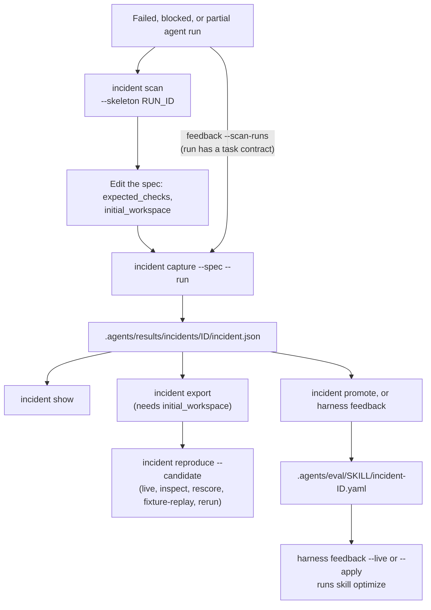

# Przypadki regresji incydentów

`oma harness incident` łączy zaobserwowaną porażkę z przypadkiem regresji oraz z oceną kandydata, która po nim następuje. Obserwacje zapisuje oddzielnie od hipotez przyczynowych. Samo niepowodzenie procesu nie stanowi dowodu, że to model spowodował incydent.

Promocja zasila optymalizację umiejętności; eksport zasila ewaluację harnessu.



## Znajdowanie kandydatów {#find-candidates}

```bash
oma harness incident scan            # failed/blocked/partial runs with no captured incident
oma harness incident scan --json
oma harness incident scan --skeleton <run-id> > incidents/run-failure.json
```

1. `oma harness incident scan` wylicza śledzone uruchomienia, których status to `failed`, `blocked` albo `partial`, i odrzuca każde uruchomienie, do którego już zapisany incydent odwołuje się przez `source.runId`. `--limit <n>` ogranicza długość listy. Uruchomienia pochodzą z rekordów uruchomień projektu w katalogu stanu profilu OMA (domyślnie `~/.oma/u/0/projects/<project-id>/agent-runs/`, gdzie `<project-id>` to SHA-256 kanonicznej ścieżki projektu; `OMA_STATE_HOME` i `OMA_PROFILE` zmieniają katalog główny i profil). `oma agent spawn` i `oma agent parallel` zachowują ostatnie 64 KiB logu każdego uruchomienia obok jego rekordu jako `<run-id>.output.txt`.
2. `--skeleton <run-id>` wypisuje specyfikację z identyfikatorem, agentem, źródłowym uruchomieniem, zaobserwowaną porażką, kodem wyjścia oraz, jeśli runner go zachował, końcowym fragmentem wyniku agenta. Pole `expected_checks` pozostaje `TODO`, ponieważ prawidłowe zachowanie jest decyzją, której skan nie może podjąć.
3. Zastąp kontrolę zastępczą. Aby incydent dało się uruchomić, dodaj też `"initial_workspace": "<dir>"` wskazujące kopię plików zadania w stanie sprzed uruchomienia. Bez tego incydent można zapisać i promować, ale `incident export` i `reproduce` kończą się komunikatem `Cannot export a runnable regression: initial workspace evidence is missing`.
4. Zapisz incydent z `--run <run-id>`, aby zachować prompt, tożsamość i odcisk workspace’u uruchomienia. `capture --run` importuje zachowany wynik jako obserwację, gdy specyfikacja jej nie zawiera, a `incident promote` może zweryfikować na jego podstawie wywiedziony fixture.

## Automatyczne zapisywanie nieudanych uruchomień

```bash
oma harness feedback --scan-runs            # capture, promote, report
oma harness feedback --scan-runs --live     # and optimize the affected skills
```

Uruchomienie nieudane, zablokowane albo częściowe, którego zadanie miało kontrakt, nie potrzebuje ręcznie pisanej specyfikacji. Oczekiwanym zachowaniem są kryteria akceptacji z kontraktu, ustalone przed uruchomieniem; kryteria objęte nieudanym pokwitowaniem weryfikacji tworzą zbiór niespełniony, a gdy uruchomienie nigdy nie zostało zweryfikowane — wszystkie kryteria. Agent opt przepisuje niespełnione kryteria na rubrykę sędziego (`PASS only if …`), sędzia ocenia wobec niej zachowany własny wynik uruchomienia, a incydent jest zapisywany tylko wtedy, gdy ten wynik nie przechodzi: rubryka, którą porażka przechodzi, nie uchwyciła tej porażki. Specyfikacja jest zapisywana pod `.agents/results/incidents/_specs/<id>.json` i przechwytywana z tożsamością uruchomienia, z rubryką jako kontrolą akceptacji `output_judge`. Uruchomienia bez zachowanego wyniku, promptu albo kontraktu są wyliczane jako niemożliwe do zapisania, wraz z powodem.

`output_judge` to kontrakt podlegający ocenie. Mechaniczny ewaluator harnessu zgłasza go jako niewykonywany; jego celem jest fixture regresji umiejętności, który `incident promote` wywodzi z niego z tą samą rubryką.

## Zapisywanie incydentu {#capture-an-incident}

Zapisz specyfikację JSON w projekcie:

```json
{
  "schema_version": 1,
  "id": "incomplete-result",
  "summary": "The agent reported success while the result remained incomplete",
  "prompt": "Complete the task and update result.json",
  "agent": "backend",
  "observed": {
    "failure": "result.json still contained complete=false",
    "output": "success",
    "exit_code": 0
  },
  "initial_workspace": "initial",
  "expected_checks": [
    {
      "type": "file_json_equals",
      "path": "result.json",
      "pointer": "/complete",
      "value": true
    }
  ],
  "evidence_files": ["original-output.txt"],
  "dependencies": []
}
```

Ścieżki `initial_workspace`, `evidence_files` i fixture’ów zależności są względne wobec pliku specyfikacji. Ścieżka `checker` kontroli polecenia jest względna wobec projektu. Składnia kontroli jest zgodna z [Ewaluacja harnessu](./harness-eval.md). Katalog początkowy musi być dostarczonym fixture’em zadania sprzed uruchomienia, bez plików instrukcji OMA ani dostawcy; oceniany harness jest wstrzykiwany osobno.

```bash
oma harness incident capture --spec incidents/incomplete-result.json --json
oma harness incident show incomplete-result --json

# Import prompt and observable metadata from an existing local run
oma harness incident capture --spec incidents/run-failure.json --run <run-id> --json
```

`--run` przyjmuje identyfikator uruchomienia wymieniony przez `oma harness incident scan`; rekordy uruchomień znajdują się w katalogu stanu profilu opisanym w sekcji [Znajdowanie kandydatów](#find-candidates), a nie w `.agents/state/`. Zachowuje tożsamość uruchomienia i sesji, dostawcę, status oraz oryginalny odcisk workspace’u. Dostarczony prompt ma pierwszeństwo przed zapisanym promptem uruchomienia. `source.trace_id` może powiązać zgłoszony incydent z zewnętrznym trace’em bez pobierania go ani przesyłania.

Zapisany manifest znajduje się w `.agents/results/incidents/<id>/incident.json`. Zawiera migawkę stanu początkowego, jeśli ją dostarczono, skróty dowodów źródłowych i plików checkerów, kontrole akceptacji, ograniczenia oraz skrót manifestu. Istniejących identyfikatorów nie można nadpisać. Wrażliwy tekst obserwacji jest maskowany; redakcja jest zgłaszana jako ograniczenie dokładnego odtworzenia. Pobieranie migawek odrzuca nieobsługiwane pliki i ma limity liczby plików oraz łącznego rozmiaru. Odwołania do dowodów zachowują skróty i ścieżki, a nie kopie każdego wskazywanego pliku źródłowego.

Opcjonalny obiekt `cause` ma pola `category`, `hypothesis`, `confidence` i `evidence`. Kategoriami są `model`, `tool`, `config`, `context`, `application`, `evaluator` i `unknown`. Jeśli go pominiesz, przyczyna pozostaje `unknown`.

## Promocja do fixture’a umiejętności

```bash
oma harness incident promote <id> [--skill <id>] [--draft] [--force] --json
```

Zapisany incydent staje się fixture’em regresji dla umiejętności, którą wykonywał agent z nieudanym uruchomieniem, więc `oma skill optimize` może naprawić tę umiejętność na jego podstawie. Wybór umiejętności odbywa się przez kierowanie promptu incydentu za pośrednictwem katalogu zainstalowanych umiejętności, z użyciem tej samej sondy na poziomie opisu, którą stosuje `oma skill eval --routing` (jedno wywołanie modelu); gdy kierowanie nic nie wybierze, używany jest pierwszy wpis `skills:` z definicji agenta w `.agents/agents/<agent>.md`, a w razie braku — zainstalowana umiejętność o nazwie `oma-<agent>`. `--skill` nadpisuje ten wybór, a promocja zapisuje, która z trzech ścieżek rozstrzygnęła (`attribution`). Fixture trafia do `.agents/eval/<skill>/incident-<id>.yaml` z `group: incident-<id>`, aby nigdy nie przechodził przez podział train/validation/test, a promocja jest zapisywana obok incydentu jako `promotion.json`. Incydent jest promowany jednorazowo.

Checker pochodzi z kontroli akceptacji. Gdy każda kontrola to `output_contains`, fixture jest deterministycznym `assert`. W pozostałych przypadkach kontrole nie mogą działać w ewaluacji umiejętności (nie ma plików ani poleceń), więc `--draft` prosi agenta opt o rubrykę sędziego zaczynającą się od `PASS only if` i wymieniającą zaobserwowaną porażkę. W każdym wariancie fixture jest dopuszczany tylko wtedy, gdy zapisany nieudany wynik go nie przechodzi: assert, który zaobserwowany wynik już spełnia, albo napisana rubryka, którą sędzia zalicza na tym wyniku, są odrzucane, ponieważ nie jest to przypadek regresji. Incydent bez zaobserwowanego wyniku nie może zostać zweryfikowany i wymaga `--force`, co jest zapisywane jako ograniczenie.

## Zamknięcie pętli

```bash
oma harness feedback                 # promote every unpromoted incident, report what changed (routing, drafting, and judge model calls)
oma harness feedback --live          # also run one optimization epoch per affected skill (dry-run)
oma harness feedback --apply --json  # also write edits that pass every gate (implies --live)
```

`--incident <ids...>` ogranicza uruchomienie do wymienionych incydentów. `--max-epochs <n>` (domyślnie 1) ustawia liczbę epok optymalizacji na umiejętność dla `--live` i `--apply`.

:::caution Koszt modelu i cel zapisu
`feedback` nie pokazuje podglądu kosztu. Nawet bez `--live` promocja kieruje każdy incydent do umiejętności za pomocą wywołania modelu i może tworzyć szkice rubryk oraz je oceniać. `--live` i `--apply` uruchamiają `oma skill optimize --live --yes` dla każdej objętej umiejętności, a `--apply` zapisuje zarządzany `SKILL.md` bezpośrednio, w tym umiejętności `oma-*`, które `oma update` nadpisuje. Do potwierdzonego uruchomienia z podglądem użyj `oma skill optimize --skill <id> --live`; do cyklu z budżetem i nakładkami projektu użyj [ewolucji harnessu projektu](./harness-evolution.md).
:::

`feedback` to pętla sprzężenia zwrotnego wdrożenia w jednym poleceniu: z `--scan-runs` najpierw zapisywane jest każde niezapisane nieudane uruchomienie z kontraktem (patrz wyżej), potem każdy zapisany incydent bez fixture’a jest promowany (w razie potrzeby z napisaniem rubryk), objęte umiejętności są grupowane, a z `--live` każda z nich jest optymalizowana raz na powiększonym zestawie według zwykłych bramek (akceptacja held-in/held-out, potwierdzony negative transfer, finalny test należący do runnera). Raport w `.agents/results/feedback/feedback-<ts>.json` wylicza promocje, pominięte incydenty z powodami oraz wynik każdej umiejętności z diffem, więc łańcuch od zaobserwowanej porażki do edycji kandydata jest jednym rekordem możliwym do audytu. Do działania według harmonogramu, ze wspólnym przydziałem wywołań modeli, trwałymi ponowieniami i nakładkami umiejętności projektu, włącz [ewolucję harnessu projektu](./harness-evolution.md). Migawka stanu następnej sesji zgłasza zastosowane zmiany.

Co pozostaje decyzją człowieka: uruchomienie bez kontraktu zadania nie ma zapisanego oczekiwanego zachowania, więc jest wyliczane przez `incident scan` i zapisywane wyłącznie przez specyfikację; `--skeleton` tworzy jej szkic.

## Eksport i ocena

```bash
oma harness incident export incomplete-result --json
oma harness incident reproduce incomplete-result --candidate candidates/fix \
  --record-file incidents/comparison.json --yes --json
```

Eksport materializuje zapisaną migawkę początkową oraz eksploracyjny zestaw z jednym przypadkiem. Skrót manifestu i tożsamość źródłowego uruchomienia albo trace’u wędrują razem z zadaniem do ewaluacji i zapisu. Zmiany w wyeksportowanych plikach, prompcie, agencie, kontrolach albo przypiętych źródłach checkerów unieważniają ponowne użycie. Utwórz nowy identyfikator incydentu, aby zmienić kontrakt akceptacji.

Domyślnie `reproduce` rozpoczyna nowe porównanie live między wariantem bazowym a kandydatem i je zapisuje. Zastosowanie ma zwykłe potwierdzenie kosztu live, chyba że podano `--yes`. To polecenie używa skonfigurowanego dostawcy agenta zadania harnessu, łącznie z Codex; nie narzuca wykonaniu zadania chronionego profilu kompilatora optymalizatora umiejętności.

Wyeksportowany zestaw incydentu ma dokładnie jedno zadanie, więc `reproduce` zawsze wypisuje `coverage: insufficient` (do werdyktu potrzeba pięciu ocenionych zadań), a decyzją jest `INSUFFICIENT`, chyba że któregoś wariantu nie udało się uruchomić (`FAIL`). Zamiast tego czytaj wiersze zadań: identyfikator incydentu pod `corrected:` oznacza, że wariant bazowy nie przeszedł, a kandydat przeszedł; pod `regressed:` oznacza, że kandydat zepsuł przechodzący przypadek; `none` w obu oznacza, że ramiona zachowały się tak samo. W JSON te pola to `score.correctedTaskIds` i `score.regressedTaskIds`.

Jeśli nie zapisano stanu początkowego, `capture` i `show` nadal działają, ale uruchamialny eksport i reprodukcja wykonania kończą się błędem brakujących dowodów. Bieżące drzewo robocze nie może ustalić oryginalnego stanu historycznego uruchomienia. Nawet dostarczona osobno migawka początkowa nie dowodzi równoważności z tym historycznym uruchomieniem; raport podaje to ograniczenie.

## Wybór operacji na dowodach

```bash
oma harness incident reproduce incomplete-result --candidate candidates/fix \
  --action inspect --record-file incidents/comparison.json --json

oma harness incident reproduce incomplete-result --candidate candidates/fix \
  --action rescore --record-file incidents/comparison.json --json

oma harness incident reproduce incomplete-result --candidate candidates/fix \
  --action fixture-replay --record-file incidents/comparison.json \
  --transcript incidents/tool-responses.json --json

oma harness incident reproduce incomplete-result --candidate candidates/fix \
  --action rerun --record-file incidents/comparison.json --record --yes --json
```

| Operacja | Co się dzieje |
|---|---|
| `inspect` | Odczytuje i agreguje zapisane werdykty. Żadne kontrole ani agenci nie są uruchamiani. |
| `rescore` | Stosuje bieżące kontrole wyniku i plików do zapisanych surowych dowodów. Stare pola przejścia/niepowodzenia są ignorowane. |
| `fixture-replay` | Odtwarza dostarczone dane odpowiedzi narzędzi i zmiany plików względem zapisanego stanu początkowego. Żaden proces modelu ani narzędzia nie jest uruchamiany. |
| `rerun` | Rozpoczyna rzeczywiste wywołania agenta dla wariantu bazowego i kandydata ze zapisanego stanu początkowego. To wiąże się ze zwykłym użyciem modelu. |

Dla zmienionego kontraktu akceptacji utwórz osobny zestaw harnessu i użyj `oma harness eval --action rescore` z tą samą tożsamością zestawu, zadania i incydentu oraz tym samym promptem. Sam wyeksportowany zestaw incydentu jest niezmienny. Zobacz [szczegóły zapisu i odtwarzania](./harness-eval.md#reuse-a-recording), aby poznać wymagania wobec surowych dowodów i schemat transkryptu narzędzi.

Zadeklaruj zależności zewnętrzne jako `{ "name": "service", "repeatability": "fixture|live|unavailable", "reason": "...", "fixture": "response.json" }`. Zależność typu fixture wskazuje na plik korzystający z pełnego schematu transkryptu harnessu, z identyfikatorem incydentu jako `taskId`. Odtworzenie incydentu w trybie offline odrzuca zależności live albo niedostępne, brakujące pliki fixture’ów, zmienione skróty fixture’ów, brakujące nazwane odpowiedzi oraz żądania, odpowiedzi i zmiany plików różne od przypiętego transkryptu. Nadal nie może ono stwierdzić, że autor zadeklarował każdą zależność zewnętrzną. Powtórzenie live również nie gwarantuje, że usługa zewnętrzna zachowa się tak jak historycznie.

Zapis, eksport i ocena emitują lokalne zdarzenia `harness.incident.*`, które łączą incydent, skróty kandydata i wariantu bazowego, tryb wykonania oraz identyfikatory zadań naprawionych albo z regresją. Incydent z jednym przypadkiem to dowód regresji, a nie zamiennik zestawów validation i final-test. Bieżące profile harnessu zgłaszają `promotionReady: false`; te operacje nie ustanawiają izolacji chronionego finalnego testu ani automatycznie nie promują kandydata.
