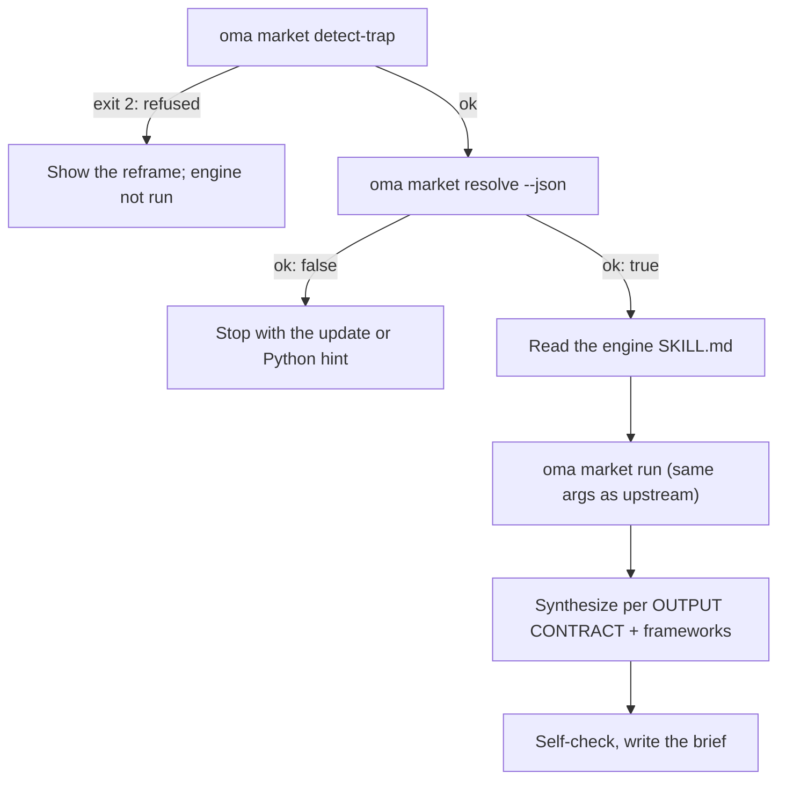

# Badania rynku

`oma-market` odpowiada na pytanie „co ludzie naprawdę mówią o X w ciągu ostatnich N dni” — o problemach, trendach, nastawieniu wobec konkurencji i odkrywaniu — korzystając ze źródeł społecznościowych z rzeczywistymi liczbami zaangażowania: Reddit (upvoty i najpopularniejsze komentarze), X, transkrypcje YouTube, TikTok, Instagram, Hacker News, Polymarket, GitHub, arXiv, Techmeme, Digg, LinkedIn, StockTwits, Bluesky, sieć i inne.

Same badania działają na upstreamowym silniku [**last30days**](https://github.com/mvanhorn/last30days-skill) (MIT, Python 3.12+). oh-my-agent nie tworzy jego forka: utrzymuje **zawsze najnowszą zarządzaną kopię**, zabezpiecza każde uruchomienie bramką i dodaje warstwę frameworków strategicznych. Częstotliwość wydań, liczba gwiazdek i pokrycie dostawców należą do projektu upstream i mogą się zmieniać.

---

## Szybki start

Poproś agenta zwykłym językiem. Frazy takie jak „badania rynku”, „problemy użytkowników”, „analiza konkurencji”, „głos klienta” albo „wykrywanie trendów” (ang. „market research”, „pain points”, „competitor analysis”, „voice of customer”, „trend detection”) aktywują umiejętność `oma-market`:

```text
Znajdź główne problemy, które programiści zgłaszali w ciągu ostatnich 30 dni w związku z VS Code remote containers.
Porównaj nastroje społeczności wobec Cursor vs Windsurf w ciągu ostatnich 90 dni, frameworks swot,5f.
```

| Sterowanie | Efekt |
|---|---|
| „A vs B” albo `--vs B` | Intencja competitor: upstreamowy przepływ porównania + SWOT + Porter’s 5F |
| `--days 7`, `30`, `90` albo `180` | Okno badania |
| `--intent pain`, `trend`, `competitor` albo `discovery` | Nadpisuje automatyczną klasyfikację intencji |
| `--frameworks none` albo lista taka jak `swot,5f,pestel` | Wyłącza sekcje frameworków albo je wybiera |

Wynikiem jest jeden raport w `.agents/results/market/{topic-slug}-{YYYYMMDD}.md`. Jego pierwsza linia to odznaka silnika (`🌐 last30days v<version> · synced <date>`), a po niej następują uporządkowane klastry dowodów z linkami, sekcje frameworków i stopka silnika wymieniająca pominięte źródła.

| Działa bez kluczy | Wymaga upstreamowego kreatora konfiguracji (klucze albo cookies) |
|---|---|
| Reddit, Hacker News, GitHub, Polymarket, arXiv, Techmeme, Digg, sieć | X, transkrypcje YouTube, TikTok, Instagram i inne źródła z kluczami; pominięte źródła są wymienione w stopce |

---

## Zawsze najnowszy silnik (wymagany Python 3.12+) {#always-the-latest-engine--nothing-to-install}

```bash
# Illustrative output; the release tag, cache path, and Python version vary.
oma market resolve
# engine:   last30days
# reason:   last30days 3.21.1 via managed:v3.21.1 (current)
# root:     ~/.cache/oma-market/last30days/v3.21.1
# skill:    ~/.cache/oma-market/last30days/v3.21.1/SKILL.md
# version:  3.21.1
# python:   python3.14 (3.14.7, PATH)
# save_dir: <workspace>/.agents/results/market/raw
```

- Cache: `~/.cache/oma-market/last30days/<tag>/` + `state.json`.
- Przed każdym użyciem `resolve` pyta GitHub o najnowsze wydanie (maksymalnie raz na `check_interval_min`, domyślnie co 60 min), pobiera nowszy tag do własnego katalogu (starsze tagi są usuwane), a w przeciwnym razie używa cache. Błędy sieci ponownie wykorzystują kopię z cache i zgłaszają `stale`.
- Python: `LAST30DAYS_PYTHON` → `market.python` → `python3.14`, `python3.13`, `python3.12`, `python3`, `python` w PATH (musi być ≥ 3.12) → `uv python find '>=3.12'`. Jeśli nie ma żadnego interpretera, `resolve` nie jest poprawne i wypisuje wskazówkę instalacji; umiejętność zatrzymuje się zamiast zredukować badanie do samego wyszukiwania w sieci.
- Konfiguracja silnika i klucze API znajdują się w `~/.config/last30days/` (zapisywane za zgodą użytkownika przez kreator upstream), więc przetrwają aktualizacje silnika.

Kolejność rozstrzygania (wygrywa pierwsze trafienie): `market.path` → `LAST30DAYS_HOME` → **zarządzane najnowsze wydanie** → kopie zainstalowane przez użytkownika (`.agents|.claude|.codex|.cursor|.qwen|.kiro/skills/last30days` w projekcie i pod `~`, następnie cache pluginu Claude Code).

```bash
oma market update            # force a check / download now
oma market resolve --offline # never touch the network
oma market run -- --help     # the engine's own flags (without `--`, oma prints its own help)
```

---

## Konfiguracja

```yaml
market:
  managed: true                   # false = never download; pins / skill dirs only
  channel: stable                 # stable (latest Release) | main (HEAD)
  check_interval_min: 60          # 0 = check on every call
  path: null                      # explicit engine dir (pin)
  python: null                    # interpreter override
  save_dir: .agents/results/market/raw
```

---

## Jak działa uruchomienie



1. `oma market detect-trap "<topic>"` — odrzuca tematy będące pułapką słów kluczowych albo zakupami demograficznymi (kod wyjścia 2) i proponuje przeformułowanie. Pusty temat albo temat dłuższy niż 200 znaków kończy się kodem wyjścia 4.
2. `oma market resolve --json` — silnik i Python; zatrzymuje się przy `ok: false`.
3. Agent czyta od początku do końca `SKILL.md` rozstrzygniętego silnika i postępuje zgodnie z nim: kreator pierwszej konfiguracji, rozstrzygnięcie uchwytów / subredditów / hashtagów przed badaniem (gdy dostępne jest WebSearch), planowanie zapytań i bramka warunku wstępnego.
4. `oma market run "<topic>" <flags> --emit=compact` — identyczne argumenty jak w upstreamowym wywołaniu `python3 scripts/last30days.py`; `--save-dir` jest dodawane z `market.save_dir`.
5. Synteza podąża za upstreamowym OUTPUT CONTRACT (odznaka w pierwszej linii, uporządkowane klastry dowodów, LAWs 1–8), a następnie oma dopisuje sekcje frameworków, które odwołują się wyłącznie do klastrów silnika:

| Intencja | Kształtowanie silnika | Frameworki |
|---|---|---|
| pain | temat ukształtowany jak skarga, `--days 30`, `--deep` przy małej ilości danych | SWOT |
| trend | `--days 7/30/90/180`, `--discover "<domain>"` dla „co jest na topie” | SWOT |
| competitor | `"A vs B"` → upstreamowy przepływ porównania | SWOT + Porter’s 5F |
| discovery | `--discover`, następnie kolejne `--drill` | SWOT + PESTEL |

6. Wykonaj samokontrolę, a następnie zapisz `.agents/results/market/{topic-slug}-{YYYYMMDD}.md`.

---

## Tryby awarii

| Sytuacja | Wynik |
|---|---|
| Temat odrzucony przez detect-trap | Pokazane przeformułowanie; silnik nie jest uruchamiany. `--force` dopiero po jawnym ponownym potwierdzeniu użytkownika |
| Brak silnika w cache i tryb offline | `ok: false` → raz online uruchom `oma market update` |
| Brak Pythona 3.12+ | `ok: false` ze wskazówką instalacji (brew / apt / `uv python install 3.12`) albo ustaw `LAST30DAYS_PYTHON` / `market.python`; brak zastępstwa w postaci samego wyszukiwania w sieci |
| Sprawdzenie wydania nie powiedzie się | Używany jest silnik z cache, zgłoszony jako `stale` |
| Źródła bez kluczy | Pomijane wewnątrz silnika i wymienione w stopce; włącz je przez upstreamowy kreator konfiguracji |

---

## Następne kroki

- [Workflowy treści i badań](./content-and-research.md) — wybierz właściwą możliwość dla innych zadań badawczych i dokumentowych
- [Silnik diagramów](./diagram-engine.md) — ten sam wzorzec zarządzanego najnowszego wydania dla archify
- [Semantyka oma-config.yaml](./oma-config-semantics.md) — jak scalana jest sekcja `market:`
- [Polecenia CLI: market](../cli-interfaces/commands.md#market) — pełna lista opcji
- Upstream: [mvanhorn/last30days-skill](https://github.com/mvanhorn/last30days-skill)
