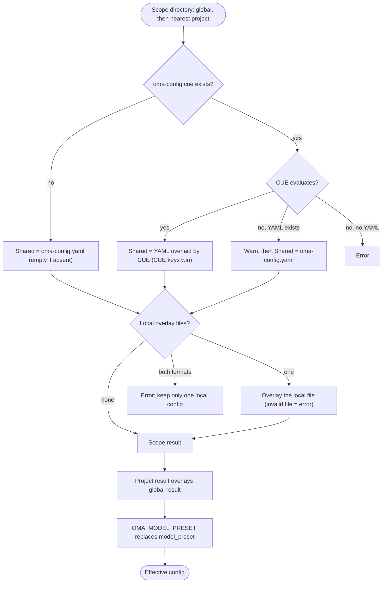

## Przegląd

OMA odczytuje globalne wartości domyślne z `$OMA_HOME/.agents/` (domyślnie `~/.oma/.agents/`),
a następnie nakłada na nie najbliższy projektowy katalog `.agents/` znaleziony powyżej katalogu roboczego.
Każdy zakres może mieć następujące warstwy:

- **Współdzielona**: `.agents/oma-config.yaml` i `.agents/oma-config.cue`. Gdy istnieją oba pliki, a plik CUE daje się ocenić, każdy klucz ustawiony w pliku CUE nadpisuje ten sam klucz w pliku YAML; klucze obecne tylko w pliku YAML pozostają wartościami domyślnymi. Gdy pliku CUE nie można ocenić, OMA wyświetla ostrzeżenie i używa samego pliku YAML.
- **Lokalna**: `.agents/oma-config.local.cue` albo `.agents/oma-config.local.yaml` (jeden plik nakładany na wynik współdzielony; zachowaj ten plik prywatnie).

Współdzielone i lokalne ustawienia projektu nadpisują ustawienia globalne. Różne katalogi główne
projektów nadrzędnych nigdy nie są scalane; pusty najbliższy katalog `.agents/` nadal wyznacza granicę
projektu. Globalne wartości domyślne nie zmieniają tożsamości projektu. Obsługiwane klucze i wartości domyślne opisano w
[konfiguracji referencyjnej](/docs/guide/configuration-reference).

## Przebieg rozstrzygania

OMA wykonuje te same kroki dla zakresu globalnego i dla najbliższego zakresu projektu, a następnie scala oba wyniki:



Gdy nie znaleziono projektowego katalogu `.agents/` albo przechodzenie w górę dociera do samego globalnego katalogu `.agents/`, używany jest wyłącznie wynik globalny.

## Tabela priorytetu {#precedence-table}

Późniejsze wiersze wygrywają. Zwykłe mapy są scalane rekurencyjnie; tablice, skalary i `null` zastępują wcześniejszą wartość.

| Kolejność | Warstwa | Zasada |
|:-----:|-------|------|
| 1 | Globalny `oma-config.yaml` | Wartości domyślne pod globalnym plikiem CUE, gdy istnieją oba. |
| 2 | Globalny `oma-config.cue` | Nadpisuje globalny YAML klucz po kluczu. Jeśli ocena się nie powiedzie (na przykład brakuje CLI `cue`), a YAML istnieje, OMA wypisuje `[config] CUE evaluation failed at ... Falling back to oma-config.yaml` i używa samego pliku YAML. |
| 3 | Globalny `oma-config.local.cue` albo `oma-config.local.yaml` | Tylko jeden plik. Niepoprawny plik lokalny jest błędem. |
| 4 | Projektowy `oma-config.yaml` | Najbliższy projektowy katalog `.agents/` w katalogu roboczym lub powyżej niego. |
| 5 | Projektowy `oma-config.cue` | Nadpisuje wiersz 4 klucz po kluczu, z tym samym zachowaniem awaryjnym co w wierszu 2. |
| 6 | Projektowy `oma-config.local.cue` albo `oma-config.local.yaml` | Tylko jeden plik. Niepoprawny plik lokalny jest błędem. |
| 7 | `OMA_MODEL_PRESET` | Niepusta wartość zastępuje `model_preset` dla tego procesu. Pusta wartość jest błędem. |

:::tip[Który plik edytować?]
Jeśli istnieje `.agents/oma-config.cue`, klucz ustawiony w nim nadpisuje ten sam klucz w `oma-config.yaml`. Zmień ten klucz w pliku CUE albo umieść wartość specyficzną dla maszyny w nakładce lokalnej. `oma doctor --profile` wymienia wczytane pliki w sekcji **Configuration sources**.
:::

Aby ustawić lokalne nadpisanie projektu, umieść w lokalnym pliku tylko zmienione liście. Na przykład lokalny wybór modelu może pozostać poza plikiem współdzielonym:

```yaml
# .agents/oma-config.local.yaml
model_preset: claude
agents:
  backend:
    model: anthropic/claude-sonnet-4-6
```

Uruchom polecenie z projektu, aby wybrany został najbliższy katalog `.agents/`. Niepoprawny plik lokalny kończy się wyraźnym błędem; napraw go albo usuń przed ponowieniem próby.

## Sprawdzanie konfiguracji

```bash
oma doctor --profile                           # loaded files, resolved preset, per-role model and CLI
cue export --out json .agents/oma-config.cue   # what the CUE layer evaluates to (requires the cue CLI)
```

| Objaw lub komunikat | Przyczyna | Rozwiązanie |
|--------------------|-------|-----|
| Zmiana w YAML nie działa | `oma-config.cue` ustawia ten sam klucz | Zmień klucz w pliku CUE albo nadpisz go w pliku lokalnym |
| `[config] CUE evaluation failed at ... Falling back to oma-config.yaml` | Brakuje CLI `cue` albo plik CUE nie daje się ocenić | Zainstaluj `cue` albo popraw błąd zgłaszany przez `cue export` |
| `Both local CUE and YAML configs exist in ...; keep only one local config.` | Dwa lokalne pliki nakładki | Usuń jeden z nich |
| `OMA_MODEL_PRESET must be non-empty` | Zmienna jest wyeksportowana, ale pusta | `unset OMA_MODEL_PRESET` |
| `Unknown model_preset "..."` | Literówka albo brak wpisu `custom_presets` | Użyj presetu wymienionego w komunikacie błędu |
| `Legacy preset name "..." is no longer valid` | Klucz sprzed zmiany nazwy, np. `claude-only` | Zmień nazwę zgodnie z komunikatem albo uruchom `oma update` |
| `[model-registry] User inline model "..." failed validation` | Niekompletny lub niepoprawny wpis `models:` | Zobacz [Wstawianie slugów modeli](/docs/guide/per-agent-models#inlining-model-slugs) |

## Wartości domyślne

| Klucz | Domyślna wartość | Kiedy stosowana |
|-----|---------|--------------|
| `auto_update_cli` | `true` | Oba pliki nie istnieją albo brakuje klucza |
| `serena.mode` | `bridge` | Oba pliki nie istnieją albo brakuje klucza |
| `serena.auto_update` | `true` | Oba pliki nie istnieją albo brakuje klucza |
| `telemetry` | `false` | Oba pliki nie istnieją albo brakuje klucza |
| `language` | `en` | Oba pliki nie istnieją albo brakuje klucza |
| `model_preset` | Wymagane | Dostarczony szablon projektu używa `auto`; schemat wymaga niepustej wartości. |
| `translation_voice` | `balanced` | Oba pliki nie istnieją albo brakuje klucza |
| `timezone` | Strefa systemowa | Oba pliki nie istnieją albo brakuje klucza |

## Uzasadnienie kolejności odczytu

Edytuj `~/.oma/.agents/oma-config.yaml` (przy ustawionym `OMA_HOME`: `<OMA_HOME>/.agents/oma-config.yaml`),
aby ustawić wartości domyślne dla całego użytkownika. Współdzielone i lokalne pliki projektu nadpisują te wartości
bez dziedziczenia niepowiązanych projektów nadrzędnych. Wybór `none` w projekcie
dla pamięci semantycznej nadpisuje globalny wybór AgentMemory.

## Uwagi

- `language` w `oma-config.yaml` steruje językiem odpowiedzi agenta. **Nie** służy do określania języka komunikatów ostrzegawczych instalacji/aktualizacji — te używają lokalizacji systemu (`$LANG`), ponieważ `oma-config.yaml` nie jest jeszcze wczytany w czasie instalacji.
- `auto_update_cli` używa nadpisań projektu przed globalnymi wartościami domyślnymi i jest domyślnie włączone, gdy żaden zakres go nie ustawia.
- `telemetry` (domyślnie `false`) mapuje się na wyłączenie telemetrii właściwe dla każdego vendora, zapisywane przez `oma install` / `oma update` / `oma link`: Claude `DISABLE_TELEMETRY` + `CLAUDE_CODE_DISABLE_FEEDBACK_SURVEY`, Gemini/Qwen `privacy.usageStatisticsEnabled`, Codex `analytics.enabled` + `feedback.enabled`, Grok `[features] telemetry` oraz Antigravity (agy) `enableTelemetry` w `~/.gemini/antigravity-cli/settings.json`. Ustawienie `telemetry: true` ponownie włącza telemetrię, usuwając wyłączenie oma dla danego vendora.
- `diagram` (silnik `auto` / `archify` / `mermaid`, `explain_sidecar`, `archify.managed|channel|check_interval_min|path|quality|open`) to rzadka sekcja nadpisania umiejętności, podobna do `video` / `image`; zobacz [Silnik diagramów](/docs/guide/diagram-engine).
- `video.hyperframes.check_interval_min` ogranicza częstotliwość kontroli najnowszych wersji dla uruchamianego per run toolchainu HyperFrames i heygen-com/hyperframes (`oma video compose`, `oma update`). Dostarczony schemat CUE nie definiuje jeszcze `video.hyperframes`, więc `cue export` odrzuca go wewnątrz bloku schematu (`field not allowed`); ustaw go w `oma-config.yaml` albo w lokalnej nakładce YAML.
- `market` (`managed|channel|check_interval_min|path|python|save_dir`) konfiguruje zawsze aktualny silnik `last30days` za `oma market`; zobacz [Badanie rynku](/docs/guide/market-research).
- Typowany schemat runtime obejmuje `providers`, `free`, `agents`, `models`, `custom_presets`, `vendors`, `session`, `docs` oraz rzadkie sekcje umiejętności. Dostarczone szablony zawierają też bloki należące do konsumentów, takie jak `scm`, `memory`, `serena_reaper` i `mcp`; ich konsumenci są właścicielami zagnieżdżonych kluczy. Nie wnioskuj o kluczu na podstawie tej listy — użyj [konfiguracji referencyjnej](/docs/guide/configuration-reference) i przewodnika funkcji dla danego bloku.
- Bezpośrednia edycja `oma-config.yaml` jest bezpieczna. `oma install` i `oma update` używają zamiany pól na poziomie wyrażeń regularnych i zachowują edytowane przez użytkownika klucze, którymi nie zarządzają (np. własne nadpisania `agents:` i `session.quota_cap`).
- `oma update` dodatkowo dopisuje klucze najwyższego poziomu zdefiniowane w dostarczonym szablonie, których brakuje w pliku (z wartościami domyślnymi szablonu), pod znacznikiem `# Added by oma update`. Posiadane już klucze nigdy nie są modyfikowane — ich istniejąca zawartość pozostaje identyczna bajtowo. Klucze celowo usunięte pojawią się ponownie z wartością domyślną szablonu; aby zrezygnować, ustaw wartość jawnie zamiast usuwać klucz.
