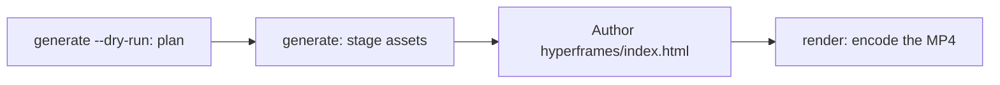

# Generowanie wideo

`oma-video` jest routerem wideo oh-my-agent. Z jednego krótkiego opisu składa skrypt, narrację, wizualizacje i napisy, a następnie zapisuje plan w katalogu uruchomienia. Etapy dostawców mogą działać bez kluczy i korzystać z lokalnych albo deterministycznych fallbacków; prawdziwy MP4 nadal wymaga działającego kompozytora i poprawnej kompozycji.

Umiejętność aktywuje się przy słowach „shorts”, „reels”, „screencast” albo przy frazach takich jak „make a video”, „explainer video”, „demo video”, „walkthrough video” czy „video from README”, a także gdy inna umiejętność potrzebuje wideo jako efektu ubocznego.

> **TL;DR** `oma video generate` planuje uruchomienie i przygotowuje zasoby. Z domyślnym kompozytorem HyperFrames nie koduje MP4: napisz `<runDir>/hyperframes/index.html` (workflow `/video` zrobi to za Ciebie), a następnie uruchom `oma video render <runDir>`. Przy pierwszym uruchomieniu zacznij od `oma video doctor --install`.

---

## Kiedy używać

- Zamiana krótkiego opisu, README, kodu albo danych w krótki klip.
- Tworzenie narracyjnego objaśnienia albo nagrania demo/walkthrough.
- Dowolny odtwarzalny potok „brief → `.mp4`”, który chcesz deterministycznie uruchamiać ponownie.

## Kiedy NIE używać

- Pojedyncze obrazy nieruchome → użyj [`oma-image`](/docs/guide/image-generation).
- Transmisja na żywo / streaming ekranu → poza zakresem (oma nigdy nie nagrywa ekranu; nagranie dostarczasz Ty).
- Samodzielny dźwięk narracji → użyj `oma-voice`.

---

## Tryby w skrócie

| Tryb | Proporcje | Co składa |
|------|--------|------------------|
| `shorts` | 9:16 | Pionowy klip krótkiej formy (skrypt → narracja → wizualizacje → napisy). |
| `explainer` | 16:9 | Poziome objaśnienie na podstawie README, kodu albo opisu danych. |
| `demo` | wyliczane | Walkthrough zbudowany z Twojego własnego nagrania ekranu przekazanego przez `--capture <file>`. `--source web --url <url>` zapisuje jedynie zamaskowany URL jako kontekst; oma nigdy nie otwiera przeglądarki, nie nagrywa ekranu ani nie automatyzuje logowania. |

Tryb ustawia wartości domyślne; aby je zmienić, przekaż odpowiednie flagi.

---

## Szybki start

W agencie `/video three quick tips for better focus` wykonuje za Ciebie wszystkie poniższe kroki. Ręcznie potok składa się z czterech kroków:



```bash
oma video doctor --install   # first run only: HyperFrames toolchain, Chrome Headless Shell, Pretendard

# 1. Plan from an agent-authored script (schema: .agents/skills/oma-video/resources/script-schema.md)
oma video generate "three quick tips for better focus" --mode shorts --script ./script.json --dry-run --output json

# 2. Stage assets (narration needs --voice <profile>; the default is a silent video)
oma video generate "three quick tips for better focus" --mode shorts --script ./script.json --output json

# 3. Author <runDir>/hyperframes/index.html per its AUTHORING.md, then encode
oma video compose <runDir>
oma video render <runDir> --output json

# Demo from your own recording; without --polish the recording itself becomes the output
oma video generate "product walkthrough" --mode demo --capture ./capture.mp4
```

<!-- oma-docs:ignore-start -->

| Krok | Polecenie | Wynik |
|---|---|---|
| Planowanie | `generate --dry-run` | `script.json`, `render-spec.json`, `manifest.json`; bez renderowania |
| Przygotowanie zasobów | `generate` | wizualizacje, napisy, opcjonalny dźwięk i muzyka, szkielet `hyperframes/` oraz ostrzeżenie `composition pending` |
| Pisanie kompozycji | edycja `hyperframes/index.html` | kompozycja |
| Renderowanie | `render <runDir>` | `{mode}-{slug}.mp4` i zaktualizowany manifest |

<!-- oma-docs:ignore-end -->

Bez `--script` CLI buduje deterministyczny szkielet z trzema scenami na podstawie tekstu krótkiego opisu. `--locale` ustawia znacznik języka narracji i napisów, ale ich nie tłumaczy; napisz krótki opis albo `script.json` w języku docelowym.

Każde uruchomienie wypisuje swój katalog. Stały `--seed` stabilizuje deterministyczne dane wejściowe planowania; wynik dostawcy live i nagranie mogą nadal się różnić. Ponownie renderuj istniejący katalog uruchomienia, gdy chcesz użyć zapisanej specyfikacji renderowania i zasobów.

Inne narzędzia, które wywołują `oma video generate --output json`, parsują z stdout kopertę JSON: `{exitCode, runDir, manifestPath, scriptPath, renderSpecPath, warnings, error}`. Nie ma klucza `outputs` — ścieżki wyników i zasobów odczytuj z manifestu pod `manifestPath`.

---

## Zawsze najnowszy HyperFrames — kompozycję piszesz Ty

oh-my-agent nie dostarcza **żadnego kodu kompozycji HyperFrames**. Każde uruchomienie dostaje własny projekt w `<runDir>/hyperframes/`, przygotowany przez `oma video compose` na najnowszym HyperFrames z npm (cache toolchainu `~/.cache/oma-video/hyperframes/<version>/`, współdzielony przez dowiązanie `node_modules`) z [heygen-com/hyperframes](https://github.com/heygen-com/hyperframes) pod HEAD (`~/.cache/oma-video/hyperframes-skills/`). Agent pisze źródło wygenerowanej kompozycji zgodnie z `AUTHORING.md` szkieletu, umiejętnościami i specyfikacją trybu w `.agents/skills/oma-video/resources/hyperframes-authoring/`.

```bash
oma video generate "…"                     # → render-spec.json + <runDir>/hyperframes/ (composition pending)
oma video compose <runDir> --output json   # refresh scaffold / print the contract (idempotent)
#   author hyperframes/index.html as instructed by AUTHORING.md
oma video render <runDir> --output json    # lint → render with the cached HyperFrames CLI → ffprobe; exit 1 on any failure
```

- Kontrole najnowszej wersji (npm + GitHub) są ograniczane przez `video.hyperframes.check_interval_min` (domyślnie 60; `0` = przy każdym compose). `oma update` respektuje ten interwał; `oma video doctor --upgrade` wymusza kontrolę; uruchomienia offline używają cache toolchainu i zgłaszają `stale`.
- Odtwarzalność znajduje się w katalogu uruchomienia: `render-spec.json`, źródło napisanej kompozycji i wersja toolchainu zapisana w metadanych wygenerowanego pakietu HyperFrames. Ponowny render tego samego uruchomienia używa tego kontraktu renderowania; nowe uruchomienie sprawdza najnowszy HyperFrames.
- Błąd lintu albo renderowania **nie** jest ukrywany za placeholderem (istnieje on wyłącznie dla `OMA_VIDEO_MOCK=1`): `oma video render` kończy się kodem 1 i diagnostyką, a agent poprawia kompozycję przy użyciu najnowszych umiejętności. Uszkodzenie po nowym wydaniu HyperFrames jest błędem kompozycji, nigdy powodem do przypięcia wersji.

```yaml
video:
  hyperframes:
    check_interval_min: 60    # 0 = check on every compose
```

---

## Referencja CLI

```bash
oma video generate <brief...> [options]
oma video doctor [--install|--upgrade|--install-mpt|--install-strudel]  # toolchain readiness / provisioning
oma video compose <runDir>       # prepare HTML project and authoring contract
oma video render <runDir>        # re-render from render-spec.json (deterministic)
oma video provider list         # provider availability + key/fallback status
```

### Główne flagi

| Flaga | Przeznaczenie |
|------|---------|
| `--mode <m>` | `shorts` \| `explainer` \| `demo`. |
| `--aspect <a>` | `9:16` \| `16:9` \| `1:1` \| `auto`. |
| `--locale <lang>` | Znacznik języka narracji i napisów. |
| `--captions <s>` | `tiktok` \| `lower-third` \| `none` (wyrównanie bez klucza). |
| `--visual <m>` | `auto` \| `generate` \| `stock` \| `aigc` \| `slide`. |
| `--voice <profile>` | Głos narracji albo `none` (domyślnie; pomiń, a wideo wyrenderuje się bez dźwięku z szacowanym czasem napisów). |
| `--music <mode>` | `upbeat`, `calm`, `cinematic`, `lofi`, `piano` albo `none`. |
| `--compositor <c>` | `hyperframes` (domyślnie) \| `mpt`. |
| `--capture <path>` | Twoje nagranie dla trybu demo: `.mp4`, `.mov`, `.webm` albo `.mkv`, przechowywane wewnątrz projektu. |
| `--source <k>` | Źródło przechwytywania demo: `file` albo `web` (domyślnie: `file`). |
| `--url <url>` | URL kontekstu dla `--source web`, zapisywany w zamaskowanej postaci w `manifest.json`. Wymagany z `--source web`; nigdy nie rozpoczyna przechwytywania i nie zastępuje `--capture`. |
| `--polish` | Nałóż kompozycję HyperFrames na przechwycone nagranie. |
| `--device`, `--ready-selector`, `--show-cursor`, `--capture-timeout`, `--capture-stop` | Akceptowane, ale nieużywane: oma nie steruje przeglądarką ani nie nagrywa ekranu. |
| `--output-dir <path>` | Bazowy katalog wyjściowy. Ścieżki poza `$PWD` wymagają `--allow-external-output`. |
| `--allow-external-output` | Zezwól na ścieżki wyjściowe poza `$PWD`. |
| `--max-usd <n>` | Pułap kosztu (domyślnie `0.2`). Gdy bieżące oszacowanie go osiągnie, uruchomienie zatrzymuje się z kodem 1; uruchom ponownie z `-y` albo wyższą wartością. |
| `--duration <sec>` | Docelowa długość w sekundach (1–180) albo `auto`. |
| `--seed <n>` | Deterministyczny seed. |
| `--dry-run` | Wygeneruj skrypt / render-spec / manifest, pomiń renderowanie. |
| `--script <path>` | Napisany przez agenta `script.json` do wstrzyknięcia (zastępuje szkielet; steruje narracją, tekstem na ekranie i promptami wizualnymi per scena). |
| `-y, --yes` | Zezwól na dostawców, których oszacowanie osiąga `--max-usd` (to samo co `OMA_VIDEO_YES=1`). |
| `--timeout <sec>` | Limit czasu w pełnych sekundach dla każdego wywołania dostawcy materiałów wizualnych i muzyki (domyślnie `600`). Przyrostki jednostek nie są parsowane: `2m` oznacza 2 sekundy. |
| `--output <f>` | Wynik CLI: `text` (domyślnie) albo `json`. |
| `--no-brief-in-manifest` | Zapisz SHA-256 krótkiego opisu zamiast jego surowej treści. |

---

## Dostawcy opcjonalni względem klucza

Etapy dostawców rozstrzygają się do **rzeczywistej gałęzi** oraz, gdy etap ją obsługuje, do **deterministycznego fallbacku**. Brakujące klucze mogą więc pozostawić zaplanowane uruchomienie z szacowanym czasem albo lokalnymi zasobami. Kompozytor jest wymaganym etapem końcowym i nie ma zwykłego placeholdera:

| Możliwość | Rzeczywista gałąź (co ją włącza) | Fallback |
|------------|-------------|----------|
| script | napisany przez agenta `script.json` przekazany przez `--script <path>` (zapisuje go workflow `/video`) | deterministyczny szkielet z trzema scenami na podstawie tekstu krótkiego opisu |
| voice | `oma-voice` (Voicebox lub VoiceStudio, lokalnie; wybierany przez `voice.backend`) z `--voice <profile>` | wideo bez dźwięku z szacowanym czasem (`--voice none`, domyślnie) |
| visual | `oma-image`, `oma-slide`, klipy stockowe Pexels, gdy ustawiono `PEXELS_API_KEY` | zasób placeholdera |
| visual: `aigc` | jeszcze niepodłączone; `RUNNINGHUB_API_KEY` włącza dostawcę, który nadal zapisuje placeholdery | zasób placeholdera |
| caption | `.srt` i `.vtt` wyrównane do `timing.json`, w języku skryptu | to samo; tłumaczenie na `--locale` nie jest jeszcze podłączone |
| music | podkład Strudel po `oma video doctor --install-strudel` | brak ścieżki muzycznej |
| capture | nagranie dostarczone przez Ciebie przez `--capture <file>` | brak: bez `--capture` tryb demo wypisuje instrukcje nagrywania i kończy się kodem 3 |
| compositor | HyperFrames (zarządzany) albo MoneyPrinterTurbo | brak fallbacku kompozytora; uruchomienie kończy się diagnostyką |

Brak automatyzacji poświadczeń: każde logowanie na ekranie wykonujesz samodzielnie podczas nagrywania; URL-e i tokeny zapytań są maskowane w logach i manifeście.

Napisy renderują się jako **statyczne okna cue** — pojedyncza linia napisów aktywna dla bieżącej klatki, zawijana przez CSS, bez animacji per słowo.

---

## Toolchain i `doctor`

Ciężki toolchain (`node_modules` zarządzanego projektu HyperFrames, osadzony font Pretendard, checkout MoneyPrinterTurbo, projekt muzyczny Strudel, Chrome Headless Shell) jest **dostarczany na żądanie**, a nie wysyłany w pakiecie. Zwykłe `doctor` działa tylko raportowo — niczego nie instaluje:

```bash
oma video doctor
```

Raportuje `node`, `chromium`, `ffmpeg`, `ffprobe`, `hyperframes-toolchain`, `hyperframes-skills`, `pretendard-font`, `mpt-project`, `strudel`, `voicebox`, `voicestudio`, `oma-image`, `pixelle` i `cap`, a także podaje wskazówkę instalacji dla brakujących elementów. Miarodajną listę zwraca `oma video doctor --output json`. Podstawowe wymagania to Node.js 22+, toolchain HyperFrames wraz z jego przeglądarką Chrome, FFmpeg/FFprobe oraz `oma-image`. Prawdziwy MP4 wymaga też napisanego HTML.

Użyj flag instalacji, aby dostarczyć toolchain:

```bash
oma video doctor --install             # warm the latest HyperFrames toolchain + Chrome Headless Shell + Pretendard + heygen-com/hyperframes
oma video doctor --upgrade             # force a latest-version check now
oma video doctor --install-mpt         # MoneyPrinterTurbo checkout (clone + venv + deps) for --compositor mpt
oma video doctor --install-strudel     # Strudel music renderer for --music (installs AGPL-3.0-or-later packages locally)
```

`--install` pobiera także osadzony font Pretendard (przypięte wydanie) do współdzielonego cache toolchainu — należy to do granicy deterministyczności. Przy błędzie sieci ostrzega, a render przechodzi na fonty systemowe; różnice przeglądarki i systemu operacyjnego nadal mogą wpływać na zakodowany wynik.

---

## Układ wyniku

```text
.agents/results/videos/{timestamp}-{shortid}-{mode}/
├── script.json          # scenes + narration
├── render-spec.json     # the deterministic render contract
├── timing.json          # per-segment timing (voicebox-stt, voicestudio-stt, or estimated)
├── captions.srt / .vtt
├── audio/narration-01.wav     # one track; absent when the video is silent
├── music/                     # pattern.strudel, bgm.wav, bgm.mp3 (with --music and Strudel installed)
├── visuals/scene-*.{png,svg,…}
├── hyperframes/         # index.html, AUTHORING.md, local assets and toolchain link
├── {mode}-{slug}.mp4    # the rendered output (slug derived from the script title)
└── manifest.json        # providers, assets, cost, warnings
```

`render-spec.json` wraz z zasobami wyznacza granicę deterministyczności.

---

## Rozwiązywanie problemów

<!-- oma-docs:ignore-start -->

| Objaw | Przyczyna / poprawka |
|---------|-------------|
| Nie powstaje MP4 | Kontrola kompozytora, kompozycji albo toolchainu nie powiodła się. Uruchom `oma video doctor`, następnie `oma video compose <runDir>` i popraw zgłoszoną kompozycję przed ponownym `oma video render <runDir>`. |
| Narracja jest cicha (`source: estimated`) | `--voice` ma domyślnie wartość `none` albo żaden backend mowy nie jest dostępny. Przekaż `--voice <profile>` z profilem z wybranego backendu (z aplikacji Voicebox albo identyfikatorem profilu VoiceStudio przy `voice.backend: voicestudio` lub `auto`) i uruchom tę aplikację albo zaakceptuj szacowany czas. |
| Uruchomienie demo kończy się kodem 3 z instrukcjami nagrywania | Nie podano pliku `--capture` (także przy `--source web`); oma nie nagrywa ekranu. Nagraj przebieg w Cap, QuickTime albo OBS, zapisz go wewnątrz projektu i uruchom ponownie z `--capture ./walkthrough.mp4`. |
| `--capture` zostaje odrzucone (kod 4) | Plik nie istnieje, znajduje się poza katalogiem projektu albo nie jest plikiem `.mp4` / `.mov` / `.webm` / `.mkv`. Skopiuj nagranie do projektu, na przykład do `./captures/demo.mp4`. |
| Uruchomienie zatrzymuje się na pułapie kosztu (kod 1) | Bieżące oszacowanie osiągnęło `--max-usd`. Uruchom ponownie z `-y` albo wyższym `--max-usd`. |
| `--out path "…" is outside $PWD. Use --allow-external-out to override.` (kod 1) | `--output-dir` wskazuje miejsce poza projektem. Uruchom ponownie z `--allow-external-output` (komunikat nadal pokazuje starą nazwę flagi) albo wybierz katalog wewnątrz projektu. |
| `oma video doctor` wykazuje brak `oma-image` | Jeśli szczegóły brzmią `Removed option --format. Use --output.`, zawiodła sama sonda gotowości i nie mówi nic o Twoich dostawcach; sprawdź ich bezpośrednio przez `oma image doctor`. W przeciwnym razie żaden dostawca obrazów nie jest gotowy, więc wizualizacje przechodzą na placeholdery: uruchom `oma image doctor` i skonfiguruj jednego dostawcę. |
| Render jest wolny przy pierwszym uruchomieniu | Przeglądarka HyperFrames / checkout MPT są dostarczane raz; kolejne uruchomienia ponownie używają cache. |

<!-- oma-docs:ignore-end -->

---

## Następne kroki

- [Workflow `/video`](../core-concepts/workflows.md#video) — potok brief → skrypt → zasoby → render-spec → HyperFrames.
- [Generowanie obrazów](./image-generation.md) — router obrazów nieruchomych używany ponownie jako dostawca wizualizacji wideo.
- [Workflowy treści i badań](./content-and-research.md) — głos, slajdy i inne możliwości związane z treścią.
- [Polecenia CLI: video](../cli-interfaces/commands.md#video) — pełna lista opcji `oma video`.
