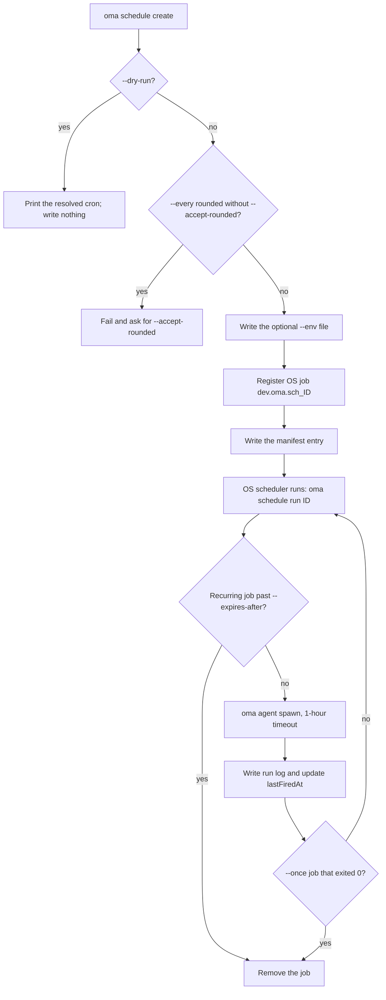
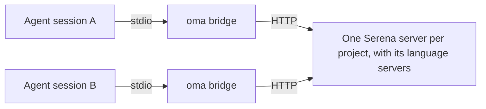
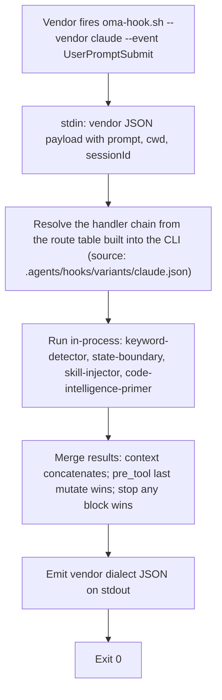

# Comandos CLI

Após uma instalação global (`bun install --global oh-my-agent`), use `oma` ou `oh-my-agent`. Para uma execução pontual sem instalação, execute `npx oh-my-agent`.

A variável de ambiente `OH_MY_AG_OUTPUT_FORMAT` pode ser definida como `json` para tornar JSON a saída padrão nos comandos que usam as opções compartilhadas `--json` / `--output`. Um `--output text` explícito continua tendo prioridade.

Se um comando falhar com `Unknown command`, `Unexpected argument` ou `Removed option`, consulte [Grafias removidas](#aliases) nesta página; para problemas de instalação, de hooks e de execução, consulte [Solução de problemas](../guide/troubleshooting.md).

## Comece por uma tarefa

Escolha o menor comando que responde a sua pergunta. Cada comando abaixo exibe um caminho ou relatório que você pode examinar antes de passar à etapa seguinte.

| Tarefa | Comece aqui | Resultado esperado |
|:-----|:-----------|:----------------|
| Instalar ou reparar um projeto | `oma install` e depois `oma doctor` | Recursos instalados e relatório de estado; use `oma doctor --profile` se o problema envolver a resolução do modelo. |
| Encontrar um comando ou opção a partir de um agente | `oma describe` ou `oma describe "image generate"` | JSON que descreve os argumentos, opções e comandos aninhados. |
| Gerar uma imagem | `oma image generate "<prompt>" --output json` | Caminhos das imagens e manifesto em `.agents/results/images/`. |
| Preparar ou produzir um vídeo | `oma video generate "<brief>" --dry-run` | Diretório de execução que contém os artefatos de planejamento; componha e renderize somente depois de escrever a composição. |
| Criar um explicador de código interativo | `/explain` | Artefato HTML autônomo validado em `.agents/results/explain/`. |
| Resolver um motor de diagramas | `oma diagram resolve --output json` | Motor Mermaid ou archify selecionado e justificativa. |
| Pesquisar sinais da comunidade | `oma market detect-trap "<topic>"` | Resultado da pré-verificação; prossiga com `oma market resolve --output json` e a execução posterior somente se o controle for aprovado. |
| Converter ou inspecionar um artigo | `oma scholar search "<query>"` | Resultados de pesquisa do Knows, OpenAlex ou Semantic Scholar; recupere um sidecar com `oma scholar get`. |
| Criar uma apresentação | `oma slide create --output-dir <dir>` | Diretório de trabalho que pode ser escrito, validado, agrupado e exportado. |
| Examinar o drift documental | `oma docs verify --json` | Relatório estruturado de referências quebradas e índice de referências regenerado. |
| Agendar um agente recorrente | `oma schedule create backend "<task>" --every 2h --dry-run` | A expressão cron resolvida; nada é registrado até você executar o comando novamente sem `--dry-run`. |
| Verificar a qualidade de skills ou do harness | `oma skill lint` ou `oma skill audit` | Relatórios offline; consulte [Escolher um comando de skill ou de harness](#choosing-a-skill-or-harness-command) antes de qualquer comando que chame modelos. |

Os nomes canônicos abaixo vêm de `oma describe`. Somente estes caminhos separados por espaços são aceitos: grafias antigas como `slide new`, `slide viewer`, `image list-vendors`, `video list-providers`, formas com dois-pontos como `agent:parallel` e os nomes curtos `viz`, `s` e `img` falham com `Unknown command` ou `Unexpected argument`. Consulte [Aliases e grafias removidas](#aliases).

## Superfície atual dos comandos

Este mapa facilita a navegação pelas referências detalhadas abaixo e a descoberta de famílias menos comuns. Use `--help` de cada família ou `oma describe <path>` para conhecer a gramática exata dos argumentos; [Opções CLI](./options.md) contém a matriz completa de opções do registro.

| Família | Caminhos registrados |
|:-------|:-----------------|
| `install` | `install` |
| `describe` | `describe` |
| `uninstall` | `uninstall` |
| `update` | `update`, `update mcp` |
| `link` | `link` |
| `intel` | `intel`, `intel suggest` |
| `market` | `market`, `market detect-trap`, `market resolve`, `market update`, `market run` |
| `doctor` | `doctor` |
| `profile` | `profile`, `profile list`, `profile show`, `profile create`, `profile use`, `profile run` |
| `home` | `home`, `home migrate` |
| `retro` | `retro` |
| `recap` | `recap` |
| `docs` | `docs`, `docs verify`, `docs sync`, `docs i18n`, `docs lint` |
| `emit` | `emit` |
| `cleanup` | `cleanup` |
| `bridge` | `bridge` |
| `verify` | `verify`, `verify agent`, `verify triggers` |
| `vault` | `vault`, `vault store`, `vault get`, `vault list`, `vault delete` |
| `star` | `star` |
| `visualize` | `visualize` |
| `search` | `search`, `search providers`, `search web`, `search fetch`, `search meta`, `search media`, `search archive`, `search trust`, `search code`, `search doctor`, `search api`, `search api fetch`, `search api search`, `search rss`, `search rss fetch`, `search rss google` |
| `harness` | `harness`, `harness eval`, `harness incident`, `harness incident scan`, `harness incident capture`, `harness incident show`, `harness incident export`, `harness incident promote`, `harness incident reproduce`, `harness feedback`, `harness evolution`, `harness evolution enable`, `harness evolution status`, `harness evolution disable`, `harness evolution run` |
| `slide` | `slide`, `slide validate`, `slide bundle`, `slide edit`, `slide doctor`, `slide create`, `slide preview`, `slide export`, `slide export pdf`, `slide export png`, `slide export pptx`, `slide import`, `slide import pptx`, `slide asset`, `slide asset fetch-video`, `slide style`, `slide style list`, `slide style preview`, `slide style get` |
| `scholar` | `scholar`, `scholar search`, `scholar resolve`, `scholar get`, `scholar lint` |
| `image` | `image`, `image generate`, `image doctor`, `image vendor`, `image vendor list` |
| `video` | `video`, `video generate`, `video doctor`, `video compose`, `video render`, `video provider`, `video provider list` |
| `serena` | `serena`, `serena check`, `serena setup`, `serena reap`, `serena daemon`, `serena daemon gc`, `serena reaper`, `serena reaper enable`, `serena reaper disable` |
| `explain` | `explain`, `explain render`, `explain lint`, `explain patch`, `explain components`, `explain validate` |
| `diagram` | `diagram`, `diagram resolve`, `diagram update`, `diagram archify` |
| `help` | `help` |
| `version` | `version` |
| `dashboard` | `dashboard`, `dashboard terminal`, `dashboard web` |
| `auth` | `auth`, `auth status` |
| `hook` | `hook`, `hook run`, `hook probe`, `hook script` |
| `state` | `state`, `state emit`, `state migrate`, `state get`, `state list`, `state repair`, `state verify`, `state decisions`, `state decisions list`, `state inject-log`, `state inject-log list`, `state inject-log get`, `state summary`, `state trajectory`, `state heal-check`, `state activate`, `state archive`, `state purge` |
| `ralph` | `ralph`, `ralph verify` |
| `goal` | `goal`, `goal set` |
| `stats` | `stats`, `stats get`, `stats reset` |
| `agent` | `agent`, `agent context`, `agent resume`, `agent begin`, `agent verify`, `agent finish`, `agent spawn`, `agent status`, `agent parallel`, `agent review` |
| `model` | `model`, `model check`, `model probe`, `model propose` |
| `memory` | `memory`, `memory keys`, `memory init`, `memory setup`, `memory daemon`, `memory daemon status`, `memory daemon start`, `memory daemon stop`, `memory daemon restart`, `memory service`, `memory service install`, `memory service uninstall`, `memory status`, `memory retry`, `memory retry drain`, `memory import`, `memory maintain`, `memory maintain backup`, `memory maintain prune`, `memory maintain vacuum`, `memory gc`, `memory upgrade` |
| `skill` | `skill`, `skill audit`, `skill lint`, `skill eval`, `skill optimize`, `skill meta-optimize`, `skill procedure`, `skill evolution-stats`, `skill promotions`, `skill rollback` |
| `skills` | `skills matrix` (o único comando que mantém o nome de grupo no plural; `oma skill matrix` é rejeitado) |
| `schedule` | `schedule`, `schedule create`, `schedule list`, `schedule delete`, `schedule run`, `schedule sync` |

`oma describe` também lista `agent parallel-supervisor`, `schedule inspect` e `schedule builtin-evolution-add`. Outros comandos os chamam internamente; você não os executa manualmente.

Quando um comando delega os argumentos restantes a outra ferramenta, o registro deixa suas opções abertas de propósito. Isso se aplica a `market run` e `diagram archify`; consulte a ajuda upstream resolvida antes de executar uma operação que modifica dados ou usa a rede.

---

## Configuração e instalação

### install

`oma` sem argumentos inicia o instalador interativo. `oma install` é a forma explícita e aceita opções para selecionar vendors.

```bash
oma
oma install
oma install --web-search native --code-intelligence gortex --semantic-memory agentmemory
```

| Opção | Valores aceitos |
|:-------|:----------------|
| `--web-search <provider>` | `native`, `brave` |
| `--code-intelligence <provider>` | `serena`, `gortex` |
| `--semantic-memory <provider>` | `agentmemory`, `honcho`, `none` |
| `--honcho-url <url>` | Origem da API do Honcho (padrão para uma nova conexão: `http://127.0.0.1:8000`) |
| `--honcho-workspace <id>` | ID do workspace do Honcho (padrão para uma nova conexão: `oma`) |

`--web-search`, `--code-intelligence` e `--semantic-memory` mantêm a escolha de vendor registrada quando são omitidas. `--honcho-url` e `--honcho-workspace` configuram uma nova conexão Honcho quando esse vendor é selecionado. A opção raiz `-y, --yes` ignora os prompts e usa os valores padrão; `--global` tem como alvo `$OMA_HOME/.agents/` (padrão `~/.oma/.agents/`). A instalação de projeto permanece em `<cwd>/.agents/` mesmo quando `OMA_HOME` está definido.

**O que o comando faz:**
1. Procura um diretório antigo `.agent/` e migra-o para `.agents/` se ele existir.
2. Detecta ferramentas concorrentes e propõe removê-las.
3. Solicita o tipo de projeto (All, Fullstack, Frontend, Backend, Mobile, DevOps, Custom).
4. Se o backend for selecionado, solicita a variante de linguagem (Python, Node.js, Rust, Other).
5. Pergunta se links simbólicos do GitHub Copilot são desejados.
6. Baixa o arquivo mais recente do registro.
7. Instala os recursos compartilhados, workflows, configurações e skills selecionados.
8. Instala as adaptações de vendor para os vendors selecionados (configurações locais do projeto; nenhuma escrita silenciosa no nível HOME).
9. Cria os links simbólicos da CLI.
10. Propõe uma configuração git **global** recomendada (confirmação opcional):
    - `rerere.enabled=true` — reutilização de conflitos de merge entre agentes
    - `init.defaultBranch=main` — branch padrão consistente para novos repositórios
    - Completamente ignorada com `--yes` / CI (instruções de correção manual são exibidas no lugar)
11. Propõe configurar MCP quando aplicável.
12. Pede uma estrela no GitHub se `gh` estiver autenticado.

**Exemplo:**
```bash
cd /path/to/my-project
oma
# Follow the interactive prompts
```

### doctor

Verificação de saúde das instalações da CLI, configurações MCP e estado das skills.

```text
oma doctor [--json] [--output <format>] [--profile] [--heal-check <agent-type>]
```

**Opções:**

| Opção | Descrição |
|:-----|:-----------|
| `--json` | Exibe a saída em formato JSON. O comando sai com o código `1` quando a contagem `issues` do relatório é maior que zero. |
| `--output <format>` | Formato de saída (`text` ou `json`) |
| `--profile` | Exibe a matriz de saúde dos perfis. Ela indica o slug de modelo resolvido, a CLI e o estado de autenticação de cada agente conforme o `model_preset` ativo e as substituições de `agents:`. Consulte [Modelos por agente](../guide/per-agent-models.md). |
| `--heal-check <agent-type>` | Inclui no relatório a verificação do gate de autocorreção (self-healing) desse agente. |

**Verificações realizadas:**
- Instalações da CLI: `claude`, `codex`, `qwen`, `agy`, `grok`, `kiro-cli`, `kimi` e `pi` (versão e caminho).
- Estado de autenticação de cada CLI.
- Configuração MCP do Claude Code (`~/.claude.json`) e do Codex (`~/.codex/config.toml`).
- Skills instaladas: quais skills estão presentes e o estado de cada uma.
- Diretório do armazenamento de memória: existência de `.agents/state/memories/` e número de arquivos (projetos mais antigos recorrem ao caminho legado `.serena/memories/`).
- Marcadores de instalação dupla (projeto e global) e avisos associados.
- Configuração git **global** recomendada (`gitRecommended` no JSON):
  - `rerere.enabled=true`
  - `init.defaultBranch=main`
  - Cada divergência é contabilizada no total de problemas (`issues` no JSON)
- Arquivo de contexto do vendor do projeto (bloco OMA de `AGENTS.md` quando Codex, Qwen ou Claude Code ≥ 2.1.277 está instalado).
- AgentMemory, estado/saúde dos hooks, diagnósticos do reaper Serena e contadores de incidentes associados.

**Reparo automático:** se skills ausentes forem detectadas, `doctor` propõe instalá-las de forma interativa. Se a configuração git recomendada estiver ausente ou incorreta, ele propõe as mesmas correções globais opcionais de install/update.

**Exemplos:**
```bash
# Interactive text output
oma doctor

# JSON output for CI pipelines
oma doctor --json

# Pipe to jq for specific checks
oma doctor --json | jq '.clis[] | select(.installed == false)'

# Inspect the profile resolution matrix
oma doctor --profile
```

### update

Atualiza as skills para a versão mais recente do registro.

```text
oma update [-f, --force] [--with-new-skills] [--ci] [-y, --yes] [--all] [--vendor <vendors>]
```

**Opções:**

| Opção | Descrição |
|:-----|:-----------|
| `-f, --force` | Substitui os arquivos de configuração personalizados (`oma-config.yaml`, `mcp.json`, diretórios `stack/`) |
| `--with-new-skills` | Instala as skills adicionadas nesta versão; sem esta opção, apenas as skills já instaladas são atualizadas. |
| `--ci` | Executa em modo CI não interativo (ignora os prompts, saída em texto simples) |
| `-y, --yes` | Ignora os prompts. O escopo dos vendors permanece inalterado: somente os diretórios existentes são atualizados, exceto com `--all` ou `--vendor`. |
| `--all` | Cria ou atualiza todos os vendors compatíveis no nível do projeto. |
| `--vendor <vendors>` | Cria ou atualiza vendors específicos. Aceita uma lista separada por vírgulas, como `claude,qwen`. |

**O que o comando faz:**
1. Obtém `prompt-manifest.json` do registro para verificar a versão mais recente.
2. Compara com a versão local em `.agents/skills/_version.json`.
3. Sai se a versão já estiver atualizada.
4. Baixa e extrai o arquivo mais recente.
5. Preserva os arquivos personalizados pelo usuário (exceto com `--force`).
6. Copia os arquivos novos para `.agents/`.
7. Restaura os arquivos preservados.
8. Atualiza as adaptações dos vendors e os links simbólicos. Por padrão, apenas os diretórios de vendors já presentes no projeto são afetados.
9. Propõe a configuração git **global** recomendada (com a mesma confirmação opcional da instalação: `rerere.enabled`, `init.defaultBranch`). Ela é ignorada com `--yes` / `--ci`.

**Exemplos:**
```bash
# Standard update (preserves config)
oma update

# Force update (resets all config to defaults)
oma update --force

# CI mode (no prompts, no spinners)
oma update --ci

# CI mode with force
oma update --ci --force

# Update existing vendors without prompts
oma update --yes

# Create/update every supported project-scoped vendor
oma update --all

# Create/update only Claude and Qwen integrations
oma update --vendor claude,qwen

# Also refresh browser MCP selections
oma update mcp --ci
```

`oma update mcp` tem suas próprias opções `--yes`, `--ci`, `--all` e `--vendor <vendors>`. Ele seleciona os servidores MCP de navegador suportados (Aside, Chrome DevTools ou Firefox DevTools) para os vendors selecionados no nível do projeto.

### uninstall

Visualiza ou remove arquivos pertencentes ao OMA a partir da raiz de instalação selecionada:

```bash
oma uninstall --dry-run
oma uninstall --yes
```

`--dry-run` lista as remoções sem modificar os arquivos. `--yes` ignora o prompt de confirmação. O comando preserva `oma-config.yaml`, `mcp.json` e as skills escritas pelo usuário, conforme a descrição registrada do comando. Se a visualização incluir um arquivo de que você ainda precisa, pare e guarde a saída do dry-run para análise.

### link

Regenera os arquivos nativos dos vendors a partir da fonte de verdade `.agents/` sem reinstalar.

```text
oma link [vendors...] [--dry-run] [--global]
```

`--dry-run` mostra o que seria gravado sem modificar os arquivos.

**Exemplos:**

```bash
# Preview the files link would write
oma link --dry-run

# Regenerate all configured vendors
oma link

# Regenerate only Claude and Codex files
oma link claude codex

# Regenerate the global install (~/.oma/.agents/) from any directory
oma link opencode --global
```

Sem `--global`, o `link` tem como alvo `<cwd>/.agents/`; com essa opção, `~/.oma/.agents/` (ou `$OMA_HOME/.agents/`). `OMA_HOME` não altera o alvo do projeto. Consulte [Instalação global](../guide/global-install.md).

**O que o comando faz:**
1. Reconstrói os arquivos nativos de agentes dos vendors a partir de `.agents/agents/`.
2. Atualiza os hooks e as configurações locais dos vendors selecionados.
3. Regenera o bloco de integração `AGENTS.md` para todo vendor configurado, inclusive o Claude Code. `CLAUDE.md` e `GEMINI.md` nunca são criados nem recebem um bloco OMA. O Claude Code ≥ 2.1.277 lê `AGENTS.md` nativamente, mas o ignora sempre que existe um `CLAUDE.md`; por isso, quando há um `CLAUDE.md` pertencente ao usuário, o `oma link` acrescenta uma única linha de importação `@AGENTS.md`; o `oma update` também remove o bloco OMA legado do `CLAUDE.md` assim que essa versão é detectada.
4. Atualiza a vinculação MCP do Cursor e os links simbólicos das skills da CLI quando aplicável.

Use este comando depois de modificar `.agents/agents/`, `.agents/workflows/`, `.agents/rules/` ou as definições de hooks.

**Comportamento dos modelos:**
- A delegação nativa para o mesmo vendor usa o modelo definido no arquivo de agente gerado para esse vendor.
- A delegação de fallback externa usa o `default_model` de cada vendor em `.agents/skills/oma-orchestration/config/cli-config.yaml`.

**Comportamento da delegação:**
- Se o vendor de destino corresponde ao ambiente de execução atual e esse ambiente suporta agentes nativos por função, o OMA usa delegação nativa.
- Caso contrário, o OMA recorre a `oma agent spawn`.

### Reconfigurar uma instalação existente {#setup-workflow}

Não existe um workflow `/setup`. Para modificar um projeto instalado, execute `oma install` novamente, use `oma update mcp` apenas para os servidores MCP de navegador ou execute `/tools` em uma sessão de agente para ativar ou desativar ferramentas MCP. Verifique a resolução de modelos por agente com `oma doctor --profile`; as fixações de modelo por agente ficam em `agents:` no `.agents/oma-config.yaml` ([Modelos por agente](../guide/per-agent-models.md)).

---

## Monitoramento e métricas

### dashboard terminal {#dashboard}

Inicia o dashboard do terminal para monitorar agentes em tempo real.

```text
oma dashboard terminal [--project-root <path>]
```

Monitora `<project>/.agents/state/memories/`, em que o projeto é `--project-root` (padrão: o diretório atual). Não há fallback automático para o caminho legado `.serena/memories/`. A interface em caracteres de desenho de caixa exibe o estado das sessões, a tabela de agentes e o feed de atividade. Ela é atualizada a cada alteração de arquivo. Pressione `Ctrl+C` para sair.

O diretório de memórias pode ser substituído pela variável de ambiente `MEMORIES_DIR`.

**Exemplo:**
```bash
# Standard usage
oma dashboard terminal

# Custom memories directory
MEMORIES_DIR=/path/to/.agents/state/memories oma dashboard terminal
```

### dashboard web

Inicia o dashboard web.

```text
oma dashboard web [--project-root <path>]
```

Inicia um servidor HTTP no endereço `http://127.0.0.1:9847` com uma conexão WebSocket para atualizações ao vivo. Abra a URL exibida em um navegador para ver o dashboard.

**Variáveis de ambiente:**

| Variável | Valor padrão | Descrição |
|:---------|:--------|:-----------|
| `DASHBOARD_PORT` | `9847` | Porta do servidor HTTP/WebSocket |
| `MEMORIES_DIR` | `<project-root>/.agents/state/memories` | Caminho do diretório de memórias; tem prioridade sobre `--project-root` |

**Exemplo:**
```bash
# Standard usage
oma dashboard web

# Custom port
DASHBOARD_PORT=8080 oma dashboard web
```

### stats

Exibe as métricas de produtividade.

```text
oma stats get [--json] [--output <format>]
oma stats reset [--json] [--output <format>]
```

**Opções:**

| Opção | Descrição |
|:-----|:-----------|
| `--json` | Exibe em formato JSON |
| `--output <format>` | Formato de saída (`text` ou `json`) |

**Métricas acompanhadas:**
- Número de sessões
- Skills usadas (com frequência)
- Tarefas concluídas
- Duração total das sessões
- Arquivos modificados, linhas adicionadas, linhas removidas
- Timestamp da última atualização

**Telemetria de custos** (agregada em cada arquivo `session-cost-*.md` sob `.agents/state/memories/`):
- Número total de tokens de entrada (aproximação baseada nos caracteres do prompt, ainda sem tokens de saída)
- Número total de delegações
- Estimativa em USD conforme uma tabela conservadora de preços por token de entrada e vendor (Claude 3 $/M, Codex 5 $/M, Gemini 0,3 $/M, Qwen 0 $/M, Cursor 5 $/M, Antigravity 0,3 $/M)
- Distribuição por vendor (tokens · delegações · USD)

A estimativa é um piso, não um valor fiel ao faturamento. Configure `session.quota_cap` em `.agents/oma-config.yaml` para impor orçamentos rígidos no momento da criação de agentes; consulte a página "Por que escolher o oh-my-agent" em Primeiros passos para conhecer o arsenal voltado à qualidade a que esses limites pertencem.

As métricas são armazenadas em `.agents/state/metrics.json`; o arquivo legado `.serena/metrics.json` é lido quando existe. Os dados são coletados das estatísticas do git e dos arquivos de memória.

**Exemplos:**
```bash
# View current metrics
oma stats get

# JSON output
oma stats get --json

# Reset all metrics
oma stats reset
```

### recap

Resume o histórico de conversas das ferramentas de IA entre sessões Claude, Codex, Gemini, Antigravity, Qwen, Cursor e Grok.

```text
oma recap [--window <period>] [--date <date>] [--tool <tools>] [--top <n>] [--sort <metric>] [--mermaid] [--graph] [--json] [--output <format>]
```

**Opções:**

| Opção | Descrição | Valor padrão |
|:-----|:-----------|:--------|
| `--window <period>` | Janela de tempo: `1d`, `3d`, `7d`, `2w`, `30d` | `1d` |
| `--date <date>` | Data específica (`YYYY-MM-DD`); tem prioridade sobre `--window` | |
| `--tool <tools>` | Filtro separado por vírgulas: `grok,claude,codex,gemini,qwen,cursor,antigravity` | todas |
| `--top <n>` | Exibe os N principais projetos/temas | |
| `--sort <metric>` | Ordena por `count` ou `duration` | `count` |
| `--mermaid` | Exibe um diagrama de Gantt Mermaid | |
| `--graph` | Abre um grafo interativo no navegador | |
| `--json` / `--output <format>` | Saída legível por máquina | `text` |

**Exemplos:**

```bash
oma recap                                     # Today (1d)
oma recap --window 7d                         # Last week
oma recap --date 2026-04-20 --tool grok,claude
oma recap --window 7d --mermaid > week.mmd
oma recap --window 30d --graph                # Interactive browser graph
```

### retro

Retrospectiva de engenharia com métricas e tendências.

```text
oma retro [window] [--json] [--output <format>] [--interactive] [--compare]
```

**Argumentos:**

| Argumento | Descrição | Valor padrão |
|:---------|:-----------|:--------|
| `window` | Janela de tempo `<n>h`, `<n>d` ou `<n>w` (por exemplo, `24h`, `7d`, `2w`). Meses não são aceitos; use `30d`. | Últimos 7 dias |

**Opções:**

| Opção | Descrição |
|:-----|:-----------|
| `--json` | Exibe em formato JSON |
| `--output <format>` | Formato de saída (`text` ou `json`) |
| `--interactive` | Modo interativo com entrada manual |
| `--compare` | Compara a janela de tempo atual com a janela anterior de mesma duração |

**O que é exibido:**
- Resumo publicável (métricas em uma linha)
- Tabela de resumo (commits, arquivos modificados, linhas adicionadas/removidas, contribuidores)
- Tendências em relação à última retrospectiva (se existir um instantâneo anterior)
- Ranking de contribuidores
- Distribuição horária dos commits (histograma)
- Sessões de trabalho
- Distribuição dos tipos de commit (feat, fix, chore, etc.)
- Áreas sensíveis (arquivos mais modificados)

**Exemplos:**
```bash
# Last 7 days (default)
oma retro

# Last 30 days
oma retro 30d

# Last 2 weeks
oma retro 2w

# Compare with previous period
oma retro 7d --compare

# Interactive mode
oma retro --interactive

# JSON for automation
oma retro 7d --json
```

---

## Home global, sessões e perfis locais

### home migrate

Copia as definições globais pertencentes ao OMA e os metadados de execução para o home unificado:

```bash
oma home migrate --dry-run --json
oma home migrate --json
oma schedule sync
```

`OMA_HOME` seleciona a raiz do armazenamento global; o padrão é `~/.oma`. As definições usam o `.agents/` dessa raiz; os agendamentos usam `schedule/`; o Serena e o índice de nomes de chaves do vault usam `state/`. O armazenamento de perfis usa `u/`, a menos que `OMA_STATE_HOME` selecione explicitamente outra raiz de perfis.

A migração preserva o conteúdo original, ignora cópias idênticas, mescla os nomes de chaves do vault e informa conflitos de destino ou dados em uso. Os diretórios de skills verificados como pertencentes ao OMA podem ser arquivados em `$OMA_HOME/backup/legacy-global-skills/` antes que seus antigos caminhos de descoberta se tornem links gerenciados para as cópias migradas. As skills do usuário e os links externos permanecem no lugar. A migração não move a autenticação dos vendors, os segredos do Keychain do sistema nem os dados de memória externos. A instalação e a atualização globais executam essa migração automaticamente. O registro dos jobs no sistema operacional é separado: execute `oma schedule sync` após a migração quando houver agendamentos.

### state list

Lista as sessões de workflow OMA do projeto atual. A descoberta global explícita lista as sessões de todos os projetos no perfil local selecionado:

```bash
oma state list
oma state list --all-projects --json
oma state list --all-projects --project /path/to/project
oma state list --all-projects --search migration
```

`--all-projects` é somente leitura. Ele não pode ser combinado com a ativação ou a manutenção de uma sessão. As leituras e gravações normais de sessões continuam limitadas ao escopo do projeto. As sessões legadas de outros repositórios devem primeiro ser migradas para o armazenamento home antes de aparecer na listagem agregada.

### profile

Gerencia perfis de armazenamento locais em `~/.oma/u/<slot>/`. Os slots são inteiros decimais não negativos; eles são distintos dos presets de modelo e das contas de login dos vendors.

```bash
oma profile list --json
oma profile create 1
oma profile show
eval "$(oma profile use 1 --shell zsh)"
oma profile show
oma profile run 1 -- oma state list --all-projects --json
```

`profile use` exibe o código de ativação do shell; ao ser avaliado, ele define `OMA_PROFILE` no shell atual. Executado sozinho, não modifica o shell pai, não altera aplicativos já em execução nem salva um padrão separado apenas para a CLI. Os comandos da CLI e os hooks de vendors iniciados no shell ativado herdam o mesmo perfil. O perfil padrão é `0`; o armazenamento segue `OMA_HOME` (padrão `~/.oma`). Um `OMA_STATE_HOME` explícito substitui apenas o armazenamento de perfis.
`profile run <slot> -- <command> [args...]` seleciona o perfil somente para este comando e seus filhos. O separador mantém as opções filhas, como `--help` e `--json`, associadas ao comando filho.

---

## Gerenciamento de agentes

### agent spawn

Inicia um processo de agente secundário.

```text
oma agent spawn <agent-id> <prompt> <session-id> [--vendor <vendor>] [-w <workspace>] [--isolation <mode>]
```

**Argumentos:**

| Argumento | Obrigatório | Descrição |
|:---------|:---------|:-----------|
| `agent-id` | Sim | Tipo de agente. Um de: `orchestrator`, `architecture`, `qa`, `pm`, `backend`, `frontend`, `mobile`, `db`, `debug`, `refactor`, `docs`, `tf-infra`, `explore` |
| `prompt` | Sim | Descrição da tarefa. Pode ser um texto inline ou um caminho de arquivo. |
| `session-id` | Sim | Identificador de sessão (formato `session-YYYYMMDD-HHMMSS`) |

**Opções:**

| Opção | Descrição |
|:-----|:-----------|
| `--vendor <vendor>` | Substituição do vendor da CLI: `antigravity`, `claude`, `codex`, `cursor`, `opencode`, `qwen`, `grok`, `pi` |
| `-w, --workspace <path>` | Diretório de trabalho do agente. Detectado automaticamente a partir da configuração do monorepo, se omitido. |
| `--resumed-from <run-id>` | Vincula uma nova tentativa ao ID da execução anterior. |
| `--task-id <id>` | ID da tarefa no plano da sessão. Por padrão, o ID do agente. |
| `--isolation <mode>` | Modo de isolamento por execução. Atualmente suporta `worktree`: cria um novo worktree git em `${tmpdir}/oma-worktrees/{sessionId}/{agentId}` na branch `oma/{sessionId}/{agentId}` e executa o agente nele. O worktree é mantido após o término; os comandos de merge ou de descarte são exibidos para revisão manual (sem merge automático). |
| `--read-only` | Limita o agente iniciado a ferramentas não destrutivas e remove as opções de autoaprovação. Usado internamente por `oma skill eval --live` nos dois braços da avaliação. |
| `--fallback-vendors <vendors>` | Ativa uma cadeia ordenada, separada por vírgulas, de até três vendors de CLI configurados. A continuação exige uma falha reconhecida de cota, limite de taxa ou falha transitória, além de um novo ponto de controle de transferência segura. |

**Resolução do vendor:** a opção `--vendor` tem prioridade, seguida pela substituição `agents:` em `oma-config.yaml` e, depois, pelos valores padrão de agente do `model_preset` ativo.

**Resolução do prompt:** se o argumento do prompt for o caminho de um arquivo existente, seu conteúdo é usado; caso contrário, o argumento é tratado como texto inline. Os protocolos de execução específicos do vendor são adicionados automaticamente.

**Códigos de saída:**

| Código | Significado |
|:-----|:--------|
| `0` | O registro da execução terminou como `completed`. |
| `3` | O processo do vendor foi concluído com o código 0, mas a execução não terminou como uma execução `completed` verificada (por exemplo, `partial`, `blocked` ou `failed`), e um evento `blocker.raised` com o código `spawn.incomplete-result` é registrado. Também é retornado quando um sucessor de `--fallback-vendors` não consegue iniciar. A execução não deve ser considerada concluída. |
| `130` | Interrompido (Ctrl+C ou SIGTERM). |
| outro | O próprio processo do vendor falhou; seu código de saída é repassado. |

Consulte [Resultados e retomada de agentes](../guide/agent-results-and-resume.md) para conhecer o registro de execução e o claim que determinam `completed`.

**Exemplos:**
```bash
# Inline prompt, auto-detect workspace
oma agent spawn backend "Implement /api/users CRUD endpoint" session-20260324-143000

# Prompt from file, explicit workspace
oma agent spawn frontend ./prompts/dashboard.md session-20260324-143000 -w ./apps/web

# Override vendor to Claude
oma agent spawn backend "Implement auth" session-20260324-143000 --vendor claude -w ./api

# Allow a prepared task handoff to another configured vendor
oma agent spawn backend "Implement auth" session-20260324-143000 --vendor claude --fallback-vendors codex,qwen -w ./api

# Mobile agent with auto-detected workspace
oma agent spawn mobile "Add biometric login" session-20260324-143000

# Run inside an isolated git worktree (useful for hypothesis spawns or
# when parallel agents would touch shared files)
oma agent spawn backend "Try a Drizzle-based rewrite" session-20260324-143000 --isolation worktree
```

**Fallback entre vendors:** os candidatos de fallback devem ter uma entrada de vendor na configuração instalada da CLI. Cada tentativa usa a configuração de modelo do vendor de destino e passa pelas verificações de cota de sessão existentes. O proxy multi-vendor `pi` fica excluído deste recurso inicial de fallback. Nenhuma credencial de vendor adicional nem rota de API paga é criada.

Quando o fallback está ativado, a tarefa recebe a instrução de preparar um registro de handoff seguro, específico da execução, em `.agents/results/`. Um sucessor lê esse registro e verifica o workspace antes de continuar o trabalho restante. Uma cota esgotada sem checkpoint utilizável termina com um registro needs-review. Um cancelamento, uma falha comum de tarefa ou uma execução concluída não dispara uma nova tentativa. `--read-only` não dispensa a exigência de checkpoint.

Os eventos da sessão registram o motivo da transição e os vendors de origem e destino; cada tentativa tem sua própria identidade de execução e o sucessor aponta para o antecessor. Isso se aplica aos subprocessos iniciados por `oma agent spawn`; o comando não troca automaticamente uma conversa interativa existente em um aplicativo de vendor. Omitir `--fallback-vendors` mantém a execução normal com um único vendor.

### agent status

Verifica o estado de um ou mais subagentes.

```text
oma agent status <session-id> [agent-ids...] [--project-root <path>]
```

**Argumentos:**

| Argumento | Obrigatório | Descrição |
|:---------|:---------|:-----------|
| `session-id` | Sim | Identificador de sessão a verificar. |
| `agent-ids` | Não | Lista de IDs de agentes separados por espaços. Se omitida, nenhuma saída é produzida. |

**Opções:**

| Opção | Descrição | Valor padrão |
|:-----|:-----------|:--------|
| `--project-root <path>` | Projeto cujos registros de execução, memórias e arquivos PID são verificados | Diretório atual |

**Valores de estado:**
- `running`, `completed`, `partial`, `blocked`, `failed`: o estado do registro de execução mais recente desse agente na sessão. Um registro `running` cujo processo executor não existe mais é informado como `failed`.
- `stale`: a execução está registrada como `completed`, mas suas evidências não são mais validadas.
- `legacy-<status>`, `unverified`, `legacy-completed`: lidos de um arquivo `result-<agent>.md` mais antigo ou de um arquivo de estado temporário quando não existe registro de execução.
- `running` / `crashed` a partir de um arquivo PID: o processo está ativo ou foi encerrado.
- `crashed`: nenhum registro de execução, arquivo de resultado, arquivo de estado ou arquivo PID foi encontrado.

**Formato de saída:** uma linha por agente: `{agent-id}:{status}`.

**Exemplos:**
```bash
# Check specific agents
oma agent status session-20260324-143000 backend frontend

# Output:
# backend:running
# frontend:completed

# Check another project
oma agent status session-20260324-143000 qa --project-root /path/to/project
```

### agent parallel

Executa vários agentes secundários em paralelo.

```text
oma agent parallel [tasks...] [--session-id <id>] [--vendor <vendor>] [-i, --inline] [--no-wait]
```

**Argumentos:**

| Argumento | Obrigatório | Descrição |
|:---------|:---------|:-----------|
| `tasks` | Sim | O caminho de um arquivo de tarefas YAML ou, com `--inline`, especificações de tarefas inline |

**Opções:**

| Opção | Descrição |
|:-----|:-----------|
| `--session-id <id>` | Vincula os resultados a uma sessão existente; os valores `id` do YAML tornam-se os IDs das tarefas |
| `--vendor <vendor>` | Substituição do vendor da CLI para todos os agentes iniciados. |
| `-i, --inline` | Modo inline: especifica as tarefas como argumentos `agent:task[:workspace]`. |
| `--no-wait` | Modo em segundo plano (inicia os agentes e retorna imediatamente). |

**Formato do arquivo YAML de tarefas:**
```yaml
tasks:
  - id: user-api        # optional task ID
    agent: backend
    task: "Implement user API"
    workspace: ./api    # optional, auto-detected if omitted
  - agent: frontend
    task: "Build user dashboard"
    workspace: ./web
```

`id`, `agent`, `task` e `workspace` pertencem ao mesmo item da lista; por isso, indente-os sob o `-`.

**Formato das tarefas inline:** `agent:task` ou `agent:task:workspace` (o workspace deve ser `.` ou começar com `./` ou `/`).

**Diretório de resultados:** `<project-root>/.agents/results/parallel-<timestamp>-<id>/` contém os arquivos de log de cada agente.

**Exemplos:**
```bash
# From YAML file
oma agent parallel tasks.yaml

# Inline mode
oma agent parallel --inline "backend:Implement auth API:./api" "frontend:Build login:./web"

# Background mode (no wait)
oma agent parallel tasks.yaml --no-wait

# Override vendor for all agents
oma agent parallel tasks.yaml --vendor claude
```

### agent review

Executa uma revisão de código com uma CLI de IA externa (codex, claude, qwen ou grok).

```text
oma agent review [--vendor <vendor>] [-p <prompt>] [-w <path>] [--no-uncommitted]
```

**Opções:**

| Opção | Descrição |
|:-----|:-----------|
| `--vendor <vendor>` | Vendor de CLI a usar: `codex`, `claude`, `qwen` ou `grok`. Por padrão, `codex` quando o vendor resolvido não é compatível. |
| `-p, --prompt <prompt>` | Prompt de revisão personalizado. Sem esta opção, um prompt de revisão padrão é usado. |
| `-w, --workspace <path>` | Caminho a revisar. Por padrão, o diretório de trabalho atual. |
| `--no-uncommitted` | Ignora a revisão das alterações não commitadas. Com esta opção, somente as alterações commitadas na sessão são revisadas. |

**O que o comando faz:**
- Detecta automaticamente o identificador da sessão atual a partir do ambiente ou da atividade recente do git.
- Para `codex`, usa o subcomando nativo `codex review`.
- Para `claude` e `qwen`, monta uma chamada baseada em um prompt e inicia a CLI com o prompt de revisão.
- Por padrão, examina as alterações não commitadas no diretório de trabalho.
- Com `--no-uncommitted`, limita a revisão às alterações commitadas na sessão.

**Exemplos:**
```bash
# Review uncommitted changes with default vendor
oma agent review

# Review with codex (uses native codex review command)
oma agent review --vendor codex

# Review with claude using a custom prompt
oma agent review --vendor claude -p "Focus on security vulnerabilities and input validation"

# Review a specific path
oma agent review -w ./apps/api

# Review only committed changes (skip working tree)
oma agent review --no-uncommitted

# Review committed changes in a specific workspace with qwen
oma agent review --vendor qwen -w ./apps/web --no-uncommitted
```

### goal set {#goal-set}

Associa um contrato de objetivo a um workflow persistente ativo (orchestrate, ultrawork, work, ralph). O contrato é aplicado mecanicamente pelo hook Stop do modo persistente: o encerramento deixa de depender apenas do julgamento do modelo.

```text
oma goal set [--workflow <name>] [--session-id <id>] [--gate <keyword>] [--budget-minutes <n>] [--description <text>]
```

Informe pelo menos uma das opções `--gate`, `--budget-minutes` ou `--description`; caso contrário, o comando falha com `Nothing to set`. Consulte [Workflow persistente](../getting-started/glossary.md#persistent-workflow) e [Portão de parada](../getting-started/glossary.md#stop-gate) no glossário.

**Opções:**

| Opção | Descrição |
|:-----|:-----------|
| `--gate <keyword>` | Portão de parada determinístico: `typecheck`, `test` ou `lint`. Corresponde ao script de mesmo nome em package.json, executado como um array argv, sem shell. Enquanto estiver definido, o hook Stop só permite o fim do workflow **quando esse script passa**; em caso de falha, ele bloqueia com o final da saída para que o agente saiba o que corrigir. Comandos livres são rejeitados — o valor do gate fica em um arquivo de estado gravável pelo agente, então executar strings arbitrárias a partir dele contornaria a camada de permissão. |
| `--budget-minutes <n>` | Orçamento de tempo real (wall-clock), medido a partir da ativação do workflow. Quando excedido, o hook Stop desativa o workflow e permite uma parada parcial honesta (veredito de máquina, registrado como `gate.failed` com `gate: "budget"` na trilha de eventos da sessão). |
| `--description <text>` | Descrição humana do objetivo. Apenas informativa. |
| `--workflow <name>` | Workflow de destino quando vários workflows persistentes estão ativos. |
| `--session-id <id>` | Sufixo do ID da sessão do vendor no arquivo de estado; necessário apenas quando vários workflows persistentes estão ativos. |

**Notas de comportamento:**
- Gate aprovado → o workflow é desativado, `gate.passed` é emitido e a parada é permitida.
- Cada execução do gate tem um orçamento de 25 segundos (`OMA_GATE_TIMEOUT_MS` só pode reduzi-lo). Falha do gate e estouro do prazo contam, ambos, para o limite de reforços (5); assim, um gate que falha continuamente não pode bloquear paradas indefinidamente. A expiração por inatividade de 2 horas permanece como a última rede de segurança. Prefira `--gate test` somente quando o script `test` terminar com folga dentro desse orçamento.
- Sem contrato de objetivo, o modo persistente se comporta exatamente como antes (apenas os prompts de reforço se aplicam): o contrato é totalmente opcional.

**Exemplos:**
```bash
# After starting /ultrawork: require typecheck to pass before the session may end
oma goal set --gate typecheck

# Bound an autonomous run: stop honestly after 2 hours even if incomplete
oma goal set --workflow ultrawork --gate typecheck --budget-minutes 120
```

---

## Agentes agendados {#scheduled-agents}

### Ciclo de vida de um agendamento {#schedule-lifecycle}

Um job agendado passa pelos comandos abaixo. É o agendador do sistema operacional, e não um processo `oma` em execução, que dispara cada execução.



| Etapa | Acionada por | O que acontece | Registrado em |
|:------|:-------------|:-------------|:------------|
| Pré-visualização | `schedule create ... --dry-run` | Resolve a expressão cron e exibe a eventual nota de arredondamento de `--every` | somente stdout |
| Registro | `schedule create` | Grava o arquivo `--env` quando solicitado, registra o job no sistema operacional e depois grava a entrada do manifesto | agendador do sistema; `~/.oma/schedule/schedules.json`; `~/.oma/schedule/env/<id>` |
| Disparo | Agendador do sistema | Executa `oma schedule run <id>`; um job recorrente que ultrapassou a idade de `--expires-after` é removido em vez de executado | — |
| Execução | `schedule run` | Executa `oma agent spawn` para o job com um tempo limite de 1 hora | `~/.oma/schedule/runs/<id>/` |
| Registro do resultado | `schedule run` | Atualiza `lastFiredAt`; remove um job `--once` somente após uma execução que sai com código 0 | manifesto |
| Inspeção e reparo | `schedule list`, `schedule sync` | Compara o manifesto com o agendador do sistema e corrige o drift | — |
| Remoção | `schedule delete <id>` | Remove o job do manifesto e do agendador do sistema | — |

`~/.oma` é o `OMA_HOME` padrão. Para sintomas como um job que nunca dispara, consulte [Solução de problemas](../guide/troubleshooting.md).

### schedule create

Registra um job de agente agendado. Exatamente uma das opções `--cron` e `--every` é obrigatória.

```text
oma schedule create <agent-id> <prompt> (--cron <expr> | --every <phrase>) [--vendor <vendor>] [-w <path>] [--once] [--expires-after <duration>] [--env <KEY1,KEY2>] [--dry-run] [--accept-rounded]
```

**Argumentos:**

| Argumento | Obrigatório | Descrição |
|:---------|:---------|:-----------|
| `agent-id` | Sim | ID do agente repassado a `oma agent spawn` no momento do disparo, por exemplo `backend`, `frontend`, `qa` ou um alias de arquivo de agente como `qa-reviewer`. Ele só é validado quando o job dispara. |
| `prompt` | Sim | Descrição da tarefa passada ao agente no momento do disparo |

**Opções:**

| Opção | Descrição |
|:-----|:-----------|
| `--cron "<expr>"` | Expressão cron de 5 campos (por exemplo, `"0 9 * * *"`). Mutuamente exclusiva com `--every`. |
| `--every "<phrase>"` | Intervalo em linguagem natural: `5m`, `2h`, `1d`, `every 20m`, `every 5 minutes`. Um valor que não corresponde a um passo cron exato (por exemplo, `7m`) é arredondado, e o job **não** é registrado a menos que você adicione `--accept-rounded`. Mutuamente exclusiva com `--cron`. |
| `--vendor <vendor>` | Substituição do vendor da CLI repassada a `oma agent spawn`: `antigravity`, `claude`, `codex`, `cursor`, `opencode`, `qwen`, `grok`, `pi`. Detecção automática por padrão. |
| `-w, --workspace <path>` | Diretório de trabalho do agente. Por padrão, o diretório atual no momento do registro. |
| `--once` | Modo de execução única: dispara uma vez e depois se remove após uma execução bem-sucedida. |
| `--expires-after <duration>` | Remove um job recorrente no primeiro disparo após atingir essa idade. Informe dias inteiros com a unidade `d`, por exemplo `30d`; `0` significa nunca. Um número sem unidade, como `30`, e valores como `12h` ou `2w` são rejeitados. |
| `--env <KEY1,KEY2>` | Captura as variáveis de ambiente indicadas em `~/.oma/schedule/env/<id>` (0600) para injeção no momento da execução. Somente as chaves listadas são capturadas, nunca o ambiente inteiro. |
| `--dry-run` | Exibe o cron resolvido e a eventual nota de arredondamento sem criar um job no sistema operacional, uma entrada no manifesto ou um arquivo env. |
| `--accept-rounded` | Registra um intervalo que `--every` arredondou, depois de examinar a pré-visualização. |

**O que o comando faz:**
1. Analisa e valida a expressão cron (ou converte a frase `--every` em cron). Com `--dry-run`, o comando para aqui.
2. Com `--env`, grava as variáveis listadas em `~/.oma/schedule/env/<id>`.
3. Registra o job no agendador do sistema: launchd no macOS; no Linux, um timer systemd `--user` ou o crontab do usuário quando o systemd não está disponível; o Agendador de Tarefas (`schtasks`) no Windows; o crontab nos demais sistemas POSIX. O job do sistema chama `oma schedule run <id>` no intervalo configurado.
4. Grava o job em `~/.oma/schedule/schedules.json` (manifesto global, permissões 0600).

**Exemplos:**
```bash
# Exact cron: weekdays at 9 AM
oma schedule create qa-reviewer "Run QA review on latest changes" --cron "0 9 * * 1-5"

# Natural language: every 2 hours
oma schedule create backend "Check for slow queries" --every "2h"

# One-shot, pinned vendor and workspace
oma schedule create pm "Generate sprint plan" --cron "0 9 * * 1" --once --vendor claude -w /path/to/project

# Capture specific env vars for the job
oma schedule create backend "Sync external data" --cron "0 * * * *" --env SYNC_API_KEY,SYNC_TARGET_URL

# Expire a recurring job after 30 days
oma schedule create backend "Check for slow queries" --every "2h" --expires-after 30d

# Preview a rounded interval, then register it
oma schedule create backend "Check logs" --every 7m --dry-run
oma schedule create backend "Check logs" --every 7m --accept-rounded
```

A pré-visualização de `--every 7m` exibe:

```text
Preview: requested interval resolves to */6 * * * *
Note: Requested every 7m -- 7 is not a divisor of 60; rounded to every 6m (*/6 * * * *).
Preview only: no OS job, manifest entry, or env file was written.
```

Consulte o [guia de agentes agendados](../guide/scheduled-agents.md) para o passo a passo completo.

### schedule list

Lista todos os jobs agendados de todos os projetos, agrupados por projeto, com o estado de drift do sistema operacional.

```text
oma schedule list [--json] [--output <format>]
```

**Opções:**

| Opção | Descrição |
|:-----|:-----------|
| `--json` | Exibe em formato JSON |
| `--output <format>` | Formato de saída (`text` ou `json`) |

**Estados de drift:**

| Estado | Significado | Reparo |
|:------|:--------|:-------|
| `synced` | A entrada do manifesto e o job do sistema estão consistentes | — |
| `stale` | O registro no sistema invoca um comando que a CLI atual não aceita mais | `oma schedule sync` (o `oma update` também faz isso) |
| `missing-in-os` | Uma entrada do manifesto não tem job no sistema | `oma schedule sync` |
| `orphan-in-os` | O sistema tem um job ausente do manifesto | `oma schedule sync --prune` |

**Exemplos:**
```bash
oma schedule list
oma schedule list --json | jq '.jobs[] | select(.drift != "synced")'
```

### schedule delete

Remove um job agendado do manifesto e do agendador do sistema.

```text
oma schedule delete <id>
```

**Argumentos:**

| Argumento | Obrigatório | Descrição |
|:---------|:---------|:-----------|
| `id` | Sim | Identificador do job fornecido por `schedule list` (formato: `sch_` seguido de 12 caracteres entre `a-z` e `2-7`) |

**Exemplo:**
```bash
oma schedule delete sch_k7d2mq4xa3pz
```

### schedule run

Executa um job agendado pelo identificador. Este é o ponto de entrada chamado pelo agendador do sistema no momento do disparo. Este comando normalmente não é executado manualmente, mas permite depurar uma tarefa.

```text
oma schedule run <id>
```

**O que o comando faz:**
1. Procura `<id>` no manifesto (sai com código diferente de zero se não for encontrado).
2. Remove um job recorrente cuja idade de `--expires-after` foi ultrapassada, em vez de executá-lo.
3. Carrega as variáveis de ambiente capturadas a partir de `~/.oma/schedule/env/<id>` e as injeta.
4. Chama `oma agent spawn <agentId> <prompt> schedule-<id>-<epoch-ms> [--vendor <vendor>] --workspace <workspace>` com um tempo limite de 1 hora. `--vendor` só é repassado quando o job tem um.
5. Grava o resultado em `~/.oma/schedule/runs/<id>/<timestamp>.md`.
6. Atualiza `lastFiredAt` no manifesto. Um job `--once` só é removido após uma execução que sai com código 0; uma execução única com falha dispara novamente no próximo horário correspondente.
7. Falha de forma explícita quando a autenticação expira: sai com código diferente de zero e exibe `re-auth required: <vendor>` no stderr. As demais falhas também saem com código diferente de zero. Nunca tem sucesso silenciosamente.

**Exemplo:**
```bash
# Invoke manually to debug a job
oma schedule run sch_k7d2mq4xa3pz
```

### schedule sync

Ressincroniza o manifesto com o agendador do sistema. Repara drifts após uma migração do sistema ou redefinição do agendador.

```text
oma schedule sync [--prune]
```

**Opções:**

| Opção | Descrição |
|:-----|:-----------|
| `--prune` | Remove também os jobs do sistema ausentes do manifesto (orphan-in-os). Sem `--prune`, os jobs órfãos são informados, mas não são removidos. |

**Exemplos:**
```bash
# Repair missing-in-os jobs
oma schedule sync

# Repair missing-in-os AND remove orphans
oma schedule sync --prune
```

---

## Gerenciamento de memória

### memory init

Inicializa o esquema do armazenamento de memória de coordenação.

```text
oma memory init [--json] [--output <format>] [--force]
```

**Opções:**

| Opção | Descrição |
|:-----|:-----------|
| `--json` | Exibe em formato JSON |
| `--output <format>` | Formato de saída (`text` ou `json`) |
| `--force` | Substitui os arquivos de esquema vazios ou existentes |

**O que o comando faz:** cria a estrutura de diretórios `.agents/state/memories/` e os arquivos de esquema iniciais usados pelos agentes e workflows para ler e gravar o estado de coordenação.

**Exemplos:**
```bash
# Initialize memory
oma memory init

# Force overwrite existing schema
oma memory init --force
```

---

## Integração e utilitários

### auth status

Verifica o estado de autenticação de todas as CLIs compatíveis.

```text
oma auth status [--json] [--output <format>]
```

**Opções:**

| Opção | Descrição |
|:-----|:-----------|
| `--json` | Exibe em formato JSON |
| `--output <format>` | Formato de saída (`text` ou `json`) |

**Verificações:** GitHub CLI (`gh`), Claude CLI, Codex CLI, Command Code, Cursor CLI, Qwen CLI, Antigravity CLI (`agy`), Grok, Kimi Code CLI, Kiro CLI, pi e OpenCode CLI. `--json` exibe um booleano por chave, por exemplo `{ "github": true, "claude": true, "codex": false, ... }`.

**Exemplos:**
```bash
oma auth status
oma auth status --json
```

### bridge

Encaminha o protocolo MCP stdio para um servidor Serena compartilhado por projeto.

```text
oma bridge [url] [--context <name>]
```

**Argumentos:**

| Argumento | Obrigatório | Descrição |
|:---------|:---------|:-----------|
| `url` | Não | Conecta-se a um endpoint gerenciado pelo chamador em vez de resolver um daemon compartilhado. `OMA_BRIDGE_URL` tem o mesmo efeito. |

**Opções:**

| Opção | Descrição |
|:-----|:-----------|
| `--context <name>` | Contexto Serena do daemon (por padrão `ide`); os daemons são indexados por esse contexto |

**O que o comando faz:** é o que a entrada MCP do Serena de cada vendor executa por padrão — você não o executa manualmente. O transporte stdio do Serena dá a cada sessão de agente seu próprio processo Python e uma pilha completa de servidor de linguagem, de modo que o custo cresce com o número de sessões abertas. O bridge reduz esse custo a um servidor por projeto: resolve a raiz do projeto a partir do diretório de trabalho, inicia um servidor HTTP do Serena fixado em `--project` caso nenhum esteja em execução e, em seguida, encaminha a sessão para ele.

Fixar `--project` é importante: um servidor iniciado sem essa opção expõe a ferramenta `activate_project`, que permite a qualquer sessão trocar o projeto subjacente de todas as outras.

**Arquitetura:**



**Ciclo de vida:** a primeira sessão inicia o servidor, as seguintes o reutilizam e cada proxy se registra como cliente. Quando a última sessão se desconecta, o servidor permanece ativo por 10 minutos — uma reinicialização se reconecta — e depois é encerrado pelo próximo bridge que for iniciado. Não há fallback automático para stdio: se o servidor compartilhado não puder ser iniciado, a conexão MCP falha com `Shared Serena is unavailable for <root>`. Execute `oma doctor` e depois tente novamente a conexão MCP.

Desative esse comportamento com `serena.mode: stdio` em `.agents/oma-config.yaml`.

**Exemplo:**
```bash
# Connect to a server you manage yourself
oma bridge http://localhost:12341/mcp
```

### verify

Verifica a saída de um subagente conforme os critérios esperados.

```text
oma verify agent <agent-type> [-w <workspace>] [--session-id <id>] [--task-id <id>] [--run-id <id>] [--json] [--output <format>]
oma verify triggers [--corpus <path>] [--max-false-fire <pct>] [--max-missed-fire <pct>] [--json] [--output <format>]
```

**Argumentos de `verify agent`:**

| Argumento | Obrigatório | Descrição |
|:---------|:---------|:-----------|
| `agent-type` | Sim | Um de: `backend`, `frontend`, `mobile`, `qa`, `debug`, `pm` |

**Opções:**

| Opção | Descrição | Valor padrão |
|:-----|:-----------|:--------|
| `-w, --workspace <path>` | Espaço de trabalho a verificar | Diretório atual |
| `--session-id <id>` | Seleciona o plano e os relatórios da sessão | |
| `--task-id <id>` | Seleciona o escopo e o relatório de uma tarefa; exige um ID de sessão ou de execução | |
| `--run-id <id>` | Seleciona o relatório exato da execução; deduz a sessão/tarefa a partir do recibo local | |
| `--json` | Exibe em formato JSON | |
| `--output <format>` | Formato de saída (`text` ou `json`) | |

**O que o comando faz:** executa as verificações configuradas para o tipo de agente indicado, incluindo testes, inspeções estáticas e conformidade com o escopo. As verificações de código do workspace continuam inspecionando o workspace quando uma tarefa ou execução é selecionada.

Quando vários planos de sessão ou recibos de execução correspondem, a verificação falha e pede uma identidade explícita em vez de escolher um arquivo pelo nome. Uma nova execução sem relatório não pode reutilizar o relatório de uma execução anterior. `--run-id` verifica o agente e o workspace do recibo antes de usar a sessão/tarefa dele. Sem um recibo local, informe os três IDs. Os relatórios TDD legados sem escopo só são aceitos com o plano legado `.agents/plan.json`.

`verify triggers` mede a precisão do detector de palavras-chave em um corpus de prompts rotulado. Os limites percentuais são gates. O caminho registrado é `verify agent`; a antiga forma no nível raiz, `oma verify <agent-type>`, é rejeitada com `Unexpected argument`.

**Verificações comuns (todos os tipos de agente):**
- **Verificação de escopo**: lê os escopos de tarefa em `.agents/results/plan-{sessionId}.json`. Compara os arquivos modificados no `git diff` com os padrões de escopo definidos. Falha se arquivos fora do escopo atribuído ao agente forem modificados.
- **Pré-verificação do charter**: verifica se o relatório de resultado selecionado contém um bloco `CHARTER_CHECK:` corretamente preenchido, sem placeholders não preenchidos.
- **Evidências de TDD**: exige que o relatório selecionado de cada tarefa aplicável contenha o ID exato da tarefa e suas próprias entradas `red:` e `green:` não vazias. Relatórios de outra sessão ou de outra tentativa não podem substituir o relatório selecionado.
- **Segredos fixos no código**: examina os arquivos `.py`, `.ts`, `.tsx`, `.js`, `.dart` em busca de padrões como `password = "..."` e `api_key = "..."` (arquivos de teste e de exemplo são excluídos).
- **Comentários TODO/FIXME**: conta os comentários `TODO`, `FIXME`, `HACK` e `XXX` (avisa se algum for encontrado).

**Verificações específicas de cada agente:**

| Tipo de agente | Verificações adicionais |
|:-----------|:-----------------|
| `backend` | Validação de sintaxe Python (`py_compile`), detecção de injeção de SQL (f-string + palavras-chave SQL), execução dos testes Python (`pytest`) |
| `frontend` | Compilação TypeScript (`tsc --noEmit`), detecção de estilos inline (`style={{`), uso do tipo `any` (falha acima de 3), testes de frontend (`vitest`) |
| `mobile` | Análise Flutter/Dart (`flutter analyze` ou `dart analyze`), testes Flutter (`flutter test`) |
| `qa` | Autoverificação |
| `debug` | Executa os testes de Python ou de frontend conforme o tipo de projeto detectado |
| `pm` | Verifica se `.agents/results/plan-{sessionId}.json` existe e contém um JSON válido |

**Formato de saída:**
Cada verificação informa `PASS`, `FAIL`, `WARN` ou `SKIP` com uma mensagem detalhada. O resultado global é `ok: true` somente se nenhuma verificação falhar.

**Exemplos:**
```bash
# Verify backend output in default workspace
oma verify agent backend

# Verify frontend in specific workspace
oma verify agent frontend -w ./apps/web

# JSON output for CI
oma verify agent backend --json

# Verify one run's scope and evidence
oma verify agent backend --run-id run-123 --json
```

### hook run {#hook}

Despacha um evento de hook do vendor pelo ponto de entrada único de hooks do oma. Esta é a ABI canônica chamada pelo wrapper `oma-hook.sh` gerado para cada vendor. O comando também pode ser usado diretamente para depurar ou testar cadeias de handlers isoladamente.

```text
oma hook run --vendor <v> --event <nativeEvent> [--matcher <tool>]
```

**Opções:**

| Opção | Obrigatório | Descrição |
|:-----|:---------|:-----------|
| `--vendor <v>` | Sim | Identidade do vendor. Um de: `antigravity`, `claude`, `codex`, `commandcode`, `cursor`, `grok`, `kimi`, `kiro` ou `qwen`. (O vendor `pi` **não** é válido aqui: ele usa o bridge `installPiExtension` em processo em vez de `oma hook run`.) |
| `--event <e>` | Sim | Nome do evento de hook nativo registrado nas configurações do vendor (por exemplo, `UserPromptSubmit`, `PreToolUse`, `Stop`) |
| `--matcher <m>` | Não | Nome de ferramenta ou matcher opcional repassado pelo registro do hook (por exemplo, `Bash`) |

**Contrato de stdin / stdout:**
- **stdin**: payload JSON nativo do vendor (o mesmo objeto que o vendor repassa aos processos de hook).
- **stdout**: JSON no dialeto do vendor (ou texto simples para os prompts do kiro) quando um handler dispara; vazio quando nenhum handler produz saída.
- **código de saída**: sempre `0` (fail-open — os erros são gravados no stderr e o agente nunca é bloqueado).

**Fluxo de dados em tempo de execução:**



**Depurar cadeias de handlers isoladamente:**

```bash
# Test what keyword-detector injects for a given prompt (Claude)
echo '{"prompt":"orchestrate the auth feature","cwd":"/path/to/project"}' \
  | oma hook run --vendor claude --event UserPromptSubmit

# Test a Bash pre_tool block (Claude): scm-guard denies staging a likely-secret file
echo '{"tool_name":"Bash","tool_input":{"command":"git add .env"},"cwd":"/path/to/project"}' \
  | oma hook run --vendor claude --event PreToolUse --matcher Bash

# Test persistent-mode Stop enforcement (Codex)
echo '{"cwd":"/path/to/project"}' \
  | oma hook run --vendor codex --event Stop

# Test Antigravity prompt-time injection (agy fires PreInvocation)
echo '{"prompt":"brainstorm","cwd":"/path/to/project"}' \
  | oma hook run --vendor antigravity --event PreInvocation
```

Uma saída stdout vazia significa que a cadeia não fez nada para esse evento. Um nome de evento que a tabela de rotas do vendor não registra (por exemplo, `BeforeTool` para `antigravity`) executa uma cadeia vazia e não exibe nada. Um objeto JSON no stdout é o dialeto do vendor que a sessão do agente receberia.

**Notas de escopo:**
- As entradas `statusLine`/hud não passam por `oma hook run` (a exibição no caminho crítico continua em um caminho `bun` direto).
- O vendor pi usa seu bridge em processo `installPiExtension`, e não `oma hook run`.
- Entregas duplicadas de uma instalação dupla em projeto e global são descartadas dentro de `oma hook run` (payload idêntico iniciado por outro wrapper `oma-hook.sh`); eventos distintos, inclusive chamadas de ferramenta em paralelo, sempre são executados.

Consulte `cli/commands/hook/command.ts` para a implementação do roteador e `cli/commands/hook/probe/` para a matriz de compatibilidade por vendor.

**Exemplos:**
```bash
# Inspect Claude keyword-detection output for a real prompt
echo '{"prompt":"plan the new checkout feature","cwd":"'$(pwd)'"}' \
  | oma hook run --vendor claude --event UserPromptSubmit

# Verify a Qwen Stop event fires the persistent-mode block
echo '{"cwd":"'$(pwd)'"}' | oma hook run --vendor qwen --event Stop

# Check Antigravity hook output format
echo '{"prompt":"brainstorm","cwd":"'$(pwd)'"}' \
  | oma hook run --vendor antigravity --event PreInvocation
```

`oma hook script --vendor <v> --script <name>` executa um único handler de hook instalado por meio do adaptador de memória da CLI.

---

### hook probe

Sonda a compatibilidade dos hooks por vendor e exibe uma matriz de cobertura.

```text
oma hook probe [--vendor <list>] [--output <fmt>] [--hooks-dir <dir>]
```

**Opções:**

| Opção | Descrição | Valor padrão |
|:-----|:-----------|:--------|
| `--vendor <list>` | Vendors a sondar, separados por vírgulas | `claude,codex,cursor,grok,kimi,kiro,qwen,antigravity` |
| `--output <fmt>` | Formato de saída: `text`, `md` ou `json` | `text` |
| `--hooks-dir <dir>` | Substitui o diretório `.agents/hooks/core` | Detectado automaticamente |

**O que o comando verifica:** para cada vendor, sonda se os scripts de hook principais (`keyword-detector`, `persistent-mode`, etc.) estão presentes e se o JSON de variante mapeia corretamente os eventos para as cadeias de handlers. O código de saída é `1` se algum vendor informar o estado `failed`.

**Exemplos:**
```bash
# Text matrix for all vendors
oma hook probe

# Markdown matrix (useful in CI PR comments)
oma hook probe --output md

# JSON for programmatic consumption
oma hook probe --output json | jq '.results[] | select(.status == "failed")'

# Probe a subset of vendors
oma hook probe --vendor claude,codex,antigravity
```

---

### vault

Gerencia chaves de API e outros segredos no chaveiro do sistema (Keychain do macOS, Secret Service do Linux ou Gerenciador de Credenciais do Windows), com suporte de `@napi-rs/keyring`. Os valores nunca aparecem no histórico do shell nem em arquivos de ambiente; somente os nomes das chaves são rastreados em `~/.oma/state/vault-index.json`, para que `oma vault list` possa enumerá-las sem expor os valores secretos.

```text
oma vault store <name> [--value <value>]
oma vault get <name>
oma vault list [--json]
oma vault delete <name>
```

**Subcomandos:**

| Subcomando | Descrição |
|:------------|:-----------|
| `store <name>` | Solicita um valor secreto (entrada oculta) e o grava sob `name` no chaveiro do sistema. `--value <value>` aceita o valor inline para uso não interativo (visível no histórico do shell; prefira o prompt). |
| `get <name>` | Exibe o valor armazenado no stdout, sem decoração, para que possa ser usado em shells: `export ANTHROPIC_API_KEY=$(oma vault get anthropic)`. Sai com o código `2` se a chave não existir. |
| `list` | Lista os nomes das chaves armazenadas com o carimbo de data `createdAt`. Os valores nunca são exibidos. |
| `delete <name>` | Remove o segredo do chaveiro e do índice. A antiga grafia `vault rm` é rejeitada. |

**Regras para nomes de chaves:** de 1 a 64 caracteres entre `[A-Za-z0-9._-]`. Exemplos: `anthropic`, `openai-prod`, `github_pat`, `sentry.dsn`.

**Dependência nativa:** o módulo nativo `@napi-rs/keyring` é carregado sob demanda; se não puder ser carregado (por exemplo, em Linux headless sem `libsecret` ou `gnome-keyring`), o comando exibe um erro explícito com uma dica de instalação em vez de recorrer silenciosamente a um fallback.

**Exemplos:**
```bash
# Store with a hidden interactive prompt
oma vault store anthropic

# Non-interactive (note: value is visible in shell history)
oma vault store openai --value sk-test-...

# Use in a shell pipeline
export ANTHROPIC_API_KEY=$(oma vault get anthropic)
oma agent spawn backend "Refactor /api/auth" session-20260517-150000

# List entries (names only)
oma vault list

# Remove
oma vault delete anthropic
```

### cleanup

Limpa processos órfãos de subagentes e arquivos temporários.

```text
oma cleanup [--dry-run] [-y, --yes] [--json] [--output <format>]
```

**Opções:**

| Opção | Descrição |
|:-----|:-----------|
| `--dry-run` | Exibe o que seria limpo, sem modificar os arquivos |
| `-y, --yes` | Ignora os prompts de confirmação e limpa tudo |
| `--json` | Exibe em formato JSON |
| `--output <format>` | Formato de saída (`text` ou `json`) |

**O que o comando limpa:**
- Arquivos `subagent-*.pid` órfãos no diretório temporário do sistema (`os.tmpdir()`: geralmente `/tmp` no Linux, `$TMPDIR` no macOS, `%TEMP%` no Windows).
- Arquivos `subagent-*.log` órfãos no mesmo diretório.
- **Servidores de linguagem Serena órfãos** — quando um cliente MCP (por exemplo, Claude) é encerrado, o `serena start-mcp-server` dele é readotado pelo init e seus processos filhos LSP (`tsserver`, `pyright`, …, centenas de MB) continuam em execução sem cliente. Eles são recuperados aqui. O caso *ocioso, mas ainda conectado* é tratado separadamente por [`serena reap`](#serena).
- Diretórios Gemini Antigravity (brain, implicit, knowledge) sob `.gemini/antigravity/`.

**Exemplos:**
```bash
# Preview what would be cleaned
oma cleanup --dry-run

# Clean with confirmation prompts
oma cleanup

# Clean everything without prompts
oma cleanup --yes

# JSON output for automation
oma cleanup --json
```

### serena

Recupera memória dos servidores de linguagem do Serena de cada projeto. O Serena inicia uma pilha LSP (`tsserver`, `pyright`, …, cerca de 300 MB) para cada projeto aberto e a mantém ativa durante toda a sessão; com vários projetos abertos, esse consumo cresce rapidamente. O reaper encerra os processos filhos LSP inativos; o Serena se recupera sozinho e os reinicia na próxima chamada de ferramenta, sem necessidade de reinicialização.

```text
oma serena reap [--dry-run] [--quiet]
oma serena reaper enable [--dry-run]
oma serena reaper disable [--dry-run]
oma serena daemon gc [--quiet]
oma serena check [--project <path>] [--dart-sdk <path>] [--timeout <duration>] [--staged]
oma serena setup
```

**Subcomandos:**

| Comando | Descrição |
|:--------|:-----------|
| `serena reap` | Recupera agora os LSPs inativos, uma vez. Execuções interativas sempre são executadas; `--quiet` (o caminho agendado) respeita a adesão opcional `enabled`. |
| `serena reap --dry-run` | Visualiza os alvos e a memória que seria liberada — nunca encerra processos. |
| `serena reaper enable` | Instala uma tarefa em segundo plano que executa `serena reap --quiet` a cada 5 minutos (launchd / timer do systemd / Agendador de Tarefas do Windows). |
| `serena reaper disable` | Remove a tarefa em segundo plano. |
| `serena daemon gc` | Encerra os daemons Serena compartilhados que ficaram sem clientes durante o período de tolerância de inatividade. `--quiet` suprime a saída para a tarefa de limpeza periódica. |
| `serena check` | Analisa um pacote Dart por meio do LSP Serena compartilhado e gerenciado. `--project` usa `apps/mobile` por padrão; `--timeout` (padrão `60s`) se aplica à inicialização e à análise; `--staged` rejeita entradas que diferem do índice do Git. |
| `serena setup` | Repara o adaptador gerenciado e instala o lançador de compatibilidade `oma-dart-check`. |

**Política:** `lru` (padrão) mantém ativos os `keepWarm` projetos usados mais recentemente e recupera os demais; `idle` recupera qualquer projeto inativo há mais de `idleMinutes`. Uma janela `graceSeconds` protege as chamadas de ferramenta em andamento.

**Configuração** (`.agents/oma-config.yaml`, adesão opcional — desabilitada por padrão):

```yaml
serena_reaper:
  enabled: false     # gates the scheduled (--quiet) path; interactive reap always runs
  policy: lru        # lru | idle
  keepWarm: 2        # LRU: keep this many most-recently-active projects warm
  idleMinutes: 10    # idle threshold / LRU secondary floor
  graceSeconds: 90   # in-flight protection; SIGTERM→SIGKILL window
```

Os diagnósticos (estado KEEP/REAP por projeto e origem do sinal de atividade) são exibidos por [`oma doctor`](#doctor). Os LSPs do Serena órfãos (cliente encerrado) são recuperados por [`oma cleanup`](#cleanup), independentemente dessa configuração.

**Exemplos:**
```bash
# See what would be reclaimed across all open projects
oma serena reap --dry-run

# Reap idle LSPs once, right now
oma serena reap

# Turn on automatic 5-minute background reaping
#   (set serena_reaper.enabled: true in oma-config.yaml first)
oma serena reaper enable

# Turn it back off
oma serena reaper disable
```

### visualize

Visualiza a estrutura do projeto como um grafo de dependências.

```text
oma visualize [--focus <node-or-path>] [--affected <paths...>] [--json] [--output <format>]
```

**Opções:**

| Opção | Descrição |
|:-----|:-----------|
| `--focus <node-or-path>` | Seleciona apenas as referências exigidas (transitivamente) pelo nó ou caminho |
| `--affected <paths...>` | Encontra as definições, workflows e verificações afetados por alterações nesses caminhos |
| `--json` | Exibe em formato JSON |
| `--output <format>` | Formato de saída (`text` ou `json`) |

**O que o comando faz:** analisa a estrutura do projeto e gera um grafo de dependências mostrando as relações entre skills, agentes, workflows e recursos compartilhados.

**Exemplos:**
```bash
oma visualize
oma visualize --json
```

### search

Primitivas mecânicas de pesquisa que cobrem busca, metadados, RSS, mídia, código e avaliação de confiança. A maioria dos subcomandos escreve JSON em stdout (formatado com `--pretty`); `rss google` exibe uma URL.

```text
oma search <subcommand> ...
```

**Subcomandos:**

| Subcomando | Função |
|:-----------|:--------|
| `fetch <url>` | Obtém uma URL por meio de um pipeline de estratégias com escalonamento automático (api → probe → impersonate → browser → archive) |
| `api fetch <url>` | Obtém via o handler de API da plataforma correspondente (a primeira estratégia que `fetch` tenta) |
| `api search <query>` | Distribui uma pesquisa por palavras-chave entre as plataformas compatíveis (`--platforms <list>`) |
| `meta <url>` | Extrai os metadados OGP / JSON-LD / Schema.org |
| `rss fetch <url>` | Descobre e analisa um feed RSS / Atom |
| `rss google <query>` | Monta uma URL de RSS do Google News para uma consulta (`--locale`, padrão `en-US`) |
| `web <query>` | Pesquisa com o vendor web selecionado (`--provider`, `--limit`, `--timeout`) |
| `providers` | Lista os vendors registrados sem fazer nenhuma requisição de rede |
| `media <url>` | Extrai os metadados de mídia via `yt-dlp` (1858 sites) |
| `archive <url>` | Obtém via o fallback AMP / archive.today / Wayback |
| `trust <domain>` | Resolve o nível ou a pontuação de confiança de um domínio |
| `code <query>` | Pesquisa código via `gh` (GitHub) ou `glab` (GitLab) |
| `doctor` | Verifica as dependências (Chrome, `python3` + `curl_cffi`, `yt-dlp`, `gh`) |

**Opções comuns dos subcomandos de URL/consulta:**

| Opção | Descrição | Valor padrão |
|:-----|:-----------|:--------|
| `--timeout <duration>` | Tempo limite por estratégia, por exemplo `15s` (não aceito por `trust` nem por `code`) | `15s` (`30s` para `media`) |
| `--locale <value>` | Cabeçalho `Accept-Language` | `en-US,en;q=0.9` |
| `--pretty` | Formata a saída JSON | `false` |

**Opções adicionais de `fetch`:**

| Opção | Descrição |
|:-----|:-----------|
| `--only <strategies>` | Estratégias a executar, separadas por vírgulas (`api,probe,impersonate,browser,archive`) |
| `--skip <strategies>` | Estratégias a ignorar, separadas por vírgulas |
| `--include-archive` | Acrescenta a estratégia de archive como último fallback |

**Opções adicionais de `media`:**

| Opção | Descrição |
|:-----|:-----------|
| `--subs` | Grava as legendas |
| `--sub-lang <list>` | Idiomas das legendas, separados por vírgulas (padrão: `en`) |
| `--format <spec>` | Especificação de formato do yt-dlp |

**Opções adicionais de `code`:**

| Opção | Descrição | Valor padrão |
|:-----|:-----------|:--------|
| `--host <github\|gitlab>` | Host | `github` |
| `--language <lang>` | Filtro de linguagem | |
| `--repo <owner/repo>` | Limita a um repositório | |
| `--limit <n>` | Número máximo de resultados | `20` |

**Códigos de saída:** `0` OK, `1` erro, `2` bloqueado, `3` não encontrado, `4` entrada inválida, `5` autenticação obrigatória, `6` tempo limite excedido.

**Exemplos:**

```bash
# Auto-escalating fetch
oma search fetch https://example.com/article --pretty

# Force a single strategy
oma search fetch https://example.com --only browser

# Cross-platform keyword search via API handlers
oma search api search "RAG patterns" --platforms hackernews,reddit

# Find a repo's trust score
oma search trust github.com

# Code search (defaults to GitHub)
oma search code "useEffect cleanup" --language ts --limit 10

# Verify your local dependencies
oma search doctor
```

O registro também expõe os seguintes auxiliares explícitos de descoberta:

```bash
# Inspect which providers are registered without making a network request
oma search providers --json

# Use the selected web provider with bounded output
oma search web "latest browser automation" --limit 10 --timeout 30s --pretty

# Fetch metadata and feeds directly
oma search meta https://example.com/article --pretty
oma search media https://example.com/video --subs --sub-lang en --pretty
oma search archive https://example.com/article --pretty

# Platform API and RSS routes
oma search api fetch https://example.com/article --pretty
oma search api search "RAG patterns" --platforms hackernews,reddit --pretty
oma search rss fetch https://example.com/feed.xml --pretty
oma search rss google "browser automation"
```

`search` emite JSON mesmo sem `--json` (exceto `rss google`, que exibe uma URL). `--pretty` altera apenas a apresentação; não altera o esquema do resultado. `search web` aceita `--provider`, `--limit`, `--timeout`, `--json` e `--pretty`. Se uma estratégia for bloqueada ou faltar uma dependência, use a tabela de códigos de saída acima e execute `oma search doctor` novamente antes de mudar de estratégia.

### image

Gera imagens de IA com vários vendors e delegação paralela sensível a autenticação.

```text
oma image <subcommand> ...
```

**Subcomandos:**

| Subcomando | Função |
|:-----------|:--------|
| `generate <prompt...>` | Gera imagens via `pollinations` (flux/zimage, gratuito), `codex` (gpt-image-2 via OAuth do ChatGPT) ou `antigravity` (nano-banana via assinatura do Gemini Code Assist, sem chave) |
| `doctor` | Verifica a autenticação e o estado de instalação para cada vendor |
| `vendor list` | Lista os vendors registrados e os modelos compatíveis |

**Opções de `image generate`:**

| Opção | Descrição | Valor padrão |
|:-----|:-----------|:--------|
| `--vendor <name>` | `auto` \| `pollinations` \| `codex` \| `antigravity` \| `all` | `auto` |
| `--size <size>` | Qualquer valor `WxH` cujas bordas sejam divisíveis por 16, de 16 a 3840, e com proporção de 1:3 a 3:1; `auto` também é aceito. | `1024x1024` |
| `--quality <level>` | `low` \| `medium` \| `high` \| `auto` | `auto` |
| `-n, --count <n>` | Número de imagens (1..5) | `1` |
| `--output-dir <path>` | Diretório de saída | `.agents/results/images/{timestamp}-{shortid}/` (sufixo `-compare` quando vários vendors são executados) |
| `--allow-external-output` | Autoriza os caminhos de saída fora de `$PWD` | `false` |
| `--model <name>` | Substituição de modelo específica do vendor; ignorada por `antigravity`, cujo modelo é opaco. | Valor padrão do vendor |
| `--timeout <duration>` | Tempo limite por imagem | `180s` |
| `-r, --reference <path>` | Imagem(ns) de referência; repetível ou separada por vírgulas. Compatível com `codex` e `antigravity`, recusada por `pollinations`. Cada arquivo ≤5 MB em PNG/JPEG/GIF/WebP (validação por magic bytes), no máximo 10. | |
| `-y, --yes` | Ignora a confirmação de custo | `false` |
| `--no-prompt-in-manifest` | Armazena o SHA256 do prompt em vez do texto bruto | `false` |
| `--dry-run` | Exibe o plano e a estimativa de custo; não executa nada | `false` |
| `--output <format>` | Formato de saída da CLI: `text` \| `json` | `text` |

Cada execução grava um `manifest.json` ao lado das imagens geradas; ele registra o vendor, o modelo, o prompt (ou seu hash), o tamanho, a qualidade e o custo.

**Exemplos:**

```bash
# Needs at least one authenticated vendor: POLLINATIONS_API_KEY (free key),
# a Codex login, or a signed-in agy. Check first with: oma image doctor
oma image generate "minimalist sunrise over mountains"

# Specific vendor + size + count, skip cost prompt
oma image generate "logo concept" --vendor codex --size 1024x1024 -n 3 -y

# All vendors in parallel for comparison
oma image generate "cat astronaut" --vendor all

# Cost estimate without spending
oma image generate "test prompt" --dry-run

# Use a reference image to guide style / subject (codex or antigravity)
oma image generate "same otter in dramatic lighting" --vendor codex -r ~/Downloads/otter.jpeg

# Multiple references (repeatable or comma-separated)
oma image generate "blend these styles" --vendor antigravity -r a.png -r b.png
oma image generate "blend these styles" --vendor antigravity -r a.png,b.png

# Per-vendor doctor check
oma image doctor --output json
```

### video

Planeja, escreve e renderiza vídeos curtos, explicativos e de demonstração. `generate` cria o brief, o script, a especificação de renderização e o manifesto de execução; uma composição e um compositor funcional são necessários antes de renderizar um MP4 de verdade.

```text
oma video generate "three ways to reduce build times" --mode shorts --dry-run --output json
oma video generate "product walkthrough" --mode demo --capture ./capture.mp4 --output json
oma video doctor --output json
oma video provider list --output json
oma video compose <runDir> --output json
oma video render <runDir> --output json
```

`generate` aceita `--mode shorts|explainer|demo`, `--aspect`, `--locale`, `--captions`, `--visual`, `--voice`, `--music`, `--duration`, `--compositor hyperframes|mpt`, `--capture`, `--source file|web`, `--url`, `--device`, `--ready-selector`, `--show-cursor`, `--polish`, `--capture-timeout` e `--capture-stop duration:<seconds>|selector:<css>`. Use `--source web --url <url>` para uma captura do navegador; `--source file` é o valor padrão. `--output-dir` escolhe a raiz de execução, `--allow-external-output` autoriza um caminho fora de `$PWD`, `--max-usd` define um teto de custo, `-y, --yes` pula a confirmação de custo, `--seed` estabiliza as entradas de planejamento, `--timeout` limita cada chamada a um provider visual ou de música, `--script` injeta um `script.json` escrito pelo agente e `--no-brief-in-manifest` armazena um hash do brief em vez do texto. `--dry-run` para após o planejamento. `--output text|json` controla o envelope da CLI.

`doctor` verifica a cadeia de ferramentas HyperFrames/MPT em cache e aceita `--install`, `--upgrade`, `--install-mpt` e `--install-strudel`. `provider list` informa a disponibilidade dos vendors e o estado das chaves. `compose` cria ou atualiza a composição da execução e exibe o contrato de autoria; `render` executa o lint, renderiza e verifica a saída. A ausência do compositor, da composição ou de uma dependência da cadeia de ferramentas é um erro. O caminho reservado a testes `OMA_VIDEO_MOCK=1` é o único modo de substituição; uma execução normal nunca substitui o resultado por um MP4 de texto ou de tamanho mínimo.

Uma saída JSON bem-sucedida contém `runDir`, `manifestPath`, `scriptPath` e `renderSpecPath`; o manifesto registra os vendors selecionados, as entradas e os recursos gerados. Depois de `compose`, escreva a composição gerada conforme o `AUTHORING.md` dela e execute `render` novamente. Se uma chave de vendor estiver indisponível, execute `oma video doctor`; se a captura falhar, verifique a URL, o seletor, o dispositivo e o tempo limite; se a renderização falhar, corrija os diagnósticos da composição antes de tentar novamente.

### star

Dá uma estrela ao oh-my-agent no GitHub.

```text
oma star
```

Nenhuma opção. A CLI `gh` deve estar instalada e autenticada. O comando adiciona uma estrela ao repositório `first-fluke/oh-my-agent`.

**Exemplo:**
```bash
oma star
```

### describe

Descreve os comandos da CLI em JSON para introspecção em tempo de execução.

```text
oma describe [command-path]
```

**Argumentos:**

| Argumento | Obrigatório | Descrição |
|:---------|:---------|:-----------|
| `command-path` | Não | Comando a descrever. Se omitido, descreve o programa raiz. |

**O que o comando faz:** exibe um objeto JSON contendo o nome, a descrição, os argumentos, as opções e os subcomandos do comando. Agentes de IA o usam para entender os recursos disponíveis da CLI. Os caminhos usam espaços, por exemplo `skill eval`; as grafias com dois-pontos e outras grafias removidas retornam `Unknown command`.

**Exemplos:**
```bash
# Describe all commands
oma describe

# Describe a specific command
oma describe "agent spawn"

# Describe a subcommand
oma describe "agent parallel"
```

---

## Comandos de pesquisa e artefatos

Estas famílias são úteis quando a saída é um artefato de pesquisa, uma apresentação ou um relatório. Elas são intencionalmente curtas aqui; os guias relacionados explicam o workflow e as opções de recuperação.

### intel suggest

Sugere trabalho de produto a partir de sinais de mercado e do repositório:

```bash
oma intel suggest --topic "developer onboarding" --target ./my-product --dry-run
oma intel suggest --config .agents/intel.yaml --json
```

`--config` fornece a configuração completa. Para execuções pontuais, `--topic`, `--target`, `--repos`, `--since` e `--last-commits` definem as entradas. `--output-dir` controla os relatórios locais e `--fixture` fornece uma fixture JSON local para revisão determinística. `--create-issue` registra os candidatos aceitos no GitHub e exige um destino configurado, além de confirmação; combine-o com `--base-repo <owner/name>` para selecionar o repositório e use `--yes` apenas em um contexto de automação já aprovado. `--dry-run` e `--json` são caminhos seguros de inspeção.

### market

A família market delega para o engine upstream `last30days` resolvido. Comece pelo gate e pelo resolvedor:

```bash
TOPIC="browser automation pain points"
oma market detect-trap "$TOPIC"
oma market resolve --output json
oma market run "$TOPIC" --days 30 --emit=compact
```

`market detect-trap` retorna o código 2 com uma reformulação para temas problemáticos de palavras-chave armadilha ou amplos demais; `--force` contorna esta proteção somente se o usuário quiser explicitamente continuar. `market resolve` aceita `--refresh` e `--offline`, enquanto `market update` atualiza o cache do engine gerenciado. `market run` repassa seus argumentos restantes ao engine Python resolvido e adiciona `--save-dir` a partir de `market.save_dir` quando um tema é informado. Leia [Pesquisa de mercado](../guide/market-research.md) antes de escolher as opções do engine; a saída de `--help` dele pertence ao engine gerenciado e muda a cada versão.

### docs

Use a família docs para examinar o drift documental. Os comandos produzem relatórios; `sync` lista candidatos para o agente host e não modifica arquivos.

```bash
oma docs verify --json
oma docs verify --no-urls --report-file .agents/results/docs-drift.md
oma docs sync HEAD~3..HEAD --json
oma docs i18n --json --min-severity HIGH
oma docs lint --json --locales ko,ja
```

`verify` verifica as referências locais e regenera `docs/generated/doc-refs.json`; `--urls-sync` aguarda a etapa opcional de URLs do `lychee`. `sync` usa por padrão as alterações em staging e, depois, `HEAD~1..HEAD`, e emite candidatos `{doc, changedFiles, matchedRefs}`. `i18n` informa o drift estrutural entre o inglês e a tradução, enquanto `lint` informa problemas de estilo dos documentos traduzidos. Nenhum desses subcomandos edita a documentação automaticamente.

### slide

`oma slide` trabalha em um diretório de fragmentos HTML de slides em 1920×1080. O menor fluxo funcional é:

```bash
oma slide create --output-dir .agents/results/slides/demo
# author slide-01.html and meta.json in that directory
oma slide validate --workspace .agents/results/slides/demo --output json
oma slide preview --workspace .agents/results/slides/demo
oma slide bundle --workspace .agents/results/slides/demo
```

O gate de qualidade sinaliza estouros, sobreposições e problemas de tamanho de fonte. Use `--slide <file>` para verificar um único slide e `--report-file <path>` com a saída JSON. Exporte somente após validar:

```text
oma slide export pdf --workspace <dir> --output-file <file> --mode capture
oma slide export png --workspace <dir> --output-dir <dir> --resolution 1080p
oma slide export pptx --workspace <dir> --output-file <file>
```

A exportação PPTX é experimental e baseada em imagens rasterizadas. `slide import pptx <file>`, `slide asset fetch-video <url>` e `slide style list|preview|get <slug>` cobrem os recursos de entrada e a descoberta de estilos. Use [oma-slide](../guide/content-and-research.md#slides-and-presentations) para as decisões de autoria e as restrições do palco fixo.

### scholar

Pesquisa artigos e metadados de trabalhos e valida sidecars antes do compartilhamento:

```bash
oma scholar search "vision language action" --limit 10
oma scholar resolve "Attention Is All You Need"
oma scholar get --section statements "knows:generated/reconvla/1.0.0"
oma scholar get "10.48550/arXiv.1706.03762"
oma scholar lint paper.knows.yaml
```

`search` pode limitar os resultados do OpenAlex com `--year-min` e forçar os vendors de fallback com `--always-fallback`. `get --section` aceita `statements`, `evidence`, `relations`, `artifacts` ou `citation`. `lint --lenient` rebaixa referências cruzadas pendentes a avisos; `--fail-on-warning` faz os avisos falharem na CI. A CLI consulta primeiro o Knows e depois os fallbacks OpenAlex e Semantic Scholar; ela não envia sidecars para o upstream.

### explain

`/explain` é o fluxo de trabalho de autoria. A CLI renderiza o rascunho escrito pelo fluxo e valida o resultado:

```bash
oma explain render draft.md --archify
oma explain render draft.md --template doc --theme card
oma explain lint draft.md
oma explain components flow
oma explain patch .agents/results/explain/2026-09-09-change.html --panel C panel.md
oma explain validate .agents/results/explain/2026-09-09-change.html
oma explain validate --input-dir .agents/results/explain --output json --report-file .agents/results/explain/report.json
```

`render` transforma um rascunho em Markdown (um arquivo, ou stdin com `-`) em uma página HTML autocontida em `.agents/results/explain/{YYYY-MM-DD}-{slug}.html`; `--output-file` escolhe outro caminho. O rascunho contém apenas o conteúdo: um painel para cada título `## ` e, dentro dele, blocos de componentes (`flow`, `sequence`, `tree`, `timeline`, `limits`, `annot`, `kv`, `callout`, `quiz`). O renderizador calcula o layout dos diagramas, distribui os painéis em linhas e aplica o tema (`--theme blueprint|card`, `--mode auto|light|dark`). `--style off|warn|strict` define a verificação do texto; com `strict`, um único aviso faz a renderização falhar. `--archify` gera um diagrama interativo do archify a partir de um bloco `flow` ou `sequence` e cria o link; se essa etapa falhar, a página é gravada mesmo assim. `components [name]` mostra a sintaxe de um componente. `patch` substitui um único painel usando o rascunho incorporado na página. `render --template sheet|doc` escolhe entre uma grade de painéis e uma coluna com sumário. `lint` verifica apenas o texto de um rascunho, sem renderizar.

Passe um arquivo ou `--input-dir`, nunca os dois. A validação cobre o contrato HTML autônomo e sinaliza falhas legíveis por máquina; ela não avalia a exatidão da explicação. Consulte [Explicador de código](../guide/code-explainer.md).

### diagram

Resolva o engine antes que um workflow emita um diagrama estrutural:

```text
oma diagram resolve --output json
oma diagram resolve --engine mermaid --offline
oma diagram update
oma diagram archify validate architecture <stem>.archify.json --quality showcase --json
oma diagram archify deliver architecture <stem>.archify.json <stem>.archify.html --quality showcase --json
```

`diagram resolve` aceita `--engine auto|archify|mermaid`, `--refresh` e `--offline`. `diagram update` atualiza a cópia gerenciada do archify. `diagram archify` repassa os argumentos restantes ao executável upstream resolvido e propaga o código de saída dele. O Mermaid continua sendo a fonte de verdade em Markdown; o HTML é um artefato derivado. Consulte [Motor de diagramas](../guide/diagram-engine.md).

## Inspeção de estado, modelos e memória

As famílias seguintes expõem o estado persistente dos workflows e os diagnósticos de modelos e vendors. Prefira `--dry-run` para ações do tipo limpeza e `--json` quando outro programa consumir o resultado.

### state

```text
oma state list --json
oma state list --all-projects --project /path/to/project --search migration
oma state get <session-id> --json
oma state trajectory <session-id>
oma state trajectory <session-id> --open
oma state decisions list work --json
oma state verify --workflow work --checkpoint remediation-choice --instance <finding-id> --json
oma state archive --older-than 90d --dry-run --json
oma state purge --older-than 90d --dry-run --json
```

`state verify` exige `--workflow`, `--checkpoint` e `--instance`; liste os checkpoints de um workflow com `state decisions list <workflow>`. `state summary [session-id]` exporta um resumo da sessão para o armazenamento de coordenação, e `state heal-check --agent <type>` informa se a autocorreção (self-healing) é permitida para um agente.

`state emit` registra um evento [L1](../getting-started/glossary.md#l1-and-l2-memory) com uma categoria e metadados explícitos da sessão. `state migrate` move sessões legadas para o perfil selecionado. `state repair` repara arquivos de estado malformados. `state decisions list` e `state inject-log list|get` inspecionam as decisões obrigatórias e as entradas de auditoria de injeção. `state trajectory` combina os eventos L1 de uma sessão com as transcrições das sessões de vendor em que ela foi executada. O resultado é um único registro, turno a turno, de prompts, respostas do modelo, chamadas de ferramenta, durações e uso de tokens; `--open` o exibe no dashboard web, em `/trajectory`. As transcrições são lidas do armazenamento de sessões de cada vendor: Claude Code, Codex, Antigravity, Grok, Qwen Code, Kiro, pi, Command Code, Kimi, DeepSeek Harness e Cursor. `CLAUDE_CONFIG_DIR`, `CODEX_HOME`, `KIMI_SHARE_DIR` e `DSH_HOME` são respeitados. O Kiro só registra o horário dos prompts, e o Cursor não registra horários nem resultados de ferramentas; por isso, uma transcrição do Cursor é exibida por inteiro, em vez de ser recortada para a sessão. Um vendor sem transcrição legível aparece apenas com seus eventos L1. `state activate`, `state archive` e `state purge` são ações explícitas; os antigos indicadores booleanos de ação são rejeitados. Arquive ou faça limpeza somente após examinar um dry-run, pois esses comandos modificam o estado local.

### model

```bash
oma model check --json
oma model check --owner openai --fail-on-drift
oma model probe openai/gpt-5 --timeout 30s --json
oma model propose --owner anthropic --json
```

`model check` compara o registro com as listas ao vivo dos vendors e pode sondar novos candidatos. `model probe` testa um slug na CLI do vendor. `model propose` gera um patch `models:` para o `oma-config`; use `--write` somente se você pretende modificar a configuração. A disponibilidade do vendor e a cota podem fazer as sondagens falharem mesmo quando uma entrada do registro é válida.

### agent evidence commands

As execuções nativas de agentes seguem uma sequência apoiada por evidências:

```bash
SESSION_ID="session-$(date +%Y%m%d-%H%M%S)"
oma agent context docs --difficulty Medium
oma agent begin docs docs "$SESSION_ID" --workspace .
# Use the runId and claimPath printed by begin.
oma agent verify "<run-id>" --required
# Or record one check and its real exit code
oma agent verify "<run-id>" -- bun run test
oma agent finish "<run-id>" "<claim-path>"
# Inspect, then resume a session
oma agent resume "$SESSION_ID" --dry-run
```

`agent context` carrega o contexto selecionado pelo grafo; `begin` inicia uma execução e exibe um ID gerado e um caminho de claim; `verify` recebe esse ID e executa as verificações fixadas (`--required`), as restringe com `--affected` ou executa o comando informado após `--` e registra seu código de saída; `finish` recebe o ID e o caminho do arquivo de claim. `agent resume <session-id> --dry-run` informa as tarefas prontas e reutilizáveis, enquanto `agent resume <session-id> --max-attempts <n>` (padrão `3`) só tenta novamente tarefas autorizadas pelo plano. `agent verify` e `agent resume` aceitam `--project-root <path>` para ter como alvo outro projeto. Consulte [Resultados e retomada de agentes](../guide/agent-results-and-resume.md) para o formato do plano e do claim. Esses comandos pertencem ao contrato de execução do OMA; o trabalho comum do usuário pode usar `agent spawn`, `agent parallel` ou `agent review`.

### memory

```bash
oma memory status --json
oma memory keys --kind connection --dry-run --json
oma memory init --json
oma memory setup --port 3111 --dry-run --json
oma memory import --source claude --since 7d --dry-run --json
oma memory gc --scope sessions --keep 20 --dry-run --json
```

`memory gc --scope` aceita `all` (padrão), `sessions` ou `serena`. `--max-age <duration>` exige uma unidade, por exemplo `50d`; `0` desativa a limpeza por idade.

`memory keys` configura credenciais de conexão do Honcho ou de embedding; `--dry-run` visualiza os destinos sem ler nem gravar chaves. `memory setup` prepara um endpoint do AgentMemory e pode, opcionalmente, instalá-lo ou iniciá-lo com `--install` ou `--start`. `memory daemon` e `memory service` gerenciam a integração com um processo local ou um serviço do sistema operacional. `memory maintain backup|prune|vacuum`, `memory retry drain`, `memory upgrade` e `memory gc` são ações de manutenção; inspecione a saída JSON ou o dry-run antes de aplicá-las.

## Gerenciamento de skills

### Escolher um comando de skill ou de harness {#choosing-a-skill-or-harness-command}

Comece pelos comandos offline. Os comandos marcados como **ao vivo** chamam modelos por meio das CLIs de vendor configuradas, o que consome cota ou dinheiro; a maioria deles exibe uma pré-visualização do custo e pede confirmação, a menos que você passe `--yes`.

| Objetivo | Comando | Chamadas de modelo | Gravações | Pré-requisito |
|:-----|:--------|:------------|:-------|:-------------|
| Verificar a sobreposição de descrições entre skills | `oma skill audit` | Nenhuma | Nada | Skills instaladas |
| Verificar a autoria de SKILL.md | `oma skill lint [--skill <id>]` | Nenhuma | Nada | Skills instaladas |
| Reproduzir veredictos de utilidade registrados | `oma skill eval --skill <id>` (mock, o padrão) | Nenhuma | Nada | Fixtures de tarefas em `.agents/eval/<id>/` com `_rollouts/` registrados; pelo menos 5 tarefas avaliáveis para uma decisão |
| Medir a utilidade de uma skill | `oma skill eval --skill <id> --live [--record]` | **Ao vivo**: um braço de referência e um de tratamento por tarefa (repetidos com `--trials`), além das chamadas ao juiz | `_rollouts/` somente com `--record` | Fixtures de tarefas |
| Propor edições de SKILL.md | `oma skill optimize --skill <id> --live` | **Ao vivo**, a cada época | Evidências de evolução; SKILL.md permanece inalterado | Pelo menos 5 fixtures de tarefas |
| Aplicar uma edição que melhora | `oma skill optimize --skill <id> --live --apply` | **Ao vivo**, a cada época | SKILL.md (com backup prévio do original); as skills `oma-*` também exigem `--yes` | O ganho de validação e o do teste final melhoram estritamente |
| Desfazer a última edição aplicada | `oma skill rollback --skill <id>` | Nenhuma | SKILL.md | Uma promoção registrada |
| Examinar o histórico de evolução | `oma skill promotions --skill <id>`, `oma skill evolution-stats --skill <id>` | Nenhuma | Nada | Execuções de otimização registradas |
| Ajustar o próprio otimizador | `oma skill meta-optimize --skill <ids...> --live` | **Ao vivo**, muitas execuções internas (`--live` é obrigatório) | Arquivo de procedimento somente com `--apply` | Skills reservadas com fixtures |
| Verificar a descoberta nativa de skills | `oma skills matrix [--live]` | **Ao vivo** somente com `--live` (executa as CLIs `claude` e `codex`); caso contrário, exibe o plano | Um relatório JSON somente com `--report <path>` | As CLIs dos vendors instaladas |
| Reproduzir uma comparação de harness | `oma harness eval --suite <yaml> --candidate <dir>` (mock, o padrão) | Nenhuma | Nada | Uma execução registrada correspondente à suite, à referência e ao candidato |
| Comparar um overlay de harness | `oma harness eval --suite <yaml> --candidate <dir> --live [--record]` | **Ao vivo**: um braço de referência e um candidato por tarefa | Uma gravação somente com `--record` | Suite e fixtures dentro do projeto |
| Transformar uma execução com falha em fixture | `oma harness incident scan`, depois `capture --spec <file>`, depois `promote <id>` | Somente `promote`: uma chamada de roteamento quando `--skill` é omitido; com `--draft`, um rascunho de rubrica pelo opt-agent e uma verificação do juiz | Registro do incidente; fixture de regressão | Uma execução de agente com falha, bloqueada ou parcial |
| Otimizar as skills por trás dos incidentes | `oma harness feedback [--live \| --apply]` | **Ao vivo** somente com `--live` ou `--apply` | Fixtures; edições aceitas de SKILL.md somente com `--apply` | Incidentes capturados, ou `--scan-runs` |
| Executar o feedback de forma agendada | `oma harness evolution enable --max-dispatches <n>` | **Ao vivo**, até o orçamento de cada execução agendada | Um job agendado (consulte [Agentes agendados](#scheduled-agents)); padrão `--mode apply`, ou `--mode propose` | Um agendador do sistema operacional |

`skill optimize` sem `--live` sai com o código `1`: a CLI não tem uma fonte de propostas registradas para a otimização mock. Para reproduzir avaliações offline, use `oma skill eval`. Para resultados "no coverage" ou "insufficient", consulte [Solução de problemas](../guide/troubleshooting.md).

### skill audit {#skills-audit}

Verifica as skills instaladas em busca de descrições sobrepostas, de generalismo que captura tudo ("buraco negro") e de degradação do roteamento ligada ao tamanho da biblioteca.

```text
oma skill audit [--json] [--output <format>]
```

**Opções:**

| Opção | Descrição |
|:-----|:-----------|
| `--json` | Exibe JSON para a CI/CD |
| `--output <format>` | Formato de saída (`text` ou `json`) |

**Verificações realizadas:**
- **Similaridade pareada das descrições**: similaridade de cosseno TF-IDF entre cada par de skills instaladas. Avisa a partir de ≥ 60%, falha a partir de ≥ 75%.
- **Detecção de generalismo abrangente (buraco negro)**: sinaliza qualquer skill cuja similaridade média com as demais seja um valor atípico positivo (≥ média + 1,5 × desvio-padrão), o que indica uma descrição genérica demais que pode desviar o roteamento.
- **Degradação ligada ao tamanho da biblioteca**: avisa quando mais de 60 skills estão instaladas (a precisão do roteamento diminui de forma logarítmica à medida que a biblioteca cresce).
- **Verificação de foco**: avisa quando uma skill se expande até virar um bundle — mais de 20 documentos de referência (arquivos `.md` além de `SKILL.md`, excluídas as árvores vendored) ou um corpo de `SKILL.md` com mais de 25.000 caracteres. Skills focadas superam bundles (SkillsBench, arXiv:2602.12670); a correção é dividir, não remover.

**Códigos de saída:** `0` se todos os resultados estão na faixa de aviso ou se não há nenhum; `1` se ao menos um par está na faixa de falha.

**Exemplos:**
```bash
oma skill audit
oma skill audit --json | jq '.findings'
```

### skill lint {#skills-lint}

Detecta problemas de autoria específicos de uma skill em um único `SKILL.md`, ao contrário de `skill audit`, que verifica as relações *entre* skills. A verificação usa a taxonomia de smells de skill do arXiv:2607.01456 (mais de 99% dos arquivos SKILL.md encontrados na prática apresentam ao menos um smell).

```text
oma skill lint [--skill <id>] [--json] [--output <format>]
```

**Opções:**

| Opção | Descrição |
|:-----|:-----------|
| `--skill <id>` | Verifica uma única skill |
| `--json` | Exibe JSON para a CI/CD |
| `--output <format>` | Formato de saída (`text` ou `json`) |

**Problemas genéricos (todas as skills):**

| Problema | Severidade | Significado |
|:------|:---------|:--------|
| `missing-name` | fail | `name` ausente ou vazio no frontmatter |
| `missing-description` | fail | `description` ausente ou vazia no frontmatter — o roteamento depende dela |
| `weak-description` | warn | Descrição com menos de 40 caracteres — fina demais para o roteamento |
| `body-too-long` | warn | Corpo do SKILL.md com mais de 500 linhas — mova o detalhe para `resources/` com divulgação progressiva |
| `template-placeholder` | warn | Texto `{Placeholder}` residual fora de trechos de código |
| `broken-reference` | fail | Referência a um arquivo `resources/`, `config/`, `scripts/` ou `assets/` inexistente |
| `verbose-description` | warn | Descrição com mais de 350 caracteres — mantenha nela os gatilhos e as exclusões de roteamento e mova os detalhes operacionais para as referências |
| `malformed-frontmatter` | fail | O SKILL.md não começa com um mapeamento de frontmatter YAML válido |
| `invalid-directory`, `missing-skill-file`, `unreadable-skill-file` | fail | A skill selecionada com `--skill` não é um diretório, não tem SKILL.md ou não pode ser lida |

**Problemas SSL-lite** (a validação SSL-lite é obrigatória quando o nome declarado de uma skill ou o nome exposto do seu diretório/alias começa com `oma-`, mesmo sem `## Scheduling`; um alias sem prefixo não pode contornar um nome declarado com `oma-`. Skills comuns sem prefixo adotam o formato ao incluir `## Scheduling`):

| Problema | Severidade | Significado |
|:------|:---------|:--------|
| `ssl-structure` | fail | Seções de primeiro nível diferentes de `Scheduling / Structural Flow / Logical Operations / References` |
| `canonical-path` | fail | Não existe exatamente um `### Canonical command path` ou `### Canonical workflow path` |
| `missing-boundaries` | warn | Nenhum `### When NOT to use` — skills sem limites desviam o roteamento |
| `empty-failure-recovery` | warn | `### Failure and recovery` ausente ou vazio (bullets e linhas de tabela são aceitos) — codifique os mecanismos de falha conforme o SkillLens |

**Códigos de saída:** `0` quando não há problemas de severidade fail; `1` se ao menos um problema fail estiver presente.

**Exemplos:**
```bash
oma skill lint
oma skill lint --skill oma-scholar
oma skill lint --json | jq '.smells'
```

### skill eval {#skills-eval}

Mede a utilidade de cada skill: carregar uma skill realmente melhora os resultados em tarefas reservadas? Este é o complemento de *utilidade* de `skill audit` (que mede a sobreposição dos limites das descrições). Enquanto `audit` pergunta "duas skills são redundantes?", `eval` pergunta "esta skill ajuda?".

```text
oma skill eval [--skill <id>] [--mock | --live] [--record] [--yes]
               [--task-dir <path>] [--max-tasks <n>] [--trials <n>]
               [--neg-transfer] [--routing] [--require-coverage]
               [--json] [--output <format>]
```

**Opções:**

| Opção | Descrição |
|:-----|:-----------|
| `--skill <id>` | Identificador da skill a avaliar (nome simples, sem separadores de caminho). Padrão: `_all`. |
| `--mock` | Reproduz as execuções registradas a partir de `_rollouts/` (padrão; determinístico, sem despacho para LLM). Seguro para a CI. |
| `--live` | Despacho de agente ao vivo — executa dois braços (referência e tratamento) por tarefa por meio do despacho interno. Exibe uma pré-visualização do custo e pede confirmação, a menos que `--yes` seja usado. |
| `--record` | Grava as execuções ao vivo capturadas (incluindo os veredictos do juiz) em `_rollouts/` para uma futura reprodução com `--mock`. Relevante somente com `--live`. |
| `--yes` | Ignora a confirmação da pré-visualização do custo. Relevante somente com `--live`. |
| `--task-dir <path>` | Substitui o diretório das fixtures de tarefas (deve ficar dentro da raiz do workspace). Padrão: `.agents/eval/<skill>/`. |
| `--max-tasks <n>` | Limita o número de tarefas avaliadas (aplicado na ordem de classificação determinística). |
| `--trials <n>` | Repete cada braço n vezes em ordem alternada (de 1 a 10; somente com `--live`). |
| `--neg-transfer` | Amostra também tarefas vizinhas do mesmo domínio para detectar transferência negativa (desativado por padrão). |
| `--routing` | Mede a ativação: qual skill instalada o modelo carregaria para cada tarefa (`--live` mede; o modo mock reproduz a gravação). |
| `--require-coverage` | Sai com código diferente de zero quando menos de 5 tarefas são encontradas (evita um falso verde silencioso na CI). |
| `--json` | Exibe JSON para a CI/CD |
| `--output <format>` | Formato de saída (`text` ou `json`) |

**Como funciona:**

Para cada fixture de tarefa em `.agents/eval/<skill>/`:
1. **Braço de referência** — o prompt da tarefa é despachado sem carregar a skill.
2. **Braço de tratamento** — `SKILL.md` é adicionado ao início do prompt, e então o prompt é despachado.
3. Cada braço é avaliado pelo seu verificador (juiz por padrão; assert ou regex para adesões determinísticas).
4. `utilityLift = weighted_mean(treatment scores) − weighted_mean(baseline scores)`.

**Decisões:**

| Decisão | Condição |
|:---------|:---------|
| `pass` | `utilityLift ≥ 5%` |
| `warn` | `0% < utilityLift < 5%` |
| `fail` | `utilityLift ≤ 0%` (código de saída 1) |
| `insufficient` | Menos de 5 tarefas avaliáveis (código de saída 1 somente com `--require-coverage`) |

**Modo recomendado:** use `--live` com verificadores do tipo juiz para medir a utilidade real de uma skill. Use `--mock` para reproduzir offline veredictos de juiz registrados ou para executar verificações de contrato determinísticas `assert`/`regex`.

**Seleção do modo:** apenas as opções escolhem o modo. Uma execução só é ao vivo quando `--live` é passado; a reprodução mock é o padrão. Nenhuma variável de ambiente substitui esse comportamento; por isso, mantenha `--live` fora dos comandos de CI.

**Códigos de saída:** `0` para pass ou warn; `1` para fail ou insufficient com `--require-coverage`.

**Exemplos:**
```bash
# Replay recorded rollouts (CI-safe)
oma skill eval --skill oma-scholar

# Live run with cost preview
oma skill eval --skill oma-scholar --live

# Live run, record results for future mock replay, skip prompt
oma skill eval --skill oma-scholar --live --record --yes

# JSON output for CI
oma skill eval --skill oma-scholar --json

# Fail CI when no tasks exist
oma skill eval --skill oma-scholar --require-coverage

# Limit to 10 tasks
oma skill eval --skill oma-scholar --max-tasks 10
```

Consulte o [guia de avaliação da utilidade de skills](../guide/skill-eval.md) para o formato das fixtures `.agents/eval/` e os tipos de verificadores.

---

### skill optimize {#skills-opt}

Otimiza o `SKILL.md` de uma skill com uma evolução persistente no estilo WikiSkill. Um Maintainer consolida as evidências observáveis das execuções em conhecimento delimitado, um Proposer emite edições limitadas de adição/remoção/substituição e os resultados rejeitados persistem entre as execuções. Os candidatos devem melhorar estritamente a divisão de validação reservada; `--apply` exige, além disso, uma melhoria estrita em uma divisão final de teste pertencente ao runner. Base de pesquisa: WikiSkill (arXiv:2608.27454).

```text
oma skill optimize [--skill <id>] --live [--dry-run | --apply]
                   [--max-epochs <n>] [--edits-per-epoch <k>] [--lr <chars>]
                   [--memory <mode>] [--yes] [--json] [--output <format>]
```

**Opções:**

| Opção | Valor padrão | Descrição |
|:-----|:--------|:-----------|
| `--skill <id>` | `_all` | Identificador da skill a otimizar (nome simples, sem separadores de caminho). |
| `--dry-run` | **sim (padrão)** | Propõe as alterações e exibe o diff sem modificar `SKILL.md`; as evidências de evolução geradas ainda assim são registradas. |
| `--apply` | — | Aplica as alterações aceitas; faz backup do original antes de uma gravação atômica e grava apenas uma melhoria validada. |
| `--mock` | — | Não executável pela CLI: a otimização não tem fonte de propostas registradas e sai com o código `1`. Para reproduzir avaliações, use `oma skill eval --mock`. |
| `--live` | obrigatório | Despacho do otimizador LLM ao vivo — gera chamadas reais de modelo a cada época. Exibe uma pré-visualização do custo e pede confirmação, a menos que `--yes` seja usado. |
| `--max-epochs <n>` | `8` | Número máximo de épocas de otimização. |
| `--edits-per-epoch <k>` | `4` | Número de edições candidatas propostas por época. |
| `--lr <chars>` | `600` | Orçamento textual de taxa de aprendizado: variação líquida máxima de caracteres por edição. |
| `--memory <mode>` | `recall` | `recall` reutiliza o conhecimento de evolução persistente; `none` parte de uma memória vazia para uma comparação com o mesmo orçamento. |
| `--yes` | — | Ignora a confirmação da pré-visualização do custo (somente com `--live`). |
| `--json` | — | Exibe JSON para a CI/CD. |
| `--output <format>` | `text` | Formato de saída (`text` ou `json`). |

**Dependência obrigatória:** exige pelo menos 5 fixtures de tarefa em `.agents/eval/<skill>/`. Exibe uma mensagem clara se esse número não for atingido. Consulte o [guia de avaliação da utilidade de skills](../guide/skill-eval.md) para saber como escrevê-las.

**Divisão treino/validação/teste:** as fixtures são divididas de forma determinística em 60/20/20. O Maintainer e o Proposer veem apenas as evidências TRAIN, a seleção dos candidatos usa as tarefas VALIDATION reservadas e a divisão TEST pertencente ao runner permanece oculta até o fim da evolução. `--apply` grava somente se o ganho de validação e o ganho do teste final melhorarem estritamente.

**Ressalva sobre o SSOT:** skills cujo identificador começa com `oma-` são sobrescritas por `oma update`. Para essas skills, `--apply` é desaconselhado — use o `--dry-run` padrão e repasse o diff proposto ao upstream. Para as skills `oma-*`, `--apply` só grava quando `--yes` também é passado; caso contrário, exibe um aviso e não grava nada. As skills escritas pelo usuário se aplicam livremente.

**Códigos de saída:** `0` se a otimização foi concluída; `1` se as fixtures forem insuficientes, se a execução for feita sem `--live` ou se o argumento for inválido.

**Exemplos:**
```bash
# Propose edits with a cost preview (SKILL.md unchanged)
oma skill optimize --skill oma-scholar --live

# Skip confirmation and apply only if validation and final-test lift improve
# (--yes is also required to apply to an oma-* skill)
oma skill optimize --skill oma-scholar --live --apply --yes

# JSON output
oma skill optimize --skill oma-scholar --live --json

# Tune epochs and edits budget
oma skill optimize --skill oma-scholar --live --max-epochs 4 --edits-per-epoch 2 --lr 300

# Offline alternative: replay recorded evaluations
oma skill eval --skill oma-scholar --json
```

Consulte o [guia de otimização de skills](../guide/skill-opt.md) para o passo a passo completo e os detalhes das proteções contra SSOT / overfitting.

---

### harness eval

Compara um overlay `.agents/` candidato com o harness OMA atual em tarefas pareadas e isoladas de repositório. O agente-alvo e a rota do vendor permanecem fixos; verificações determinísticas avaliam os arquivos e a saída produzidos por cada braço.

```text
oma harness eval --suite <path> --candidate <path> [--partition <name>]
                 [--mock | --live | --action <mode>] [--transcript <path>]
                 [--record] [--record-file <path>] [--yes]
                 [--timeout <duration>] [--require-coverage]
                 [--json] [--output <format>]
```

| Opção | Descrição |
|:-----|:------------|
| `--suite <path>` | Suite YAML obrigatória. A suite e os workspaces de fixtures devem ficar dentro da raiz do projeto. |
| `--candidate <path>` | Raiz candidata obrigatória, contendo um overlay `.agents/` delimitado. |
| `--partition <name>` | `validation` (padrão) ou `final-test`. |
| `--mock` | Inspeciona os veredictos registrados que correspondem à suite, à referência e ao candidato (padrão; sem reproduzir o agente). |
| `--action <mode>` | `inspect`, `rescore`, `fixture-replay` ou `rerun`. |
| `--transcript <path>` | Transcrição de fixture de ferramentas para `fixture-replay`. |
| `--live` | Executa os braços de referência e candidato com o agente de destino da suite. |
| `--record` | Persiste uma execução ao vivo para uma reprodução mock futura. Exige `--live`. |
| `--record-file <path>` | Substitui o caminho da gravação; ele deve permanecer dentro da raiz do projeto. |
| `--yes` | Ignora a confirmação de custo da execução ao vivo. |
| `--timeout <duration>` | Tempo limite por braço, com unidade, idêntico para a referência e o candidato. Padrão: `15m`. A antiga grafia `--timeout-minutes` é rejeitada. |
| `--require-coverage` | Sai com código diferente de zero quando menos de cinco tarefas pareadas são avaliáveis. |
| `--json` | Exibe a avaliação completa em formato JSON. |
| `--output <format>` | Formato de saída (`text` ou `json`). |

**Gate de decisão:** pass exige pelo menos 5 tarefas pareadas avaliadas, um ganho de pelo menos 5 pontos percentuais e nenhuma regressão. Com pelo menos 5 pares, qualquer regressão ou ganho negativo falha, e um ganho inferior a 5 pontos sem regressões resulta em `warn`. Um erro de despacho sempre falha. Uma cobertura abaixo do mínimo resulta em `insufficient` e só sai com código diferente de zero com `--require-coverage`.

**Isolamento:** os arquivos candidatos podem substituir somente o conteúdo de `.agents/agents`, `.agents/rules`, `.agents/skills` e `.agents/workflows` no braço candidato temporário. Hooks, configuração, estado, fixtures de avaliação, links simbólicos, variantes de vendors, alterações protegidas do frontmatter de execução dos agentes e arquivos do harness de vendor pertencentes às fixtures são recusados. Um braço falha se modificar definições protegidas durante a execução. A descoberta de vendors baseada em HOME é recusada na avaliação ao vivo. A rota do agente principal é fixa; a fixação do modelo de subagentes aninhados ainda não é aplicada.

```bash
# Generate a live measurement and recording
oma harness eval --suite harness-eval/suite.yaml --candidate candidate --live --record

# Replay the same measurement in CI
oma harness eval --suite harness-eval/suite.yaml --candidate candidate --mock --require-coverage --json
```

Consulte o [guia de avaliação do harness](../guide/harness-eval.md) para o esquema da suite, as verificações compatíveis, o modelo de isolamento e as limitações atuais.

### harness incident promote

Transforma um incidente capturado em uma fixture de regressão para a skill que o agente com falha exercitou.

```text
oma harness incident promote <id> [--skill <id>] [--draft] [--force] [--json]
```

Sem `--skill`, uma chamada de roteamento ao vivo escolhe a skill, e a skill da definição do agente serve de fallback. `--draft` pede ao opt-agent que redija uma rubrica de juiz quando as verificações não são asserções sobre a saída. `--force` admite uma fixture que não pode ser validada em relação à saída observada.

Os demais comandos de incidentes:

| Comando | Finalidade | Opções principais |
|:--------|:--------|:------------|
| `oma harness incident scan` | Lista as execuções de agentes com falha, bloqueadas ou parciais ainda não referenciadas por nenhum incidente capturado | `--limit <n>`, `--skeleton <run-id>` (exibe um esqueleto de especificação) |
| `oma harness incident capture --spec <path>` | Captura um incidente a partir de um JSON de especificação | `--run <id>` importa os metadados observáveis de uma execução de agente |
| `oma harness incident show <id>` | Exibe a procedência do incidente | `--json` |
| `oma harness incident export <id>` | Exporta a fixture do incidente | `--json` |
| `oma harness incident reproduce <id> --candidate <path>` | Avalia um overlay `.agents/` candidato no incidente; sem `--action`, inicia uma nova execução ao vivo | `--action inspect\|rescore\|fixture-replay\|rerun`, `--record`, `--record-file`, `--transcript`, `--yes`, `--timeout <duration>` (`15m`) |

### harness feedback

Promove todos os incidentes ainda não promovidos e, com `--live` ou `--apply`, otimiza cada skill afetada em relação à sua suite ampliada.

```text
oma harness feedback [--scan-runs] [--live] [--apply] [--max-epochs <n>] [--incident <ids...>] [--json]
```

`--apply` implica `--live` e grava apenas as edições aceitas que passam por todos os gates. `--max-epochs` tem `1` como padrão. `--scan-runs` primeiro captura como incidentes, a partir dos contratos de tarefa, as execuções com falha ainda não capturadas.

Consulte o [guia de casos de regressão de incidentes](../guide/harness-incidents.md).

### harness evolution

Agenda ciclos de feedback com orçamento definido para o projeto atual.

```text
oma harness evolution enable --max-dispatches <n> [--cron <expr>] [--mode apply|propose]
oma harness evolution status
oma harness evolution run
oma harness evolution disable
```

`enable` registra um job agendado (cron padrão `0 3 * * *`, modo padrão `apply`) com um orçamento finito de despachos de modelo por execução; `disable` o remove. `run` inicia um ciclo imediatamente, e `status` exibe a configuração e o job agendado correspondente. Consulte o [guia de evolução do harness](../guide/harness-evolution.md).

---

### help

Exibe as informações de ajuda.

```text
oma help
```

Exibe o texto completo de ajuda com todos os comandos disponíveis.

### version

Exibe o número da versão.

```text
oma version
```

Exibe a versão atual da CLI e sai.

---

## Solução de problemas {#troubleshooting}

| Sintoma | Causa | Correção |
|:--------|:------|:----|
| `Unknown command: ... Use oma --help.` | Um alias curto (`viz`, `s`, `img`), uma grafia com dois-pontos (`agent:parallel`, `memory:init`) ou um plural `skills audit` / `lint` / `eval` / `opt` | Use o caminho canônico indicado em [Aliases e grafias removidas](#aliases) |
| `Unexpected argument for oma <path>. Use --help.` | Um subcomando renomeado, como `vault rm`, `search api <url>` ou `verify backend` | `vault delete`, `search api fetch <url>`, `verify agent backend` |
| `Removed option -r. Use --project-root.` (também `--root`, `--session`, `--timeout-minutes`, `--max-age-days`) | A opção foi renomeada | Use a grafia que a mensagem exibe: `--project-root`, `--session-id`, `--timeout`, `--expires-after` ou `--max-age` |
| `Invalid duration: 30. Include a unit, e.g. 30s or 2m.` | Uma opção de duração, como `--expires-after` ou `--max-age`, recebeu um número sem unidade | Adicione uma unidade, por exemplo `30d` |
| `Interval was rounded. Review with --dry-run, then re-run with --accept-rounded to register it.` | O valor de `--every` não corresponde a um passo cron exato | Visualize com `--dry-run` e depois adicione `--accept-rounded` ou use `--cron` |
| `Nothing to set: pass at least one of --gate, --budget-minutes, --description` | `oma goal set` foi executado sem contrato | Adicione `--gate`, `--budget-minutes` ou `--description` |

Para problemas de instalação, de vendors, de hooks, do dashboard e de agendamentos, consulte o [guia de solução de problemas](../guide/troubleshooting.md).

---

## Variáveis de ambiente

| Variável | Descrição | Usada por |
|:---------|:-----------|:--------|
| `OH_MY_AG_OUTPUT_FORMAT` | Defina como `json` para tornar JSON a saída padrão; um `--output text` explícito tem prioridade | Comandos que usam as opções compartilhadas `--json` / `--output` |
| `DASHBOARD_PORT` | Porta do dashboard web | `dashboard web` |
| `MEMORIES_DIR` | Substitui o caminho do diretório de memórias | `dashboard terminal`, `dashboard web` |
| `OMA_BRIDGE_URL` | Conecta `oma bridge` a um endpoint Serena gerenciado pelo chamador, como o argumento `url` | `bridge` |
| `OMA_GATE_TIMEOUT_MS` | Reduz o orçamento de 25 segundos do portão de parada definido por `oma goal set --gate` | hook Stop do modo persistente |
| `OMA_HOOK_DEDUP` | Defina como `0` para desativar a supressão de entregas duplicadas em `oma hook run`. | `hook run` |
| `OMA_HOOK_DEDUP_DIR` | Substitui o diretório privado de claims usado para suprimir entregas duplicadas de hooks (padrão: `$XDG_RUNTIME_DIR/oma-hook-dedup`; se ausente, `<tmpdir>/oma-hook-dedup-<uid>`). | `hook run` |

`oma skill eval` não tem substituição por variável de ambiente para o modo; somente `--live` torna uma execução ao vivo.

---

## Aliases e grafias removidas {#aliases}

`oma` é o único alias: é o nome binário curto de `oh-my-agent`, e ambos são instalados com o pacote.

As grafias antigas são rejeitadas com `Unknown command`, `Unexpected argument` ou `Removed option`. Use a forma canônica:

| Grafia antiga | Use |
|:-------------|:----|
| `viz`, `s`, `img`, `vid`, `sl` | `visualize`, `search`, `image`, `video`, `slide` |
| Formas com dois-pontos, como `agent:parallel`, `memory:init`, `schedule:add` | `agent parallel`, `memory init`, `schedule create` |
| `skills audit`, `skills lint`, `skills eval`, `skills opt` | `skill audit`, `skill lint`, `skill eval`, `skill optimize` (somente `skills matrix` mantém o grupo no plural) |
| `verify <agent-type>` | `verify agent <agent-type>` |
| `vault rm` | `vault delete` |
| `search api <url>`, `search api:search`, `search rss <url>`, `search rss:google` | `search api fetch <url>`, `search api search`, `search rss fetch <url>`, `search rss google` |
| `slide new`, `slide viewer`, `image list-vendors`, `video list-providers` | `slide create`, `slide preview`, `image vendor list`, `video provider list` |
| `-r`, `--root` | `--project-root` |
| `--session` | `--session-id` |
| `--timeout-minutes <n>` | `--timeout <duration>` |
| `--max-age-days <n>` | `--expires-after <duration>` (`schedule create`) ou `--max-age <duration>` (`memory gc`) |

Somente `schedule:run` e `serena daemon:gc` ainda são resolvidos, para que as entradas do agendador do sistema registradas por versões antigas continuem funcionando.
