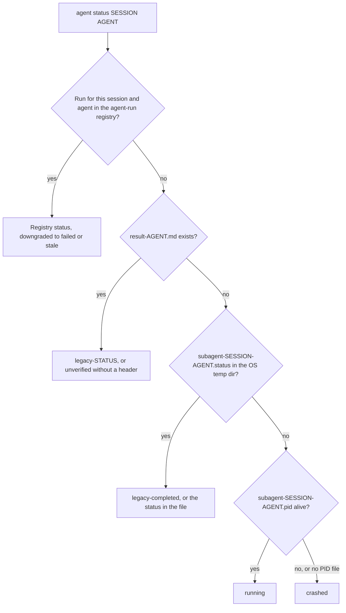

# Opções CLI

## Referência rápida {#quick-reference}

| Eu quero... | Use |
|:-------------|:----|
| Executar sem prompts | `-y` / `--yes` (também reconhecidos: `OMA_YES=1`, `CI=true`); `oma update --ci` para uma saída simples e não interativa |
| Obter JSON | `--json`, `--output json` ou `OH_MY_AG_OUTPUT_FORMAT=json`. Consulte [Opções de saída](#output-options) para as exceções |
| Atuar sobre a instalação global | `-g` / `--global` ou `OMA_INSTALL_GLOBAL=1`; `OMA_HOME` muda a raiz de armazenamento global |
| Pré-visualizar antes de alterar qualquer coisa | `--dry-run` quando o comando o lista. Consulte [Quais comandos suportam JSON](#commands-supporting-json-output) |
| Ver os indicadores de um comando | `oma <command> --help`, `oma describe "<command>"` ou o [registro](#complete-public-option-registry) no fim desta página |
| Corrigir um script que quebrou após uma atualização | [Comandos e opções renomeados](#renamed-commands-and-options) |
| Ramificar em caso de falha em um script | [Códigos de saída](#exit-codes) |

---

## Opções globais {#global-options}

Estas opções estão disponíveis no comando raiz `oma` / `oh-my-agent`:

| Opção | Descrição |
|:-----|:-----------|
| `-g, --global` | Opera na instalação global do OMA (`~/.oma/.agents/` ou `$OMA_HOME/.agents/`) em vez de `<cwd>/.agents/` |
| `-y, --yes` | Ignora os prompts quando o comando selecionado oferece confirmação; as verificações de segurança específicas do comando continuam sendo aplicadas. Também reconhece `OMA_YES=1` e `CI=true` |
| `-V, --version` | Exibe o número da versão e sai |
| `-h, --help` | Exibe a ajuda do comando |

Todos os subcomandos também aceitam `-h, --help` para mostrar a ajuda específica de cada um.

`--global` define a raiz de instalação para todo o processo; assim, `install`, `update`, `link` e `uninstall` resolvem para a instalação global, independentemente do diretório atual:

| Modo | Como selecioná-lo | Local de `.agents/` |
|:-----|:-----------------|:--------------------|
| Projeto (padrão) | nada | `<cwd>/.agents/` |
| Global | `--global` ou `OMA_INSTALL_GLOBAL=1` | `$OMA_HOME/.agents/` (padrão `~/.oma/.agents/`) |

`OMA_HOME=<abs-path>` muda a raiz de armazenamento global; deve ser um caminho absoluto. As instalações de projeto continuam usando o cwd. Execute `oma home --json` para exibir os locais resolvidos e `oma home migrate --dry-run` para pré-visualizar uma migração de dados legados. Consulte [Instalação global](../guide/global-install.md).

---

## Comandos e opções renomeados {#renamed-commands-and-options}

Os caminhos de comando usam espaços, não dois-pontos, e vários comandos e opções foram renomeados. As grafias antigas são rejeitadas, não tratadas como aliases:

- Um comando antigo falha com `Unknown command: ... Use oma --help.` ou `Unexpected argument for oma <group>. Use oma <replacement>.`
- Os nomes de grupo isolados `dashboard`, `state` e `stats` agora exibem a ajuda do grupo em vez de executar algo.
- Uma opção antiga falha com `Removed option <old>. Use <new>.`; os indicadores de ação removidos de `state` e `stats` falham com `Removed option <old>. Use an explicit action; see oma --help.`

Apenas `schedule:run` e `serena daemon:gc` ainda são resolvidos, para que as entradas do agendador do sistema escritas por versões anteriores continuem funcionando.

| Comando antigo | Use agora |
|:------------|:--------|
| qualquer caminho `a:b` com dois-pontos (`agent:spawn`, `state:emit`, ...) | o caminho separado por espaços (`agent spawn`, `state emit`) |
| `dashboard`, `dashboard:web` | `dashboard terminal`, `dashboard web` |
| `hook --vendor ...` | `hook run --vendor ...` |
| `intel run` | `intel suggest` |
| `state`, `state:get <id>` | `state list`, `state get <id>` |
| `state --activate` / `--archive` / `--purge` | `state activate` / `state archive` / `state purge` |
| `state:required-decisions` | `state decisions list` |
| `state:inject-log ... --entry <file>` | `state inject-log list`, `state inject-log get <session-id> <file>` |
| `stats`, `stats --reset` | `stats get`, `stats reset` |
| `memory:retry-drain` | `memory retry drain` |
| `vault rm` | `vault delete` |
| `search api <url>`, `search rss <url>` | `search api fetch <url>`, `search rss fetch <url>` |
| `search api:search`, `search rss:google` | `search api search`, `search rss google` |
| `skills audit` / `lint` / `eval` / `promotions` / `rollback` / `procedure` / `meta-optimize` / `evolution-stats` / `matrix` | `skill ...` (singular) |
| `skills opt` | `skill optimize` |
| `slide new`, `slide viewer` | `slide create`, `slide preview` |
| `slide pdf` / `png` / `pptx` | `slide export pdf` / `png` / `pptx` |
| `slide import-pptx`, `slide fetch-video`, `slide styles ...` | `slide import pptx`, `slide asset fetch-video`, `slide style ...` |
| `image list-vendors`, `video list-providers` | `image vendor list`, `video provider list` |
| `schedule:add`, `schedule:remove` | `schedule create`, `schedule delete` |
| `verify <agent-type>` | `verify agent <agent-type>` |

| Opção antiga | Use agora |
|:-----------|:--------|
| `-m, --model <vendor>` | `--vendor <vendor>` |
| `-r, --root <path>` | `--project-root <path>` |
| `--sid`, `--session` | `--session-id <id>` |
| `--format <fmt>` | `--output <format>` (`search media --format` não muda) |
| `--out <dir>`, `--out-dir` | `--output-dir <path>` |
| `--out <file>`, `--out-file` | `--output-file <path>`; `--report-file <path>` em `slide validate` e `explain validate` |
| `--dir` | `--workspace <path>` nos comandos `slide`, `--output-dir <path>` em `slide create`, `--input-dir <path>` em `explain validate` |
| `--max` | `--limit <n>` em `scholar search` |
| `--allow-external-out` | `--allow-external-output` |
| `--timeout <seconds>`, `--timeout <ms>`, `--timeout-minutes` | `--timeout <duration>` (`30s`, `2m`). Uma unidade é obrigatória onde o valor antigo era em milissegundos ou minutos |
| `--max-age-days` | `--max-age <duration>`; `--expires-after <duration>` em `schedule create` |

---

## Opções de saída {#output-options}

Muitos comandos oferecem saída legível por máquina para pipelines de CI/CD e automação. Há três formas de solicitar saída JSON.

### 1. Indicador --json {#1---json-flag}

```bash
oma stats get --json
oma doctor --json
oma cleanup --json
```

O indicador `--json` está disponível apenas nos caminhos que o listam. Não deduza o suporte a partir de uma família de comandos: por exemplo, as folhas `image`, `video` e `slide` expõem `--output` quando o registro o lista, enquanto `search` sempre exibe JSON.

### 2. Indicador --output {#2---output-flag}

```bash
oma stats get --output json
oma doctor --output text
```

Na maioria dos comandos, `--output` aceita `text` ou `json`. Ele oferece a mesma função que `--json`, mas também permite solicitar explicitamente saída em texto, o que é útil quando a variável de ambiente está definida como `json`.

**Validação:** se um formato inválido for informado, a CLI lança: `Invalid output format: {value}. Expected one of text, json`.

### 3. Variável de ambiente OH_MY_AG_OUTPUT_FORMAT {#3-oh_my_ag_output_format-environment-variable}

```bash
export OH_MY_AG_OUTPUT_FORMAT=json
oma stats get # outputs JSON
oma doctor # outputs JSON
oma retro # outputs JSON
```

Defina esta variável de ambiente como `json` para tornar JSON o formato padrão nos comandos que o suportam. Somente o valor `json` é reconhecido; qualquer outro valor é ignorado e a saída permanece em texto.

### Como o formato é escolhido {#how-the-format-is-chosen}

Um indicador na linha de comando prevalece sobre a variável de ambiente. Passar ao mesmo tempo `--json` e um `--output` diferente de JSON é um erro, não uma regra de prioridade.

| Você passa | Variável não definida | `OH_MY_AG_OUTPUT_FORMAT=json` |
|:---------|:---------------|:------------------------------|
| nada | texto | JSON |
| `--json` ou `--output json` | JSON | JSON |
| `--output text` | texto | texto |
| `--json --output text` | erro: `--json conflicts with --output. Choose one output format.` | mesmo erro |

Alguns comandos usam seus próprios valores de formato:

| Comandos | Controle de formato |
|:---------|:---------------|
| `search ...` | Sempre JSON; `--pretty` apenas indenta. `search providers` e `search web` também aceitam `--json` |
| `describe` | Sempre JSON |
| `image ...`, `video ...` | `--output text\|json` (padrão `text`) |
| `slide validate` | `--output json\|concise` (padrão `concise`) |
| `explain validate` | `--output concise\|json` (padrão `concise`) ou `--json` |
| `hook probe` | `--output text\|md\|json` |

### Quais comandos suportam JSON {#commands-supporting-json-output}

Todo comando que aceita `--json` ou `--output` informa `supportsJsonOutput: true` em `oma describe`, e o [registro](#complete-public-option-registry) no fim desta página lista os indicadores por caminho. Os comandos que sempre exibem JSON sem indicador (`describe` e a maioria dos subcomandos `search`) não são marcados. Para listar os caminhos a partir da CLI:

```bash
oma describe | jq -r '.. | objects | select(.supportsJsonOutput? == true) | .path'
```

Use `select(.supportsDryRun? == true)` da mesma forma para encontrar os comandos com `--dry-run`.

---

## Opções por comando {#per-command-options}

### install

```text
oma install [--web-search <provider>] [--code-intelligence <provider>] [--semantic-memory <provider>] [--honcho-url <url>] [--honcho-workspace <id>]
```

O instalador interativo grava as configurações de provider selecionadas em `.agents/oma-config.yaml`. Os indicadores de provider selecionam as integrações de pesquisa na web, de inteligência de código e de memória semântica; `--honcho-url` e `--honcho-workspace` configuram o serviço de memória Honcho quando esse provider é selecionado. O indicador raiz `-y, --yes` se aplica quando um fluxo de instalação pede confirmação.

### doctor

```text
oma doctor [--json] [--output <format>] [--profile] [--heal-check <agentType>]
```

| Opção | Descrição | Valor padrão |
|:-----|:-----------|:--------|
| `--json` | Emite JSON em vez de texto formatado. | `false` |
| `--output <format>` | Formato de saída explícito (`text` ou `json`). Consulte [Opções de saída](#output-options). | `text` |
| `--profile` | Exibe a matriz de saúde do perfil (slug de modelo resolvido, CLI e estado de autenticação por agente a partir do `model_preset` ativo e das substituições de `agents:`). Consulte [Modelos por agente](../guide/per-agent-models.md). | `false` |
| `--heal-check <agentType>` | Inclui a verificação do gate de autorreparo de um agente. | |

Com `--json`, o relatório tem os campos de nível superior `ok` e `issues`, e `doctor` sai com `1` quando `issues` é maior que zero.

### update

```text
oma update [-f | --force] [--with-new-skills] [--ci] [-y | --yes] [--all] [--vendor <vendors>]
oma update mcp [-y | --yes] [--ci] [--all] [--vendor <vendors>]
```

| Opção | Curto | Descrição | Valor padrão |
|:-----|:------|:-----------|:--------|
| `--force` | `-f` | Substitui os arquivos de configuração personalizados durante a atualização. Abrange `oma-config.yaml`, `mcp.json` e os diretórios `stack/`. Sem esta opção, esses arquivos passam por backup antes da atualização e são restaurados depois. | `false` |
| `--with-new-skills` | | Instala as skills adicionadas ao registro desde a instalação atual. | `false` |
| `--ci` | | Executa em modo CI não interativo. Ignora todas as confirmações e usa saída simples no console em vez de spinners e animações. Obrigatório em pipelines de CI/CD sem stdin. | `false` |
| `--yes` | `-y` | Ignora os prompts. Não cria os diretórios de vendors ausentes, exceto com `--all` ou `--vendor`. | `false` |
| `--all` | | Cria ou atualiza todos os vendors compatíveis no nível do projeto. | `false` |
| `--vendor <vendors>` | | Cria ou atualiza uma lista de vendors separados por vírgulas, por exemplo `claude,qwen`. | Apenas os diretórios de vendors existentes |

`oma update mcp` usa os mesmos controles `--yes`, `--ci`, `--all` e `--vendor` ao escolher os servidores MCP do navegador. Ele não usa `--force` nem `--with-new-skills`.

**Comportamento com --force:**
- `oma-config.yaml` é substituído pelo valor padrão do registro.
- `mcp.json` é substituído pelo valor padrão do registro.
- O diretório backend `stack/` (recursos específicos da linguagem) é substituído.
- Todos os outros arquivos são sempre atualizados, independentemente desta opção.

**Comportamento com --ci:**
- Nenhum `console.clear()` na inicialização.
- `@clack/prompts` é substituído por `console.log` simples.
- Os prompts de detecção de concorrentes são ignorados.
- Os erros são lançados em vez de chamar `process.exit(1)`.

**Escopo dos vendors:**
- `oma update` atualiza apenas os diretórios de vendors que já existem.
- `oma update --yes` usa o mesmo escopo de vendors, sem prompts.
- `oma update --all` cria ou atualiza todos os vendors compatíveis no nível do projeto.
- `oma update --vendor claude,qwen` cria ou atualiza somente os vendors listados.

### stats

```text
oma stats get [--json | --output <format>]
oma stats reset [--json | --output <format>]
```

| Opção | Descrição | Valor padrão |
|:-----|:-----------|:--------|
| `--json` | Emite JSON. `stats get` exibe o objeto de métricas; `stats reset` exibe `{"reset":true}`. | `false` |
| `--output <format>` | Emite `text` ou `json`. | `text` |

`oma stats reset` é o comando de reinicialização; `oma stats get --reset` falha com `Removed option --reset`.

:::note
`stats get` não é somente leitura. Cada chamada conta como uma sessão e adiciona o diff dos últimos 10 commits aos contadores cumulativos de arquivos e linhas em `.agents/state/metrics.json`; portanto, não o consulte em polling.
:::

### retro

```text
oma retro [window] [--json] [--output <format>] [--interactive] [--compare]
```

| Opção | Descrição | Valor padrão |
|:-----|:-----------|:--------|
| `--interactive` | Entrada guiada legada: pergunta o que você realizou, os principais aprendizados e os próximos passos. Ignora a janela, `--compare` e `--json`. | `false` |
| `--compare` | Compara a janela de tempo atual com a janela anterior de mesma duração. Exibe as variações (por exemplo, commits +12, linhas adicionadas -340). | `false` |

**Formato do argumento window:** um número seguido de `h`, `d` ou `w`.
- `24h`: 24 horas
- `7d`: 7 dias
- `2w`: 2 semanas
- Omita para usar o valor padrão (7 dias)

Meses não são suportados: `oma retro 1m` falha com `Invalid window: 1m. Use: 24h, 7d, 14d, 30d, 2w`.

### cleanup

```text
oma cleanup [--dry-run] [-y | --yes] [--json] [--output <format>]
```

| Opção | Curto | Descrição | Valor padrão |
|:-----|:------|:-----------|:--------|
| `--dry-run` | | Modo de pré-visualização. Lista todos os itens que seriam limpos sem fazer nenhuma alteração. O código de saída é 0, independentemente do que for encontrado. | `false` |
| `--yes` | `-y` | Ignora todos os prompts de confirmação. Limpa tudo sem perguntar. Útil em scripts e na CI. | `false` |

**O que é limpo:**
1. Arquivos PID órfãos: `/tmp/subagent-*.pid`, quando o processo referenciado não está mais em execução.
2. Arquivos de log órfãos: `/tmp/subagent-*.log`, correspondentes a PIDs de processos encerrados.
3. Diretórios Gemini Antigravity: `.gemini/antigravity/brain/`, `.gemini/antigravity/implicit/`, `.gemini/antigravity/knowledge/`. Eles acumulam estado ao longo do tempo e podem ficar muito grandes.

### agent spawn

```text
oma agent spawn <agent-id> <prompt> <session-id> [options]
```

| Opção | Curto | Descrição | Valor padrão |
|:-----|:------|:-----------|:--------|
| `--resumed-from` | — | Vincula uma nova tentativa ao identificador da execução anterior. | |
| `--fallback-vendors` | — | Cadeia explícita e ordenada de vendors de fallback, separados por vírgulas. | |
| `--task-id` | — | Identificador da tarefa vindo do plano da sessão. | Identificador do agente |
| `--vendor` | — | Substituição do vendor da CLI. `--help` lista `antigravity`, `claude`, `codex`, `cursor`, `opencode`, `qwen`, `grok` e `pi`. | Resolvido a partir da configuração |
| `--workspace` | `-w` | Diretório de trabalho do agente. Se omitido ou definido como `.`, a CLI detecta automaticamente o espaço de trabalho a partir dos arquivos de configuração do monorepo (pnpm-workspace.yaml, package.json, lerna.json, nx.json, turbo.json, mise.toml). | Detectado automaticamente ou `.` |
| `--isolation` | — | Modo de isolamento: `worktree` cria um worktree git por execução; o valor padrão é `none`. | `none` |
| `--read-only` | — | Limita o agente iniciado a ferramentas não destrutivas e remove os indicadores de autoaprovação. | `false` |

**Validação:**
- `agent-id` e `session-id` não devem conter `..`, `?`, `#`, `%` nem caracteres de controle. `agent spawn` não tem uma lista fixa de identificadores de agente; o roteamento de modelo e de vendor reconhece `orchestrator`, `architecture`, `qa`, `pm`, `backend`, `frontend`, `mobile`, `db`, `debug`, `refactor`, `docs`, `tf-infra` e `explore`, além de aliases como `backend-engineer`, `qa-reviewer` e `research-explorer`.
- `--vendor` deve ser um identificador de vendor do oma: `antigravity`, `claude`, `codex`, `commandcode`, `copilot`, `cursor`, `grok`, `hermes`, `kimi`, `kiro`, `opencode`, `pi`, `qwen` ou `zcode`. A tabela abaixo cobre os oito vendors que `--help` nomeia.

**Comportamento específico de cada vendor:**

| Vendor | Comando | Indicador de autoaprovação | Indicador de prompt |
|:-------|:--------|:-----------------|:-----------|
| antigravity | `agy` | `--dangerously-skip-permissions` | `-p` |
| claude | `claude` | (nenhum) | `-p` |
| codex | `codex` | `--sandbox workspace-write` | (nenhum; o prompt é posicional) |
| cursor | `cursor-agent` | específico do vendor | `-p` |
| opencode | `opencode` | específico do vendor | `-p` |
| qwen | `qwen` | `--yolo` | `-p` |
| grok | `grok` | específico do vendor | `-p` |
| pi | `pi` | suprimido no modo `--read-only` | o prompt é posicional |

Esses valores padrão podem ser substituídos em `.agents/skills/oma-orchestration/config/cli-config.yaml`.

O Codex mantém seu sandbox workspace-write. O oma habilita o acesso à rede e adiciona a raiz do projeto, o diretório de estado do OMA (`~/.oma`) e os caches existentes de gerenciadores de pacotes como diretórios graváveis. `oma update` substitui `cli-config.yaml`; portanto, defina um modo duradouro com `OMA_CODEX_SANDBOX`: `read-only`, `workspace-write` (padrão) ou `danger-full-access` (sem sandbox e sem aprovações).

### agent status

```text
oma agent status <session-id> [agent-ids...] [--project-root <path>]
```

| Opção | Descrição | Valor padrão |
|:-----|:-----------|:--------|
| `--project-root <path>` | Projeto cujo registro de execuções de agentes e cujos arquivos `.agents/state/memories/result-{agent}.md` são lidos. `-r` e `--root` foram removidos e falham com `Removed option -r. Use --project-root.` | Diretório de trabalho atual |

O comando exibe uma linha `{agent-id}:{status}` por agente solicitado. Para cada agente, ele usa a primeira fonte que existir:



| Estado | Significado |
|:-------|:--------|
| `running`, `completed`, `partial`, `blocked`, `failed` | Estado registrado no registro de execuções de agentes |
| `failed` | Também informado quando uma execução registrada está `running`, mas seu processo executor não existe mais |
| `stale` | A execução registrada está `completed`, mas a evidência do resultado não é mais validada |
| `legacy-<status>` | Nenhuma execução registrada; `result-{agent}.md` tem um cabeçalho `## Status: <status>` |
| `unverified` | Nenhuma execução registrada; `result-{agent}.md` não tem cabeçalho de estado |
| `legacy-completed` | Nenhuma execução nem arquivo de resultado; o arquivo `.status` da sessão diz `completed` (qualquer outro valor é exibido como está) |
| `crashed` | Nada foi encontrado, ou o arquivo PID legado aponta para um processo encerrado |

Consulte [Resultados e retomada dos agentes](../guide/agent-results-and-resume.md) para saber como as execuções são registradas.

### agent parallel

```text
oma agent parallel [tasks...] [--session-id <id>] [--vendor <vendor>] [-i | --inline] [--no-wait]
```

| Opção | Curto | Descrição | Valor padrão |
|:-----|:------|:-----------|:--------|
| `--session-id <id>` | — | Identificador de sessão de todas as execuções iniciadas. Passe o mesmo identificador a `oma agent status`. | Nome do diretório de execução, `parallel-<timestamp>-<suffix>` |
| `--vendor` | — | Substituição do vendor da CLI aplicada a todos os agentes iniciados. | Resolvido para cada agente a partir da configuração |
| `--inline` | `-i` | Interpreta os argumentos de tarefa como strings `agent:task[:workspace]` em vez de um caminho de arquivo. | `false` |
| `--no-wait` | | Modo em segundo plano. Inicia todos os agentes e retorna imediatamente, sem esperar a conclusão. A lista de PIDs e os logs são salvos em `.agents/results/parallel-<timestamp>-<suffix>/`. | `false` (espera a conclusão) |

**Formato das tarefas inline:** `agent:task` ou `agent:task:workspace`
- O workspace é detectado verificando se o último segmento separado por dois-pontos começa com `./`, `/` ou é igual a `.`.
- Exemplo: `backend:Implement auth API:./api` -- agent=backend, task="Implement auth API", workspace=./api.
- Exemplo: `frontend:Build login page` -- agent=frontend, task="Build login page", workspace=auto-detected.

**Formato do arquivo YAML de tarefas:**

```yaml
tasks:
  - id: api            # optional; default <agent>-<index>
    agent: backend
    task: "Implement user API"
    workspace: ./api   # optional; auto-detected when omitted
  - agent: frontend
    task: "Build user dashboard"
```

### recap

```text
oma recap [--window <period>] [--date <date>] [--tool <tools>] [--top <n>] [--sort <metric>] [--mermaid] [--graph] [--json] [--output <format>]
```

| Opção | Descrição | Valor padrão |
|:-----|:-----------|:--------|
| `--window <period>` | Janela de tempo no formato `<n>h`, `<n>d` ou `<n>w` (por exemplo `1d`, `3d`, `7d`, `2w`, `30d`). Valores acima de 30 dias são limitados a 30 dias com um aviso. Ignorada quando `--date` está definido. | `1d` |
| `--date <date>` | Data específica (`YYYY-MM-DD`). Tem prioridade sobre `--window`. | |
| `--tool <tools>` | Filtra as sessões por ferramenta. Lista separada por vírgulas: `antigravity`, `claude`, `codex`, `cursor`, `gemini`, `grok`, `qwen`. | todas as ferramentas |
| `--top <n>` | Exibe somente os N principais projetos/temas do resumo. | sem limite |
| `--sort <metric>` | Ordena as sessões por `count` ou `duration`. | `count` |
| `--mermaid` | Exibe um diagrama de Gantt Mermaid em vez do resumo padrão. `--json` tem prioridade. | `false` |
| `--graph` | Abre o grafo interativo no dashboard web (`/recap`). Tem prioridade sobre `--mermaid` e `--json`. | `false` |

### search

```text
oma search <subcommand> [...]
```

Todo subcomando `search` escreve JSON em stdout sem nenhum indicador; `providers` e `web` também aceitam `--json`. Nenhum aceita `--output`. `--pretty` muda apenas a indentação.

| Subcomando | Opções importantes |
|:-----------|:---------------|
| `providers` | `--json`, `--pretty` |
| `web <query>` | `--provider <id>`, `--limit <n>` (padrão `10`), `--timeout <duration>` (padrão `15s`), `--json`, `--pretty` |
| `fetch <url>` | `--only`, `--skip`, `--include-archive`, `--timeout <duration>` (padrão `15s`), `--locale`, `--pretty` |
| `meta <url>` / `archive <url>` / `api fetch <url>` / `rss fetch <url>` | `--timeout <duration>` (padrão `15s`), `--locale` (padrão `en-US,en;q=0.9`), `--pretty` |
| `api search <query>` | `--platforms <list>`, `--timeout <duration>`, `--locale`, `--pretty` |
| `rss google <query>` | `--locale` (padrão `en-US`) |
| `media <url>` | `--subs`, `--sub-lang <list>` (padrão `en`), `--format <spec>`, `--timeout <duration>` (padrão `30s`), `--pretty` |
| `code <query>` | `--host <github\|gitlab>` (padrão `github`), `--language`, `--repo`, `--limit` (padrão `20`), `--pretty` |
| `trust <domain>` | `--pretty` |
| `doctor` | nenhum (executa verificações de binários para Chrome / `python3 curl_cffi` / `yt-dlp` / `gh`) |

`search` usa a escala compartilhada de códigos de saída; consulte [Códigos de saída](#exit-codes).

### image

```text
oma image <subcommand> [...]
```

O formato de saída é controlado por cada subcomando via `--output <text|json>`.

`image generate` aceita:

| Opção | Curto | Descrição | Valor padrão |
|:-----|:------|:-----------|:--------|
| `--vendor <name>` | | `auto` \| `pollinations` \| `codex` \| `antigravity` \| `all`. `auto` resolve a configuração `image:` ativa e a autenticação disponível. | `auto` |
| `--size <size>` | | `WxH` com as duas bordas divisíveis por 16, de 16 a 3840, proporção de 1:3 a 3:1, ou `auto`. | valor padrão do vendor |
| `--quality <level>` | | `low` \| `medium` \| `high` \| `auto`. | valor padrão do vendor |
| `--count <n>` | `-n` | Número de imagens, de 1 a 5. | `1` |
| `--output-dir <dir>` | | Diretório de saída. Deve ficar dentro de `$PWD`, exceto se `--allow-external-output` estiver definido. | `.agents/results/images/{timestamp}/` |
| `--allow-external-output` | | Autoriza os caminhos `--output-dir` fora de `$PWD`. | `false` |
| `--model <name>` | | Substituição de modelo específica do vendor. O modelo antigravity é selecionado por `agy`. | valor padrão do vendor |
| `--timeout <duration>` | | Tempo limite por imagem, expresso como duração. | valor padrão do vendor |
| `--reference <path>` | `-r` | Imagem de referência para transferência de estilo/tema. Repetível (`-r a.png -r b.png`) ou separada por vírgulas. Validada quanto ao tamanho (≤5 MB), ao formato (PNG/JPEG/GIF/WebP via magic bytes) e à quantidade (≤10). Compatível com `codex` e `antigravity`; recusada com o código de saída 4 por `pollinations`. | |
| `--yes` | `-y` | Ignora o prompt de confirmação do custo. | `false` |
| `--no-prompt-in-manifest` | | Armazena o SHA256 do prompt em vez do texto bruto em `manifest.json`. | `false` |
| `--dry-run` | | Exibe o plano e a estimativa de custo; não executa nada. | `false` |
| `--output <format>` | | `text` \| `json`. | `text` |

`image doctor` e `image vendor list` aceitam `--output <text|json>`. Use `image vendor list` para descobrir os vendors; a grafia antiga `image list-vendors` falha.

### video

```text
oma video generate <brief...> [options]
oma video doctor [--output <format>] [--install|--upgrade|--install-mpt|--install-strudel]
oma video compose <run-dir> [--output <format>] [--refresh] [--offline]
oma video render <run-dir> [--output <format>]
oma video provider list [--output <format>]
```

`video generate` aceita os controles de planejamento e de captura `--mode`, `--aspect`, `--locale`, `--captions`, `--visual`, `--voice`, `--music`, `--duration`, `--compositor`, `--capture`, `--source`, `--url`, `--device`, `--ready-selector`, `--show-cursor`, `--polish`, `--capture-timeout` e `--capture-stop`. Aceita também `--output-dir`, `--allow-external-output`, `--max-usd`, `--seed`, `--timeout`, `--script`, `--dry-run`, `--yes`, `--output` e `--no-brief-in-manifest`. A captura pelo navegador usa `--source web --url <url>`; `file` é a origem padrão. Uma renderização normal exige uma composição escrita e um compositor funcional; os placeholders se limitam ao caminho de teste `OMA_VIDEO_MOCK=1`.

`video doctor` informa ou instala a cadeia de ferramentas HyperFrames/MPT/Strudel. `compose` prepara o contrato de composição da execução e `render` executa o lint, renderiza e verifica a saída. `provider list` informa o estado do provider e da chave. Consulte [Geração de vídeo](../guide/video-generation.md) para o manifesto de execução e a sequência de recuperação.

### memory init

```text
oma memory init [--json] [--output <format>] [--force]
```

| Opção | Descrição | Valor padrão |
|:-----|:-----------|:--------|
| `--force` | Substitui os arquivos de esquema vazios ou existentes em `.agents/state/memories/`. Sem esta opção, os arquivos existentes não são tocados. | `false` |

### verify

```text
oma verify agent <agent-type> [-w <workspace>] [--session-id <id>] [--task-id <id>] [--run-id <id>] [--json] [--output <format>]
oma verify triggers [--corpus <path>] [--max-false-fire <pct>] [--max-missed-fire <pct>] [--json] [--output <format>]
```

| Opção | Curto | Descrição | Valor padrão |
|:-----|:------|:-----------|:--------|
| `--workspace` | `-w` | Caminho para o diretório workspace a verificar. | Diretório de trabalho atual |
| `--session-id <id>` | | Seleciona o plano e os relatórios da sessão. Obrigatório quando existem vários planos, a menos que um recibo de execução identifique a sessão. | |
| `--task-id <id>` | | Seleciona o escopo e o relatório de uma tarefa. Requer `--session-id` ou `--run-id`. | |
| `--run-id <id>` | | Seleciona o relatório exato da execução. Deduz a sessão/tarefa a partir do recibo local; se ele não existir, informe explicitamente os dois identificadores. | |

**Tipos de agente:** `backend`, `frontend`, `mobile`, `qa`, `debug`, `pm`.

`verify triggers` mede a precisão do detector de palavras-chave em um corpus rotulado. Os limites percentuais são gates; use a saída JSON quando um job de CI precisar inspecionar resultados individuais. A grafia antiga `oma verify <agent-type>` falha; use `verify agent <agent-type>`.

---

## Códigos de saída {#exit-codes}

**Escala compartilhada (`image`, `video`, `search`):**

| Código | Significado |
|:-----|:--------|
| `0` | sucesso |
| `1` | erro genérico |
| `2` | bloqueado, ou recusa de segurança do provider |
| `3` | não encontrado |
| `4` | entrada inválida |
| `5` | autenticação obrigatória, ou o binário do provider não está instalado |
| `6` | tempo limite excedido |

**Específicos de cada comando:**

| Comando | Códigos |
|:--------|:------|
| `doctor --json` | `0` nenhum problema, `1` um ou mais problemas |
| `verify agent` | `0` todas as verificações passam, `1` uma verificação falhou ou o tipo de agente é inválido, `2` workspace não encontrado |
| `verify triggers` | `0` dentro dos limites, `1` um limite foi excedido |
| `docs verify` | `1` referências quebradas encontradas |
| `vault get` | `1` nome de chave inválido, `2` entrada inexistente |

---

## Exemplos práticos {#practical-examples}

### Pipeline de CI: atualização e verificação {#ci-pipeline-update-and-verify}

```bash
# Update in CI mode, then fail the job when doctor reports any issue
oma update --ci
oma doctor --json | jq -e '.ok' > /dev/null
```

### Execução em lote de agentes com monitoramento de estado {#batch-agent-execution-with-status-monitoring}

```bash
# Choose the session ID first and pass it to both commands
SESSION_ID="session-$(date +%Y%m%d-%H%M%S)"
oma agent parallel tasks.yaml --session-id "$SESSION_ID" --no-wait

# Check status every 5 seconds
watch -n 5 "oma agent status $SESSION_ID backend frontend mobile"
# Without `watch` (stock macOS), loop instead:
# while sleep 5; do oma agent status "$SESSION_ID" backend frontend mobile; done
```

### Limpeza na CI depois dos testes {#cleanup-in-ci-after-tests}

```bash
# Clean up all orphaned processes without prompts
oma cleanup --yes --json
```

### Verificação por workspace {#workspace-aware-verification}

```bash
# Verify each domain in its workspace
oma verify agent backend -w ./apps/api
oma verify agent frontend -w ./apps/web
oma verify agent mobile -w ./apps/mobile
```

### Retro com comparação para revisões de sprint {#retro-with-comparison-for-sprint-reviews}

```bash
# Two-week sprint retro with comparison to previous sprint
oma retro 2w --compare
```

### Script completo de verificação de saúde {#full-health-check-script}

```bash
#!/usr/bin/env bash
set -euo pipefail

echo "=== oh-my-agent Health Check ==="

report="$(mktemp)"
# doctor exits 1 when it finds issues; keep the report and continue
oma doctor --json > "$report" || true

# Check CLI installations
jq -r '.clis[] | "\(.name): \(if .installed then "OK (\(.version // "unknown"))" else "MISSING" end)"' "$report"
jq -r '"Issues: \(.issues)"' "$report"

# Check auth status (an object of booleans keyed by github and each vendor ID)
oma auth status --json | jq -r 'to_entries[] | "\(.key): \(if .value then "authenticated" else "not authenticated" end)"'

echo "=== Done ==="
```

### Describe para introspecção de agentes {#describe-for-agent-introspection}

```bash
# An AI agent can discover available commands
oma describe | jq '.command.subcommands[] | {name, description}'

# Get details about a specific command
oma describe "agent spawn" | jq '.command.options[] | {flags, description}'
```

---

## Registro público completo das opções {#complete-public-option-registry}

Cada linha é um caminho de comando que é executado por conta própria; os grupos que apenas exibem a ajuda foram omitidos, e os indicadores raiz compartilhados estão descritos em [Opções globais](#global-options). Os valores padrão aparecem ao lado de sua opção. Execute `oma describe "<path>"` para obter o JSON completo de um caminho.

:::note
Esta tabela é gerada a partir de `oma describe`. Não a edite manualmente: execute `node cli/scripts/generate-cli-reference.mjs` para regenerá-la, ou adicione `--check` para falhar quando ela estiver desatualizada.
:::

<!-- oma:generated cli-registry:start -->

| Command | Arguments | Options | Description |
|:--|:--|:--|:--|
| `agent begin` | `<agent-id> <task-id> <session-id>` | `--project-root <path>`, `-w, --workspace <path>` | Start an evidence-backed native agent run |
| `agent context` | `<agent-id>` | `--project-root <path>`, `--difficulty <level>` (default: `Medium`) | Load graph-selected context for a native dispatch prompt |
| `agent finish` | `<run-id> <result-file>` | `--project-root <path>` | Validate a native agent result against its verification receipts |
| `agent parallel` | `[tasks...]` | `--session-id <id>`, `--vendor <vendor>`, `-i, --inline`, `--no-wait` | Run multiple sub-agents in parallel |
| `agent resume` | `<session-id>` | `--project-root <path>`, `--dry-run`, `--max-attempts <count>` (default: `3`) | Resume safe incomplete tasks, reusing current acceptance evidence |
| `agent review` | — | `--vendor <vendor>`, `-p, --prompt <prompt>`, `-w, --workspace <path>`, `--no-uncommitted` | Run code review using external CLI (codex/claude/qwen/grok) |
| `agent spawn` | `<agent-id> <prompt> <session-id>` | `--resumed-from <run-id>`, `--fallback-vendors <vendors>`, `--task-id <id>`, `--vendor <vendor>`, `-w, --workspace <path>`, `--isolation <mode>`, `--read-only` | Spawn a subagent (prompt can be inline text or a file path) |
| `agent status` | `<session-id> [agent-ids...]` | `--project-root <path>` (default: current directory) | Check status of subagents |
| `agent verify` | `<run-id> [command...]` | `--project-root <path>`, `--required`, `--affected <paths...>` | Execute verification argv after -- and record its real exit code |
| `auth status` | — | `--json`, `--output <format>` | Check authentication status of all supported CLIs |
| `bridge` | `[url]` | `--context <name>` (default: `ide`), `--oma-home <path>`, `--oma-state-home <path>` | Proxy MCP stdio to a shared per-project Serena server (started on demand) |
| `cleanup` | — | `--dry-run`, `-y, --yes`, `--json`, `--output <format>` | Clean up orphaned subagent processes and temp files |
| `dashboard terminal` | — | `--project-root <path>` | Start terminal dashboard (real-time agent monitoring) |
| `dashboard web` | — | `--project-root <path>` | Start web dashboard on http://127.0.0.1:9847 |
| `describe` | `[command-path]` | — | Describe CLI commands as JSON for runtime introspection |
| `diagram archify` | `[args...]` | — | Run the installed archify CLI (doctor \| guide \| validate \| deliver \| visual-check …) with update checks disabled |
| `diagram resolve` | — | `--engine <engine>`, `--refresh`, `--offline`, `--json`, `--output <format>` | Report which diagram engine workflows should use, and where archify lives |
| `diagram update` | — | `--json`, `--output <format>` | Download the latest archify release into oma's managed cache (~/.cache/oma-diagram/archify) |
| `docs i18n` | — | `--json`, `--min-severity <level>` (default: `MEDIUM`) | Detect drift between English source docs (web/docs) and i18n translations (web/i18n/{lang}/...). Emits structural signals (line count, heading count, last-commit timestamp) per pair so the host LLM can decide which translations need a diff-sync patch. The CLI never edits translations. |
| `docs lint` | — | `--json`, `--locales <list>` | Lint translated docs for content-level anti-patterns (em-dashes in CJK targets, etc.). Complements `oma docs i18n` (structural drift) with style/anti-pattern checks per oma-translation SKILL.md § Stage 4. The CLI never auto-fixes — it only reports issues for the host LLM to restructure. |
| `docs sync` | `[diff-range]` | `--json` | Given a git diff, list docs that reference changed files. The host LLM (skill runtime) is expected to read this list plus the diff and propose patches per the SKILL.md contract — the CLI never auto-edits docs. Default diff-range: --cached (staged changes), fallback to HEAD~1..HEAD. |
| `docs verify` | `[path]` | `--json`, `--report-file <path>`, `--no-urls`, `--urls-sync` | Extract file, link, and script references from docs and report broken targets. Regenerates docs/generated/doc-refs.json as a side effect. Exit code: 0 = clean, 1 = broken refs found. URL link checking is delegated to `lychee` (install: brew install lychee). |
| `doctor` | — | `--profile`, `--heal-check <agentType>`, `--json`, `--output <format>` | Check CLI installations, MCP configs, and skill status |
| `emit` | — | `--target <target>` (default: `all`), `--output-dir <path>` (default: `.`), `--json`, `--output <format>` | Emit standards-conformant artifacts from the .agents/ SSOT (Agent Skills spec, Agent Plugins package, Claude Code plugin marketplace, AGENTS.md, cli/AGENTS.md) |
| `explain components` | `[name]` | `--json`, `--output <format>` | List the components a draft can use, or print one component's syntax |
| `explain lint` | `[file]` | `--style <level>`, `--lang <code>`, `--json`, `--output <format>` | Check the prose of a draft (file or stdin) without rendering |
| `explain patch` | `<html> [file]` | `--panel <id>`, `--open`, `--json`, `--output <format>` | Replace one panel of a rendered page from its embedded draft (new panel from file or stdin) |
| `explain render` | `[file]` | `--output-file <path>`, `--template <name>`, `--theme <name>`, `--mode <mode>`, `--style <level>`, `--lang <code>`, `--archify`, `--no-archify`, `--open`, `--json`, `--output <format>` | Render a Markdown draft (file or stdin) into one self-contained HTML explanation |
| `explain validate` | `[file]` | `--input-dir <path>`, `--output <format>` (default: `concise`), `--report-file <path>`, `--json` | Validate self-contained explain HTML report artifacts |
| `goal set` | — | `--workflow <name>`, `--session-id <id>`, `--gate <keyword>`, `--budget-minutes <n>`, `--description <text>`, `--json`, `--output <format>` | Attach a goal contract (deterministic stop gate / wall-clock budget) to an active persistent workflow |
| `harness eval` | — | `--suite <path>`, `--candidate <path>`, `--partition <name>` (default: `validation`), `--mock`, `--action <mode>`, `--transcript <path>`, `--live`, `--record`, `--record-file <path>`, `--yes`, `--timeout <duration>` (default: `15m`), `--require-coverage`, `--json`, `--output <format>` | Compare a candidate .agents overlay with the current baseline |
| `harness evolution disable` | — | `--json`, `--output <format>` | Disable harness evolution and remove its scheduled job |
| `harness evolution enable` | — | `--max-dispatches <n>`, `--cron <expr>` (default: `0 3 * * *`), `--mode <mode>` (default: `apply`), `--json`, `--output <format>` | Enable scheduled harness evolution with a dispatch budget |
| `harness evolution run` | — | `--scheduled`, `--json`, `--output <format>` | Run one harness evolution tick now |
| `harness evolution status` | — | `--json`, `--output <format>` | Show the evolution config, schedule, pending retries, and overlay conflicts |
| `harness feedback` | — | `--live`, `--apply`, `--max-epochs <n>` (default: `1`), `--incident <ids...>`, `--scan-runs`, `--json`, `--output <format>` | Promote captured incidents to skill fixtures and optimize the affected skills |
| `harness incident capture` | — | `--spec <path>`, `--run <id>`, `--json`, `--output <format>` | Record a failure from an incident spec as a captured incident |
| `harness incident export` | `<id>` | `--json`, `--output <format>` | Export a captured incident as a one-task eval suite |
| `harness incident promote` | `<id>` | `--skill <id>`, `--draft`, `--force`, `--json`, `--output <format>` | Turn a captured incident into a regression fixture for a skill |
| `harness incident reproduce` | `<id>` | `--candidate <path>`, `--action <mode>`, `--record-file <path>`, `--transcript <path>`, `--record`, `--yes`, `--timeout <duration>` (default: `15m`), `--json`, `--output <format>` | Inspect, rescore, replay, or rerun a captured incident against a candidate |
| `harness incident scan` | — | `--limit <n>`, `--skeleton <run-id>`, `--json`, `--output <format>` | List failed, blocked, or partial agent runs that no captured incident references yet |
| `harness incident show` | `<id>` | `--json`, `--output <format>` | Show a captured incident and its provenance |
| `help` | — | — | Show help information |
| `home` | — | `--json`, `--output <format>` | Inspect and migrate OMA global storage |
| `home migrate` | — | `--dry-run`, `--json`, `--output <format>` | Copy legacy OMA global files; preserve originals |
| `hook probe` | — | `--vendor <list>`, `--output <format>` (default: `text`), `--hooks-dir <dir>` | Probe per-vendor L1 hook compatibility and print a matrix |
| `hook run` | — | `--vendor <v>`, `--event <e>`, `--matcher <m>` | Dispatch a vendor hook event through the centralised oma hook router |
| `image doctor` | — | `--output <format>` (default: `text`) | Check authentication and install status per vendor |
| `image generate` | `<prompt...>` | `--vendor <name>` (default: `auto`), `--size <size>`, `--quality <level>`, `-n, --count <n>`, `--output-dir <path>`, `--allow-external-output`, `--model <name>`, `--timeout <duration>`, `-r, --reference <path>`, `-y, --yes`, `--no-prompt-in-manifest`, `--dry-run`, `--output <format>` (default: `text`) | Generate images via pollinations (flux/zimage, free), codex (gpt-image-2, ChatGPT OAuth), or antigravity (gemini nano-banana via `agy` CLI, free with Gemini Code Assist sign-in) |
| `image vendor list` | — | `--output <format>` (default: `text`) | List registered vendors and supported models |
| `install` | — | `--web-search <provider>`, `--code-intelligence <provider>`, `--semantic-memory <provider>`, `--honcho-url <url>`, `--honcho-workspace <id>` | Install oh-my-agent skills and configurations |
| `intel suggest` | — | `--config <path>`, `--topic <topic>`, `--target <target>`, `--repos <repos>`, `--since <window>`, `--last-commits <n>`, `--output-dir <path>`, `--dry-run`, `--fixture <path>`, `--create-issue`, `--base-repo <owner/name>`, `--yes`, `--json`, `--output <format>` | Suggest high-value product work from market/code intelligence |
| `link` | `[vendors...]` | `--dry-run` | Regenerate vendor files (.claude/, .cursor/, etc.) from .agents/ SSOT |
| `market detect-trap` | `<topic>` | `--force` | Preflight check that refuses keyword-trap queries |
| `market resolve` | — | `--refresh`, `--offline`, `--json`, `--output <format>` | Report the last30days engine oma will run (managed latest, pin, or local copy) and the Python it uses |
| `market run` | `[args...]` | — | Run the last30days engine (scripts/last30days.py) with the given arguments; --save-dir defaults to market.save_dir |
| `market update` | — | `--json`, `--output <format>` | Download the latest last30days release into oma's managed cache (~/.cache/oma-market/last30days) |
| `memory daemon restart` | — | `--port <port>` (default: `3111`), `--dry-run`, `--json`, `--output <format>` | Restart the OMA-owned AgentMemory daemon |
| `memory daemon start` | — | `--port <port>` (default: `3111`), `--dry-run`, `--json`, `--output <format>` | Start AgentMemory in the background |
| `memory daemon status` | — | `--json`, `--output <format>` | Show daemon status |
| `memory daemon stop` | — | `--dry-run`, `--json`, `--output <format>` | Stop the OMA-owned AgentMemory daemon |
| `memory gc` | — | `--scope <scope>` (default: `all`), `--keep <count>`, `--max-age <duration>`, `--dry-run`, `--json`, `--output <format>` | Garbage-collect project-local memory: prune old L1 sessions and ephemeral Serena files |
| `memory import` | — | `--source <source>` (default: `all`), `--since <since>` (default: `30d`), `--dry-run`, `--force-partial`, `--json`, `--output <format>` | Import vendor conversation history into AgentMemory |
| `memory init` | — | `--force`, `--json`, `--output <format>` | Initialize the coordination store in .agents/state/memories |
| `memory keys` | — | `--kind <kind>` (default: `connection`), `--profile <name>` (default: `oma`), `--key-env <name>` (default: `LLM_OPENAI_API_KEY`), `--from-env <name>`, `--dry-run`, `--json`, `--output <format>` | Configure Honcho connection or local embedding credentials |
| `memory maintain` | `<action>` | `--keep <count>` (default: `5`), `--dry-run`, `--json`, `--output <format>` | Maintain AgentMemory local storage: backup, prune, vacuum |
| `memory maintain backup` | — | `--keep <count>` (default: `5`), `--dry-run`, `--json`, `--output <format>` | Back up AgentMemory local storage |
| `memory maintain prune` | — | `--keep <count>` (default: `5`), `--dry-run`, `--json`, `--output <format>` | Delete AgentMemory backups beyond --keep |
| `memory maintain vacuum` | — | `--keep <count>` (default: `5`), `--dry-run`, `--json`, `--output <format>` | Run SQLite VACUUM on AgentMemory storage |
| `memory retry drain` | — | `--dry-run`, `--json`, `--output <format>` | Drain queued semantic-memory deliveries |
| `memory service install` | — | `--port <port>` (default: `3111`), `--dry-run`, `--json`, `--output <format>` | Install AgentMemory launchd/systemd service integration |
| `memory service uninstall` | — | `--dry-run`, `--json`, `--output <format>` | Uninstall AgentMemory launchd/systemd service integration |
| `memory setup` | — | `--endpoint <url>`, `--port <port>`, `--install`, `--start`, `--dry-run`, `--json`, `--output <format>` | Prepare AgentMemory endpoint configuration |
| `memory status` | — | `--json`, `--output <format>` | Show selected semantic-memory provider health |
| `memory upgrade` | — | `--port <port>`, `--dry-run`, `--json`, `--output <format>` | Stop, backup, upgrade, restart, and health-check AgentMemory |
| `model check` | — | `--json`, `--fail-on-drift`, `--owner <name>`, `--probe` | Check model registry against live vendor model lists |
| `model probe` | `<slug>` | `--json`, `--timeout <duration>` | Probe a model slug against its vendor CLI to verify it is accepted |
| `model propose` | — | `--json`, `--owner <name>`, `--write`, `--timeout <duration>` | Run model:check --probe internally and generate an oma-config `models:` patch for accepted candidates |
| `profile create` | `<slot>` | `--json`, `--output <format>` | Create a local profile |
| `profile list` | — | `--json`, `--output <format>` | List local profiles |
| `profile run` | `<slot> <command> [args...]` | — | Run one command with OMA_PROFILE set for the child process |
| `profile show` | `[slot]` | `--json`, `--output <format>` | Show a local profile |
| `profile use` | `<slot>` | `--shell <shell>`, `--json`, `--output <format>` | Print shell code to activate an existing profile |
| `ralph verify` | — | `--session-id <id>`, `--newer-than <iso>`, `--no-emit`, `--json`, `--output <format>` | Verify ralph EXEC artifacts (anti-circumvention gate, ralph.md Step 1.3) |
| `recap` | — | `--window <period>` (default: `1d`), `--date <date>`, `--tool <tools>`, `--top <n>`, `--sort <metric>` (default: `count`), `--mermaid`, `--graph`, `--json`, `--output <format>` | Recap AI tool conversation history |
| `retro` | `[window]` | `--interactive`, `--compare`, `--json`, `--output <format>` | Engineering retrospective with metrics & trends |
| `schedule create` | `<agent-id> <prompt>` | `--cron <expr>`, `--every <phrase>`, `--vendor <vendor>`, `-w, --workspace <path>`, `--once`, `--expires-after <duration>`, `--env <keys>`, `--dry-run`, `--accept-rounded` | Register a scheduled agent job |
| `schedule delete` | `<id>` | — | Remove a scheduled job from manifest and OS scheduler |
| `schedule list` | — | `--json`, `--output <format>` | List scheduled jobs with OS drift state (synced/stale/missing-in-os/orphan-in-os), grouped by project |
| `schedule run` | `<id>` | `--oma-home <path>`, `--oma-state-home <path>`, `--registration <identity>` | Execute a scheduled job by id (invoked by OS scheduler; not normally called directly) |
| `schedule sync` | — | `--prune` | Re-sync manifest → OS scheduler (registers missing jobs, rewrites stale commands). Use --prune to remove orphan OS jobs. |
| `scholar get` | `<id>` | `--section <name>` | Fetch a sidecar (knows record_id) or work metadata (W-id, DOI, arXiv:&lt;id&gt;, CorpusId:&lt;n&gt;, S2 paperId) |
| `scholar lint` | `<file>` | `--lenient`, `--fail-on-warning` | Validate a .knows.yaml or .knows.json sidecar (v0.9.0) |
| `scholar resolve` | `<query...>` | — | Find best paper match across knows.academy, OpenAlex, Semantic Scholar |
| `scholar search` | `<query...>` | `--limit <n>` (default: `10`), `--year-min <year>`, `--always-fallback` | Search papers (knows.academy → OpenAlex → Semantic Scholar) |
| `search api fetch` | `<url>` | `--timeout <duration>` (default: `15s`), `--locale <value>` (default: `en-US,en;q=0.9`), `--pretty` | Fetch a URL through its matched platform API |
| `search api search` | `<query>` | `--platforms <list>`, `--timeout <duration>` (default: `15s`), `--locale <value>` (default: `en-US,en;q=0.9`), `--pretty` | Fan-out keyword search across platforms that support it |
| `search archive` | `<url>` | `--timeout <duration>` (default: `15s`), `--locale <value>` (default: `en-US,en;q=0.9`), `--pretty` | Fetch via AMP / archive.today / Wayback |
| `search code` | `<query>` | `--host <github\|gitlab>` (default: `github`), `--language <lang>`, `--repo <owner/repo>`, `--limit <n>` (default: `20`), `--pretty` | Search code via gh / glab |
| `search doctor` | — | — | Check dependencies (Chrome, python3 curl_cffi, yt-dlp, gh) |
| `search fetch` | `<url>` | `--only <strategies>`, `--skip <strategies>`, `--include-archive`, `--timeout <duration>` (default: `15s`), `--locale <value>` (default: `en-US,en;q=0.9`), `--pretty` | Fetch URL via auto-escalating strategy pipeline |
| `search media` | `<url>` | `--subs`, `--sub-lang <list>` (default: `en`), `--format <spec>`, `--timeout <duration>` (default: `30s`), `--pretty` | Extract media metadata via yt-dlp (1858 sites) |
| `search meta` | `<url>` | `--timeout <duration>` (default: `15s`), `--locale <value>` (default: `en-US,en;q=0.9`), `--pretty` | Extract OGP / JSON-LD / Schema.org from URL |
| `search providers` | — | `--json`, `--pretty` | List registered search providers and inspect selection without network calls |
| `search rss fetch` | `<url>` | `--timeout <duration>` (default: `15s`), `--locale <value>` (default: `en-US,en;q=0.9`), `--pretty` | Discover and parse RSS/Atom feed for a URL |
| `search rss google` | `<query>` | `--locale <value>` (default: `en-US`) | Build Google News RSS URL for a query |
| `search trust` | `<domain>` | `--pretty` | Resolve trust level / score for a domain |
| `search web` | `<query>` | `--provider <id>`, `--limit <n>` (default: `10`), `--timeout <duration>` (default: `15s`), `--json`, `--pretty` | Search with the selected web provider (Brave has a CLI adapter) |
| `serena check` | — | `--project <path>` (default: `apps/mobile`), `--dart-sdk <path>`, `--timeout <duration>` (default: `60s`), `--staged` | Analyze a Dart package using the managed shared Serena LSP |
| `serena daemon gc` | — | `--quiet` | Stop shared Serena daemons with no clients after the idle grace period |
| `serena reap` | — | `--dry-run`, `--quiet` | Kill idle Serena LSP children to reclaim memory (Serena self-heals on next tool call) |
| `serena reaper disable` | — | `--dry-run` | Uninstall the periodic Serena Reaper scheduled task |
| `serena reaper enable` | — | `--dry-run` | Install the periodic Serena Reaper scheduled task (runs every 5 minutes) |
| `serena setup` | — | — | Repair the managed adapter and install the oma-dart-check compatibility launcher |
| `skill audit` | — | `--json`, `--output <format>` | Check frontmatter description similarity between installed skills |
| `skill eval` | — | `--skill <id>`, `--mock`, `--live`, `--record`, `--yes`, `--task-dir <path>`, `--max-tasks <n>`, `--trials <n>`, `--require-coverage`, `--neg-transfer`, `--routing`, `--json`, `--output <format>` | Measure per-skill utility lift (treatment vs baseline on held-out tasks) |
| `skill evolution-stats` | — | `--skill <id>`, `--json`, `--output <format>` | Aggregate recorded optimization runs: proposals, acceptance, verified improvements, rollbacks, by memory mode and procedure |
| `skill lint` | — | `--skill <id>`, `--json`, `--output <format>` | Detect per-skill authoring smells (frontmatter, structure, broken refs) |
| `skill matrix` | — | `--suite <path>`, `--project-root <path>`, `--skills <names>`, `--delivery <mode>` (default: `native`), `--vendors <ids>` (default: `claude,codex`), `--cases <ids>`, `--live`, `--yes`, `--timeout-seconds <n>` (default: `120`), `--claude-model <model>`, `--codex-model <model>`, `--report <path>`, `--json`, `--output <format>` | Test native skill discovery, references and output contracts across CLI vendors |
| `skill meta-optimize` | — | `--target <part>` (default: `optimizer`), `--skill <ids...>`, `--anchor <ids...>`, `--repeats <n>` (default: `3`), `--candidates <n>` (default: `2`), `--max-epochs <n>` (default: `1`), `--edits-per-epoch <k>` (default: `4`), `--live`, `--apply`, `--memory <mode>` (default: `none`), `--yes`, `--json`, `--output <format>` | Propose and score changes to the evolution procedure itself on held-out skills; promote only with a paired bootstrap interval above zero |
| `skill optimize` | — | `--skill <id>`, `--dry-run`, `--apply`, `--mock`, `--live`, `--max-epochs <n>` (default: `8`), `--edits-per-epoch <k>` (default: `4`), `--lr <chars>` (default: `600`), `--yes`, `--memory <mode>` (default: `recall`), `--json`, `--output <format>` | Optimize a skill's SKILL.md to maximize measured held-out utility lift |
| `skill procedure` | — | `--export`, `--json`, `--output <format>` | Show the evolution procedure (optimizer/maintainer prompts, constitution) and its hashes; --export writes editable defaults |
| `skill promotions` | — | `--skill <id>`, `--all`, `--json`, `--output <format>` | List recorded SKILL.md promotions and rollbacks for a skill, or every skill and the procedure with --all |
| `skill rollback` | — | `--skill <id>`, `--json`, `--output <format>` | Restore the SKILL.md body replaced by the most recent recorded promotion |
| `slide asset fetch-video` | `<url>` | `--workspace <path>`, `--output-name <name>` | Download video via yt-dlp into ./assets/ and print local ref |
| `slide bundle` | — | `--workspace <path>`, `--output-file <path>`, `--inline-fonts` | Merge per-slide files into a single self-contained .html deliverable |
| `slide create` | — | `--output-dir <path>` (default: `my-deck`), `--force` | Scaffold a new slide working directory with starter HTML, assets/, and meta.json |
| `slide doctor` | — | — | Probe required deps (chrome, puppeteer-core) and optional deps (yt-dlp, pptxgenjs) |
| `slide edit` | — | `--workspace <path>`, `--port <n>` (default: `0`) | Open browser bbox editor (node:http server at 127.0.0.1, dispatches to oma agent runner) |
| `slide export pdf` | — | `--workspace <path>`, `--output-file <path>`, `--mode <mode>` (default: `capture`) | Export slides to PDF via puppeteer-core |
| `slide export png` | — | `--workspace <path>`, `--output-dir <path>`, `--resolution <res>` (default: `1080p`) | Export each slide as a PNG image via puppeteer-core |
| `slide export pptx` | — | `--workspace <path>`, `--output-file <path>` | [EXPERIMENTAL] Export to PPTX via pptxgenjs (raster-backed, gradients rasterized) |
| `slide import pptx` | `<file>` | `--workspace <path>` | Import a .pptx file into slide fragments via officeparser (bunx, best-effort) |
| `slide preview` | — | `--workspace <path>` | Build viewer.html (deck-stage web component + speaker-notes panel, toggle with `n`) |
| `slide style get` | `<slug>` | `--refresh` | Fetch a bold template design.md (always-latest main; cached for offline fallback) |
| `slide style list` | — | — | List available style presets (vendored + bold-template index) |
| `slide style preview` | `<slug>` | — | Preview a style preset in the terminal |
| `slide validate` | — | `--workspace <path>`, `--output <format>` (default: `concise`), `--slide <file>`, `--report-file <path>` | Geometric quality gate — renders slides via puppeteer-core and checks overflow/overlap/font-size |
| `star` | — | — | Star oh-my-agent on GitHub |
| `state activate` | `<session-id>` | `--category <category>` (default: `main`), `--archived`, `--all-projects`, `--project <project>`, `--search <text>`, `--older-than <duration>` (default: `90d`), `--dry-run`, `--json`, `--output <format>` | Set the active session for a category |
| `state archive` | — | `--category <category>` (default: `main`), `--archived`, `--all-projects`, `--project <project>`, `--search <text>`, `--older-than <duration>` (default: `90d`), `--dry-run`, `--json`, `--output <format>` | Move inactive terminal sessions to the state archive |
| `state decisions list` | `[workflow]` | `--agent <id>`, `--json`, `--output <format>` | List workflow checkpoints or available agent decision subjects |
| `state emit` | `<kind> [payload]` | `--session-id <id>`, `--category <category>` (default: `main`), `--vendor <vendor>`, `--vendor-sid <vendorSid>`, `--parent-event-id <eventId>`, `--causality-key <key>`, `--ts <iso>`, `--no-mirror`, `--json`, `--output <format>` | Append an OMA L1 workflow event |
| `state get` | `<sid>` | `--json`, `--output <format>` | Inspect one OMA L1 session by ID |
| `state heal-check` | — | `--agent <agentType>`, `--json`, `--output <format>` | Check whether self-healing is allowed for an agent |
| `state inject-log get` | `<session-id> <file>` | `--json`, `--output <format>` | Print one inject audit log entry for a session |
| `state inject-log list` | `<sid>` | `--entry <file>`, `--json`, `--output <format>` | List or view per-boundary inject audit logs |
| `state list` | — | `--category <category>` (default: `main`), `--archived`, `--all-projects`, `--project <project>`, `--search <text>`, `--older-than <duration>` (default: `90d`), `--dry-run`, `--json`, `--output <format>` | Inspect OMA L1 workflow state |
| `state migrate` | — | `--runtime`, `--include-active`, `--dry-run`, `--json`, `--output <format>` | Migrate project state to the home profile |
| `state purge` | — | `--category <category>` (default: `main`), `--archived`, `--all-projects`, `--project <project>`, `--search <text>`, `--older-than <duration>` (default: `90d`), `--dry-run`, `--json`, `--output <format>` | Delete inactive sessions older than --older-than |
| `state repair` | — | `--dry-run`, `--json`, `--output <format>` | Repair OMA L1 workflow state files |
| `state summary` | `[sid]` | `--category <category>` (default: `main`), `--json`, `--output <format>` | Export a session summary to the coordination store |
| `state trajectory` | `[sid]` | `--category <category>` (default: `main`), `--open`, `--width <columns>`, `--sequence`, `--ascii`, `--json`, `--output <format>` | Show a session trajectory: L1 events joined with vendor transcripts |
| `state verify` | — | `--workflow <workflow>`, `--checkpoint <checkpoint>`, `--instance <id>`, `--session-id <id>`, `--category <category>` (default: `main`), `--no-emit-missing`, `--json`, `--output <format>` | Verify required L1 events for a workflow checkpoint |
| `stats get` | — | `--json`, `--output <format>` | View productivity metrics |
| `stats reset` | — | `--json`, `--output <format>` | Reset productivity metrics data |
| `uninstall` | — | `--dry-run`, `-y, --yes` | Remove oh-my-agent's owned files (preserves oma-config.yaml, mcp.json, and user-authored skills) |
| `update` | — | `-f, --force`, `--with-new-skills`, `--ci`, `-y, --yes`, `--all`, `--vendor <vendors>` | Update skills to latest version from registry |
| `update mcp` | — | `-y, --yes`, `--ci`, `--all`, `--vendor <vendors>` | Choose browser MCP servers (Aside, Chrome DevTools, Firefox DevTools) |
| `vault delete` | `<name>` | — | Remove a secret from the keychain and the index |
| `vault get` | `<name>` | — | Print stored value to stdout (for: export KEY=$(oma vault get &lt;name&gt;)) |
| `vault list` | — | `--json` | List stored secret names (values never displayed) |
| `vault store` | `<name>` | `--value <value>` | Store a secret under &lt;name&gt; (interactive password prompt) |
| `verify agent` | `<agent-type>` | `-w, --workspace <path>` (default: current directory), `--session-id <id>`, `--task-id <id>`, `--run-id <id>`, `--json`, `--output <format>` | Run the check battery on one agent's output (backend, frontend, mobile, qa, debug, pm) |
| `verify triggers` | — | `--corpus <path>`, `--max-false-fire <pct>`, `--max-missed-fire <pct>`, `--json`, `--output <format>` | Measure keyword-detector trigger accuracy against a labeled prompt corpus |
| `version` | — | — | Show version number |
| `video compose` | `<runDir>` | `--output <format>` (default: `text`), `--refresh`, `--offline` | Scaffold the run's Hyperframes project on the latest toolchain + heygen-com/hyperframes; prints the authoring contract |
| `video doctor` | — | `--output <format>` (default: `text`), `--install`, `--upgrade`, `--install-mpt`, `--install-strudel` | Check video provider and compositor readiness |
| `video generate` | `<brief...>` | `--mode <mode>`, `--aspect <aspect>`, `--locale <lang>`, `--captions <style>`, `--visual <mode>`, `--voice <profile>`, `--music <mode>`, `--duration <sec>`, `--compositor <name>`, `--capture <path>`, `--source <kind>` (default: `file`), `--url <url>`, `--device <name>`, `--ready-selector <css>`, `--show-cursor`, `--polish`, `--capture-timeout <sec>`, `--capture-stop <mode>`, `--output-dir <path>`, `--allow-external-output`, `--max-usd <n>`, `--seed <n>`, `--timeout <duration>`, `-y, --yes`, `--dry-run`, `--script <path>`, `--output <format>` (default: `text`), `--no-brief-in-manifest` | Generate a video run directory from a brief |
| `video provider list` | — | `--output <format>` (default: `text`) | List video providers and availability |
| `video render` | `<runDir>` | `--output <format>` (default: `text`) | Re-render a run directory from render-spec.json |
| `visualize` | — | `--focus <node-or-path>`, `--affected <paths...>`, `--json`, `--output <format>` | Visualize project structure as a dependency graph |

<!-- oma:generated cli-registry:end -->

---

## Veja também {#see-also}

- [Comandos CLI](./commands.md): comportamento e exemplos de cada comando.
- Os arquivos de regras dos vendors (`.cursor/rules`, ...) são regenerados por [`oma link <vendor>`](./commands.md#link), e não por um comando `export` separado.
- [Referência de configuração](../guide/configuration-reference.md): as chaves de configuração que estes indicadores substituem.
- [Atualizações automáticas](../guide/automated-updates.md): como executar `oma update` a partir da GitHub Action.
- [Monitoramento do dashboard](../guide/dashboard-monitoring.md): `agent status` e os dashboards.
- [Instalação global](../guide/global-install.md): raízes de instalação de projeto e global.
- [Solução de problemas](../guide/troubleshooting.md)
