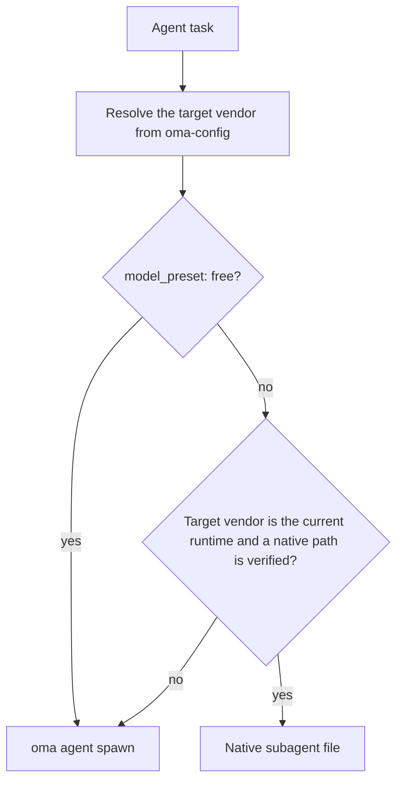
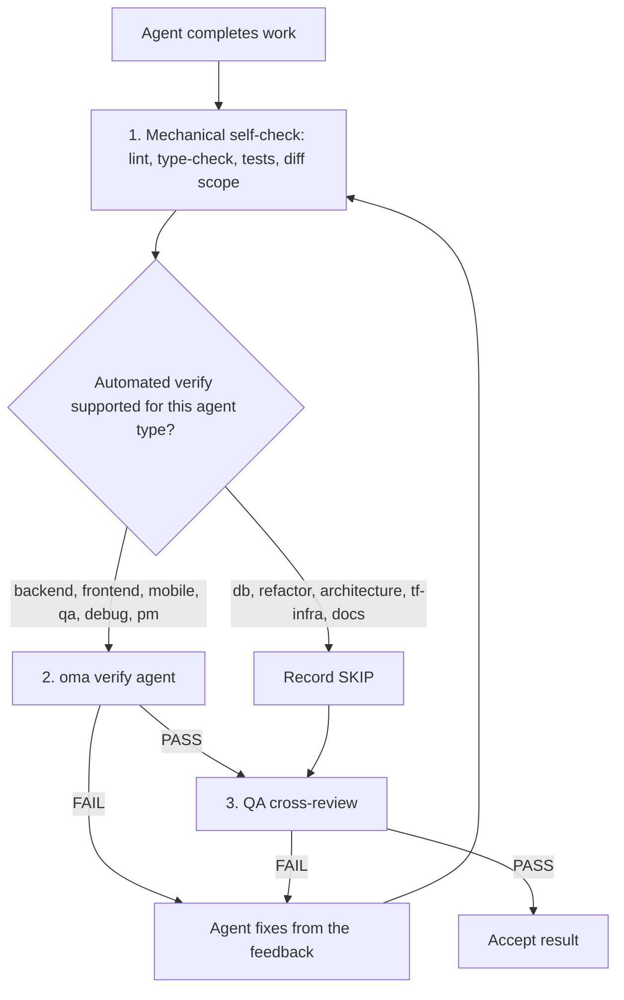

# Agentes

O OMA separa [skills](../getting-started/glossary.md#skill), papéis de dispatch e [definições de agentes](../getting-started/glossary.md#agent-definition). Uma skill roteia e carrega orientações de domínio; um papel canônico é a identidade de runtime usada no dispatch; uma definição versionada dá ao subagente uma persona nativa do vendor. Essas camadas se sobrepõem por design, então use o limite da tarefa e os critérios de aceitação para decidir se uma única skill basta.

---

## Catálogo de skills {#skill-catalog}

Esta tabela é a lista oficial das skills instaladas. Ela é gerada a partir do frontmatter de cada `.agents/skills/<name>/SKILL.md` por `cli/scripts/generate-skill-catalog.mjs`; execute o script com `--check` para detectar divergências. A seção `## References` do SKILL.md de cada skill lista seus arquivos de recursos e quando lê-los.

<!-- oma:generated skill-catalog:start -->
<!-- Generated from SKILL.md frontmatter under .agents/skills by cli/scripts/generate-skill-catalog.mjs. Do not edit this block by hand. -->

| Skill | Use it for |
|---|---|
| [`oma-academic-writing`](https://github.com/first-fluke/oh-my-agent/blob/main/.agents/skills/oma-academic-writing/SKILL.md) | Draft and revise academic prose against a rubric, evidence, and citation requirements. Use for essays, reports, literature reviews, or academic style audits. |
| [`oma-architecture`](https://github.com/first-fluke/oh-my-agent/blob/main/.agents/skills/oma-architecture/SKILL.md) | Evaluate system boundaries and architectural tradeoffs. Use for architecture decisions, design reviews, and ADRs. |
| [`oma-backend`](https://github.com/first-fluke/oh-my-agent/blob/main/.agents/skills/oma-backend/SKILL.md) | Implement server APIs, authentication, and application data access. Schema modeling and query tuning use oma-db. |
| [`oma-brainstorm`](https://github.com/first-fluke/oh-my-agent/blob/main/.agents/skills/oma-brainstorm/SKILL.md) | Explore goals, constraints, and alternative approaches before choosing a design. Use when the user requests ideation or design exploration. |
| [`oma-coordination`](https://github.com/first-fluke/oh-my-agent/blob/main/.agents/skills/oma-coordination/SKILL.md) | Coordinate assigned specialist tasks and handoffs manually. Use when supervising a multi-agent project step by step. |
| [`oma-db`](https://github.com/first-fluke/oh-my-agent/blob/main/.agents/skills/oma-db/SKILL.md) | Design schemas and migrations, tune queries, or plan vector retrieval and database operations. Application API implementation uses oma-backend. |
| [`oma-debug`](https://github.com/first-fluke/oh-my-agent/blob/main/.agents/skills/oma-debug/SKILL.md) | Diagnose a reproducible failure, fix its cause, and verify the regression. Use for crashes, incorrect behavior, and failing tests. |
| [`oma-design`](https://github.com/first-fluke/oh-my-agent/blob/main/.agents/skills/oma-design/SKILL.md) | Define or review a visual system, DESIGN.md, or redesign direction. Use for typography, layout, color, motion, and interaction design decisions. |
| [`oma-dev-workflow`](https://github.com/first-fluke/oh-my-agent/blob/main/.agents/skills/oma-dev-workflow/SKILL.md) | Configure development tasks, git hooks, CI/CD, or release automation. Use when creating or fixing a repository development workflow. |
| [`oma-docs`](https://github.com/first-fluke/oh-my-agent/blob/main/.agents/skills/oma-docs/SKILL.md) | Check documentation references, sync docs to code changes, and detect translation drift. Use for documentation maintenance in a repository. |
| [`oma-explanation`](https://github.com/first-fluke/oh-my-agent/blob/main/.agents/skills/oma-explanation/SKILL.md) | Create an offline HTML explanation of a code change (diff, PR, branch) or of a topic, system, or question. Use when a visual walkthrough document is requested. |
| [`oma-frontend`](https://github.com/first-fluke/oh-my-agent/blob/main/.agents/skills/oma-frontend/SKILL.md) | Implement or modify web UI in React, Next.js, or Angular. Use for components, pages, styles, forms, and frontend state or data flows. |
| [`oma-hwp`](https://github.com/first-fluke/oh-my-agent/blob/main/.agents/skills/oma-hwp/SKILL.md) | Convert Hangul HWP, HWPX, or HWPML documents to Markdown with kordoc. Use for text, table, and image extraction from these formats. |
| [`oma-image`](https://github.com/first-fluke/oh-my-agent/blob/main/.agents/skills/oma-image/SKILL.md) | Generate raster images or reference-guided variations through the OMA image CLI. Use for image assets or explicit vendor comparisons; pixel editing uses an editor. |
| [`oma-market`](https://github.com/first-fluke/oh-my-agent/blob/main/.agents/skills/oma-market/SKILL.md) | Research customer pain points, trends, and competitors through the OMA market engine. Use for market discovery or voice-of-customer analysis. |
| [`oma-mobile`](https://github.com/first-fluke/oh-my-agent/blob/main/.agents/skills/oma-mobile/SKILL.md) | Implement Flutter, React Native, native Swift, or native Kotlin Android apps. Use for mobile screens, widgets, platform integrations, and application data flows. |
| [`oma-observability`](https://github.com/first-fluke/oh-my-agent/blob/main/.agents/skills/oma-observability/SKILL.md) | Design or troubleshoot telemetry, SLOs, and incident diagnostics. Route to the relevant signal, system boundary, or vendor guide. |
| [`oma-orchestration`](https://github.com/first-fluke/oh-my-agent/blob/main/.agents/skills/oma-orchestration/SKILL.md) | Dispatch and supervise parallel specialist agents with durable task state. Use when automated multi-agent execution is requested. |
| [`oma-pdf`](https://github.com/first-fluke/oh-my-agent/blob/main/.agents/skills/oma-pdf/SKILL.md) | Extract PDF text, headings, tables, and images into Markdown using opendataloader-pdf. Use for PDF parsing, not PDF layout creation. |
| [`oma-pm`](https://github.com/first-fluke/oh-my-agent/blob/main/.agents/skills/oma-pm/SKILL.md) | Turn product requirements into scoped tasks with dependencies and acceptance criteria. Use for implementation planning and prioritization. |
| [`oma-qa`](https://github.com/first-fluke/oh-my-agent/blob/main/.agents/skills/oma-qa/SKILL.md) | Review changes for correctness, security, accessibility, and performance. Use for scoped quality reviews or verification plans; bug fixes use oma-debug. |
| [`oma-recap`](https://github.com/first-fluke/oh-my-agent/blob/main/.agents/skills/oma-recap/SKILL.md) | Summarize AI conversation histories for a specified date or period. Use for daily work recaps and cross-tool activity summaries. |
| [`oma-refactor`](https://github.com/first-fluke/oh-my-agent/blob/main/.agents/skills/oma-refactor/SKILL.md) | Restructure existing code while preserving observable behavior. Use for targeted technical debt or hotspot work with characterization tests. |
| [`oma-scholar`](https://github.com/first-fluke/oh-my-agent/blob/main/.agents/skills/oma-scholar/SKILL.md) | Search academic literature and generate, validate, or compare Knows paper sidecars. Use for claim/evidence analysis and literature synthesis. |
| [`oma-scm`](https://github.com/first-fluke/oh-my-agent/blob/main/.agents/skills/oma-scm/SKILL.md) | Manage Git branches, merges, conflicts, commits, and release baselines. Use for repository history and change-management operations. |
| [`oma-search`](https://github.com/first-fluke/oh-my-agent/blob/main/.agents/skills/oma-search/SKILL.md) | Find external documentation, web sources, or remote code with citations. Local code navigation uses the configured code tools. |
| [`oma-security`](https://github.com/first-fluke/oh-my-agent/blob/main/.agents/skills/oma-security/SKILL.md) | Scan application source, agent skills, and MCP components; run penetration tests against scoped web test deployments, validate findings, and configure scan gates. Use oma-qa for broad quality reviews and domain skills for remediation. |
| [`oma-skill-creation`](https://github.com/first-fluke/oh-my-agent/blob/main/.agents/skills/oma-skill-creation/SKILL.md) | Create or revise OMA skills and their references. Use for skill routing, execution contracts, conditional loading, and authoring validation. |
| [`oma-slide`](https://github.com/first-fluke/oh-my-agent/blob/main/.agents/skills/oma-slide/SKILL.md) | Create, import, revise, or export presentation decks through the OMA slide CLI or the ppt-master route. Use for HTML slides, editable PPTX, and PDF, PNG, or PPTX deck delivery. |
| [`oma-tf-infra`](https://github.com/first-fluke/oh-my-agent/blob/main/.agents/skills/oma-tf-infra/SKILL.md) | Create or review Terraform infrastructure and plans. Use for cloud resources, IAM, networking, state management, and infrastructure changes. |
| [`oma-translation`](https://github.com/first-fluke/oh-my-agent/blob/main/.agents/skills/oma-translation/SKILL.md) | Translate or revise localized UI strings and prose while preserving meaning, terminology, placeholders, and structure. |
| [`oma-video`](https://github.com/first-fluke/oh-my-agent/blob/main/.agents/skills/oma-video/SKILL.md) | Create videos through the OMA video CLI, or analyze and edit existing clips with media tools. Use for frame extraction, visual analysis, silence cuts, dubbing assembly, sound effects, scripts, and composition; audio-only work uses oma-voice. |
| [`oma-voice`](https://github.com/first-fluke/oh-my-agent/blob/main/.agents/skills/oma-voice/SKILL.md) | Generate or transcribe speech with Voicebox or VoiceStudio, or process existing audio locally. Use for narration, transcripts, timed speech, and loudness conversion; video editing uses oma-video. |
<!-- oma:generated skill-catalog:end -->

---

## Papéis de dispatch {#dispatch-roles}

O runtime faz o dispatch por papel canônico. Cada papel, exceto `orchestrator`, tem uma definição versionada em `.agents/agents/`, cujo frontmatter `skills:` indica as skills que ela carrega. A primeira skill listada é a responsável pela tarefa.

| Papel | Arquivo de definição | Também aceito | Skills |
|------|-----------------|---------------|--------|
| `orchestrator` | nenhum (papel de coordenação de runtime) | | |
| `pm` | `pm-planner.md` | `pm-planner` | oma-pm |
| `architecture` | `architecture-reviewer.md` | `architecture-reviewer` | oma-architecture |
| `qa` | `qa-reviewer.md` | `qa-reviewer` | oma-qa |
| `backend` | `backend-engineer.md` | `backend-engineer` | oma-backend |
| `frontend` | `frontend-engineer.md` | `frontend-engineer` | oma-frontend, oma-design |
| `mobile` | `mobile-engineer.md` | `mobile-engineer` | oma-mobile |
| `db` | `db-engineer.md` | `db-engineer` | oma-db |
| `debug` | `debug-investigator.md` | `debug-investigator` | oma-debug |
| `refactor` | `refactor-engineer.md` | `refactor-engineer` | oma-refactor |
| `docs` | `docs-curator.md` | `docs-curator` | oma-docs |
| `tf-infra` | `tf-infra-engineer.md` | `tf-infra-engineer` | oma-tf-infra |
| `explore` | `research-explorer.md` | `research-explorer`, `explorer` | oma-search, oma-market, oma-scholar |

O sufixo final `-agent` também é aceito (`qa-agent` é resolvido como `qa`).

### Arquivos de agentes nativos {#native-agent-files}

As definições de agentes em `.agents/agents/` são a fonte de verdade. O OMA as projeta em arquivos nativos do vendor para runtimes que aceitam subagentes personalizados:

| Runtime | Arquivos de agentes nativos |
|---------|--------------------|
| Claude Code | `.claude/agents/<name>.md` |
| Codex CLI | `.codex/agents/<name>.toml` |
| Cursor | `.cursor/agents/` |
| OpenCode | `.opencode/agents/` |
| Kiro | `.kiro/agents/` |
| Grok | `.grok/agents/` |
| CommandCode | `.commandcode/agents/` |
| Qwen Code | `.qwen/agents/` |

O pi não tem um sistema de arquivos de agentes, então `oma agent spawn` incorpora a persona da definição diretamente no prompt. Os arquivos gerados são atualizados por `oma link`, `oma install` e `oma update`.

### Como um papel é despachado {#how-a-role-is-dispatched}

Quando um workflow mapeia um agente para o mesmo vendor do runtime atual, ele usa primeiro o arquivo de agente nativo desse runtime. Tarefas entre vendors recorrem a `oma agent spawn`.



> **Dispatch do modelo por agente:** o vendor, o modelo e o esforço de cada papel vêm de `.agents/oma-config.yaml` (ou de `.agents/oma-config.cue`, com uma sobreposição `.local` opcional). Com `model_preset: auto`, o padrão em novas instalações, os papéis sem override em `agents:` seguem as configurações nativas de agente e modelo do runtime atual; `model_preset: free` sempre faz o dispatch por `oma agent spawn`. Consulte [Modelos por agente](../guide/per-agent-models.md) para detalhes de configuração e [`oma doctor --profile`](../cli-interfaces/commands.md#doctor) para inspecionar a matriz ativa.

---

## Categorias de skills {#agent-categories}

| Categoria | Skills | Responsabilidade |
|----------|--------|---------------|
| **Ideação** | oma-brainstorm | Explorar ideias, propor abordagens e produzir documentos de design |
| **Arquitetura** | oma-architecture | Limites de sistema/módulo/serviço, análises no estilo ADR/ATAM/CBAM e registros de tradeoffs |
| **Planejamento** | oma-pm | Decompor requisitos, dividir tarefas, definir contratos de API e atribuir prioridades |
| **Implementação** | oma-frontend, oma-backend, oma-mobile, oma-db | Escrever código nos respectivos domínios |
| **Design** | oma-design | Sistemas de design, DESIGN.md, tokens, tipografia, cores, movimento e acessibilidade |
| **Infraestrutura** | oma-tf-infra | Provisionamento Terraform multi-cloud, IAM, otimização de custos e policy-as-code |
| **DevOps** | oma-dev-workflow | Task runner mise, CI/CD, migrações, coordenação de releases e automação de monorepo |
| **Observabilidade** | oma-observability | Pipelines de observabilidade, roteamento de rastreabilidade, sinais MELT+P (metrics/logs/traces/profiles/cost/audit/privacy), gestão de SLO, investigação de incidentes e ajuste de transporte |
| **Qualidade** | oma-qa | Auditoria de segurança (OWASP), performance, acessibilidade (WCAG) e revisão de qualidade de código |
| **Depuração** | oma-debug | Reprodução de bugs, análise de causa raiz, correções mínimas e testes de regressão |
| **Localização** | oma-translation | Tradução contextual que preserva tom, registro e termos do domínio |
| **Coordenação** | oma-orchestration, oma-coordination | Orquestração multiagente automatizada e manual |
| **Git** | oma-scm | Geração de Conventional Commits e divisão de commits por funcionalidade |
| **Busca e recuperação** | oma-search | Roteador de busca baseado em intenção com pontuação de confiança (docs Context7, web, código `gh`/`glab` e inteligência local de código) |
| **Retrospectiva** | oma-recap | Análise do histórico de conversas entre ferramentas e resumos de trabalho temáticos |
| **Processamento de documentos** | oma-hwp, oma-pdf | Conversão de HWP/HWPX/HWPML e PDF para Markdown para ingestão em LLM/RAG |
| **Documentação** | oma-docs | Manutenção da documentação: referências quebradas, documentos afetados por um diff, deriva de tradução e lint de documentos traduzidos |
| **Explicação** | oma-explanation | Explicações HTML offline de uma mudança de código (diff, PR, branch, intervalo de commits) ou de um tema, sistema ou pergunta |
| **Escrita acadêmica** | oma-academic-writing, oma-scholar | Redação e auditoria de prosa acadêmica de nível de publicação e pesquisa acadêmica, busca e peer review com sidecars Knows |
| **Segurança** | oma-security | Scan de código-fonte de aplicações, pacotes de skills de agentes, componentes MCP e deploys de teste web autorizados (Deepsec, scanners da Cisco, ARTEX), com validação independente de achados e gates de CI |
| **Refatoração** | oma-refactor | Reestruturação incremental que preserva comportamento, com foco em hotspots, redes de testes de caracterização e commits apenas de refatoração |
| **Pesquisa de mercado** | oma-market | Pesquisa de pain points, tendências, concorrentes e descoberta a partir de sinais comunitários, com frameworks SWOT/Porter 5F/PESTEL escolhidos automaticamente pela intenção |
| **Criação de skills** | oma-skill-creation | Criação e validação de skills OMA no formato SSL-lite |
| **Geração de mídia** | oma-image, oma-slide, oma-video, oma-voice | Geração de imagens por IA, apresentações HTML, vídeos curtos/explicativos/de demonstração e TTS/STT local |

---

## Referência detalhada dos agentes {#detailed-agent-reference}

Estes resumos explicam o domínio e as regras principais de cada skill. O SKILL.md da própria skill é a fonte de verdade: a seção `## References` lista os arquivos de recursos e a condição para ler cada um, por isso esta página não copia essas listas.

### oma-brainstorm

**Domínio:** Ideação orientada por design antes do planejamento ou implementação.

**Quando usar:** Explorar uma nova ideia de funcionalidade, entender a intenção do usuário, comparar abordagens. Use antes de `/plan` para requisições complexas ou ambíguas.

**Quando NÃO usar:** Requisitos claros (vá para oma-pm), implementação (vá para agentes de domínio), revisão de código (vá para oma-qa).

**Regras principais:**
- Sem implementação ou planejamento antes da aprovação do design
- Uma pergunta de esclarecimento por vez (não em lotes)
- Comparar duas ou três abordagens viáveis quando as alternativas ajudam a decisão; se as restrições deixarem menos opções, explicar o motivo em vez de inventar alternativas
- Apresentar o design seção por seção, resolvendo apenas as escolhas relevantes ainda em aberto
- YAGNI: projete apenas o necessário

**Workflow:** 7 fases: Contexto, Perguntas, Abordagens (opcionalmente alimentadas por TRIZ-lite), Design, Revisão Cega, Documentação (salva em `docs/plans/designs/`), Transição para `/plan`.

---

### oma-architecture

**Domínio:** Arquitetura de software/sistemas, incluindo limites de módulos e serviços, análise de tradeoffs, síntese de partes interessadas e registros de decisão.

**Quando usar:** Escolher ou revisar arquitetura de sistema, definir limites de módulo/serviço/propriedade, comparar opções arquiteturais com tradeoffs explícitos, investigar dores arquiteturais (amplificação de mudanças, dependências ocultas, APIs estranhas), priorizar investimentos ou refatorações arquiteturais, escrever recomendações de arquitetura ou ADRs.

**Quando NÃO usar:** Sistemas visuais/de design (use oma-design), planejamento de funcionalidades e decomposição de tarefas (use oma-pm), implementação de Terraform (use oma-tf-infra), diagnóstico de bugs (use oma-debug), revisão de segurança/performance/acessibilidade (use oma-qa).

**Metodologias:** Roteamento diagnóstico, comparação design-twice, análise de risco no estilo ATAM, priorização no estilo CBAM, registros de decisão no estilo ADR.

**Regras principais:**
- Diagnosticar o problema arquitetural antes de selecionar um método
- Usar a metodologia mais leve e suficiente para a decisão atual
- Distinguir design arquitetural do design de UI/visual e da entrega em Terraform
- Consultar agentes de partes interessadas apenas quando a decisão for suficientemente transversal para justificar o custo
- A qualidade da recomendação importa mais que o teatro do consenso: consultar amplamente, decidir explicitamente
- Cada recomendação deve declarar premissas, tradeoffs, riscos e etapas de validação
- Ser consciente de custo por padrão: custo de implementação, custo operacional, complexidade da equipe, custo de mudanças futuras

---

### oma-pm

**Domínio:** Gerenciamento de produto, incluindo análise de requisitos, decomposição de tarefas e contratos de API.

**Quando usar:** Decompor funcionalidades complexas, determinar viabilidade, priorizar trabalho, definir contratos de API.

**Regras principais:**
- Design API-first: definir contratos antes das tarefas de implementação
- Cada tarefa tem: agente, título, critérios de aceitação, prioridade, dependências
- Minimizar dependências para máxima execução paralela
- Segurança e testes são parte de cada tarefa (não fases separadas)
- Tarefas devem ser completáveis por um único agente
- Gerar o plano JSON e um task board com escopo de sessão para compatibilidade com o orquestrador

**Saída:** `.agents/results/plan-{sessionId}.json` com tiers numéricos de prioridade (`1` = independente; tiers menores rodam primeiro), além do relatório com escopo de execução `result-{agentId}-{taskId}-{runId}-{sessionId}.md` no armazenamento de memória configurado.

---

### oma-frontend

**Domínio:** Web UI em React/Next.js ou Angular com TypeScript. Projetos React usam FSD-lite; projetos Angular seguem `resources/angular-rules.md`.

**Quando usar:** Construir interfaces de usuário, componentes, lógica do lado do cliente, estilização, validação de formulários, integração com API.

**Stack tecnológico:**
- React + Next.js (Server Components por padrão, Client Components para interatividade)
- TypeScript (strict)
- TailwindCSS v4 + shadcn/ui (primitivas somente leitura, estender via cva/wrappers)
- FSD-lite: raiz `src/` + feature `src/features/*/` (sem importações cross-feature)

**Bibliotecas (projetos React/Next.js):**
| Propósito | Biblioteca |
|-----------|-----------|
| Datas | luxon |
| Estilização | TailwindCSS v4 + shadcn/ui |
| Hooks | ahooks ou @mantine/hooks |
| Utils | es-toolkit |
| Tipos | type-fest |
| Estado URL | nuqs |
| Estado Servidor | TanStack Query (hooks gerados pelo orval quando existe uma spec OpenAPI) |
| Estado Cliente | Jotai ou Zustand, escolhido pela intenção, sem padrão (minimizar uso) |
| Formulários | @tanstack/react-form + Zod |
| Auth | better-auth |
| Animação | motion (`motion/react`) para projetos novos |

**Regras principais:**
- shadcn/ui primeiro, estender via cva, nunca modificar `components/ui/*` diretamente
- Mapeamento 1:1 de design tokens (nunca hardcode cores)
- Proxy de requisições: preserve a convenção `proxy.ts` existente do Next.js 16+; verifique a versão instalada e o roteamento antes de propor renomear para `middleware.ts`
- Sem prop drilling além de 3 níveis; use a biblioteca de estado de cliente do projeto (atoms Jotai ou uma store Zustand)
- Imports absolutos com `@/` obrigatório
- Meta de FCP < 1s
- Breakpoints responsivos: 320px, 768px, 1024px, 1440px

**Checklist do portão de qualidade:**
- Acessibilidade: labels ARIA, headings semânticos, navegação por teclado
- Mobile: verificado em viewports mobile
- Performance: sem CLS, carregamento rápido
- Resiliência: Error Boundaries e Loading Skeletons
- Testes: lógica coberta por Vitest
- Qualidade: typecheck e lint passam

---

### oma-backend

**Domínio:** APIs, lógica do lado do servidor, autenticação, operações de banco de dados.

**Quando usar:** APIs REST/GraphQL, migrações de banco de dados, auth, lógica de negócio do servidor, jobs em background.

**Arquitetura:** Router (HTTP) -> Service (Lógica de Negócio) -> Repository (Acesso a Dados) -> Models.

**Detecção de stack:** Lê manifestos do projeto (pyproject.toml, package.json, Cargo.toml, go.mod, etc.) para determinar linguagem e framework. Se faltarem convenções específicas do projeto, peça ao usuário para executar `/stack-set`; esse comando materializa as referências resolvidas de `stack/` a partir do schema e dos templates fornecidos.

**Regras principais:**
- Arquitetura limpa: sem lógica de negócio em route handlers
- Todas as entradas validadas com a biblioteca de validação do projeto
- Apenas consultas parametrizadas (nunca interpolação de string em SQL)
- JWT + Argon2id para auth (bcrypt aceitável apenas por compatibilidade legada); aplique rate limit aos endpoints de auth
- Async onde suportado; anotações de tipo em todas as assinaturas
- Exceções customizadas via módulo centralizado de erros
- Estratégia explícita de carregamento ORM, boundaries de transação, lifecycle seguro

<!-- oma-docs:ignore-start -->
Os arquivos específicos do projeto `stack/stack.yaml`, `stack/tech-stack.md`, snippets e templates de API são gerados por `/stack-set` quando necessários; ficam ausentes até a materialização da stack.
<!-- oma-docs:ignore-end -->

---

### oma-mobile

**Domínio:** Apps mobile multiplataforma e nativos (Flutter, React Native e Swift native iOS).

**Quando usar:** Apps mobile nativos (iOS + Android), padrões de UI específicos mobile, funcionalidades de plataforma (câmera, GPS, push notifications), arquitetura offline-first; apps Swift native iOS usando SwiftUI e `swift-openapi-generator`.

**Arquitetura:** Clean Architecture: domain -> data -> presentation. Para Swift iOS: layout de projeto `App/Core/Features/Shared`.

**Stacks tecnológicos:**
- Flutter/Dart: Riverpod/Bloc (gerenciamento de estado), Dio com interceptors (API), GoRouter (navegação), Material Design 3 (Android) + iOS HIG.
- Swift native iOS (iOS 17+): SwiftUI + `@Observable` (Observation framework), `swift-openapi-generator` da Apple para clientes de API, layout `App/Core/Features/Shared`.

**Regras principais:**
- Riverpod/Bloc para gerenciamento de estado (sem setState bruto para lógica complexa)
- Todos os controllers dispostos no método `dispose()`
- Dio com interceptors para chamadas de API; tratar offline graciosamente
- Meta de 60fps; testar em ambas as plataformas
- Swift: usar `@Observable` em vez de `ObservableObject` no iOS 17+; gerar clientes de API a partir de specs OpenAPI via `swift-openapi-generator`

**Seeds de plataforma:** `variants/` fornece `flutter/`, `react-native/` e `swift-ios/`, cada um com `stack.yaml`, `tech-stack.md`, `snippets.md` e um template de API, além do `stack.schema.json` compartilhado. São material inicial para `/stack-set`, não leitura obrigatória para editar código existente.

---

### oma-db

**Domínio:** Arquitetura de banco de dados em SQL, NoSQL e bancos de dados vetoriais.

**Quando usar:** Design de schema, ERD, normalização, indexação, transações, planejamento de capacidade, estratégia de backup, design de migrações, arquitetura de vector DB/RAG, revisão de anti-padrões, design com consciência de conformidade (ISO 27001/27002/22301).

**Workflow padrão:** Explorar (identificar entidades, padrões de acesso, volume) -> Projetar (schema, restrições, transações) -> Otimizar (índices, particionamento, arquivamento, anti-padrões).

**Regras principais:**
- Escolher modelo primeiro, engine depois
- 3NF padrão para relacional; documentar tradeoffs BASE para distribuído
- Documentar todas as três camadas de schema: externa, conceitual, interna
- Integridade é de primeira classe: entidade, domínio, referencial, regra de negócio
- Concorrência nunca é implícita: definir boundaries de transação e níveis de isolamento
- Vector DBs são infraestrutura de recuperação, não fonte de verdade
- Nunca tratar busca vetorial como substituto direto de busca lexical

**Entregáveis obrigatórios:** Resumo do schema externo, schema conceitual, schema interno, tabela de padrões de dados, glossário, estimativa de capacidade, estratégia de backup/recuperação. Para vector/RAG: política de versão de embedding, política de chunking, estratégia de recuperação híbrida.

---

### oma-design

**Domínio:** Sistemas de design, UI/UX, gerenciamento de DESIGN.md.

**Quando usar:** Criar ou revisar sistemas de design e DESIGN.md, redesenhar um site ou app existente (preservar ou reformular), landing pages, design tokens, paletas de cores, tipografia, layouts responsivos, revisão de acessibilidade.

**Workflow:** 7 fases: Setup (coleta de contexto) -> Extração (opcional, a partir de URLs de referência) -> Aprimoramento (aprimoramento de prompt vago) -> Proposta (2-3 direções de design) -> Geração (DESIGN.md + tokens) -> Auditoria (responsivo, WCAG, Nielsen, verificação de AI slop) -> Entrega.

**Aplicação de anti-padrões ("sem AI slop"):**
- Tipografia: stack de fontes do sistema por padrão; sem Google Fonts padrão sem justificativa
- Cor: sem gradientes purple-to-blue, sem orbs/blobs de gradiente, sem branco puro em preto puro
- Layout: sem cards aninhados, sem layouts desktop-only, sem layouts cookie-cutter de 3 métricas
- Movimento: sem bounce easing em todo lugar, sem animações > 800ms, deve respeitar prefers-reduced-motion
- Componentes: sem glassmorphism em todo lugar, todos os elementos interativos precisam de alternativas de teclado/toque

**Regras principais:**
- Reutilizar `.design-context.md` e `DESIGN.md` quando existirem; criar `.design-context.md` somente quando uma etapa substancial de descoberta embasar a decisão
- Para um site ou app existente, seguir `resources/redesign-protocol.md` e classificar entre Preserve e Overhaul antes de propor
- Stack de fontes do sistema por padrão (fontes CJK-ready para ko/ja/zh)
- WCAG AA mínimo para todos os designs
- Responsive-first (mobile como padrão)
- Apresentar 2-3 direções, obter confirmação

---

### oma-tf-infra

**Domínio:** Infraestrutura como código com Terraform, multi-cloud.

**Quando usar:** Provisionamento em AWS/GCP/Azure/Oracle Cloud, configuração Terraform, autenticação CI/CD (OIDC), CDN/load balancers/storage/networking, gerenciamento de estado, infraestrutura de conformidade ISO.

**Detecção de cloud:** Lê providers e prefixos de recursos do Terraform (`google_*` = GCP, `aws_*` = AWS, `azurerm_*` = Azure, `oci_*` = Oracle Cloud). Inclui tabela completa de mapeamento de recursos multi-cloud.

**Regras principais:**
- Agnóstico de provider: detectar cloud a partir do contexto do projeto
- Estado remoto com versionamento e locking
- OIDC-first para auth CI/CD
- Plan antes de apply sempre
- IAM de menor privilégio
- Taguear tudo (Environment, Project, Owner, CostCenter)
- Sem secrets no código
- Fixar versão de todos os providers e módulos
- Sem auto-approve em produção

---

### oma-dev-workflow

**Domínio:** Automação de tarefas monorepo e CI/CD.

**Quando usar:** Executar dev servers, executar lint/format/typecheck entre apps, migrações de banco de dados, geração de API, builds i18n, builds de produção, otimização de CI/CD, validação pre-commit.

**Regras principais:**
- Sempre usar tarefas `mise run` em vez de comandos diretos do gerenciador de pacotes
- Executar lint/test apenas em apps alterados
- Validar mensagens de commit com commitlint
- CI deve pular apps não alterados
- Nunca usar comandos diretos do gerenciador de pacotes quando existem tarefas mise

---

### oma-observability

**Domínio:** Roteador de observabilidade e rastreabilidade baseado em intenção, através de camadas, fronteiras e sinais.

**Quando usar:**
- Configuração de pipeline: OTel SDK + Collector + backend de vendor
- Rastreabilidade através de fronteiras de serviço e domínio: propagadores W3C, baggage, multi-tenant, multi-cloud
- Ajuste de transporte: limiares UDP/MTU, OTLP gRPC vs HTTP, topologia Collector DaemonSet vs sidecar, receitas de sampling
- Forense de incidentes: localização em 6 dimensões (code / service / layer / host / region / infra)
- Seleção de categoria de vendor: OSS full-stack vs SaaS comercial vs especialista em alta cardinalidade vs especialista em profiling
- Observability-as-code: dashboards Grafana Jsonnet, CRD PrometheusRule, YAML OpenSLO, alertas SLO burn-rate
- Meta-observabilidade: saúde própria do pipeline, desvio de relógio, guardrails de cardinalidade, matriz de retenção
- Cobertura de sinais MELT+P: metrics, logs, traces, profiles, cost, audit, privacy
- Migrações de pipeline de logs avaliadas com base no suporte upstream atual e nos requisitos do projeto

**Quando NÃO usar:** Observabilidade de LLM ops / gen_ai (use Langfuse, Arize Phoenix, LangSmith, Braintrust), lineage de pipeline de dados (OpenLineage + Marquez, dbt test, Airflow lineage), telemetria de camada física IoT / datacenter (Nlyte, Sunbird, Device42), orquestração de chaos engineering (Chaos Mesh, Litmus, Gremlin, ChaosToolkit), infraestrutura GPU / TPU (NVIDIA DCGM Exporter), cadeia de suprimento de software (sigstore, in-toto, SLSA), workflow de resposta a incidentes / paging (PagerDuty, OpsGenie, Grafana OnCall), configuração de único vendor já coberta pela skill própria daquele vendor.

**Regras principais:**
- Classificar intenção antes de rotear: setup | migrate | investigate | alert | trace | tune | route
- Categoria primeiro, não registro de vendors: delegar a skills próprias do vendor via `resources/vendor-categories.md`; não duplicar documentação do vendor
- Ajuste de transporte é o fosso: limiares UDP/MTU, seleção de protocolo OTLP, topologia do Collector e receitas de sampling são profundidade que outras skills não cobrem
- Meta-observabilidade é inegociável: validar saúde própria do pipeline, sincronização de relógio (< 100 ms de desvio), cardinalidade e retenção antes de declarar a configuração completa
- Preferência CNCF-first: Prometheus, Jaeger, Thanos, Fluent Bit, OpenTelemetry, Cortex, OpenCost, OpenFeature, Flagger, Falco
- O Fluentd continua como projeto CNCF Graduated; o guia da CNCF de 2025-10 sobre Fluentd para Fluent Bit é um guia de migração, não uma descontinuação. Escolha Fluentd, Fluent Bit ou o OTel Collector com base na carga de trabalho, nos plugins e nos requisitos operacionais
- W3C Trace Context como propagador padrão; traduzir por cloud (AWS X-Ray `X-Amzn-Trace-Id`, GCP Cloud Trace, Datadog, Cloudflare, Linkerd)
- Privacidade antes de recursos: redação de PII, regras de baggage cientes de sampling, auditoria imutável SOC2/ISO + apagamento GDPR/PIPA aplicados na coleta, não apenas no armazenamento

---

### oma-qa

**Domínio:** Garantia de qualidade, cobrindo segurança, performance, acessibilidade e qualidade de código.

**Quando usar:** Revisão final antes do deploy, auditorias de segurança, análise de performance, conformidade de acessibilidade, análise de cobertura de testes.

**Ordem de prioridade da revisão:** Segurança > Performance > Acessibilidade > Qualidade de Código.

**Níveis de severidade:**
- **CRITICAL**: Brecha de segurança, risco de perda de dados
- **HIGH**: Bloqueia lançamento
- **MEDIUM**: Corrigir neste sprint
- **LOW**: Backlog

**Regras principais:**
- Cada achado deve incluir arquivo:linha, descrição e correção
- Executar ferramentas automatizadas primeiro (npm audit, bandit, lighthouse)
- Sem falsos positivos; cada achado deve ser reproduzível
- Fornecer código de correção, não apenas descrições

---

### oma-debug

**Domínio:** Diagnóstico e correção de bugs.

**Quando usar:** Bugs reportados por usuários, crashes, problemas de performance, falhas intermitentes, race conditions, bugs de regressão.

**Metodologia:** Reproduzir primeiro, depois diagnosticar. Nunca adivinhar correções.

**Regras principais:**
- Identificar causa raiz, não apenas sintomas
- Correção mínima: alterar apenas o necessário
- Cada correção recebe um teste de regressão
- Buscar padrões similares em outros lugares
- Documentar em `.agents/results/`

**Ferramentas de inteligência de código usadas (Gortex ou Serena):**
- `find_symbol("functionName")` ou a navegação de símbolos do Gortex: localizar a função
- `find_referencing_symbols("Component")` ou a análise de impacto do Gortex: encontrar todos os usos
- `search_for_pattern("error pattern")` ou a busca do Gortex: encontrar problemas similares

---

### oma-translation

**Domínio:** Tradução multilíngue com consciência de contexto.

**Quando usar:** Traduzir strings de UI, documentação, textos de marketing, revisar traduções existentes, criar glossários.

**Fluxo em seis cenas:** Prepare, Acquire, Reason, Act, Verify e Finalize. O método de tradução tem quatro etapas: ler o significado e a sintaxe protegida, escolher o registro, reconstruir no idioma de destino e preservar o estilo do autor onde ele for pertinente.

**Regras principais:**
- Escanear arquivos de locale existentes primeiro para corresponder às convenções
- Traduzir significado, não palavras
- Preservar conotações emocionais
- Nunca produzir traduções palavra por palavra
- Nunca misturar registros dentro de um texto
- Preservar terminologia específica de domínio como está

---

### oma-orchestration

**Domínio:** Coordenação automatizada multiagente via CLI spawning.

**Quando usar:** Funcionalidades complexas requerendo múltiplos agentes em paralelo, execução automatizada, implementação full-stack.

**Padrões de configuração:**

| Configuração | Padrão | Descrição |
|--------------|--------|-----------|
| MAX_PARALLEL | 3 | Máximo de subagentes concorrentes |
| MAX_RECOVERY_ATTEMPTS | 3 | Total de novas tentativas e hipóteses de exploração por tarefa, incluindo a tentativa original |
| POLL_INTERVAL | 30s | Intervalo de verificação de status para execuções de `oma agent spawn` (subagentes nativos do Claude Code retornam de forma síncrona) |

**Fases do workflow:** Plan → References (selecionar referências por tarefa) → Setup (artefatos de sessão e de task board) → Execute (despachar tarefas prontas dentro de MAX_PARALLEL) → Monitor → Verify (loop de revisão) → Collect (claims e relatórios com escopo de execução).

**Loop de revisão agente-para-agente:** veja [Fluxo de orquestração](#orchestration-flow) para o diagrama e os limites do loop.

**Evidência de sessão:** Registra correções relevantes e achados de revisão julgados quando útil, com causa, impacto e verificação. Não há pontuação de penalidade nem pausa acionada por pontuação.

---

### oma-scm

**Domínio:** Gerenciamento de configuração de software (SCM) e Git, cobrindo branching, merges, worktrees, baselines, prontidão para auditoria e Conventional Commits.

**Quando usar:** Após mudanças de código (`/scm`), conflitos de merge, estratégia de branches, releases/tags ou qualquer questão de CM do repositório.

**Tipos de commit:** feat, fix, docs, style, refactor, perf, test, chore, build, ci, revert.

**Workflow (commits):** Analisar mudanças → Dividir por funcionalidade quando necessário → tipo → escopo → descrição (imperativo, menos de 72 caracteres, minúscula, sem ponto final) → fazer commit com caminhos explícitos.

**Regras:**
- Não usar `git add -A` ou `git add .` sem autorização explícita
- Nunca commitar arquivos de secrets
- Sempre especificar arquivos ao fazer staging
- Escrever a mensagem em um arquivo e fazer commit com `git commit -F <message-file>`
- Não reescrever histórico compartilhado sem autorização explícita; usar `--force-with-lease`, nunca `--force` simples
- Trailers de coautoria só são incluídos quando a configuração efetiva `scm.co_author` os habilita e fornece nome e e-mail.

---

### oma-coordination

**Domínio:** Guia de coordenação multiagente manual passo a passo.

**Quando usar:** Trabalho multidomínio em que você quer supervisionar o spawn, o monitoramento, o alinhamento de contratos e o QA passo a passo, em vez de uma orquestração totalmente automatizada.

**Quando NÃO usar:** Execução paralela totalmente automatizada (usar oma-orchestration), tarefas de domínio único (usar o agente de domínio diretamente).

**Regras principais:**
- Reutilizar um plano válido; chamar oma-pm somente quando a decomposição ou os contratos precisarem mudar
- Spawnar em paralelo tarefas independentes do mesmo tier de prioridade, cada uma em seu próprio workspace ou com `--isolation worktree`
- Atualizar os contratos das fronteiras de API alteradas antes do trabalho dependente de frontend ou mobile
- A revisão de QA é sempre a etapa final
- Encaminhar defeitos bloqueantes de QA e lacunas de verificação obrigatória de volta ao agente responsável e, em seguida, executar novamente as verificações afetadas

**Workflow:** Plano (reutilizar ou PM) → Spawn por tier de prioridade → Monitorar → Revisão de QA → Corrigir problemas → Entregar.

**Diferença para oma-orchestration:** A coordination é manual e guiada (o usuário controla o ritmo), o orchestrator é automatizado (os agentes são spawnados e executados com intervenção mínima do usuário).

---

### oma-search

**Domínio:** Roteador de busca baseado em intenção com pontuação de confiança de domínio. Roteia consultas para Context7 (docs), busca web nativa, `gh`/`glab` (código) e inteligência de código local (Gortex ou Serena).

**Quando usar:** Encontrar documentação oficial de bibliotecas/frameworks, pesquisa web por tutoriais/exemplos/comparações/soluções, busca de código no GitHub/GitLab por padrões de implementação, qualquer consulta em que o canal de busca não seja claro (roteamento automático), outras skills que precisam de infraestrutura de busca (invocação compartilhada).

**Quando NÃO usar:** Exploração somente local do código (use o MCP de inteligência de código diretamente), análise de histórico ou blame do Git (use oma-scm), pesquisa completa de arquitetura (use oma-architecture, que pode invocar esta skill internamente).

**Regras principais:**
- `--docs`, `--code` ou `--web` explícitos selecionam a rota; caso contrário, classifique a intenção com `resources/intent-rules.md`
- Uma consulta, uma melhor rota; evite multi-rota redundante a menos que a intenção seja ambígua
- Pontuar a confiança de cada resultado; todos os resultados não locais recebem rótulos de confiança de domínio do registro
- Outras flags: `--strict` filtra os resultados por confiança após a pontuação, `--wide` mantém resultados rotulados de menor confiança e `--gitlab` seleciona o GitLab como host de código
- Fail forward: se a rota primária falhar, faça fallback gracioso (docs→web, web→estratégias `oma search fetch`)
- Nenhum MCP adicional necessário: Context7 para docs, nativo de runtime para web, CLI para código, provider configurado (Gortex ou Serena) para local
- Busca web agnóstica de vendor: use o que o runtime atual oferecer (WebSearch, Google, Bing)
- Confiança apenas no nível de domínio; sem pontuação por sub-caminho ou página

---

### oma-recap

**Domínio:** Análise de histórico de conversas em várias ferramentas de IA (Claude, Codex, Gemini, Antigravity, Qwen, Cursor, Grok) com resumos de trabalho temáticos diários/periódicos.

**Quando usar:** Resumir um dia ou período de atividade de trabalho, compreender o fluxo de trabalho em várias ferramentas de IA, analisar padrões de troca de ferramentas entre sessões, preparar standups diários / retros semanais / registros de trabalho.

**Quando NÃO usar:** Retrospectiva de mudanças de código baseada em commits Git (use `oma retro`), monitoramento de agentes em tempo real (use `oma dashboard terminal`), métricas de produtividade (use `oma stats get`).

**Processo:**
1. Resolver data ou janela de tempo a partir de entrada em linguagem natural (today, yesterday, last Monday, data explícita)
2. Obter os dados da conversa com `oma recap --date YYYY-MM-DD --json` para um dia do calendário ou `oma recap --window 7d --json` para uma janela móvel (`1d`, `3d`, `7d`, `2w`, `30d`); restrinja com `--tool`
3. Agrupar por conteúdo (projetos e temas), não por ferramenta; uma janela de 3 dias ou mais agrupa por projeto em vez de por dia
4. Extrair temas (funcionalidades trabalhadas, bugs corrigidos, ferramentas exploradas)
5. Renderizar resumo temático diário/periódico

---

### oma-hwp

**Domínio:** Conversão de HWP / HWPX / HWPML (processador de texto coreano) para Markdown usando `kordoc`.

**Quando usar:** Converter documentos HWP coreanos (`.hwp`, `.hwpx`, `.hwpml`) para Markdown, preparar documentos governamentais/empresariais coreanos para contexto de LLM ou RAG, extrair conteúdo estruturado (tabelas, cabeçalhos, listas, imagens, notas de rodapé, hyperlinks) de HWP.

**Quando NÃO usar:** Arquivos PDF (use oma-pdf), XLSX/DOCX (fora de escopo), gerar/editar HWP (fora de escopo), arquivos já em texto (use a ferramenta Read diretamente).

**Regras principais:**
- Use `bunx kordoc@latest` para executar (nenhuma instalação necessária); sempre passe `@latest` ou uma versão fixada
- O formato de saída padrão é Markdown
- Se nenhum diretório de saída for especificado, a saída vai para o mesmo diretório da entrada
- O kordoc cuida da preservação de estrutura (cabeçalhos, tabelas, tabelas aninhadas, notas de rodapé, hyperlinks, imagens)
- As defesas de segurança (ZIP bomb, XXE, SSRF, XSS) são fornecidas pelo kordoc; não adicione as suas próprias
- Para HWP criptografados ou bloqueados por DRM, reporte claramente a limitação ao usuário
- Pós-processe com `resources/flatten-tables.ts` para converter blocos HTML `<table>` em tabelas pipe GFM e remover caracteres da Private Use Area da fonte Hancom

---

### oma-pdf

**Domínio:** Conversão de PDF para Markdown usando `opendataloader-pdf`.

**Quando usar:** Converter documentos PDF para Markdown para contexto de LLM ou RAG, extrair conteúdo estruturado (tabelas, cabeçalhos, listas) de PDFs, preparar dados PDF para consumo por IA.

**Quando NÃO usar:** Gerar/criar PDFs (use ferramentas documentais apropriadas), editar PDFs existentes (fora de escopo), leitura simples de arquivos já em texto (use a ferramenta Read diretamente).

**Regras principais:**
- Use `uvx opendataloader-pdf` para executar (nenhuma instalação necessária)
- O formato de saída padrão é Markdown
- Se nenhum diretório de saída for especificado, a saída vai para o mesmo diretório do PDF de entrada
- Preserve a estrutura do documento (cabeçalhos, tabelas, listas, imagens)
- Para PDFs escaneados, use o modo híbrido com OCR
- Sempre execute `uvx mdformat` na saída para normalizar a formatação Markdown
- Valide se o Markdown de saída é legível e bem estruturado
- Reporte quaisquer problemas de conversão (tabelas ausentes, texto distorcido) ao usuário

---

### oma-academic-writing

**Domínio:** Prosa acadêmica em inglês, pronta para publicação: redigir, revisar e auditar ensaios, relatórios, seções de análise, resumos executivos, conclusões e revisões de literatura.

**Quando usar:** Redigir ou revisar relatórios e seções de análise acadêmica, escrever resumos executivos, conclusões ou revisões de literatura, reescrever prosa com aparência de IA em inglês natural, polir um texto para qualidade de topo (HD, A, top-band) e revisar variedade de frases, qualidade verbal, modalização e conformidade anti-IA.

**Quando NÃO usar:** Tradução (use oma-translation), descoberta de fontes, coleta de citações ou busca bibliográfica (use oma-scholar), análise de rubrica e decomposição de tarefas (use oma-pm), documentação de código/README/texto de referência de API (use a skill de domínio correspondente), texto informal ou de marketing e escrita acadêmica que não seja em inglês (redija em inglês e depois encaminhe para oma-translation).

**Modos:** `draft` (título + prosa + Writing Notes + Claim-Evidence Map), `revise` (original + revisão + lista de mudanças), `review` (relatório PASS/FAIL de conformidade sobre estrutura de frases, qualidade verbal, anti-IA, especificidade, modalização, clareza de parágrafos, ritmo e alinhamento entre alegações e evidências).

**Regras principais:**
- Citação antes do julgamento: cite o texto literal da rubrica ou restrição antes de aplicar qualquer regra
- Toda frase deve ser verificável; nunca invente dados, estatísticas ou citações
- Verbos genéricos proibidos (`show`, `have`, `make`, `do`, `get`, `use`, …) não devem ser verbos principais
- Varie tipo, extensão e abertura das frases; nunca use 3 ou mais frases do mesmo tipo em sequência
- Ajuste a força da modalização à força da evidência; não use primeira pessoa como `I think` ou `I believe`
- Cada alegação deve apontar para evidência no Claim-Evidence Map; enfraqueça ou remova alegações sem suporte

**Workflow:** 6 etapas — READ a rubrica e o rascunho e cite as restrições, PLAN parágrafos como Topic-Support-Conclude, DRAFT sob os quatro protocolos, AUDIT com a checklist anti-IA, REVERSE-OUTLINE e construa o Claim-Evidence Map, POLISH com leitura em voz alta, coesão, especificidade, contagem de palavras e ritmo.

---

### oma-security

**Domínio:** Scan e validação de segurança para código-fonte de aplicações, pacotes de skills de agentes, componentes MCP e deploys de teste web autorizados.

**Quando usar:** Fazer scan de um repositório ou de um diff de código-fonte; inspecionar um pacote de skill, um servidor MCP ou uma configuração; executar um teste de penetração delimitado contra um deploy de teste concreto e autorizado; validar candidatos apontados por scanners; configurar um gate de CI específico de um engine; resolver problemas de credenciais, cobertura, matchers, cota ou estado retomável de um scanner.

**Quando NÃO usar:** Revisão ampla de corretude, performance, acessibilidade ou qualidade (use oma-qa), comparação de ferramentas ou pesquisa sem execução (use oma-search), decisões de arquitetura de segurança (use oma-architecture), correção no código do produto (use oma-debug ou a skill responsável de backend/frontend/mobile/infraestrutura).

**Engine padrão por alvo:**

| Alvo | Engine padrão |
|--------|----------------|
| Código-fonte da aplicação ou diff de código-fonte | Deepsec (Cisco AI Deep SAST quando selecionado explicitamente) |
| Diretório ou pacote de skill de agente | Cisco Skill Scanner |
| Código-fonte, configuração ou servidor MCP | Cisco MCP Scanner |
| Deploy de teste web | ARTEX |
| Reprodução local delimitada | Método de validação da Cloudflare (sem rede externa) |

**Regras principais:**
- Um scan geral de repositório seleciona apenas o código-fonte; scans de skill, MCP e runtime não são adicionados por implicação
- Um resultado com falha ou vazio nunca seleciona automaticamente outro engine, modelo ou analisador pago
- Preserve e retome o estado existente de `.deepsec/`; nunca reinicialize para apagar uma execução com falha ou ruidosa
- Uma chave ou ferramenta instalada não autoriza chamadas pagas nem um escopo mais amplo; reutilize a autorização existente conforme a política de execução compartilhada
- Cada candidato único vai para um verificador novo que não o descobriu; `confirmed` exige prova observada de forma independente
- Nenhum resultado estabelece que um alvo é seguro; um gate não pode passar enquanto verificações obrigatórias estiverem incompletas

**Saída:** um `.agents/results/security/<run-id>/` por invocação com `run.json`, `findings.json` e `report.md` (além de `runtime.json` para execuções de runtime web e `gate.json` para CI).

---

### oma-docs

**Domínio:** Manutenção da documentação em quatro modos: `verify` (referências quebradas; regenera `docs/generated/doc-refs.json`), `sync` (documentos que referenciam arquivos alterados em um diff), `i18n` (deriva de tradução) e `lint` (problemas de estilo em documentos traduzidos).

**Quando usar:** Depois de uma refatoração, renomeação ou remoção de arquivo, para encontrar referências obsoletas nos documentos; antes de uma release, para confirmar que comandos CLI, caminhos de arquivo e chaves de configuração ainda existem; depois de um git diff importante, para localizar documentos que referenciam arquivos alterados; verificações rotineiras de deriva de tradução.

**Quando NÃO usar:** Pesquisa geral de código-fonte (use oma-search), implementação de aplicação (use o especialista responsável), tradução de texto conhecido (use oma-translation).

**Regras principais:**
- Pedidos apenas de revisão produzem propostas; um pedido de edição com escopo já existente autoriza aplicar essas correções sem nova aprovação por arquivo
- A CLI emite dados estruturados; o host LLM faz a síntese e o rascunho dos patches. Não invente achados da CLI nem chame uma API de LLM de vendor a partir da CLI de docs
- Arquivos com secrets (`.env*`, chaves privadas, credenciais) nunca aparecem em relatórios de diff nem em patches
- Respeite blocos de ignore, `oma-docs: skip` e as exclusões configuradas
- A verificação de URLs é delegada ao `lychee` (opcional); o hook de workflow só roda quando `docs.auto_verify` está habilitado e apenas emite avisos

**Workflow:** `oma docs verify --json`, `oma docs sync <range> --json`, `oma docs i18n --json` ou `oma docs lint --json` → inspecionar os resultados estruturados → verificar cada correção em relação ao código atual → aplicar as correções autorizadas → executar novamente as verificações afetadas. `verify` sai com 0 quando está limpo e com 1 quando encontra referências quebradas.

---

### oma-explanation

**Domínio:** Explicações em HTML offline e autocontidas em dois modos: modo de mudança (um diff, PR, branch ou intervalo de commits, com contexto, intuição, percurso pelo código e um quiz de cinco perguntas) e modo de tema (um conceito, sistema ou pergunta como uma folha visual de uma página).

**Quando usar:** Explicar um diff, pull request, branch ou intervalo de commits, ou um tema, sistema ou pergunta, como uma única página HTML que funciona offline.

**Workflow:** O modelo escreve um rascunho em Markdown; `oma explain render` o transforma em um único arquivo HTML em `.agents/results/explain/{YYYY-MM-DD}-{slug}.html`, e `oma explain validate` o verifica. A ativação ocorre apenas por `/explain`, pela menção do nome da skill ou por delegação; a skill fica fora das dicas por palavra-chave.

**Quando NÃO usar:** Uma página documental comum, implementação de recurso em andamento ou deck de slides (use `oma-slide` para apresentações).

---

### oma-image

**Domínio:** Geração de imagens de IA com dispatch paralelo entre vendors e consciência de autenticação (Codex `gpt-image-2`, modelos da família Gemini “nano-banana” do Antigravity via `agy`, com o modelo exato selecionado internamente, Pollinations flux/zimage).

**Quando usar:** Gerar imagens, assets visuais, ilustrações, fotos de produto, concept art ou mockups; comparar saídas de vários modelos de imagem para o mesmo prompt; produzir imagens a partir de prompts em workflows de edição.

**Quando NÃO usar:** Editar uma imagem existente ou manipular fotos, gerar vídeos ou áudio (use oma-video/oma-voice), compor vetores/SVG estruturados em linha ou apenas redimensionar/converter assets.

**Regras principais:**
- Esclareça antes de invocar: se assunto, estilo, composição ou uso estiver ambíguo, pergunte ou amplie o prompt e mostre a versão ampliada
- Dispatch com autenticação: execute apenas vendors autenticados; com `--vendor all`, todos os vendors solicitados precisam estar disponíveis
- Proteção de custo: confirme antes de execuções com custo estimado ≥ $0.20 (`--yes`/`OMA_IMAGE_YES=1` ignora essa etapa); `pollinations` e `antigravity` são gratuitos por padrão
- Segurança de caminho: saídas fora de `$PWD` exigem `--allow-external-output`; `n` máximo = 5
- Saídas registradas: toda execução grava `manifest.json` junto às imagens com prompt, vendor/modelo, entradas e metadados do artefato. Isso registra dados de reprodutibilidade, mas não promete pixels idênticos.
- Encaminhe automaticamente imagens de referência anexadas com `--reference <path>` (codex/antigravity)

**Workflow:** PREPARE (esclareça/amplie o prompt e escolha o vendor) → ACQUIRE (valide autenticação, referências e caminho de saída) → ACT (`oma image generate`) → VERIFY (manifesto, arquivos e código de saída) → FINALIZE (caminhos de saída e avisos).

---

### oma-market

**Domínio:** Pesquisa de mercado por sinais comunitários: extração de pain points, detecção de tendências, posicionamento de concorrentes e descoberta. A pesquisa roda no mecanismo upstream [`last30days`](https://github.com/mvanhorn/last30days-skill) (Reddit, X, YouTube, TikTok, Instagram, HN, Polymarket, GitHub, arXiv, Techmeme, Digg, LinkedIn, StockTwits, Bluesky, web e outros), que o oma mantém automaticamente na versão mais recente.

**Quando usar:** Extrair pain points reais de posts da comunidade, detectar tendências em uma categoria em janelas de 7/30/90/180 dias, analisar sentimento de concorrentes e posicionamento com SWOT/Porter 5F, fazer descoberta aberta (`--discover`), pesquisar pessoas, empresas ou tickers, identificar sinais de contratação e executar investigações de acompanhamento.

**Quando NÃO usar:** Pesquisa web geral sem enquadramento de mercado (use oma-search diretamente), literatura acadêmica (use oma-scholar), dashboards ao vivo ou monitoramento agendado (encapsule esta skill em `oma schedule <action>`).

**Regras principais:**
- Execute detect-trap primeiro: nunca rode o mecanismo sem preflight (`--force` somente após reconfirmação explícita do usuário)
- Um mecanismo, sempre o mais recente: `oma market resolve` atualiza a cópia gerenciada (`~/.cache/oma-market/last30days/<tag>/`) antes do uso; uma cópia instalada pelo usuário e desatualizada só é fallback quando nada estiver em cache offline
- Siga literalmente o `SKILL.md` do mecanismo resolvido; a única substituição é `oma market run <args>` no lugar da chamada bruta `python3 scripts/last30days.py`
- Nunca use somente WebSearch: sem mecanismo, sem Python 3.12+ ou com saída diferente de zero, pare e informe
- Fontes que exigem chave só são ativadas pelo assistente de configuração upstream com consentimento do usuário; fontes ignoradas continuam visíveis no rodapé
- Frameworks citam somente clusters do mecanismo; a primeira linha de badge e as LAWs upstream são aplicadas antes de gravar o arquivo
- Um único brief por execução em `.agents/results/market/{topic-slug}-{YYYYMMDD}.md`; frameworks alternam automaticamente por intenção (pain/trend → SWOT, competitor → SWOT + Porter 5F, discovery → SWOT + PESTEL)

**Workflow:** detect-trap → `oma market resolve` → leia o SKILL.md upstream → etapas upstream de pré-pesquisa (assistente de configuração, resolução de handle/subreddit, plano de consultas) → `oma market run … --emit=compact` → sintetize conforme o OUTPUT CONTRACT upstream → acrescente frameworks → faça a auto-verificação → grave.

---

### oma-refactor

**Domínio:** Refatoração que preserva comportamento: reestruturação incremental segura com foco em code smells/SATD/hotspots, redes de testes de caracterização e commits apenas de refatoração.

**Quando usar:** Executar refatoração em arquivos ou módulos específicos (extrair, mover, renomear, decompor, alinhar idioma), refatoração preparatória antes de uma funcionalidade, recuperar um legado/brownfield (descoberta de seams e testes de caracterização), selecionar alvos por hotspot (churn × complexidade) ou auditar se o código está seguro para refatorar agora.

**Quando NÃO usar:** Corrigir um bug reportado ou comportamento que falha (use oma-debug; refatoração não deve mudar comportamento), auditar segurança/performance/acessibilidade (use oma-qa), definir design de sistema/limites de módulos/ADRs (use oma-architecture), projetar schema ou mecânicas de migração de DB (use oma-db), dividir ou preparar commits (use oma-scm) ou otimizar performance como objetivo.

**Regras principais:**
- Preservação de comportamento: o contrato do consumidor, atento à Lei de Hyrum, é inviolável; tuning é efeito colateral, nunca objetivo
- Verificável: nunca reestruture sem uma rede de segurança; se ela faltar ou for fraca, escreva primeiro testes de caracterização (golden-master) em commits separados
- Incremental: uma transformação nomeada por commit; em falhas repetidas use Mikado (registre o pré-requisito, reverta completamente e recorra)
- Separado (dois chapéus): nunca misture mudanças de comportamento em commits de refatoração (somente commits com tipo `refactor:`)
- Econômico: legibilidade é o objetivo dominante; não refatore código que será removido nem código frio com pouco churn
- Desvio de convenção exige a rota de ADR do oma-architecture, não uma edição local; todas as métricas são proxies (Goodhart)

**Workflow:** PREPARE (classifique green/brownfield, limites de tamanho e ranking de hotspots) → ACQUIRE (leia o código com ferramentas de símbolos e colete métricas e sinais do git) → REASON (planeje a sequência de transformação atômica/expand-contract) → ACT (uma transformação engine-first) → VERIFY (rode novamente os testes sem mudanças → commit, ou reverta com Mikado) → FINALIZE (delta de métricas e veredito de legibilidade).

---

### oma-scholar

**Domínio:** Companheiro de pesquisa acadêmica que usa a especificação de sidecars `.knows.yaml` do Knows: gerar, validar, revisar, consultar e comparar sidecars estruturados de artigos, além de buscar dados em knows.academy.

**Quando usar:** Leitura econômica de artigos por sidecars (~700 tokens de claims contra ~10K do PDF completo), geração de `.knows.yaml` a partir de rascunhos/LaTeX/notas, validação da estrutura antes de compartilhar, produção de peer reviews como sidecars, consulta ou resumo de sidecars existentes, comparação estrutural entre dois artigos e busca/recuperação no knows.academy.

**Quando NÃO usar:** Busca web geral ou conteúdo não acadêmico (use oma-search), tradução de artigos (use oma-translation), parsing de PDF sem sidecar (use oma-pdf) ou fluxo completo de peer review com sistema editorial.

**Modos:** Generate, Validate, Review, Analyze, Compare, Remote (search/fetch).

**Regras principais:**
- A especificação-alvo é v0.9.0 / perfil `paper@1`; o host LLM gera sidecars (nunca chame um SDK LLM externo)
- Anti-fabricação: se DOI/venue/year não estiver visível na fonte, omita a chave inteira; nunca escreva `doi: TODO` nem adivinhe
- Nomes de campos exatos, um único objeto `provenance.actor`, enums fechados e números sem aspas
- Claims com evidência usam `supported_by`; definições e questões em aberto podem ficar ancoradas na fonte. `oma scholar lint` avisa abaixo de 1.5 relações por statement, mas a proporção é um diagnóstico, não uma cota
- Valide antes de compartilhar (`oma scholar lint`); use `--lenient` para sidecars de terceiros
- knows.academy → fallback para OpenAlex em artigos antigos ou anteriores a 2026; a API proxy pública não exige autenticação

**Workflow:** PREPARE (modo + fonte) → ACQUIRE (metadados, seções ou texto local) → REASON (extraia claims, evidências e relações) → ACT (gere/linte/revise/analise/compare/busque) → VERIFY (schema, enums, IDs e relações) → FINALIZE (sidecar/relatório/resumo com ressalvas).

---

### oma-skill-creation

**Domínio:** Criar e validar skills OMA no formato Markdown SSL-lite (Scheduling / Structural Flow / Logical Operations / References).

**Quando usar:** Criar uma skill nova em `.agents/skills/{name}/SKILL.md`, atualizar uma skill existente para o formato SSL-lite, adicionar um caminho canônico de comando ou workflow a uma skill intensiva em execução, auditar se a skill tem roteamento, execução, validação e recuperação suficientes e decidir se exemplos pertencem ao corpo ou a `resources/`.

**Quando NÃO usar:** Instalar skills de terceiros em `$CODEX_HOME/skills` (externo), criar um pacote de plugin Codex (externo), escrever um plano geral de projeto que não seja sobre autoria de skills (use oma-pm) ou editar diretamente código de produto, infraestrutura, frontend, backend ou mobile (use a skill especialista correspondente).

**Regras principais:**
- Mantenha exatamente as quatro seções de nível superior: Scheduling, Structural Flow, Logical Operations, References
- Preserve frontmatter YAML com `name` e `description` claros; execute `oma skill audit` depois de editar a descrição (aviso em ≥ 60%, falha em ≥ 75% de colisão de cosseno TF-IDF)
- Inclua limites concretos de `When NOT to use` com rotas para skills adjacentes
- Adicione exatamente um caminho canônico inline (`Canonical command path` para comandos frágeis/repetíveis, `Canonical workflow path` para fluxos de julgamento/pesquisa)
- Coloque detalhes longos específicos de variantes em `resources/`, não no corpo principal; não crie README/changelog/docs de instalação dentro de uma skill

**Workflow:** PREPARE (propósito, gatilhos, limites, entradas/saídas e dependências) → ACQUIRE (leia 1-3 skills análogas e convenções) → REASON (inline vs `resources/`) → ACT (redija a partir do template SSL-lite) → VERIFY (checagens estruturais, de roteamento, execução e formatação) → FINALIZE (arquivos alterados e relatório de validação).

---

### oma-slide

**Domínio:** Geração de apresentações HTML com muitas animações em um palco fixo de 1920×1080, com validate/bundle/export determinísticos para PDF/PNG/PPTX por meio da CLI `oma slide`.

**Quando usar:** Criar uma apresentação a partir de tema ou outline, aprimorar ou reformatar um deck existente, gerar HTML por slide com animações e estética baseada na doutrina de design, exportar deck para PDF/PNG/PPTX, aplicar um preset de estilo nomeado ou exportar/importar do Canva.

**Quando NÃO usar:** Criar um documento comum sem slides, gerar somente imagens (use oma-image diretamente), definir marca ou sistema de design (use oma-design) ou executar operações CLI determinísticas (validate/bundle/export) sem geração (chame a CLI `oma slide` diretamente).

**Regras principais:**
- A skill escreve o HTML; a CLI faz todo o resto (scaffold, validate, bundle, export)
- Use somente assets locais: sem URLs remotas em ``/`<video src>`, apenas `./assets/<file>`
- Para CJK, a fonte Pretendard é obrigatória em qualquer slide coreano, japonês ou chinês
- O wrapper `prefers-reduced-motion`, estados de foco visíveis e `data-om-validate` são obrigatórios em todos os slides
- No máximo 3 iterações de auto-fix na validação; depois apresente o diff ao usuário
- Encaminhe geração de imagens para oma-image; o Canva MCP é opcional e só é provisionado automaticamente com consentimento explícito do usuário

**Workflow:** 7 fases — DETECT (modo), DISCOVER (esclareça e avalie assets), STYLE (3 previews ao vivo → usuário escolhe), GENERATE (`slide-NN.html` em 1920×1080), VALIDATE (`oma slide validate`, ≤3 loops de auto-fix), REVIEW (viewer e editor bbox opcional), DELIVER (`bundle` + exportação opcional para PDF/PNG/PPTX).

---

### oma-video

**Domínio:** Gerar vídeos curtos, explicativos e de demonstração gravada por uma pessoa por meio da CLI `oma video`, compondo script → narração → visuais → legendas → render do HyperFrames.

**Quando usar:** Gerar vídeo curto (shorts/reels, 9:16) a partir de um tema, explainers (16:9/9:16) a partir de README/código/dados, demonstrações e walkthroughs a partir de captura de tela (`--source file`) ou captura supervisionada de aplicativo web em navegador headed (`--source web`) para qualquer URL e renderizar novamente uma execução existente de forma determinística.

**Quando NÃO usar:** Gerar uma única imagem estática (use oma-image), gerar um deck de slides (use oma-slide; o vídeo o chama internamente para frames de explainer), gerar apenas áudio de fala (use oma-voice), editar de forma não linear um mp4 pronto ou fazer live streaming (a captura web supervisionada faz parte do escopo).

**Regras principais:**
- Esclareça ou infira o modo antes de invocar; mostre ao usuário o plano inferido em vez de renderizar silenciosamente um brief vago
- A configuração de providers é opcional por chave para fallbacks de assets compatíveis; providers pagos (Pexels, Pixelle) só são ativados quando sua chave de ambiente existe, e uma falha do compositor nunca é substituída por um vídeo fallback
- Proteção de custo em ≥ `$0.20` (`--yes`/`OMA_VIDEO_YES=1` ignora); limites de 180 s de duração / 40 cenas
- Entradas de render são registradas em `render-spec.json`, junto com assets, seed e Pretendard incorporado; `OMA_VIDEO_MOCK=1` é um harness de teste para fixtures golden, não uma entrega ao usuário
- A demonstração é human-in-the-loop: a captura web abre apenas um navegador headed e grava enquanto uma pessoa conduz o fluxo — NÃO automatize credenciais; `--url` e tokens são mascarados em logs/manifest
- Segurança de caminho (`--allow-external-output` para saída fora de `$PWD`)

**Workflow:** PREPARE (modo/aspect/locale, esclareça/amplie o brief) → ACQUIRE (verifique a disponibilidade dos providers, valide o caminho de captura e o custo) → ACT (script → voice ∥ visuals ∥ captions → render-spec → render) → VERIFY (schema, hashes do manifest, código de saída e mp4) → FINALIZE (run-dir, caminho do mp4 e avisos de cobertura).

---

### oma-voice

**Domínio:** Text-to-speech e speech-to-text local-first por meio do servidor MCP Voicebox — tudo no dispositivo, sem cloud, chaves de API ou custo por chamada.

**Quando usar:** Gerar áudio curto de notificação para conclusão ou bloqueio de tarefa de agente, produzir voiceover/narração/assets de áudio (mp3 ou wav), transcrever arquivos de áudio locais (mp3, wav, m4a, webm, flac) para Markdown e comparar perfis de voz executando o mesmo texto novamente com ids de perfil diferentes.

**Quando NÃO usar:** TTS em cloud ou vozes multilíngues de alta fidelidade em cloud, ditado em tempo real pelo microfone do terminal (use o ditado por hotkey do Voicebox), upload de amostra de clonagem ou criação de perfil (feito na UI desktop do Voicebox), vídeo/música/design de som.

**Regras principais:**
- Voicebox é obrigatório: em falha de handshake ou de `GET /health`, saia com uma indicação única para instalar/iniciar; não tente novamente nem relance automaticamente
- Perfil é obrigatório: se `voicebox_list_profiles` estiver vazio, indique a UI do aplicativo ao usuário e saia
- Limites de tamanho: TTS aceita no máximo 5000 caracteres por chamada (avise em 2000), STT aceita 30 minutos; v1 não faz chunking automático
- Transparência de invocação automática: notificações só disparam quando a tarefa excede `auto_notify_after_sec` (padrão 60s); sempre anuncie a intenção em uma linha
- Segurança de caminho (avise e peça confirmação para saída fora de `$PWD`); SIGINT não grava saída parcial
- Manifest obrigatório em toda geração; não há proteção de custo (Voicebox é gratuito)

**Workflow:** PREPARE (valide texto/áudio/idioma/caminho/perfil) → ACQUIRE (esclareça uma vez se faltar algum sinal) → ACT (MCP `voicebox_speak` ou `voicebox_transcribe`) → VERIFY (presença de áudio/transcrição e campos do manifest) → FINALIZE (grave `manifest.json` e informe o caminho).

---

## Autorização e clarificação {#charter-preflight-charter_check}

Os agentes não imprimem um bloco fixo de preflight. Toda definição em `.agents/agents/` remete a `.agents/skills/_shared/core/execution-policy.md`, que `oma agent spawn` injeta no prompt de cada subagente junto com `.agents/skills/_shared/runtime/result-contract.md`.

| Situação | O que o agente faz |
|-----------|---------------------|
| O objetivo e a autorização estão claros; restam detalhes rotineiros | Usa as convenções do repositório, declara as suposições relevantes e prossegue |
| Uma preferência poderia melhorar o resultado | Faz uma pergunta opcional e concisa e continua o trabalho independente |
| A falta de informação altera de forma relevante a corretude ou o escopo | Faz a pergunta específica e pausa apenas o trabalho dependente |
| Uma ação precisa de autorização ainda não concedida | Prepara o resultado revisável, explica a ação e então pergunta |

Um subagente iniciado por spawn não pode perguntar diretamente ao usuário. Ele informa o fato exato que falta e qualquer trabalho independente concluído em um resultado estruturado `blocked` ou `partial`, e o coordenador responde a partir do contexto existente ou pergunta ao usuário. Consulte `.agents/skills/_shared/core/clarification-protocol.md`.

---

## Carregamento de skills {#two-layer-skill-loading}

Um agente lê por inteiro o SKILL.md da skill responsável e lê os arquivos de `resources/` um de cada vez, somente quando a tarefa atende ao gatilho declarado de cada arquivo: seções do checklist para verificações ainda não resolvidas, um playbook de erros somente após uma falha observada, `common-checklist.md` somente para uma revisão ampla entre domínios. A dificuldade define um orçamento flexível de tamanho; ela nunca acrescenta skills nem checklists completos. Consulte [Skills](./skills.md) para o modelo de carregamento e [Carregamento de recursos por tarefa](./skills.md#resource-loading-by-task).

---

## Execução com escopo {#scoped-execution}

Os agentes operam sob limites estritos de domínio:

- Um agente frontend não modifica código backend
- Um agente backend não toca em componentes de UI
- Um agente de DB não implementa endpoints de API
- Os agentes documentam dependências fora do escopo para os outros agentes

Quando, durante a execução, é descoberta uma tarefa de outro domínio, o agente a registra em seu arquivo de resultado como item de escalonamento, em vez de tentar tratá-la.

---

## Estratégia de workspace {#workspace-strategy}

Em projetos multiagente, workspaces separados evitam conflitos de arquivo:

```text
./apps/api → backend agent workspace
./apps/web → frontend agent workspace
./apps/mobile → mobile agent workspace
```

Os workspaces são especificados com a flag `-w` ao iniciar agentes:

```bash
oma agent spawn backend "Implement auth API" session-01 -w ./apps/api
oma agent spawn frontend "Build login form" session-01 -w ./apps/web
```

`-w` é opcional; o workspace é detectado automaticamente quando omitido. Use `--task-id` para que cada execução corresponda à sua tarefa do plano, `--isolation worktree` para dar a cada spawn sua própria git worktree e `--read-only` para restringir uma passagem de revisão a ferramentas não destrutivas:

```bash
oma agent spawn backend prompts/auth-api.md session-01 --task-id task-2 --isolation worktree
oma agent spawn qa prompts/review.md session-01 --task-id task-5 --read-only
```

---

## Fluxo de orquestração {#orchestration-flow}

Ao executar um workflow multiagente (`/orchestrate` ou `/work`):

1. **O agente PM** decompõe a solicitação em tarefas com tiers numéricos de prioridade (`1` = sem dependências; tiers menores rodam primeiro), dependências e critérios de aceitação. Um plano existente válido é reutilizado
2. **Sessão inicializada**: ID de sessão gerado, `orchestrator-session-{sessionId}.md` e `task-board-{sessionId}.md` criados no armazenamento de memória configurado
3. **Tarefas do tier 1** são iniciadas em paralelo (até MAX_PARALLEL agentes simultâneos)
4. **Progresso monitorado**: em execuções de `oma agent spawn`, o orquestrador consulta os arquivos com escopo de execução `progress-{agentId}-{taskId}-{runId}-{sessionId}.md` a cada POLL_INTERVAL; subagentes nativos do Claude Code retornam de forma síncrona
5. **Tiers seguintes** são iniciados quando suas dependências são concluídas
6. **O loop de revisão** roda para cada agente concluído (veja abaixo)
7. **Resultados coletados** dos arquivos de resultado com escopo de execução e das claims estruturadas
8. **Relatório final** com resumo da sessão, arquivos alterados e problemas restantes

### Loop de revisão agente-para-agente {#agent-to-agent-review-loop}

Fonte: `.agents/skills/oma-orchestration/SKILL.md` (PHASE 4.5).



A auto-verificação é apenas mecânica. A qualidade do design e os critérios de aceitação são julgados na revisão cruzada do QA, porque os agentes tendem a superestimar a própria saída.

| Contador | Máx. | Ao exceder |
|---------|-----|-------------|
| Ciclos de auto-verificação e correção | 3 | Escalar para a revisão cruzada de qualquer forma |
| Rejeições na revisão cruzada | 2 | Reportar ao usuário com o histórico de revisões |
| Total de iterações do loop | 5 | Parar a recuperação; preservar as verificações com falha e retornar `partial` ou `failed` |

---

## Definições de agentes {#agent-definitions}

`.agents/agents/` contém 12 definições de subagentes versionadas que são a fonte de verdade, uma por papel na tabela de [Papéis de dispatch](#dispatch-roles). Cada arquivo define a identidade do agente e `skills:`, uma seção de protocolo de execução que aponta para a política de execução e o contrato de resultado compartilhados, e as regras do domínio; alguns acrescentam um resumo da arquitetura ou do processo. Eles são usados ao iniciar subagentes pela ferramenta Task/Agent (Claude Code) ou pela CLI, e o OMA os projeta nos [arquivos de agentes nativos](#native-agent-files) de cada runtime.

---

## Estado de runtime (armazenamento de memória do projeto) {#runtime-state-project-memory-store}

Durante sessões de orquestração, os agentes coordenam por arquivos de memória compartilhados em `.agents/state/memories/` (projetos antigos usam como fallback o caminho legado `.serena/memories/`). Altere o caminho ou os nomes das ferramentas com `memoryConfig` em `.agents/mcp.json`, não no `.mcp.json` da raiz do repositório, que é a lista de servidores MCP do Claude Code:

| Arquivo | Proprietário | Finalidade | Outros |
|------|-------|---------|--------|
| `orchestrator-session-{sessionId}.md` | Orchestrator | ID da sessão, status, hora de início e rastreamento de fases | Somente leitura |
| `task-board-{sessionId}.md` | Orchestrator | Atribuições de tarefas, prioridades e atualizações de status | Somente leitura |
| `progress-{agentId}-{taskId}-{runId}-{sessionId}.md` | Essa execução | Progresso turno a turno: ações, arquivos lidos/modificados e status atual | Lido pelo orquestrador |
| `result-{agentId}-{taskId}-{runId}-{sessionId}.md` | Essa execução | Saída final: status (completed/failed), resumo, arquivos alterados e checklist dos critérios de aceitação | Lido pelo orquestrador |
| `session-metrics-{sessionId}.md` | Orchestrator | Evidência de sessão opcional: correções relevantes, retrabalho e achados de revisão julgados | Lido pelo QA |
| `lessons-{sessionId}.md` | Orchestrator | Lições da sessão baseadas em evidências | Lido por todos |
| `experiment-ledger-{sessionId}.md` | Orchestrator/QA | Evidências de experimentos reais | Lido por todos |

As ferramentas de memória são configuráveis. Por padrão, os agentes leem e escrevem esses arquivos de coordenação diretamente com suas ferramentas nativas (`Read`, `Write`, `Edit`), mas ferramentas personalizadas e um caminho-base personalizado podem ser definidos em `.agents/mcp.json`:

```json
{
  "memoryConfig": {
    "provider": "file",
    "basePath": ".agents/state/memories",
    "tools": {
      "read": "Read",
      "write": "Write",
      "edit": "Edit"
    }
  }
}
```

Os dashboards (`oma dashboard terminal` e `oma dashboard web`) observam esses arquivos de memória para monitoramento em tempo real.

---

## Relacionados {#related}

- [Skills](./skills.md): como uma skill é selecionada e como seus recursos são carregados
- [Workflows](./workflows.md): workflows de barra que leem skills
- [Execução paralela](./parallel-execution.md)
- [Resultados de agentes e retomada](../guide/agent-results-and-resume.md): o ciclo de vida `oma agent begin` → `oma agent verify` → `oma agent finish`
- [Modelos por agente](../guide/per-agent-models.md)
- [Monitoramento com dashboard](../guide/dashboard-monitoring.md)
