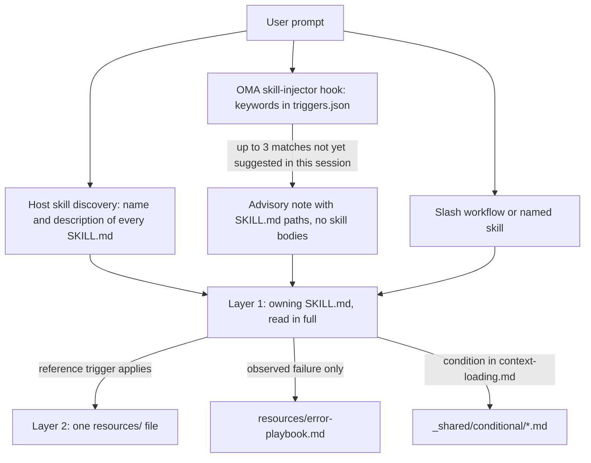
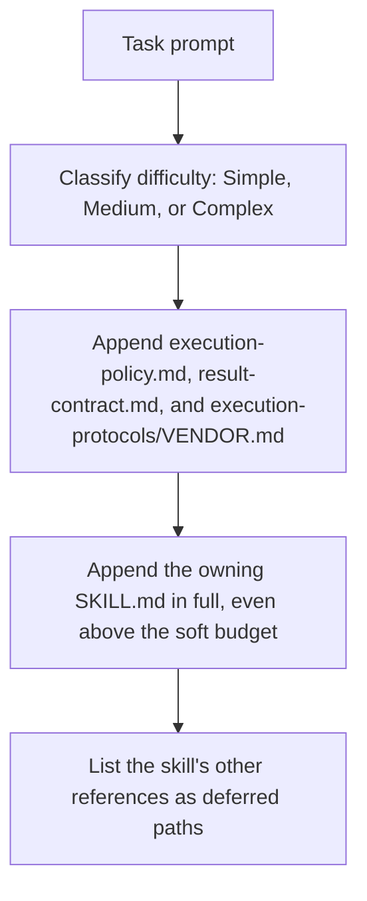

# Skills

[Skills](../getting-started/glossary.md#skill) são pacotes estruturados de conhecimento que fornecem a um papel de dispatch as orientações do seu domínio. Elas reúnem protocolos de execução, referências de stack, templates de código, playbooks de erros, checklists de qualidade e exemplos quando a skill os oferece, organizados em uma arquitetura de duas camadas criada para economizar tokens. Para a lista de skills instaladas, consulte o [catálogo de skills](./agents.md#skill-catalog).

---

## O design em duas camadas

Uma skill chega ao contexto em etapas. A seleção coloca diante do modelo apenas um caminho ou uma descrição; o SKILL.md responsável é lido por inteiro depois que a skill é escolhida; os arquivos de apoio são lidos um de cada vez, quando o gatilho de cada um se aplica.



Fontes: `.agents/hooks/core/skill-injector.ts`, `.agents/skills/_shared/core/skill-routing.md` e `.agents/skills/_shared/core/context-loading.md`.

### Camada 1: SKILL.md (lido quando a skill é selecionada)

Toda skill tem um arquivo `SKILL.md` na raiz. O hook injetor transmite uma **referência de caminho**, não o corpo, então uma skill não selecionada não custa nada além de sua `description`. Todo `SKILL.md` tem frontmatter YAML e as mesmas quatro seções de nível superior; `oma skill lint` aponta uma skill que omita alguma delas ou cujo corpo passe de 500 linhas.

| Parte | Conteúdo |
|------|----------|
| Frontmatter | `name` e uma `description` de roteamento (o que a skill faz e quando usá-la) |
| `## Scheduling` | Objetivo, assinatura de intenção, quando usar, quando NÃO usar, entradas e saídas esperadas, dependências |
| `## Structural Flow` | Transições, falha e recuperação, estados de saída |
| `## Logical Operations` | Comando canônico ou caminho de workflow, escopo de recursos, guardrails |
| `## References` | Arquivos da Camada 2, cada um com a condição que justifica sua leitura |

Frontmatter atual do `oma-frontend`:

```yaml
---
name: oma-frontend
description: "Implement or modify web UI in React, Next.js, or Angular. Use for components, pages, styles, forms, and frontend state or data flows."
---
```

Os runtimes host mostram ao modelo a `description` de cada skill, por isso ela é escrita como uma frase de roteamento. O hook de palavras-chave do OMA não a lê; as palavras-chave dele ficam em `.agents/hooks/core/triggers.json`.

### Camada 2: resources/ (carregado sob demanda)

O diretório `resources/` contém conhecimento de execução detalhado. Esses arquivos são carregados somente quando:
1. O host ou workflow selecionou a skill (por exemplo, por uma correspondência nativa de skill ou por um comando explícito)
2. A tarefa atual atende à condição de carregamento da referência

Este carregamento sob demanda é governado pelo guia de context-loading (`.agents/skills/_shared/core/context-loading.md`), que distingue as instruções de entrada das referências selecionadas pela tarefa.

### O que `oma agent spawn` injeta

O dispatch pela CLI monta o próprio prompt do subagente, de modo que o subagente começa já com os contratos e a skill responsável no contexto:



Fonte: `cli/commands/agent/spawn-status.ts`, `cli/platform/agent-config/loaders.ts` e `cli/platform/context-loader.ts`. Subagentes nativos recebem o mesmo contexto de tarefa de `oma agent context <agent-id>` e leem a política e o contrato de resultado por conta própria se o runtime não os tiver fornecido.

---

## Exemplo de estrutura de arquivos

```text
.agents/skills/oma-frontend/
├── SKILL.md                          ← Layer 1: read when selected
└── resources/
    ├── execution-protocol.md         ← Layer 2: step-by-step workflow
    ├── tech-stack.md                 ← Layer 2: detailed technology specs
    ├── tailwind-rules.md             ← Layer 2: Tailwind conventions
    ├── angular-rules.md              ← Layer 2: Angular-specific conventions
    ├── snippets.md                   ← Layer 2: copy-paste code patterns
    ├── error-playbook.md             ← Layer 2: error recovery procedures
    └── checklist.md                  ← Layer 2: quality verification checklist

.agents/skills/oma-backend/
├── SKILL.md
├── resources/
│   ├── execution-protocol.md
│   ├── orm-reference.md              ← Domain-specific (ORM queries, N+1, transactions)
│   ├── checklist.md
│   └── error-playbook.md
└── variants/                          ← Starter seeds for /stack-set
    ├── stack.schema.json
    ├── node/
    ├── python/
    └── rust/

.agents/skills/oma-mobile/
├── SKILL.md
├── resources/
│   ├── execution-protocol.md
│   ├── tech-stack.md
│   ├── screen-template.dart
│   ├── screen-template.swift         ← Swift native iOS screen template
│   ├── screen-template.tsx            ← React Native screen template
│   ├── checklist.md
│   └── error-playbook.md
└── variants/                          ← Platform seeds for /stack-set
    ├── README.md
    ├── stack.schema.json
    ├── flutter/                       ← stack.yaml, tech-stack.md, snippets.md, api-template.dart
    ├── react-native/                  ← stack.yaml, tech-stack.md, snippets.md, api-template.ts
    └── swift-ios/                     ← stack.yaml, tech-stack.md, snippets.md, api-template.swift

.agents/skills/oma-design/
├── SKILL.md
├── resources/
│   ├── execution-protocol.md
│   ├── anti-patterns.md
│   ├── asset-strategy.md
│   ├── checklist.md
│   ├── design-md-spec.md
│   ├── design-tokens.md
│   ├── getdesign-fetcher.md
│   ├── prompt-enhancement.md
│   ├── redesign-protocol.md
│   ├── stitch-integration.md
│   └── error-playbook.md
└── reference/                         ← Deep reference material
    ├── typography.md
    ├── color-and-contrast.md
    ├── spatial-design.md
    ├── motion-design.md
    ├── responsive-design.md
    ├── component-patterns.md
    ├── accessibility.md
    ├── visual-hierarchy.md
    └── shader-and-3d.md
```

---

## Tipos de recursos por skill

| Tipo de Recurso | Padrão de Nome | Propósito | Quando Carregado |
|-----------------|---------------|---------|-------------|
| **Protocolo de Execução** | `execution-protocol.md` | Workflow passo a passo: Analisar -> Planejar -> Implementar -> Verificar | A operação selecionada precisa dos detalhes de seu comando ou contrato |
| **Stack Tecnológico** | `tech-stack.md` | Specs detalhadas de tecnologia, versões, configuração | Decisão de framework ou stack selecionada |
| **Playbook de Erros** | `error-playbook.md` | Passos do sintoma à recuperação; a falta de informação ou de autorização pausa apenas a ação dependente | Somente após uma falha observada |
| **Checklist** | `checklist.md` | Verificação de qualidade específica do domínio | Seções relevantes, para verificações ainda não resolvidas |
| **Snippets** | `snippets.md` | Padrões de código prontos para copiar | Implementação ou formato de saída pouco familiar |
| **Exemplos** | `examples.md` | Exemplos resolvidos de entrada/saída (oma-pm, oma-db, oma-tf-infra, oma-observability, oma-search) | Implementação ou formato de saída pouco familiar |
| **Variantes** | Diretório `variants/` | Seeds iniciais por linguagem/framework. O backend fornece `node`, `python` e `rust`; o mobile fornece `flutter`, `react-native` e `swift-ios`. `/stack-set` os usa para gerar o `stack/` do projeto. | Quando uma stack correspondente está sendo configurada |
| **Templates** | `screen-template.{dart,swift,tsx}` (oma-mobile), `variants/*/api-template.*` | Boilerplate para uma nova tela ou um novo módulo de API | Ao criar esse arquivo |
| **Referência de Domínio** | `orm-reference.md`, `anti-patterns.md`, etc. | Conhecimento profundo de domínio para subtarefas específicas | Específico por tipo de tarefa |

---

## Recursos compartilhados (_shared/)

Todos os agentes compartilham fundamentos comuns de `.agents/skills/_shared/`. Estes são organizados em três categorias:

### Recursos core (`.agents/skills/_shared/core/`)

| Recurso | Finalidade | Quando carregado |
|---------|---------|------------------------|
| **`execution-policy.md`** | Regras de autorização, clarificação, verificação e conclusão para todas as skills e workflows. | Injetado em todo prompt de `oma agent spawn`; agentes nativos o leem se ele não tiver sido fornecido |
| **`skill-routing.md`** | Roteia por resultado da tarefa, responsabilidade e dependências reais; sem cadeia obrigatória de agentes nem cota de turnos. | Referenciado por skills de orquestração e coordenação |
| **`context-loading.md`** | Entrada da skill responsável, referências condicionais e limites de carregamento em runtime. | Ao compor o contexto |
| **`prompt-structure.md`** | Orienta handoffs de tarefas pouco familiares com objetivo, contexto, restrições reais e evidências de aceitação; sem template obrigatório para tarefas diretas. | Ao compor um handoff pouco familiar; não é um pré-carregamento obrigatório |
| **`clarification-protocol.md`** | Resolve detalhes rotineiros a partir do contexto e pede apenas informações relevantes ausentes ou autorização. | Quando os requisitos são ambíguos |
| **`code-intelligence.md`** | Usar a capacidade de inteligência de código configurada para busca, navegação e análise de impacto no código. | Busca ou navegação no código |
| **`test-approach.md`** | `test_approach` por tarefa, vindo do plano do PM, e o bloco `TDD_EVIDENCE` para tarefas `tdd`. | Tarefas cujo plano define `test_approach` |
| **`context-budget.md`** | Estimativas de tamanho de arquivo, medição do prompt real, leituras delimitadas e checkpoints. | Tarefas longas ou diagnóstico de sobrecarga de contexto |
| **`difficulty-guide.md`** | Escolhe a profundidade do planejamento e os entregáveis com base nas dependências e nas necessidades de verificação. | Quando a decomposição precisa de uma estimativa de dificuldade |
| **`quality-principles.md`** | Orientações sobre escopo, manutenibilidade, evidências e verificação proporcional. | No início de workflows orientados à qualidade (ultrawork) |
| **`vendor-detection.md`** | Resolve o vendor de destino de cada agente a partir da configuração e escolhe entre dispatch nativo e `oma agent spawn`. | Quando os detalhes do dispatch não estão resolvidos |
| **`session-metrics.md`** | Evidências opcionais da sessão, sem pontuações de penalidade conversacional ou do avaliador. | Retrospectiva solicitada ou correção relevante |
| **`common-checklist.md`** | Verificações aplicáveis entre domínios; sem limites globais de contagem de linhas nem exigência generalizada de catch. | Revisão entre domínios, quando relevante |
| **`lessons-learned.md`** | Registra e aplica lições baseadas em evidências, com condições de versão/gatilho; sem limiar automático de RCA. | Consultado após erros e no fim da sessão |
| **`anti-ai-prose.md`** | Diagnósticos de prosa compartilhados. | Auditorias de prosa acadêmica e revisões de estilo de tradução |
| **`stack-verify.schema.json`** | Definições `verify:` compartilhadas, reutilizadas pelos schemas de stack do backend e do mobile. | Validação de schema de stack |
| **`api-contracts/`** | Template de contrato opcional. Reutilize os schemas do projeto; os contratos gerados ficam fora do código-fonte da skill. | Quando há trabalho planejado que atravessa fronteiras |

### Recursos de runtime (`.agents/skills/_shared/runtime/`)

| Recurso | Finalidade |
|---------|---------|
| **`result-contract.md`** | Identidade da execução, caminho de claim e contrato de conclusão para resultados de agentes. Injetado em todo prompt de `oma agent spawn`; agentes nativos o seguem com `oma agent begin`, `oma agent verify` e `oma agent finish`. |
| **`memory-protocol.md`** | Formato e operações de arquivos de memória para subagentes CLI. Define protocolos On Start, During Execution e On Completion usando ferramentas de memória configuráveis (leitura/escrita/edição), com extensão para rastrear experimentos. |
| **`event-spec.md`** | Contrato durável de eventos de workflow, anexado a `events.jsonl` no perfil home do OMA e inspecionado com `oma state get` ou `oma state list`. |
| **`execution-protocols/claude.md`** | Padrões de execução específicos do Claude Code. Injetado por `oma agent spawn` quando o vendor é claude. |
| **`execution-protocols/antigravity.md`** | Padrões de execução da CLI Antigravity (`agy`). |
| **`execution-protocols/codex.md`** | Padrões de execução específicos da CLI Codex. |
| **`execution-protocols/commandcode.md`** | Padrões de execução do CommandCode. |
| **`execution-protocols/grok.md`** | Padrões de execução do Grok. |
| **`execution-protocols/kimi.md`** | Padrões de execução do Kimi Code. |
| **`execution-protocols/kiro.md`** | Padrões de execução do Kiro. |
| **`execution-protocols/opencode.md`** | Padrões de execução da extensão OpenCode. |
| **`execution-protocols/pi.md`** | Padrões de execução da extensão pi. |
| **`execution-protocols/qwen.md`** | Padrões de execução específicos da CLI Qwen. |

Os protocolos de execução específicos de vendor são injetados automaticamente em agentes iniciados pela CLI com `oma agent spawn`. Subagentes nativos usam as regras de integração do vendor selecionado.

### Recursos condicionais (`.agents/skills/_shared/conditional/`)

Estes são carregados apenas quando condições específicas são atendidas durante a execução:

| Recurso | Condição de Gatilho | Carregado Por |
|---------|---------------------|--------------|
| **`quality-score.md`** | É necessária uma baseline definida ou uma comparação de experimentos | Orquestrador (passa para o prompt do agente QA) |
| **`experiment-ledger.md`** | Uma hipótese real é comparada com uma baseline ou com outra abordagem | Coordenador (mantém o ledger compartilhado; agentes em paralelo gravam resultados com escopo de tarefa/execução para ele mesclar) |
| **`exploration-loop.md`** | A recuperação falha repetidamente e alternativas merecem ser testadas dentro do orçamento | Orquestrador (inline, antes de spawnar agentes de hipótese) |
| **`diagram-engine.md`** | Um workflow está prestes a emitir um diagrama estrutural (arquitetura, sequência, fluxo de dados, ciclo de vida) | O workflow que emite o diagrama |

Esses recursos ficam adiados até que o gatilho de cada um se aplique. A dificuldade, por si só, não os injeta.

---

## Como uma skill é selecionada {#how-skills-route-via-skill-routingmd}

Três caminhos levam uma skill ao contexto. Nenhum deles, por si só, inicia um workflow ou autoriza delegação.

1. **Descoberta nativa do host.** Runtimes com suporte a skills listam o `name` e a `description` de cada skill; o modelo lê o SKILL.md cuja descrição corresponde ao resultado solicitado.
2. **Dica de palavra-chave do OMA.** Onde o OMA instala seu hook de prompt, o `skill-injector` compara o prompt com palavras-chave multilíngues em `.agents/hooks/core/triggers.json` e adiciona uma nota consultiva `[OMA SKILLS DETECTED: ...]` listando até três caminhos de SKILL.md. Para "Build a login form with Tailwind CSS", só a palavra-chave `tailwind` corresponde, então a nota sugere `oma-frontend`.
3. **Invocação explícita.** Um workflow de barra como `/plan`, `/review` ou `/debug`, ou o nome da skill no prompt.

### Responsabilidade por resultado

Uma única skill responsável cuida de uma tarefa delimitada; acrescente um handoff somente quando outra skill trouxer uma capacidade distinta. Esta tabela espelha `.agents/skills/_shared/core/skill-routing.md`. Para outros domínios, escolha entre as descrições das skills instaladas no [catálogo de skills](./agents.md#skill-catalog).

| Resultado solicitado | Skill responsável |
|-------------------|--------------|
| API da aplicação, autenticação no servidor, lógica de serviço/acesso a dados | oma-backend |
| Schema, design de migração, indexação, ajuste de queries, operações de banco de dados | oma-db |
| Componentes web, páginas, formulários, estado do cliente | oma-frontend |
| Telas mobile, widgets, integração com a plataforma | oma-mobile |
| Fronteiras do sistema, tradeoffs de arquitetura, ADR | oma-architecture |
| Diagnosticar e corrigir comportamento incorreto | oma-debug |
| Revisar corretude, segurança, acessibilidade, performance | oma-qa |
| Sistema visual, DESIGN.md, direção de redesign | oma-design |
| Ideação solicitada ou exploração de alternativas | oma-brainstorm |
| Requisitos, dependências, critérios de aceitação | oma-pm |
| Execução paralela de especialistas solicitada | oma-orchestration |
| Coordenação manual multiagente solicitada | oma-coordination |
| Branches Git, commits, merges, histórico do repositório | oma-scm |

### Dependências entre skills

Não existe uma cadeia de execução fixa. Ordene o trabalho pelas dependências reais:

- Resolva uma decisão de arquitetura ou de produto ainda em aberto antes do trabalho que depende dela. Decisões já existentes não precisam passar de novo por arquitetura, brainstorming ou PM.
- O trabalho de backend e o de cliente podem avançar de forma independente quando o contrato de API compartilhado estiver utilizável. Se ele não existir, defina essa fronteira com os responsáveis relevantes primeiro.
- A revisão pode começar sobre uma parte concluída e revisável enquanto a implementação independente continua. Não revise um artefato instável como evidência final.
- Um bug encontrado durante a implementação pode ser corrigido pelo seu responsável. Acrescente apoio de debug quando o diagnóstico justificar; não há cadeia obrigatória de implementação para debug.
- Em um defeito entre domínios, identifique a partir das evidências o contrato que falha e o responsável. Uma incompatibilidade de API não significa automaticamente que o backend precisa mudar.

### Quando uma dica de skill não aparece

Todos esses comportamentos vêm de `.agents/hooks/core/skill-injector.ts`.

| Sintoma | Causa | O que fazer |
|---------|-------|------------|
| Nenhuma nota `[OMA SKILLS DETECTED]` | O prompt começa com `/`, há um [workflow persistente](../getting-started/glossary.md#persistent-workflow) ativo na sessão ou a mensagem é uma mensagem de agente retransmitida | Esperado: o workflow controla o contexto. Cite a skill pelo nome se precisar dela |
| Uma skill esperada não aparece na nota | Apenas as 3 melhores correspondências são listadas (10 pontos por palavra-chave correspondente) | Use um termo mais específico ou cite a skill pelo nome |
| Uma skill sugerida antes não é sugerida de novo | Um caminho de SKILL.md é sugerido uma vez por sessão; o registro em `.agents/state/skill-sessions.json` expira após uma hora sem novas sugestões | A sugestão anterior continua valendo |
| Uma palavra-chave é ignorada | Texto dentro de blocos de código, crases ou aspas duplas é removido antes da correspondência | Mencione o termo em texto simples |
| oma-academic-writing, oma-docs, oma-explanation, oma-scholar ou oma-skill-creation nunca são sugeridas | Essas skills não têm palavras-chave em `triggers.json` | Use `/docs` ou `/explain`, ou cite a skill pelo nome; a descoberta do host continua vendo suas descrições |
| A dica cita uma skill não relacionada | A correspondência é baseada em palavras-chave e consultiva | Declare o resultado desejado; a nota orienta o modelo a usar seu próprio julgamento |

---

## Matemática de economia de tokens {#token-savings-math}

Meça o custo de contexto antes de afirmar que há economia. Duas coisas diferentes usam as palavras simple, medium e complex:

- **Cenários do script** (`routed`, `simple`, `medium`, `complex`, `all`) são comparações cumulativas de tamanho de arquivo exibidas por `scripts/measure-skill-context.ts`. Não são políticas de carregamento, e `all` é apenas um limite superior.
- **Dificuldade do loader** (Simple, Medium, Complex) seleciona o orçamento flexível do contexto que o dispatch pela CLI injeta. Veja [Carregamento de recursos por tarefa](#resource-loading-by-task).

```bash
bun scripts/measure-skill-context.ts
bun scripts/measure-skill-context.ts --skills oma-pm,oma-backend,oma-frontend --json
oma agent context backend --difficulty Medium
```

O script informa estimativas de bytes UTF-8 / 4. `routed` é apenas a entrada; `simple`, `medium` e `complex` acrescentam arquivos hipotéticos de protocolo, de exemplo e de stack para comparação. Os nomes são mantidos por compatibilidade com o script, e não como instruções de pré-carregamento. Um checkout novo pode usar uma seed de plataforma como proxy de tamanho; ele não carrega todas as plataformas.

O comando de contexto exibe a injeção real de contexto da tarefa: um cabeçalho `## Task context (graph-selected, approximately N tokens)`, o SKILL.md responsável e a lista de referências adiadas. Ele não inclui o restante da conversa nem todas as instruções do host/runtime, e um prompt de spawn é maior porque `oma agent spawn` também acrescenta a política de execução, o contrato de resultado e o protocolo do vendor. Use um prompt montado ou a telemetria de uso para medir o total de tokens de entrada, a latência e o custo em um modelo específico. Não infira esses valores a partir do tamanho do repositório nem das contagens de espelhos gerados.

## Carregamento de recursos por tarefa {#resource-loading-by-task}

Todo nível de dificuldade começa pela skill responsável. O grafo é um índice de referências; a adjacência não autoriza carregar outro especialista, um playbook de erros nem um workflow condicional de experimentos.

O loader usa orçamentos flexíveis de 1.500 / 4.000 / 8.000 tokens estimados para Simple / Medium / Complex. Uma entrada que excede o orçamento é mantida e o excesso é informado. As referências de apoio permanecem adiadas, a menos que sejam selecionadas explicitamente depois que o gatilho da tarefa correspondente for resolvido. Uma entrada obrigatória nunca é substituída por documentos menores e não relacionados.

A verificação segue o risco da tarefa e os requisitos do projeto. Um rótulo de dificuldade não exige uma suíte de testes completa, uma resposta de preflight fixa nem uma segunda aprovação de trabalho já autorizado.

## Mapas de tarefas de context-loading (por agente)

Estes são exemplos de referências a consultar quando a tarefa precisar delas. Use o índice atual da skill responsável e selecione apenas as seções aplicáveis:

### Agente backend

<!-- oma-docs:ignore-start -->

| Tipo de tarefa | Recursos obrigatórios |
|-----------|-------------------|
| Criação de API CRUD | `stack/snippets.md` e `stack/api-template.*` do projeto (gerados por `/stack-set`) quando existirem; caso contrário, o código existente do projeto |
| Autenticação | `stack/snippets.md` + `stack/tech-stack.md` quando existirem |
| Migração de DB | `stack/snippets.md` quando existir; o design de schema fica com oma-db |
| Otimização de performance | `orm-reference.md` e exemplos correspondentes fornecidos pela skill |
| Modificação de código existente | provider de inteligência de código do projeto e recursos de execução relevantes |

<!-- oma-docs:ignore-end -->

`variants/node`, `variants/python` e `variants/rust` são seeds iniciais para `/stack-set`; os agentes não as leem ao editar código existente.

### Agente frontend

| Tipo de tarefa | Recursos obrigatórios |
|-----------|-------------------|
| Criação de componente | snippets.md + padrões de componentes existentes no projeto |
| Implementação de formulário | snippets.md (form + Zod) |
| Integração com API | snippets.md (TanStack Query) |
| Estilização | tailwind-rules.md |
| Layout de página | snippets.md (grid) |

### Agente de design

| Tipo de tarefa | Recursos obrigatórios |
|-----------|-------------------|
| Criação de sistema de design | reference/typography.md + reference/color-and-contrast.md + reference/spatial-design.md + design-md-spec.md |
| Design de landing page | reference/component-patterns.md + reference/motion-design.md + prompt-enhancement.md |
| Auditoria de design | checklist.md + anti-patterns.md |
| Exportação de design tokens | design-tokens.md |
| Efeitos 3D/shader | reference/shader-and-3d.md + reference/motion-design.md |
| Revisão de acessibilidade | reference/accessibility.md + checklist.md |

### Agente de QA

| Tipo de tarefa | Recursos obrigatórios |
|-----------|-------------------|
| Revisão de segurança | checklist.md (seção Security) |
| Revisão de performance | checklist.md (seção Performance) |
| Revisão de acessibilidade | checklist.md (seção Accessibility) |
| Auditoria completa | checklist.md (todas as seções), mais iso-quality.md quando for solicitada uma revisão baseada em normas |
| Comparação de métrica definida | quality-score.md (condicional) |

---

## Composição de prompt do orquestrador

Quando o orquestrador escreve um prompt de subagente (`oma-orchestration/resources/subagent-prompt-template.md`), ele fornece apenas dados da tarefa: papel do agente, ID da tarefa, workspace, caminhos permitidos, descrição da tarefa, critérios de aceitação, referências da tarefa com suas condições de carregamento e restrições relevantes.

- No dispatch pela CLI, `oma agent spawn` já injeta `execution-policy.md`, `result-contract.md`, o protocolo de execução do vendor e o SKILL.md responsável, então o prompt não os repete.
- No dispatch nativo, passe os caminhos desses arquivos e da skill responsável se o runtime não os tiver fornecido.
- Acrescente uma seção do error-playbook somente após uma falha observada, e `runtime/memory-protocol.md` somente quando o agente coordena ou retoma estado durável de tarefas.

Essa composição direcionada evita carregar recursos desnecessários e maximiza o contexto disponível do subagente para o trabalho real.

---

## Evidências de sessão e revisão retrospectiva

Os registros de sessão capturam correções relevantes, mudanças de escopo, retrabalho e achados de revisão julgados com evidências. A clarificação necessária não gera penalidade. As antigas pontuações ponderadas de CD e EA e as regras de RCA acionadas por limiares foram removidas; eram instruções de prompt, e não métricas calculadas pela CLI.

Use os resultados de tarefas existentes sempre que possível. Um arquivo `session-metrics-{sessionId}.md` separado é opcional no armazenamento de coordenação configurado. Uma falha repetida ou uma retrospectiva solicitada pode justificar uma lição, mas uma verificação comum com falha ou um achado contestado não estabelece uma automaticamente. Mantenha os logs históricos; não os reescreva no novo formato.

`oma stats` informa a produtividade e os resumos de uso/custo registrados. `oma retro` agrupa eventos reais de portão, bloqueio e decisão ausente em sugestões. Nenhum dos dois calcula pontuações de CD/EA a partir desses artefatos Markdown.

## Decomposição de tarefas e recuperação de contexto

Planeje em torno de dependências e de comportamentos verificáveis de forma independente. Contagens fixas de sprints e de arquivos, assim como estimativas de turnos, não determinam a profundidade da revisão nem a conclusão. Mantenha os testes e o tratamento de erros junto ao comportamento que eles verificam.

Diante de uma estagnação observada ou da perda de contexto útil, salve o trabalho concluído, os critérios restantes, os caminhos relevantes e as evidências de verificação antes de retomar ou de fazer um novo dispatch. Preserve o trabalho existente e evite duplicar uma tentativa em andamento. A proporção entre turnos e progresso, por si só, não exige um reset.

## Medição condicional e exploração

Uma baseline definida ou uma comparação de experimentos ativa a orientação de medição; ter apenas testes ou lint, não. Registre métricas comparáveis com unidades, método, revisão e evidências. As verificações obrigatórias de correção e de segurança permanecem independentes. O OMA não tem fórmula composta padrão, portão de nota por letra nem rollback acionado por pontuação.

Um experimento real registra sua hipótese, as evidências de baseline e do candidato, as verificações obrigatórias, a decisão e os arquivos sob sua responsabilidade. Falhas repetidas podem justificar testar outro mecanismo dentro do orçamento de recuperação existente. Isole as mudanças do experimento, preserve edições não relacionadas e verifique o candidato integrado antes de retomar o portão.

---

## Relacionados

- [Agentes](./agents.md): catálogo de skills, papéis de dispatch, definições e arquivos de agentes nativos
- [Workflows](./workflows.md): workflows de barra que leem skills
- [Estrutura do projeto](./project-structure.md): onde `.agents/skills/` fica após a instalação
- [Resultados de agentes e retomada](../guide/agent-results-and-resume.md): o ciclo de vida nativo `oma agent begin` → `oma agent finish`
- [Avaliação de skills](../guide/skill-eval.md) e [Otimização de skills](../guide/skill-opt.md)
- Autoria: use a skill `oma-skill-creation` e depois execute `oma skill lint` e `oma skill audit`
