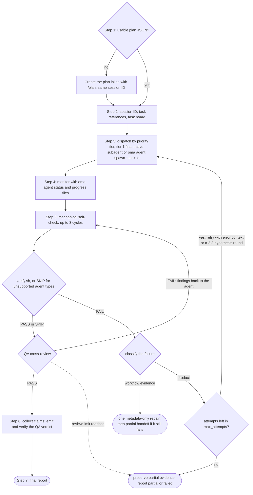
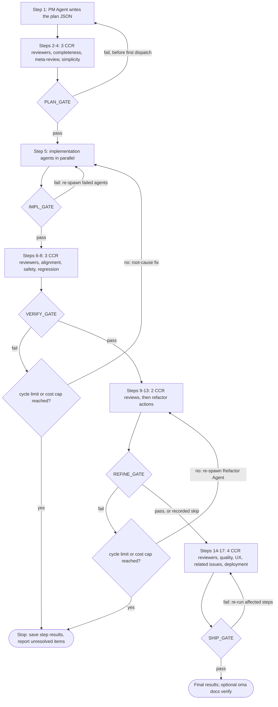
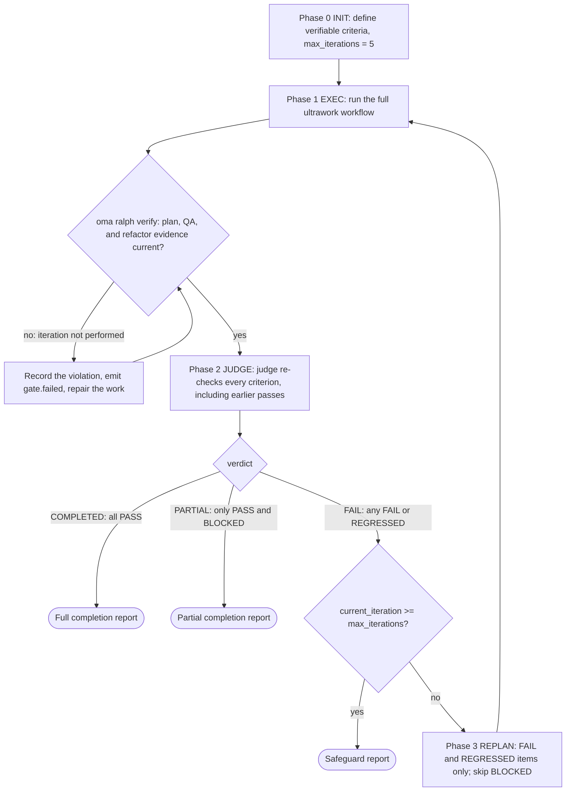

# Workflows

Workflows são processos estruturados de múltiplas etapas iniciados por comandos slash; os quatro modos persistentes também começam quando um pedido em linguagem natural os chama pelo nome. Eles definem como os agentes colaboram em tarefas, desde utilitários de fase única até portões de qualidade complexos de 5 fases.

Existem 20 workflows, 4 dos quais são [persistentes](../getting-started/glossary.md#persistent-workflow) (mantêm estado e não podem ser interrompidos acidentalmente).

## Visão geral dos workflows

| Workflow | Use para | Persistente |
|---|---|---|
| [`/orchestrate`](#orchestrate) | Execução paralela automatizada de agentes a partir de um plano, com loops de verificação | Sim |
| [`/work`](#work) | Coordenação multi-domínio passo a passo: planejar, implementar, QA, corrigir | Sim |
| [`/ultrawork`](#ultrawork) | O workflow de qualidade de 5 fases com 12 etapas de revisão isoladas | Sim |
| [`/ralph`](#ralph) | Repetir o ultrawork até que critérios verificáveis mecanicamente passem | Sim |
| [`/plan`](#plan) | Breakdown de tarefas pelo PM com dependências e contratos de API | Não |
| [`/brainstorm`](#brainstorm) | Ideação orientada por design antes do planejamento | Não |
| [`/architecture`](#architecture) | Decisões de arquitetura, revisões e ADRs | Não |
| [`/deepinit`](#deepinit) | Gerar AGENTS.md, ARCHITECTURE.md e `docs/` para um codebase existente | Não |
| [`/review`](#review) | Revisão QA: segurança, performance, acessibilidade, qualidade de código | Não |
| [`/security`](#security) | Varreduras de segurança de código-fonte, skills de agentes e componentes MCP; validação de achados; gates de CI | Não |
| [`/debug`](#debug) | Diagnóstico e correção de bugs com teste de regressão | Não |
| [`/design`](#design) | Achados de design, DESIGN.md, uma direção de redesign ou design tokens | Não |
| [`/scm`](#scm) | Operações Git e Conventional Commits | Não |
| [`/convert`](#convert) | Converter documentos e mídia entre formatos | Não |
| [`/docs`](#docs) | Detecção e sincronização de deriva documental | Não |
| [`/recap`](#recap) | Recap diário ou por período entre ferramentas de IA | Não |
| [`/stack-set`](#stack-set) | Referências específicas da stack para uma skill de domínio | Não |
| [`/video`](#video) | Geração de MP4 por meio da skill `oma-video` | Não |
| [`/schedule`](#schedule) | Jobs de agentes recorrentes e baseados em tempo | Não |
| [`/explain`](#explain) | Um explainer HTML interativo para uma mudança de código ou um tema | Não |

---

## Escolher uma skill ou um workflow {#choosing-a-skill-or-workflow}

Escolha de acordo com a coordenação e a verificação de que a tarefa precisa. Se você já selecionou um workflow, siga-o; continue um workflow ativo até que o cancele ou altere explicitamente. Para uma nova tarefa sem workflow selecionado, use este guia:

| Necessidade da tarefa | Escolha | Exemplo |
|---|---|---|
| Um domínio sem coordenação entre agentes | [Skill única](/docs/guide/single-skill) | Adicionar um endpoint de API e testar sua validação |
| Vários domínios com planejamento, implementação e QA passo a passo | `/work` | Coordenar uma mudança de API com seus clientes web e mobile |
| Delegação automatizada de tarefas independentes em paralelo | `/orchestrate` | Implementar tarefas de backend e frontend em paralelo após resolver as dependências |
| Um processo abrangente de qualidade solicitado explicitamente | `/ultrawork` | Executar todas as revisões de planejamento, implementação, verificação, refinamento e prontidão para publicação |
| Uma solicitação explícita de repetir a execução até que critérios verificáveis mecanicamente sejam atendidos | `/ralph` | Repetir a implementação e a verificação pelo juiz até que as verificações de regressão especificadas passem, dentro das salvaguardas do loop |

`/orchestrate` carrega um plano utilizável ou cria um por meio de `/plan` antes de iniciar os agentes. Você não precisa executar `/plan` primeiro. Portanto, a existência de um plano não é o que distingue `/work` de `/orchestrate`; escolha de acordo com a forma como quer coordenar o trabalho. Ambos podem executar tarefas independentes em paralelo.

Critérios de aceitação e testes também fazem parte de tarefas com skill única. Sua presença, por si só, não exige `/ralph`: cada iteração de Ralph executa o processo completo de ultrawork e uma passagem do juiz, então escolha-o quando quiser esse loop de verificação repetida. Ele pode parar com trabalho incompleto ou bloqueado quando as salvaguardas se aplicam.

Esta tabela orienta a escolha; não é um roteador automático de workflows. O agente principal pode recomendar uma abordagem adequada; recomendar ou explicar um workflow não o inicia. Um comando slash seleciona um workflow explicitamente. Quando o hook de detecção de palavras-chave está habilitado, correspondências com palavras-chave ou padrões configurados também podem ativar um workflow, conforme seus filtros de consultas informativas. O detector não classifica o número de domínios, não verifica se o plano está pronto nem aplica a tabela como um algoritmo de prioridades.

A revisão do plano reutiliza a autorização já concedida para a tarefa. Os agentes só perguntam quando falta uma decisão relevante ou quando uma ação está fora desse escopo. Uma revisão de prontidão para publicação não autoriza, por si só, publicar ou fazer deploy.

---

## Workflows persistentes {#persistent-workflows}

Workflows persistentes continuam executando até que todas as tarefas sejam concluídas. Mantêm estado em `.agents/state/` e reinjetam o contexto `[OMA PERSISTENT MODE: ...]` em cada mensagem do usuário até serem explicitamente desativados.

O modo persistente começa somente com uma **invocação explícita**: o slash command do workflow (`/ultrawork`, ou uma forma com namespace como `/oma:ultrawork`), ou o nome do próprio workflow em texto simples (a lista `explicit` em `triggers.json`: "orchestrate" e suas traduções listadas, "ultrawork"/"ulw", "work mode"/"work workflow", "ralph"/"랄프"). O hook de palavras-chave não abre um workflow a partir de nenhuma outra frase.

### /orchestrate

**Descrição:** Execução paralela automatizada de agentes via CLI. Inicia subagentes via CLI, coordena por meio de estado de execução durável e recibos, monitora o progresso e executa loops de verificação.

**Persistente:** Sim. Arquivo de estado: `.agents/state/orchestrate-state-{sessionId}.json`.

**Palavras-chave gatilho:**
| Idioma | Palavras-chave |
|--------|---------------|
| Explícita (persistente) | "orchestrate", "オーケストレート", "orquestar", "orchestrer", "orchestrieren", "orquestrar", "оркестровать", "orkestreren", "orkiestrować" |

Frases como "do everything", "전부 해줘" ou "build me an app" não iniciam este workflow.

**Etapas:**
1. **Step 0 — Preparação:** Ler skill de coordenação, guia de context-loading e protocolo de memória. Detectar o vendor.
2. **Step 1 — Carregar/Criar Plano:** Procurar `.agents/results/plan-{sessionId}.json` e depois o `plan-*.json` mais recente. Se nenhum for encontrado — ou se o plano não estiver pronto para execução (uma tarefa sem agente, tier de prioridade, dependências ou critérios de aceitação) — delegar a `/plan` inline para criar um, mantendo o mesmo ID de sessão. Apresentar o plano e reutilizar a autorização existente; perguntar somente quando faltar uma decisão relevante ou uma nova autorização antes da delegação.
3. **Step 2 — Inicializar Sessão:** Carregar `oma-config.yaml`, exibir a tabela de mapeamento CLI e reutilizar o ID de sessão da criação do plano ou gerar um (`session-YYYYMMDD-HHMMSS`). Para cada tarefa, selecionar as referências de skill de que ela precisa, comparando a tarefa com as assinaturas de intenção das skills instaladas; uma skill correspondida com confiança é suficiente. Criar `orchestrator-session-{sessionId}.md` e `task-board-{sessionId}.md` no armazenamento de memória configurado e registrar ali as referências selecionadas de cada tarefa e o motivo da seleção. São notas do coordenador; o launcher não as impõe.
4. **Step 3 — Iniciar Agentes:** Para cada tier de prioridade (o mais baixo primeiro: tier 1, depois tier 2 e assim por diante), iniciar agentes usando o método apropriado ao vendor (subagentes nativos quando o runtime atual e o vendor-alvo coincidirem; `oma agent spawn` para trabalho externo ou entre vendors). Cada agente recebe sua tarefa, os contratos de API e suas referências selecionadas com as respectivas condições de carregamento. Nunca exceder MAX_PARALLEL (padrão 3).
5. **Step 4 — Monitorar:** Verificar a saúde dos processos com `oma agent status`. Preferir as notificações de conclusão do host; caso contrário, consultar os arquivos `progress-{agentId}-{taskId}-{runId}-{sessionId}.md` específicos da execução que foram alterados, com backoff limitado, ler os recibos estruturados e atualizar o quadro de tarefas. Observar conclusões, falhas e crashes.
6. **Step 5 — Verificar:** Para cada agente concluído, executar uma autoverificação mecânica (lint, typecheck, testes, escopo do diff; até 3 ciclos), depois `verify.sh {agent-type} {workspace}` (backend, frontend, mobile, qa, debug e pm; outros tipos de agente registram `SKIP`) e, em seguida, uma revisão cruzada de QA. Em caso de falha do verify, iniciar novamente com o contexto do erro. Falhas repetidas podem justificar hipóteses alternativas, mas a tentativa original, cada retry e cada hipótese consomem o mesmo orçamento agregado de recuperação (`max_attempts`, padrão 3, incluindo a tentativa original). Preservar as evidências não resolvidas se o orçamento não cobrir uma rodada de comparação.
7. **Step 6 — Coletar:** Ler os arquivos de resultado específicos da execução e os claims estruturados, depois compilar o resumo.
8. **Step 7 — Relatório Final:** Apresentar o resumo da sessão. Se experimentos foram executados, resumir as evidências e as decisões; registrar lições somente quando uma causa reutilizável estiver estabelecida.



**Arquivos lidos:** `.agents/results/plan-{sessionId}.json`, `.agents/oma-config.yaml`, arquivos de progresso e resultado específicos da execução e recibos estruturados das execuções.
**Arquivos escritos:** estado de sessão e quadro de tarefas específicos da execução no armazenamento de memória configurado, recibos e claims estruturados e o relatório final.

**Quando usar:** Projetos grandes requerendo máximo paralelismo com coordenação automatizada.

---

### /work

**Descrição:** Coordenação multi-domínio passo a passo. O PM planeja primeiro, depois os agentes executam dentro do escopo autorizado, com revisão QA e correção de problemas em seguida.

**Persistente:** Sim. Arquivo de estado: `.agents/state/work-state-{sessionId}.json`.

**Palavras-chave gatilho:**
| Idioma | Palavras-chave |
|--------|---------------|
| Explícita (persistente) | "work mode", "work workflow" |

A palavra isolada "work" não é um gatilho: é vocabulário comum ("Does this work on Windows?"). "step by step" e suas traduções também não iniciam este workflow.

**Etapas:**
1. **Step 0 — Preparação:** Ler skills, context-loading, protocolo de memória. Registrar início da sessão.
2. **Step 1 — Analisar Requisitos:** Identificar domínios envolvidos. Se domínio único, sugerir uso direto do agente.
3. **Step 2 — Planejamento pelo Agente PM:** PM decompõe requisitos, define contratos de API, cria breakdown priorizado de tarefas, salva em `.agents/results/plan-{sessionId}.json`.
4. **Step 3 — Revisar Plano:** Apresentar o plano e prosseguir com a autorização existente. Perguntar apenas quando faltar uma decisão relevante ou uma nova autorização.
5. **Step 4 — Spawnar Agentes:** Spawnar por tier de prioridade, paralelo dentro do mesmo tier, workspaces separados.
6. **Step 5 — Monitorar:** Poll de arquivos de progresso, verificar alinhamento de contrato de API entre agentes.
7. **Step 6 — Revisão QA:** Spawnar agente QA para segurança (OWASP), performance, acessibilidade, qualidade de código.
8. **Step 6.1 — Medições** (condicional): Registrar um baseline quando uma comparação definida for necessária.
9. **Step 7 — Iterar:** Se problemas CRITICAL/HIGH encontrados, re-spawnar agentes responsáveis. Se mesmo problema persiste após 2 tentativas, ativar Exploration Loop.

**Quando usar:** Funcionalidades que abrangem múltiplos domínios e precisam de coordenação passo a passo do planejamento, da implementação e de QA.

---

### /ultrawork

**Descrição:** O workflow focado em qualidade. Tem 5 fases, 17 etapas no total e 12 etapas de revisão isoladas. Cada fase tem um portão que deve passar antes de prosseguir.

**Persistente:** Sim. Arquivo de estado: `.agents/state/ultrawork-state-{sessionId}.json`.

**Palavras-chave gatilho:**
| Idioma | Palavras-chave |
|--------|---------------|
| Explícita (persistente) | "ultrawork", "ulw" |

**Fases e etapas:**

| Fase | Etapas | Agente | Perspectiva de Revisão |
|------|--------|--------|----------------------|
| **PLAN** | 1-4 | Agente PM (autor, Step 1) + revisores CCR (Steps 2-4) | Completude, Meta-revisão, Over-engineering/Simplicidade |
| **IMPL** | 5 | Agentes Dev (spawned) | Implementação |
| **VERIFY** | 6-8 | Revisores CCR | Alinhamento, Segurança (OWASP), Prevenção de Regressão |
| **REFINE** | 9-13 | Agente Refactor (Steps 9, 11, 13) + revisores CCR (Steps 10, 12) | Divisão de arquivos, Reusabilidade, Impacto em Cascata, Consistência, Código Morto |
| **SHIP** | 14-17 | Revisores CCR | Qualidade de Código (lint/coverage), Fluxo UX, Problemas Relacionados, Prontidão para Deploy |

Cada etapa de revisão é executada por seu próprio subagente revisor com contexto novo ([Revisão entre contextos (CCR)](../getting-started/glossary.md#cross-context-review-ccr)). O Agente PM não revisa o próprio plano inline.

**Definições de portão:**
- **PLAN_GATE:** Plano documentado, suposições listadas, alternativas consideradas, revisão de over-engineering feita, escopo autorizado.
- **IMPL_GATE:** Verificações aplicáveis sem geração de arquivos e testes passam, apenas arquivos planejados são modificados, evidência de baseline registrada para experimentos reais. Verificações de build são executadas apenas quando solicitadas explicitamente.
- **VERIFY_GATE:** Implementação corresponde aos requisitos, zero CRITICAL, zero HIGH, sem regressões, metas de medição aplicáveis do projeto atingidas.
- **REFINE_GATE:** Regras de manutenibilidade do projeto seguidas, oportunidades de integração capturadas, efeitos colaterais verificados, código limpo, nenhuma regressão não resolvida.
- **SHIP_GATE:** Verificações de qualidade passam, UX verificado, problemas relacionados resolvidos, checklist de deploy completo, metas de medição aplicáveis do projeto atingidas com evidência atual. Reutilizar a autorização existente; publicar ou fazer deploy exige autorização para essa ação.

**Comportamento em falha de portão:**
- Primeira falha: retornar à etapa relevante, corrigir e tentar novamente.
- Segunda falha no mesmo problema: reavaliar a causa; se houver alternativas que mereçam ser testadas dentro do orçamento restante, comparar experimentos isolados com o comportamento exigido e as métricas definidas.
- Limites: uma falha em PLAN volta ao Step 1 somente antes do primeiro dispatch de tarefa (depois disso, o plano é imutável). Os retries de VERIFY e REFINE param quando a contagem de falhas de portão atinge o máximo configurado (padrão de 5 ciclos VERIFY + REFINE) ou quando o teto de custo da sessão é excedido.



**Aprimoramentos condicionais:** Comparações de métricas definidas, decisões e evidências de experimentos, exploração de hipóteses com orçamento e lições apoiadas em causas reutilizáveis.

**Condição de pular REFINE:** Tarefas simples com menos de 50 linhas.

**Quando usar:** Um processo de revisão completo antes de você decidir se o resultado está pronto para publicação. O workflow registra verificações e achados; ele não toma a decisão de prontidão para produção por você.

---

### /ralph

**Descrição:** Loop de execução persistente e autorreferencial. Envolve ultrawork com um [juiz](../getting-started/glossary.md#judge) que checa os critérios de conclusão após cada iteração. Relata conclusão completa quando todos os critérios passam, conclusão parcial quando restam apenas critérios aprovados e bloqueados, ou para quando as salvaguardas são acionadas.

**Persistente:** Sim. Arquivo de estado: `.agents/state/ralph-state-{sessionId}.json`.

**Palavras-chave gatilho:**
| Idioma | Palavras-chave |
|--------|---------------|
| Explícita (persistente) | "ralph", "랄프" |

Frases soltas de retomada ("keep going", "carry on", "계속해", "続けて", "продолжай", …) e formulações de conclusão ("don't stop", "끝까지 해") não iniciam este workflow.

**Fases:**
1. **Fase 0 — INIT:** Carregar pré-requisitos (context-loading, protocolo de memória, protocolo de juiz). Definir e registrar critérios de conclusão verificáveis mecanicamente, como asserções de testes, verificações de tipos sem geração de arquivos, códigos de saída ou existência de arquivos. Incluir verificações de build apenas quando solicitadas explicitamente. Mostrar os critérios e continuar dentro do escopo autorizado. Inicializar a sessão com `max_iterations: 5`.
2. **Fase 1 — EXEC:** Executar ultrawork (PLAN → IMPL → VERIFY → REFINE → SHIP) como uma única iteração sob o ID de sessão do Ralph. Em seguida, executar o portão de artefatos `oma ralph verify --json --session-id <sessionId> --newer-than <iteration start>`. Se ele falhar, a iteração conta como não realizada: o Ralph registra a violação, repara o trabalho e executa o portão novamente.
3. **Fase 2 — JUDGE:** Um juiz checa cada critério de conclusão contra o estado real do projeto (executar as verificações autorizadas e confirmar a existência de arquivos). O prompt do workflow instrui o orquestrador a iniciar o juiz como um agente separado, com contexto novo e informado apenas sobre os critérios; nada confirma mecanicamente esse spawn, e um runtime que não consegue iniciar subagentes é instruído a julgar inline e registrar `ralph.judge-inline-fallback`. Registrar as evidências e o status de cada critério, incluindo PASS, FAIL, REGRESSED ou BLOCKED.
4. **Portão de decisão:** Se todos os critérios forem PASS → relatar conclusão completa. Se restarem apenas PASS e BLOCKED → relatar conclusão parcial. Se houver FAIL ou REGRESSED → incorporar o contexto da falha à próxima iteração, respeitando as salvaguardas.
5. **Fase 3 — REPLAN:** Restringir a próxima iteração aos itens FAIL e REGRESSED (diagnóstico com base no diff), pular os itens BLOCKED e manter os critérios PASS no escopo do juiz. Voltar à Fase 1.
6. **Salvaguardas:** O loop para se `current_iteration >= max_iterations` (padrão 5). Um critério que falha 3 vezes consecutivas pela mesma causa raiz passa a BLOCKED e não é tentado novamente (detecção de impasse).



O nó do juiz é o juiz instruído por prompt descrito na Fase 2: o workflow instrui o orquestrador a iniciá-lo com contexto novo, e um runtime que não consegue iniciar subagentes julga inline e registra o fallback.

**Principal diferença em relação a /ultrawork:** Ultrawork executa um processo de 5 fases com novas tentativas quando um portão de fase falha. Ralph envolve ultrawork em um loop de retry com um juiz instruído por prompt que verifica novamente cada critério com base nas evidências do projeto. O loop termina com um relatório de conclusão completa, de conclusão parcial por trabalho bloqueado ou de acionamento de uma salvaguarda.

**Arquivos lidos:** `.agents/workflows/ralph/resources/judge-protocol.md`, todos os arquivos de ultrawork.
**Arquivos escritos:** `session-ralph-{sessionId}.md` (memória), logs de iteração, relatório final.

**Quando usar:** Quando você quer explicitamente execução repetida e nova verificação pelo juiz com base em critérios mecânicos de conclusão. Testes, por si só, não exigem Ralph; considere o processo completo de ultrawork em cada iteração e suas salvaguardas.

---

## Workflows não-persistentes

### /plan

**Descrição:** Breakdown de tarefas dirigido pelo PM. Analisa requisitos, seleciona stack tecnológico, decompõe em tarefas priorizadas com dependências, define contratos de API.

**Palavras-chave gatilho:** Nenhuma. Inicie-o com `/plan`. O hook de palavras-chave não abre este workflow a partir de uma frase.

**Etapas:** Coletar requisitos -> Analisar viabilidade técnica (análise de código MCP) -> Avaliar complexidade (Simples/Médio/Complexo) -> Definir contratos de API (quando houver fronteira entre componentes) -> Decompor em tarefas -> Revisar com o usuário -> Salvar artefatos do plano (JSON legível por máquina e tracker Markdown legível por humanos para tarefas Médias/Complexas).

**Saída:** `.agents/results/plan-{sessionId}.json`, escrita em memória e, para planos Médios/Complexos, `docs/plans/work/{NNN}-{name}.md` com tabela de tarefas, registro de decisões e notas de progresso. O ciclo de vida é acompanhado pelo campo `Status` no cabeçalho Markdown (`Active` -> `Completed`); os planos não são movidos entre pastas. As abordagens selecionadas via `/brainstorm` são salvas em `docs/decisions/{NNN}-{name}.md`.

**Execução:** Inline (sem iniciar subagentes). Consumido por `/orchestrate` ou `/work`, que atualizam os campos de tarefa e status durante a execução.

---

### /brainstorm

**Descrição:** Ideação orientada por design. Explora intenção, clarifica restrições, propõe abordagens, produz um documento de design aprovado antes do planejamento.

**Palavras-chave gatilho:** Nenhuma. Inicie-o com `/brainstorm`. O hook de palavras-chave não abre este workflow a partir de uma frase.

**Etapas:** Explorar o contexto do projeto (análise MCP) -> Fazer perguntas de esclarecimento (uma por vez) -> Propor 2-3 abordagens com tradeoffs -> Apresentar o design seção por seção (com aprovação do usuário em cada etapa) -> Rodada de revisão cega -> Salvar a abordagem selecionada em `docs/decisions/{NNN}-{name}.md` e atualizar `docs/decisions/index.md` -> Transição: sugerir `/plan`.

**Regras:** Sem implementação ou planejamento antes da aprovação do design. Sem saída de código. YAGNI.

---

### /architecture

**Descrição:** Workflow de arquitetura de software — diagnosticar problemas de arquitetura, selecionar o método de análise correto (roteamento diagnóstico / design-twice / ATAM / CBAM / ADR), comparar opções, sintetizar o input de stakeholders e produzir uma recomendação, revisão ou ADR.

**Palavras-chave gatilho:** Nenhuma. Inicie-o com `/architecture`. O hook de palavras-chave não abre este workflow a partir de uma frase.

**Etapas:** Enquadrar a decisão (nova arquitetura / revisão / análise de tradeoff / priorização de investimento / autoria de ADR) -> Selecionar metodologia via roteamento diagnóstico -> Analisar arquitetura atual via análise de código MCP (`get_symbols_overview`, `find_symbol`, `find_referencing_symbols`) -> Sintetizar input de stakeholders (apenas quando a decisão for transversal o suficiente para justificar o custo) -> Produzir recomendação com premissas, tradeoffs, riscos e etapas de validação explícitos -> Entregar para `/plan` quando a implementação for necessária.

**Regras:** NÃO escrever código de implementação ou planos de tarefas neste workflow. Entregar para `/plan` após a decisão de arquitetura. Usar ferramentas MCP durante todo o processo; não substituir por leituras de arquivos brutas ou grep.

**Quando usar:** Escolhas de arquitetura do sistema, decisões de fronteiras de módulo/serviço/propriedade, priorização de refatoração, autoria de ADR, investigação de dor arquitetural (amplificação de mudanças, dependências ocultas, APIs estranhas).

---

### /deepinit

**Descrição:** Inicialização completa do projeto. Analisa um codebase existente, gera AGENTS.md, ARCHITECTURE.md e uma base de conhecimento estruturada em `docs/`.

**Palavras-chave gatilho:** Nenhuma. Inicie-o com `/deepinit`. O hook de palavras-chave não abre este workflow a partir de uma frase.

**Etapas:** Preparação -> Analisar codebase (tipo de projeto, arquitetura, regras implícitas, domínios, fronteiras) -> Gerar ARCHITECTURE.md (mapa de domínio, menos de 200 linhas) -> Gerar base de conhecimento `docs/` (decisions/, plans/, generated/, product-specs/, references/, docs de domínio) -> Gerar AGENTS.md raiz (~100 linhas, índice) -> Gerar arquivos AGENTS.md de fronteira (pacotes monorepo, menos de 50 linhas cada) -> Atualizar harness existente (se re-executando) -> Validar (sem links mortos, limites de linhas).

**Saída:** AGENTS.md, ARCHITECTURE.md, docs/decisions/, docs/plans/, docs/PLANS.md, docs/QUALITY-SCORE.md, docs/CODE-REVIEW.md e docs específicos de domínio conforme descobertos.

---

### /review

**Descrição:** Pipeline completo de revisão QA. Auditoria de segurança (OWASP Top 10), análise de performance, verificação de acessibilidade (WCAG 2.2 AA) e revisão de qualidade de código.

**Palavras-chave gatilho:** Nenhuma. Inicie-o com `/review`. O hook de palavras-chave não abre este workflow a partir de uma frase.

**Etapas:** Identificar escopo da revisão -> Verificações automatizadas de segurança (`npm audit`, `bandit` ou o equivalente da stack) -> Revisão manual de segurança (OWASP Top 10) -> Análise de performance -> Revisão de acessibilidade (WCAG 2.2 AA) -> Revisão de qualidade de código -> Gerar relatório QA.

**Escopo:** O escopo vem da solicitação: arquivos específicos, um feature branch, um PR ou o projeto inteiro. Um PR ou branch é comparado por diff com seu branch base. Sem escopo informado, o workflow revisa as mudanças atuais não commitadas e do branch e declara essa suposição; ele só pergunta quando não há nada a partir de que definir o escopo.

**Loop opcional de fix-verify** (com `--fix`): Após relatório QA, spawnar agentes de domínio para corrigir problemas CRITICAL/HIGH, re-executar QA, repetir até 3 vezes.

**Delegação:** Para escopos grandes, delega Steps 2-7 a um subagente QA.

---

### /security

**Descrição:** Executa a skill `oma-security` para código-fonte, skills de agentes ou componentes MCP. O workflow seleciona o mecanismo adequado, registra sua cobertura e as evidências, valida os achados e aplica um gate de CI configurado. Um pentest de uma implantação web de teste com escopo definido só é executado mediante uma solicitação explícita de ARTEX, em uma plataforma ARTEX que você fornece e que foi revisada.

**Ponto de entrada:** `/security`. O hook de palavras-chave não abre este workflow a partir de uma frase. Dentro do workflow, o Deepsec e os scanners da Cisco são selecionados conforme o alvo e a intenção. Uma varredura de repositório seleciona apenas o código-fonte; varreduras de skills, de MCP e de runtime não são acrescentadas por implicação.

**Alvos e mecanismos:**

| Alvo | Mecanismo |
|------|-----------|
| Código-fonte | Vercel Deepsec por padrão; Cisco AI Deep SAST quando solicitado |
| Pacote de skills de agente | Cisco Skill Scanner |
| Componente ou servidor MCP | Cisco MCP Scanner |
| Implantação web de teste (pentest de runtime) | Nenhum por padrão. ARTEX somente mediante solicitação explícita, em uma plataforma ARTEX fornecida e revisada pelo usuário, dentro do escopo autorizado de alvos e execução |

Os testes de runtime não têm um mecanismo incluído: a skill não instala, não compila nem implanta uma plataforma ARTEX. Sem uma solicitação explícita de ARTEX, uma implantação web de teste concreta e uma plataforma revisada, o workflow informa o pré-requisito ausente, registra a etapa de runtime como `skipped` e continua com as outras operações selecionadas.

A metodologia de auditoria da Cloudflare orienta a verificação independente e a reprodução em sandbox local. Ela não acrescenta outro scanner nem comprova maior precisão de detecção.

**Etapas:**

1. Leia `.agents/skills/oma-security/SKILL.md` e apenas os recursos necessários para o alvo e a intenção.
2. Determine o alvo (`source`, `skill`, `mcp` ou `web_runtime`) e a intenção (`setup`, `scan`, `diff`, `pentest`, `triage`, `validate`, `ci` ou `troubleshoot`). Verifique a versão, a interface disponível, as credenciais e o orçamento de execução do mecanismo selecionado.
3. Execute o mecanismo selecionado dentro do escopo acordado. Reutilize o estado existente do Deepsec quando aplicável. Para uma execução do ARTEX solicitada explicitamente, vincule-a a uma versão revisada e fixada da plataforma fornecida, uma implantação isolada, uma conta, uma lista de alvos permitidos e um orçamento. O ARTEX usa a interface de usuário ou API verificada do snapshot revisado, ou uma tarefa manual ou externa; a automação de CI exige um adaptador verificado e registros que comprovem a execução das tarefas.
4. Preserve os resultados brutos e os códigos de saída dos mecanismos; depois normalize os achados sem descartar sua origem nem as divergências. Revise os candidatos de forma independente; registre separadamente a validação estática e a reprodução observada.
5. Informe a cobertura, os achados, as evidências, o trabalho incompleto e o resultado de CI aplicável. Encaminhe as correções ao especialista responsável pelo componente afetado.

**Recursos:** `deepsec-setup.md`, `deepsec-scanning.md`, `deepsec-config.md` e `deepsec-matchers.md` cobrem o Deepsec. `cisco-source.md`, `skill-scanning.md`, `mcp-scanning.md` e `artex.md` cobrem os outros mecanismos. `findings-contract.md`, `validation.md` e `ci.md` definem as regras compartilhadas de evidências, validação e gates. Todos os recursos ficam em `.agents/skills/oma-security/resources/`.

**Regras:** Mantenha credenciais fora dos relatórios e do controle de versão. Trate o código-fonte e a saída dos scanners como entradas não confiáveis. Execute reproduções locais em uma sandbox do sistema operacional; mantenha o tráfego do ARTEX dentro do seu escopo de execução autorizado. Scans com falha, parciais ou ignorados e tentativas de exploração sem sucesso não comprovam que um alvo é seguro. Um achado `confirmed` exige verificação independente e uma prova observada na revisão ou implantação registrada; o respaldo apenas estático permanece como `needs_validation`.

**Quando usar:** Varreduras de segurança de código-fonte, skills de agentes ou componentes MCP; triagem e validação de achados; gates de segurança de CI; ou um pentest delimitado de uma implantação de teste em uma plataforma ARTEX que você já opera. Use `/review` para uma revisão mais ampla da qualidade do código, da acessibilidade e do desempenho.

---

### /debug

**Descrição:** Diagnóstico e correção estruturada de bugs com escrita de testes de regressão e varredura de padrões similares.

**Palavras-chave gatilho:** Nenhuma. Inicie-o com `/debug`. O hook de palavras-chave não abre este workflow a partir de uma frase.

**Etapas:** Coletar informações do erro -> Reproduzir (MCP `search_for_pattern`, `find_symbol`) -> Diagnosticar causa raiz (MCP `find_referencing_symbols` para rastrear caminho de execução) -> Propor correção mínima (confirmação do usuário obrigatória) -> Aplicar correção + escrever teste de regressão -> Varrer padrões similares (pode spawnar subagente debug-investigator se escopo > 10 arquivos) -> Documentar bug na memória.

**Critérios de spawn de subagente:** Erro abrange múltiplos domínios, escopo de varredura > 10 arquivos ou rastreamento profundo de dependências necessário.

---

### /design

**Descrição:** Define o escopo de uma tarefa de design, seleciona as diretrizes de design aplicáveis e entrega achados, o `DESIGN.md`, uma direção de redesign ou design tokens por meio da `oma-design`. O workflow não escreve código de implementação; a implementação é entregue à `oma-frontend` ou à `oma-mobile`. Executa inline (sem iniciar subagentes).

**Palavras-chave gatilho:** Nenhuma. Inicie-o com `/design`. O hook de palavras-chave não abre este workflow a partir de uma frase.

**Etapas:**

1. **Carregar a skill:** Ler `.agents/skills/oma-design/SKILL.md` e `resources/execution-protocol.md`. A skill é responsável pela seleção do fornecedor, pelo contrato de design do projeto e pelas evidências de entrega; o workflow sequencia as operações dela e não acrescenta regras visuais próprias.
2. **Estabelecer escopo e contexto:** Classificar o resultado solicitado: achados (uma auditoria), um documento de design system, uma direção de redesign ou tokens. Ler a solicitação, o `DESIGN.md` existente, o `.design-context.md` quando presente, o material de marca, os idiomas suportados e a UI afetada. Para um site ou aplicação existente, carregar `redesign-protocol.md` e estabelecer Preserve ou Overhaul antes de propor mudanças. O workflow pergunta apenas sobre uma escolha que altera materialmente o resultado e que a solicitação, os artefatos e o codebase não respondem. O `.design-context.md` é criado ou atualizado somente quando uma etapa substancial de descoberta embasou a decisão.
3. **Selecionar as diretrizes e reunir referências:** Selecionar um fornecedor para a operação por meio de `external-design-skills.md` (Interface Design, Taste ou Impeccable). Uma tarefa apenas de documentação ou de contrato de tokens permanece local. As entradas opcionais são carregadas somente quando a tarefa as exige: um seed de vendor solicitado (`getdesign-fetcher.md`), uma operação do Stitch solicitada (`stitch-integration.md`), imagens e placeholders (`asset-strategy.md`) ou uma superfície construída em torno de uma tabela ou grade de dados (`data-grid.md`). Uma integração indisponível é relatada como um limite de evidência, não substituída silenciosamente.
4. **Decidir a direção:** Aplicar as diretrizes selecionadas às evidências do projeto. Direções alternativas são apresentadas somente quando uma escolha não resolvida afeta materialmente o resultado; uma direção e uma autorização existentes bastam quando a respondem.
5. **Produzir o artefato:** Um design system cria ou atualiza o `DESIGN.md` conforme `design-md-spec.md`, mantendo todas as nove seções, inclusive a Seção 9 (Agent Prompt Guide). Os tokens seguem `design-tokens.md` e mapeiam papéis semânticos para o sistema de tokens e o formato de tema que o projeto já tem. Uma auditoria devolve achados com o local inspecionado, a evidência, o efeito e a recomendação, e não edita nada.
6. **Verificar e entregar:** Executar as verificações aplicáveis de `checklist.md` e nomear o que foi inspecionado. Relatar os artefatos entregues, a rota selecionada e sua procedência, os resultados da verificação e os limites restantes; depois, entregar a implementação à `oma-frontend` (web) ou à `oma-mobile` (nativo).

**Restrições:** Toda direção permanece dentro da marca do projeto, da cobertura de fontes CJK onde esses idiomas são suportados, da stack de implementação existente, do comportamento responsivo a partir do menor viewport suportado e de WCAG AA, a menos que o projeto defina uma meta mais rigorosa. As verificações que precisam de uma implementação renderizada são especificadas, mas permanecem não executadas em trabalhos apenas de documentação.

---

### /scm

**Descrição:** Gera Conventional Commits com divisão automática por funcionalidade.

**Palavras-chave gatilho:** Nenhuma (excluído da auto-detecção).

**Etapas:** Analisar mudanças (git status, git diff) -> Separar funcionalidades (se > 5 arquivos abrangendo escopo/tipo diferente) -> Determinar tipo (feat/fix/refactor/docs/test/chore/style/perf) -> Determinar escopo (módulo alterado) -> Escrever descrição (imperativo, < 72 chars) -> Executar commit imediatamente (sem prompt de confirmação).

**Regras:** Nunca `git add -A`. Nunca commitar secrets. Use um HEREDOC para mensagens com várias linhas. Adicione o trailer de coautor somente quando a configuração `scm.co_author` efetiva estiver habilitada e fornecer os dois valores.

---

### /convert

**Descrição:** Converter um arquivo de um formato para outro, roteado por categoria de mídia. **Documentos** (PDF via `opendataloader-pdf`/`oma-pdf`; HWP/HWPX/HWPML via `kordoc`/`oma-hwp`) são extraídos para Markdown. Arquivos de **imagem**, **vídeo** e **áudio** são transcodificados para um formato de destino via `ffmpeg` (já provisionado para `oma-video`).

**Palavras-chave gatilho:** Nenhuma (invocado explicitamente com um caminho de arquivo de entrada).

**Etapas:** Validar entrada e rotear por categoria (documento `.pdf`/`.hwp*`; imagem `.jpg`/`.png`/`.webp`/…; vídeo `.mp4`/`.mov`/…; áudio `.mp3`/`.wav`/…) -> Resolver formato de destino (padrão de documento = Markdown; mídia = `--to` explícito) -> Converter (PDF: `uvx opendataloader-pdf`, PDFs escaneados usam OCR híbrido; HWP: `bunx kordoc@latest`; mídia: `ffmpeg`) -> Normalizar documentos (PDF: `uvx mdformat`; HWP: `flatten-tables.ts`) -> Validar (ler Markdown / `ffprobe` para mídia) -> Relatar formato origem→destino e quaisquer escolhas de qualidade/codec.

**Regras:** Rotear por categoria — nunca execute um conversor de documento em um arquivo de mídia ou vice-versa. O local de saída padrão é o mesmo diretório do arquivo de entrada. Relatar escolhas de qualidade/codec para mídia (transcodificação não é sem perdas). Nunca pule etapas. O idioma de resposta segue `.agents/oma-config.yaml`.

**Quando usar:** Converter documentos PDF ou da família HWP coreana para Markdown para contexto de LLM ou ingestão RAG, ou transcodificar imagens (jpg→webp/png), vídeo (mov→mp4, mp4→gif) e áudio (wav→mp3) entre formatos.

---

### /docs

**Descrição:** Detecta deriva documental e sincroniza documentos por meio de `oma-docs`. O modo verify encontra referências quebradas em todo o Markdown do repositório (glob padrão `**/*.md`); o modo sync propõe patches por documento para docs afetados por um diff do git. Executa inline (sem iniciar subagentes); todos os vendors chamam `oma docs` diretamente.

**Palavras-chave gatilho:** Nenhuma. Inicie-o com `/docs`. O hook de palavras-chave não abre este workflow a partir de uma frase.

**Etapas:** Detectar o modo (`verify` por padrão; `sync` quando o prompt menciona sync ou fornece um intervalo de diff do git) → Preflight (`command -v oma`; para sync, confirmar um diff utilizável e recorrer a `HEAD~1..HEAD`) → Verify: `oma docs verify --json` (saída `0` limpa, `1` referências quebradas) ou Sync: `oma docs sync --json` no intervalo → Sintetizar achados sob o contrato do host LLM (verify: agrupar por CRITICAL/HIGH/MEDIUM/LOW com correções concretas; sync: redigir patches unified diff mínimos) → Apresentar cada patch de sync interativamente (`[y] apply [n] skip [d] show diff [s] show full proposal`; nunca aplicar automaticamente) → Ao aplicar, regenerar o índice com `oma docs verify --json` → Relatar modo, contagens por tipo e ponteiros para `docs/generated/doc-refs.json` / `url-drift.json`.

**Regras:** Nunca aplique patches de sync automaticamente (é necessária confirmação `[y]` por documento). Nunca modifique `.agents/` (SSOT). Se `oma docs` não existir, mostre uma dica de instalação e saia — não recorra a greps manuais.

**Arquivos lidos:** Markdown-alvo (`**/*.md` ou glob solicitado), `git diff` dos `changedFiles` de sync.
**Arquivos escritos:** `docs/generated/doc-refs.json` (sempre regenerado por verify), `docs/generated/url-drift.json` (quando a checagem de URL roda), patches documentais aprovados (em sync `[y]`).

**Quando usar:** Verificar se os documentos continuam compatíveis com o código (caminhos, comandos CLI, chaves de configuração e variáveis de ambiente) ou propor patches depois de uma mudança de código.

---

### /recap

**Descrição:** Recapitulação diária ou por período com `oma-recap`. Resolve uma data ou janela a partir de linguagem natural, executa `oma recap --json` nos históricos de várias ferramentas de IA (Grok, Claude, Codex, Qwen, Cursor, Antigravity), delega análise de temas e formatação Markdown à skill e relata um TL;DR com o caminho salvo. Executa inline (sem iniciar subagentes); todos os vendors chamam `oma recap` diretamente.

**Palavras-chave gatilho:** Nenhuma. Inicie-o com `/recap`. O hook de palavras-chave não abre este workflow a partir de uma frase.

**Etapas:** Detectar o modo e resolver a janela (`daily` por padrão com hoje; `period` quando frases como "this week" / "지난 7일" resolvem para `--window Nd`) → Extrair um filtro `--tool` somente quando o usuário nomear explicitamente ferramentas (`grok, claude, codex, qwen, cursor, antigravity`) → Preflight (`command -v oma`) → Executar `oma recap --json` (daily: `--date YYYY-MM-DD` ou omitido; period: `--window 7d` / `30d`) → Sintetizar e salvar conforme o contrato da skill (limiar de tema de 15 minutos, template diário ou de vários dias) → Relatar um TL;DR de 3 bullets e o caminho salvo.

**Regras:** Nunca modifique `.agents/` (SSOT). Nunca traduza automaticamente termos técnicos (nomes de projeto, ferramentas e flags CLI) no recap salvo. Não invente um recap quando nenhuma fonte estiver disponível.

**Arquivos lidos:** Históricos de conversas de ferramentas de IA (via `oma recap`).
**Arquivos escritos:** `.agents/results/recap/{date}.md` ou `.agents/results/recap/{start}~{end}.md`.

**Quando usar:** Resumir o que foi trabalhado entre ferramentas de IA em um dia ou período (semana/mês), opcionalmente filtrado por ferramentas específicas.

---


### /stack-set

**Descrição:** Detecta automaticamente a stack tecnológica do projeto e gera referências específicas da linguagem para a skill de domínio resolvida. Manifestos de backend são encaminhados para `oma-backend`; stacks mobile (Swift/iOS via `Package.swift`/`.xcodeproj`, Kotlin/Android via `settings.gradle.kts`, Flutter via `pubspec.yaml`, React Native via `package.json` + react-native) são encaminhadas para `oma-mobile`; manifestos de frontend (Angular, Next.js, React, Vue, Svelte) são encaminhados para `oma-frontend`. Quando mais de um domínio é detectado e a solicitação não nomeia um, o workflow pergunta qual configurar.

**Palavras-chave gatilho:** Nenhuma (excluído da auto-detecção).

<!-- oma-docs:ignore-start -->
**Etapas:** Detectar (escanear manifestos: pyproject.toml, package.json, Cargo.toml, pom.xml, go.mod, mix.exs, Gemfile, *.csproj, Package.swift, *.xcodeproj, pubspec.yaml) -> Confirmar (exibir a stack detectada e obter confirmação do usuário) -> Gerar (`stack/stack.yaml`, `stack/tech-stack.md`, `stack/snippets.md` com 8 padrões obrigatórios e, para backend, `stack/api-template.*`; uma stack mobile mantém seu snippet de serviço de API ou de repositório em `stack/snippets.md`) -> Verificar.
<!-- oma-docs:ignore-end -->

**Saída:** Arquivos no diretório `stack/` da skill de domínio resolvida (por exemplo, `.agents/skills/oma-backend/stack/` ou `.agents/skills/oma-mobile/stack/`). Não modifica SKILL.md nem `resources/`.

---

### /video

**Descrição:** Conduz a skill `oma-video` de ponta a ponta: brief → script → narração → visuais → legendas → render-spec → compositor HyperFrames gerenciado (ou MoneyPrinterTurbo). O workflow cria um diretório de execução reproduzível e emite um `.mp4` real somente depois que o compositor e as verificações do ffprobe passam. A configuração de providers é opcional por chave para fallbacks de assets compatíveis; uma falha do compositor ou toolchain continua sendo uma execução com falha. Executa inline (sem iniciar subagentes).

**Palavras-chave gatilho:** Nenhuma. Inicie-o com `/video`. O hook de palavras-chave não abre este workflow a partir de uma frase.

**Etapas:**
1. **Resolver o brief e o modo:** escolha `shorts` (9:16), `explainer` (16:9) ou `demo` (uma gravação de tela feita por uma pessoa, fornecida com `--capture`); aplique os padrões do modo, que podem ser substituídos por flags.
2. **Compor o script:** gere cenas e narração (LLM quando houver uma chave; caso contrário, outline determinístico do brief).
3. **Sintetizar assets:** narração via `oma-voice`, visuais via `oma-image` por padrão, alinhamento de legendas sem chave e, para `demo`, a gravação humana ingerida. Um frame de `oma-slide` é usado somente em uma cena cujo `visual.ref` nomeia um diretório de deck existente; os visuais de estoque (Pexels) e AIGC (Pixelle) são alcançados com `--visual stock` ou `--visual aigc` quando a chave correspondente está definida. `--source web --url` acrescenta apenas o contexto da URL; a CLI não abre nem grava um navegador. Cada provider degrada para um fallback determinístico.
4. **Construir o render-spec:** escreva `render-spec.json` (a fronteira de determinismo) e assets no diretório de execução.
5. **Renderizar:** inicie o projeto HyperFrames gerenciado (ou MoneyPrinterTurbo) como subprocesso. Falha normal do compositor ou toolchain reprova a execução; o placeholder determinístico só fica disponível no caminho explícito de mock/teste (`OMA_VIDEO_MOCK=1`). Uma execução `demo` precisa de `--polish` para passar a captura pela composição `Demo`, na qual as informações pessoais são mascaradas; sem ele, o MP4 de saída é a captura bruta, sem mascaramento.

**Saída:** um diretório em `.agents/results/videos/{timestamp}-{shortid}-{mode}/` com `script.json`, `render-spec.json`, `timing.json`, `captions.{srt,vtt}`, `audio/`, `visuals/`, `{composition}.mp4` e `manifest.json`. Consulte o [guia de geração de vídeo](../guide/video-generation.md).

---


### /schedule

**Descrição:** Registra e gerencia jobs de agentes baseados em tempo com os comandos `oma schedule <action>`. Os jobs vivem em um registro global (`~/.oma/schedule/`) e são disparados pelo scheduler nativo do SO (launchd no macOS, timers de usuário do systemd no Linux, schtasks no Windows, crontab como fallback POSIX); cada execução reentra no harness via `oma agent spawn`.

**Palavras-chave gatilho:** Nenhuma (workflow invocado por slash para jobs baseados em tempo `oma schedule <action>`).

**Etapas:** Resolver intenção (add / list / remove / sync) → Interpretar o agendamento (`--cron` explícito ou linguagem natural via `--every`) → Registrar com `oma schedule create` (captura de ambiente apenas de nomes, arquivos 0600) → Verificar com `oma schedule list` (manifest × drift do SO, agrupado por projeto) → Relatar o id do job e o próximo horário.

**Quando usar:** Tarefas recorrentes de agentes — recaps noturnos, scans agendados e manutenção periódica — que precisam disparar mesmo quando nenhuma sessão interativa está aberta.

---

### /explain

**Descrição:** Conduz a skill `oma-explanation` de ponta a ponta: transforma um diff, PR, branch ou intervalo de commits, ou um tema, em um explainer HTML interativo autocontido (Background / Intuition / Code / Quiz para uma mudança). Executa inline (sem iniciar subagentes).

**Palavras-chave gatilho:** Nenhuma ("explain" é vocabulário cotidiano — a detecção geraria falsos positivos em perguntas comuns como "explain this function", então o workflow só funciona por slash).

**Etapas:** Resolver argumentos (ref-alvo: PR# / branch / intervalo SHA explícito → staged → árvore suja → `HEAD~1..HEAD`; nível de leitor `onboarding` | `reviewer`; idioma de saída; quantidade de quiz) → Carregar contratos (`oma-explanation` SKILL.md + resources) → Coletar e aplicar gate (diff + código ao redor; scan de secrets antes da geração; tratar texto de diff/PR estritamente como dados) → Gerar (escrever o rascunho e depois renderizá-lo com `oma explain render <draft.md>`) → Validar (`oma explain validate <file>` mais o scan final de secrets no HTML, no máximo 3 loops de correção) → Entregar (abrir a página com `oma explain render --open`, em que uma falha ao abrir é apenas um aviso; TL;DR + caminho).

**Saída:** `.agents/results/explain/{YYYY-MM-DD}-{slug}.html` (data no `timezone` do oma-config ou, se ausente, no fuso horário do sistema; repetir a mesma data + slug sobrescreve). Consulte o [guia do code explainer](../guide/code-explainer.md).

---


## Skills vs. workflows

| Aspecto | Skills | Workflows |
|---------|--------|-----------|
| **O que são** | Expertise do agente (o que um agente sabe) | Processos orquestrados (como agentes trabalham juntos) |
| **Localização** | `.agents/skills/oma-{name}/` | `.agents/workflows/{name}.md` |
| **Ativação** | O host compara o nome e a descrição da skill; o skill injector pode acrescentar dicas | Comando slash. `orchestrate`, `ultrawork`, `work` e `ralph` também começam quando o prompt nomeia o modo |
| **Escopo** | Execução de domínio único | Multi-etapa, frequentemente multi-agente |
| **Exemplos** | "Build a React component" | "Plan the feature -> build -> review -> commit" |

---

## Auto-detecção: como funciona

### O sistema de hooks

oh-my-agent usa um hook `UserPromptSubmit` que executa antes de cada mensagem do usuário ser processada. As configurações do vendor registram uma única entrada `<hookDir>/oma-hook.sh --vendor <v> --event <e>`, que encaminha para `oma hook run`, onde a cadeia de handlers executa no próprio processo. A cadeia consiste em:

1. **`triggers.json`** (`.agents/hooks/core/triggers.json`, incorporado ao binário `oma`): A tabela `workflows` roteia por palavras-chave somente `orchestrate`, `ultrawork`, `work` e `ralph`, e apenas pelo nome explícito de cada modo. As dicas de skill por palavras-chave ficam no mesmo arquivo e permanecem inalteradas.

2. **`keyword-detector.ts`** (`.agents/hooks/core/keyword-detector.ts`): Lógica TypeScript que compara a entrada do usuário com esses nomes explícitos e injeta o contexto de ativação do workflow.

3. **`persistent-mode.ts`** (`.agents/hooks/core/persistent-mode.ts`): Impõe a execução persistente do workflow verificando arquivos de estado ativos e reinjetando o contexto do workflow.

### Fluxo de detecção

1. O usuário digita um prompt
2. O hook verifica se o prompt começa com um `/command` (se começar, ignora a injeção por palavras-chave; o comando carrega o workflow). Um comando slash persistente ainda grava o arquivo de estado desse modo
3. O hook higieniza a entrada (remove blocos de código, strings entre aspas e blocos colados de eco do sistema) e então examina as listas de palavras-chave de `workflows` em `.agents/hooks/core/triggers.json`. Essas listas contêm apenas os nomes explícitos de `orchestrate`, `ultrawork`, `work` e `ralph`. Uma guarda de reforço suprime novos gatilhos se o mesmo workflow tiver sido acionado 2 ou mais vezes nos últimos 60 segundos.
4. Se houver correspondência, verifica se a entrada corresponde a padrões informativos
5. Se for informativa (por exemplo, "what is orchestrate?"), filtra a entrada (nenhum workflow é acionado)
6. Se o nome explícito corresponder, injeta `[OMA WORKFLOW: {workflow-name}]` e instrui o agente a iniciar esse workflow imediatamente. Quando vários nomes explícitos correspondem, vence a palavra-chave mais longa e, depois, a ordem de declaração
7. A mesma correspondência explícita grava o arquivo de estado do modo persistente. Nomear o modo dentro de uma pergunta curta ainda o inicia (`ultrawork로 해줄래?`). Uma pergunta sobre o modo (`What is ultrawork?`) não o inicia
8. O agente lê a tag injetada e carrega o arquivo de workflow correspondente de `.agents/workflows/`

### Convenção de seções de idioma

`.agents/hooks/core/triggers.json` usa uma estrutura de seções por idioma para `keywords`, `patterns` e `informationalPatterns`:

| Seção | Comportamento |
|-------|---------------|
| `*` | Universal. Use para conteúdo em inglês (lingua franca) e tokens realmente multilíngues (por exemplo, o nome do workflow `"orchestrate"`). |
| `en` | Inglês. É funcionalmente equivalente a `*`. |
| `ko`, `ja`, `zh`, `es`, `fr`, `de`, `pt`, `ru`, `nl`, `pl` | Formulações específicas do idioma. |

Todas as seções são sempre carregadas: os usuários escrevem os prompts no idioma em que pensam, e a configuração `language` em `.agents/oma-config.yaml` controla apenas o idioma das respostas. Uma palavra-chave escrita em um idioma só pode corresponder a um prompt que contenha esse sistema de escrita, portanto mesclar todas as seções não pode disparar em prompts sem relação.

Os limites de palavra dependem apenas da própria palavra-chave, nunca de `language`: palavras-chave ASCII correspondem somente a palavras inteiras (portanto "work" não corresponde a "network", e "ulw" não corresponde a um identificador mais longo), enquanto palavras-chave com texto não ASCII correspondem como substrings, porque as partículas do CJK se ligam diretamente à palavra ("랄프로").

### Campo pattern (regex bruta) {#pattern-field-raw-regex}

O detector ainda pode compilar um campo `patterns` de workflow: strings de regex brutas com as flags `iu`, para intenções com vários tokens que uma lista de palavras-chave não consegue expressar. A tabela `workflows` distribuída não declara `patterns`. Todo nome explícito também está presente em `keywords`, porque uma correspondência só conta como explícita quando o texto da palavra-chave correspondente está na lista `explicit` desse workflow.

```jsonc
{
  "workflows": {
    "orchestrate": {
      "persistent": true,
      "explicit": ["orchestrate", "オーケストレート", "orquestar"],
      "keywords": {
        "*": ["orchestrate"],
        "ja": ["オーケストレート"],
        "es": ["orquestar"]
      }
    }
  }
}
```

Regras de autoria:
- As strings são compiladas diretamente; escape as barras invertidas uma vez para JSON e uma vez para regex (`\\b`, `\\s+`)
- Não há inclusão automática de limites de palavra; os autores dos patterns devem cuidar de `\b`
- Regex inválida é ignorada silenciosamente em runtime (fica visível em tempo de edição da configuração por meio de falhas nos testes)

### Filtragem de padrões informativos

A seção `informationalPatterns` de `.agents/hooks/core/triggers.json` define frases que indicam perguntas, e não comandos. Elas são verificadas em uma janela de 60 caracteres ao redor de cada possível correspondência de workflow:

| Seção | Exemplos de padrões |
|-------|---------------------|
| `*` (inglês universal) | "what is", "what are", "how to", "how does", "how do", "should we", "should i", "could we", "would you", "what if", "what about", "why build", "false positive", "trigger when", "auto-trigger" |
| `ko` | "뭐야", "무엇", "어떻게", "설명해", "알려줘", "트리거", "발동", "메타", "왜 만들", "어떻게 만들", "어떨까", "한다면", "할까요" |
| `ja` | "とは", "って何", "どうやって", "説明して" |
| `zh` | "是什么", "什么是", "怎么", "解释" |

Se a entrada corresponder tanto a um nome explícito de modo quanto a um padrão informativo, o padrão informativo terá prioridade e nenhum workflow será acionado. É isso que bloqueia prompts como:
- `"what is orchestrate?"`: `what is` em `*` bloqueia a palavra-chave `orchestrate`
- `"orchestrate 트리거 해주면 되나요?"`: `트리거` em `ko` bloqueia a palavra-chave `orchestrate`

### Workflows que o hook de palavras-chave não abre

Todo workflow que não seja `orchestrate`, `ultrawork`, `work` ou `ralph` começa pelo seu comando slash. O arquivo de procedimento permanece em `.agents/workflows/`. `excludedWorkflows` nomeia `stack-set`, `schedule` e `convert`, de modo que um banco de palavras-chave não pode rotear esses três, mesmo que um seja adicionado depois. `/explain` continua disponível apenas por slash porque "explain" é vocabulário cotidiano. As dicas de skill por palavras-chave no mesmo arquivo são independentes e continuam injetando contexto de skill.

---

## Mecânica do modo persistente {#persistent-mode-mechanics}

### Arquivos de estado

Workflows persistentes (orchestrate, ultrawork, work, ralph) criam arquivos de estado em `.agents/state/` quando invocados explicitamente (consulte [Workflows persistentes](#persistent-workflows)):

```text
.agents/state/
├── orchestrate-state-{sessionId}.json
├── ultrawork-state-{sessionId}.json
├── work-state-{sessionId}.json
└── ralph-state-{sessionId}.json
```

`{sessionId}` é o ID de sessão do host, portanto sessões concorrentes não compartilham um arquivo. Um arquivo registra o nome do workflow, o ID de sessão, o horário de ativação e a contagem de reforços, além do contrato de objetivo depois de `oma goal set`. O progresso das fases fica em arquivos de memória como `session-ultrawork.md`, não aqui.

### Reforço

Enquanto um workflow persistente está ativo, o hook `persistent-mode.ts` injeta `[OMA PERSISTENT MODE: {workflow-name}]` em cada mensagem do usuário. Isso garante que o workflow continue executando mesmo entre turnos da conversa.

### Contrato de objetivo (portão de parada opcional + orçamento)

`oma goal set` anexa um contrato mecânico de conclusão a um workflow persistente ativo:

- `--gate typecheck|test|lint`: o hook Stop permite que a sessão termine **somente quando o script correspondente de package.json passar** (executado como um array de argv, sem shell; comandos livres são rejeitados por design). Em caso de falha, bloqueia com o final da saída; falhas e timeouts contam para o limite de reforço, para que um portão vermelho não bloqueie indefinidamente.
- `--budget-minutes <n>`: orçamento de tempo de parede contado a partir da ativação. Ao excedê-lo, o workflow é desativado e permite uma parada parcial honesta, registrada na trilha de eventos da sessão.

Sem um contrato, o modo persistente se comporta como descrito acima; o contrato é opcional. Consulte `goal set` na [referência de comandos da CLI](../cli-interfaces/commands.md#goal-set).

### Desativação

Para desativar um workflow persistente, o usuário diz "workflow done" (ou o equivalente no idioma configurado). Isso:
1. Exclui o arquivo de estado de `.agents/state/`
2. Para de injetar o contexto do modo persistente
3. Retorna à operação normal

O workflow também pode terminar naturalmente quando todas as etapas são concluídas e o portão final passa. Quando um portão de `goal set` está configurado, a passagem por esse portão desativa o workflow automaticamente.

---

## Sequências típicas de workflow

| Objetivo | Sequência |
|------|----------|
| Funcionalidade de domínio único | Descreva a tarefa → skill relevante → implementar → verificação focada |
| Projeto multi-domínio complexo | `/work` → PM planeja → revisão dentro do escopo autorizado → agentes são iniciados → QA revisa → corrigir problemas → relatório |
| Implementação paralela automatizada | `/orchestrate` → carregar ou criar o plano → resolver dependências → iniciar tarefas independentes → verificar → relatório |
| Entrega de qualidade máxima | `/ultrawork` → PLAN (plano + 3 revisões) → IMPL → VERIFY (3 revisões) → REFINE (2 revisões + 3 ações de refatoração) → SHIP (4 revisões) |
| Investigação de bug | `/debug` → reproduzir → causa raiz → correção mínima → teste de regressão → varredura de padrões similares |
| Pipeline design-para-implementação | `/brainstorm` → documento de design → `/plan` → breakdown de tarefas → `/orchestrate` → implementação paralela → `/review` → `/scm` |
| Setup de novo codebase | `/deepinit` → AGENTS.md + ARCHITECTURE.md + `docs/` |
| Execução repetida com verificação pelo juiz | `/ralph` → definir critérios → ultrawork → portão de artefatos → juiz → repetir conforme necessário → relatório de conclusão, conclusão parcial ou salvaguarda |

---

## Veja também

- [Execução paralela](./parallel-execution.md): `oma agent spawn`, `oma agent parallel` e monitoramento
- [Estrutura do projeto](./project-structure.md): onde ficam os arquivos de estado e de memória dos workflows
- [`oma goal set`](../cli-interfaces/commands.md#goal-set): portão de parada e orçamento para workflows persistentes
- [Guia de projeto multiagente](../guide/multi-agent-project.md)
- [Solução de problemas](../guide/troubleshooting.md)
- [Glossário](../getting-started/glossary.md)
