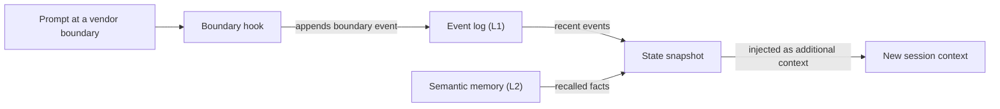

# Glossário

Cada entrada traz uma definição curta e um link para a página que trata do termo em profundidade. Quando uma palavra tem significados diferentes em partes diferentes do OMA, a entrada indica isso.

## Blocos fundamentais

### Skill {#skill}

Uma skill é um pacote de conhecimento de domínio em `.agents/skills/oma-<name>/`. Seu `SKILL.md` entra no contexto quando a skill é roteada, e os arquivos em `resources/` são carregados somente quando a tarefa precisa deles. Uma skill orienta como um agente trabalha em um domínio; ela não define um processo de várias etapas. Consulte [Skills](../core-concepts/skills.md).

### Workflow {#workflow}

Um workflow é um processo de várias etapas definido em `.agents/workflows/<name>.md`. Você inicia um com o comando slash correspondente, como `/plan` ou `/orchestrate`; quando o hook de detecção de palavras-chave está habilitado, uma frase gatilho correspondente também pode injetá-lo. Workflows coordenam uma ou mais skills e agentes. Consulte [Workflows](../core-concepts/workflows.md) e [Escolher uma skill ou um workflow](../core-concepts/workflows.md#choosing-a-skill-or-workflow).

### Definição de agente {#agent-definition}

Uma definição de agente é um arquivo de subagente versionado em `.agents/agents/`, como `backend-engineer.md` ou `qa-reviewer.md`. Ela define a identidade do agente, as skills que ele carrega (frontmatter `skills:`), uma seção de protocolo de execução e regras de domínio. O OMA projeta esses arquivos para formatos nativos dos vendors, como `.claude/agents/*.md` e `.codex/agents/*.toml`. A documentação também usa "agente" para um papel de dispatch (`backend`, `qa`, `explore`) e para uma skill como `oma-backend`. Consulte [Definições de agentes](../core-concepts/agents.md#agent-definitions).

## Presets

### Preset de skills {#skill-preset}

Um preset de skills é o conjunto de skills que o instalador adiciona a um projeto, como `all`, `fullstack`, `backend` ou `research`. Os recursos compartilhados de `_shared/` são instalados com todos os presets. Um preset de skills não afeta qual modelo executa um agente. Consulte [Presets](./installation.md#presets).

### Preset de modelo {#model-preset}

O preset de modelo é o valor de `model_preset` em `.agents/oma-config.yaml` (ou `.cue`). Ele decide qual vendor e qual modelo cada agente usa. `auto`, o padrão para novas instalações, segue as configurações de agente e de modelo do próprio runtime atual; presets fixos como `claude`, `codex` ou `mixed` as fixam. Overrides em `agents.<id>` têm prioridade sobre o preset, exceto com `free`, em que `free.model` substitui os modelos fixados por agente. Consulte [Presets integrados](../guide/per-agent-models.md#built-in-presets).

## Execução de workflows

### Workflow persistente {#persistent-workflow}

Um workflow persistente continua em execução entre turnos até que seu trabalho termine ou você o desative. Os workflows persistentes são `/orchestrate`, `/work`, `/ultrawork` e `/ralph`, e somente uma invocação explícita ativa o modo persistente. Enquanto um deles está ativo, um hook reinjeta `[OMA PERSISTENT MODE: ...]` a cada prompt, e o hook Stop impede que a sessão termine até que um limite de reforço ou um timeout por inatividade seja atingido. Diga `workflow done` para desativá-lo. Consulte [Mecânica do modo persistente](../core-concepts/workflows.md#persistent-mode-mechanics).

### Portão de parada {#stop-gate}

Um portão de parada é uma verificação de conclusão opcional que você anexa a um workflow persistente ativo com `oma goal set --gate typecheck|test|lint`. A partir daí, o hook Stop só permite que o workflow termine quando o script de `package.json` com esse nome passa. As falhas do portão contam para o limite de reforço, então um portão com falha não consegue bloquear as paradas para sempre. Consulte [`goal set`](../cli-interfaces/commands.md#goal-set).

## Sessões e estado

"Sessão" tem dois significados no OMA: a sessão que o próprio OMA acompanha e a sessão de conversa da CLI ou IDE de IA que você está usando. Mantenha-as separadas ao ler arquivos de estado ou opções de comandos.

### Sessão do OMA {#oma-session}

Uma sessão do OMA é o trabalho que o OMA acompanha com seu próprio ID de sessão, independentemente de qualquer conversa do vendor. A orquestração usa o ID para nomear o plano, o quadro de tarefas, os arquivos de progresso e de resultado e os registros de execução dos agentes; o orquestrador o gera no formato `session-YYYYMMDD-HHMMSS`. O estado dos workflows usa um ID de sessão do OMA (`sid`) como chave do [log de eventos](#event-log), que `oma state list` e `oma state get <sid>` inspecionam. Consulte [Estratégia de ID de sessão](../guide/multi-agent-project.md#session-id-strategy).

### ID de sessão do vendor {#vendor-session-id}

Um ID de sessão do vendor é o ID de conversa atribuído pela CLI ou IDE de IA, como um ID de sessão do Claude Code ou do Codex. O OMA o registra como `vendorSid` nos eventos, e os arquivos de estado do modo persistente usam esse ID como chave (`.agents/state/<workflow>-state-<vendor-session-id>.json`). Quando uma sessão do OMA está ativa e chega um prompt de outra sessão do vendor, de outro vendor ou de uma sessão que acabou de ser compactada, um hook registra um evento `boundary` e injeta um snapshot do estado para que o trabalho continue no novo contexto. Consulte [`state`](../cli-interfaces/commands.md#state).

Se a memória semântica não estiver disponível, o snapshot usa apenas os eventos locais.

### Log de eventos {#event-log}

O log de eventos é o registro append-only de uma sessão do OMA, armazenado como `events.jsonl` em `${OMA_STATE_HOME:-~/.oma}/u/<profile>/sessions/<sid>/`. Cada linha é um evento, como `session.created`, `workflow.phase`, `gate.passed`, `decision.made` ou `session.ended`. Os workflows anexam as decisões obrigatórias com `oma state emit` e as verificam com `oma state verify`; leia o log com `oma state get` ou `oma state trajectory` em vez de abrir o arquivo. Consulte [`state`](../cli-interfaces/commands.md#state).

## Revisão e evidências

### Juiz {#judge}

"Juiz" tem dois significados. No `/ralph`, o juiz é a fase posterior a cada iteração do ultrawork que verifica cada critério de conclusão contra o estado real do projeto e registra PASS, FAIL, REGRESSED ou BLOCKED. Um agente iniciado separadamente, com contexto novo, executa essa fase, para que o orquestrador não avalie o próprio trabalho. Na avaliação e otimização de skills, `judge` é o tipo de verificador padrão: um modelo avalia a saída de um braço com base em uma rubrica e retorna PASS ou FAIL. Consulte [/ralph](../core-concepts/workflows.md#ralph) e [o verificador judge](../guide/skill-eval.md#judge-default).

### Revisão entre contextos (CCR) {#cross-context-review-ccr}

A revisão entre contextos (cross-context review) é a regra segundo a qual cada etapa de revisão do `/ultrawork` é executada em um subagente revisor novo e com contexto isolado. O revisor recebe apenas os artefatos em revisão, referenciados por caminho (diff, arquivos alterados, plano, resultados anteriores, saída de testes), além do guia dessa revisão específica; ele nunca vê o histórico da sessão principal nem o raciocínio de quem implementou. Cada revisor escreve um veredito estruturado que o coordenador da fase coleta. Consulte [/ultrawork](../core-concepts/workflows.md#ultrawork).

### Charter {#charter}

O charter é o bloco de preflight `CHARTER_CHECK` que os agentes de implementação escreviam antes de qualquer código. As definições de agentes atuais não exigem uma saída de preflight fixa. Em vez disso, os agentes seguem a política de execução compartilhada: declaram as suposições relevantes, perguntam somente quando a informação ausente muda a correção ou o escopo e pausam apenas o trabalho que depende da resposta. Um subagente iniciado não pode perguntar diretamente a você, então ele relata o dado ausente em um resultado `blocked` ou `partial`. Consulte [Autorização e esclarecimento](../core-concepts/agents.md#charter-preflight-charter_check).

### Registro de execução e claim {#run-record-and-claim}

Um registro de execução é o recibo legível por máquina de uma tentativa de agente, armazenado no diretório de estado por projeto do perfil, `~/.oma/u/<profile>/projects/<project-hash>/agent-runs/` (versões antigas usavam `.agents/state/agent-runs/`); `oma agent begin` o cria e tira um snapshot do contrato da tarefa. O claim é o relatório do próprio agente no caminho `.claim.json` correspondente, com status `completed`, `partial`, `blocked` ou `failed`, além dos arquivos alterados, do trabalho não resolvido e dos artefatos. `oma agent finish` confere o claim com o contrato atual, os recibos de verificação e os hashes dos artefatos, de modo que um claim com evidências desatualizadas não continue como concluído. Consulte [Resultados de agentes e retomada](../guide/agent-results-and-resume.md).

## Memória e providers

### Memória L1 e L2 {#l1-and-l2-memory}

L1 é o [log de eventos](#event-log): estado local e append-only dos workflows, lido por `oma state verify` e pelo snapshot de fronteira. L2 é a memória semântica, fatos recuperados fornecidos pelo provider `providers.semantic_memory` selecionado: `agentmemory` (o padrão), `honcho` ou `none`. As decisões obrigatórias ficam na L1, portanto sobrevivem às fronteiras de sessão sem a L2. "L1" e "L2" também têm outros significados: a camada 1 e a camada 2 de uma skill são seu `SKILL.md` e seu diretório `resources/` sob demanda, e `oma docs verify` relata "referências L2", que são as referências de arquivos, URLs, CLI, scripts, ambiente e configuração que ele extrai da documentação. Consulte [`memory`](../cli-interfaces/commands.md#memory) e [Memória semântica Honcho](../guide/configuration-reference.md#honcho-semantic-memory).

### Provider de capacidade {#capability-provider}

Um provider de capacidade é a ferramenta ou o serviço externo que o OMA usa para uma capacidade, selecionado em `providers` no `.agents/oma-config.yaml`. As capacidades são documentação (`docs`, padrão `context7`), busca na web (`web`, padrão `native`), inteligência de código (`code_intelligence`, padrão `serena`) e memória semântica (`semantic_memory`, padrão `agentmemory`). Execute `oma link` depois de trocar um provider. Consulte [Chaves de nível superior](../guide/configuration-reference.md#top-level-keys) e [Padrões importantes](./important-defaults.md).

## Planos e arquivos-fonte

### Plano {#plan}

Um plano é o breakdown de tarefas legível por máquina em `.agents/results/plan-<sessionId>.json`, escrito por `/plan` e consumido por `/orchestrate` e `/work`; `/orchestrate` cria um quando não existe um plano utilizável. Cada tarefa indica seu agente, workspace, dependências, critérios de aceitação e verificações exigidas, e os registros de execução tiram um snapshot desse contrato. Ele não tem relação com a resolução de modelos por agente que `oma doctor --profile` mostra, que algumas páginas chamam de plano herdado. Consulte [/plan](../core-concepts/workflows.md#plan) e [Iniciar uma execução nativa](../guide/agent-results-and-resume.md#start-a-native-run).

### SSOT {#ssot}

A fonte única de verdade (SSOT) é o diretório `.agents/`: `<project>/.agents/` em uma instalação de projeto ou `~/.oma/.agents/` em uma instalação global. Skills, workflows, definições de agentes, regras e configuração ficam ali, e `oma install`, `oma update` e `oma link` geram a partir dele os arquivos nativos dos vendors (`.claude/`, `.codex/` e outros). Edite `.agents/` e execute `oma link` em vez de editar os arquivos gerados. Algumas páginas usam SSOT para uma fonte mais restrita, como o manifest de agentes agendados. Consulte [.agents/: a fonte de verdade](../core-concepts/project-structure.md#agents-the-source-of-truth).
