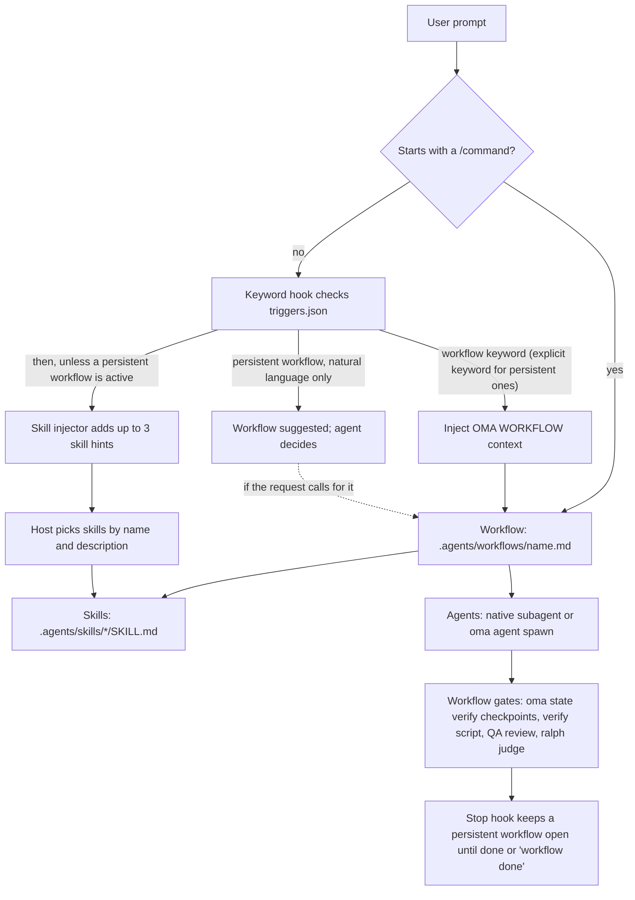

# Introdução

oh-my-agent é um framework de orquestração multiagente para IDEs e ferramentas de CLI com IA. Em vez de depender de um único assistente de IA para tudo, o oh-my-agent distribui o trabalho entre 33 pacotes de skills e 13 papéis canônicos de dispatch. Doze arquivos de definição de subagentes versionados oferecem personas reutilizáveis para implementação, revisão, planejamento, depuração, documentação, pesquisa e infraestrutura. `research-explorer.md` corresponde ao papel canônico `explore`; `orchestrator` é um papel de coordenação em tempo de execução sem um arquivo de definição separado.

O OMA fornece verificações mecânicas quando você as solicita ou escolhe um workflow que as inclui. `oma verify agent <agent-type>` executa as verificações para o tipo de agente selecionado; `/ralph` adiciona verificação baseada em artefatos e um loop de [juiz](./glossary.md#judge); os hooks Stop de vendors habilitados (o [portão de parada](./glossary.md#stop-gate)) podem manter um workflow aberto enquanto suas verificações configuradas são executadas. O simples carregamento de uma skill não estabelece a aceitação, e um prompt comum não executa automaticamente todos os portões do workflow. Use os critérios de aceitação do workflow e os arquivos resultantes para decidir o que está concluído.

Todo o sistema reside em um diretório portátil `.agents/` dentro do projeto. Alterne entre Claude Code, Codex CLI, Antigravity CLI ou IDE, Cursor, OpenCode e outras ferramentas compatíveis: a configuração dos agentes acompanha o código.

Se você está começando com OMA, leia primeiro o [Início rápido](./quick-start.md) e depois os [Padrões importantes](./important-defaults.md). A instalação cria a [SSOT](./glossary.md#ssot) e as integrações com vendors; a primeira verificação útil é `oma doctor`; a primeira tarefa útil é uma pequena alteração em um único domínio. Use `/work` ou `/orchestrate` apenas quando a tarefa precisar de coordenação.

---

## O paradigma multiagente

Assistentes tradicionais de programação com IA costumam lidar com frontend, backend, banco de dados, segurança e infraestrutura usando um único contexto de prompt. Isso pode causar:

- **Diluição de contexto**: carregar conhecimento de todos os domínios desperdiça a janela de contexto
- **Responsabilidade indefinida**: uma tarefa que atravessa domínios não tem um limite explícito para cada parte
- **Coordenação manual**: funcionalidades complexas que abrangem vários domínios precisam de handoffs escolhidos pelo host ou pelo usuário

O oh-my-agent resolve isso com especialização:

1. **Cada skill tem um domínio principal.** A skill de frontend conhece React/Next.js, shadcn/ui, TailwindCSS v4 e a arquitetura FSD-lite. A skill de backend conhece o padrão Repository-Service-Router, consultas parametrizadas e autenticação JWT. Os domínios podem se sobrepor nas fronteiras; use os critérios de aceitação da tarefa para decidir quando é preciso uma segunda skill ou um workflow de coordenação.

2. **Os agentes podem executar em paralelo.** Enquanto um agente de backend cria uma API, um agente de frontend pode trabalhar em seu próprio workspace. O orquestrador coordena por meio de arquivos duráveis com escopo de execução e recibos.

3. **As orientações de qualidade já vêm incluídas.** As skills trazem checklists de domínio, playbooks de erros e regras de [charter](./glossary.md#charter). O preflight do charter delimita o escopo antes da escrita do código; a revisão de QA é executada quando o workflow selecionado a inclui ou quando você a solicita.

---

## O catálogo atual: 33 skills, 12 definições e 21 workflows {#the-current-catalog-33-skills-12-definitions-21-workflows}

O catálogo separa três coisas que é fácil confundir:

- **[Skills](./glossary.md#skill)** são os 33 pacotes de conhecimento de domínio em `.agents/skills/*/SKILL.md`. Elas roteiam a partir da intenção expressa em linguagem natural e carregam seus recursos progressivamente.
- **[Definições de agentes](./glossary.md#agent-definition)** são os 12 arquivos em `.agents/agents/`. Eles fornecem personas de subagentes nativas do vendor e referenciam uma ou mais skills.
- **[Workflows](./glossary.md#workflow)** são as 21 definições de processo em `.agents/workflows/`. Quatro são [persistentes](./glossary.md#persistent-workflow) (`orchestrate`, `work`, `ultrawork` e `ralph`); os demais geram um relatório e não mantêm o modo persistente ativo.

As seções abaixo preservam o catálogo detalhado de skills. Quando um nome ou descrição mudar, o frontmatter do `SKILL.md` vigente é a fonte de verdade.

Os 12 arquivos de definição versionados cobrem os 13 papéis de tempo de execução por meio de aliases: `research-explorer.md` corresponde a `explore`, enquanto `orchestrator` existe apenas em tempo de execução. Os demais arquivos de definição correspondem aos papéis nomeados em [Agentes](../core-concepts/agents.md).

### Ideação, arquitetura e planejamento

| Agente | Função | Principais capacidades |
|-------|------|------------------------|
| **oma-brainstorm** | Ideação orientada pelo design | Explora a intenção do usuário, propõe 2–3 abordagens com análise de trade-offs e produz documentos de design antes de qualquer código. Workflow em 6 fases: Contexto, Perguntas, Abordagens, Design, Documentação e transição para `/plan`. |
| **oma-architecture** | Especialista em arquitetura de sistemas | Limites de módulos, serviços e responsabilidade; análise de trade-offs e síntese de stakeholders. Metodologias: roteamento diagnóstico, comparação entre duas opções de design, análise no estilo ATAM, priorização no estilo CBAM e registros de decisão no estilo ADR. A eficiência de custos é o padrão. |
| **oma-pm** | Gerente de produto | Decompõe requisitos em tarefas priorizadas com dependências. Define contratos de API. Produz `.agents/results/plan-{sessionId}.json` e um quadro de tarefas com escopo de sessão. Dá suporte a conceitos de ISO 21500, análise de riscos da ISO 31000 e governança da ISO 38500. |

### Implementação

| Agente | Função | Stack e recursos |
|-------|------|-----------------|
| **oma-frontend** | Especialista em UI/UX | React, Next.js, TypeScript, TailwindCSS v4, shadcn/ui e arquitetura FSD-lite. Bibliotecas: luxon (datas), ahooks ou @mantine/hooks (hooks), es-toolkit (utilitários), Jotai/Zustand (estado no cliente), TanStack Query via hooks gerados pelo orval (estado no servidor), @tanstack/react-form + Zod (formulários), better-auth (autenticação), nuqs (estado na URL). Recursos: `execution-protocol.md`, `tech-stack.md`, `tailwind-rules.md`, `snippets.md`, `angular-rules.md`, `error-playbook.md` e `checklist.md`. |
| **oma-backend** | Especialista em API e servidor | Arquitetura limpa (Router-Service-Repository-Models). Independente de stack; detecta Python/Node.js/Rust/Go/Java/Elixir/Ruby/.NET nos manifestos do projeto. JWT + Argon2id para autenticação. Recursos: `execution-protocol.md`, `orm-reference.md`, `checklist.md` e `error-playbook.md`. Dá suporte a `/stack-set` para gerar referências `stack/` específicas da linguagem. |
| **oma-mobile** | Desenvolvimento móvel multiplataforma | Flutter, Dart, Riverpod/Bloc para gerenciamento de estado, Dio com interceptors para chamadas de API e GoRouter para navegação. Arquitetura limpa: domínio-dados-apresentação. Material Design 3 (Android) + iOS HIG. Meta de 60 fps. Também oferece suporte a iOS nativo com Swift: SwiftUI + `@Observable` (iOS 17+), `swift-openapi-generator` da Apple para clientes de API e organização de projeto `App/Core/Features/Shared`. Recursos: `execution-protocol.md`, `tech-stack.md`, `screen-template.dart`, `screen-template.swift`, `screen-template.tsx`, `checklist.md` e `error-playbook.md`; as variantes por plataforma são materializadas por `/stack-set`. |
| **oma-db** | Arquitetura de banco de dados | Modelagem de bancos SQL, NoSQL e vetoriais. Design de schema (3NF por padrão), normalização, indexação, transações, planejamento de capacidade e estratégia de backup. Dá suporte a um design consciente da ISO 27001/27002/22301. Recursos: `execution-protocol.md`, `document-templates.md`, `anti-patterns.md`, `vector-db.md`, `iso-controls.md`, `checklist.md` e `error-playbook.md`. |

### Design

| Agente | Função | Principais capacidades |
|-------|------|------------------------|
| **oma-design** | Especialista em sistemas de design | Cria DESIGN.md com tokens, tipografia, sistemas de cores, motion design (motion/react, GSAP, Three.js), layouts responsive-first e conformidade com WCAG 2.2. Workflow em 7 fases: Setup, Extração, Aperfeiçoamento, Proposta, Geração, Auditoria e Handoff. Aplica anti-patterns (sem “AI slop”). Integração opcional com Stitch MCP. Recursos: `design-md-spec.md`, `design-tokens.md`, `anti-patterns.md`, `prompt-enhancement.md`, `stitch-integration.md` e o diretório `reference/`, com guias de tipografia, cor, espaço, movimento, responsividade, componentes, acessibilidade e shaders. |

### Infraestrutura, DevOps e observabilidade

| Agente | Função | Principais capacidades |
|-------|------|------------------------|
| **oma-tf-infra** | Infraestrutura como código | Terraform multinuvem (AWS, GCP, Azure e Oracle Cloud). Autenticação com OIDC como padrão, IAM com menor privilégio e policy-as-code (OPA/Sentinel), além de otimização de custos. Dá suporte a controles de IA da ISO/IEC 42001, continuidade da ISO 22301 e documentação de arquitetura da ISO/IEC/IEEE 42010. Recursos: `multi-cloud-examples.md`, `cost-optimization.md`, `policy-testing-examples.md`, `iso-42001-infra.md` e `checklist.md`. |
| **oma-dev-workflow** | Automação de tarefas em monorepo | executor de tarefas mise, pipelines de CI/CD, migrações de banco de dados, coordenação de releases, hooks do git e validação pré-commit. Recursos: `validation-pipeline.md`, `database-patterns.md`, `api-workflows.md`, `i18n-patterns.md`, `release-coordination.md` e `troubleshooting.md`. |
| **oma-observability** | Roteador de observabilidade baseado em intenção | Cobertura de sinais MELT+P (métricas/logs/traces/profiles/custo/auditoria/privacidade), ajuste de transporte (UDP/MTU, OTLP gRPC versus HTTP, topologia do Collector, amostragem), propagação de W3C Trace Context, gerenciamento de SLO e alertas de burn rate, perícia de incidentes (localização em 6 dimensões), observabilidade da própria operação (saúde, sincronização de relógio, cardinalidade e retenção). Prioriza CNCF; Fluentd está obsoleto (use Fluent Bit ou OTel Collector). |

### Qualidade e depuração

| Agente | Função | Principais capacidades |
|-------|------|------------------------|
| **oma-qa** | Garantia de qualidade | Auditoria de segurança (OWASP Top 10), análise de desempenho, acessibilidade (WCAG 2.2 AA) e revisão de qualidade de código. Severidade: CRITICAL/HIGH/MEDIUM/LOW com arquivo:linha e código de correção. Dá suporte às características de qualidade da ISO/IEC 25010 e ao alinhamento de testes da ISO/IEC 29119. Recursos: `execution-protocol.md`, `iso-quality.md`, `checklist.md`, `verify-ship-protocol.md` e `error-playbook.md`. |
| **oma-debug** | Diagnóstico e correção de bugs | Metodologia primeiro-reproduza. Análise da causa raiz, correções mínimas, testes de regressão obrigatórios e busca de padrões semelhantes. Usa ferramentas MCP de inteligência de código (Gortex ou Serena) para rastrear símbolos. Recursos: `execution-protocol.md`, `common-patterns.md`, `debugging-checklist.md`, `bug-report-template.md` e `error-playbook.md`. |
| **oma-refactor** | Refatoração que preserva o comportamento | Reestruturação incremental segura com redes de segurança de testes de caracterização. Seleção de hotspots (complexidade × churn), escolha de code smells/SATD, reversão pelo método Mikado quando há falha, expand-contract para alterações stateful e commits apenas de refatoração. Transformações primeiro pelo engine (renomeação da IDE, jscodeshift/ast-grep), métricas via `uvx lizard` / `uvx radon`. Legibilidade é o critério de sucesso; métricas são proxies. |

### Localização, coordenação e git

| Agente | Função | Principais capacidades |
|-------|------|------------------------|
| **oma-translation** | Tradução com contexto | Fluxo em seis cenas: Preparar, Adquirir, Raciocinar, Agir, Verificar e Finalizar. O método de tradução tem quatro etapas: ler o significado e a sintaxe protegida, escolher o registro, reconstruir no idioma-alvo e preservar o estilo do autor onde ele pertence. Perfis por idioma (`resources/lang/{code}.md`) carregam regras de registro e tipografia. Recursos: `translation-rubric.md`, `anti-ai-patterns.md` e `lang/{ko,ja,zh,en}.md`. |
| **oma-orchestration** | Coordenador automatizado de multiagentes | Inicia subagentes de CLI em paralelo, coordena por meio de sessão persistente, quadro de tarefas, arquivos de progresso e resultados e monitora loops de verificação. Configurável: MAX_PARALLEL (padrão 3), MAX_RETRIES (padrão 2), POLL_INTERVAL (padrão 30s). Inclui loop de revisão entre agentes e evidência de sessão opcional. Recursos: `subagent-prompt-template.md` e `memory-schema.md`. |
| **oma-scm** | Gerenciamento de configuração de software (SCM) + Git | Cuida de estratégias de branch, fluxos de merge/rebase/conflito, worktrees, baselines e rastreamento do estado de release. Também orienta mensagens de Conventional Commits com staging seguro; os trailers de coautoria vêm da configuração efetiva `scm.co_author` quando habilitados. |
| **oma-coordination** | Guia manual de workflows multiagente | Guia passo a passo da coordenação de agentes PM, Frontend, Backend, Mobile e QA via CLI `oma agent spawn`. Começa pela decomposição feita pelo PM, inicia tarefas da mesma prioridade em workspaces separados, monitora arquivos de progresso/resultados com escopo de execução, alinha contratos de API/dados antes do trabalho de frontend/mobile e termina com revisão de QA. É a contraparte manual do `oma-orchestration`. |

### Pesquisa, retrospectiva e processamento de documentos

| Agente | Função | Principais capacidades |
|-------|------|------------------------|
| **oma-search** | Roteador de pesquisa baseado em intenção | Encaminha consultas para Context7 (docs), pesquisa web nativa, `gh`/`glab` (código) e inteligência de código local (Gortex ou Serena). Atribui pontuação de confiança de domínio a todos os resultados não locais. Roteamento fail-forward (docs→web→fetch). Flags: `--docs`, `--code`, `--web`, `--strict`, `--wide` e `--gitlab`. |
| **oma-recap** | Retrospectiva de trabalho entre ferramentas | Analisa históricos de conversas do Grok, Claude, Codex, Gemini, Qwen, Cursor e Antigravity. Interpreta entradas naturais de data/janela, agrupa por ferramenta e sessão, extrai temas, produz resumos diários/periódicos e registra quando a CLI limita a janela solicitada a 30 dias. |
| **oma-hwp** | HWP/HWPX/HWPML → Markdown | Conversão de documentos coreanos do processador de texto via `bunx kordoc@latest`. Preserva headings, tabelas (inclusive aninhadas), notas de rodapé, hyperlinks e imagens. Remove caracteres da área de uso privado da Hancom via pós-processador `flatten-tables.ts`. |
| **oma-pdf** | PDF → Markdown | Conversão de PDF via `uvx opendataloader-pdf`. Preserva headings, tabelas, listas e imagens; modo híbrido de OCR para PDFs digitalizados; normaliza a saída com `uvx mdformat`. |

### Escrita acadêmica e pesquisa

| Agente | Função | Principais capacidades |
|-------|------|------------------------|
| **oma-academic-writing** | Prosa acadêmica em inglês pronta para publicação | Redige, revisa e audita ensaios, relatórios, resumos executivos, conclusões e revisões de literatura. Aplica simultaneamente quatro protocolos: Estrutura de frases (4 tipos, comprimentos e aberturas variados), Verbo (substitui verbos genéricos proibidos por um corpus acadêmico em camadas), Modalização (força ajustada às evidências) e conformidade Anti-AI. Gate de citação antes do julgamento, mapa de afirmação-evidência e reverse outlining. Modos: `draft` / `revise` / `review`. |
| **oma-scholar** | Companheiro de sidecar para artigos de pesquisa | Pesquisa, gera, valida, revisa e compara artigos acadêmicos por meio da especificação de sidecar Knows `.knows.yaml` (v0.9.0 / `paper@1`). Acesso eficiente a afirmações/evidências/relações por tokens (~700 tokens apenas para afirmações versus ~10 mil no PDF completo). Anti-fabricação: omite campos desconhecidos em vez de adivinhar. `oma scholar search/resolve/get/lint` sobre knows.academy, com fallback automático para OpenAlex em artigos anteriores a 2026. |

### Segurança

| Agente | Função | Principais capacidades |
|-------|------|------------------------|
| **oma-security** | Varredura e validação de segurança | Faz varreduras no código-fonte da aplicação, nas skills de agentes e em componentes MCP; executa testes de penetração em implantações web de teste com escopo definido, valida os achados e configura gates de varredura. Engines padrão por alvo: Deepsec para código-fonte ou diffs da aplicação, Cisco Skill Scanner para pacotes de skills de agentes, Cisco MCP Scanner para componentes MCP e ARTEX para implantações web de teste. Use `oma-qa` para revisões amplas de qualidade e as skills de domínio para a correção. |

### Documentação e metatooling

| Agente | Função | Principais capacidades |
|-------|------|------------------------|
| **oma-docs** | Detector de drift de documentação | O modo `verify` verifica deterministicamente `docs/**/*.md` em busca de referências quebradas (caminhos de arquivo, comandos CLI, chaves de configuração, variáveis de ambiente e scripts) e sai com 0/1; o modo `sync` relaciona um diff do git a documentos candidatos e prepara propostas de patch do LLM do host confirmadas por documento (nunca aplica automaticamente). A verificação de URLs é delegada ao `lychee`; a CLI emite JSON estruturado, e o host LLM faz toda a síntese (sem chamadas a SDK de vendor). Nunca modifica `.agents/`. |
| **oma-skill-creation** | Especialista em criação de skills SSL-lite | Cria, atualiza e audita skills OMA no formato SSL-lite com as quatro seções obrigatórias (Scheduling / Structural Flow / Logical Operations / References). Classifica o tipo da skill, insere exatamente um caminho canônico inline, impõe rotas cruzadas `When NOT to use` e executa `oma skill audit` para detectar colisões entre descrições (aviso com similaridade de cosseno TF-IDF ≥ 60%, falha ≥ 75%). Move detalhes longos de variantes para `resources/`. |
| **oma-explanation** | Explicador de alterações de código | Transforma um diff, PR, branch ou intervalo de commits em um explicador HTML offline autocontido com seções Background, Intuition, Code e Quiz. O workflow `/explain` valida o artefato final e o grava em `.agents/results/explain/`. |

### Pesquisa de mercado

| Agente | Função | Principais capacidades |
|-------|------|------------------------|
| **oma-market** | Inteligência de sinais da comunidade | Executa o mecanismo upstream `last30days` (Reddit com upvotes e comentários reais, X, YouTube transcripts, TikTok, HN, Polymarket, GitHub, arXiv, Techmeme, Bluesky, web e outros) por meio de `oma market run`; o OMA mantém o mecanismo sempre na versão mais recente (`~/.cache/oma-market/`), aplica `detect-trap` a cada execução, classifica a intenção (dor / tendência / concorrente / descoberta) e adiciona seções SWOT / 5 Forças de Porter / PESTEL. Produz um briefing único em conformidade com LAW em `.agents/results/market/{slug}-{YYYYMMDD}.md`. |

### Geração de mídia e conteúdo

| Agente | Função | Principais capacidades |
|-------|------|------------------------|
| **oma-image** | Roteador de imagens multi-vendor | Despacha em paralelo com consciência de autenticação para Codex (`gpt-image-2` via OAuth do ChatGPT, CLI-first), modelos Gemini da família “nano-banana” do Antigravity via CLI `agy` + Gemini Code Assist (o modelo exato é escolhido internamente) e Pollinations (`flux`/`zimage` gratuitos). Aplica protocolo de clarificação/amplificação antes da geração, aceita até 10 imagens de referência, tem guardrail de custo (confirmação a partir de ≥ $0.20) e escreve `manifest.json` para reprodutibilidade. CLI: `oma image generate`, `oma image doctor` e `oma image vendor list`. |
| **oma-slide** | Gerador de decks HTML ricos em animação | Gera decks de apresentação distintos, sem “AI slop”, em um palco fixo de 1920×1080; depois valida deterministicamente a geometria, empacota em HTML de arquivo único e exporta para PDF/PNG/PPTX por meio da CLI `oma slide`. Presets de estilo + templates marcantes, regra CJK→Pretendard, `prefers-reduced-motion` + foco visível obrigatórios e loop de validação com no máximo 3 correções automáticas. Delega imagens ao `oma-image`; exportação/importação opcional via Canva MCP. |
| **oma-video** | Roteador de vídeos curtos, explainers e demos | Cria shorts/reels (9:16), explainers (16:9) e demos gravadas por pessoas (16:9) com a CLI `oma video`. O barramento determinístico de ativos (`script.json` → `timing.json` → `render-spec.json`) alimenta um compositor HyperFrames gerenciado; os providers de ativos podem usar fallbacks locais, mas composição/toolchain ausentes ou erros de renderização fazem a execução falhar. A captura humana nunca automatiza credenciais. |
| **oma-voice** | TTS e STT locais | Usa o servidor MCP Voicebox para notificações no dispositivo, TTS de ativos e transcrição sem chamadas à nuvem nem custo por chamada. TTS usa WAV por padrão e pode transcodificar localmente para MP3; a transcrição aceita caminhos de áudio ou base64. As chamadas de TTS têm limite de 5000 caracteres e as entradas de STT, de 30 minutos; execuções persistidas de ativos/transcrições gravam um manifesto. |

---

## Modelo de divulgação progressiva

O oh-my-agent usa uma arquitetura de skills em duas camadas para evitar o esgotamento da janela de contexto:

**Camada 1: SKILL.md (carregada quando a skill é roteada)**
Contém a identidade do agente, condições de roteamento, regras principais e orientações de “quando usar / quando NÃO usar”. Isso é tudo que é carregado quando o agente não está trabalhando ativamente.

**Camada 2: resources/ (carregados sob demanda)**
Contém protocolos de execução, referências de stack, snippets de código, playbooks de erros, checklists e exemplos. Esses recursos são carregados somente quando o agente é invocado para uma tarefa e, mesmo então, apenas os recursos relevantes ao tipo específico da tarefa são carregados (com base na avaliação de dificuldade e no mapeamento tarefa-recurso em `context-loading.md`).

Quanto contexto isso economiza depende das skills e da tarefa, então meça em vez de supor um número. Veja a [matemática da economia de tokens](../core-concepts/skills.md#token-savings-math) para o script e o que suas estimativas cobrem.

---

## .agents/: a única fonte de verdade (SSOT)

Tudo de que o oh-my-agent precisa fica no diretório `.agents/`:

```text
.agents/
├── oma-config.yaml   # Shared preferences and provider/model settings
├── oma-config.cue    # Optional schema-backed configuration
├── mcp.json          # MCP server configuration
├── skills/           # 33 skill directories + _shared resources
│   ├── _shared/      # Core resources used by all agents
│   └── oma-{skill}/  # Per-skill SKILL.md + resources/variants
├── workflows/        # 21 workflow definitions
├── agents/           # 12 subagent definitions
├── hooks/            # Hook sources, including core/triggers.json
├── rules/            # Project rules projected into vendor files
├── config/           # Shipped defaults (defaults.yaml)
├── results/          # Plans (plan-{sessionId}.json) and agent results
└── state/            # Active workflow state files
```

O diretório `.claude/` existe apenas como camada de integração com a IDE. Ele contém symlinks que apontam de volta para `.agents/`, além de hooks para detecção de palavras-chave e a statusline HUD. O diretório `.agents/state/memories/` armazena o estado de coordenação em tempo de execução durante as sessões de orquestração (projetos mais antigos recorrem ao caminho legado `.serena/memories/`).

Essa arquitetura deixa a configuração dos agentes:
- **Portátil**: troque de IDE sem reconfigurar
- **Versionada**: faça commit de `.agents/` junto com o código
- **Compartilhável**: a equipe recebe a mesma configuração de agentes

---

## IDEs e ferramentas CLI compatíveis

O oh-my-agent funciona com as IDEs e CLIs com IA selecionadas por meio do carregamento nativo de skills/prompts ou de arquivos de integração gerados:

| Ferramenta | Método de integração | Agentes em paralelo |
|------|-----------------------|---------------------|
| **Claude Code** | Skills nativas + ferramenta Agent | Ferramenta Agent para paralelismo real |
| **Antigravity CLI/IDE** | Skills e configurações MCP projetadas para `agy` | `oma agent spawn` |
| **Codex CLI** | Skills carregadas automaticamente | Solicitações paralelas mediadas pelo modelo |
| **Cursor** | Skills pela integração `.cursor/` | `@agent-name` + `oma agent spawn` |
| **OpenCode** | Skills + bridge de plugin em processo + subagentes gerados (`.opencode/agents/`) | `oma agent spawn --vendor opencode` |
| **Kimi Code CLI** | Hooks + skills em `~/.kimi-code/` (escrita no HOME condicionada a consentimento; também lê `.agents/skills/` nativamente); Serena com escopo de projeto via MCP | `oma agent spawn --vendor kimi` |

A criação de agentes se adapta a cada vendor selecionado por meio da detecção de vendor e da configuração ativa. Runtimes do mesmo vendor podem usar subagentes nativos; agentes de outros vendors iniciados pela CLI recorrem a `oma agent spawn`. Veja [Execução paralela](../core-concepts/parallel-execution.md) para as regras de despacho.

---

## Como uma solicitação flui

O diagrama mostra o que acontece entre um prompt e um resultado concluído. O hook de palavras-chave, o injetor de skills e o hook Stop só são executados em hosts cuja integração de hooks está habilitada. O hook de palavras-chave e o injetor de skills são executados em sequência sobre o mesmo prompt, e o contexto que eles injetam é combinado.



Fontes: `.agents/hooks/core/keyword-detector.ts` (ignora comandos de barra, faz a correspondência de gatilhos e a sugestão de workflows persistentes), `.agents/hooks/core/skill-injector.ts`, `.agents/hooks/core/persistent-mode.ts` e os arquivos de workflow em `.agents/workflows/`. Nem todo workflow tem todos os portões: `/orchestrate` executa o script de verificação, `/review` executa a revisão de QA e `/ralph` adiciona o [juiz](./glossary.md#judge).

---

## Sistema de roteamento de skills {#skill-routing-system}

O host escolhe uma skill a partir dos nomes e das descrições das skills instaladas. O mapa de roteamento do OMA (`.agents/skills/_shared/core/skill-routing.md`) define qual skill é responsável por qual resultado; roteie pelo resultado solicitado e por suas dependências, não apenas por uma palavra-chave. Escolher uma skill não inicia um workflow nem autoriza delegação.

| Resultado solicitado | Skill responsável |
|---|---|
| API da aplicação, autenticação no servidor, lógica de serviço/acesso a dados | oma-backend |
| Schema, design de migrações, indexação, ajuste de consultas, operações de banco de dados | oma-db |
| Componentes web, páginas, formulários, estado no cliente | oma-frontend |
| Telas móveis, widgets, integração com a plataforma | oma-mobile |
| Limites do sistema, trade-offs de arquitetura, ADR | oma-architecture |
| Diagnosticar e corrigir comportamento incorreto | oma-debug |
| Revisar correção, segurança, acessibilidade e desempenho | oma-qa |
| Sistema visual, DESIGN.md, direção de redesign | oma-design |
| Ideação ou exploração de alternativas solicitada | oma-brainstorm |
| Requisitos, dependências, critérios de aceitação | oma-pm |
| Execução paralela de especialistas solicitada | oma-orchestration |
| Coordenação multiagente manual solicitada | oma-coordination |
| Branches, commits e merges do Git, histórico do repositório | oma-scm |

Para outros domínios, o host escolhe entre as descrições das skills instaladas. O trabalho multidomínio não tem uma cadeia fixa: uma decisão de arquitetura ou de produto ainda em aberto é resolvida primeiro, e o trabalho de backend e de cliente pode avançar em paralelo assim que o contrato de API compartilhado estiver utilizável.

---

## HUD da statusline

Ao executar no Claude Code, o oh-my-agent exibe um indicador persistente `[OMA]` na barra de status mostrando:
- Nome do modelo (por exemplo, Opus, Sonnet)
- Uso de contexto com cores (verde < 70%, amarelo 70–85%, vermelho > 85%)
- Estado do workflow ativo (se houver um workflow persistente)

O HUD usa `.claude/hooks/hud.ts` por meio do recurso `statusLine` do Claude Code.

---

## Detecção automática de workflows

Você não precisa digitar `/command` para acionar workflows. O sistema de hooks do oh-my-agent examina sua entrada em linguagem natural em busca dos gatilhos de palavras-chave definidos em `.agents/hooks/core/triggers.json` (incorporados ao binário `oma` e compartilhados entre vendors), com suporte a 11 idiomas (inglês, coreano, japonês, chinês, espanhol, francês, alemão, português, russo, holandês e polonês).

- **Entrada acionável** (por exemplo, “planeje a funcionalidade de autenticação”) → carrega automaticamente o workflow
- **Entrada informativa** (por exemplo, “o que é orchestrate?”) → filtrada, nenhum workflow é acionado
- **`/command` explícito** → o hook ignora a detecção para evitar duplicação
- **Workflows persistentes** (`orchestrate`, `work`, `ultrawork`, `ralph`) detectados apenas pela linguagem natural são sugeridos, não iniciados; o modo persistente é ativado quando o prompt usa a palavra-chave explícita do workflow (por exemplo, `ultrawork` ou `ralph`)
- **Workflows persistentes ativos** reinjetam o contexto em cada mensagem até você dizer “workflow done”

Cada evento de hook é entregue pela ABI canônica `oma hook run`: o vendor executa `oma-hook.sh --vendor <v> --event <nativeEvent>`, que encaminha para a cadeia de handlers em processo e emite o dialeto específico do vendor em stdout (sempre sai com código 0, fail-open).

---

## Suporte entre vendors {#cross-vendor-support}

O oh-my-agent não se limita ao Claude Code. Os vendors com hooks compartilham a mesma ABI `oma hook run`; os vendors com extensões usam seu bridge em processo:

| Vendor | Entrega do hook | StatusLine |
|------------|-----------------|------------|
| **Claude Code** | `oma-hook.sh --vendor claude --event UserPromptSubmit` / `PreToolUse` / `Stop` | `bun .claude/hooks/hud.ts` (direto, inalterado) |
| **Codex CLI** | `oma-hook.sh --vendor codex --event UserPromptSubmit` / `PreToolUse` / `Stop` | — |
| **Qwen Code** | `oma-hook.sh --vendor qwen --event UserPromptSubmit` / `PreToolUse` / `Stop` | caminho `bun` via `ui.statusLine` |
| **Cursor** | `oma-hook.sh --vendor cursor --event beforeSubmitPrompt` / `preToolUse` / `stop` | — |
| **Grok** | `oma-hook.sh --vendor grok --event UserPromptSubmit` / `PreToolUse` / `Stop` | — |
| **Kiro** | `oma-hook.sh --vendor kiro --event userPromptSubmit` / `preToolUse` / `stop` | — |
| **Kimi Code** | `oma-hook.sh --vendor kimi --event UserPromptSubmit` / `PreToolUse` / `Stop` (TOML global `[[hooks]]` apenas em `~/.kimi-code/config.toml`) | — |
| **Antigravity** | `.agents/hooks.json` → `bun .agents/hooks/core/*.ts` (`PreInvocation` / `PostToolUse` / `Stop`) | `statusLine` → `~/.gemini/antigravity-cli/settings.json` |
| **CommandCode** | `oma-hook.sh --vendor commandcode --event SessionStart` / `PostToolUse` / `Stop` | — |
| **OpenCode** | Bridge em processo (`installOpencodePlugin`) — não passa por `oma hook run` | — |
| **pi** | Bridge em processo (`installPiExtension`) — não passa por `oma hook run` | — |

O diretório `.agents/` continua sendo a fonte de verdade. A instalação vincula ou projeta suas skills, workflows, hooks e definições de agentes nos vendors selecionados; as capacidades variam por vendor. Tanto subagentes nativos do mesmo vendor quanto agentes de outros vendors iniciados pela CLI leem dessa fonte.

---

## Próximos passos

- **[Instalação](./installation.md)**: três métodos de instalação, presets, configuração da CLI e verificação
- **[Agentes](/docs/core-concepts/agents)**: visão detalhada das 33 skills, 13 papéis de dispatch e preflight do charter
- **[Skills](/docs/core-concepts/skills)**: explicação da arquitetura em duas camadas
- **[Workflows](/docs/core-concepts/workflows)**: os 21 workflows com gatilhos e fases
- **[Guia de uso](/docs/guide/usage)**: exemplos reais, de tarefas únicas à orquestração completa
