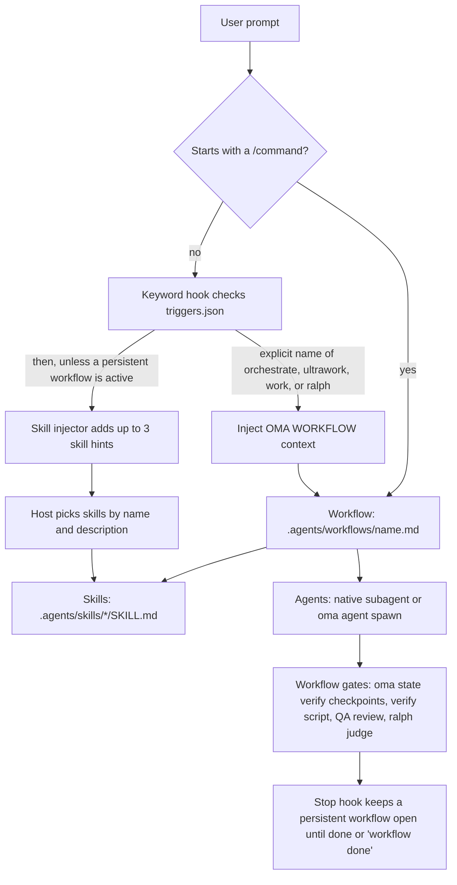

# Introdução

oh-my-agent é um framework de orquestração multiagente para IDEs e ferramentas de CLI com IA. Em vez de depender de um único assistente de IA para tudo, o oh-my-agent distribui o trabalho entre 33 pacotes de skills e 13 papéis canônicos de dispatch. Doze arquivos de definição de subagentes versionados oferecem personas reutilizáveis para implementação, revisão, planejamento, depuração, documentação, pesquisa e infraestrutura. `research-explorer.md` corresponde ao papel canônico `explore`; `orchestrator` é um papel de coordenação em tempo de execução sem um arquivo de definição separado.

O OMA fornece verificações mecânicas quando você as solicita ou escolhe um workflow que as inclui. `oma verify agent <agent-type>` executa as verificações para o tipo de agente selecionado; `/ralph` adiciona verificação baseada em artefatos e um loop de [juiz](./glossary.md#judge); os hooks Stop de vendors habilitados (o [portão de parada](./glossary.md#stop-gate)) podem manter um workflow aberto enquanto suas verificações configuradas são executadas. O simples carregamento de uma skill não estabelece a aceitação, e um prompt comum não executa automaticamente todos os portões do workflow. Use os critérios de aceitação do workflow e os arquivos resultantes para decidir o que está concluído.

Todo o sistema reside em um diretório portátil `.agents/` dentro do projeto. Alterne entre Claude Code, Codex CLI, Antigravity CLI ou IDE, Cursor, OpenCode e outras ferramentas compatíveis: a configuração dos agentes acompanha o código.

Comece por [Escolha uma configuração](./choose-setup.md): carregue uma skill para uma tarefa no seu agente atual, selecione um preset de skills de runtime para hooks e workflows ou instale o plugin do Claude Code. O carregamento temporário de skills fornece instruções e arquivos de apoio; as dependências de CLI, de regras do projeto e de serviços externos continuam explícitas. A instalação do runtime cria a [SSOT](./glossary.md#ssot) e as integrações com vendors.

Use o [Início rápido](./quick-start.md) para uma primeira tarefa e suas verificações observadas. `oma doctor` verifica uma instalação de runtime; [Padrões importantes](./important-defaults.md) explica seus providers e sua configuração. Passe para `/work` ou `/orchestrate` quando a coordenação for necessária e as skills que eles referenciam estiverem instaladas.

---

## O paradigma multiagente

Assistentes tradicionais de programação com IA costumam lidar com frontend, backend, banco de dados, segurança e infraestrutura usando um único contexto de prompt. Isso pode causar:

- **Diluição de contexto**: carregar conhecimento de todos os domínios desperdiça a janela de contexto
- **Responsabilidade indefinida**: uma tarefa que atravessa domínios não tem um limite explícito para cada parte
- **Coordenação manual**: funcionalidades complexas que abrangem vários domínios precisam de handoffs escolhidos pelo host ou pelo usuário

O OMA atribui domínios a skills e encaminha o trabalho das tarefas aos agentes:

1. **Cada skill tem um domínio principal.** A skill de frontend conhece React/Next.js, shadcn/ui, TailwindCSS v4 e a arquitetura FSD-lite. A skill de backend conhece o padrão Repository-Service-Router, consultas parametrizadas e autenticação JWT. Os domínios podem se sobrepor nas fronteiras; use os critérios de aceitação da tarefa para decidir quando é preciso uma segunda skill ou um workflow de coordenação.

2. **Os agentes podem executar em paralelo.** Enquanto um agente de backend cria uma API, um agente de frontend pode trabalhar em seu próprio workspace. O orquestrador coordena por meio de arquivos duráveis com escopo de execução e recibos.

3. **As orientações de qualidade já vêm incluídas.** As skills trazem checklists de domínio, playbooks de erros e regras de [charter](./glossary.md#charter). O preflight do charter delimita o escopo antes da escrita do código; a revisão de QA é executada quando o workflow selecionado a inclui ou quando você a solicita.

---

## O catálogo atual: 33 skills, 12 definições e 20 workflows {#the-current-catalog-33-skills-12-definitions-20-workflows}

O catálogo separa três coisas que é fácil confundir:

- **[Skills](./glossary.md#skill)** são os 33 pacotes de conhecimento de domínio em `.agents/skills/*/SKILL.md`. Elas roteiam a partir da intenção expressa em linguagem natural e carregam seus recursos progressivamente.
- **[Definições de agentes](./glossary.md#agent-definition)** são os 12 arquivos em `.agents/agents/`. Eles fornecem personas de subagentes nativas do vendor e referenciam uma ou mais skills.
- **[Workflows](./glossary.md#workflow)** são as 20 definições de processo em `.agents/workflows/`. Quatro são [persistentes](./glossary.md#persistent-workflow) (`orchestrate`, `work`, `ultrawork` e `ralph`); os demais geram um relatório e não mantêm o modo persistente ativo.

As seções abaixo preservam o catálogo detalhado de skills. Quando um nome ou descrição mudar, o frontmatter do `SKILL.md` vigente é a fonte de verdade.

Os 12 arquivos de definição versionados cobrem os 13 papéis de tempo de execução por meio de aliases: `research-explorer.md` corresponde a `explore`, enquanto `orchestrator` existe apenas em tempo de execução. Os demais arquivos de definição correspondem aos papéis nomeados em [Agentes](../core-concepts/agents.md).

### Ideação, arquitetura e planejamento

| Agente | Função | Principais capacidades |
|-------|------|------------------------|
| **oma-brainstorm** | Ideação orientada pelo design | Explora a intenção do usuário, propõe 2–3 abordagens com análise de trade-offs e produz documentos de design antes de qualquer código. O workflow `/brainstorm` executa 7 etapas: Contexto, Perguntas, Abordagens, Design, Revisão cega, Documentação (`docs/decisions/`) e transição para `/plan`. |
| **oma-architecture** | Especialista em arquitetura de sistemas | Limites de módulos, serviços e responsabilidade; análise de trade-offs e síntese de stakeholders. Metodologias: roteamento diagnóstico, comparação entre duas opções de design, análise no estilo ATAM, priorização no estilo CBAM e registros de decisão no estilo ADR. A eficiência de custos é o padrão. |
| **oma-pm** | Gerente de produto | Decompõe requisitos em tarefas priorizadas com dependências. Define contratos de API. Produz `.agents/results/plan-{sessionId}.json` como handoff para o orquestrador; o orquestrador cria o quadro de tarefas e é responsável por ele. Dá suporte a conceitos de ISO 21500, análise de riscos da ISO 31000 e governança da ISO 38500. |

### Implementação

| Agente | Função | Stack e recursos |
|-------|------|-----------------|
| **oma-frontend** | Especialista em UI/UX | React, Next.js, TypeScript, TailwindCSS v4, shadcn/ui e arquitetura FSD-lite. Bibliotecas: luxon (datas), ahooks ou @mantine/hooks (hooks), es-toolkit (utilitários), Jotai/Zustand (estado no cliente), TanStack Query via hooks gerados pelo orval (estado no servidor), @tanstack/react-form + Zod (formulários), better-auth (autenticação), nuqs (estado na URL). Recursos: `execution-protocol.md`, `tech-stack.md`, `tailwind-rules.md`, `snippets.md`, `angular-rules.md`, `error-playbook.md` e `checklist.md`. |
| **oma-backend** | Especialista em API e servidor | Arquitetura limpa (Router-Service-Repository-Models). Independente de stack; detecta Python/Node.js/Rust/Go/Java/Elixir/Ruby/.NET nos manifestos do projeto. JWT + Argon2id para autenticação. Presets distribuídos: Python (Litestar com SQLAlchemy 2 (async) por meio do Advanced Alchemy, modelos msgspec, autenticação JWT embutida), Node.js (NestJS + Prisma, testado com Vitest) e Rust (Axum + SQLx); um projeto instalado com o preset anterior de FastAPI mantém o FastAPI. Recursos: `execution-protocol.md`, `orm-reference.md`, `checklist.md` e `error-playbook.md`, além da referência de stack (`stack/` quando presente; caso contrário, o `variants/<language>/` correspondente). Dá suporte a `/stack-set` para gerar referências `stack/` específicas da linguagem. |
| **oma-mobile** | Desenvolvimento móvel multiplataforma | Flutter, Dart, Riverpod/Bloc para gerenciamento de estado, Dio com interceptors para chamadas de API e GoRouter para navegação. Arquitetura limpa: domínio-dados-apresentação. Material Design 3 (Android) + iOS HIG. Meta de 60 fps. Também oferece suporte a React Native, iOS nativo com Swift (SwiftUI + `@Observable` no iOS 17+, `swift-openapi-generator` da Apple para clientes de API e organização de projeto `App/Core/Features/Shared`) e Android nativo com Kotlin (Jetpack Compose, Hilt e clientes `*Api` gerados sobre Ktor). Recursos: `execution-protocol.md`, `tech-stack.md`, `checklist.md` e `error-playbook.md`; os arquivos `stack.yaml`, `tech-stack.md` e `snippets.md` de cada plataforma (padrões de tela, estado, camada de dados e API) ficam em `variants/<platform>/`. A skill lê `stack/` quando `/stack-set` o gerou e, caso contrário, a variante correspondente. |
| **oma-db** | Arquitetura de banco de dados | Modelagem de bancos SQL, NoSQL e vetoriais. Design de schema (3NF por padrão), normalização, indexação, transações, planejamento de capacidade e estratégia de backup. Dá suporte a um design consciente da ISO 27001/27002/22301. Recursos: `execution-protocol.md`, `document-templates.md`, `anti-patterns.md`, `vector-db.md`, `migration-playbook.md`, `query-tuning.md`, `iso-controls.md`, `checklist.md`, `error-playbook.md` e `examples.md`. |

### Design

| Agente | Função | Principais capacidades |
|-------|------|------------------------|
| **oma-design** | Sistema visual e direção de design | Define ou revisa um sistema visual, o `DESIGN.md` ou uma direção de redesign: decisões de tipografia, layout, cor, movimento e interação. Resolve a intenção de design do projeto e carrega uma skill de design externa por operação (Interface Design para interfaces de produto, Impeccable para crítica, auditoria e polimento, Taste para as demais direções de arte web); tarefas apenas de documentação e de contrato de tokens permanecem locais. Mantém a marca, a stack e a cobertura de fontes CJK existentes, com WCAG AA como meta padrão de acessibilidade. Pergunta apenas sobre uma escolha material ainda não resolvida e apresenta direções alternativas somente quando há uma em aberto. Não escreve código de implementação; faz o handoff para `oma-frontend` ou `oma-mobile`. Entradas opcionais de Stitch e getdesign. Recursos: `execution-protocol.md`, `external-design-skills.md`, `product-interface-review.md`, `redesign-protocol.md`, `design-md-spec.md`, `design-tokens.md`, `data-grid.md`, `asset-strategy.md`, `getdesign-fetcher.md`, `stitch-integration.md`, `checklist.md` e `error-playbook.md`. |

### Infraestrutura, DevOps e observabilidade

| Agente | Função | Principais capacidades |
|-------|------|------------------------|
| **oma-tf-infra** | Infraestrutura como código | Terraform multinuvem (AWS, GCP, Azure e Oracle Cloud). Autenticação com OIDC como padrão, IAM com menor privilégio e policy-as-code (OPA/Sentinel), além de otimização de custos. Dá suporte a controles de IA da ISO/IEC 42001, continuidade da ISO 22301 e documentação de arquitetura da ISO/IEC/IEEE 42010. Recursos: `multi-cloud-examples.md`, `cost-optimization.md`, `policy-testing-examples.md`, `iso-42001-infra.md` e `checklist.md`. |
| **oma-dev-workflow** | Automação de tarefas em monorepo | executor de tarefas mise, pipelines de CI/CD, migrações de banco de dados, coordenação de releases, hooks do git e validação pré-commit. Também configura ferramentas de lint, format e typecheck específicas da linguagem e o commitlint. Recursos: `mise-basics.md`, `tooling-profiles.md`, `validation-pipeline.md`, `example-task-wiring.md` (migrações, geração de clientes de API, builds de i18n), `release-coordination.md` e `troubleshooting.md`. |
| **oma-observability** | Roteador de observabilidade baseado em intenção | Cobertura de sinais MELT+P (métricas/logs/traces/profiles/custo/auditoria/privacidade), ajuste de transporte (UDP/MTU, OTLP gRPC versus HTTP, topologia do Collector, amostragem), propagação de W3C Trace Context, gerenciamento de SLO e alertas de burn rate, perícia de incidentes (localização em 6 dimensões), observabilidade da própria operação (saúde, sincronização de relógio, cardinalidade e retenção). Os recursos são carregados conforme seus gatilhos; Fluentd, Fluent Bit ou o OTel Collector é escolhido a partir dos requisitos de carga de trabalho, de plugins e operacionais. |

### Qualidade e depuração

| Agente | Função | Principais capacidades |
|-------|------|------------------------|
| **oma-qa** | Garantia de qualidade | Auditoria de segurança (OWASP Top 10), análise de desempenho, acessibilidade (WCAG 2.2 AA) e revisão de qualidade de código. Severidade: CRITICAL/HIGH/MEDIUM/LOW com arquivo:linha e código de correção. Dá suporte às características de qualidade da ISO/IEC 25010 e ao alinhamento de testes da ISO/IEC 29119. Varreduras conduzidas por scanners e testes de penetração pertencem ao `oma-security`. Recursos: `execution-protocol.md`, `iso-quality.md`, `checklist.md` e `error-playbook.md`. |
| **oma-debug** | Diagnóstico e correção de bugs | Metodologia primeiro-reproduza. Análise da causa raiz, correções mínimas, testes de regressão obrigatórios e busca de padrões semelhantes. Usa ferramentas MCP de inteligência de código (Gortex ou Serena) para rastrear símbolos. Recursos: `execution-protocol.md`, `checklist.md`, `debugging-checklist.md` (relatório de bug condensado, referência de ferramentas, roteamento de handoff), `bug-report-template.md` (bugs complexos ou CRITICAL/HIGH) e `error-playbook.md`. |
| **oma-refactor** | Refatoração que preserva o comportamento | Reestruturação incremental segura com redes de segurança de testes de caracterização. Seleção de hotspots (complexidade × churn), escolha de code smells/SATD, reversão pelo método Mikado quando há falha, expand-contract para alterações stateful e commits apenas de refatoração. Transformações primeiro pelo engine (renomeação da IDE, jscodeshift/ast-grep), métricas via `uvx lizard` / `uvx radon`. Legibilidade é o critério de sucesso; métricas são proxies. |

### Localização, coordenação e git

| Agente | Função | Principais capacidades |
|-------|------|------------------------|
| **oma-translation** | Tradução com contexto | O método de tradução tem quatro etapas: ler o significado e a sintaxe protegida, escolher o registro, reconstruir no idioma-alvo e preservar o estilo do autor onde ele pertence. Perfis por idioma (`resources/lang/{code}.md`) carregam regras de registro e tipografia. Recursos: `translation-rubric.md`, `anti-ai-patterns.md`, `style-skills.md` e `lang/{ko,ja,zh,en}.md`. |
| **oma-orchestration** | Coordenador automatizado de multiagentes | Inicia subagentes de CLI em paralelo, coordena por meio de sessão persistente, quadro de tarefas, arquivos de progresso e resultados e monitora loops de verificação. Padrões: MAX_PARALLEL 3 e MAX_RECOVERY_ATTEMPTS 3 (novas tentativas e hipóteses de exploração por tarefa, incluindo a tentativa original); a consulta de progresso usa backoff limitado e só ocorre quando as notificações de conclusão não estão disponíveis. Seleciona as referências de skills por tarefa e as registra como notas do coordenador. Inclui loop de revisão entre agentes e evidência de sessão opcional. Recursos: `subagent-prompt-template.md` e `memory-schema.md`. |
| **oma-scm** | Gerenciamento de configuração de software (SCM) + Git | Cuida de estratégias de branch, fluxos de merge/rebase/conflito, worktrees, baselines e rastreamento do estado de release. Também orienta mensagens de Conventional Commits com staging seguro; os trailers de coautoria vêm da configuração efetiva `scm.co_author` quando habilitados. |
| **oma-coordination** | Regras compartilhadas de coordenação | Regras de coordenação para o trabalho multiagente: reutilização de plano, alinhamento de contratos, responsabilidade pelos workspaces e handoff para QA. É carregada pelos workflows `/work`, `/orchestrate` e `/ultrawork` e também pode ser usada na coordenação manual passo a passo com `oma agent spawn`: reutilizar ou criar o plano, iniciar tarefas da mesma prioridade em workspaces separados, monitorar arquivos de progresso/resultados com escopo de execução, alinhar contratos de API/dados antes do trabalho de frontend/mobile e terminar com revisão de QA. O `oma-orchestration` é responsável pela execução automatizada. |

### Pesquisa, retrospectiva e processamento de documentos

| Agente | Função | Principais capacidades |
|-------|------|------------------------|
| **oma-search** | Roteador de pesquisa para fontes externas | Seleciona uma rota principal por solicitação: `docs` (Context7, com descoberta do site oficial quando necessário), `web` (o provider `native`, `brave` ou `exa` configurado), `code` (`oma search code` sobre `gh`/`glab`) ou `fetch` (uma URL conhecida). Retorna as fontes com a rota, o provider efetivo, o status de leitura do conteúdo, as evidências de apoio e as limitações; não atribui pontuações numéricas de confiança. Outra rota só é adicionada quando uma lacuna de evidência a exige, e a falha de um provider escolhido explicitamente é relatada, não substituída silenciosamente. Flags: `--docs`, `--code`, `--web`, `--strict`, `--wide` e `--gitlab`. A navegação no código local usa as ferramentas de código configuradas. |
| **oma-recap** | Retrospectiva de trabalho entre ferramentas | Analisa históricos de conversas do Grok, Claude, Codex, Gemini, Qwen, Cursor e Antigravity. Interpreta entradas naturais de data/janela, agrupa por conteúdo do trabalho (por projeto em janelas de 3 dias ou mais), extrai temas, produz resumos diários/periódicos e registra quando a CLI limita a janela solicitada a 30 dias. |
| **oma-hwp** | HWP/HWPX/HWPML → Markdown | Conversão de documentos coreanos do processador de texto via `bunx kordoc@latest`. Preserva headings, tabelas (inclusive aninhadas), notas de rodapé, hyperlinks e imagens. Remove caracteres da área de uso privado da Hancom via pós-processador `flatten-tables.ts`. |
| **oma-pdf** | PDF → Markdown | Conversão de PDF via `uvx opendataloader-pdf`. Preserva headings, tabelas, listas e imagens; modo híbrido de OCR para PDFs digitalizados; normaliza a saída com `uvx mdformat`. |

### Escrita acadêmica e pesquisa

| Agente | Função | Principais capacidades |
|-------|------|------------------------|
| **oma-academic-writing** | Prosa acadêmica em inglês pronta para publicação | Redige, revisa e audita ensaios, relatórios, abstracts, resumos executivos, conclusões e revisões de literatura. Aplica orientações de estrutura de frases (ritmo, aberturas, coesão de parágrafos), orientações de verbos (`academic-verb-guide.md`: significado exato e força da evidência), modalização ajustada às evidências e a auditoria de prosa anti-AI. Cita as restrições da rubrica fornecida antes de julgar e usa um mapa de afirmação-evidência e reverse outlining. Modos: `draft` / `revise` / `review`. |
| **oma-scholar** | Companheiro de sidecar para artigos de pesquisa | Pesquisa, gera, valida, revisa e compara artigos acadêmicos por meio da especificação de sidecar Knows `.knows.yaml` (v0.9.0 / `paper@1`). Acesso eficiente a afirmações/evidências/relações por tokens (~700 tokens apenas para afirmações versus ~10 mil no PDF completo). Anti-fabricação: omite campos desconhecidos em vez de adivinhar. `oma scholar search/resolve/get/lint` sobre knows.academy, com fallback para OpenAlex e Semantic Scholar em artigos que o knows.academy não tem. |

### Segurança

| Agente | Função | Principais capacidades |
|-------|------|------------------------|
| **oma-security** | Varredura e validação de segurança | Faz varreduras no código-fonte da aplicação, nas skills de agentes e em componentes MCP, valida os achados e configura gates de varredura. Engines padrão por alvo: Deepsec para código-fonte ou diffs da aplicação, Cisco Skill Scanner para pacotes de skills de agentes e Cisco MCP Scanner para componentes MCP. Os testes de penetração em tempo de execução não têm engine padrão: um teste de penetração em uma implantação web de teste com escopo definido só é executado mediante um pedido explícito de ARTEX, em uma plataforma ARTEX fornecida e revisada pelo usuário. Use `oma-qa` para revisões amplas de qualidade e as skills de domínio para a correção. |

### Documentação e metatooling

| Agente | Função | Principais capacidades |
|-------|------|------------------------|
| **oma-docs** | Detector de drift de documentação | O modo `verify` verifica deterministicamente `docs/**/*.md` em busca de referências quebradas (caminhos de arquivo, comandos CLI, chaves de configuração, variáveis de ambiente e scripts) e sai com 0/1; o modo `sync` relaciona um diff do git a documentos candidatos e prepara propostas de patch do LLM do host confirmadas por documento (nunca aplica automaticamente). A verificação de URLs é delegada ao `lychee`; a CLI emite JSON estruturado, e o host LLM faz toda a síntese (sem chamadas a SDK de vendor). Nunca modifica `.agents/`. |
| **oma-skill-creation** | Especialista em criação de skills SSL-lite | Cria, atualiza e audita skills OMA no formato SSL-lite com as quatro seções obrigatórias (Scheduling / Structural Flow / Logical Operations / References). Classifica o tipo da skill, insere exatamente um caminho canônico inline, impõe rotas cruzadas `When NOT to use` e executa `oma skill audit` para detectar colisões entre descrições (aviso com similaridade de cosseno TF-IDF ≥ 60%, falha ≥ 75%). Move detalhes longos de variantes para `resources/`. |
| **oma-explanation** | Explicador de alterações e tópicos | Transforma um diff, PR, branch ou intervalo de commits em um explicador HTML offline autocontido com seções Background, Intuition, Code e Quiz, ou explica um tópico como uma folha visual de uma página. O modelo escreve um rascunho, `oma explain render` grava a página em `.agents/results/explain/`, `oma explain validate` a verifica e `oma explain render --open` a abre. |

### Pesquisa de mercado

| Agente | Função | Principais capacidades |
|-------|------|------------------------|
| **oma-market** | Inteligência de sinais da comunidade | Executa o mecanismo upstream `last30days` (Reddit com upvotes e comentários reais, X, YouTube transcripts, TikTok, HN, Polymarket, GitHub, arXiv, Techmeme, Bluesky, web e outros) por meio de `oma market run`; o mecanismo é uma instalação da CLI de skills (`oma market update`), e o oma aplica `detect-trap` a cada execução, classifica a intenção (dor / tendência / concorrente / descoberta) e adiciona seções SWOT / 5 Forças de Porter / PESTEL. Produz um briefing único em conformidade com LAW em `.agents/results/market/{slug}-{YYYYMMDD}.md`. |

### Geração de mídia e conteúdo

| Agente | Função | Principais capacidades |
|-------|------|------------------------|
| **oma-image** | Roteador de imagens multi-vendor | Despacha em paralelo com consciência de autenticação para Codex (`gpt-image-2` via OAuth do ChatGPT, CLI-first), modelos Gemini da família “nano-banana” do Antigravity via CLI `agy` + Gemini Code Assist (o modelo exato é escolhido internamente) e Pollinations (`flux`/`zimage` gratuitos). Resolve o briefing a partir dos detalhes fornecidos e de padrões razoáveis e pergunta apenas sobre uma escolha material que esteja faltando, aceita até 10 imagens de referência, tem guardrail de custo (confirmação a partir de ≥ $0.20) e escreve `manifest.json` para reprodutibilidade. As configurações ficam em `image:` no `.agents/oma-config.yaml`. CLI: `oma image generate`, `oma image doctor` e `oma image vendor list`. |
| **oma-slide** | Gerador de decks HTML ricos em animação | Gera decks de apresentação distintos, sem “AI slop”, em um palco fixo de 1920×1080; depois valida deterministicamente a geometria, empacota em HTML de arquivo único e exporta para PDF/PNG/PPTX por meio da CLI `oma slide`. Presets de estilo + templates marcantes, regra CJK→Pretendard, `prefers-reduced-motion` + foco visível obrigatórios e loop de validação com no máximo 3 correções automáticas. Delega imagens ao `oma-image`; exportação/importação opcional via Canva MCP. CLI: `oma slide create`, `oma slide style get`, `oma slide asset fetch-video`, `oma slide validate`, `oma slide bundle` e `oma slide export pdf|png|pptx`. |
| **oma-video** | Roteador de vídeos curtos, explainers e demos | Cria shorts/reels (9:16), explainers (16:9) e demos gravadas por pessoas (16:9) com a CLI `oma video`. O barramento determinístico de ativos (`script.json` → `timing.json` → `render-spec.json`) alimenta um compositor HyperFrames gerenciado; os providers de ativos podem usar fallbacks locais, mas composição/toolchain ausentes ou erros de renderização fazem a execução falhar. Visuais de stock e AIGC são acessados com `--visual stock|aigc`; um visual de slide precisa de `visual.ref` apontando para um deck existente. Uma demo precisa de `--polish` para produzir um vídeo mascarado e entregável; sem ele, a saída é a captura bruta. A captura humana nunca automatiza credenciais. As configurações ficam em `video:` no `.agents/oma-config.yaml`. |
| **oma-voice** | TTS e STT locais | Usa o servidor MCP Voicebox para notificações no dispositivo, TTS de ativos e transcrição sem chamadas à nuvem nem custo por chamada. TTS usa WAV por padrão e pode transcodificar localmente para MP3; a transcrição aceita caminhos de áudio ou base64. As chamadas de TTS têm limite de 5000 caracteres e as entradas de STT, de 30 minutos; execuções persistidas de ativos/transcrições gravam um manifesto. |

---

## Modelo de divulgação progressiva

O oh-my-agent usa uma arquitetura de skills em duas camadas para evitar o esgotamento da janela de contexto:

**Camada 1: SKILL.md (carregada quando a skill é roteada)**
Contém a identidade do agente, condições de roteamento, regras principais e orientações de “quando usar / quando NÃO usar”. Isso é tudo que é carregado quando o agente não está trabalhando ativamente.

**Camada 2: resources/ (carregados sob demanda)**
Contém protocolos de execução, referências de stack, snippets de código, playbooks de erros, checklists e exemplos. Esses recursos são carregados somente quando o agente é invocado para uma tarefa e, mesmo então, apenas os recursos relevantes ao tipo específico da tarefa são carregados (com base na avaliação de dificuldade e no mapeamento tarefa-recurso em `context-loading.md`).

Quanto contexto isso economiza depende das skills e da tarefa, então meça em vez de supor um número. Veja a [matemática da economia de tokens](../core-concepts/skills.md#token-savings-math) para o script e o que suas estimativas cobrem.

---

## .agents/: a única fonte de verdade (SSOT)

Tudo de que o oh-my-agent precisa fica no diretório `.agents/`:

```text
.agents/
├── oma-config.yaml   # Shared preferences and provider/model settings
├── oma-config.cue    # Optional schema-backed configuration
├── mcp.json          # MCP server configuration
├── skills/           # 33 skill directories + _shared resources
│   ├── _shared/      # Core resources used by all agents
│   └── oma-{skill}/  # Per-skill SKILL.md + resources/variants
├── workflows/        # 20 workflow definitions
├── agents/           # 12 subagent definitions
├── hooks/            # Hook sources, including core/triggers.json
├── rules/            # Project rules projected into vendor files
├── results/          # Plans (plan-{sessionId}.json) and agent results
└── state/            # Active workflow state files
```

O diretório `.claude/` existe apenas como camada de integração com a IDE. Ele contém symlinks que apontam de volta para `.agents/`, além de hooks para detecção de palavras-chave e a statusline HUD. O diretório `.agents/state/memories/` armazena o estado de coordenação em tempo de execução durante as sessões de orquestração (projetos mais antigos recorrem ao caminho legado `.serena/memories/`).

Essa arquitetura deixa a configuração dos agentes:
- **Portátil**: troque de IDE sem reconfigurar
- **Versionada**: faça commit de `.agents/` junto com o código
- **Compartilhável**: a equipe recebe a mesma configuração de agentes

---

## IDEs e ferramentas CLI compatíveis

O oh-my-agent funciona com as IDEs e CLIs com IA selecionadas por meio do carregamento nativo de skills/prompts ou de arquivos de integração gerados:

| Ferramenta | Método de integração | Agentes em paralelo |
|------|-----------------------|---------------------|
| **Claude Code** | Skills nativas + ferramenta Agent | Ferramenta Agent para paralelismo real |
| **Antigravity CLI/IDE** | Skills e configurações MCP projetadas para `agy` | `oma agent spawn` |
| **Codex CLI** | Skills carregadas automaticamente | Solicitações paralelas mediadas pelo modelo |
| **Cursor** | Skills pela integração `.cursor/` | `@agent-name` + `oma agent spawn` |
| **OpenCode** | Skills + bridge de plugin em processo + subagentes gerados (`.opencode/agents/`) | `oma agent spawn --vendor opencode` |
| **Kimi Code CLI** | Hooks + skills em `~/.kimi-code/` (escrita no HOME condicionada a consentimento; também lê `.agents/skills/` nativamente); Serena com escopo de projeto via MCP | `oma agent spawn --vendor kimi` |

A criação de agentes se adapta a cada vendor selecionado por meio da detecção de vendor e da configuração ativa. Runtimes do mesmo vendor podem usar subagentes nativos; agentes de outros vendors iniciados pela CLI recorrem a `oma agent spawn`. Veja [Execução paralela](../core-concepts/parallel-execution.md) para as regras de despacho.

---

## Como uma solicitação flui

O hook de palavras-chave, o injetor de skills e o hook Stop só são executados em hosts cuja integração de hooks está habilitada. O hook de palavras-chave e o injetor de skills são executados em sequência sobre o mesmo prompt, e o contexto que eles injetam é combinado.



Fontes: `.agents/hooks/core/keyword-detector.ts` (ignora comandos de barra, correspondência explícita do nome do modo), `.agents/hooks/core/skill-injector.ts`, `.agents/hooks/core/persistent-mode.ts` e os arquivos de workflow em `.agents/workflows/`. Nem todo workflow tem todos os portões: `/orchestrate` executa o script de verificação, `/review` executa a revisão de QA e `/ralph` adiciona o [juiz](./glossary.md#judge).

---

## Sistema de roteamento de skills {#skill-routing-system}

O host escolhe uma skill a partir dos nomes e das descrições das skills instaladas. O mapa de roteamento do OMA (`.agents/skills/_shared/core/skill-routing.md`) define qual skill é responsável por qual resultado; roteie pelo resultado solicitado e por suas dependências, não apenas por uma palavra-chave. Escolher uma skill não inicia um workflow nem autoriza delegação.

| Resultado solicitado | Skill responsável |
|---|---|
| API da aplicação, autenticação no servidor, lógica de serviço/acesso a dados | oma-backend |
| Schema, design de migrações, indexação, ajuste de consultas, operações de banco de dados | oma-db |
| Componentes web, páginas, formulários, estado no cliente | oma-frontend |
| Telas móveis, widgets, integração com a plataforma | oma-mobile |
| Limites do sistema, trade-offs de arquitetura, ADR | oma-architecture |
| Diagnosticar e corrigir comportamento incorreto | oma-debug |
| Revisar correção, segurança, acessibilidade e desempenho | oma-qa |
| Sistema visual, DESIGN.md, direção de redesign | oma-design |
| Ideação ou exploração de alternativas solicitada | oma-brainstorm |
| Requisitos, dependências, critérios de aceitação | oma-pm |
| Execução paralela de especialistas solicitada | oma-orchestration |
| Coordenação multiagente manual solicitada | oma-coordination |
| Branches, commits e merges do Git, histórico do repositório | oma-scm |

Para outros domínios, o host escolhe entre as descrições das skills instaladas. O trabalho multidomínio não tem uma cadeia fixa: uma decisão de arquitetura ou de produto ainda em aberto é resolvida primeiro, e o trabalho de backend e de cliente pode avançar em paralelo assim que o contrato de API compartilhado estiver utilizável.

---

## HUD da statusline

Ao executar no Claude Code, o oh-my-agent exibe um indicador persistente `[OMA]` na barra de status mostrando:
- Nome do modelo (por exemplo, Opus, Sonnet)
- Uso de contexto com cores (verde < 70%, amarelo 70–85%, vermelho > 85%)
- Estado do workflow ativo (se houver um workflow persistente)

O HUD usa `.claude/hooks/hud.ts` por meio do recurso `statusLine` do Claude Code.

---

## Detecção automática

Um comando de barra inicia um workflow. Para um pedido em linguagem natural, o sistema de hooks do oh-my-agent compara a entrada com as tabelas de palavras-chave em `.agents/hooks/core/triggers.json` (incorporadas ao binário `oma` e compartilhadas entre vendors), que cobrem 11 idiomas (inglês, coreano, japonês, chinês, espanhol, francês, alemão, português, russo, holandês e polonês).

- **Dicas de skill** (por exemplo, “faça uma auditoria de segurança”) → o injetor de skills indica até três skills correspondentes; a nota é apenas uma sugestão e não inicia nenhum workflow
- **Workflows persistentes** (`orchestrate`, `work`, `ultrawork`, `ralph`) → iniciam a partir de texto simples somente quando o prompt usa o nome explícito do workflow (por exemplo, `ultrawork: add rate limiting`)
- **Todos os demais workflows** → iniciam somente pelo respectivo `/command`
- **Entrada informativa** (por exemplo, “o que é orchestrate?”) → filtrada, nenhum workflow é acionado
- **`/command` explícito** → o hook ignora a detecção para evitar duplicação
- **Workflows persistentes ativos** reinjetam o contexto em cada mensagem até você dizer “workflow done”

Cada evento de hook é entregue pela ABI canônica `oma hook run`: o vendor executa `oma-hook.sh --vendor <v> --event <nativeEvent>`, que encaminha para a cadeia de handlers em processo e emite o dialeto específico do vendor em stdout (sempre sai com código 0, fail-open).

---

## Suporte entre vendors {#cross-vendor-support}

O oh-my-agent não se limita ao Claude Code. Os vendors com hooks compartilham a mesma ABI `oma hook run`; os vendors com extensões usam seu bridge em processo:

| Vendor | Entrega do hook | StatusLine |
|------------|-----------------|------------|
| **Claude Code** | `oma-hook.sh --vendor claude --event UserPromptSubmit` / `PreToolUse` / `Stop` | `bun .claude/hooks/hud.ts` (direto, inalterado) |
| **Codex CLI** | `oma-hook.sh --vendor codex --event UserPromptSubmit` / `PreToolUse` / `Stop` | — |
| **Qwen Code** | `oma-hook.sh --vendor qwen --event UserPromptSubmit` / `PreToolUse` / `Stop` | caminho `bun` via `ui.statusLine` |
| **Cursor** | `oma-hook.sh --vendor cursor --event beforeSubmitPrompt` / `preToolUse` / `stop` | — |
| **Grok** | `oma-hook.sh --vendor grok --event UserPromptSubmit` / `PreToolUse` / `Stop` | — |
| **Kiro** | `oma-hook.sh --vendor kiro --event userPromptSubmit` / `preToolUse` / `stop` | — |
| **Kimi Code** | `oma-hook.sh --vendor kimi --event UserPromptSubmit` / `PreToolUse` / `Stop` (TOML global `[[hooks]]` apenas em `~/.kimi-code/config.toml`) | — |
| **Antigravity** | `.agents/hooks.json` → `bun .agents/hooks/core/*.ts` (`PreInvocation` / `PostToolUse` / `Stop`) | `statusLine` → `~/.gemini/antigravity-cli/settings.json` |
| **CommandCode** | `oma-hook.sh --vendor commandcode --event SessionStart` / `PostToolUse` / `Stop` | — |
| **OpenCode** | Bridge em processo (`installOpencodePlugin`) — não passa por `oma hook run` | — |
| **pi** | Bridge em processo (`installPiExtension`) — não passa por `oma hook run` | — |

O diretório `.agents/` continua sendo a fonte de verdade. A instalação vincula ou projeta suas skills, workflows, hooks e definições de agentes nos vendors selecionados; as capacidades variam por vendor. Tanto subagentes nativos do mesmo vendor quanto agentes de outros vendors iniciados pela CLI leem dessa fonte.

---

## Próximos passos

- **[Instalação](./installation.md)**: três métodos de instalação, presets, configuração da CLI e verificação
- **[Agentes](/docs/core-concepts/agents)**: visão detalhada das 33 skills, 13 papéis de dispatch e a política de autorização e esclarecimento
- **[Skills](/docs/core-concepts/skills)**: explicação da arquitetura em duas camadas
- **[Workflows](/docs/core-concepts/workflows)**: os 20 workflows com gatilhos e fases
- **[Guia de uso](/docs/guide/usage)**: exemplos reais, de tarefas únicas à orquestração completa
