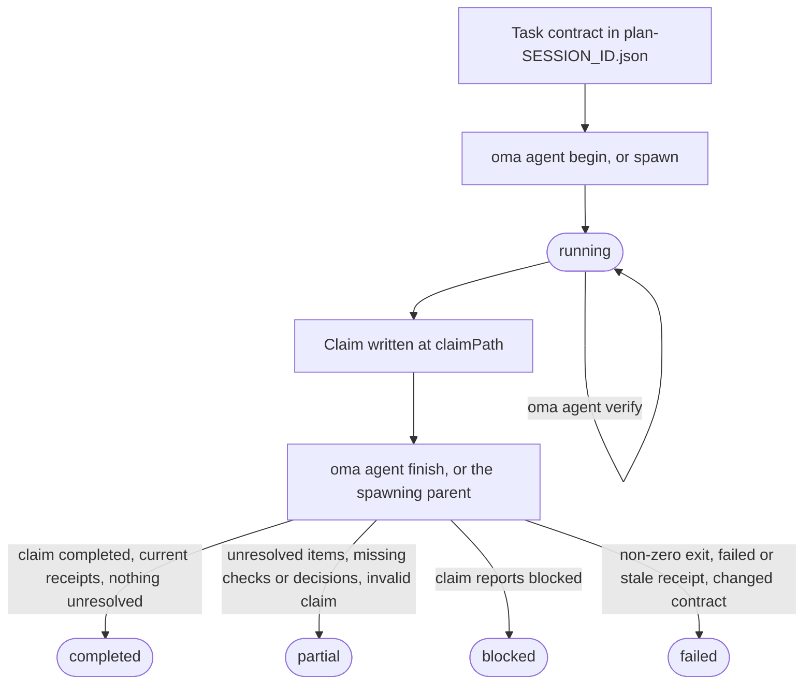
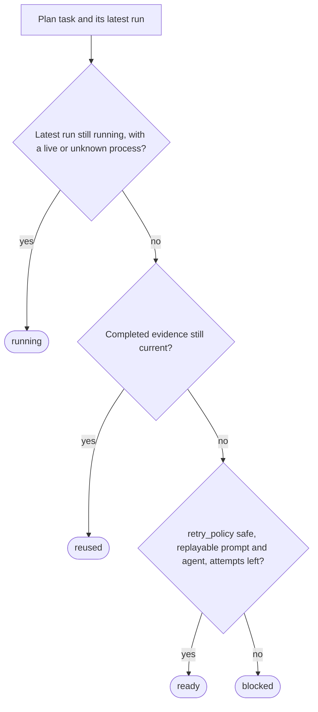

# Resultados de agentes e retomada

O OMA trata o resultado de um agente como um pequeno registro de evidências, não apenas como o código de saída do processo. Uma execução registra os IDs da tarefa e da sessão, a impressão digital do workspace, os recibos de verificação, os arquivos alterados, o trabalho não resolvido e os hashes dos artefatos. Assim, um coordenador pode reutilizar uma tarefa concluída somente enquanto o contrato de aceitação e as entradas ainda coincidirem.

Use o ciclo de vida diretamente quando estiver executando um agente nativo. Workflows e `oma agent spawn` criam os mesmos registros por você e deixam a finalização da execução gerenciada a cargo do coordenador pai. Para os termos usados aqui, consulte [Registro de execução e claim](../getting-started/glossary.md#run-record-and-claim) e [Plano](../getting-started/glossary.md#plan) no glossário.

## Ciclo de vida em resumo

| Etapa | Comando | Registra | Guarde |
| --- | --- | --- | --- |
| 1. Contrato | Edite `.agents/results/plan-SESSION_ID.json` | `acceptance_criteria` e `required_checks` da tarefa | ID da sessão, ID da tarefa |
| 2. Início | `oma agent begin AGENT TASK SESSION_ID --workspace .` | Registro da execução com status `running` | `runId`, `claimPath` |
| 3. Contexto (opcional) | `oma agent context AGENT --difficulty Medium` | Nada | Contexto do prompt |
| 4. Verificação | `oma agent verify RUN_ID --required` | Um recibo por verificação | Código de saída |
| 5. Claim | Escreva o JSON em `claimPath` | Arquivo de claim | Nada |
| 6. Finalização | `oma agent finish RUN_ID CLAIM_PATH` | Status final | `status` |
| 7. Recuperação | `oma agent resume SESSION_ID --dry-run`, depois sem `--dry-run` | Checkpoint de recuperação e lease de sessão | Status por tarefa |

`oma agent spawn` e `oma agent parallel` executam as etapas 2 e 6 por você: o processo pai inicia a execução e a finaliza quando o filho termina.



Um claim também pode informar `partial` ou `failed` diretamente. A finalização nunca promove um claim: ela rebaixa um claim `completed` cujas evidências não se sustentam, e um código de saída diferente de zero torna qualquer execução `failed`.

## Iniciar uma execução nativa {#start-a-native-run}

Defina primeiro a tarefa, seus `acceptance_criteria` e `required_checks` em um plano em `.agents/results/plan-SESSION_ID.json`. Para uma pequena verificação genérica de projeto, o plano pode conter uma tarefa como esta:

```json
{
  "tasks": [
    {
      "id": "docs",
      "agent": "docs",
      "task": "Review README.md and report any documentation issues",
      "workspace": ".",
      "acceptance_criteria": [
        { "id": "diff-clean", "description": "The current Git diff has no whitespace errors" }
      ],
      "required_checks": [
        { "id": "whitespace", "criteria": ["diff-clean"], "command": ["git", "diff", "--check"], "cwd": "." }
      ],
      "retry_policy": "manual"
    }
  ]
}
```

Essa verificação prova apenas que o diff do Git não contém erros de espaço em branco; substitua a tarefa, o critério e a verificação pelo contrato de aceitação real do projeto. Na raiz do projeto, inicie a execução:

```bash
oma agent begin docs docs SESSION_ID --workspace .
```

Substitua `SESSION_ID` pelo ID da sessão usado no plano. O comando imprime um JSON que contém um UUID `runId` gerado e um `claimPath`, por exemplo:

```json
{
  "runId": "<generated-run-id>",
  "taskId": "docs",
  "sessionId": "<your-session-id>",
  "status": "running",
  "claimPath": ".agents/state/agent-runs/<generated-run-id>.claim.json"
}
```

Os valores entre sinais de maior e menor são placeholders; use os valores reais impressos pela sua execução. Um início bem-sucedido cria o registro da execução em `.agents/state/agent-runs/` e captura um snapshot do contrato da tarefa. O caminho do claim é sempre o caminho do registro da execução com `.claim.json` no lugar de `.json`.

## Carregar o contexto e executar a tarefa

Carregue as referências selecionadas pelo grafo antes de editar:

```bash
oma agent context docs --difficulty Medium
```

A dificuldade deve ser `Simple`, `Medium` ou `Complex`. O comando imprime o contexto montado para o agente selecionado. Se não houver contexto apoiado pelo grafo, corrija a definição da tarefa ou continue pelo caminho de busca nativo documentado pelo projeto; não fabrique um recibo de contexto.

Execute a tarefa no workspace registrado por `begin`. Mantenha o plano da sessão fixo enquanto a execução estiver ativa. Se a tarefa alterar seus critérios de aceitação ou verificações obrigatórias, inicie uma nova execução depois de atualizar o plano.

## Registrar a verificação

Execute cada verificação fixada no contrato de aceitação:

```bash
oma agent verify RUN_ID --required
```

Substitua `RUN_ID` pelo UUID retornado por `begin`. O comando executa o argv declarado e registra o código de saída real e as impressões digitais do workspace antes e depois. Uma única linha de comando exata pode ser registrada quando essa verificação fizer parte do contrato da tarefa:

```bash
oma agent verify RUN_ID -- git diff --check
```

Use o formato de comando exato somente para uma verificação que pertença ao contrato da tarefa; nos demais casos, mantenha os `required_checks` do plano e use `--required`, para que o recibo comprove os critérios de aceitação declarados.

Use `--affected PATH...` somente quando o grafo tiver uma seleção completa de testes para esses caminhos. As verificações são executadas em série por execução. Um código de saída diferente de zero ou uma alteração no workspace durante uma verificação invalida esse recibo.

## Escrever e concluir o claim

Para tarefas que escolhem um contrato de API, uma política de autenticação, um modelo de dados,
uma estratégia de migração, um responsável pelo estado, um escopo de acesso à infraestrutura ou outra
decisão da qual o trabalho posterior depende, declare `required_decisions` na tarefa
antes do dispatch:

```json
"required_decisions": [
  {
    "subject": "db.migration-strategy",
    "description": "Choose the compatibility window and rollback strategy for the account migration."
  }
]
```

Omita este campo em tarefas que seguem uma decisão existente. Os requisitos são
fixados com o contrato da tarefa e não podem ser removidos nem alterados após o dispatch.
Liste os assuntos sugeridos para um agente com
`oma state decisions list --agent db-engineer --json`. Esses assuntos são
opções a usar quando forem relevantes; o catálogo não torna todas as escolhas obrigatórias.

Escreva o arquivo de claim no caminho exato impresso por `begin`:

```json
{
  "status": "completed",
  "changedFiles": [],
  "unresolved": [],
  "artifacts": []
}
```

`status` pode ser `completed`, `partial`, `blocked` ou `failed`. Os caminhos são relativos à raiz do projeto e cada artefato deve ser um arquivo comum dentro do workspace. Use `verificationSkipped` somente para uma revisão específica que não tenha verificação executável; isso não transforma uma verificação falha em aprovação.

Inclua as decisões substantivas no array opcional `decisions` do claim:

```json
"decisions": [
  {
    "subject": "db.migration-strategy",
    "decision": "Use an expand-and-contract migration; retain the old column for one release.",
    "rationale": "Both deployed app versions must work during the rollout; rollback switches reads to the retained column.",
    "alternatives": ["Replace the column during a maintenance window"],
    "evidence": ["docs/account-migration.md"]
  }
]
```

O pai armazena cada decisão como um evento `decision.made` na sessão da execução
e anexa os IDs reais do agente, da tarefa e da execução. Uma decisão obrigatória ausente
mantém o resultado como partial, inclusive quando as verificações executáveis passam. Decisões de
outra tarefa ou tentativa não podem satisfazer o requisito. O recibo fixa os IDs dos
eventos de decisão e os hashes de conteúdo; a reutilização verifica se esses eventos ainda
existem, são válidos e têm o conteúdo inalterado.
Decisões opcionais também são registradas. Agentes somente leitura retornam o mesmo array em
seu claim `OMA_RESULT_JSON` para que o pai possa persisti-lo.

Finalize uma execução nativa depois de escrever o claim:

```bash
oma agent finish RUN_ID CLAIM_PATH
```

Substitua os dois valores pelos retornados no JSON de `begin`. `CLAIM_PATH` é o caminho `.claim.json` gerado; não invente um novo nome de arquivo.

O comando de finalização valida o claim, o contrato atual, os recibos atuais e os hashes dos artefatos. Um claim concluído com evidências obsoletas se torna failed ou partial. O comando se recusa a finalizar uma execução gerenciada cujo ciclo de vida pertença ao processo pai.

## Comportamento de execuções criadas e nativas

`oma agent spawn` e `oma agent parallel` criam uma execução, injetam a identidade da execução e as instruções de resultado no prompt filho e deixam o pai capturar o código de saída do filho. Um filho deve escrever seu claim e informar seus artefatos; o pai finaliza o recibo gerenciado. Um filho somente leitura retorna uma linha `OMA_RESULT_JSON: {...}`; o pai a preserva, e sua explicação `verificationSkipped` continua distinta de uma verificação executável.

Os arquivos de resultado legíveis por humanos em `.agents/results/` e as notas de memória em `.agents/state/memories/` ajudam as pessoas a acompanhar o progresso. O recibo legível por máquina em `.agents/state/agent-runs/` é a evidência usada para reutilização e retomada.

## Inspecionar a recuperação antes de tentar novamente

Primeiro, pergunte o que o OMA faria:

```bash
oma agent resume SESSION_ID --dry-run
```

O relatório classifica cada tarefa como `reused`, `ready`, `running` ou `blocked` e inclui o motivo:



Uma dependência que não esteja `reused` faz uma tarefa dependente `reused` voltar a `ready` (ou `blocked`, quando não puder ser reproduzida), e uma tarefa `ready` cuja dependência esteja `blocked` ou `running` passa a `blocked`. Um recibo concluído válido só é reutilizado quando seu contrato, suas entradas, os hashes dos artefatos e as evidências de dependências continuam atuais. Um processo gerenciado ativo, ou uma execução nativa sem evidência de atividade, não é duplicado.

Quando o relatório indicar que a execução é segura, retome as tarefas prontas na ordem das dependências:

```bash
oma agent resume SESSION_ID
```

A repetição automática exige `retry_policy: "safe"`, além de um prompt reproduzível e um agente reproduzível no plano ou no dispatch salvo. O padrão é `manual`. `--max-attempts` tem padrão `3`, incluindo a tentativa original:

```bash
oma agent resume SESSION_ID --max-attempts 2
```

O OMA grava o checkpoint de recuperação em `.agents/state/agent-resume/` e usa um lease de sessão para impedir que dois coordenadores tentem novamente a mesma sessão. O plano permanece fixo durante a recuperação. Se o plano ou uma dependência mudar, ou se uma tentativa posterior alterar uma entrada anterior, as tarefas afetadas ficam bloqueadas e precisam de uma nova execução de verificação.

Retomar inicia uma nova tentativa; não restaura a conversa interrompida com o modelo. Antes de retomar uma execução nativa interrompida, marque a execução antiga como `partial` ou `failed` com seu resultado real e o trabalho não resolvido. Depois, inspecione o relatório de simulação e tente novamente somente tarefas que tenham um caminho seguro de repetição.

## Exemplos de recuperação

| Situação | Ação | Resultado esperado |
| --- | --- | --- |
| Uma verificação obrigatória falhou | Corrija a tarefa, execute novamente `oma agent verify RUN_ID --required` e finalize com um novo claim. | O recibo mais recente substitui o resultado falho quando a impressão digital do workspace está atual. |
| O processo morreu antes de um claim | Marque a execução como partial ou failed e execute `oma agent resume SESSION_ID --dry-run`. | A tentativa antiga é preservada; uma tarefa segura fica `ready`, enquanto uma tarefa manual fica `blocked`. |
| Uma dependência mudou | Execute novamente a dependência e inspecione o relatório outra vez. | A reutilização dependente é invalidada mesmo quando os próprios arquivos não mudaram. |
| O plano ou as entradas mudaram | Inicie uma nova execução depois que o plano estiver estável. | A nova execução captura o novo contrato; as evidências antigas não são reutilizadas. |
| Uma tarefa precisa de uma decisão | Registre-a como `blocked` com uma explicação. | A retomada a mantém bloqueada até que a decisão e o prompt estejam disponíveis. |

## Próximos passos

- Mensagens de erro de `begin`, `verify`, `finish` e `resume`: [Solução de problemas](./troubleshooting.md#find-your-error)
- Erros de análise, ferramentas de vendor ausentes, estado do dashboard, agendamentos e dados de avaliação obsoletos: [Solução de problemas](./troubleshooting.md)
- Acompanhe as execuções gerenciadas enquanto trabalham: [Monitoramento pelo dashboard](./dashboard-monitoring.md)
- Defina planos com contratos de tarefa: [Projetos multiagente](./multi-agent-project.md)
