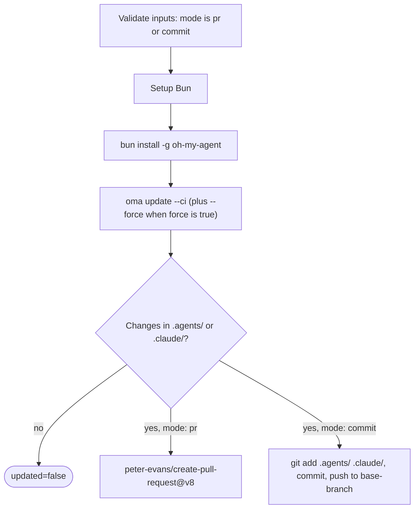

# Guia: Atualizações automáticas

## Visão geral

A GitHub Action do oh-my-agent (`first-fluke/oma-update-action@v1`) atualiza automaticamente as skills de agentes do seu projeto executando `oma update` no CI. Ela oferece dois modos: criar um pull request para revisão ou fazer commit diretamente em uma branch.

---

## Configuração rápida

<!-- oma-docs:ignore-start -->
Adicione este arquivo ao projeto como `.github/workflows/update-oh-my-agent.yml`:
<!-- oma-docs:ignore-end -->

```yaml
name: Update oh-my-agent

on:
  schedule:
    - cron: '0 9 * * 1'  # Every Monday at 9am UTC
  workflow_dispatch:        # Allow manual trigger

permissions:
  contents: write
  pull-requests: write

jobs:
  update:
    runs-on: ubuntu-latest
    steps:
      - uses: actions/checkout@v4

      - uses: first-fluke/oma-update-action@v1
```

Essa é a configuração mínima. Quando um componente instalado muda, a action deve terminar com `updated=true`, uma saída de versão e um pull request. Quando nenhum arquivo muda, ela termina com `updated=false` e sem PR.

---

## Todas as entradas da action

| Entrada | Tipo | Obrigatória | Padrão | Descrição |
|:--------|:-----|:------------|:-------|:-----------|
| `mode` | string | Não | `"pr"` | Como aplicar as mudanças. `"pr"` cria um pull request. `"commit"` envia diretamente para a branch base. |
| `base-branch` | string | Não | `"main"` | Branch base do PR (no modo `pr`) ou branch de destino dos commits diretos (no modo `commit`). Ela não altera o que é obtido no checkout; defina `ref:` de `actions/checkout` para a mesma branch. |
| `force` | string | Não | `"false"` | Passa `--force` para `oma update`. Quando `"true"`, sobrescreve arquivos de configuração personalizados pelo usuário (`oma-config.yaml`, `mcp.json`) e diretórios `stack/`. Normalmente eles são preservados. |
| `pr-title` | string | Não | `"chore(deps): update oh-my-agent skills"` | Título personalizado do pull request. Usado apenas no modo `pr`. |
| `pr-labels` | string | Não | `"dependencies,automated"` | Labels separadas por vírgula para adicionar ao PR. Usadas apenas no modo `pr`. |
| `commit-message` | string | Não | `"chore(deps): update oh-my-agent skills"` | Mensagem de commit personalizada. Usada nos dois modos (como mensagem do commit do PR ou do commit direto). |
| `token` | string | Não | `${{ github.token }}` | Token do GitHub para criar PRs. Use um Personal Access Token (PAT) se precisar que o PR dispare outros workflows (o `GITHUB_TOKEN` padrão não dispara execuções de workflow nos PRs que cria). |

---

## Todas as saídas da action

| Saída | Tipo | Descrição | Disponível |
|:------|:-----|:-----------|:-----------|
| `updated` | string | `"true"` quando foram detectadas mudanças depois de executar `oma update`. `"false"` quando já estava atualizado. | Sempre |
| `version` | string | Versão do oh-my-agent após a atualização. Lida de `.agents/skills/_version.json`. | Quando `updated` é `"true"` |
| `pr-number` | string | Número do pull request. | Somente no modo `pr` quando um PR é criado |
| `pr-url` | string | URL completa do pull request criado. | Somente no modo `pr` quando um PR é criado |

---

## Exemplos detalhados

### Exemplo 1: modo PR padrão

É a configuração mais comum. Cria um PR toda segunda-feira quando há atualizações disponíveis.

```yaml
name: Update oh-my-agent

on:
  schedule:
    - cron: '0 9 * * 1'
  workflow_dispatch:

permissions:
  contents: write
  pull-requests: write

jobs:
  update:
    runs-on: ubuntu-latest
    steps:
      - uses: actions/checkout@v4

      - uses: first-fluke/oma-update-action@v1
        id: update

      - name: Summary
        if: steps.update.outputs.updated == 'true'
        run: |
          echo "Updated to version ${{ steps.update.outputs.version }}"
          echo "PR: ${{ steps.update.outputs.pr-url }}"
```

**O que acontece:**
- Faz checkout do repositório.
- Instala o Bun e depois instala o oh-my-agent globalmente.
- Executa `oma update --ci`.
- Verifica se `.agents/` ou `.claude/` têm mudanças.
- Se houver mudanças, usa `peter-evans/create-pull-request@v8` para criar um PR na branch `chore/update-oh-my-agent`.
- O PR recebe as labels `dependencies,automated` e inclui o novo número de versão no corpo.

### Exemplo 2: modo de commit direto com PAT

Para equipes que querem aplicar atualizações imediatamente, sem uma etapa de revisão de PR. Usa um PAT para que o commit possa disparar workflows posteriores.

```yaml
name: Update oh-my-agent (Direct)

on:
  schedule:
    - cron: '0 6 * * *'  # Daily at 6am UTC
  workflow_dispatch:

permissions:
  contents: write

jobs:
  update:
    runs-on: ubuntu-latest
    steps:
      - uses: actions/checkout@v4
        with:
          ref: develop
          token: ${{ secrets.OH_MY_AGENT_PAT }}

      - uses: first-fluke/oma-update-action@v1
        with:
          mode: commit
          token: ${{ secrets.OH_MY_AGENT_PAT }}
          commit-message: "chore: auto-update oh-my-agent skills"
          base-branch: develop
```

**O que acontece:**
- Faz checkout de `develop` usando um PAT. `ref: develop` é obrigatório: `base-branch` define apenas o destino do push, e a action envia qualquer `HEAD` que o checkout tenha produzido.
- Executa `oma update --ci`.
- Se houver mudanças, configura o git como `github-actions[bot]` e faz commit diretamente em `develop`.
- O PAT garante que o commit dispare os workflows que escutam pushes em `develop`.

**Importante:** use `secrets.OH_MY_AGENT_PAT` (um Fine-Grained PAT com permissão Contents: Write) no lugar de `github.token`. O `GITHUB_TOKEN` padrão cria commits que não disparam outros workflows, o que pode quebrar pipelines de CI que esperam eventos de push.

### Exemplo 3: notificação condicional

Atualiza com uma notificação do Slack quando uma nova versão está disponível.

```yaml
name: Update oh-my-agent

on:
  schedule:
    - cron: '0 9 * * 1'
  workflow_dispatch:

permissions:
  contents: write
  pull-requests: write

jobs:
  update:
    runs-on: ubuntu-latest
    steps:
      - uses: actions/checkout@v4

      - uses: first-fluke/oma-update-action@v1
        id: update

      - name: Notify Slack
        if: steps.update.outputs.updated == 'true'
        uses: slackapi/slack-github-action@v2
        with:
          webhook: ${{ secrets.SLACK_WEBHOOK }}
          webhook-type: incoming-webhook
          payload: |
            {
              "text": "oh-my-agent updated to v${{ steps.update.outputs.version }}. PR: ${{ steps.update.outputs.pr-url }}"
            }

      - name: Skip notification
        if: steps.update.outputs.updated == 'false'
        run: echo "Already up to date, no notification needed."
```

**Padrão principal:** use `steps.update.outputs.updated == 'true'` para executar condicionalmente as etapas posteriores apenas quando uma atualização real ocorreu. Isso evita ruído em execuções "sem mudanças".

### Exemplo 4: modo force com labels personalizadas

Para projetos que querem restaurar todos os arquivos de configuração aos padrões durante a atualização.

```yaml
name: Update oh-my-agent (Force)

on:
  workflow_dispatch:  # Manual trigger only for force updates

permissions:
  contents: write
  pull-requests: write

jobs:
  update:
    runs-on: ubuntu-latest
    steps:
      - uses: actions/checkout@v4

      - uses: first-fluke/oma-update-action@v1
        with:
          force: 'true'
          pr-title: "chore(deps): force-update oh-my-agent skills (reset configs)"
          pr-labels: "dependencies,automated,force-update"
          commit-message: "chore(deps): force-update oh-my-agent skills"
```

**Aviso:** o modo force sobrescreve `oma-config.yaml`, `mcp.json` e os diretórios `stack/`. Use-o somente quando quiser restaurar todas as personalizações aos padrões. Para atualizações normais, omita a entrada `force`.

---

## Como funciona internamente

A action é uma [composite action](https://docs.github.com/en/actions/creating-actions/creating-a-composite-action) definida em `action/action.yml`. Primeiro ela valida se `mode` é `pr` ou `commit`, depois executa as etapas abaixo e termina com um pull request ou um commit direto:



### Etapa 1: configurar o Bun

```yaml
- uses: oven-sh/setup-bun@v2
```

Instala o runtime Bun, necessário para executar a CLI do oh-my-agent.

### Etapa 2: instalar o oh-my-agent

```bash
bun install -g oh-my-agent
```

Instala a CLI globalmente a partir do registro npm. Isso disponibiliza o comando `oma`.

### Etapa 3: executar oma update

```yaml
- name: Run oma update
  shell: bash
  env:
    FORCE: ${{ inputs.force }}
  run: |
    FLAGS="--ci"
    if [ "$FORCE" = "true" ]; then
      FLAGS="$FLAGS --force"
    fi
    oma update $FLAGS
```

As entradas chegam ao script por meio de `env:`, e não por interpolação `${{ }}` dentro de `run:`, o que impede que o valor de uma entrada seja executado como código shell.

A flag `--ci` executa a atualização em modo não interativo (ignora todos os prompts e exibe texto simples em vez de animações de spinner). A flag `--force`, quando habilitada, sobrescreve os arquivos de configuração personalizados pelo usuário.

O que `oma update --ci` faz internamente:

1. Busca `prompt-manifest.json` na branch principal para obter o número da versão mais recente.
2. Compara esse número com a versão local em `.agents/skills/_version.json`.
3. Se as versões coincidirem, termina com "Already up to date.".
4. Se houver uma versão nova, baixa e extrai o tarball mais recente.
5. Preserva os arquivos personalizados pelo usuário (exceto com `--force`): `oma-config.yaml`, `mcp.json` e os diretórios de stack.
6. Copia os arquivos novos sobre o diretório `.agents/` existente.
7. Restaura os arquivos preservados.
8. Atualiza as adaptações dos vendors (hooks, configurações e definições de agentes) para os vendors da lista `vendors:` da configuração (uma lista vazia significa nenhum). Sem uma lista `vendors:`, atualiza somente os vendors cujos diretórios de projeto já existem.
9. Atualiza os symlinks da CLI.

A action chama `oma update --ci` sem `--with-new-skills`. Isso atualiza o conjunto de skills instalado e informa sobre skills novas disponíveis; execute `oma update --with-new-skills` deliberadamente quando o projeto deve adicionar novas skills como parte da atualização.

### Etapa 4: verificar mudanças

```bash
if [ -n "$(git status --porcelain .agents/ .claude/ 2>/dev/null)" ]; then
  echo "updated=true" >> "$GITHUB_OUTPUT"
  if [ -f ".agents/skills/_version.json" ]; then
    VERSION=$(jq -r '.version' .agents/skills/_version.json)
    echo "version=$VERSION" >> "$GITHUB_OUTPUT"
  fi
else
  echo "updated=false" >> "$GITHUB_OUTPUT"
fi
```

Verifica se `oma update` realmente alterou arquivos em `.agents/` ou `.claude/`. Define as saídas `updated` e `version` conforme o resultado. Mudanças fora desses dois diretórios (por exemplo, `.codex/` ou `AGENTS.md`) não definem `updated=true`.

Depois disso, de acordo com a entrada `mode`:

- **Modo `pr`:** usa `peter-evans/create-pull-request@v8` para criar um PR na branch `chore/update-oh-my-agent`. O PR inclui o novo número de versão, um link para o repositório do oh-my-agent e as labels configuradas. Se a branch já existir (por causa de um PR anterior ainda aberto), atualiza o PR existente.
- **Modo `commit`:** configura o git como `github-actions[bot]`, adiciona `.agents/` e `.claude/` ao staging, faz commit com a mensagem configurada e envia para a branch base.

---

## Veja também

- [Instalação global](./global-install.md): `oma update --global` e ressalvas de CI para instalações em todo o usuário
- [Referência de configuração](./configuration-reference.md#update-and-ownership-rules): quais arquivos de configuração `oma update` preserva
- [Integração com projeto existente](./integration.md): os arquivos que `oma update` atualiza em um projeto
