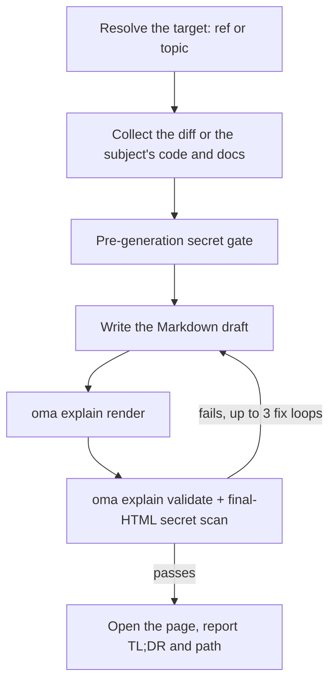

# Explicador de código

`/explain` transforma uma alteração de código em um documento HTML rico e autocontido que ensina o que mudou e por quê: contexto profundo opcional para iniciantes, uma seção de intuição central com dados de brinquedo, um walkthrough de código ordenado para compreensão e um quiz de cinco perguntas. A saída é um único arquivo `.html` que funciona offline, com diagramas, destaques e um quiz acessível, salvo em `.agents/results/explain/` e validado contra um checklist determinístico antes da entrega.

`/explain` funciona somente como slash command: não é ativado automaticamente pela linguagem natural. “explain” é vocabulário cotidiano, por isso é intencionalmente excluído da detecção de palavras-chave (o mesmo precedente de `/convert`). Diga `/explain` explicitamente ou peça a outra skill para produzir um “documento explicativo” como saída delegada.

## Dois modos

| Modo | Você digita | Precisa de git | O que a página explica |
|---|---|---|---|
| Change | `/explain`, `/explain #640`, `/explain a..b`, `/explain <branch>` | sim (`gh` para referências de PR) | Uma alteração de código: Background, Intuition, Code, Quiz |
| Topic | `/explain how does session windowing work` (texto que não resolve para nenhum PR, branch ou intervalo SHA) | não | Um conceito, um sistema ou a resposta a uma pergunta, como uma folha visual de uma página: uma resposta inicial, depois painéis de diagramas, tabelas e prosa curta |

Se o texto puder ser tanto um nome de branch quanto um assunto, o workflow o verifica primeiro como referência git; a referência prevalece.

---

## Quando usar

- Explicar um PR, branch, intervalo de commits ou alteração atual staged/unstaged como documento
- Integrar uma pessoa da equipe a uma alteração que ela não escreveu
- Produzir um artefato didático revisável depois que uma alteração grande ou sutil entrar
- Transformar uma arquitetura, um protocolo, uma comparação ou uma resposta longa em uma única página visual (modo topic)

## Quando NÃO usar

- *Vídeo* explicativo narrado → use [`oma-video`](./video-generation.md) (modo explainer); `/explain` produz um documento HTML, não um vídeo
- Verificar se a documentação ainda corresponde à base de código → use `oma-docs` (detecção de drift)
- Deck de apresentação / slides → use `oma-slide` (contrato de deck fixo em 1920×1080)
- Encontrar defeitos ou emitir veredictos de revisão → use `oma-qa` ou o workflow `/review`; `/explain` narra uma alteração didaticamente, não a avalia

---

## Início rápido

```text
/explain
/explain 640
/explain a1b2c3d..e5f6a7b
/explain payments-refactor for reviewer
```

A referência-alvo é resolvida a partir da formulação:

| Você digita | Resolução do alvo | Nível do leitor |
|----------|--------------------|--------------|
| `/explain` | Alterações staged (`git diff --cached`), com fallback para a árvore de trabalho suja | `onboarding` |
| `/explain 640`, `/explain #640` | PR #640 via `gh pr diff` | `onboarding` |
| `/explain a..b` | Intervalo SHA `a..b` (ou `a...b`) | `onboarding` |
| `/explain feature-branch for reviewer` | `git diff main...feature-branch` | `reviewer` |
| `/explain how does the row planner work` | Modo topic: sem referência; o agente coleta o código e a documentação do assunto | n/a |

Se nenhuma referência explícita for informada e tanto as alterações staged quanto a árvore de trabalho suja estiverem vazias, a resolução recorre a `HEAD~1..HEAD`.



---

## Ordem de resolução das referências

Somente no modo change; o modo topic pula a resolução de referências.

1. **Argumento explícito** — um número de PR (`#640`), nome de branch ou intervalo SHA (`a..b` / `a...b`)
2. **Alterações staged** — `git diff --cached`
3. **Árvore de trabalho suja** — `git diff`
4. **Fallback** — `HEAD~1..HEAD`

Um diff vazio ou uma referência não resolvível interrompe o workflow; ele oferece commits recentes como candidatos, em vez de adivinhar uma alternativa.

---

## Níveis de leitura

| Nível | Efeito |
|-------|--------|
| `onboarding` (padrão) | Contexto profundo completo (Tier A), para quem não conhece o sistema ao redor |
| `reviewer` | Condensa a camada de contexto profundo; as seções Intuition e Code permanecem completas |

Solicite `reviewer` adicionando “for reviewer” ao comando, como em `/explain feature-branch for reviewer`.

---

## Conteúdo do documento

Esta seção descreve o modo change. Um explainer do modo change é uma única página longa com rolagem (sem abas e sem navegação multipágina), com um índice seguido de quatro seções fixas, nesta ordem:

1. **Background** — Tier A (contexto profundo de sistema/arquitetura, marcado como “ignorável se você já conhece o sistema”) e Tier B (contexto restrito a esta alteração)
2. **Intuition** — a essência da alteração com exemplos obrigatórios de dados de brinquedo, reforçada por 2–3 famílias de diagramas reutilizadas (mock simplificado de UI, diagrama de sistema/fluxo de dados com dados de exemplo, estado antes/depois) renderizadas apenas como HTML/SVG inline — sem arte ASCII
3. **Code** — walkthrough agrupado para compreensão humana (não em ordem alfabética nem na ordem do diff), referenciando código por meio de `file:line`
4. **Quiz** — 5 perguntas por padrão (parametrizável), cada uma voltada a um aspecto distinto da alteração, com distratores plausíveis e texto de feedback em todas as opções (certas e erradas)

A prosa e o conteúdo do quiz são escritos no idioma de saída solicitado (idioma do prompt → `.agents/oma-config.yaml` `language` → inglês); código, identificadores e inline code permanecem em inglês conforme as regras de i18n. O contrato completo de conteúdo está em `.agents/skills/oma-explanation/resources/document-structure.md`.

---

## Como a página é construída

O agente escreve um rascunho em Markdown, e `oma explain render` o transforma na página: layout, tema, geometria dos diagramas e o script do quiz vêm do renderizador, não do modelo.

| Comando | Uso |
|---|---|
| `oma explain render draft.md` | Renderiza um rascunho (um arquivo ou stdin) em `.agents/results/explain/{YYYY-MM-DD}-{slug}.html`. As opções incluem `--template sheet\|doc`, `--theme`, `--mode`, `--archify` e `--open`. |
| `oma explain lint draft.md` | Verifica a prosa sem renderizar (`--style strict` sai com 1 diante de um aviso). |
| `oma explain components [name]` | Lista os componentes que um rascunho pode usar (`flow`, `sequence`, `tree`, `timeline`, `limits`, `annot`, `kv`, `callout`, `quiz`) ou imprime a sintaxe de um componente. |
| `oma explain patch <page.html> --panel <id>` | Substitui um painel de uma página renderizada (por letra ou título) e mantém o restante. |
| `oma explain validate <file>` | Executa as verificações posteriores determinísticas descritas abaixo. |

---

## Contrato HTML

Páginas geradas por `oma explain render` cumprem estas regras automaticamente; elas importam quando você verifica ou edita HTML manualmente.

O arquivo gerado deve abrir corretamente offline via `file://` com **zero carregamentos de recursos externos**: sem scripts/stylesheets de CDN, webfonts ou imagens externas (somente SVG inline ou data URIs). Âncoras de hyperlink (`<a href="https://...">`) são permitidas; a proibição cobre somente o *carregamento* de recursos.

- Blocos de código usam `<pre>`; qualquer container customizado declara `white-space: pre-wrap`. Não use bibliotecas externas de syntax highlighting.
- Pilha de fontes: uma Pretendard instalada localmente, encontrada pelo nome da família (a página nunca baixa fontes e não usa a função CSS `local()`), depois `system-ui` e fontes CJK do sistema. Páginas em japonês e chinês pulam a Pretendard e começam por `system-ui` com fontes para esse idioma.
- Responsivo a partir de 375px, contraste WCAG AA nos temas claro e escuro, suporte a `prefers-color-scheme: dark` e respeito a `prefers-reduced-motion`.
- O quiz é JavaScript vanilla: opções como elementos `<button>`, feedback imediato de certo/errado anunciado por uma região `aria-live="polite"`, respostas corretas distribuídas aleatoriamente entre posições, resumo de pontuação final e navegação completa por teclado.

Especificação comportamental completa: `.agents/skills/oma-explanation/resources/html-contract.md`.

---

## Segredos e defesa contra injeção de prompt

O conteúdo do diff e as descrições de PR são tratados estritamente como **dados**: quaisquer instruções incorporadas à alteração explicada são ignoradas.

Os segredos passam por dois gates:

1. **Pré-geração:** o diff coletado é verificado antes de qualquer autoria.
2. **Pós-geração:** o HTML final também é verificado, pois a prosa de contexto pode citar arquivos inalterados que uma verificação apenas do diff não encontraria.

Ao detectar qualquer ocorrência, a geração para imediatamente, somente os locais mascarados são informados (nunca o valor real) e uma continuação com conteúdo redigido exige confirmação explícita.

---

## Checklist de validação

Depois da geração, um checklist baseado em grep é executado contra o arquivo de saída: nenhuma referência a carregamento de recursos externos, conformidade de `pre`/`pre-wrap` em containers de código, presença do script do quiz, formato de nome `{YYYY-MM-DD}-{slug}.html` (data no `timezone` do oma-config ou, se ausente, no fuso horário do sistema) e verificação final de segredos no HTML. Em caso de falha, o loop corrige e valida novamente até **3 iterações**, depois para e mostra os itens restantes em vez de entregar silenciosamente.

Esta é uma restrição da v1: a validação é baseada em grep/arquivo e verifica somente a *presença* do script do quiz (não sua correção comportamental completa). Use um navegador (ou o MCP chrome-devtools) para exercitar manualmente o quiz quando o comportamento for importante.

Você pode validar um artefato existente com o comando de CLI registrado:

```bash
oma explain validate .agents/results/explain/2026-09-09-payment-refactor.html
oma explain validate --input-dir .agents/results/explain --output json
```

Saída esperada (nomes de arquivo ilustrativos):

```text
$ oma explain validate .agents/results/explain/2026-09-09-payment-refactor.html
✔ Explain validation passed: 1/1 file(s) valid

$ oma explain validate ".agents/results/explain/payment refactor.html"
✖ Explain validation failed: 1/1 file(s) failed
File: .agents/results/explain/payment refactor.html
  - [error] filename-format: Filename 'payment refactor.html' does not match format {YYYY-MM-DD}-{slug}.html
```

A primeira forma verifica um arquivo HTML. A forma de diretório verifica todos os relatórios em um diretório e retorna um relatório legível por máquina. Use `--report-file <path>` para salvar o relatório JSON; a grafia antiga `--out-file` agora falha com `Removed option --out-file. Use --report-file.` Uma saída diferente de zero significa que pelo menos um artefato falhou nas verificações determinísticas; ela não inspeciona a precisão didática da prosa nem das respostas do quiz.

---

## Saída

```text
.agents/results/explain/{YYYY-MM-DD}-{slug}.html
```

A data segue o `timezone` do oma-config ou, se ausente, o fuso horário do sistema. Executar novamente a mesma combinação de data + slug sobrescreve o arquivo anterior; preservar uma execução anterior é sua responsabilidade. Depois que a validação passa, o workflow tenta abrir a página (somente aviso; um ambiente headless apenas recorre a informar o caminho) e relata um TL;DR junto do caminho do arquivo. `oma explain render --open` abre a página diretamente no navegador.

---

## Sidecar archify opcional

Quando `diagram.explain_sidecar: true` está definido em `oma-config.yaml` ou você o solicita (`/explain 640 with archify`), `/explain` renderiza com `--archify`: ele deriva um `{date}-{slug}.archify.html` interativo de um bloco `flow` ou `sequence` do rascunho e o vincula por uma âncora simples. Ele nunca é incorporado: o explainer continua sendo um único arquivo autocontido, e uma falha do sidecar nunca impede a entrega. Consulte [Diagram Engine](./diagram-engine.md#explain).

## Casos-limite

| Situação | Comportamento |
|-----------|----------|
| Diff vazio / referência não resolvível | Para, oferece commits recentes como candidatos e nunca adivinha outra referência |
| Diff grande demais | Exclui automaticamente lockfiles/arquivos gerados, agrupa o restante por arquivo e lista as exclusões no rodapé de proveniência |
| Diff somente binário ou gerado | Para: não há nada que possa ser explicado |
| CLI `gh` ausente ou não autenticada (referência de PR) | Orientação de instalação/autenticação e alternativa de diff de branch local |
| Merge/rebase em andamento | Para: worktree instável |
| Diretório que não é Git | Modo change: para imediatamente. O modo topic é executado sem git. |
| Validação falha após 3 loops de correção | Para e mostra os itens que falharam no checklist |
| `open` falha / ambiente headless | Somente aviso: o caminho informado é suficiente |

---

## Próximos passos

- [Workflow `/explain`](../core-concepts/workflows.md#explain) — pipeline de resolução de referências → coleta → gate de segredos → geração → validação → entrega
- [Diagram Engine](./diagram-engine.md) — o sidecar archify opcional
- [Comandos da CLI: explain](../cli-interfaces/commands.md#explain) — todas as opções de `oma explain`
- [Geração de vídeo](./video-generation.md) — o *modo* explainer de `oma-video` produz um vídeo narrado em vez de um documento HTML
- [Workflows de conteúdo e pesquisa](./content-and-research.md) — outros recursos de documentos e pesquisa
