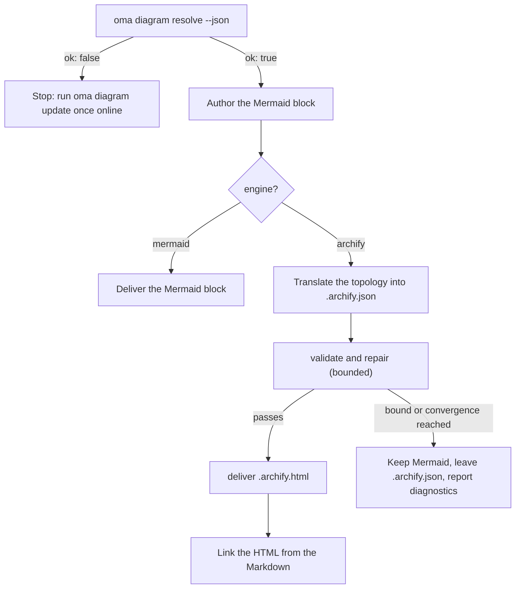

# Motor de diagramas

`/architecture` (ADRs, recomendações e revisões) e `/explain` (explainers de alterações de código) emitem diagramas estruturais. O artefato de `/architecture` sempre inclui um bloco **Mermaid** em Markdown, e o workflow `/explain` desenha diagramas SVG inline. Quando [archify](https://github.com/tt-a1i/archify) é resolvido, o workflow de arquitetura também emite um **diagrama HTML interativo e validado** ao lado do artefato. Ele usa uma especificação JSON tipada e oferece suporte a temas claro/escuro, pan-zoom, busca, rastreamento de relações e exportação PNG/SVG/WebM.

Mermaid continua sendo a SSOT textual no Markdown e nos diffs do Git. archify produz um artefato derivado.

---

<a id="always-the-latest-archify--nothing-to-install"></a>
## Instalar o archify {#install-archify}

archify é uma skill de agente sob licença MIT (Node ≥ 18, sem dependências de runtime). O oh-my-agent usa a cópia instalada por meio da [skills CLI](https://github.com/vercel-labs/skills) e não mantém nenhuma cópia própria:

- `oma diagram update` instala o archify quando ele está ausente (`bunx skills add tt-a1i/archify --skill archify -g -y`) e, caso contrário, o atualiza (`bunx skills update archify -g -y`).
- `oma diagram resolve` apenas lê os diretórios de skills instalados e nunca acessa a rede. Sem uma instalação, `auto` recorre ao Mermaid e indica o comando de instalação.
- `oma update` não instala o archify.

```bash
# Illustrative output; the version, install path, and quality can vary.
oma diagram update
oma diagram resolve
# engine:   archify  (requested: auto)
# reason:   archify 2.15.0 via home:~/.agents/skills
# root:     /Users/you/.agents/skills/archify
# bin:      /Users/you/.agents/skills/archify/bin/archify.mjs
# version:  2.15.0
# quality:  showcase
# sidecar:  off (explain)
```

Ordem de resolução (o primeiro resultado vence, de forma idêntica em todos os runtimes de vendor):

1. `diagram.archify.path` em `oma-config.yaml` — fixação explícita
2. Variável de ambiente `ARCHIFY_HOME` — fixação explícita
3. Diretórios de skills instalados: projeto `.agents` / `.claude` / `.codex` / `.cursor` / `.qwen` / `.kiro` / `.gemini` / `.copilot` `/skills/archify`, depois os mesmos em `~`, depois `~/.config/agents/skills/archify` e `~/.raven/workspace/skills/archify`

<!-- oma-docs:ignore-start -->
Uma ocorrência exige que o diretório archify instalado ou fixado contenha `bin/archify.mjs`.
<!-- oma-docs:ignore-end -->

Versões anteriores mantinham uma cópia própria em `~/.cache/oma-diagram/`. Ela não é mais lida; você pode excluí-la.

---

## Configuração {#configuration}

Seção esparsa em `.agents/oma-config.yaml` (chaves ausentes usam os padrões mostrados):

```yaml
diagram:
  engine: auto                # auto | archify | mermaid
  explain_sidecar: false      # /explain also writes an archify sidecar
  archify:
    path: null                # explicit install dir (pin)
    quality: showcase         # showcase | standard  → --quality
    open: false               # pass --open to deliver
```

`archify.managed`, `archify.channel` e `archify.check_interval_min` estão obsoletos: ainda passam na validação, mas são ignorados, e `resolve` exibe um aviso enquanto estiverem definidos.

### Qual engine é executado {#which-engine-runs}

Uma única decisão cobre o valor da configuração, se o archify é resolvido e o que o workflow entrega. "É resolvido" significa que qualquer etapa da [ordem de resolução](#always-the-latest-archify--nothing-to-install) encontra uma instalação: uma fixação ou um diretório de skill instalado.

| `diagram.engine` | archify é resolvido? | `oma diagram resolve --json` | Resultado de `/architecture` |
|---|---|---|---|
| `auto` (padrão) | sim | `engine: archify`, `ok: true` | Bloco Mermaid + `.archify.html` vinculado |
| `auto` | não (archify não instalado) | `engine: mermaid`, `ok: true` | Somente Mermaid; o relatório indica `oma diagram update` |
| `archify` | sim | `engine: archify`, `ok: true` | Bloco Mermaid + `.archify.html` vinculado |
| `archify` | não | `engine: mermaid`, `ok: false`, saída 1 | O workflow para com a dica `oma diagram update` em vez de rebaixar silenciosamente |
| `mermaid` | não verificado | `engine: mermaid`, `ok: true` | Somente Mermaid; archify nunca é chamado |

`oma diagram resolve --engine <auto|archify|mermaid>` substitui a configuração em uma chamada, e um prompt pode fazer o mesmo em uma execução (`/explain 640 with archify`).

---

## CLI {#cli}

```bash
oma diagram resolve [--engine auto|archify|mermaid] [--json]
oma diagram update  [--json]
oma diagram archify <archify args…>
```

`oma diagram update` força uma atualização e sai com 1 quando nenhuma instalação archify pode ser resolvida.

`oma diagram archify` executa o executável archify resolvido com `ARCHIFY_UPDATE_CHECK_DISABLED=1` (sem rede) e propaga o código de saída, para que `validate` / `deliver` / `visual-check` se comportem exatamente como a documentação do archify descreve:

```bash
oma diagram archify guide "show the auth request lifecycle" --json
oma diagram archify validate architecture adr-auth.archify.json --quality showcase --json
oma diagram archify deliver  architecture adr-auth.archify.json adr-auth.archify.html --quality showcase --json
oma diagram archify visual-check adr-auth.archify.html --json   # exit 2 = no Chrome (skipped), or archify itself could not be resolved
```

`--json` em `resolve` retorna `{ ok, requested, engine, quality, open, explainSidecar, archify?: { root, bin, version, source }, reason, probed, warnings }` — `source` é `config:…`, `env:…` ou um rótulo de diretório de skill, como `home:~/.agents/skills`; `warnings` lista as chaves obsoletas ignoradas. `--refresh` e `--offline` são aceitos como no-ops obsoletos.

---

## Uso pelos workflows {#how-the-workflows-use-it}

O protocolo compartilhado está em `.agents/skills/_shared/conditional/diagram-engine.md`. `/architecture` segue esta sequência:

1. `oma diagram resolve --json`
2. Escreva primeiro o bloco Mermaid (sempre).
3. Se `engine: archify`: traduza a topologia Mermaid para a IR JSON do archify (`architecture` / `sequence` / `dataflow` / `lifecycle` / `workflow`), lendo somente o schema correspondente e um exemplo da instalação.
4. `validate` → reparar → `deliver`, com limites: para quando a especificação passa, quando a regra de convergência do archify é acionada, após 3 tentativas de reparo, após 10 minutos no total ou quando o mesmo diagnóstico se repete. Rótulos semânticos nunca são apagados somente para passar.
5. Vincule o HTML: nunca o incorpore.



### `/architecture` {#architecture}

Somente para decisões estruturais (limites, dependências e fluxo de dados). Saída ao lado do artefato Markdown em `.agents/results/architecture/`:

```text
adr-notification-service.md            # Mermaid block + "Interactive:" link
adr-notification-service.archify.json  # frozen spec (kept even on failure)
adr-notification-service.archify.html  # delivered viewer
```

### `/explain` {#explain}

Opt-in, porque o contrato do explainer (um único arquivo autocontido, com tema baseado em variáveis CSS) não permite incorporar um segundo documento HTML completo. Habilite com `diagram.explain_sidecar: true`, passe `oma explain render --archify` ou peça isso no prompt ("with archify"). Não há bloco Mermaid nem JSON escrito à mão: o renderizador deriva a especificação archify de um bloco `flow` ou `sequence` do rascunho (o painel marcado com `{archify}`), executa `deliver` (recorrendo uma vez da qualidade `showcase` para `standard`) e vincula `{date}-{slug}.archify.html` com um `<a href>` simples. O comando informa `linked`, `skipped` (com o motivo) ou `failed` (primeiro diagnóstico). O workflow não entra em loop diante de um sidecar com falha, e uma falha do sidecar nunca impede o explainer.

---

## Pôsteres de stack (stack-diagram) {#stack-posters-stack-diagram}

Quando o diagrama é uma topologia de stack tecnológica ou de infraestrutura cujos nós são produtos de fornecedores (AWS, Vercel, Postgres, …) e você pede logos, `/architecture` segue a **rota stack** em vez do archify. Ele executa a skill de agente upstream [Caru-ini/stack-diagram](https://github.com/Caru-ini/stack-diagram) (MIT; Python 3.9+, acesso à rede para os logos) da mesma forma que `oma-slide` executa o ppt-master: não há comando oma nem chave de configuração. A tabela de rotas está em `.agents/skills/_shared/conditional/diagram-engine.md`.

- Resolução: primeiro o catálogo de skills do runtime; caso contrário, `bunx skills use caru-ini/stack-diagram@stack-diagram`. Se não for possível resolvê-la, o workflow recorre à decisão archify ↔ Mermaid acima e informa isso.
- Saída: `<artifact-stem>.stack.html` ao lado do artefato Markdown, vinculado na seção Diagram como `Stack: …`. O bloco Mermaid continua sendo a SSOT.
- Somente HTML. A exportação PNG e a verificação por captura de tela do upstream exigem Playwright + Chromium; o oma nunca os instala nem executa.
- O upload para a galeria do upstream (`share.py`) é ignorado, a menos que você peça explicitamente para publicar.
- Limites: 2 tentativas de build, 5 minutos no total; uma execução limpa de `build.py` é o critério de aceitação.
- `/explain` nunca segue essa rota; seu sidecar é derivado do rascunho em código.

Diga "archify" no prompt para forçar a rota estrutural, ou "stack-diagram" / "with logos" para forçar a rota stack.

---

## Modos de falha {#failure-modes}

Um archify não resolvível é coberto pela [tabela de decisão do engine](#which-engine-runs). Os casos restantes:

| Situação | Resultado |
|---|---|
| `oma diagram update` falha (offline, `bunx` ausente) | O erro da skills CLI é exibido; uma instalação existente continua funcionando |
| `validate` nunca converge | Mermaid continua sendo o diagrama entregue; o último `.archify.json` fica disponível para uma pessoa; os diagnósticos são informados literalmente |
| Chrome ausente para `visual-check` | Informado como `skipped`, nunca como aprovação |
| `oma diagram archify …` sai com 2 | O Chrome está ausente (`visual-check`) ou o archify não pôde ser resolvido; verifique primeiro `oma diagram resolve --json` |

---

## Próximos passos {#next-steps}

- [Explicador de código](./code-explainer.md) — o workflow `/explain` e seu sidecar archify opcional
- [Workflow `/architecture`](../core-concepts/workflows.md#architecture) — ADRs e revisões que carregam o bloco Mermaid
- [Semântica de oma-config.yaml](./oma-config-semantics.md) — como a seção `diagram:` é mesclada
- [Comandos da CLI: diagram](../cli-interfaces/commands.md#diagram) — lista completa de opções
- [Market Research](./market-research.md) — o mesmo padrão de instalação via skills CLI para o engine last30days
- upstream archify: [tt-a1i/archify](https://github.com/tt-a1i/archify)
- upstream stack-diagram: [Caru-ini/stack-diagram](https://github.com/Caru-ini/stack-diagram)
