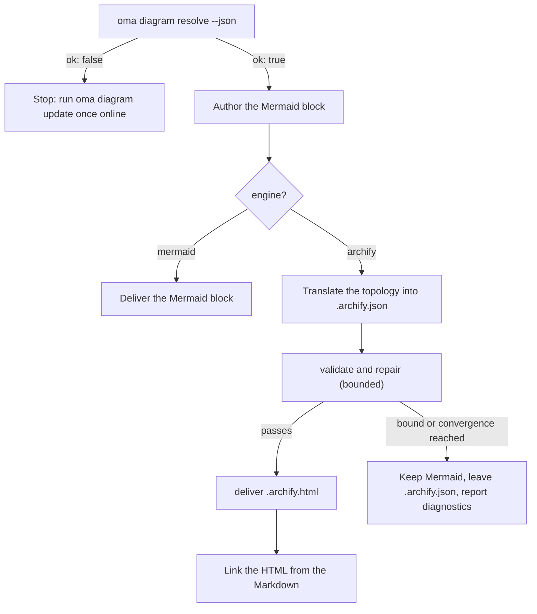

# Motor de diagramas

`/architecture` (ADRs, recomendações e revisões) e `/explain` (explainers de alterações de código) emitem diagramas estruturais. Para `/architecture`, eles sempre são blocos **Mermaid** dentro do artefato Markdown (`/explain` desenha seus próprios diagramas SVG inline) e, quando [archify](https://github.com/tt-a1i/archify) pode ser resolvido, o que é o caso normal, também um **diagrama HTML interativo e validado** ao lado do artefato: tema claro/escuro, pan-zoom, busca, rastreamento de relações e exportação PNG/SVG/WebM, renderizado a partir de uma especificação JSON tipada.

Mermaid continua sendo a SSOT textual no Markdown e nos diffs do Git. archify produz um artefato derivado.

---

## Archify sempre atualizado — nada para instalar {#always-the-latest-archify--nothing-to-install}

archify é uma skill de agente sob licença MIT (Node ≥ 18, sem dependências de runtime). O oh-my-agent não depende de uma cópia instalada uma vez; mantém **sua própria cópia gerenciada** e acompanha a versão mais recente:

- Cache: `~/.cache/oma-diagram/archify/<tag>/` mais um ponteiro `state.json`.
- Antes de cada uso, `oma diagram resolve` consulta no GitHub a tag da versão mais recente (limitada a uma vez por `check_interval_min`, padrão 60 min), baixa o tarball do código quando existe uma tag mais nova (diretório atômico por tag; tags antigas são removidas) e, caso contrário, reutiliza a cópia em cache.
- Falhas de rede nunca são fatais: a cópia em cache é usada e informada como `stale` com o motivo. Somente uma primeira execução sem rede e sem cache recorre a uma cópia da skill instalada pelo usuário e, depois disso, ao Mermaid.

```bash
# Illustrative output; the release tag, cache path, and quality can vary.
oma diagram update          # force a check / download now
oma diagram resolve
# engine:   archify  (requested: auto)
# reason:   archify 2.15.0 via managed:v2.15.0 (current)
# root:     /Users/you/.cache/oma-diagram/archify/v2.15.0
# bin:      /Users/you/.cache/oma-diagram/archify/v2.15.0/bin/archify.mjs
# version:  2.15.0
# quality:  showcase
# sidecar:  off (explain)
oma diagram resolve --offline   # never touch the network
```

Ordem de resolução (o primeiro resultado vence, de forma idêntica em todos os runtimes de vendor):

1. `diagram.archify.path` em `oma-config.yaml` — fixação explícita, desativa auto-latest
2. Variável de ambiente `ARCHIFY_HOME` — fixação explícita
3. **Managed latest** (`~/.cache/oma-diagram/archify`)
4. Diretórios de skills instalados pelo usuário: projeto `.agents` / `.claude` / `.codex` / `.cursor` / `.qwen` / `.kiro` `/skills/archify`, depois os mesmos em `~`, além de `~/.raven/workspace/skills/archify`

<!-- oma-docs:ignore-start -->
Uma ocorrência exige que a instalação archify gerenciada ou fixada contenha `bin/archify.mjs`.
<!-- oma-docs:ignore-end -->

---

## Configuração

Seção esparsa em `.agents/oma-config.yaml` (chaves ausentes usam os padrões mostrados):

```yaml
diagram:
  engine: auto                # auto | archify | mermaid
  explain_sidecar: false      # /explain also writes an archify sidecar
  archify:
    managed: true             # false = never download; use pins / skill dirs only
    channel: stable           # stable (latest GitHub Release) | main (HEAD of main)
    check_interval_min: 60    # minutes between remote checks; 0 = every call
    path: null                # explicit install dir (pin)
    quality: showcase         # showcase | standard  → --quality
    open: false               # pass --open to deliver
```

### Qual engine é executado {#which-engine-runs}

Uma única decisão cobre o valor da configuração, se o archify é resolvido e o que o workflow entrega. "É resolvido" significa que qualquer etapa da [ordem de resolução](#always-the-latest-archify--nothing-to-install) encontra uma instalação: uma fixação, a cópia gerenciada mais recente ou um diretório de skill instalado pelo usuário.

| `diagram.engine` | archify é resolvido? | `oma diagram resolve --json` | Resultado de `/architecture` |
|---|---|---|---|
| `auto` (padrão) | sim | `engine: archify`, `ok: true` | Bloco Mermaid + `.archify.html` vinculado |
| `auto` | não (por exemplo, primeira execução offline ou `managed: false` sem diretório de skill) | `engine: mermaid`, `ok: true` | Somente Mermaid; o relatório diz para executar `oma diagram update` uma vez online |
| `archify` | sim | `engine: archify`, `ok: true` | Bloco Mermaid + `.archify.html` vinculado |
| `archify` | não | `engine: mermaid`, `ok: false`, saída 1 | O workflow para com a dica `oma diagram update` em vez de rebaixar silenciosamente |
| `mermaid` | não verificado | `engine: mermaid`, `ok: true` | Somente Mermaid; archify nunca é chamado |

`oma diagram resolve --engine <auto|archify|mermaid>` substitui a configuração em uma chamada, e um prompt pode fazer o mesmo em uma execução (`/explain 640 with archify`).

---

## CLI

```bash
oma diagram resolve [--engine auto|archify|mermaid] [--refresh] [--offline] [--json]
oma diagram update  [--json]
oma diagram archify <archify args…>
```

`oma diagram update` força uma atualização e sai com 1 quando nenhuma instalação archify pode ser resolvida.

`oma diagram archify` executa o executável archify resolvido com `ARCHIFY_UPDATE_CHECK_DISABLED=1` (sem rede) e propaga o código de saída, para que `validate` / `deliver` / `visual-check` se comportem exatamente como a documentação do archify descreve:

```bash
oma diagram archify guide "show the auth request lifecycle" --json
oma diagram archify validate architecture adr-auth.archify.json --quality showcase --json
oma diagram archify deliver  architecture adr-auth.archify.json adr-auth.archify.html --quality showcase --json
oma diagram archify visual-check adr-auth.archify.html --json   # exit 2 = no Chrome (skipped), or archify itself could not be resolved
```

`--json` em `resolve` retorna `{ ok, requested, engine, quality, open, explainSidecar, archify?: { root, bin, version, source, status?, note? }, reason, probed }` — `source` é `managed:<tag>`, `config:…`, `env:…` ou um rótulo de diretório de skill; `status` (`fresh` / `current` / `stale`) e `note` são definidos para cópias gerenciadas.

---

## Uso pelos workflows

O protocolo compartilhado está em `.agents/skills/_shared/conditional/diagram-engine.md`. `/architecture` segue esta sequência:

1. `oma diagram resolve --json`
2. Escreva primeiro o bloco Mermaid (sempre).
3. Se `engine: archify`: traduza a topologia Mermaid para a IR JSON do archify (`architecture` / `sequence` / `dataflow` / `lifecycle` / `workflow`), lendo somente o schema correspondente e um exemplo da instalação.
4. `validate` → reparar → `deliver`, com limites: para quando a especificação passa, quando a regra de convergência do archify é acionada, após 3 tentativas de reparo, após 10 minutos no total ou quando o mesmo diagnóstico se repete. Rótulos semânticos nunca são apagados somente para passar.
5. Vincule o HTML: nunca o incorpore.



### `/architecture`

Somente para decisões estruturais (limites, dependências e fluxo de dados). Saída ao lado do artefato Markdown em `.agents/results/architecture/`:

```text
adr-notification-service.md            # Mermaid block + "Interactive:" link
adr-notification-service.archify.json  # frozen spec (kept even on failure)
adr-notification-service.archify.html  # delivered viewer
```

### `/explain`

Opt-in, porque o contrato do explainer (um único arquivo autocontido, com tema baseado em variáveis CSS) não permite incorporar um segundo documento HTML completo. Habilite com `diagram.explain_sidecar: true`, passe `oma explain render --archify` ou peça isso no prompt ("with archify"). Não há bloco Mermaid nem JSON escrito à mão: o renderizador deriva a especificação archify de um bloco `flow` ou `sequence` do rascunho (o painel marcado com `{archify}`), executa `deliver` (recorrendo uma vez da qualidade `showcase` para `standard`) e vincula `{date}-{slug}.archify.html` com um `<a href>` simples. O comando informa `linked`, `skipped` (com o motivo) ou `failed` (primeiro diagnóstico). O workflow não entra em loop diante de um sidecar com falha, e uma falha do sidecar nunca impede o explainer.

---

## Modos de falha

Um archify não resolvível é coberto pela [tabela de decisão do engine](#which-engine-runs). Os casos restantes:

| Situação | Resultado |
|---|---|
| A verificação de atualização falha (offline, limitada por taxa) | A cópia em cache é usada e informada como `stale` com o motivo |
| `validate` nunca converge | Mermaid continua sendo o diagrama entregue; o último `.archify.json` fica disponível para uma pessoa; os diagnósticos são informados literalmente |
| Chrome ausente para `visual-check` | Informado como `skipped`, nunca como aprovação |
| `oma diagram archify …` sai com 2 | O Chrome está ausente (`visual-check`) ou o archify não pôde ser resolvido; verifique primeiro `oma diagram resolve --json` |

---

## Próximos passos

- [Explicador de código](./code-explainer.md) — o workflow `/explain` e seu sidecar archify opcional
- [Workflow `/architecture`](../core-concepts/workflows.md#architecture) — ADRs e revisões que carregam o bloco Mermaid
- [Semântica de oma-config.yaml](./oma-config-semantics.md) — como a seção `diagram:` é mesclada
- [Comandos da CLI: diagram](../cli-interfaces/commands.md#diagram) — lista completa de opções
- [Market Research](./market-research.md) — o mesmo padrão de versão gerenciada mais recente para o engine last30days
- upstream archify: [tt-a1i/archify](https://github.com/tt-a1i/archify)
