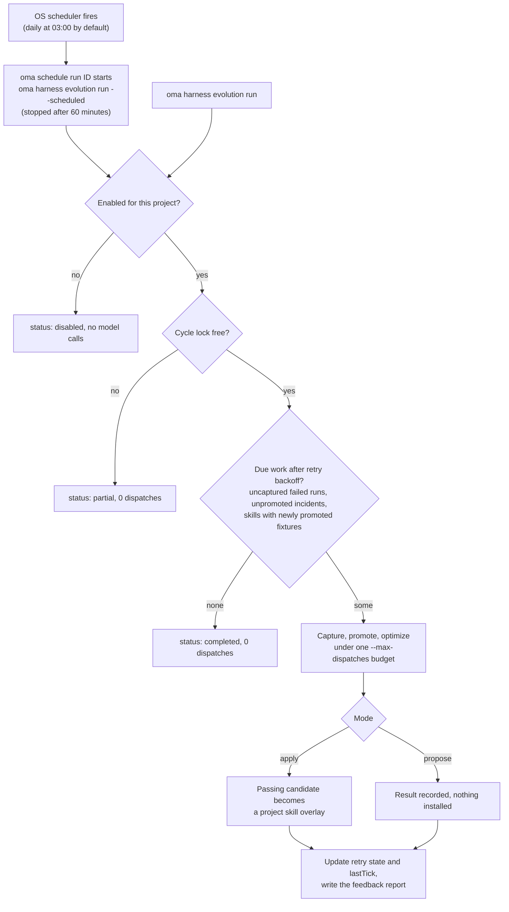

# Evolução do harness do projeto

O OMA pode coletar evidências das execuções de agente rastreadas e processar falhas em um ciclo de feedback agendado. As alterações automáticas de skills ficam **desativadas até que você as habilite para um projeto**. Cada ciclo tem um orçamento finito de chamadas de modelo, e uma alteração aplicada precisa passar pelos gates de avaliação de skills já existentes.

O caminho automatizado melhora documentos de skill. Alterações no procedimento do otimizador ou do maintainer continuam sendo uma [metaotimização](./skill-opt.md#meta-optimization-the-procedure-as-the-candidate) separada, invocada manualmente.

## Habilitar um projeto

Execute a partir da raiz do projeto:

```bash
# Example allowance: at most 300 model dispatches per scheduled cycle
oma harness evolution enable --max-dispatches 300

# Evaluate proposals without applying them
oma harness evolution enable --max-dispatches 300 --mode propose

# Choose a schedule in the operating system's local time
oma harness evolution enable --max-dispatches 300 --cron "0 3 * * *"

oma harness evolution status --json
```

`enable` imprime as configurações salvas e o ID do job no agendador:

```json
{
  "enabled": true,
  "scheduleId": "sch_abcdefgh2345",
  "mode": "apply",
  "maxDispatches": 300
}
```

`status --json` retorna `config`, `schedule` (a entrada do agendador, ou `exists: false`), `pending` (o número de novas tentativas não concluídas), `conflicts` (conflitos de sobreposição por skill) e `state` (novas tentativas e `lastTick`).

O agendamento padrão é diário, às 03:00 no horário local, e o modo padrão é `apply`. `--max-dispatches` é obrigatório ao habilitar e deve ser um inteiro positivo. O valor do exemplo é uma cota de chamadas, não uma estimativa de preço nem uma promessa de que um ciclo será concluído. Suítes de fixtures maiores e pontuações repetidas consomem mais chamadas.

<!-- oma-docs:ignore-start -->
As configurações são salvas em `.agents/evolution/harness-evolution.json`. A evidência gerada, o estado de novas tentativas e o bloqueio do ciclo ficam em `.agents/state/harness-evolution/`.
<!-- oma-docs:ignore-end -->

Habilitar registra um job integrado no [agendador do sistema operacional](./scheduled-agents.md) já existente do OMA; ele aparece em `oma schedule list` com o agente `__builtin__`. No horário de disparo, `oma schedule run <id>` inicia `oma harness evolution run --scheduled` neste projeto e o interrompe após 60 minutos, então dimensione `--max-dispatches` para um ciclo que caiba em uma hora. Habilitar novamente atualiza o job do projeto em vez de criar outro. Interrompa o agendamento com `oma harness evolution disable` em vez de `oma schedule delete`, para que as configurações salvas continuem consistentes.

```bash
# Run one cycle now under the saved mode and budget
oma harness evolution run --json

# Stop future cycles; retain evidence and applied improvements
oma harness evolution disable
```

`run --json` retorna `status` (`completed`, `partial` ou `disabled`), `dispatchesUsed` e `maxDispatches`. Quando outro ciclo detém o bloqueio, `run` retorna `partial` com 0 dispatches. Um ciclo que para com um erro, como uma cota esgotada, sai com esse erro e registra `partial` ou `failed` em `state.lastTick`.

Um projeto desabilitado não executa trabalho de modelo por meio do comando evolution, inclusive em uma invocação agendada atrasada. Desabilitar não reverte as alterações já aplicadas.

## O que acontece automaticamente

O ciclo é executado pelo agendador ou manualmente.



1. **Registrar a evidência de conclusão.** As execuções rastreadas pelo OMA deixam referências locais ao seu resultado e à sua evidência de verificação. Essa etapa de conclusão não faz chamadas extras de modelo. A conclusão repetida da mesma execução não cria evidência duplicada.
2. **Coletar falhas conforme o agendamento.** O ciclo varre as execuções com falha elegíveis, deriva as expectativas dos contratos de tarefa registrados e verifica se uma fixture de regressão proposta realmente rejeita a saída com falha preservada.
3. **Otimizar as skills afetadas.** Os incidentes são agrupados por skill. Cada skill é otimizada sob as verificações já existentes de treino, validação, teste final, isolamento e transferência negativa.
4. **Aplicar ou reportar.** No modo `apply`, um candidato aprovado se torna uma sobreposição de skill do projeto. No modo `propose`, o ciclo registra o resultado sem instalá-lo.
5. **Reportar as alterações.** Use o status e o histórico de promoções existente para inspecionar os resultados. As alterações aplicadas também alimentam o aviso de evolução da próxima sessão.

O OMA não observa automaticamente todas as conversas nativas nem todas as correções do usuário. A entrada é a evidência de execução que o OMA realmente rastreia. Uma execução sem saída preservada ou sem contrato de aceitação pode exigir uma [especificação de incidente](./harness-incidents.md#capture-an-incident) escrita manualmente.

## Orçamento e novas tentativas

O ciclo compartilha uma única cota de chamadas entre captura, redação de rubricas, roteamento, pontuação, otimização de skills, tarefas vizinhas e avaliação final. Uma chamada de modelo é debitada da cota antes do dispatch. As chamadas que a camada de execução repete também contam. Um limite mais rígido definido na constitution da skill continua valendo.

Quando a cota se esgota, a avaliação permanece incompleta e o candidato afetado não pode ser aplicado. O relatório registra o uso e o trabalho pendente. Apenas um ciclo de projeto é executado por vez.

Criar uma fixture não marca a otimização do incidente como concluída. Uma otimização interrompida ou com falha continua pendente e pode ser retomada após o backoff, sem duplicar a fixture. O backoff dobra a cada tentativa com falha: 2, 4, 8, … minutos, até 1024 minutos (cerca de 17 horas). Um resultado totalmente avaliado, sem nenhuma alteração aceitável, é registrado como processado, de modo que a mesma evidência não dispare otimizações repetidas sem limite. Uma nova evidência pode disparar outra tentativa.

Mudar do modo de proposta para o modo de aplicação torna as propostas não aplicadas elegíveis para processamento. Aplicar ainda exige uma avaliação atual e o conteúdo de origem inalterado; uma proposta antiga não é uma instrução de gravação incondicional.

## Sobreposições persistentes de skills

As alterações automáticas são armazenadas separadamente das definições de skill gerenciadas, na área de evolução do projeto, que pertence ao usuário: `.agents/evolution/skills/<skill>/` (com um registro `overlay.json`). A avaliação e os links de skill de vendor locais ao projeto usam o corpo efetivo selecionado a partir da base gerenciada e de sua sobreposição elegível. As instalações de vendor com escopo de HOME não são redirecionadas para uma sobreposição do projeto. Uma cópia não gerenciada em um diretório de vendor do projeto precisa ser resolvida antes da aplicação automática. Os recursos da skill continuam disponíveis em seus caminhos relativos.

Uma sobreposição registra a base contra a qual foi avaliada. Depois de `oma update`:

- Uma base inalterada continua usando sua sobreposição.
- Uma base alterada deixa a sobreposição preservada, mas a marca como conflito e usa a base atualizada. A avaliação antiga não pode estabelecer que a sobreposição é segura na nova base.

Uma edição feita enquanto a otimização está em execução impede que o candidato sobrescreva esse conteúdo alterado. O status reporta os conflitos para revisão.

## Inspecionar e desfazer

```bash
oma harness evolution status --json
oma skill promotions --all
oma skill rollback --skill oma-docs
```

Os registros de promoção retêm os hashes do candidato e do pai, a evidência de avaliação e um patch revisável. Reverter a primeira sobreposição restaura o uso da base gerenciada; reverter uma sobreposição posterior restaura a sobreposição anterior. Edições desconhecidas são preservadas: a reversão se recusa a descartar conteúdo que não corresponda mais ao candidato registrado.

O `oma skill optimize --apply` manual continua gravando o `SKILL.md` gerenciado, mas se recusa a fazê-lo enquanto houver uma sobreposição de projeto ativa para essa skill (`[oma skill opt] an active project overlay owns this skill; ...`). Primeiro reverta a sobreposição com `oma skill rollback --skill <id>` ou deixe o ciclo de evolução aplicar a alteração. A evolução agendada seleciona explicitamente o caminho de aplicação por sobreposição.

## Escopo da evidência

Um teste de software aprovado confirma a integração dos componentes e as regras de avaliação. Ele não estabelece que alterações automáticas repetidas melhorem, ao longo do tempo, o trabalho real de um projeto. Inspecione as promoções, os custos, as regressões e o histórico de reversões reais antes de aumentar a cota ou ampliar a automação. A promoção de procedimento L5 não é invocada por este loop de feedback agendado.

## Veja também

- [Casos de regressão de incidentes](./harness-incidents.md) — capture, promova e reproduza os incidentes que este ciclo processa.
- [Otimização de skills](./skill-opt.md) — os gates pelos quais toda alteração aplicada passa.
- [Agentes agendados](./scheduled-agents.md) — o agendador do sistema operacional que dispara o ciclo.
