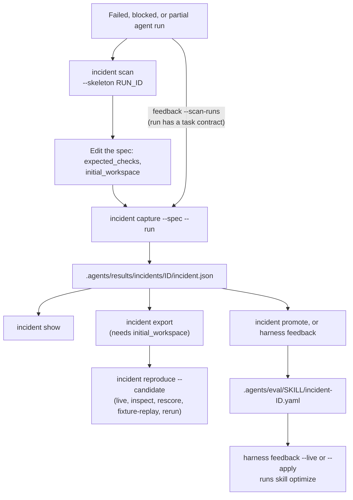

# Casos de regressão de incidentes

`oma harness incident` conecta uma falha observada a um caso de regressão e à avaliação candidata que a segue. Ele registra observações separadamente das hipóteses causais. Uma falha de processo, por si só, não estabelece que o modelo causou o incidente.

O diagrama mostra o ciclo de vida de um incidente. A promoção alimenta a otimização de skills; a exportação alimenta a avaliação do harness.



## Encontrar candidatos {#find-candidates}

```bash
oma harness incident scan            # failed/blocked/partial runs with no captured incident
oma harness incident scan --json
oma harness incident scan --skeleton <run-id> > incidents/run-failure.json
```

1. `oma harness incident scan` lista as execuções rastreadas cujo status é `failed`, `blocked` ou `partial` e descarta qualquer execução que um incidente capturado já referencie por meio de `source.runId`. `--limit <n>` limita a lista. As execuções vêm dos registros de execução do projeto no diretório de estado do perfil do OMA (por padrão `~/.oma/u/0/projects/<project-id>/agent-runs/`, em que `<project-id>` é o SHA-256 do caminho canônico do projeto; `OMA_STATE_HOME` e `OMA_PROFILE` alteram a raiz e o perfil). `oma agent spawn` e `oma agent parallel` mantêm os últimos 64 KiB do log de cada execução ao lado do respectivo registro, como `<run-id>.output.txt`.
2. `--skeleton <run-id>` imprime uma especificação com o id, o agente, a execução de origem, a falha observada, o código de saída e, quando o runner o preservou, o final da saída do agente. `expected_checks` é deixado como `TODO` porque o comportamento correto é uma decisão que a varredura não pode tomar.
3. Substitua a verificação de placeholder. Para tornar o incidente executável, adicione também `"initial_workspace": "<dir>"` apontando para uma cópia dos arquivos da tarefa como estavam antes da execução. Sem isso, o incidente pode ser capturado e promovido, mas `incident export` e `reproduce` param com `Cannot export a runnable regression: initial workspace evidence is missing`.
4. Capture com `--run <run-id>` para que o prompt, a identidade e a impressão digital do workspace da execução sejam preservados. `capture --run` importa a saída preservada como observação quando a especificação omite uma, e `incident promote` pode validar a fixture derivada em relação a ela.

## Capturar automaticamente uma execução com falha

```bash
oma harness feedback --scan-runs            # capture, promote, report
oma harness feedback --scan-runs --live     # and optimize the affected skills
```

Uma execução com falha, bloqueada ou parcial cuja tarefa tinha um contrato não exige uma especificação escrita à mão. O comportamento esperado são os critérios de aceitação do contrato, definidos antes da execução; os critérios cobertos por um recibo de verificação com falha formam o conjunto não atendido, ou todo critério, quando a execução nunca verificou nada. O opt-agent reescreve os critérios não atendidos como uma rubrica de juiz (`PASS only if …`), o juiz pontua a própria saída preservada da execução em relação a ela, e o incidente é capturado somente quando essa saída falha: uma rubrica que a falha passa não capturou a falha. A especificação é gravada em `.agents/results/incidents/_specs/<id>.json` e capturada com a identidade da execução, levando a rubrica como uma verificação de aceitação `output_judge`. Execuções sem saída preservada, sem prompt ou sem contrato são listadas como não capturáveis, com o respectivo motivo.

`output_judge` é um contrato graduado. O avaliador mecânico do harness o reporta como não avaliado; seu propósito é a fixture de regressão de skill que `incident promote` deriva dele com a mesma rubrica.

## Capturar um incidente {#capture-an-incident}

Salve uma especificação JSON dentro do projeto:

```json
{
  "schema_version": 1,
  "id": "incomplete-result",
  "summary": "The agent reported success while the result remained incomplete",
  "prompt": "Complete the task and update result.json",
  "agent": "backend",
  "observed": {
    "failure": "result.json still contained complete=false",
    "output": "success",
    "exit_code": 0
  },
  "initial_workspace": "initial",
  "expected_checks": [
    {
      "type": "file_json_equals",
      "path": "result.json",
      "pointer": "/complete",
      "value": true
    }
  ],
  "evidence_files": ["original-output.txt"],
  "dependencies": []
}
```

Os caminhos de `initial_workspace`, `evidence_files` e das fixtures de dependência são relativos ao arquivo de especificação. O caminho `checker` de uma verificação de comando é relativo ao projeto. A sintaxe das verificações corresponde a [Avaliação do harness](./harness-eval.md). O diretório inicial deve ser uma fixture de tarefa pré-execução fornecida, sem arquivos de instrução do OMA ou do vendor; o harness em avaliação é injetado separadamente.

```bash
oma harness incident capture --spec incidents/incomplete-result.json --json
oma harness incident show incomplete-result --json

# Import prompt and observable metadata from an existing local run
oma harness incident capture --spec incidents/run-failure.json --run <run-id> --json
```

`--run` recebe um ID de execução listado por `oma harness incident scan`; os registros de execução ficam no diretório de estado do perfil descrito em [Encontrar candidatos](#find-candidates), não em `.agents/state/`. Ele preserva a identidade da execução e da sessão, o vendor, o status e a impressão digital original do workspace. Um prompt fornecido tem precedência sobre o prompt registrado da execução. `source.trace_id` pode vincular um incidente relatado a um trace externo sem buscá-lo nem enviá-lo.

O manifesto capturado fica em `.agents/results/incidents/<id>/incident.json`. Ele inclui o instantâneo inicial, quando fornecido, hashes da evidência de origem e dos arquivos de verificador, verificações de aceitação, limitações e um hash do manifesto. IDs existentes não podem ser sobrescritos. O texto sensível da observação é ocultado; a ocultação é reportada como um limite à reprodução exata. A coleta de instantâneos rejeita arquivos não suportados e tem limites por arquivo, por contagem e por tamanho total. As referências de evidência preservam hashes e caminhos, não cópias de cada arquivo de origem referenciado.

O objeto opcional `cause` tem `category`, `hypothesis`, `confidence` e `evidence`. As categorias são `model`, `tool`, `config`, `context`, `application`, `evaluator` e `unknown`. Omiti-lo deixa a causa como `unknown`.

## Promover para uma fixture de skill

```bash
oma harness incident promote <id> [--skill <id>] [--draft] [--force] --json
```

Um incidente capturado se torna uma fixture de regressão para a skill que o agente que falhou exerceu, de modo que `oma skill optimize` possa reparar a skill em relação a ela. A skill é escolhida roteando o prompt do incidente contra o catálogo de skills instaladas, com a mesma sonda em nível de descrição que `oma skill eval --routing` usa (uma chamada de modelo); quando o roteamento não escolhe nada, usa-se a primeira entrada de `skills:` da definição do agente em `.agents/agents/<agent>.md` ou, na ausência dela, a skill instalada chamada `oma-<agent>`. `--skill` tem precedência, e a promoção registra qual dos três decidiu (`attribution`). A fixture é gravada em `.agents/eval/<skill>/incident-<id>.yaml` com `group: incident-<id>` para que nunca atravesse a divisão entre treino, validação e teste, e a promoção é registrada ao lado do incidente como `promotion.json`. Um incidente é promovido uma única vez.

O verificador vem das verificações de aceitação. Quando todas as verificações são `output_contains`, a fixture é um `assert` determinístico. Caso contrário, as verificações não podem ser executadas em uma avaliação de skill (não há arquivos nem comandos), então `--draft` solicita ao opt-agent uma rubrica de juiz que comece com `PASS only if` e cite a falha observada. Em ambos os casos, a fixture só é admitida quando a saída com falha registrada a reprova: se um assert já é satisfeito pela saída observada, ou se o juiz aprova nessa saída uma rubrica redigida, a promoção é recusada, porque não se trata de um caso de regressão. Um incidente sem saída observada não pode ser validado e exige `--force`, o que é registrado como uma limitação.

## Fechar o ciclo

```bash
oma harness feedback                 # promote every unpromoted incident, report what changed (routing, drafting, and judge model calls)
oma harness feedback --live          # also run one optimization epoch per affected skill (dry-run)
oma harness feedback --apply --json  # also write edits that pass every gate (implies --live)
```

`--incident <ids...>` limita a execução aos incidentes listados. `--max-epochs <n>` (padrão 1) define as épocas de otimização por skill para `--live` e `--apply`.

:::caution Custo de modelo e destino de gravação
`feedback` não mostra uma prévia de custo. Mesmo sem `--live`, a promoção encaminha cada incidente para uma skill com uma chamada de modelo e pode redigir e julgar rubricas. `--live` e `--apply` executam `oma skill optimize --live --yes` para cada skill afetada, e `--apply` grava diretamente o `SKILL.md` gerenciado, inclusive skills `oma-*` que `oma update` sobrescreve. Para uma execução confirmada e com prévia, use `oma skill optimize --skill <id> --live`; para um ciclo com orçamento e sobreposições de projeto, use a [evolução do harness do projeto](./harness-evolution.md).
:::

`feedback` é o loop de feedback de implantação em um único comando: com `--scan-runs`, toda execução com falha não capturada que tenha um contrato é capturada primeiro (veja acima); em seguida, todo incidente capturado sem fixture é promovido (redigindo rubricas quando necessário), as skills afetadas são agrupadas e, com `--live`, cada uma é otimizada uma vez contra sua suíte ampliada sob os gates normais (aceitação held-in/held-out, transferência negativa confirmada, teste final pertencente ao runner). O relatório em `.agents/results/feedback/feedback-<ts>.json` lista as promoções, os incidentes ignorados com os motivos e o resultado de cada skill com o diff, de modo que a cadeia de uma falha observada até uma edição candidata é um único registro auditável. Para a operação agendada, com uma cota compartilhada de chamadas de modelo, novas tentativas persistentes e sobreposições de skill do projeto, habilite a [evolução do harness do projeto](./harness-evolution.md). O instantâneo de estado da sessão seguinte anuncia as alterações aplicadas.

O que continua sendo uma decisão humana: uma execução sem contrato de tarefa não tem comportamento esperado registrado, por isso é listada por `incident scan` e capturada apenas por meio de uma especificação; `--skeleton` redige uma.

## Exportar e avaliar

```bash
oma harness incident export incomplete-result --json
oma harness incident reproduce incomplete-result --candidate candidates/fix \
  --record-file incidents/comparison.json --yes --json
```

A exportação materializa o instantâneo inicial salvo e uma suíte exploratória de caso único. O hash do manifesto e a identidade da execução e do trace de origem viajam com a tarefa até a avaliação e o registro. Alterações nos arquivos exportados, no prompt, no agente, nas verificações ou nas fontes fixadas dos verificadores invalidam o reuso. Crie um novo ID de incidente para alterar o contrato de aceitação.

Por padrão, `reproduce` inicia uma nova comparação live entre baseline e candidato e a registra. A confirmação live de custo normal se aplica, a menos que `--yes` seja fornecido. Este comando usa o vendor de agente configurado para a tarefa do harness, incluindo o Codex; ele não impõe o perfil de compilador protegido do otimizador de skills na execução da tarefa.

Uma suíte de incidente exportada tem exatamente uma tarefa, então `reproduce` sempre imprime `coverage: insufficient` (são necessárias cinco tarefas pontuadas para um veredicto), e a decisão é `INSUFFICIENT`, a menos que um dos braços não tenha sido despachado (`FAIL`). Em vez disso, leia as linhas de tarefa: o ID do incidente em `corrected:` significa que o baseline falhou e o candidato passou; em `regressed:` significa que o candidato quebrou um caso que passava; `none` em ambos significa que os braços se comportaram da mesma forma. Em JSON, esses campos são `score.correctedTaskIds` e `score.regressedTaskIds`.

Se nenhum estado inicial foi capturado, `capture` e `show` continuam funcionando, mas a exportação executável e a reprodução da execução param com um erro de evidência ausente. A árvore de trabalho atual de uma execução histórica não pode estabelecer o estado original dela. Mesmo um instantâneo inicial fornecido separadamente não prova equivalência com aquela execução histórica; o relatório declara essa limitação.

## Escolher a operação de evidência

```bash
oma harness incident reproduce incomplete-result --candidate candidates/fix \
  --action inspect --record-file incidents/comparison.json --json

oma harness incident reproduce incomplete-result --candidate candidates/fix \
  --action rescore --record-file incidents/comparison.json --json

oma harness incident reproduce incomplete-result --candidate candidates/fix \
  --action fixture-replay --record-file incidents/comparison.json \
  --transcript incidents/tool-responses.json --json

oma harness incident reproduce incomplete-result --candidate candidates/fix \
  --action rerun --record-file incidents/comparison.json --record --yes --json
```

| Operação | O que acontece |
|---|---|
| `inspect` | Lê e agrega veredictos salvos. Nenhuma verificação ou agente é executado. |
| `rescore` | Aplica as verificações atuais de saída e de arquivo à evidência bruta salva. Os campos antigos de aprovação e reprovação são ignorados. |
| `fixture-replay` | Reproduz os dados de resposta de ferramenta e as alterações de arquivo fornecidos contra o estado inicial registrado. Nenhum modelo nem processo de ferramenta é executado. |
| `rerun` | Inicia chamadas reais de agente de baseline e candidato a partir do estado inicial registrado. Isso incorre no uso normal de modelo. |

Para um contrato de aceitação revisado, crie uma suíte de harness separada e use `oma harness eval --action rescore` com a mesma identidade e o mesmo prompt de suíte, tarefa e incidente. A suíte de incidente exportada em si é imutável. Consulte [detalhes de registro e reprodução](./harness-eval.md#reuse-a-recording) para os requisitos de evidência bruta e o esquema de transcrição de ferramentas.

Declare dependências externas como `{ "name": "service", "repeatability": "fixture|live|unavailable", "reason": "...", "fixture": "response.json" }`. Uma dependência de fixture aponta para um arquivo que usa o esquema completo de transcrição do harness, com o ID do incidente como `taskId`. A reprodução offline de um incidente rejeita dependências live ou unavailable, arquivos de fixture ausentes, hashes de fixture alterados, respostas nomeadas ausentes e alterações de requisições, respostas ou arquivos que difiram da transcrição fixada. Ela ainda não pode atestar que o autor declarou todas as dependências externas. Uma repetição live também não pode garantir que um serviço externo se comporte como se comportava historicamente.

A captura, a exportação e a avaliação emitem eventos locais `harness.incident.*` que conectam o incidente, os hashes de candidato e baseline, o modo de execução e os IDs das tarefas corrigidas ou regredidas. Um incidente de caso único é evidência de regressão, não um substituto para as suítes de validação e de teste final. Os perfis de harness atuais reportam `promotionReady: false`; essas operações não estabelecem o isolamento protegido do teste final nem promovem automaticamente um candidato.
