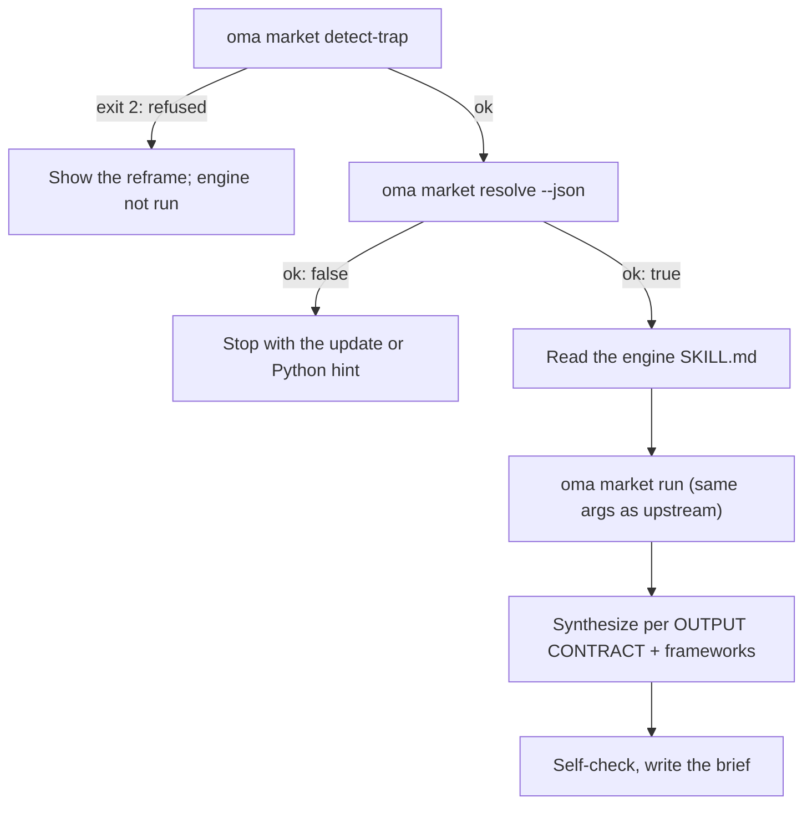

# Pesquisa de mercado

`oma-market` responde “o que as pessoas estão realmente dizendo sobre X nos últimos N dias” — pontos de dor, tendências, sentimento sobre concorrentes e descoberta — usando fontes comunitárias com números reais de engajamento: Reddit (upvotes e comentários principais), X, transcrições do YouTube, TikTok, Instagram, Hacker News, Polymarket, GitHub, arXiv, Techmeme, Digg, LinkedIn, StockTwits, Bluesky, a web e outras.

A pesquisa em si roda no engine upstream [**last30days**](https://github.com/mvanhorn/last30days-skill) (MIT, Python 3.12+). O oh-my-agent não faz fork dele: mantém uma **cópia gerenciada sempre atualizada**, aplica um gate a cada execução e acrescenta uma camada de frameworks estratégicos. Cadência de releases, quantidade de stars e cobertura de providers pertencem ao projeto upstream e podem mudar.

---

## Início rápido

Peça ao seu agente em linguagem natural. Expressões como “pesquisa de mercado”, “pontos de dor”, “análise de concorrentes”, “voz do cliente” ou “detecção de tendências” ativam a skill `oma-market`:

```text
Encontre os principais pontos de dor que desenvolvedores relatam sobre os remote containers do VS Code nos últimos 30 dias.
Compare o sentimento da comunidade sobre Cursor vs Windsurf nos últimos 90 dias, frameworks swot,5f.
```

| Direcione com | Efeito |
|---|---|
| "A vs B", ou `--vs B` | Intenção competitor: fluxo de comparação upstream + SWOT + Porter's 5F |
| `--days 7`, `30`, `90` ou `180` | Janela de pesquisa |
| `--intent pain`, `trend`, `competitor` ou `discovery` | Substitui a classificação automática de intenção |
| `--frameworks none`, ou uma lista como `swot,5f,pestel` | Desativa as seções de framework ou escolhe quais incluir |

O resultado é um único brief em `.agents/results/market/{topic-slug}-{YYYYMMDD}.md`. A primeira linha é o badge do engine (`🌐 last30days v<version> · synced <date>`), seguida de clusters de evidências ordenados com links, das seções de framework e do rodapé do engine que lista as fontes ignoradas.

| Roda sem chaves | Precisa do assistente de configuração upstream (chaves ou cookies) |
|---|---|
| Reddit, Hacker News, GitHub, Polymarket, arXiv, Techmeme, Digg, web | X, transcrições do YouTube, TikTok, Instagram e outras fontes com chave; as fontes ignoradas são listadas no rodapé |

---

## Engine sempre na versão mais recente (requer Python 3.12+) {#always-the-latest-engine--nothing-to-install}

```bash
# Illustrative output; the release tag, cache path, and Python version vary.
oma market resolve
# engine:   last30days
# reason:   last30days 3.21.1 via managed:v3.21.1 (current)
# root:     ~/.cache/oma-market/last30days/v3.21.1
# skill:    ~/.cache/oma-market/last30days/v3.21.1/SKILL.md
# version:  3.21.1
# python:   python3.14 (3.14.7, PATH)
# save_dir: <workspace>/.agents/results/market/raw
```

- Cache: `~/.cache/oma-market/last30days/<tag>/` + `state.json`.
- Antes de cada uso, `resolve` consulta no GitHub a release mais recente (limitada a uma vez por `check_interval_min`, padrão 60 min), baixa uma tag mais nova para seu próprio diretório (tags antigas são removidas) e, caso contrário, reutiliza o cache. Falhas de rede reutilizam a cópia em cache e informam `stale`.
- Python: `LAST30DAYS_PYTHON` → `market.python` → `python3.14`, `python3.13`, `python3.12`, `python3`, `python` no PATH (deve ser ≥ 3.12) → `uv python find '>=3.12'`. Se nenhum for encontrado, `resolve` não fica ok e imprime a dica de instalação; a skill para em vez de degradar para uma pesquisa somente na web.
- A configuração do engine e as chaves de API ficam em `~/.config/last30days/` (gravadas pelo assistente de configuração upstream com seu consentimento), portanto sobrevivem às atualizações do engine.

Ordem de resolução (o primeiro resultado vence): `market.path` → `LAST30DAYS_HOME` → **managed latest** → cópias instaladas pelo usuário (`.agents|.claude|.codex|.cursor|.qwen|.kiro/skills/last30days` no projeto e em `~`, depois o cache de plugins do Claude Code).

```bash
oma market update            # force a check / download now
oma market resolve --offline # never touch the network
oma market run -- --help     # the engine's own flags (without `--`, oma prints its own help)
```

---

## Configuração

```yaml
market:
  managed: true                   # false = never download; pins / skill dirs only
  channel: stable                 # stable (latest Release) | main (HEAD)
  check_interval_min: 60          # 0 = check on every call
  path: null                      # explicit engine dir (pin)
  python: null                    # interpreter override
  save_dir: .agents/results/market/raw
```

---

## Como uma execução funciona



1. `oma market detect-trap "<topic>"` recusa tópicos com armadilha de palavras-chave e compras demográficas (sai com 2) e sugere uma reformulação. Um tópico vazio ou com mais de 200 caracteres sai com 4.
2. `oma market resolve --json` resolve o engine e o Python; para em `ok: false`.
3. O agente lê o `SKILL.md` do engine resolvido do início ao fim e o segue: assistente de configuração da primeira execução, resolução prévia de handles/subreddits/hashtags (quando WebSearch estiver disponível), planejamento da consulta e gate de pré-condições.
4. `oma market run "<topic>" <flags> --emit=compact` usa argumentos idênticos à chamada upstream `python3 scripts/last30days.py`; `--save-dir` é adicionado a partir de `market.save_dir`.
5. A síntese segue o OUTPUT CONTRACT upstream (badge na primeira linha, clusters de evidências ordenados e LAWs 1–8); depois o oma acrescenta seções de framework que citam somente clusters do engine:

| Intenção | Modelagem do engine | Frameworks |
|---|---|---|
| pain | tópico em formato de reclamação, `--days 30`, `--deep` quando houver poucos dados | SWOT |
| trend | `--days 7/30/90/180`, `--discover "<domain>"` para “o que está em alta” | SWOT |
| competitor | `"A vs B"` → fluxo de comparação upstream | SWOT + Porter's 5F |
| discovery | `--discover`, depois follow-ups `--drill` | SWOT + PESTEL |

6. Faça a autoverificação e escreva `.agents/results/market/{topic-slug}-{YYYYMMDD}.md`.

---

## Modos de falha

| Situação | Resultado |
|---|---|
| Tópico recusado por detect-trap | Reformulação exibida; o engine não é executado. `--force` somente após reconfirmação explícita do usuário |
| Nenhum engine em cache e modo offline | `ok: false` → execute `oma market update` uma vez online |
| Nenhum Python 3.12+ | `ok: false` com dica de instalação (brew / apt / `uv python install 3.12`), ou defina `LAST30DAYS_PYTHON` / `market.python`; não há substituto somente com pesquisa web |
| Verificação de release falha | Engine em cache usado, informado como `stale` |
| Fontes sem chaves | Ignoradas dentro do engine e listadas no rodapé; habilite-as pelo assistente de configuração upstream |

---

## Próximos passos

- [Fluxos de conteúdo e pesquisa](./content-and-research.md) — escolha a capacidade certa para outras tarefas de pesquisa e documentos
- [Motor de diagramas](./diagram-engine.md) — o mesmo padrão de latest gerenciado para archify
- [Semântica de oma-config.yaml](./oma-config-semantics.md) — como a seção `market:` é mesclada
- [Comandos da CLI: market](../cli-interfaces/commands.md#market) — lista completa de opções
- Upstream: [mvanhorn/last30days-skill](https://github.com/mvanhorn/last30days-skill)
