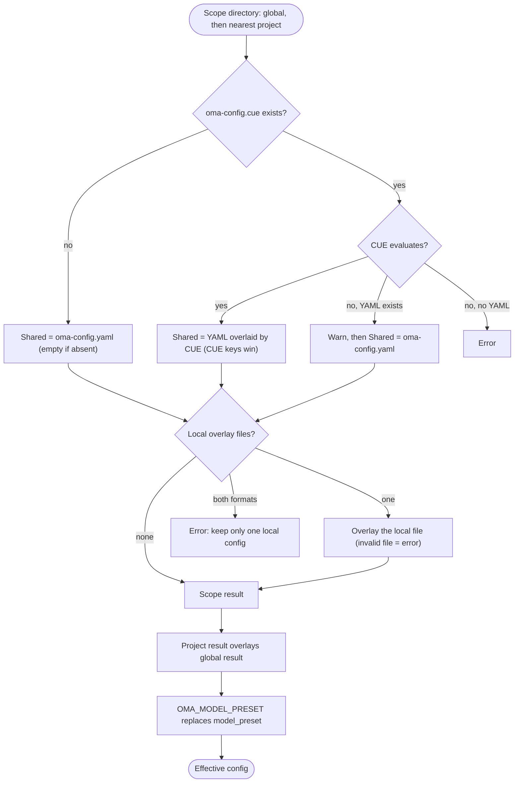

## Visão geral

O OMA lê os padrões globais de `$OMA_HOME/.agents/` (padrão `~/.oma/.agents/`)
e depois aplica por cima o `.agents/` de projeto mais próximo encontrado acima do diretório de trabalho.
Cada escopo pode ter estas camadas:

- **Compartilhada:** `.agents/oma-config.yaml` e `.agents/oma-config.cue`. Quando os dois existem e o arquivo CUE é avaliado, cada chave definida no arquivo CUE substitui a mesma chave no arquivo YAML; as chaves presentes apenas no arquivo YAML continuam como padrões. Quando o arquivo CUE não pode ser avaliado, o OMA emite um aviso e usa somente o arquivo YAML.
- **Local:** `.agents/oma-config.local.cue` ou `.agents/oma-config.local.yaml` (um arquivo, aplicado sobre o resultado compartilhado; mantenha este arquivo privado).

As configurações compartilhadas e locais do projeto substituem as configurações globais. Raízes de projeto
ancestrais diferentes nunca são mescladas; um `.agents/` mais próximo vazio ainda é um limite
de projeto. Os padrões globais não alteram a identidade do projeto. Consulte a
[Referência de configuração](/docs/guide/configuration-reference) para chaves e padrões suportados.

## Fluxo de resolução

O OMA executa as mesmas etapas para o escopo global e para o escopo de projeto mais próximo e, em seguida, mescla os dois resultados:



Quando nenhum `.agents/` de projeto é encontrado, ou a busca chega ao próprio diretório `.agents/` global, somente o resultado global é usado.

## Tabela de precedência {#precedence-table}

As linhas posteriores prevalecem. Mapas comuns são mesclados recursivamente; arrays, escalares e `null` substituem o valor anterior.

| Ordem | Camada | Regra |
|:-----:|-------|------|
| 1 | `oma-config.yaml` global | Padrões abaixo do arquivo CUE global quando os dois existem. |
| 2 | `oma-config.cue` global | Substitui o YAML global chave por chave. Se a avaliação falhar (por exemplo, a CLI `cue` está ausente) e o YAML existir, o OMA imprime `[config] CUE evaluation failed at ... Falling back to oma-config.yaml` e usa somente o YAML. |
| 3 | `oma-config.local.cue` ou `oma-config.local.yaml` global | Apenas um arquivo. Um arquivo local malformado é um erro. |
| 4 | `oma-config.yaml` do projeto | O `.agents/` de projeto mais próximo no diretório de trabalho ou acima dele. |
| 5 | `oma-config.cue` do projeto | Substitui a linha 4 chave por chave, com o mesmo fallback da linha 2. |
| 6 | `oma-config.local.cue` ou `oma-config.local.yaml` do projeto | Apenas um arquivo. Um arquivo local malformado é um erro. |
| 7 | `OMA_MODEL_PRESET` | Um valor não vazio substitui `model_preset` nesse processo. Um valor vazio é um erro. |

:::tip[Qual arquivo devo editar?]
Se `.agents/oma-config.cue` existir, uma chave definida nele substitui a mesma chave em `oma-config.yaml`. Altere essa chave no arquivo CUE ou coloque um valor específico da máquina em um overlay local. `oma doctor --profile` lista os arquivos que carregou em **Configuration sources**.
:::

Para uma substituição local do projeto, coloque apenas as folhas alteradas no arquivo local. Por exemplo, uma escolha local de modelo pode ficar fora do arquivo compartilhado:

```yaml
# .agents/oma-config.local.yaml
model_preset: claude
agents:
  backend:
    model: anthropic/claude-sonnet-4-6
```

Execute o comando no projeto para que o diretório `.agents/` mais próximo seja selecionado. Um arquivo local malformado falha de modo explícito; corrija-o ou remova-o antes de tentar novamente.

## Verifique sua configuração

```bash
oma doctor --profile                           # loaded files, resolved preset, per-role model and CLI
cue export --out json .agents/oma-config.cue   # what the CUE layer evaluates to (requires the cue CLI)
```

| Sintoma ou mensagem | Causa | Correção |
|--------------------|-------|-----|
| Uma alteração no YAML não tem efeito | `oma-config.cue` define a mesma chave | Altere a chave no arquivo CUE ou substitua-a em um arquivo local |
| `[config] CUE evaluation failed at ... Falling back to oma-config.yaml` | A CLI `cue` está ausente ou o arquivo CUE não é avaliado | Instale o `cue` ou corrija o erro relatado por `cue export` |
| `Both local CUE and YAML configs exist in ...; keep only one local config.` | Dois arquivos de overlay local | Apague um deles |
| `OMA_MODEL_PRESET must be non-empty` | A variável está exportada, mas vazia | `unset OMA_MODEL_PRESET` |
| `Unknown model_preset "..."` | Erro de digitação ou entrada ausente em `custom_presets` | Use um preset citado na mensagem de erro |
| `Legacy preset name "..." is no longer valid` | Uma chave anterior à renomeação, como `claude-only` | Renomeie-a como a mensagem indica ou execute `oma update` |
| `[model-registry] User inline model "..." failed validation` | Uma entrada `models:` incompleta ou inválida | Consulte [Inlining model slugs](/docs/guide/per-agent-models#inlining-model-slugs) |

## Valores padrão

| Chave | Padrão | Quando aplicado |
|-----|---------|--------------|
| `auto_update_cli` | `true` | Os dois arquivos estão ausentes ou a chave não existe |
| `serena.mode` | `bridge` | Os dois arquivos estão ausentes ou a chave não existe |
| `serena.auto_update` | `true` | Os dois arquivos estão ausentes ou a chave não existe |
| `telemetry` | `false` | Os dois arquivos estão ausentes ou a chave não existe |
| `language` | `en` | Os dois arquivos estão ausentes ou a chave não existe |
| `model_preset` | Obrigatório | O template de projeto distribuído usa `auto`; o schema exige um valor não vazio. |
| `translation_voice` | `balanced` | Os dois arquivos estão ausentes ou a chave não existe |
| `timezone` | Fuso horário do sistema | Os dois arquivos estão ausentes ou a chave não existe |

## Justificativa da ordem de leitura

Edite `~/.oma/.agents/oma-config.yaml` (com `OMA_HOME` definido: `<OMA_HOME>/.agents/oma-config.yaml`)
para padrões válidos para todo o usuário. Os arquivos compartilhados/locais do projeto substituem esses padrões
sem herdar projetos ancestrais não relacionados. Uma seleção `none` no projeto
para memória semântica substitui a seleção global do AgentMemory.

## Observações

- `language` em `oma-config.yaml` controla o idioma das respostas do agente. Ele **não** é usado para determinar mensagens de aviso de instalação ou atualização; elas usam o locale do sistema (`$LANG`) porque `oma-config.yaml` ainda não foi carregado no momento da instalação.
- `auto_update_cli` usa as substituições do projeto antes dos padrões globais e fica habilitado por padrão quando nenhum escopo o define.
- `telemetry` (padrão `false`) é mapeado para o opt-out próprio de cada vendor, escrito por `oma install` / `oma update` / `oma link`: Claude usa `DISABLE_TELEMETRY` + `CLAUDE_CODE_DISABLE_FEEDBACK_SURVEY`, Gemini/Qwen usam `privacy.usageStatisticsEnabled`, Codex usa `analytics.enabled` + `feedback.enabled`, Grok usa `[features] telemetry` e Antigravity (agy) usa `enableTelemetry` em `~/.gemini/antigravity-cli/settings.json`. Definir `telemetry: true` ativa novamente a telemetria ao remover o opt-out do oma para esse vendor.
- `diagram` (engine `auto` / `archify` / `mermaid`, `explain_sidecar`, `archify.managed|channel|check_interval_min|path|quality|open`) é uma seção esparsa de substituição de skill, como `video` / `image`; consulte o [Diagram Engine](/docs/guide/diagram-engine).
- `video.hyperframes.check_interval_min` limita a frequência das verificações de versão mais recente para a toolchain HyperFrames por execução e heygen-com/hyperframes (`oma video compose`, `oma update`). O schema CUE distribuído ainda não define `video.hyperframes`, por isso `cue export` o rejeita dentro do bloco do schema (`field not allowed`); defina-o em `oma-config.yaml` ou em um overlay YAML local.
- `market` (`managed|channel|check_interval_min|path|python|save_dir`) configura o engine `last30days`, sempre atualizado, por trás de `oma market`; consulte o [Market Research](/docs/guide/market-research).
- O schema de runtime tipado cobre `providers`, `free`, `agents`, `models`, `custom_presets`, `vendors`, `session`, `docs` e as seções esparsas de skills. Os templates distribuídos também contêm blocos pertencentes ao consumidor, como `scm`, `memory`, `serena_reaper` e `mcp`; os consumidores são responsáveis pelas chaves aninhadas. Não deduza uma chave a partir desta lista; use a [Referência de configuração](/docs/guide/configuration-reference) e o guia da feature desse bloco.
- Editar `oma-config.yaml` diretamente é seguro. `oma install` e `oma update` usam substituição de campos no nível de regex e preservam chaves editadas pelo usuário que não gerenciam (por exemplo, substituições personalizadas em `agents:` e `session.quota_cap`).
- `oma update` também acrescenta chaves de nível superior que o template distribuído define, mas que faltam no seu arquivo (com os padrões do template), sob um marcador `# Added by oma update`. Chaves que você já tem nunca são modificadas: o conteúdo existente permanece byte a byte idêntico. Chaves que você apagou deliberadamente reaparecem com o padrão do template; defina o valor explicitamente em vez de apagar a chave para optar por não usá-la.
