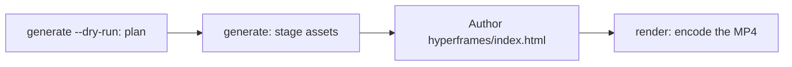

# Geração de vídeo

`oma-video` é o roteador de vídeo do oh-my-agent. A partir de um briefing de uma linha, ele compõe roteiro, narração, visuais e legendas e depois registra o plano em um diretório de execução. As etapas de providers têm chaves opcionais e podem usar fallbacks locais ou determinísticos; um MP4 real ainda exige um compositor funcional e uma composição válida.

A skill é ativada por "shorts", "reels", "screencast" ou por frases como "make a video", "explainer video", "demo video", "walkthrough video" ou "video from README", ou quando outra skill precisa de vídeo como efeito colateral.

> **TL;DR** `oma video generate` planeja uma execução e prepara os ativos. Com o compositor HyperFrames padrão, ele não codifica um MP4: escreva `<runDir>/hyperframes/index.html` (o workflow `/video` faz isso por você) e depois execute `oma video render <runDir>`. Na primeira execução, comece com `oma video doctor --install`.

---

## Quando usar

- Transformar um briefing, README, código ou dados em um clipe curto.
- Produzir um explainer narrado ou uma gravação de demo/walkthrough.
- Qualquer pipeline reproduzível de "briefing → `.mp4`" que você queira executar novamente de forma determinística.

## Quando NÃO usar

- Imagens estáticas individuais → use [`oma-image`](/docs/guide/image-generation).
- Transmissão de tela ao vivo / streaming → fora do escopo (o oma nunca grava a tela; você fornece a gravação).
- Áudio de narração independente → use `oma-voice`.

---

## Modos em resumo

| Modo | Proporção | O que compõe |
|------|--------|------------------|
| `shorts` | 9:16 | Clipe vertical curto (roteiro → narração → visuais → legendas). |
| `explainer` | 16:9 | Explainer horizontal a partir de um README, código ou briefing de dados. |
| `demo` | derivada | Walkthrough criado a partir da sua própria gravação de tela, fornecida com `--capture <file>`. `--source web --url <url>` apenas armazena a URL mascarada como contexto; o oma nunca abre um navegador, grava a tela ou automatiza o login. |

O modo escolhe padrões sensatos; passe as flags relevantes quando precisar de valores diferentes.

---

## Início rápido

Em um agente, `/video three quick tips for better focus` executa todas as etapas abaixo por você. À mão, o pipeline tem quatro etapas:



```bash
oma video doctor --install   # first run only: HyperFrames toolchain, Chrome Headless Shell, Pretendard

# 1. Plan from an agent-authored script (schema: .agents/skills/oma-video/resources/script-schema.md)
oma video generate "three quick tips for better focus" --mode shorts --script ./script.json --dry-run --output json

# 2. Stage assets (narration needs --voice <profile>; the default is a silent video)
oma video generate "three quick tips for better focus" --mode shorts --script ./script.json --output json

# 3. Author <runDir>/hyperframes/index.html per its AUTHORING.md, then encode
oma video compose <runDir>
oma video render <runDir> --output json

# Demo from your own recording; without --polish the recording itself becomes the output
oma video generate "product walkthrough" --mode demo --capture ./capture.mp4
```

<!-- oma-docs:ignore-start -->

| Etapa | Comando | Resultado |
|---|---|---|
| Planejar | `generate --dry-run` | `script.json`, `render-spec.json`, `manifest.json`; sem renderização |
| Preparar ativos | `generate` | visuais, legendas, áudio e música opcionais, um scaffold `hyperframes/` e o aviso `composition pending` |
| Escrever | editar `hyperframes/index.html` | a composição |
| Renderizar | `render <runDir>` | `{mode}-{slug}.mp4` e um manifesto atualizado |

<!-- oma-docs:ignore-end -->

Sem `--script`, a CLI cria um esqueleto determinístico de três cenas a partir do texto do briefing. `--locale` define a tag de idioma da narração e das legendas, mas não as traduz; escreva o briefing ou o `script.json` no idioma de destino.

Cada execução imprime seu diretório. Um `--seed` fixo estabiliza as entradas de planejamento determinísticas; a saída de providers live e a gravação capturada ainda podem variar. Renderize novamente um diretório de execução existente quando quiser reutilizar a especificação de renderização e os ativos salvos.

Outras ferramentas que chamam `oma video generate --output json` analisam um envelope JSON no stdout: `{exitCode, runDir, manifestPath, scriptPath, renderSpecPath, warnings, error}`. Não existe uma chave `outputs`; leia os caminhos de saída/ativos a partir do manifesto em `manifestPath`.

---

## HyperFrames sempre atualizado — você escreve a composição

O oh-my-agent não distribui **nenhum código de composição HyperFrames**. Cada execução recebe seu próprio projeto em `<runDir>/hyperframes/`, criado por `oma video compose` na versão mais recente do HyperFrames do npm (cache da toolchain em `~/.cache/oma-video/hyperframes/<version>/`, compartilhado por um symlink `node_modules`), com [heygen-com/hyperframes](https://github.com/heygen-com/hyperframes) em HEAD (`~/.cache/oma-video/hyperframes-skills/`). O agente escreve o código-fonte da composição gerada seguindo o `AUTHORING.md` do scaffold, as skills e a especificação do modo em `.agents/skills/oma-video/resources/hyperframes-authoring/`.

```bash
oma video generate "…"                     # → render-spec.json + <runDir>/hyperframes/ (composition pending)
oma video compose <runDir> --output json   # refresh scaffold / print the contract (idempotent)
#   author hyperframes/index.html as instructed by AUTHORING.md
oma video render <runDir> --output json    # lint → render with the cached HyperFrames CLI → ffprobe; exit 1 on any failure
```

- As verificações da versão mais recente (npm + GitHub) são limitadas por `video.hyperframes.check_interval_min` (padrão 60; `0` = a cada compose). `oma update` respeita o intervalo; `oma video doctor --upgrade` força uma verificação; execuções offline usam a toolchain em cache e informam `stale`.
- A reprodutibilidade mora no diretório de execução: `render-spec.json`, o código da composição escrito e a versão da toolchain registrada nos metadados do pacote HyperFrames gerado. Renderizar novamente a mesma execução reutiliza esse contrato; uma nova execução verifica o HyperFrames mais recente.
- Uma falha de lint ou renderização **não** é escondida atrás de um placeholder (isso existe somente para `OMA_VIDEO_MOCK=1`): `oma video render` sai com código 1 e os diagnósticos, e o agente corrige a composição usando as skills mais recentes. Uma quebra em uma nova release do HyperFrames é um bug de composição, nunca motivo para fixar a versão.

```yaml
video:
  hyperframes:
    check_interval_min: 60    # 0 = check on every compose
```

---

## Referência da CLI

```bash
oma video generate <brief...> [options]
oma video doctor [--install|--upgrade|--install-mpt|--install-strudel]  # toolchain readiness / provisioning
oma video compose <runDir>       # prepare HTML project and authoring contract
oma video render <runDir>        # re-render from render-spec.json (deterministic)
oma video provider list         # provider availability + key/fallback status
```

### Flags principais

| Flag | Finalidade |
|------|---------|
| `--mode <m>` | `shorts` \| `explainer` \| `demo`. |
| `--aspect <a>` | `9:16` \| `16:9` \| `1:1` \| `auto`. |
| `--locale <lang>` | Tag de idioma da narração/legenda. |
| `--captions <s>` | `tiktok` \| `lower-third` \| `none` (alinhamento sem chave). |
| `--visual <m>` | `auto` \| `generate` \| `stock` \| `aigc` \| `slide`. |
| `--voice <profile>` | Voz de narração ou `none` (o padrão; omita e o vídeo renderiza em silêncio com tempo estimado de legendas). |
| `--music <mode>` | `upbeat`, `calm`, `cinematic`, `lofi`, `piano` ou `none`. |
| `--compositor <c>` | `hyperframes` (padrão) \| `mpt`. |
| `--capture <path>` | Sua gravação para o modo demo: `.mp4`, `.mov`, `.webm` ou `.mkv`, armazenada dentro do projeto. |
| `--source <k>` | Fonte da captura demo: `file` ou `web` (padrão: `file`). |
| `--url <url>` | URL de contexto para `--source web`, armazenada mascarada em `manifest.json`. Obrigatória com `--source web`; nunca inicia uma captura e não substitui `--capture`. |
| `--polish` | Sobrepõe a composição HyperFrames à gravação capturada. |
| `--device`, `--ready-selector`, `--show-cursor`, `--capture-timeout`, `--capture-stop` | Aceitas, mas não usadas: o oma não controla um navegador nem grava a tela. |
| `--output-dir <path>` | Diretório-base de saída. Caminhos fora de `$PWD` exigem `--allow-external-output`. |
| `--allow-external-output` | Permite caminhos de saída fora de `$PWD`. |
| `--max-usd <n>` | Teto de custo (padrão `0.2`). Quando a estimativa acumulada o atinge, a execução para com código de saída 1; execute novamente com `-y` ou um valor maior. |
| `--duration <sec>` | Duração-alvo em segundos (1–180) ou `auto`. |
| `--seed <n>` | Seed determinística. |
| `--dry-run` | Emite roteiro / render-spec / manifesto e ignora a renderização. |
| `--script <path>` | `script.json` criado pelo agente para injetar (substitui o esqueleto; controla narração, texto na tela e prompts visuais por cena). |
| `-y, --yes` | Permite providers cuja estimativa atinja `--max-usd` (o mesmo que `OMA_VIDEO_YES=1`). |
| `--timeout <sec>` | Limite de tempo, em segundos inteiros, de cada chamada a um provider visual ou de música (padrão `600`). Sufixos de unidade não são interpretados: `2m` significa 2 segundos. |
| `--output <f>` | Saída da CLI: `text` (padrão) ou `json`. |
| `--no-brief-in-manifest` | Armazena um SHA-256 do briefing em vez do briefing bruto. |

---

## Providers com chaves opcionais

As etapas de providers resolvem para um **ramo real** e, quando a etapa oferece suporte, para um **fallback determinístico**. Assim, chaves ausentes podem deixar uma execução planejada com tempo estimado ou ativos locais. O compositor é a etapa final obrigatória e não tem um fallback placeholder normal:

| Capacidade | Ramo real (o que o habilita) | Fallback |
|------------|-------------|----------|
| script | `script.json` criado pelo agente e passado com `--script <path>` (o workflow `/video` o escreve) | esqueleto determinístico de três cenas a partir do texto do briefing |
| voice | `oma-voice` (Voicebox ou VoiceStudio, local; escolhido por `voice.backend`) com `--voice <profile>` | vídeo silencioso com tempo estimado (`--voice none`, o padrão) |
| visual | `oma-image`, `oma-slide`, clipes de stock do Pexels quando `PEXELS_API_KEY` está definida | ativo placeholder |
| visual: `aigc` | ainda não conectado; `RUNNINGHUB_API_KEY` habilita o provider, que ainda grava placeholders | ativo placeholder |
| caption | `.srt` e `.vtt` alinhados a `timing.json`, no idioma do roteiro | o mesmo; a tradução para `--locale` ainda não está conectada |
| music | trilha Strudel depois de `oma video doctor --install-strudel` | sem faixa de música |
| capture | uma gravação que você fornece com `--capture <file>` | nenhum: sem `--capture`, o modo demo imprime instruções de gravação e sai com código 3 |
| compositor | HyperFrames (gerenciado) ou MoneyPrinterTurbo | sem fallback de compositor; a execução falha com diagnósticos |

Não há automação de credenciais: você faz qualquer login na tela durante a gravação; URLs e tokens de consulta são mascarados nos logs e no manifesto.

As legendas são renderizadas como **cues estáticos em janelas**: uma única linha de legenda ativa no frame atual, quebrada por CSS, sem animação por palavra.

---

## Toolchain e `doctor`

A toolchain pesada (o `node_modules` do projeto HyperFrames gerenciado, a fonte Pretendard incorporada, o checkout do MoneyPrinterTurbo, o projeto de música Strudel e o Chrome Headless Shell) é **provisionada sob demanda**, nunca enviada no pacote. O `doctor` simples apenas informa o estado: nunca instala nada:

```bash
oma video doctor
```

Ele informa `node`, `chromium`, `ffmpeg`, `ffprobe`, `hyperframes-toolchain`, `hyperframes-skills`, `pretendard-font`, `mpt-project`, `strudel`, `voicebox`, `voicestudio`, `oma-image`, `pixelle` e `cap` e imprime a dica de instalação para tudo que estiver faltando. Execute `oma video doctor --output json` para obter a lista oficial. A base exige Node.js 22+, a toolchain do HyperFrames e seu navegador Chrome, FFmpeg/FFprobe e `oma-image`. Um MP4 real também exige HTML escrito.

Use as flags de instalação para provisionar a toolchain:

```bash
oma video doctor --install             # warm the latest HyperFrames toolchain + Chrome Headless Shell + Pretendard + heygen-com/hyperframes
oma video doctor --upgrade             # force a latest-version check now
oma video doctor --install-mpt         # MoneyPrinterTurbo checkout (clone + venv + deps) for --compositor mpt
oma video doctor --install-strudel     # Strudel music renderer for --music (installs AGPL-3.0-or-later packages locally)
```

`--install` também busca a fonte Pretendard incorporada (release fixada) para o cache compartilhado da toolchain; isso faz parte do limite de determinismo. Em uma falha de rede, ele avisa e o renderizador recorre às fontes do sistema; diferenças de navegador e de SO ainda podem afetar a saída codificada.

---

## Layout de saída

```text
.agents/results/videos/{timestamp}-{shortid}-{mode}/
├── script.json          # scenes + narration
├── render-spec.json     # the deterministic render contract
├── timing.json          # per-segment timing (voicebox-stt, voicestudio-stt, or estimated)
├── captions.srt / .vtt
├── audio/narration-01.wav     # one track; absent when the video is silent
├── music/                     # pattern.strudel, bgm.wav, bgm.mp3 (with --music and Strudel installed)
├── visuals/scene-*.{png,svg,…}
├── hyperframes/         # index.html, AUTHORING.md, local assets and toolchain link
├── {mode}-{slug}.mp4    # the rendered output (slug derived from the script title)
└── manifest.json        # providers, assets, cost, warnings
```

O `render-spec.json` com os ativos é o limite de determinismo.

---

## Solução de problemas

<!-- oma-docs:ignore-start -->

| Sintoma | Causa / correção |
|---------|-------------|
| Nenhum MP4 é produzido | Falhou uma verificação de compositor, composição ou toolchain. Execute `oma video doctor`, depois `oma video compose <runDir>` e corrija a composição informada antes de executar novamente `oma video render <runDir>`. |
| A narração está silenciosa (`source: estimated`) | `--voice` tem `none` como padrão, ou nenhum backend de voz está acessível. Passe `--voice <profile>` com um perfil do backend selecionado (app Voicebox, ou um ID de perfil do VoiceStudio com `voice.backend: voicestudio` ou `auto`) e inicie esse app, ou aceite o tempo estimado. |
| A execução demo sai com código 3 e instruções de gravação | Nenhum arquivo `--capture` foi informado (também com `--source web`); o oma não grava a tela. Grave o fluxo com Cap, QuickTime ou OBS, salve-o dentro do projeto e execute novamente com `--capture ./walkthrough.mp4`. |
| `--capture` rejeitado (código 4) | O arquivo não existe, está fora do diretório do projeto ou não é `.mp4` / `.mov` / `.webm` / `.mkv`. Copie a gravação para dentro do projeto, por exemplo `./captures/demo.mp4`. |
| A execução para no teto de custo (código 1) | A estimativa acumulada atingiu `--max-usd`. Execute novamente com `-y` ou um `--max-usd` maior. |
| `--out path "…" is outside $PWD. Use --allow-external-out to override.` (código 1) | `--output-dir` aponta para fora do projeto. Execute novamente com `--allow-external-output` (a mensagem ainda mostra o nome antigo da flag) ou escolha um diretório dentro do projeto. |
| `oma video doctor` lista `oma-image` como ausente | Se o detalhe mostrar `Removed option --format. Use --output.`, a própria sondagem de prontidão falhou e não diz nada sobre seus vendors; verifique-os diretamente com `oma image doctor`. Caso contrário, nenhum vendor de imagem está pronto, então os visuais recorrem a placeholders: execute `oma image doctor` e configure um vendor. |
| A primeira renderização é lenta | O navegador HyperFrames / checkout MPT está sendo provisionado uma vez; execuções posteriores reutilizam o cache. |

<!-- oma-docs:ignore-end -->

---

## Próximos passos

- [Workflow `/video`](../core-concepts/workflows.md#video) — o pipeline briefing → roteiro → ativos → render-spec → HyperFrames.
- [Geração de imagem](./image-generation.md) — o roteador de imagens estáticas reutilizado como provider visual de vídeo.
- [Workflows de conteúdo e pesquisa](./content-and-research.md) — voz, slides e outras capacidades de conteúdo.
- [Comandos da CLI: video](../cli-interfaces/commands.md#video) — lista completa de opções de `oma video`.
